# Trim · Hidrocarburos

Front-end del producto que **baja los barriles diferidos de los equipos de alto impacto**
de un campo de crudo: las bombas de reinyección de agua y las electrosumergibles.

> **¿Va a construir el backend?** Empiece por [`docs/backend/`](docs/backend/README.md): el documento técnico completo. Trae cada cifra de la aplicación con su fórmula, su ejemplo calculado y el texto que se muestra según su valor, y todas las pantallas anotadas. También la cadena de datos, la API, el modelo de datos en PostgreSQL ([`sql/esquema.sql`](docs/backend/sql/esquema.sql), validado con filas reales del demo) y el libro de Excel de las tablas y sus relaciones ([`modelo-de-datos.xlsx`](docs/backend/modelo-de-datos.xlsx)). El contrato endpoint por endpoint sigue en [`CONTRATO.md`](CONTRATO.md).

## Cómo se ve

Doce pantallas con los datos del demo: los cinco campos y la operadora son de demostración, y
cada pantalla lo dice arriba («Datos de demostración»). Cada rol ve solo las suyas (ver «Cada rol
ve lo que su decisión exige»). Un clic en una imagen la abre en grande. Se regeneran desde la
aplicación con `npm run pantallazos`.

| | |
|---|---|
| [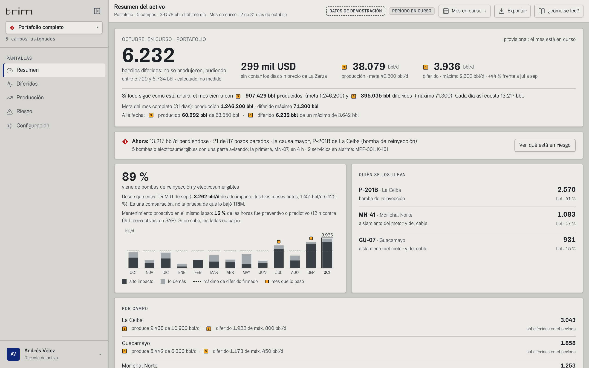](docs/pantallas/resumen-gerente.png)<br>**Resumen del activo · gerente.** Los barriles diferidos del mes con su rango («calculado»; el porqué, en el ⓘ), su valor en USD, el promedio diario y el cierre proyectado como barras contra la meta firmada, y qué equipos se llevan más. | [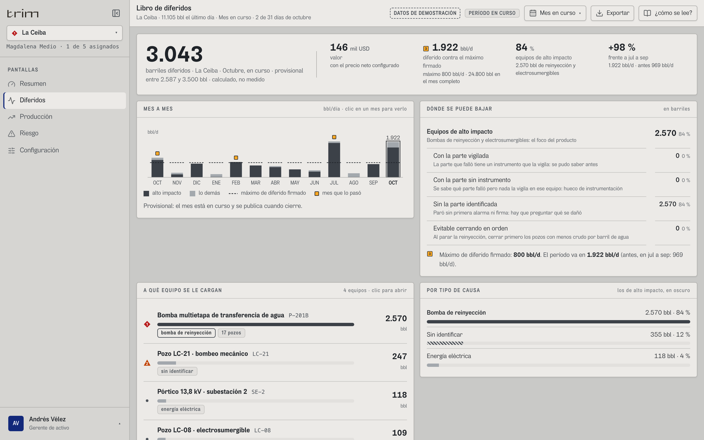](docs/pantallas/diferidos.png)<br>**Libro de diferidos.** Cuántos barriles se perdieron, por equipo y por tipo de causa, mes a mes contra el máximo firmado. «Dónde bajarlo» separa la parte vigilada, la que no tiene instrumento y la que nadie identificó. |
| [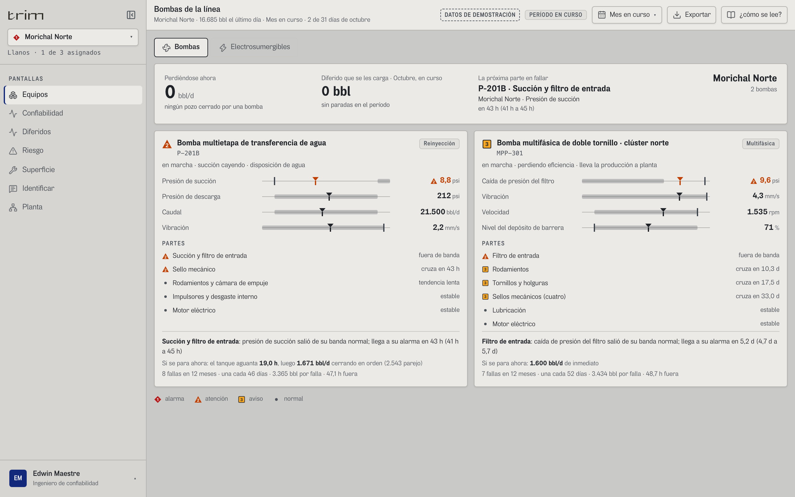](docs/pantallas/bombas-vigia.png)<br>**Bombas · confiabilidad.** Una placa por bomba: cada variable contra su banda normal y su alarma, y cada parte (succión, sello, rodamientos…) con su estado y cuándo cruzaría su límite («cruza en 43 h»). | [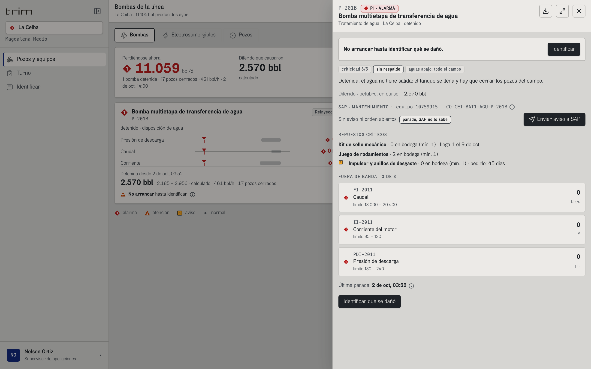](docs/pantallas/ficha-bomba-parada.png)<br>**Ficha de una bomba parada.** P-201B se detuvo sin primera alarma: «no arrancar hasta identificar qué se dañó». Trae el respaldo (no hay), los repuestos críticos en SAP, el botón para enviar el aviso a SAP y las señales fuera de banda. |
| [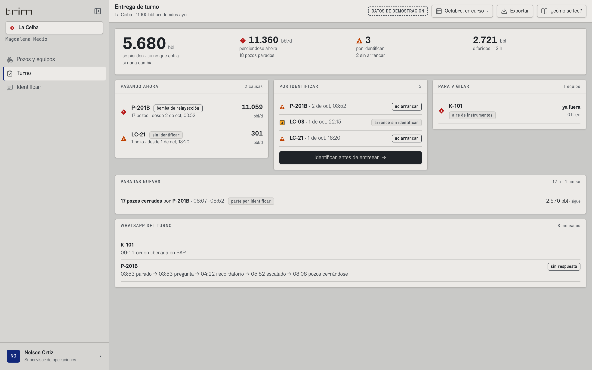](docs/pantallas/turno.png)<br>**Entrega de turno · supervisor.** Lo que se está perdiendo ahora, lo que hay que identificar antes de entregar, lo que hay que vigilar y lo que TRIM mandó por WhatsApp en el turno: aviso, pregunta, recordatorio y escalamiento. | <a href="docs/pantallas/whatsapp-operario.png">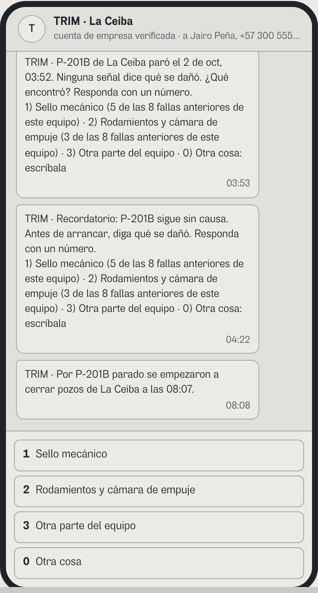</a><br>**WhatsApp del operario.** TRIM pregunta qué se dañó y ofrece las partes que más han fallado en ese equipo; el operario responde con un número. En este front es visual: el envío real lo hace el backend. |
| [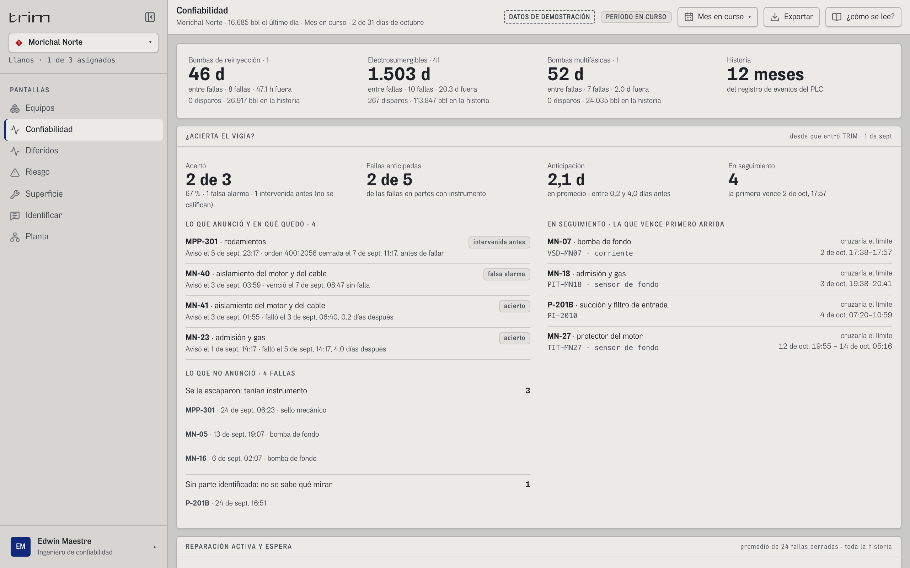](docs/pantallas/confiabilidad.png)<br>**Confiabilidad · ¿acierta el vigía?.** Tiempo entre fallas por familia de equipo; lo que el vigía anunció y en qué quedó (acierto, falsa alarma, intervenida antes); lo que no anunció, y lo que sigue en seguimiento. | [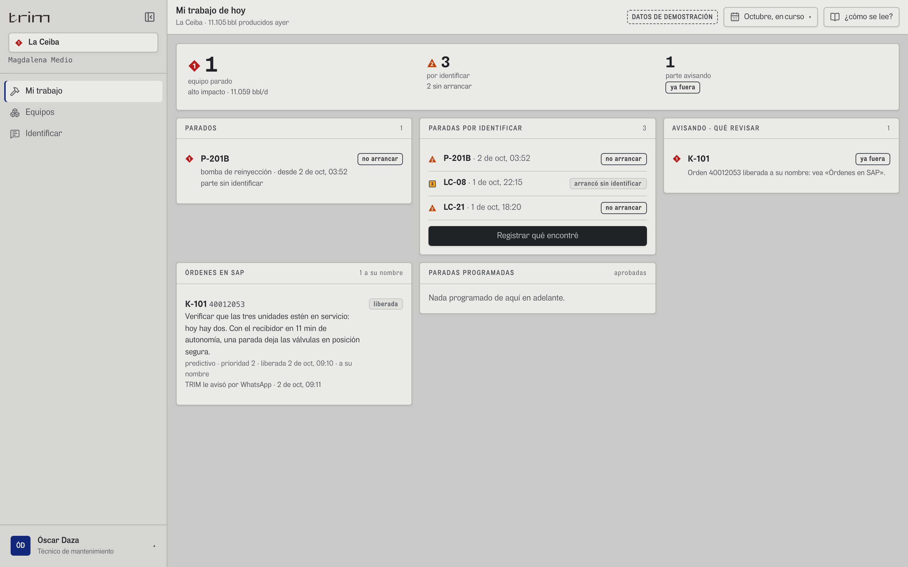](docs/pantallas/ordenes-sap-tecnico.png)<br>**Mi trabajo · técnico.** Lo parado, lo que falta identificar y las órdenes de SAP a su nombre. TRIM no crea órdenes: manda el aviso con su evidencia, las lee y avisa por WhatsApp cuando se liberan. |
| [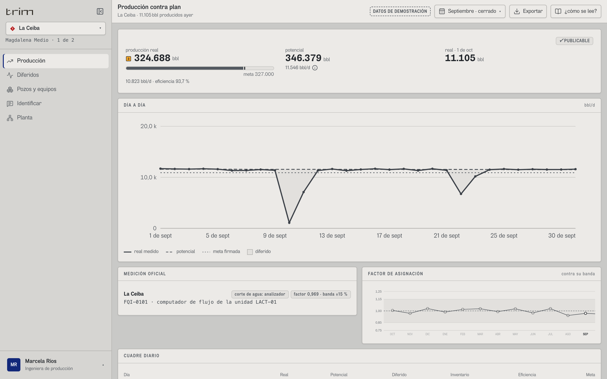](docs/pantallas/produccion-cuadre.png)<br>**Producción contra plan.** Lo real (punto de medición oficial) contra el potencial y la meta firmada, día a día; el factor de asignación contra su banda, y el cuadre: real + diferido + inventario = potencial. | [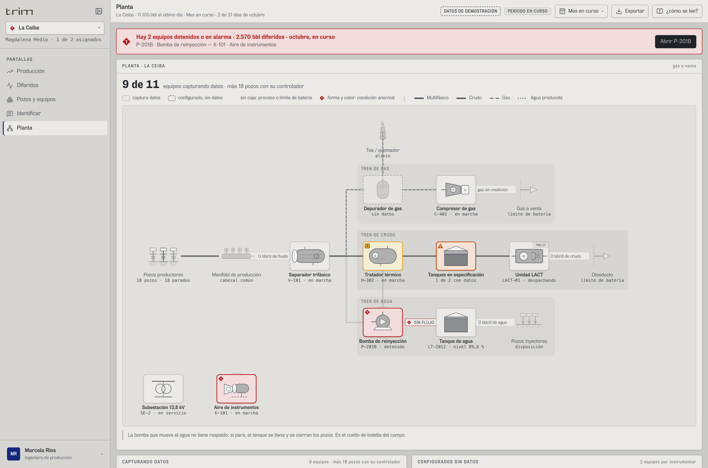](docs/pantallas/planta.png)<br>**Planta.** El esquema del campo. Lleno: el equipo captura datos; punteado: configurado, sin datos. Lo anormal lleva forma y color (ISA-101): aquí P-201B detenida deja la reinyección «sin flujo». |
| [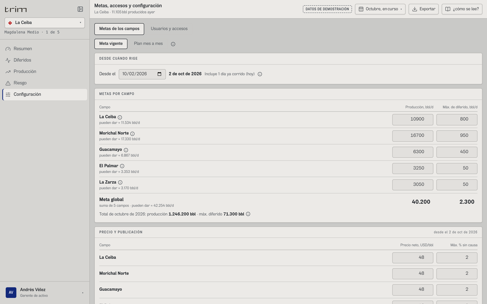](docs/pantallas/metas-firmadas.png)<br>**Metas firmadas · gerente.** Meta de producción y máximo de diferido por campo, desde una fecha; la meta global es la suma. Cada cambio se firma con motivo y queda en el historial. | [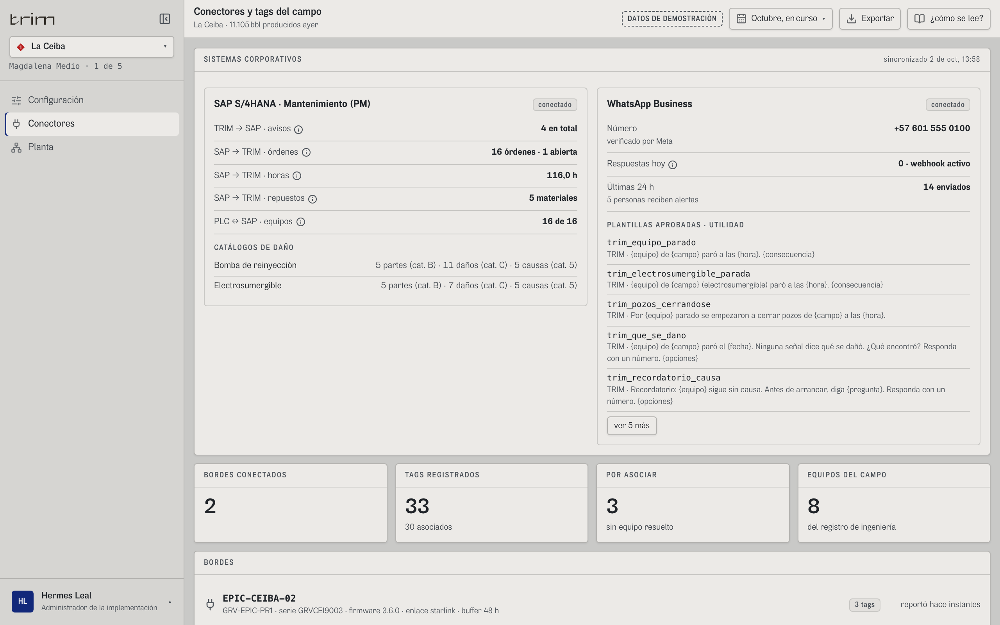](docs/pantallas/conectores.png)<br>**Conectores · administrador.** SAP PM (avisos, órdenes, horas, repuestos y catálogos de daño) y WhatsApp Business (plantillas aprobadas). Se muestran conectados; en este front son visuales. |

## Una sola promesa

> **Decir cuántos barriles se perdieron por cada equipo de alto impacto y por qué parte,
> probarlo con la cadena de custodia, y avisar antes de que vuelva a pasar.**

Lo que no sostiene esa frase no entra al primer producto. El alcance está en
[`src/shared/config/producto.ts`](src/shared/config/producto.ts): una bandera, dos listas, nada borrado.

| En el MVP | En v2 |
|---|---|
| Resumen y portafolio · Diferidos · Producción · Pozos · **Electrosumergibles** · **Bombas** · **Identificar** · Turno · Riesgo · Mantenimiento · Confiabilidad · Superficie · Mi trabajo · Planta · Configuración · Conectores | Agua · Evidencia · Regulatorio |
| Gerente · Producción · Supervisor · Operador · Jefe de mantenimiento · Confiabilidad · Técnico · Administrador | Planeación · Contratos · Cumplimiento |

### El foco: los equipos que, cuando fallan, cierran pozos

Con cortes de agua de 92 % a 98 %, por cada barril de crudo hay que mover de 12 a 40 de agua
(Ecopetrol). Si la **bomba de reinyección** se para y el respaldo no alcanza, el tanque se
llena y hay que cerrar pozos. Si una **electrosumergible** falla, su pozo para semanas hasta
que se cambia. Por eso el producto sigue, de cada uno, la parte que se daña: sello,
rodamientos, succión, hidráulica; aislamiento, bomba de fondo, admisión, protector.

| Nivel ISA-101 | Pantalla | Quién |
|---|---|---|
| 1 · vista del área | Resumen y portafolio, con la franja «ahora» | Gerente |
| 2 · control de la unidad | Bombas (una placa por bomba) y la flota de electrosumergibles | Supervisor, operador, confiabilidad |
| 3 · detalle | Variables de la plantilla API 676 / API 610 y del variador, salud por parte, «si se para ahora» con el orden de cierre | Confiabilidad, mantenimiento, operación |
| 4 · diagnóstico | Vigía con su proyección, y cada parada con su evidencia y su tolerancia | Confiabilidad, producción |

## Cadena de custodia: a mano entran dos cosas

Todo lo que se muestra sale de un equipo: el **estado de cada pozo** de su controlador, el
**caudal** de su prueba (separador automatizado o estimado desde la electrosumergible), lo
**real** del computador de flujo del punto de medición oficial, la **parada de la bomba** y su
**primera alarma** del PLC, el **nivel del tanque** de su transmisor. A mano entran solo:

1. **La configuración** (`pages/Configuracion.tsx`), en borrador y con firma y motivo; cada
   firma es una versión:
   - **Metas, del gerente de activo** (`metas:firmar`): por campo, la meta de producción y el
     máximo de diferido en **bbl/d**, por tramos con fecha de inicio (`TramoMeta`). Van en
     barriles porque se suman: la **meta global es la suma** y nunca se escribe aparte. Cada
     período se mide día por día contra el tramo que regía (`metaEntre`); el mes en curso
     muestra lo que va a la fecha y el total del mes. Una meta no se reescribe hacia atrás de
     un mes cerrado. En el mismo tramo, con la misma fecha, van el precio neto y el máximo
     sin causa para publicar: el valor se calcula día por día con el precio de ese día, así
     cambiar el precio hoy no reescribe un mes cerrado ni la huella de sus informes.
   - **Técnica, del administrador** (`config:firmar`): el **perfil del campo** (gas sí o no y
     a dónde va; si tiene bombas de la línea y electrosumergibles), tanques de agua, respaldo de
     cada bomba, programa de paradas y empresa del membrete. El perfil decide qué se dibuja en
     Planta y qué subpantallas aparecen.
   - **Plan mes a mes**: el presupuesto de la empresa, pegado desde Excel o en CSV
     (`entities/plan.ts`), queda como un tramo por mes desde su día 1.
   - **Accesos, del gerente** (`usuarios:administrar`, `entities/usuarios.ts`): invita, cambia
     rol o campos y suspende; nadie se borra y cada cambio queda con su motivo. Siempre queda
     al menos un gerente con acceso.
2. **La respuesta del operario** (`pages/Causa.tsx`, «Identificar», o por WhatsApp en el hilo
   de la parada) cuando ninguna señal explica una parada. Queda marcada como declarada, con el
   canal por el que llegó; la primera respuesta gana. Regla de operación: el equipo no se
   arranca hasta que se identifique el daño; TRIM no escribe en el PLC y, si arranca antes,
   registra la no conformidad.

La asignación oficial que se sube en Producción no entra al libro: es un cotejo.

## El carril caliente: WhatsApp y SAP

- **WhatsApp** (`entities/mensajes.ts`): TRIM avisa a quien tiene que actuar con reglas fijas
  del producto. Parada de alto impacto, al supervisor y al operador. «¿Qué se dañó?», al
  operador, con hasta tres causas sugeridas y su porqué; recordatorio a los 30 min y al
  supervisor a las 2 h. Cuando el vigía anticipa la falla de una parte, a confiabilidad y al
  jefe de mantenimiento, con la ventana en que la espera. Orden liberada en SAP, al técnico. Cada
  mensaje dice solo lo que se sabía a su hora. Turno muestra lo enviado; en Identificar se abre
  el chat de quien recibió la pregunta, como lo ve en su teléfono, y desde ahí se responde en
  dos toques: la parte y lo que vio.
- **Catálogo de daños** (`entities/catalogo.ts`): por clase de equipo, parte → modo de falla →
  mecanismo → causa raíz (ISO 14224 B.6, B.2, B.3), con su lugar en los catálogos de SAP PM.
  Quien abrió el equipo dice parte y modo; confiabilidad completa mecanismo y causa raíz. Un
  pozo con electrosumergible se responde con las partes de ella.
- **SAP PM** (`entities/sap.ts`, `widgets/sap/`): TRIM **no crea órdenes**. Manda el aviso con
  su evidencia (M1 si el equipo marcha y una parte avisa, M2 si paró) y lee de vuelta órdenes,
  estados, horas confirmadas y repuestos. Con eso arma las horas proactivas contra
  correctivas y los tres relojes de ISO 14224. **En el demo, la historia de SAP se deriva del
  PLC con una regla fija** (una correctiva por falla cerrada, una preventiva por parada del
  programa, una predictiva abierta) y así se dice; en producción la devuelve SAP.
- **Historial de aciertos** (`entities/aciertos.ts`): cada predicción se califica al vencer su
  ventana (acierto, intervenida, falsa alarma); se muestran la tasa, las fallas anticipadas, la
  anticipación y lo que se le escapó. En el demo, el registro desde la puesta en marcha se arma
  con una regla fija sobre la historia del PLC, coherente con ella y con SAP.
- **Demostración**: una sola marca en la cabecera («Datos de demostración»; «Demo» en el teléfono)
  y en el membrete de cada hoja impresa; las pantallas se ven como el producto conectado.

## Cómo se calcula el diferido

Es **asignación de producción**: el factor de cada mes (fiscal ÷ lo que dicen las pruebas
por las horas que produjo cada pozo) tiene que caer en la banda de la Res. 40236; el
potencial es pruebas × factor; el diferido de cada evento del controlador es crudo de la
prueba × factor × horas apagado. En un mes entero, la suma de los eventos da exacto
potencial − real. Cada barril lleva su causa, deducida de las señales en un orden fijo
(`entities/causa-senal.ts`): servicio caído, bomba de la línea parada, programa, código del
controlador, declarado, sin identificar. Las fórmulas completas, para que el backend dé el
mismo número, están en [`CONTRATO.md`](CONTRATO.md).

Hace falta **Node 22.13 o más** (`.nvmrc`: 22). El simulador usa `node:sqlite`, que antes de
22.13 no existe sin bandera; `engines` en `package.json` y `engine-strict` en `.npmrc` hacen
que `npm ci` lo diga de entrada en vez de fallar al arrancar.

```bash
npm ci                              # instala exactamente las versiones del lock
npm run dev                         # front + API en http://localhost:5173
npm run build                       # tsc -b + vite build (con la Content-Security-Policy)
npm run verificar                   # tsc -b + oxlint src + verificar:libro + verificar:contrato; sale con 1 si algo falla
npm run verificar:libro             # solo las comprobaciones de scripts/verificar-libro.mjs
npm run verificar:contrato          # cada endpoint de src/shared/api/contrato.ts sobrevive al paso por JSON, y la fuente http de punta a punta
npm test                            # verificar + referencia comprobar
npm run e2e:instalar                # una vez: Chrome, Safari (WebKit) y Firefox de Playwright
npm run e2e                         # las pruebas de navegador de e2e/ (flujos, auditor y demo construido) en los tres motores
npm run pantallazos                 # regenera las imágenes de docs/pantallas/ que muestra este README
npm run referencia                  # regenera referencia/ (insumos en JSON y salidas esperadas de los endpoints calculados)
node scripts/referencia.mjs comparar --base-url=http://servidor:8080   # un backend contra referencia/
node scripts/gen-linea.mjs          # regenera los datos de demo (determinista, byte a byte)
npm run simulador                   # simulador solo (y sirve dist/ si existe) en 127.0.0.1:8787
npm run semilla                     # regenera la semilla del registro desde el catálogo y borra la base
npm run demo -- <carpeta>           # arma el demo: dist/ + demo/servidor.mjs, cabeceras.mjs y abrir-demo.command
npm run paquete -- <paquete>        # el paquete de entrega: copia el código a 1-aplicacion (regla de .gitignore), arma 4-demo y lo revisa
npm run paquete:comprobar -- <paquete>   # revisa: copia al día, y que LEEME y OBSOLETO solo nombren lo que la copia tiene
```

**Integración continua** (`.github/workflows/pruebas.yml`): en cada empuje a `main` y en cada
pull request corre, en este orden, `npm ci`, `npm test`, `npm run build`, `npx playwright install
--with-deps chromium webkit firefox` y `npm run e2e`. Si una prueba de navegador falla, el informe
(capturas y trazas) queda como artefacto de la corrida («informe-e2e»). Corre en `ubuntu-latest`;
para un runner propio, `gh variable set RUNNER_LABEL --body <etiqueta>`. `verificar:libro` imprime
al final cuántas comprobaciones pasaron (hoy más de 250): el número crece con cada corrección y no
se escribe a mano en ningún documento.

**Contra un backend** (CONTRATO.md, «Cómo se comprueba un backend»): el backend carga los
insumos de `referencia/insumos/` y `referencia.mjs comparar` le pide por HTTP los casos de
`referencia/`; con `VITE_FUENTE=http` en `.env.local`, `npm run dev`
y `npm run e2e -- --project=dev` (con `TRIM_URL=…` si el front no está en `http://localhost:5173`)
corren el front, sus flujos y el auditor contra ese servidor.

Los datos de demo (`src/entities/datos/`) son de cinco campos ficticios y **no son historia
de un campo real**. Están calibrados con fuentes publicadas: MTBF de 28 a 57 días y MTTR de
3,7 a 101 h de bombas de reinyección (Palo Azul), el sello como 60 % de las fallas de bombas
(ESA, 2025), el reparto de 673 fallas de electrosumergibles (campo Sirte, Libia) y 0,66 fallas
por pozo-año en bombeo mecánico (Texas Tech).

## Qué es del servidor y qué del front

Lo que decide un número o un permiso es del **servidor**: el libro y todo lo que sale de los
insumos (diferido, causas, salud, vigía, electrosumergibles, metrología, SAP, aciertos, mensajes,
el estado de cada equipo, las cifras y la huella de los informes), los datos de catálogo de cada
campo, la sesión y las capacidades. Las reglas de lo que entra a mano (`validarConfig`,
`revisarAcceso`, los umbrales de `entities/reglas.ts`, `aplicarCambioPlanta`, `leerPlan`,
`leerAsignacion`) corren en **los dos** lados: el front avisa antes de mandar y el servidor las
vuelve a correr, y su 422 manda. El **front** solo formatea, dibuja la planta (`planta.armar`),
traduce la cadena del dato a frases (`cadena.ts`), ordena y filtra lo que llegó. La tabla
completa está en [`CONTRATO.md`](CONTRATO.md) («Quién calcula qué»).

En el demo no hay servidor para eso: `src/shared/api/` es la costura. Cada consulta tiene su
endpoint en `contrato.ts`, y cada escritura, en `escrituras.ts`, aplica las reglas del servidor
sobre la sesión del navegador (`sesion.ts`), en el mismo orden en que el servidor las aplica.

## La cadena de datos no vive en el front

Este repositorio es **front**. La cadena de datos la sirve el backend, y lo que hay aquí
es el **contrato** ([`CONTRATO.md`](CONTRATO.md)) más un simulador (`simulador-api/`, Node +
SQLite sin dependencias) para desarrollar y probar sin esperar al servidor real. El simulador
solo se monta en desarrollo; el build no lo incluye.

**Qué cubre cada cosa.** El simulador implementa el **registro de la cadena de datos**
(procedencia, inventario, pendientes, asociar un tag, inscripción y nacimiento del borde);
lo demás (libro, configuración, usuarios, SAP, mensajes, predicciones, informes, asignación)
lo calcula el demo dentro del front, con la misma forma de respuesta que el backend tiene que
dar: cada endpoint, con su ruta y su JSON (fechas ISO con zona, entidades por clave en
`refs`, el error `{ "error": { "codigo", "mensaje" } }`), está en `src/shared/api/contrato.ts`,
y `npm run verificar:contrato` prueba que cada uno vuelve igual por JSON. Para que un backend en cualquier lenguaje compruebe que da
los mismos números, `referencia/` trae **lo que entra**, en `referencia/insumos/` (los insumos de
los cinco campos del demo en JSON, con la forma de cada endpoint de insumo y de arranque: no
hace falta leer `src/entities/datos/`), y **lo que tiene que salir** de los endpoints
calculados (libro, serie mensual y producción día a día; riesgo, aciertos, SAP, salud de
bombas y electrosumergibles, predicción y asignación por pozo). Con esos insumos cargados,
`node scripts/referencia.mjs comparar --base-url=http://servidor:puerto` los pide por HTTP y
compara con tolerancia; `npm test` comprueba que esos archivos bastan (arma los casos con los
insumos leídos de ellos). Las lecturas de las electrosumergibles todavía no tienen endpoint
en el contrato: van aparte y los casos que las leen lo dicen (CONTRATO.md, «Pendiente»). `scripts/verificar-libro.mjs` prueba las mismas identidades llamando
al motor en TypeScript, y además el simulador (peticiones mal formadas, ingesta, semilla).

**Probar el front contra un backend** no pide tocar código: en `.env.local` (ver `.env.example`)
`VITE_FUENTE=http` y `VITE_API_URL=http://servidor:8080/api` (o relativa, `/api`, si el front y
la API van detrás del mismo dominio). Con `npm run dev` y una dirección absoluta, Vite manda
`/api` allá por su proxy y no monta el simulador; un `npm run build` con esas variables pide
directo al backend y no lleva los datos del demo; su Content-Security-Policy ya deja hablar
con ese origen (`connect-src`; con una relativa basta `'self'`), y quien publique el front
tiene que mandar la misma cabecera (`politica(html, { api })` de `demo/cabeceras.mjs`). **Para
producción** falta todavía, en el front, la sesión: arrancar con `GET /api/sesion` en vez del
rol de la dirección y quitar «Cambiar de rol» y las cabeceras del prototipo (CONTRATO.md,
«Pendiente en el front para producción»). Al arrancar se traen el
catálogo y la sesión (`src/shared/api/servidor.ts`); cada pantalla pide lo suyo con la caché
de `src/shared/api/consulta.ts` (muestra «Cargando…» mientras llega y, si falla, el error con
«Reintentar»), y cada escritura es un POST/PATCH de `src/shared/api/escrituras.ts`.

**Al regenerar la semilla** (`npm run semilla`) se borra `simulador-api/datos/trim.db`; si
queda una base de otra semilla u otro esquema, el arranque la detecta por su huella, la
reconstruye y lo dice en la consola. Lo que se asoció a mano en esa base se pierde.

**Un cliente nuevo son filas, no código.** Nada de la cadena se escribe por cliente:

| Pieza | De dónde sale |
|---|---|
| `gateway`, `fuente`, `tag`, `calibracion` | **se descubren**: el borde publica su certificado de nacimiento (`POST /api/ingesta/nacimiento`, forma de NBIRTH/DBIRTH de Sparkplug B) y las filas se crean solas |
| `equipo` (nombre, clase ISO 14224, criticidad) | registro de ingeniería del cliente, declarado una vez |
| `formula` | librería del producto, por clase de equipo y tipo de tag; solo los tags calculados la llevan |
| `tag.equipo_id` | se resuelve solo cuando el borde nombra el dispositivo con el activo; si no, queda `pendiente` y lo asocia una persona |

`v_procedencia` une todo eso. La cadena **no se escribe: se consulta**. Los endpoints y
sus formas están en [`CONTRATO.md`](CONTRATO.md).

La pantalla **Conectores** (rol administrador) es la cara de todo esto: bordes
conectados con su último reporte, inscripción de un borde nuevo, y los tags que llegaron
sin equipo resuelto con una sugerencia por nomenclatura que se acepta de a uno o en
bloque.

El bloque técnico (gateway, transporte, almacenamiento) lo omite **el servidor** salvo
que la petición traiga la capacidad `conector:configurar`. No es un filtro de pantalla.

El front no sabe de protocolos: `entities/cadena.ts` es un traductor que convierte la
respuesta en las cuatro frases que lee quien opera el campo.

## El demo y el despliegue

El servidor del demo vive en el proyecto, en `demo/`, para que se mantenga con el código:
`servidor.mjs` (estático, sin dependencias), `cabeceras.mjs` (las cabeceras de seguridad, una
sola fuente) y `abrir-demo.command` (doble clic en macOS). Para el paquete:

```bash
npm run build
npm run demo -- ~/Downloads/TRIM-hidrocarburos/4-demo
```

`npm run demo` copia `dist/` y esos tres archivos; si la carpeta ya era un demo la vacía antes
(no quedan assets de builds viejos) y si tiene otra cosa no la toca. Se ve en
`http://127.0.0.1:4173` (doble clic en `abrir-demo.command`; para verlo basta cualquier Node
reciente).

**El paquete de entrega** (`~/Downloads/TRIM-hidrocarburos`) tiene cuatro carpetas: `1-aplicacion`
(el código), `2-documentos`, `3-investigacion` y `4-demo`. `4-demo` se arma con los dos comandos
de arriba. `1-aplicacion` es una copia del proyecto **sin** lo que está en `.gitignore` (la base
del simulador, `.respaldos/`, `node_modules`, `dist`, los `.local`):

```bash
rsync -a --delete --exclude node_modules --exclude dist --exclude .respaldos \
  --exclude 'simulador-api/datos/*.db*' --exclude '*.local' --exclude .DS_Store \
  ./ ~/Downloads/TRIM-hidrocarburos/1-aplicacion/
```

Trabajar sobre esa copia pide Node 22.13 o más (`npm ci`). El `LEEME.md` de la raíz del paquete
dice qué hay en cada carpeta. El servidor escucha
**solo en 127.0.0.1** (un portátil en la Wi-Fi de un cliente no expone el demo), sirve solo
`index.html`, `assets/`, `brand/` y `fonts/` (ni su código ni el lanzador), responde 400 a una
ruta con un `%` mal formado en vez de caerse, y manda las cabeceras de seguridad.

**Cabeceras que tiene que mandar el servidor que publique el front en producción** (las
mismas de `demo/cabeceras.mjs`):

| Cabecera | Valor |
|---|---|
| `Content-Security-Policy` | `default-src 'self'; script-src 'self' 'sha256-…'; style-src 'self' 'unsafe-inline'; img-src 'self' data: blob:; font-src 'self'; connect-src 'self'; object-src 'none'; base-uri 'none'; form-action 'self'; frame-ancestors 'none'` |
| `X-Content-Type-Options` | `nosniff` |
| `Referrer-Policy` | `no-referrer` |
| `X-Frame-Options` | `DENY` |
| `Cross-Origin-Opener-Policy` | `same-origin` |

La huella `sha256-…` es la del script en línea de `index.html` (el que evita el destello de
tema) y se calcula del HTML construido: el build la pone en un `<meta>` y `cabeceras.mjs` la
saca del archivo que sirve. `'unsafe-inline'` en estilos es por el pie de página del informe
impreso (`widgets/informe/Membrete.tsx`, un `<style>` con `@page` cuyo texto cambia con el
informe); los scripts no lo tienen. `frame-ancestors` no vale en un `<meta>`: va en la cabecera.
En desarrollo no hay política: Vite inyecta su propio script de recarga.

## Pruebas de navegador

Viven en `e2e/` y corren con [Playwright](https://playwright.dev) (`@playwright/test`, dependencia
de desarrollo). La primera vez hay que bajar su Chromium:

```bash
npm run e2e:instalar                       # npx playwright install chromium
npm run e2e                                # todo: flujos, auditor y demo construido
npx playwright test --project=dev          # solo contra npm run dev (flujos y auditor)
npx playwright test --project=demo         # solo el demo construido
npx playwright test carril                 # un archivo
npx playwright test auditor -g "390 px"    # el auditor en un ancho
npx playwright test metas --headed         # viendo el navegador (o --ui, paso a paso)
npx playwright show-report e2e/.informe    # el informe de la última corrida
```

`playwright.config.ts` levanta lo que haga falta y lo apaga al terminar: `npm run dev` en el
puerto 5173 (si ya está levantado, lo usa) y, para el proyecto «demo», `e2e/servir-demo.mjs`, que
corre `npm run build`, arma el demo con `scripts/armar-demo.mjs` en una carpeta temporal y lo sirve
con su `servidor.mjs` y sus cabeceras en el 4199 (`TRIM_PUERTO_DEMO` para cambiarlo). Con
`TRIM_URL` los flujos y el auditor van contra esa dirección y no se levanta el servidor de
desarrollo. Con `CI=1` no se reutiliza ningún servidor ya levantado. Cada prueba abre un contexto
de navegador nuevo, así que corren a la vez (4 a la vez; 2 en CI) sin pisarse: el estado de la
aplicación vive en la página. Lo que falla deja captura y traza en `e2e/.resultados/`.

Chrome (proyectos «dev» y «demo») corre todo en los cinco anchos. Safari y Firefox de escritorio
(«safari», «firefox») repiten los flujos, la interfaz y el auditor a 1280 px: son los otros dos
motores, con otra medida del texto, otro manejo del foco y otra lectura de la política de seguridad.
Safari de teléfono («iphone», «demo-iphone») corre el auditor y la interfaz a 390 px y el demo
construido: es donde el operario abre el chat de WhatsApp. Firefox no tiene modo teléfono. Un solo
motor: `npx playwright test --project=safari`.

| Archivo | Qué prueba | Comprobaciones |
|---|---|---|
| `metas.spec.ts` | metas firmadas con fecha y motivo, accesos (invitar, suspender, propios campos), permisos del administrador | 23 |
| `perfil-plan.spec.ts` | perfil del campo (sin electrosumergibles, sin gas) y el plan mes a mes pegado y firmado | 13 |
| `qa2.spec.ts` | «atrás» después de una redirección; meses del plan que heredan; cifra del mes pegada como diaria | 5 |
| `carril.spec.ts` | carril caliente por WhatsApp de punta a punta, análisis de confiabilidad, Turno, órdenes de SAP, aciertos del vigía, cuadre con la asignación oficial (con su motivo y su rastro), conectores y el menú de cada rol | 75 |
| `auditor.spec.ts` | 94 rutas × 5 anchos (1512, 1280, 1024, 768 y 390 px): nada se sale de su tarjeta ni de la pantalla, nada se recorta ni se pisa, ninguna pantalla vacía, ningún error de la página, y lo que cada rol debe ver y no ver (22 rutas con aserciones; una expresión regular exige además el orden, p. ej. la cifra junto a su meta). Con la ficha o la introducción abiertas se audita el diálogo. Antes de auditar se comprueba el detector plantándole dos defectos | 2 de la autoprueba; por ancho, 134 de lo que ve cada rol y 3 de conjunto (lo que se ve, errores, hallazgos) |
| `interfaz.spec.ts` | dos diálogos abiertos a la vez (introducción y ficha): el de arriba recibe el foco y el de abajo queda inerte, Escape cierra uno por vez; el foco no se pierde cuando la ficha cambia de equipo; las tuberías de Planta no son paradas de Tab y «SIN FLUJO» se lee (4,5:1) y lleva forma; el chat de WhatsApp en el teléfono; las barras contra la meta del resumen; **en el papel** sale lo que la pantalla deja en un ⓘ, un globo o tras «ver N más» (Riesgo, Resumen, Turno, Identificar, Diferidos, Conectores, Metas, Mi perfil, Planta) y «DATOS DE DEMOSTRACIÓN»; un período parcial dice «en curso» y en el teléfono no se corta (390 y 320 px); la introducción no se salta su lista; el tanque de Planta a la vista en el teléfono | 55 escritas |
| `pozo-operacion.spec.ts` | una electrosumergible parada: en operación no sale «fuera de banda» por estar sin señal; en ingeniería se ven todas sus señales | 2 |
| `demo-construido.spec.ts` | el build servido como se entrega carga cada pantalla por partes sin que la política de seguridad bloquee nada | 6 |

Cada flujo termina con «sin errores de la página». Las comprobaciones son blandas: si una falla,
el flujo sigue y el informe las lista todas. `e2e/apoyo.ts` tiene lo que comparten los flujos (la
introducción de cada rol ya vista y las acciones de quien usa la aplicación: un clic de Playwright
espera a que el botón se vea y reciba el puntero; antes se llamaba `.click()` desde el DOM). El
auditor no marca la introducción como vista: la primera entrada de cada rol también se audita.

## Qué decide la arquitectura

| Decisión | Por qué |
|---|---|
| **Vite + React 19 + TypeScript estricto** (`noUncheckedIndexedAccess`) | Un índice que puede no existir obliga a escribirlo; es la clase de error que en un tablero industrial sale como un número en blanco. |
| **Tailwind v4 con `@theme` / `@theme inline`** | Lo semántico va en `@theme inline` apuntando a variables que el tema redefine. Declarado en `@theme` a secas, Tailwind congela el valor claro y el modo oscuro no cambia nada. La rampa de marca va en `@theme static` porque se usa desde plantillas de JS y Tailwind poda lo que no ve escrito. |
| **`data-theme` ya resuelto** (claro \| oscuro) desde `index.html` | Un solo juego de valores oscuros en el CSS en vez de repetirlo para el modo «sistema». El script es bloqueante a propósito: evita el destello. |
| **Zustand sin router de rutas, con hash** | El contexto (campo, período) no se pierde al cambiar de rol, y la dirección `#/rol/pantalla/campo/período/equipo` permite compartir una vista tal cual. |
| **Capacidades, no roles** (`Capacidad` en `entities/tipos.ts`) | El botón no se esconde por nombre de cargo sino porque el servidor no concede la capacidad. Ocultar en el navegador no es un permiso. |
| **Instancias por campo** (`entities/equipos.ts`, `equipo-vivo.ts`) | El catálogo describe el tipo de equipo; cada campo trae su instancia. Un pozo no está en el catálogo: su estado lo da su controlador. Si un campo no tiene conectado un equipo, se dice —nunca se muestran las lecturas de otro campo. |

## Estructura

```
src/
  main.tsx    prepara la fuente de datos (fuente.ts) y luego monta la aplicación (arranque.tsx)
  app/        store (zustand): contexto, rol, campo, período y las acciones · URL · pantallas
  entities/   el motor, sin React: libro (asignación), diferido (predicción, riesgo),
              causa-senal, salud, vigia, esp, pozos, bombas, partes, configuracion,
              usuarios, informe, mensajes, sap, aciertos, reglas, insumos, datos/ (demo)
  shared/
    api/      la costura con el servidor: contrato.ts (rutas y formas JSON), cable.ts,
              consulta.ts (GET con caché), escrituras.ts (POST/PATCH), sesion.ts, fuente.ts
    config/   producto.ts (MVP y v2) y region.ts (el país)
    lib/      formato de cifras del sector (BPDC, bbl, 14,65 psia · 60 °F), csv, carga
    ui/       primitivas, Tip (metadata al hover y al foco), Sparkline, Prioridad
    brand/    wordmark e isotipo
  widgets/    Riel, Cabecera, PanelEquipo, MenuPerfil · diferidos/ · bombas/ · pozos/ · informe/ · …
  pages/      una vista por pantalla (el mapa id → vista está en app/pantallas.tsx)
public/       fonts/ (Air y Air Condensed en WOFF2) y brand/
simulador-api/  el registro de la cadena de datos (Node + SQLite) y su esquema de referencia
scripts/    verificar-libro, referencia (salidas esperadas por HTTP), gen-linea, armar-demo, pantallazos
docs/pantallas/  las imágenes de «Cómo se ve» (las saca scripts/pantallazos.mjs)
referencia/ insumos en JSON y salidas esperadas de los endpoints calculados (las genera scripts/referencia.mjs)
e2e/        pruebas de navegador con Playwright: flujos, auditor visual y demo construido
demo/       servidor del demo, cabeceras de seguridad y lanzador
```

`app/pantallas.tsx` es el único lugar donde se declara una pantalla: id, título,
icono y componente. Agregar una pantalla es agregar una fila y listarla en el rol.

## Reglas de producto que el código sostiene

- **El orden es por barriles**, nunca por severidad del instrumento ni por puntuación.
- **Donde falta el dato se muestra el hueco**, no una estimación para cuadrar la tabla. Un
  pozo sin prueba no tiene caudal; sube el factor de asignación y se dice.
- **Ningún número fijo en el catálogo**: producción, potencial, alarmas del campo, MTBF,
  horizontes y eventos salen de los equipos. El catálogo de equipos (`entities/equipos.ts`)
  guarda lo que es de la máquina: nombre, norma, tags y lecturas del historiador.
- **El dinero solo aparece donde la configuración firmada tiene precio neto**: el valor suma
  los días con precio, dice cuántos campos entran y cuáles tienen días sin precio; nunca pone un
  precio en cero.
- **El color se reserva para lo anormal** (ISA-101 / High Performance HMI). Hay tres usos
  permitidos y ninguno más:
  1. **Anormal**: rojo, naranja y amarillo de prioridad, siempre con su forma. Un indicador
     fuera de meta es un aviso: cuadrado amarillo junto al número (`FueraDeMeta`).
  2. **Dato inválido**: magenta, para lo que no tiene señal.
  3. **Interacción**: el azul de marca, solo en el foco del teclado, la pantalla actual y
     las marcas de selección. Nunca sobre un dato.

  Series, barras, tendencias y líneas de proceso van en gris (`--dato-*`, `--f-*`). El
  fluido se distingue por el trazo, no por el color.
- **Nada se mueve si no es una alarma.** Lo único que parpadea es la prioridad 1.
- **La prioridad nunca va solo en color**: rombo 1, triángulo 2, cuadrado 3, y el número
  adentro (`shared/ui/Prioridad.tsx`). Un instrumento sin señal se marca aparte y su
  valor es `null`, nunca cero.
- **Los barriles llevan su tolerancia** (Res. 40236, Ecuación 22); lo de frecuencia reducida
  es aproximado y se dice aparte.
- **Una falla no es un disparo**: en la electrosumergible, lo que arranca solo en menos de
  24 h no cuenta en el tiempo entre fallas, y con menos de dos fallas no se calcula.
- **Toda cifra se rastrea hasta el instrumento**, en dos niveles (`entities/cadena.ts`).

## El esquema de planta

**No hay coordenadas escritas a mano.** `entities/planta.ts` recibe la configuración del
campo —su tronco, sus tres trenes y sus servicios industriales— y `armar()` calcula
columnas, carriles, líneas y bandas. Registrar un pozo en `pages/Configuracion.tsx` lo
hace aparecer en el esquema sin tocar el dibujo; los carriles se separan solos cuando un
conjunto se despliega.

- **Conjuntos**: pozos y tanques son varios. Se abren y se cierran desde la barra del
  esquema, y al abrirlos cada miembro queda conectado por su propio ramal, como un
  cabezal real, para poder colgarle equipos a cada uno.
- **Símbolos de proceso**, no cajas (`widgets/planta/Simbolos.tsx`): el separador es un
  recipiente horizontal, la bomba lleva su triángulo, el tanque se llena con el nivel que
  da el medidor.
- **Las líneas hablan**: al pasar el cursor por cualquiera —incluidas la barra de 13,8 kV
  y la de aire de instrumentos— dice corriente, de dónde viene, a dónde va, caudal y
  estado. La línea se mueve mientras hay flujo y se apaga con un rótulo *sin flujo* en la
  salida del equipo detenido.
- **Fijo, no arrastrable**: la vista no se mueve sola ni se pierde. Se acerca y se aleja
  con los botones y se recorre con el desplazamiento normal del contenedor.
- **Lo que está mal salta primero**: franja de alarma arriba con los barriles diferidos, y
  un clic en el equipo abre sus dispositivos y la cadena del dato.

## Pozos y equipos, y la planta

Pozos, bombas y electrosumergibles son **una entrada del menú**, «Pozos y equipos», con
subpantallas (`GRUPOS` en `app/pantallas.tsx`, `app/grupos.ts`). Cada subpantalla aparece si
el rol la usa y el campo la tiene en su perfil: El Palmar, de bombeo mecánico, no ofrece
electrosumergibles. Siguen siendo pantallas con su dirección propia, así que los enlaces de
antes funcionan; la entrada del menú lleva a la última subpantalla que el rol abrió.

**Planta** dibuja solo los trenes que el campo tiene y destaca lo que **captura datos**
(instrumentado y con señal): lleno. Lo configurado sin datos va tenue y punteado, y se lista
aparte como lo que falta por instrumentar. Los pozos y los tanques van en un bloque cada uno.

## Cada rol ve lo que su decisión exige

Las pantallas son las mismas; cambia la profundidad. Cada rol trae su nivel
(`Rol.nivel` en `entities/tipos.ts`, `useNivel()` en el store) y los widgets se dibujan
según él, con los mismos números debajo:

| Nivel | Roles | Ve | No ve |
|---|---|---|---|
| `decision` | Gerente | Barriles y su rango, valor, producción y diferido por día contra sus metas, total del mes, quién se los lleva, si está parado o en riesgo. Un equipo abre su ficha ejecutiva | Variables, gráficos, tags, método de la tolerancia, factor de asignación, custodia |
| `operacion` | Supervisor, operador, técnico | Qué está parado, cuánto se pierde, cuánto aguanta el tanque, orden de cierre, qué identificar, qué hacer, solo lo que está fuera de banda | Tendencias, proyecciones, tolerancias, historia de fallas |
| `ingenieria` | Producción, confiabilidad, mantenimiento, administración | Todo | — |

| Rol | Entra por | Para decidir |
|---|---|---|
| Gerente de activo | Resumen | cuánto no se produjo, cuánto es de alto impacto, si baja contra la meta que firmó; cómo cierra el mes si todo sigue como está; el alto impacto antes y después de que entró TRIM (una comparación, no una prueba) |
| Ingeniera de producción | Producción | el factor de asignación en banda, la custodia completa, nada sin identificar y el cuadre pozo por pozo con la asignación oficial |
| Supervisor y operador | Bombas | qué está parado, cuánto aguanta el tanque y en qué orden cerrar; qué falta identificar |
| Jefe de mantenimiento | Mantenimiento | qué parte atacar primero para que el diferido de alto impacto baje |
| Ingeniero de confiabilidad | Bombas, Confiabilidad | cada cuánto falla cada equipo, de qué parte y qué tan bien está registrado; si el vigía acierta; avisos a SAP |
| Técnico | Mi trabajo | qué se dañó, qué revisar y en qué tag; las órdenes que SAP liberó a su nombre |
| Administrador | Configuración | tanques, respaldos, programa y membrete, con firma (las metas y los accesos son del gerente) |

**Lo no producido lleva su rango para todos los roles** («5.729–6.734 bbl · calculado», con el
«no medido» y su porqué en el globo y en el papel; `widgets/diferidos/Rango.tsx`): lo producido se
mide; lo no producido se calcula por asignación.
El método (Ec. 22, bandas) queda en ingeniería.

**Exportar** (capacidad `evidencia:exportar`): el menú de la cabecera exporta la pantalla, y la
ficha de un equipo se exporta desde su propio panel («Exportar la ficha en PDF»). PDF por la
ventana de imprimir, con membrete, fecha, quién, hasta qué hora llegan los datos, versión de la
configuración, folio `INF-AAAA-NNNN` y huella SHA-256 de las cifras (`entities/informe.ts`); CSV de
los eventos del período con el mismo membrete. El front manda la consulta y el servidor calcula
las cifras y la huella. En el demo la huella la calcula el navegador con `crypto.subtle`, que
solo existe en HTTPS o en localhost: abierto desde otra dirección por HTTP, exportar con folio lo
dice y no sale.

Lo que el cliente todavía no conectó (permisos de trabajo) sale como hueco diciendo de dónde
vendría, nunca estimado. Órdenes, horas y repuestos
vienen de SAP por el contrato (`CONTRATO.md` · SAP PM).

## Las causas salen de las señales, y se reportan con PRODML

Nadie clasifica una parada en un formulario: la causa la dice el servicio que se cayó, la
bomba que paró, el programa aprobado, el código del variador o la primera alarma del PLC.
Lo que ninguna señal explica se le pregunta a quien estuvo. Para reportar, cada tipo de causa
cae en su casilla de la enumeración **`ReasonLost` de PRODML v2.0** (§29.15.20, Energistics),
en `entities/causas.ts`.
