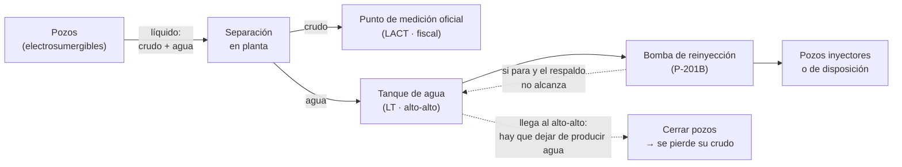
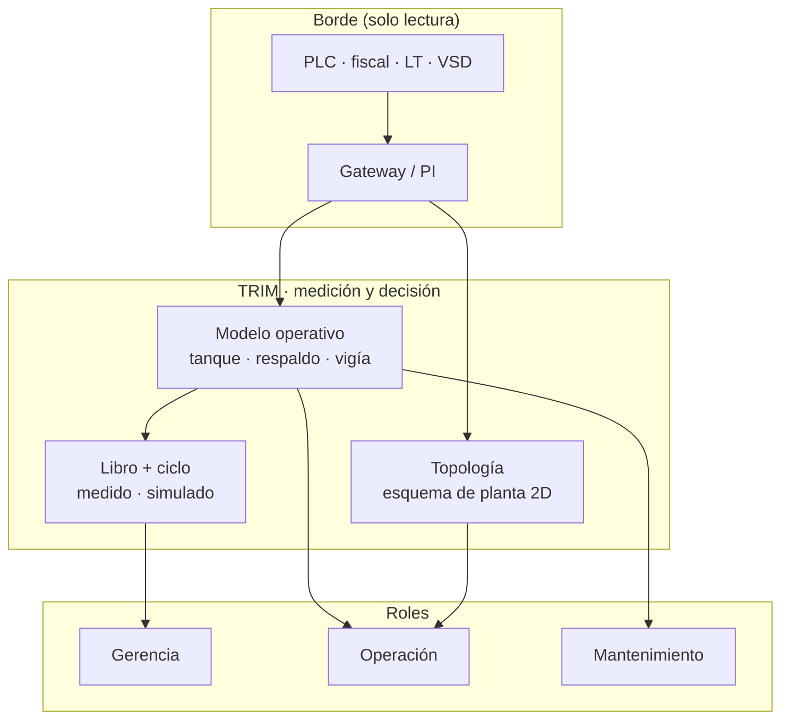
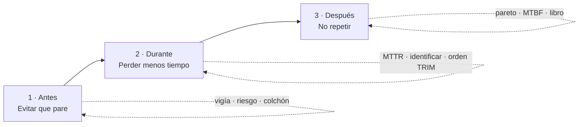

# 1. El problema y su solución técnica

> **En una frase.** TRIM es un producto **global** para **prevenir paradas no planificadas** (y medir las que ocurren) en **electrosumergibles**, **bombas multifásicas** y **bombas de reinyección o disposición de agua**: cadena de custodia del diferido en barriles por equipo y parte, **vigía** antes de la falla, y ciclo **antes · durante · después** desde operación hasta gerencia.

Este capítulo explica el problema físico, la cadena de cálculo que lo resuelve, dónde se trabó cada barril con el modelo choke y la cifra del norte (§1.3b) y un caso real del demo de punta a punta. Incluye el alcance **global** del producto y la línea **gemelo digital** de simulación (§1.6, distinta del pitch de TRIM), las **tres palancas** de venta (§1.7) y el encargo al backend (§1.8). Cada paso remite al capítulo donde están sus fórmulas completas.

## 1.1 Por qué el agua manda

En un yacimiento **maduro** (Colombia, Oriente Medio, Asia-Pacífico, cuencas con alta BSW), el pozo no entrega solo crudo: entrega **líquido**, y una fracción grande es agua de formación. El **corte de agua** (BSW) es la fracción de agua en el líquido:

$$
\text{BSW} = \frac{Q_w}{Q_w + Q_o} \qquad\Longrightarrow\qquad \frac{Q_w}{Q_o} = \frac{\text{BSW}}{1 - \text{BSW}}
$$

| BSW | Barriles de agua por barril de crudo ($Q_w/Q_o$) |
|---|---|
| 92 % | 0,92 ÷ 0,08 = **11,5** |
| 95 % | 0,95 ÷ 0,05 = **19** |
| 97 % | 0,97 ÷ 0,03 ≈ **32,3** |
| 98 % | 0,98 ÷ 0,02 = **49** |

La relación crece muy rápido al final: pasar de 95 % a 98 % multiplica por 2,6 el agua que hay que mover por cada barril de crudo.

Esa agua se separa en la planta, cae a un **tanque de agua** y una **bomba de reinyección** la devuelve al subsuelo. La bomba no mueve crudo, pero **todo el crudo depende de ella**:

Si la bomba se para y nada más absorbe el agua, el tanque sube. Al llegar al nivel **alto-alto** hay que dejar de producir agua, y la única forma es **cerrar o reducir pozos**. Cada pozo afectado se lleva su crudo. Con BSW altos, una bomba de agua parada pesa sobre la producción **más** que muchas fallas de fondo.

El otro equipo de alto impacto es la **electrosumergible** (ESP) o el sistema de levantamiento artificial del pozo: si falla, ese pozo deja de producir hasta un trabajo de fondo (días o semanas).

> **Global vs demo.** La física (BSW, tanque, respaldo, orden de cierre) es la misma en cualquier región; cambian las **reglas de custodia** (asignación, bandas, fiscal), la **moneda** y los **catálogos** — vía configuración regional (`src/shared/config/region.ts`). El demo usa **cinco campos en Colombia** (Res. MME 40236, hora `America/Bogota`, USD): La Ceiba **95 %**, Morichal **97 %**, Guacamayo **93 %**, El Palmar **80 %** (bombeo mecánico), La Zarza **32 %** (gas/condensado). En un piloto entran las pruebas o asignación del cliente (5B §4.1).

## 1.2 Lo que cada nivel necesita saber

El mismo cálculo responde preguntas distintas según quién mira. Lo que cambia por nivel es qué se muestra, no los números (sección 2.8):

| Nivel | Pregunta | Lo que TRIM responde | Capítulo |
|---|---|---|---|
| **Gerencia** (decisión) | ¿Cuánto dejamos de producir, cuánto vale, por culpa de qué, baja contra la meta que firmé, y cuánto puedo todavía evitar o recuperar? | Barriles diferidos del período (libro, **medido**) y el **retorno posible** del ciclo **1 · Antes / 2 · Durante / 3 · Después** (simulado, no entra al libro) | 5A, 6, 11 |
| **Ingeniería de producción** | ¿El número aguanta una auditoría? | Factor de asignación en su banda regulatoria, custodia completa (pozos con prueba, días con fiscal), identidad exacta con el fiscal, publicación del libro | 5A |
| **Operación** (supervisor, operador) | ¿Qué está parado, cuánto aguanta el tanque, qué pozos cierro primero, puedo arrancar? | Lo que se pierde ahora (bbl/d, bbl/h, pozos cerrados), colchón en horas, orden de cierre, «no arrancar hasta identificar» | 5B |
| **Mantenimiento y confiabilidad** | ¿Qué parte va a fallar, cuándo, y cuánto crudo arriesga? | Vigía (cruce de la alarma en horas, con rango), salud por parte, riesgo por equipo, costo por falla, historia (MTBF, horas fuera) | 5C, 5B |
| **Aguas abajo** del equipo | ¿A quién afecta? | Los pozos que cierra cada bomba (chip «aguas abajo: todo el campo»), el servicio que paró a todo lo demás | 5B |
| **Todos, con el modelo choke** | ¿Dónde se trabó lo que no se produjo, qué limita hoy al campo y qué equipo cuesta más si falla hoy? | El tramo de cada barril (yacimiento, pozo, planta, afuera), lo que limita y su holgura, la cifra del norte (lo no planeado) y «si falla hoy» por equipo | 5E |
| **Cumplimiento regulatorio** | ¿Qué le reporto a la ANH de cada parada y quién lo confirmó? | La clasificación de seis pasos de cada fila de `paradas_pozo` (Circular ANH 0024 de 2026), con lo que propuso TRIM, lo que dijo cada persona y lo que falta | 5E |

## 1.3 La cadena de cálculo, en siete pasos

### Paso 1 · Medir lo real
Lo producido **se mide**: es el fiscal del día del computador de flujo del punto de medición oficial (PMO). Un día sin fiscal no se rellena: se dice «sin fiscal» y el libro no se publica. → 5A.

$$
R_m = \sum_{d \in m,\ \text{con fiscal}} F_d
$$

### Paso 2 · Reconstruir el potencial
Lo que se habría producido sin eventos sale de las **pruebas de pozo**, llevadas a lo medido con el **factor de asignación** del mes:

$$
\text{FA}_m = \frac{R_m}{T_m}, \qquad T_m = \sum_{d} \sum_{p} q_{p,d} \cdot \frac{\max(0,\ H_d - P_{p,d})}{24}
$$

donde $q_{p,d}$ es el crudo de la prueba vigente del pozo, $H_d$ las horas del día y $P_{p,d}$ las horas perdidas del pozo ese día. El FA se compara contra su **banda regulatoria** (Res. MME 40236 de 2022, Fig. 10.2: ±15 % o ±5 % según la gravedad API y el volumen). Fuera de banda, el libro no se publica. → 5A §2.

### Paso 3 · Repartir lo que faltó, evento por evento
Cada evento de pozo (un paro o una frecuencia reducida, con la hora del PLC) produce un **tramo** de diferido:

$$
\text{bbl}_e = \sum_{d} q_{p,d} \cdot \text{FA}_{m(d)} \cdot h^{\text{ef}}_{e,d} \cdot \frac{f_{e,d}}{24}, \qquad f = \begin{cases} 1 & \text{paro} \\ 1 - \dfrac{\text{Hz}_e}{\text{Hz}_{\text{prueba}}} & \text{frecuencia reducida (aproximado, se marca aparte)} \end{cases}
$$

con $q_{p,d}$ el crudo de la prueba vigente del pozo ese día, $\text{FA}_{m(d)}$ el factor del mes de ese día y $h^{\text{ef}}_{e,d}$ las horas del evento en ese día. Las horas se cobran **una sola vez** aunque dos eventos se pisen. Así se cumple, en mes entero y por campo, la **identidad exacta**:

$$
\text{potencial} - \text{real} = \sum_{\text{eventos}} \text{bbl}
$$

Se rompe en un solo caso: un evento en un día **sin fiscal** suma diferido pero ese día no entra ni a lo real ni al potencial. Por eso un día sin fiscal bloquea la publicación del libro (5A §3, «Identidad del libro»).

Su incertidumbre se calcula con la Ec. 22 de la misma resolución (raíz de la suma de los cuadrados), y se muestra como rango: «5.729–6.734 bbl · calculado». → 5A §3–4.

### Paso 4 · Atribuir cada evento a su causa: equipo y parte
Un pozo no para «solo». Cada evento recorre un **árbol de causas**, en orden y con ventanas de tiempo exactas:

1. un **servicio** caído (energía, aire, compresión…) dentro de su ventana;
2. la **bomba de la línea** que le cortó el paso: la multifásica de su clúster, o la de reinyección cuando el tanque llegó al alto-alto (`LSHH`, `CMD`, `HZ`);
3. el **programa** de paradas firmado;
4. el **código del controlador** de la electrosumergible (falla a tierra, sobrecarga, baja carga…), que dice la parte;
5. lo que **declaró el operario** (por pantalla o WhatsApp);
6. **sin identificar**.

Para la parada de una bomba, la parte sale de la **primera alarma** del PLC o de la **firma de señales** al parar. Si ninguna señal la explica, TRIM pregunta al operario y marca **«no arrancar hasta identificar»**. Arrancar sin identificar queda como **no conformidad**. → 5B §2–3.

### Paso 5 · El agua: colchón, orden de cierre y lo evitable
Cuando la bomba de reinyección para, TRIM calcula cuánto aguanta el tanque y qué crudo se pierde después:

$$
h = \frac{(a - n)\cdot C}{\max(0,\ Q_{\text{mueve}} - Q_{\text{respaldo}})\,/\,24}
$$

con $a$ el alto-alto, $n$ el nivel, $C$ la capacidad del tanque, $Q_{\text{mueve}}$ la mediana del caudal de la bomba y $Q_{\text{respaldo}}$ lo que el respaldo absorbe.

Pasado el colchón hay que quitar el agua sin salida. TRIM recomienda cerrar **primero los pozos con menos crudo por barril de agua** ($r_j = c_j / w_j$): es una mochila fraccionaria y el orden voraz es óptimo. Después de cada parada mide cuánto se habría evitado con ese orden. → 5B §4.

### Paso 6 · Anticipar
El **vigía** proyecta cada señal del equipo hacia su alarma (mínimos cuadrados sobre la serie del historiador) y dice **en cuántas horas cruza**, con rango y qué parte daña. Con eso, **riesgo** pone precio a cada equipo: el crudo que pierde por día si para y **lo que costaría si falla hoy**:

$$
\text{si falla hoy} = Q_{\text{hoy}} \cdot \frac{1}{n}\sum_{i=1}^{n} \frac{\max(0,\ d_i - h_{\text{colchón}})}{24}
$$

con $Q_{\text{hoy}}$ el crudo que se perdería por día, $d_i$ las horas que duró cada una de sus $n$ fallas cerradas y $h_{\text{colchón}}$ las horas que el tanque aguanta hoy. Las horas que el tanque absorbe no cuestan crudo: **si la bomba vuelve antes de que el tanque se llene, la falla no cuesta nada**. Esa es la meta de reparación que la operación puede perseguir. Y **«¿acierta el vigía?»** registra cada predicción y en qué quedó. → 5C, 5B §5.

### Paso 7 · Cerrar el ciclo
Las **metas** y el **precio** los firma el gerente, por tramos y con motivo, en versiones que nunca se sobrescriben. El libro de un mes se **publica** solo si el FA está en banda, toda parada tiene causa dentro del máximo firmado, hay fiscal y hay meta. Los **informes** salen con folio y una **huella SHA-256** que calcula el servidor. Las paradas avisan por **WhatsApp** a quien tiene que actuar, y los avisos van a **SAP PM** con su evidencia. → 5A §7, 5D.

## 1.3b Dónde se trabó cada barril: el modelo choke y la cifra del norte

Los siete pasos dicen **cuánto** se dejó de producir y **por qué equipo y qué parte**. El modelo choke agrega **dónde**: el campo es una tubería en serie (yacimiento → pozos → planta → afuera), lo que limita es su tramo más angosto y cada parada se trabó en uno de los tramos. Es el método de SPE-36848 (BP, 1996), el mismo que la ANH adoptó como el paso 2 de la clasificación de paradas que la Circular 0024 de 2026 exige desde el 1 de diciembre de 2026. Con él, el mismo barril sirve para gestionar y para reportar (capítulo 5E):

- **Qué limita hoy.** Lo que dan los pozos según sus pruebas (con un factor de medición firmado, nunca el factor de asignación del mes), el tren más angosto de la planta y lo que deja salir el oleoducto. En La Ceiba, hoy (2-oct-2026, 14:00), limitan los pozos: 11.857 bbl/d, con 1.143 bbl/d de holgura en la planta. Si la planta limitara, abrir más pozos no daría nada (5E.2).
- **Una sola cifra del norte.** Lo que el producto busca bajar es **lo no planeado**: las paradas por fallas, disparos y terceros, contadas fila por fila con la clasificación vigente. En los 13 meses del demo son **462.267,1 bbl** de 485.684,2 diferidos; la eficiencia de producción es 95,65 % y la no planeada, 2,85 % del potencial del sistema. La misma cifra sale en el reparto, el árbol, el mes a mes y la línea base (5E.4).
- **Priorizar con «si falla hoy».** Cada equipo ordenado por lo que costaría que fallara hoy, con el tramo donde se trabaría: en La Ceiba, con P-201B parada, las dos bombas hermanas sin instrumento pasan al primer puesto (3.059 bbl/d después de 2 minutos de colchón). Ese orden decide dónde va el vigía, qué ruta predictiva va primero y qué repuesto se pide ya (5E.7).
- **Clasificar sin inventar.** TRIM propone los seis pasos de la ANH con la señal, la topología y el programa; pregunta en palabras de campo lo que la señal no decide; y una persona confirma. Lo que dice cada persona se guarda paso por paso y no se borra (5E.9).

## 1.4 Un caso real de punta a punta: P-201B de La Ceiba, 2 de octubre de 2026

Todas las cifras salen del motor con los datos del demo (capítulo 5B §4).

**Antes de la parada.** La Ceiba mueve **224.075 bbl/d de agua** (95 %) con tres bombas de reinyección de 90.000 bbl/d en paralelo: P-201A, P-201B y P-201C. P-201B mueve una mediana de **74.200 bbl/d** (medidor FI-2011). Si para, P-201A y P-201C pueden tomar 30.100 bbl/d más entre las dos (el respaldo firmado); el resto, **44.100 bbl/d**, se queda sin salida. El tanque TK-AG-CE mide 30.000 bbl con alto-alto al 90 %.

| Hora | Qué pasa | Cálculo | Lo que se ve |
|---|---|---|---|
| **03:52** | P-201B para (evento `EV-2011-1002`). El tanque está en 78,7 % (LT-2012). | Volumen libre $= (0{,}90 - 0{,}787)\cdot 30.000 = 3.390$ bbl. Agua sin salida $= 74.200 - 30.100 = 44.100$ bbl/d $= 1.837{,}5$ bbl/h. Colchón $= 3.390 / 1.837{,}5 =$ **1,84 h** (1,66–2,03 h). | La placa pasa a ◆ P1 «detenido». WhatsApp al supervisor y al operador: equipo parado, el respaldo no alcanza para todo su caudal. Ninguna señal explica la parte: «No arrancar hasta identificar el daño», y TRIM le pregunta al operador qué se dañó. |
| **05:43** | Primer pozo cerrado: LC-16, por nivel alto-alto (`LSHH`). | El tanque aguantó **1,845 h**: el modelo acertó al minuto. | Fila de la parada: «colchón 1,8 h · aguantó 1,8 h». |
| **05:46** | Los operarios cierran LC-07. Cierran primero los pozos que más agua dan, como haría un buen operador: con esos dos se quita el agua sin salida. | Crudo de los dos pozos cerrados = **1.665 bbl/d**. En el orden de TRIM (primero los de menos crudo por barril de agua: LC-02, LC-10 y LC-01 enteros, y bajar la frecuencia de LC-17 y LC-07) serían **1.426 bbl/d**: 14 % menos. | Detalle de la bomba: «Orden de cierre»; la parada abierta dice «evitable en orden: 30 bbl» (lo que lleva hasta ahora). |
| **14:00** (ahora) | La parada sigue abierta. El tanque está quieto en 89,6 %: con los dos pozos cerrados, P-201A y P-201C sacan toda el agua que entra. | Perdiéndose **1.665 bbl/d** $=$ 69 bbl/h. Diferido de la parada $=$ **573 bbl** (487–659, ±15,0 %). | Bombas: «Perdiéndose ahora 1.665 bbl/d · 69 bbl/h · 2 pozos cerrados». Placa: «573 bbl · 487 – 659 · calculado». Planta: el tanque, gris («P-201B detenida: el respaldo toma el agua que entra, el nivel no sube»). |
| **Gerencia** | La misma parada en el Resumen del portafolio, octubre en curso. | 573 de 2.377 bbl diferidos del portafolio $=$ 24 %. MN-41, la electrosumergible de Morichal caída desde el 25-sep, lleva 1.083 (46 %). | «Causa mayor: P-201B · La Ceiba» (lo que más se pierde ahora). Por equipo: «MN-41 · 1.083 bbl · 46 %», «P-201B · 573 bbl · 24 %». |
| **Historia** | Lo que esta bomba le ha costado al campo. | 9 fallas, una cada **41 días**, **40,0 h** fuera en promedio, **4.593 bbl** por falla. | Ficha del equipo y Confiabilidad: «le ha costado por falla». |

La misma parada en la pantalla de la bomba (confiabilidad, La Ceiba, octubre en curso):

| # | Lo que se ve | Valor | De dónde sale |
|---|---|---|---|
| 1 | Respaldo de la bomba | «respaldo 30.100 bbl/d» | configuración firmada: `respaldos[]` (P-201A y P-201C en paralelo; 5B §4.2) |
| 2 | Diferido que causó | 573 bbl (487 – 659 · ±15,0 %) | Σ de los tramos de los pozos cuya causa es esta parada (5B §4.4) |
| 3 | Perdiéndose ahora | 1.665 bbl/d · 69 bbl/h · 2 pozos cerrados | Σ del crudo asignado de los pozos cerrados por ella (5B §4.3) |
| 4 | Le ha costado por falla | 4.593 bbl · 9 fallas en 12 meses · cada 41 d · 40,0 h fuera | historia del equipo: lo que costaron sus fallas pasadas (5B §7) |
| 5 | «No arrancar hasta identificar el daño» | P2 | ninguna señal explica la parte (5B §3) |
| 6 | Pozos que cerró | 2 (LC-07, LC-16) | eventos de pozo cargados a la parada (5B §4.3) |
| 7 | Colchón contra lo observado | «colchón 1,8 h · aguantó 1,8 h» | previsto con el nivel al parar; observado = primer cierre − paro (5B §4.4) |
| 8 | Libre hasta el alto-alto | 3.390 bbl | $(0{,}90 - 0{,}787) \cdot 30.000$ |
| 9 | Agua sin salida | 44.100 bbl/d | mediana de FI-2011 (74.200) − respaldo (30.100) |
| 10 | Primer pozo cerrado | a las 1,8 h | LC-16 a las 05:43 |
| 11 | Por qué paró | «Sin primera alarma y sin firma: el PLC no dice qué parte falló» | árbol de causas de la bomba (5B §3) |

**La misma bomba con más respaldo: P-201B de Morichal.** Morichal mueve **581.849 bbl/d de agua** (97 %) con siete bombas de 90.000 bbl/d. P-201B mueve 79.900; las otras seis tienen 39.500 libres entre todas. Con la bomba en marcha y el tanque TK-AG-MN (60.000 bbl) en 61,8 %, si P-201B se para ahora:

- el agua sin salida es $79.900 - 39.500 = 40.400$ bbl/d;
- el tanque aguanta **10,1 h** (9,0–11,1 h; el cálculo da 10,05 h);
- después hay que cerrar MN-27 y bajarles la frecuencia a MN-36 y MN-13 (25 %, lo más que aguanta una electrosumergible) y a MN-39 (16 %);
- se pierden **783 bbl/d** en ese orden, contra **1.222 bbl/d** cerrando parejo: **439 bbl/d menos**;
- y si falla hoy, con lo que han durado sus 8 fallas, costaría **≈ 1.235 bbl**: de cada falla solo cuentan las horas después de las 10 h que aguanta el tanque. **Si vuelve antes de 10 h, no cuesta crudo.** Lo que de verdad le costó cada falla en el pasado, con el tanque y los pozos de entonces, fue 2.765 bbl en promedio («le ha costado por falla»).

En la historia del demo, los operarios de Morichal cerraron primero los pozos más aguateros; cerrar en el orden de TRIM habría evitado **1.029 bbl** en 12 meses (201 solo en la parada del 24 de septiembre). Es poco contra un buen operador, y así debe ser: la ganancia grande está en no cerrar parejo, en reparar antes de que el tanque se llene y en anticipar la falla.

| # | Lo que se ve | Valor | De dónde sale |
|---|---|---|---|
| 1 | Respaldo | «respaldo 39.500 bbl/d» | configuración firmada (las otras seis bombas del tren) |
| 2 | Si se para ahora | 783 bbl/d tras 10,1 h de colchón | crudo en orden (5B §4.2) |
| 3 | Nivel del tanque | LT-2012 61,8 % contra alto-alto 90 % | transmisor de nivel |
| 4 | Volumen libre | 16.920 bbl | $(0{,}90 - 0{,}618) \cdot 60.000$ |
| 5 | Agua sin salida | 40.400 bbl/d | 79.900 − 39.500 |
| 6 | Aguanta | 10,1 h (9,0 h a 11,1 h) | colchón con su rango (aforo y medidor de agua) |
| 7 | Orden de cierre | MN-27 entero; MN-36 y MN-13 al 25 %; MN-39 al 16 % | crudo por barril de agua, de menor a mayor, con el tope de frecuencia (5B §4.2) |
| 8 | Ahorro contra cerrar parejo | «439 bbl/d menos que parejo» | 1.222 − 783 |

Y lo que ve el gerente en el resumen del portafolio, el mismo día:

| # | Lo que se ve | Valor | De dónde sale |
|---|---|---|---|
| 1 | Barriles diferidos del portafolio | 2.377 | Σ de los tramos de los cinco campos en octubre (5A §3) |
| 2 | Su rango | «2.132–2.622 bbl · calculado» | tolerancia por la Ec. 22, en cuadratura entre campos (5A §4) |
| 3 | Perdiéndose ahora | 2.650 bbl/d · 4 de 87 pozos parados | riesgo ahora del portafolio (5B §5) |
| 4 | Causa mayor | «P-201B · La Ceiba» | lo que más se pierde ahora (5B §5) |
| 5 | Por equipo | MN-41 · 1.083 bbl · 46 %; P-201B · 573 bbl · 24 %; LC-21 · 247 bbl · 10 % | Pareto por equipo del período (5A §8) |

**Esto es la operatividad de los equipos críticos traducida a barriles.** La bomba de agua no produce un barril, pero su respaldo, su tanque y el orden de cierre deciden si una parada cuesta 0 bbl (el tanque la absorbe), unos cientos de bbl/d o miles. Con 95 % de agua el margen es de horas, no de días: por eso hay que saberlo al minuto.

## 1.5 Por qué los cálculos son precisos

| Riesgo de imprecisión | Cómo lo resuelve el motor | Capítulo |
|---|---|---|
| La hora del evento | Se usa la del PLC, sin redondear. Un evento abierto mide hasta el «ahora» del servidor. | 4, 5B §1 |
| Dos eventos que se pisan en el mismo pozo | Cada hora del pozo se cobra **una vez**: manda el paro sobre la frecuencia reducida y, entre paros, el primero. | 5A §2 |
| El diferido «no cuadra» con lo medido | Identidad exacta potencial − real = Σ eventos en mes entero con fiscal todos los días. En un día suelto, la diferencia es el **inventario del tanque de venta** (el PMO mide lo que se despacha, no lo que producen los pozos ese día), que se compensa dentro del mes. | 5A §3, 9.5 |
| Pruebas viejas o pozos sin prueba | Se usa la prueba vigente al inicio del día; un pozo sin prueba es un **hueco de custodia** que sube el FA y se nombra. | 5A §2 |
| Factor de asignación absurdo | Se compara contra la banda de la Res. 40236; fuera de banda, el libro no se publica. | 5A §2 |
| Frecuencia reducida | Se estima con $1 - \text{Hz}/\text{Hz}_0$, se marca **aproximado** y se suma aparte. | 5A §3 |
| Incertidumbre | Rango por la Ec. 22 (raíz de la suma de los cuadrados); el colchón suma la del aforo del tanque (0,2 %) y la del medidor de agua. | 5A §4, 5B §4 |
| ¿El colchón predicho sirve? | Se mide contra lo observado en cada parada. En el demo: 1,84 h previstas contra 1,845 h observadas en La Ceiba, y como mucho 3 minutos de diferencia en las 18 paradas que llegaron a cerrar pozos. | 5B §4.4 |
| Una parada que cruza dos meses | Se recorta a cada mes con el factor de ese mes; no se suma entera a los dos. | 5B §4.4 |
| Lo que entra a mano | Solo la configuración firmada y la respuesta del operario, con fecha, firmante y motivo. Nada se sobrescribe: un mes viejo se recalcula con la versión que regía. | 5D |

## 1.6 Producto global TRIM y línea gemelo digital (simulación)

### Qué vende TRIM (sin etiqueta «gemelo»)

En **presentaciones comerciales** TRIM se describe como **software de barriles y paradas** con custodia: libro medido, vigía, colchón, ciclo Antes / Durante / Después. **No** se presenta como gemelo digital: esa palabra reserva otra línea de producto (abajo).

El mismo binario sirve **globalmente** mientras el yacimiento encaje en el patrón «equipos críticos de superficie/fondo + agua que manda + medición fiscal»:

| Dimensión | Qué es global | Qué configura el cliente / región |
|---|---|---|
| Física | BSW, tanque, respaldo, orden de cierre, ESP/bombas | Capacidades, tags, esquema de planta |
| Custodia | Potencial − real = Σ eventos; hueco = no inventar | Banda de asignación, fiscal, publicación (p. ej. Res. 40236 en Colombia) |
| Moneda y formato | Motor en barriles; UI formatea | Precio neto, locale (`region.ts`) |
| Integraciones | Patrón borde → MQTT/PI → API | SAP, WhatsApp, historiador del sitio |

### Cuatro pilares del producto (contrato + front hecho)

| Pilar | Pregunta | Pantallas / capítulos |
|---|---|---|
| **Comportamiento crítico** | ¿Cuánto aguanta el tanque y qué cuesta si falla hoy? | 5B, 5C, Bombas, Riesgo |
| **Topología operativa** | ¿Dónde está el cuello de botella ahora? | Planta (6C.7), catálogo |
| **Cadena del dato** | ¿Tag, hora, custodia? | Cap. 4, CadenaDato |
| **Libro y ciclo** | ¿Medido vs qué puedo mover? | 5A, 11, Resumen |

### RFP: TRIM frente a un «digital twin» genérico

| Pregunta en la licitación | TRIM (hoy) |
|---|---|
| Barriles por equipo y parte, publicables | **Sí** |
| Colchón, orden de cierre, vigía | **Sí** |
| Trazabilidad tag → cifra | **Sí** |
| Simular planta/proceso/línea completa con planos | **No** — línea gemelo digital |
| 3D navegable del P&ID | **No** |
| LLM que elija la intervención | **No** — ciclo por `bbl` y reglas |

Frase de pitch: *«TRIM mide y prioriza paradas en barriles, con custodia desde el PLC hasta gerencia.»*

### Gemelo digital (visión): simular proceso, planta o línea

En la **estrategia de producto**, «gemelo digital» significa otra cosa: un modelo del **proceso, la planta o la línea del cliente** para **simular** escenarios, no solo registrar lo ocurrido.

| Elemento del gemelo digital | Rol |
|---|---|
| **P&ID, planos, layouts, isométricos** | Geometría y conectividad: qué está en serie/paralelo, dónde actuar |
| **Datasheets, curvas de bomba, límites de diseño** | Parámetros del simulador |
| **Modelo de proceso** (balances, hidráulica, composición según necesidad) | Responder «qué pasa si paro X / subo Y» |
| **Datos en vivo** (tags) | Calibrar y validar el modelo contra la realidad |
| **Escenarios** | Capacidad, bottlenecks, mantenimiento, contingencias |

Esa línea **no está en el MVP de TRIM** (cap. 11 §«Fuera de este producto»). Cuando exista, debe **compartir tags y documentos** con TRIM: el libro sigue siendo la verdad contable; el gemelo explora futuros. **No mezclar** en el mismo slide comercial.

### Piloto mínimo TRIM (cualquier región)

| # | Insumo | Para |
|---|---|---|
| 1 | Eventos de pozo (hora PLC) | Libro |
| 2 | Paradas de bomba + alarma / firma al parar | Parte |
| 3 | Fiscal diario | Real, asignación |
| 4 | Nivel tanque de agua | Colchón |
| 5 | Caudal y estado de bombas críticas | Pérdida ahora |
| 6 | Pruebas o asignación de pozos | Potencial |
| 7 | Configuración firmada | Tanque, respaldos, metas, precio |
| 8 | Series vigía | Antes |
| 9 | Esquema de planta | Planta |
| 10 | Mensajería + ERP mantenimiento | Operación |

Producción: reloj real, LT en vivo, firma al parar persistida, `decision_plan` (cap. 10 S1–S4, S24). Sin eso el demo enseña; el piloto en campo no cierra.

### MVP vs v2

Con `MVP = true` (`producto.ts`) está apagada **Evidencia** (y los roles de la planeadora y de abastecimiento). **Agua** se encendió con el modelo choke (21-oct-2026: «La tubería del agua») y **Regulatorio**, con el árbol de pérdidas del choke (22-oct-2026). v2 amplía pantallas, no sustituye el libro por un simulador 3D.

## 1.7 Las tres palancas comerciales (Antes · Durante · Después)

TRIM se vende como **reducir paradas en tres momentos**, no como un único KPI de mantenimiento:

| Palanca | Mensaje de venta (una frase) | Cifra en pantalla | Medido o simulado |
|---|---|---|---|
| **Antes** | «Intervenga mientras el tanque aguanta, no cuando ya cerró pozos.» | Σ lo que costaría si falla **hoy** (`costoFalla`) | Simulado |
| **Durante** | «Cada hora parada cuesta barriles: recupere antes del MTTR e identifique antes de arrancar.» | Horas restantes × \(Q/24\) + evitable por orden | Simulado |
| **Después** | «Ataque la parte que más costó en el período para que no se repita.» | Top parte + evitable histórico del período | Simulado (sobre libro) |

El **libro** responde «cuánto dejamos de producir» (custodia, firmable). El **ciclo** responde «cuánto podemos todavía mover» (motor TRIM, chip «simulado»). En Resumen el ciclo va **arriba** y el libro **abajo**, para que no se confundan. Detalle de fórmulas, UI y contrato: capítulo **11**. Alcance global y gemelo digital (simulación): §1.6.

## 1.8 Qué tiene que construir el backend para que esto funcione

1. **Recibir del borde**, sin edición manual: los eventos de los controladores de pozo con su código y su hora, las paradas de las bombas con la primera alarma y la firma de señales al parar (en el demo la firma nunca llega; el backend tiene que guardarla al registrar la parada: capítulo 5B, «Huecos»), las caídas de servicios, el fiscal del día, el nivel de los tanques y las series de los tags. → Capítulo 4.
2. **Guardar** eso y lo que entra a mano, con las reglas de custodia (solo inserción, versiones, quién y cuándo). → Capítulo 3.
3. **Calcular** las vistas con el motor (capítulo 5) y servirlas por la API (capítulo 7) con la misma forma que el demo.
4. **Avisar** por WhatsApp y **conversar** con SAP. → Capítulo 5D.
5. **Repartir por tramo y clasificar para la ANH**: la topología y las capacidades firmadas, el tramo de cada parada, el reparto y el árbol de pérdidas con la cifra única del norte, «si falla hoy», y la clasificación de seis pasos con lo que dice cada persona guardado paso por paso. → Capítulo 5E.
6. **Probar** que da los mismos números que el demo. → Capítulo 9.
