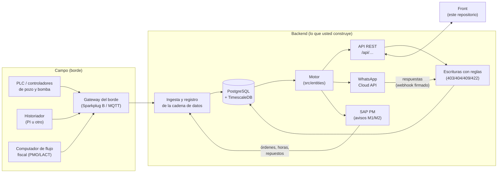

# 2. Arquitectura: qué hace el servidor y cómo habla con el front

Este capítulo es el mapa. Dice qué piezas existen, cuál de ellas tiene que construir usted, por dónde viaja cada dato y qué reglas siguen todas las respuestas. Los capítulos 4 y 5 dicen **qué** se calcula; este dice **dónde** y **cómo llega a la pantalla**.

## 2.1 Las tres capas del front y la que usted reemplaza

El repositorio es solo el front. Por dentro tiene tres capas, y la frontera entre ellas está vigilada por el linter (`.oxlintrc.json`, regla `no-restricted-imports`: las pantallas no pueden importar funciones de cálculo del motor, solo nombres de presentación):

| Capa | Carpeta | Qué es | En producción |
|---|---|---|---|
| **Motor** | `src/entities/*.ts` (46 módulos, ≈ 16.100 líneas) | TypeScript puro, sin React: el libro de diferidos, la atribución de causas, el colchón del tanque, la salud de las partes, el vigía, el modelo choke y la clasificación ANH, las reglas de escritura, la huella de los informes… | **Lo corre el servidor.** Es la especificación ejecutable de cada número. |
| **Costura** | `src/shared/api/*.ts` | El único lugar por donde la interfaz pide datos. Cada consulta es un *endpoint* tipado de `contrato.ts`; cada escritura, una función de `escrituras.ts`. | Con `VITE_FUENTE=http`, cada consulta es un `GET` y cada escritura un `POST`/`PATCH` al servidor. |
| **Interfaz** | `src/pages`, `src/widgets`, `src/app`, `src/shared/ui` | Pantallas, paneles y componentes. Solo muestran, ordenan y filtran lo que llega. | Igual. No cambia. |

En el **demo** (lo que hoy se ve publicado), la costura llama al motor dentro del navegador con los datos de demostración. En el **producto**, la costura le pide lo mismo al servidor y el motor vive del lado del servidor. **Las dos rutas devuelven exactamente la misma forma de dato**: esa es la garantía de que el front no se toca cuando llega el backend.



## 2.2 Lo que el servidor tiene que hacer, en seis bloques

1. **Ingesta y registro de la cadena de datos.** Recibe del borde los eventos de los controladores de pozo, las paradas de las bombas con su primera alarma, las caídas de servicios (energía, aire, compresión…), las series de los tags del historiador y el valor fiscal del día del computador de flujo. Registra la procedencia de cada tag (de qué instrumento sale, por qué gateway, con qué banda normal). Capítulo 4.
2. **El motor.** Con esos insumos y la configuración firmada calcula las vistas: el libro de diferidos por mes y período, la producción día a día, la predicción de cada bomba, el riesgo, la salud de cada parte, el registro de aciertos del vigía, la asignación por pozo, el ciclo ANTES / DURANTE / DESPUÉS (`escenarios.ts`, capítulo 11) y, con el modelo choke, lo que limita a cada campo, el tramo de cada parada, el reparto por tramo y por escalón, el árbol de pérdidas, las tuberías del campo y del agua, «si falla hoy» y las filas ANH con su propuesta de seis pasos (capítulo 5E). Capítulo 5.
3. **Las escrituras.** Lo único que entra a mano: la configuración firmada (metas, precio, tanques, respaldos, programa de paradas), los usuarios y accesos, la respuesta del operario sobre una parada, el análisis de causa raíz, el aviso a SAP, el informe con folio, la asignación oficial cargada, los cambios de planta, la topología y las capacidades del choke (dentro de la configuración firmada) y la clasificación ANH de cada parada, que se guarda paso por paso y solo por inserción. Cada una con sus reglas de autorización y de forma. Capítulos 5D y 5E y anexo A.
4. **WhatsApp.** Enviar con las plantillas aprobadas lo que las reglas disparan (parada, cierre, pregunta de causa, recordatorio a los 30 min, escalamiento a las 2 h, parte que avisa, orden liberada) y recibir por el webhook firmado la respuesta del operario. Capítulo 5D.
5. **SAP PM.** Leer órdenes, horas confirmadas y repuestos; enviar avisos M1/M2 con la evidencia. **TRIM no crea órdenes en SAP.** Capítulo 5D.
6. **Sesión e identidad.** El token sale del servicio de identidad del cliente (OIDC/SSO); de él se resuelven la persona, su rol, sus campos y sus capacidades. Nunca de la petición. Sección 2.8.

## 2.3 Dos formas de construir el motor del servidor

| | **A. Correr el motor TypeScript en Node** (recomendada para el MVP) | **B. Reescribirlo en otro lenguaje** |
|---|---|---|
| Qué se hace | Un servicio Node importa `src/entities/*` tal cual, le instala los insumos leídos de la base (`instalarInsumos`, `src/entities/insumos.ts`) y expone los endpoints con los códecs de `contrato.ts` (`aDTO`). | Se traduce cada fórmula de este documento. |
| Igualdad de números | Por construcción: es el mismo código. | Hay que probarla: `node scripts/referencia.mjs comparar --base-url=…` contra los 252 casos de `referencia/` (y las 18 escrituras rechazadas con `--escrituras`). |
| Riesgo | Bajo. El motor está cubierto por 701 comprobaciones (`npm run verificar`: 435 del libro, 128 del árbol, 138 del contrato, más 15 de la costura http). | Alto en los bordes (redondeos, zona horaria, meses parciales, eventos que se pisan). |
| Costo | Un servicio Node 22. | Semanas por módulo. |

Con cualquiera de las dos, **la prueba es la misma**: los casos de `referencia/` (capítulo 9). Este documento explica cada fórmula para que la opción B sea posible y para que cualquiera pueda auditar un número; no porque haya que reescribir el motor.

> **Ojo con un detalle de la opción A.** Hoy el motor calcula sobre **toda la historia en memoria** (los insumos se instalan una vez). Para el demo basta; con años de historia y varios campos, el servidor debe instalar por consulta solo la ventana que la vista necesita (el mes del libro y los meses de la línea base, por ejemplo) o precalcular los meses cerrados (capítulo 3, tablas `libro_mes` y `asignacion_pozo_mes`). Un mes cerrado y publicado **no cambia**: se calcula una vez y se guarda.

## 2.4 El recorrido de un número, de la dirección a la pantalla

Toda la interfaz se maneja con la dirección (la parte después de `#`):

```
#/<rol>/<pantalla>/<campo>[~portafolio]/<período>[/<equipo>]
```

| Tramo | Valores | Ejemplo |
|---|---|---|
| `rol` | `ger`, `prod`, `sup`, `oper`, `jefe`, `conf`, `tec`, `adm` (los de la versión 2 —`plan`, `cont`, `reg`— no se ofrecen) | `ger` |
| `pantalla` | una de las del rol (tabla 2.9) | `resumen` |
| `campo` | id del registro de campos; con `~portafolio`, la vista suma **todos los campos asignados** a la persona y recuerda desde cuál se entró | `ceiba~portafolio` |
| `período` | `curso`, `cerrado`, `trimestre`, `ytd`, `doce`, o un rango `AAAA-MM-DD_AAAA-MM-DD` | `curso` |
| `equipo` | opcional: abre la ficha del equipo o el detalle del pozo | `P-201B` |

En producción el `rol` de la dirección **no da permisos**: es solo la vista del demo. Los permisos salen del token (2.8).

El recorrido de una cifra, por ejemplo los **2.377 barriles diferidos** del resumen del gerente en el portafolio, octubre en curso:

1. La dirección `#/ger/resumen/ceiba~portafolio/curso` se lee en `src/app/url.ts` (`leerHash`) y queda en el estado global (`src/app/store.ts`): campos = los cinco asignados, período = mes en curso.
2. La pantalla (`src/pages/Resumen.tsx` → `src/widgets/resumen/ResumenDirectivo.tsx`) llama `useLibro({ campos, desde, hasta })` de la costura (`src/shared/api/diferidos.ts:323`).
3. La costura arma la dirección del pedido con `urlDe(DIFERIDOS, { campos, desde, hasta })` → `GET /api/vistas/diferidos?campos=ceiba,morichal,guacamayo,palmar,zarza&desde=2026-10-01T00:00:00.000-05:00&hasta=2026-10-02T14:00:00.000-05:00` (los valores van codificados para URL: `:` → `%3A`, `,` → `%2C`). Los parámetros van **ordenados por nombre** (`URLSearchParams.sort()`): el mismo pedido da siempre el mismo texto, que es la clave de la caché.
4. El servidor responde `{ "datos": <Libro>, "refs": { "pozos": {…}, "eventos": {…} } }`.
5. El códec del endpoint (`contrato.ts`) **revive** el JSON: fechas ISO → `Date`, claves de `refs` → objetos, `null` de «horas que nunca llegan» → `Infinity`, precio `null` → ausente. Si la forma no es la del contrato, lanza `ErrorDeContrato` y la pantalla lo dice (no pinta números a medias).
6. La caché (`src/shared/api/consulta.ts`) guarda la respuesta (hasta 150 entradas; la clave incluye la **versión del contexto**: al firmar una configuración o responder una parada, las consultas cambian de clave y se vuelven a pedir).
7. La pantalla lee el dominio con `use()` de React 19. Mientras llega, el `<Suspense>` muestra «Cargando…»; si falla, el `LimiteDeError` ofrece reintentar.
8. La interfaz **solo formatea**: `n0(2376.75) = "2.377"` (capítulo 8).

El mapa completo de qué endpoint alimenta qué pantalla está en el capítulo 7.

## 2.5 El arranque

Con la fuente `http`, antes de pintar nada, el front pide **diez `GET` en paralelo** (`src/shared/api/servidor.ts`, `arrancarDelServidor`):

| Pedido | Para qué |
|---|---|
| `GET /api/campos` | El registro de campos (id, nombre, cuenca, qué lo limita). Un cliente nuevo son filas aquí, no código. |
| `GET /api/catalogo` | Lo que casi no cambia de cada campo: calendario publicado, perfiles de bomba, registro de equipos y sus tags, límites de cada tag, medición oficial y metrología, pozos, catálogos de daños, esquema de planta. |
| `GET /api/configuracion/historial` | Todas las versiones firmadas; **la última es la vigente**. Vacío = el front no arranca y lo dice. |
| `GET /api/paradas/respuestas` | Lo que los operarios declararon de cada parada. |
| `GET /api/usuarios`, `GET /api/usuarios/historial` | El registro de personas y el rastro de cambios de acceso. |
| `GET /api/informes` | Los informes emitidos (folio, cifras, huella). |
| `GET /api/asignacion-oficial` | La asignación oficial cargada por mes y el rastro de cargas. |
| `GET /api/analisis` | Los análisis de causa raíz vigentes y anteriores. |
| `GET /api/planta/cambios` | El historial de cambios del esquema de planta. |

Reglas del arranque: **ninguno responde 403** a una persona con sesión (lo que no le toca se filtra, no se niega); si uno falla, el front no arranca a medias y lo dice; si `GET /api/catalogo` trae un campo que `GET /api/campos` no registra, se detiene (`camposSinRegistro`).

## 2.6 El reloj, los días y los períodos

Todo el sistema vive en **hora de Colombia (UTC−5, sin horario de verano)**. El día del campo empieza a las 00:00 de Bogotá, que es las 05:00 UTC.

**Medianoche del día que contiene el instante $t$:**

$$
t_{00} = \left\lfloor \frac{t - 5\,\text{h}}{D} \right\rfloor \cdot D + 5\,\text{h}, \qquad D = 24\,\text{h}
$$

con $t$ en milisegundos desde la época Unix (UTC). Ejemplo: $t$ = 2-oct-2026 14:00 (−05:00) = 19:00 UTC → $t_{00}$ = 2-oct-2026 05:00 UTC = 00:00 de Bogotá.

**El «ahora».** En el demo es fijo: `AHORA = 2026-10-02T14:00:00-05:00` (`src/entities/reloj.ts`), para que un evento abierto mida siempre lo mismo. En producción lo da el servidor; queda pendiente decidir si viaja como `generadoEn`/`datosHasta` en cada respuesta o por `GET /api/reloj` (capítulo 10).

**Los períodos** salen de `calendarioDe(ahora)` (`src/entities/reloj.ts:48`). El `hasta` **no se incluye** (intervalo semiabierto $[\text{desde}, \text{hasta})$):

| Id | Nombre en la cabecera | `desde` | `hasta` | Con `AHORA` del demo |
|---|---|---|---|---|
| `curso` | «Octubre, en curso» | día 1 del mes, 00:00 | ahora | 1-oct 00:00 → 2-oct 14:00 (parcial: «2 de 31 días de octubre») |
| `cerrado` | «Septiembre · cerrado» | día 1 del mes anterior | día 1 del mes en curso | 1-sep → 1-oct |
| `trimestre` | «Trimestre jul–sep» | día 1 de hace 3 meses | día 1 del mes en curso | 1-jul → 1-oct |
| `ytd` | «Año a la fecha» | 1-ene 00:00 | ahora | 1-ene → 2-oct 14:00 (parcial: «9 cerrados + 2 días») |
| `doce` | «Últimos 12 meses» | día 1 de hace 12 meses | día 1 del mes en curso | 1-oct-2025 → 1-oct-2026 |
| rango | «1 sep – 10 sep» | 00:00 del primer día | 00:00 del día siguiente al último | el que se escoja, recortado al primer y último día con datos |

Un período «parcial» (`curso`, `ytd`) **no se publica**: el libro sale «provisional» con el motivo `en-curso` (capítulo 5A).

## 2.7 Campo y portafolio

Cada vista se pide para **una lista de campos** (`campos=a,b,c`). «Portafolio» es la suma de todos los campos asignados a la persona. Las reglas de suma son del motor y las detalla el capítulo 5A; las que el servidor no puede olvidar:

- Los **barriles** (volúmenes) se suman campo a campo. Las **tasas** (bbl/d) del período se recalculan con los barriles sumados y las horas del período; no se promedian promedios.
- El **factor de asignación** es de cada campo y de cada mes: nunca se calcula un factor «del portafolio».
- La **meta del portafolio** es la suma de las metas firmadas de cada campo. Si un campo no tiene meta firmada, el portafolio **no tiene meta** (y se dice cuál falta: `meta.sinMeta`).
- El **valor en USD** suma solo los campos con precio; los demás se nombran (`sinPrecio`) y el front escribe «falta precio en La Zarza».

## 2.8 Sesión, roles y nivel de detalle

**La identidad sale del token, nunca de la petición** (`GET /api/sesion`; anexo A, «Sesión y autenticación»). Del token el servidor resuelve:

- la **persona** (id y nombre),
- su **rol** y el **nivel de detalle** del rol,
- sus **campos** (`"todos"` o una lista: los que el gerente le asignó en Usuarios, no los de fábrica del rol),
- sus **capacidades** (nueve permisos que cada escritura revisa).

Los 8 roles del producto (`src/entities/roles.ts`):

| Rol (id) | Nivel | Entra por | Pantallas | Campos de fábrica | Capacidades |
|---|---|---|---|---|---|
| Gerente de activo (`ger`) | decision | Resumen | resumen, diferidos, producción, riesgo, configuración | todos | `evidencia:exportar`, `metas:firmar`, `usuarios:administrar` |
| Ingeniera de producción (`prod`) | ingenieria | Producción | producción, diferidos, pozos, electrosumergibles, identificar, planta | ceiba, palmar | `evidencia:exportar`, `asignacion:cargar` |
| Supervisor de operaciones (`sup`) | operacion | Bombas | bombas, electrosumergibles, turno, identificar, pozos | ceiba | `causa:declarar`, `evidencia:exportar`, `sap:aviso` |
| Operador de campo (`oper`) | operacion | Bombas | bombas, electrosumergibles, identificar, turno | ceiba | `causa:declarar`, `sap:aviso` |
| Jefe de mantenimiento (`jefe`) | ingenieria | Mantenimiento | mantenimiento, diferidos, bombas, electrosumergibles, confiabilidad, superficie, riesgo, identificar | todos | `causa:completar`, `evidencia:exportar`, `sap:aviso` |
| Ingeniero de confiabilidad (`conf`) | ingenieria | Bombas | bombas, electrosumergibles, confiabilidad, diferidos, riesgo, superficie, identificar, planta | ceiba, morichal, guacamayo | `causa:completar`, `evidencia:exportar`, `sap:aviso` |
| Técnico de mantenimiento (`tec`) | operacion | Mi trabajo | mi trabajo, bombas, electrosumergibles, identificar | ceiba | `causa:declarar` |
| Administrador de la implementación (`adm`) | ingenieria | Configuración | configuración, conectores, planta | todos | `evidencia:exportar`, `conector:configurar`, `config:firmar` |

Todos tienen además **Mi perfil** (se abre desde el menú de la persona).

**El nivel de detalle cambia lo que se muestra, no los números.** A nivel `decision` (gerente) el front no pinta señales, tags, tolerancias, custodia, factor de asignación ni paneles de vigía; el servidor puede omitirlos de la respuesta. A nivel `operacion` (supervisor, operador, técnico) se muestra lo que sirve en el turno (qué está parado, qué hacer, no arrancar), sin acumulados ni energía por barril. A nivel `ingenieria` se muestra todo. Las variantes de cada pantalla están en el capítulo 6.

**Autorización en el servidor.** Cada escritura revisa, en este orden: capacidad y persona activa (403) → que el recurso exista (404) → que el campo del cuerpo sea el del recurso (422) y que la persona tenga ese campo (403) → conflicto (409) → forma (422). Las lecturas también: una dirección con un campo ajeno no devuelve datos de ese campo. Detalle en el capítulo 5D y el anexo A.

## 2.9 Las reglas del cable (resumen)

Son las del anexo A («Reglas del cable»); aquí las que más se olvidan:

| Regla | Por qué |
|---|---|
| Sobre `{ "datos": …, "refs": { … } }`; las escrituras, `{ "datos": … }` | Las entidades compartidas (pozos, eventos, perfiles de bomba) viajan **una vez** en `refs` y las filas las nombran por clave (`"ceiba/LC-14"`). |
| Fechas ISO 8601 **con zona y milisegundos**, en hora de Colombia | Sin zona, el front la rechaza: un instante sin zona es ambiguo en un campo que opera de noche. |
| Opcional ausente → **se omite**; `null` solo donde el dominio dice null | «Sin dato del fiscal» (`real: null`) no es lo mismo que «cero barriles». |
| Horas que nunca llegan → `null` | El tanque que no se llena tiene colchón infinito; JSON no tiene `Infinity`. |
| Lo que puede no existir → `"datos": null` con HTTP 200 | Un pozo que no está es un hueco que la pantalla muestra, no un error. |
| Precio sin configurar → `null` u omitido, **nunca 0** | Un 0 valoraría los barriles en 0 USD sin avisar. |
| Error único `{ "error": { "codigo", "mensaje" } }` | El `mensaje` se muestra tal cual a la persona: en español y sin detalles internos (nada de SQL ni rutas del servidor). |

## 2.10 Lo que la interfaz hace por su cuenta (y el servidor no)

Para que quede claro qué **no** tiene que calcular el servidor:

- **Formatear** cifras, fechas y unidades (`src/shared/lib/formato.ts`, `src/entities/reloj.ts`). El servidor manda números sin redondear.
- **Ordenar, filtrar y cortar** listas que ya llegaron (por ejemplo, «ver 13 más»).
- **Dibujar** el esquema de planta (`planta.armar`) a partir de la topología que manda el catálogo.
- **Escribir las frases** de la procedencia de un dato (`cadena.ts`).
- **Las sumas de horas SAP por clase de orden** (se calculan en el front a partir de `GET /api/sap/ordenes`; ya no hay `/api/sap/horas`).
- **Las reglas de lo que entra a mano**, *además* del servidor: el front las corre para avisar antes de mandar; el servidor las vuelve a correr y **sus 422 mandan**.

Todo lo que **decide** un número o un permiso lo calcula el servidor.

## 2.11 Los módulos del modelo choke y del árbol de seis pasos

Once módulos del motor (≈ 6.900 líneas de las 16.100) hacen el capítulo 5E. Leen el libro y la causa de la señal; **no cambian** ni el libro, ni la causa, ni la asignación: los parten por tramo y por día y los clasifican.

| Módulo | Líneas | Qué hace | Lee de |
|---|---:|---|---|
| `capacidades.ts` | 416 | Las capacidades de los tramos (firmadas o del demo), los trenes de la planta y las reglas de su firma | `configuracion`, `planta` |
| `choke.ts` | 1.507 | Los cuatro tramos, la topología y su validación, el tramo de cada parada (`chokeDeCausa`), los potenciales y lo que limita, los días de cada campo, los escalones | `capacidades`, `causa-senal`, `libro`, `planta`, `pozos` |
| `anh-catalogo.ts` | 597 | El catálogo de la Circular 0024 (Tabla 1) y sus dos formas de salida | — |
| `anh-clasificacion.ts` | 1.543 | La clasificación de seis pasos: procedencia, coherencia, `REGLAS_ANH@2`, preguntas de campo, quién dice y quién confirma, lo que rige en cada fila | `anh-catalogo`, `causa-senal`, `choke` |
| `anh-paradas.ts` | 393 | Las filas de `paradas_pozo` (pozo × día operacional × causa), la conciliación con el libro, el lote | `anh-clasificacion`, `libro` |
| `choke-reparto.ts` | 712 | El reparto por tramo y por escalón sobre las filas ANH, la PE, la tubería del campo, la serie, el mes a mes, la línea base | `anh-paradas`, `choke`, `diferido`, `libro` |
| `choke-arbol.ts` | 340 | El árbol de pérdidas del choke (tres órdenes) y su revisión | `anh-paradas`, `choke-reparto` |
| `choke-agua.ts` | 353 | La tubería del agua y el colchón (la misma cuenta de `diferido.ts`) | `choke`, `diferido` |
| `criticidad.ts` | 435 | «Si falla hoy» | `choke`, `diferido`, `salud` |
| `choke-config.ts` | 415 | Las respuestas de la filosofía operacional, la vista previa del impacto, la carga de la topología por CSV | `choke`, `choke-reparto`, `criticidad`, `anh-clasificacion` |
| `anh-calidad.ts` | 165 | La calidad de la clasificación | `anh-paradas`, `choke` |

El árbol de pérdidas va en su propio archivo porque lee las filas ANH, que a su vez leen el motor del choke: dentro de `choke.ts` sería una importación circular. Lo que se repite mucho (las filas de cada día, los días de cada campo, las capacidades de una configuración, el tramo de cada causa) se memoriza **una vez por contexto, período y versión de lo guardado** (QA-D7: ningún cálculo de más de 300 ms en el hilo principal). Un servidor que corra el motor (opción A de 2.3) hereda esa memoria; uno que lo reescriba tiene que precalcular por mes cerrado, como el libro.
