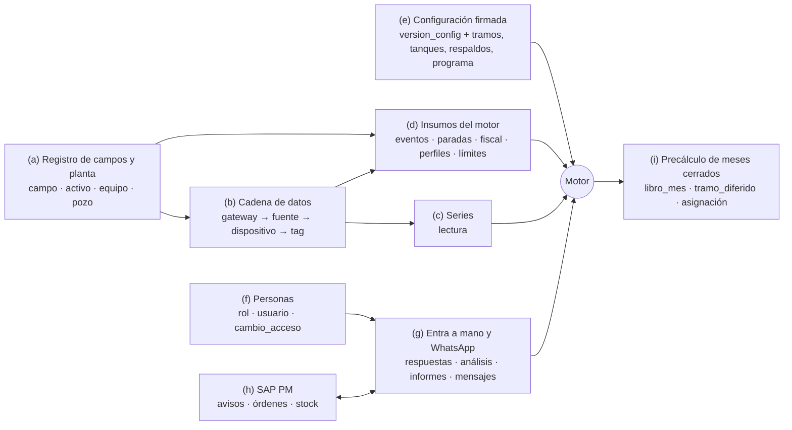
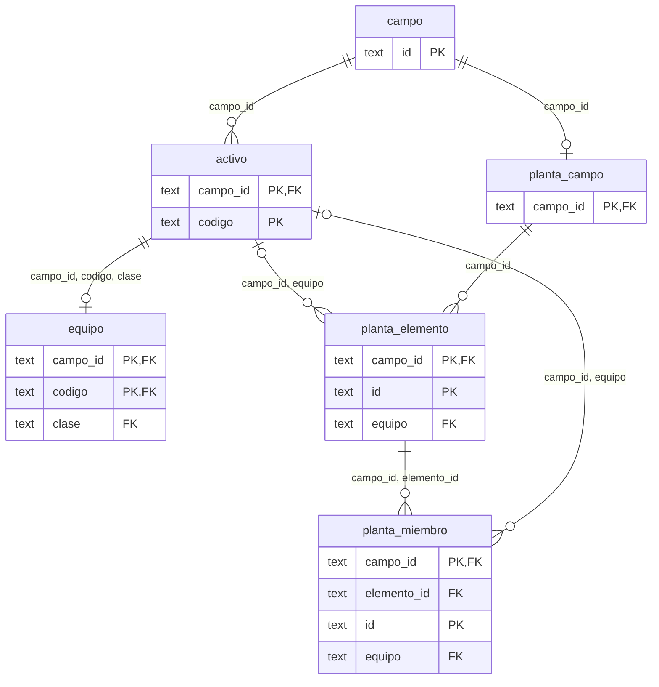
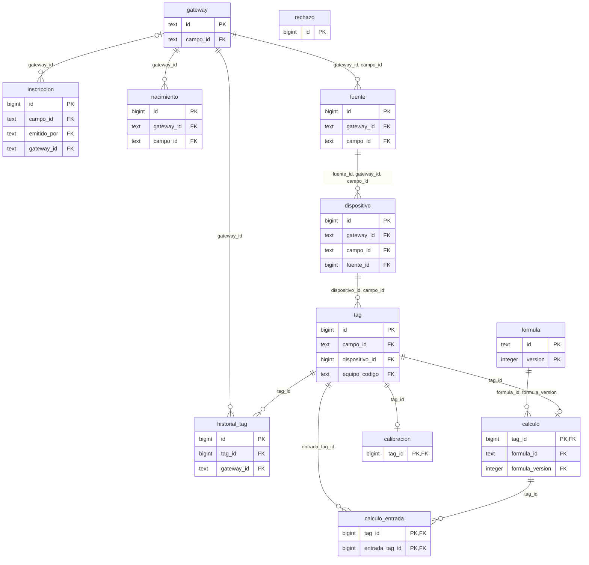
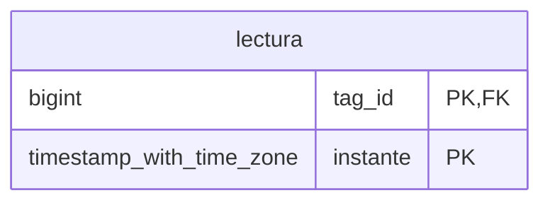
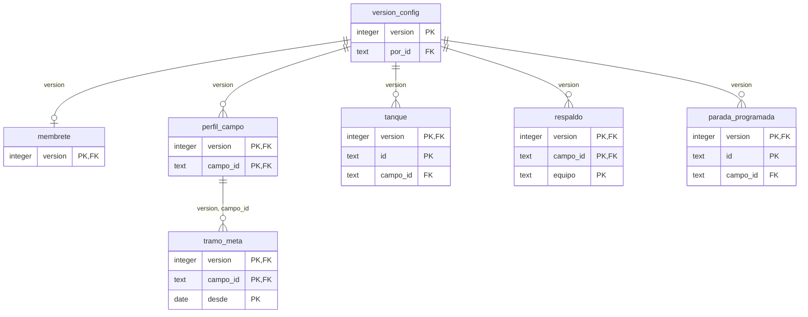
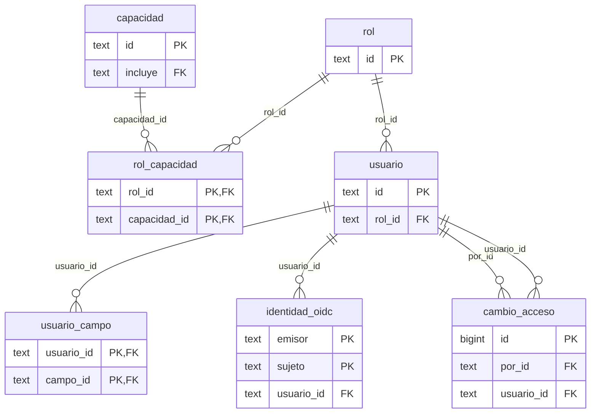
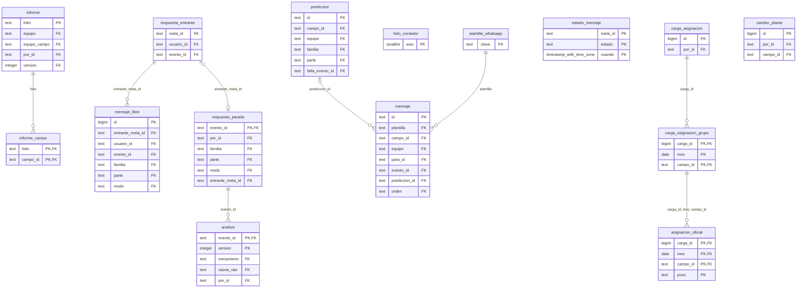
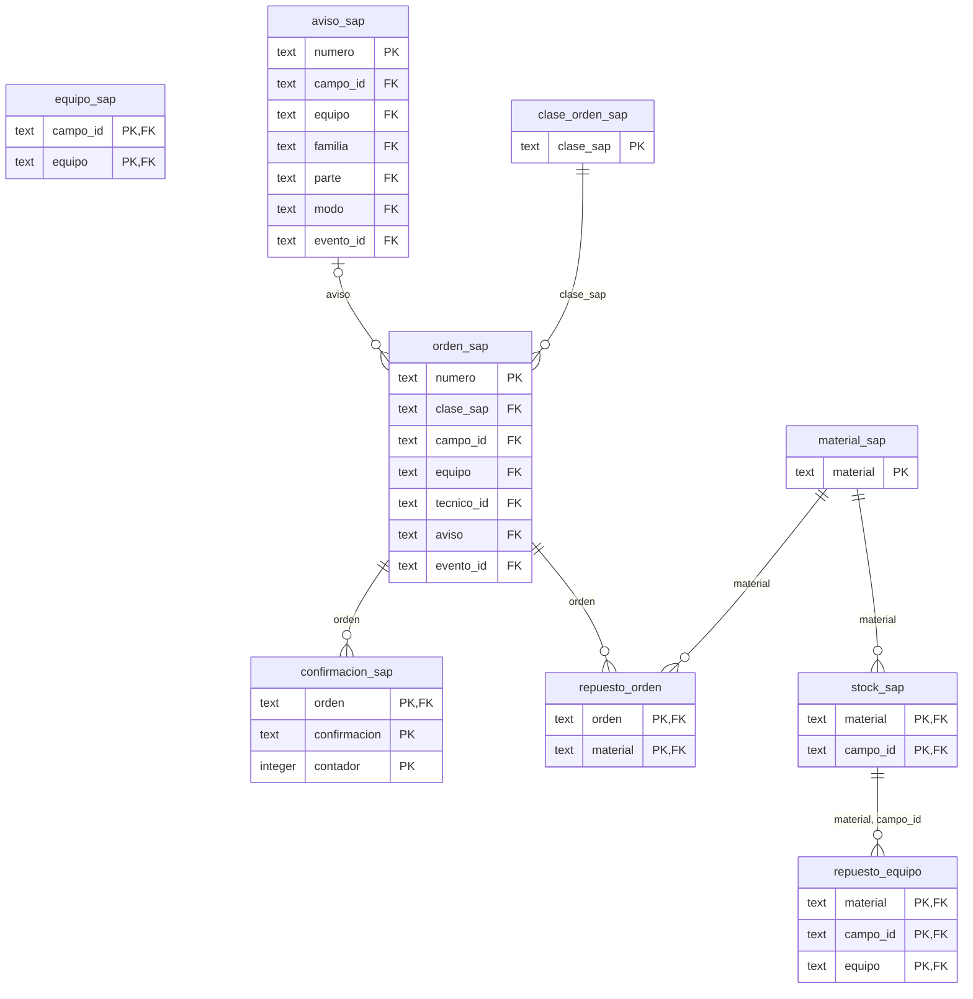
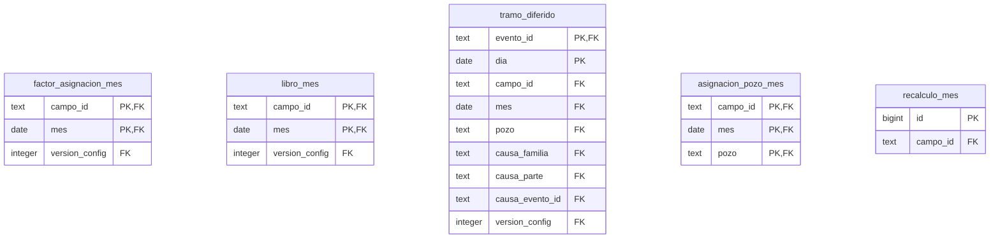

# 3. Modelo de datos

Este capítulo es la base de datos del servidor: **qué se guarda, en qué tabla, quién lo escribe, qué endpoint lo lee y qué reglas obliga la base** (no solo el código). Es PostgreSQL 16; TimescaleDB es opcional. El capítulo 4 cuenta cómo llegan los datos del borde a estas tablas; los capítulos 5A a 5D, qué calcula el motor con ellas; el 7, los endpoints.

Todo lo de este capítulo está en la carpeta `sql/`:

| Archivo | Qué es |
|---|---|
| `esquema.sql` | El esquema completo, ejecutable con `psql -v ON_ERROR_STOP=1 -f esquema.sql`. Cada tabla y cada columna tienen su `COMMENT` en español. |
| `timescale.sql` | Opcional, se corre **después** y solo si la extensión existe: convierte `lectura` en hipertabla con trozos de un mes, compresión y agregados continuos por hora y por día. |
| `ejemplos.sql` | 9.992 filas **reales del demo** en 72 tablas (sale de `referencia/` y del motor; ninguna inventada). |
| `pruebas.sql` | 90 pruebas de que las restricciones muerden (78 rechazos y 12 aceptaciones esperadas). |
| `cuadres.sql` | Las identidades del motor comprobadas sobre los datos cargados. |
| `tablas.json` | La especificación para el Excel: grupos, tablas, columnas, filas de ejemplo y relaciones. Coincide 1:1 con `esquema.sql` (lo comprueba `herramientas/comprobar-tablas.mjs`). |
| `validacion.log` | La corrida de todo lo anterior en un PostgreSQL 16 temporal. |
| `herramientas/` | Los scripts que generan y comprueban (se pueden volver a correr con `herramientas/validar.sh <raíz del proyecto>`). |

## 3.1 Convenciones

**Tipos.**

| Dato | Tipo | Por qué |
|---|---|---|
| Un instante (inicio de un evento, hora de una firma) | `timestamptz` | Se guarda en UTC; la API lo escribe en hora de Colombia con zona y milisegundos (`2026-10-02T14:00:00.000-05:00`, función `fecha_iso_co`). Un instante sin zona es ambiguo en un campo que opera de noche. |
| Un día del campo (fiscal, tramo por día) | `date` | El día de Colombia: de 00:00 a 24:00 de Bogotá (05:00 a 05:00 UTC). |
| Un mes | `date` con día 1 | El contrato lo escribe `AAAA-MM`; la base lo guarda como el día 1 para poder compararlo y sumarle meses. |
| Barriles, bbl/d, USD/bbl, horas cobradas | `numeric` | Sin redondeo binario: lo que se suma en un mes tiene que cuadrar al barril. |
| Lectura de un instrumento | `double precision` | Es lo que da el PLC (IEEE-754); no se suma en el libro. |
| Listas cortas que se leen enteras (cambios de una firma, evidencia de un aviso) | `text[]` | |
| Lo que se guarda tal como llegó o se firmó (la `Config`, el nacimiento, los parámetros de un mensaje, las cifras de un informe) | `jsonb` | Es el registro tal cual; cuando además hay que consultar por partes, existe su forma normalizada (configuración firmada). |

**Un dato ausente es NULL, nunca 0.** El fiscal de un día sin dato del computador de flujo (`produccion_fiscal_diaria.bbl`), un precio sin configurar (`tramo_meta.netback_usd`), un °API que el laboratorio no ha reportado (`metrologia_campo.api`), el lado de una alarma que no existe (`alarma_tag.alta`) o un instrumento sin señal (`lectura.valor` con calidad `mala`). Ninguna columna de esas tiene `default 0`.

**Solo inserción.** Un trigger (`solo_insercion`) rechaza `UPDATE`, `DELETE` y `TRUNCATE` con SQLSTATE `23001` en: `version_config` y su forma normalizada (`membrete`, `perfil_campo`, `tramo_meta`, `tanque`, `respaldo`, `parada_programada`), `cambio_acceso`, `mensaje` y `mensaje_libre` (salvo poner una vez el id de Meta), `estado_mensaje`, `respuesta_entrante`, `respuesta_parada`, `analisis`, `informe`, `informe_campo`, `carga_asignacion`, `carga_asignacion_grupo`, `asignacion_oficial`, `cambio_planta`, `historial_tag`, `nacimiento`, `rechazo`, `alarma_tag`, `evento` y `recalculo_mes`. Los eventos del borde (`evento_pozo`, `evento_servicio`, `parada_bomba`) solo admiten **cerrarse** (poner `fin` una vez) y, en una parada, **poner la firma** una vez (`evento_solo_cierre`). Las predicciones solo admiten **agregar la calificación** una vez (`prediccion_califica`). A nadie se le borra del registro de personas (`usuario_reglas`). En todas estas tablas un trigger de sentencia (`<tabla>_sin_truncate`) rechaza también `TRUNCATE`, que no dispara los triggers de fila: sin él, un `TRUNCATE … CASCADE` vaciaría el registro sin pasar por la regla. El precálculo no se corrige en sitio (`precalculo_no_se_actualiza`): un mes se recalcula entero.

**Las reglas viven en la base además del código.** Lo que el contrato pide con 409 o 422 y que se puede decir como restricción está en la base: la primera respuesta gana (clave primaria), un aviso abierto por equipo (índice único parcial), el WhatsApp único entre no suspendidos (índice único parcial), los rangos de `validarConfig` (CHECK), el candado optimista de la configuración (`version = base + 1`). Así un segundo cliente, un script de carga o un error del servidor no puede dejar la base en un estado que el contrato prohíbe. Las reglas que dependen de la hora («lo de un mes cerrado no cambia», «una parada solo se programa antes de que empiece») las aplica el servidor con `validarConfig` y su hora; la base no conoce «ahora» al validar.

**Cómo se traduce un error de la base a HTTP.** El servidor captura el SQLSTATE y responde con el error único del contrato (el `mensaje` en español y sin detalles de SQL):

| SQLSTATE | Qué lo dispara | HTTP y código del contrato |
|---|---|---|
| `23505` en `respuesta_parada_pkey` | segunda respuesta al mismo evento | 409 `conflicto` («Ya respondió …») |
| `23505` en `aviso_sap_uno_abierto` | segundo aviso abierto del equipo | 409 `conflicto` con el número del abierto |
| `23505` en `version_config_pkey` | otro firmó sobre la misma base | 409 `version-cambio` |
| `23505` en `usuario_telefono_unico` / `usuario_correo_unico` | WhatsApp o correo repetido | 422 `acceso-invalido` con `errores[{campo:'whatsapp'|'correo'}]` |
| `23505` en `respuesta_entrante_pkey` | Meta reintentó el mismo mensaje | 200 al webhook (ya estaba) |
| `23514` (CHECK o trigger de regla) | un rango o una regla de forma | 422 `peticion-invalida` o el código propio (`texto-corto`, `descripcion-corta`…) |
| `23514` de `usuario_coherente` (último gerente) | dejar la operación sin gerente activo | 409 `conflicto` |
| `23503` (clave foránea) | un recurso que no existe (equipo, campo, evento) | 404 o 422 según el endpoint (`equipo-desconocido`, `campo-desconocido`) |
| `23001` (solo inserción) | el servidor intentó corregir un registro | 500 `interno`: es un error de programación, no del usuario |

Las validaciones que el contrato exige **antes** que la forma (capacidad 403, recurso 404, campo del cuerpo 422, campo de la persona 403) se revisan en el servidor en ese orden (`escrituras.ts`) antes de tocar la base; la base es la última línea.

## 3.2 Los nueve grupos

| Grupo | Para qué | Tablas |
|---|---|---|
| [(a) Registro de campos y planta](#33-a-registro-de-campos-y-planta) | Quién es cada campo, qué activos tiene (equipos de superficie y pozos) y la topología de su planta. Un cliente nuevo son filas aquí, no código. | 6: `campo`, `activo`, `equipo`, `planta_campo`, `planta_elemento`, `planta_miembro` |
| [(b) Cadena de datos](#34-b-cadena-de-datos) | Del gateway del borde al tag: se llena sola con el nacimiento de Sparkplug B (NBIRTH/DBIRTH). Da la procedencia de cada número y la banda normal versionada de cada tag. | 12: `gateway`, `inscripcion`, `nacimiento`, `rechazo`, `fuente`, `dispositivo`, `tag`, `historial_tag`, `formula`, `calculo`, `calculo_entrada`, `calibracion` |
| [(c) Series](#35-c-series) | La lectura de cada tag en el tiempo (tag, instante, valor, calidad), particionada por mes; opcionalmente hipertabla de TimescaleDB. | 1: `lectura` |
| [(d) Insumos del motor](#36-d-insumos-del-motor) | Lo que el borde entrega y el motor consume (interfaz Insumos): pozos y pruebas, eventos de los controladores, paradas de bombas, caídas de servicios, fiscal diario, metrología, perfiles de bomba, límites y alarmas, y el catálogo de daños de ISO 14224. | 27: `pozo`, `prueba_pozo`, `evento`, `evento_pozo`, `evento_servicio`, `parada_bomba`, `punto_medicion`, `mes_fiscal`, `produccion_fiscal_diaria`, `metrologia_campo`, `banda_regulatoria`, `perfil_bomba`, `perfil_bomba_tag`, `perfil_bomba_pozo`, `alarma_tag`, `ajuste_variador`, `modo_falla`, `mecanismo_falla`, `causa_raiz`, `modo_por_clase`, `clase_catalogo`, `clase_iso_catalogo`, `parte`, `parte_variable`, `parte_modo`, `mapeo_catalogo_sap`, `perfil_bomba_primera_alarma` |
| [(e) Configuración firmada](#37-e-configuracion-firmada) | Lo único técnico que entra a mano: metas, precio, regla de cierre, perfil, tanques, respaldos, programa y membrete. Cada firma es una versión completa e inmutable. | 7: `version_config`, `membrete`, `perfil_campo`, `tramo_meta`, `tanque`, `respaldo`, `parada_programada` |
| [(f) Personas](#38-f-personas) | Roles y capacidades del producto, usuarios con sus campos y su WhatsApp, la identidad del SSO y el rastro de cambios de acceso. | 7: `rol`, `capacidad`, `rol_capacidad`, `usuario`, `usuario_campo`, `identidad_oidc`, `cambio_acceso` |
| [(g) Lo que entra a mano y WhatsApp](#39-g-lo-que-entra-a-mano-y-whatsapp) | Respuestas de los operarios, análisis de confiabilidad, informes con folio, el registro de WhatsApp (saliente y entrante), predicciones del vigía, la asignación oficial cargada y los cambios de planta. | 15: `plantilla_whatsapp`, `prediccion`, `respuesta_entrante`, `respuesta_parada`, `analisis`, `folio_contador`, `informe`, `informe_campo`, `mensaje`, `mensaje_libre`, `estado_mensaje`, `carga_asignacion`, `carga_asignacion_grupo`, `asignacion_oficial`, `cambio_planta` |
| [(h) Lo que se lee de SAP PM](#310-h-lo-que-se-lee-de-sap-pm) | Espejo de lo que TRIM necesita de SAP: identidad del equipo, avisos, órdenes con sus horas y repuestos, y stock. TRIM no crea órdenes. | 9: `equipo_sap`, `clase_orden_sap`, `aviso_sap`, `orden_sap`, `confirmacion_sap`, `material_sap`, `repuesto_orden`, `stock_sap`, `repuesto_equipo` |
| [(i) Precálculo de meses cerrados](#311-i-precalculo-de-meses-cerrados) | Caché verificable del motor para meses cerrados y publicados: libro del mes por campo, factor de asignación, tramos por día y asignación por pozo. | 5: `factor_asignacion_mes`, `libro_mes`, `tramo_diferido`, `asignacion_pozo_mes`, `recalculo_mes` |

**Total: 89 tablas y 9 vistas, 144 claves foráneas.** Las particiones mensuales de `lectura` (`lectura_AAAA_MM`) no se cuentan como tablas.

Dos **supertipos** ordenan las claves foráneas:

- **`activo`** (campo, código, clase): todo lo que tiene código en un campo es un equipo de superficie (`equipo`, clase `catalogo`) o un pozo (`pozo`, clase `pozo`). Lo que puede apuntar a cualquiera de los dos (un aviso de SAP de `K-101` o de `LC-14`, una predicción, el programa de paradas que trae bombas y pozos, un tag) apunta a `activo`. Es `ClaseEquipo` de `src/entities/equipo-vivo.ts`. El mismo código existe en varios campos (`P-201B` está en La Ceiba, Morichal, Guacamayo, El Palmar y La Zarza): la identidad es siempre **(campo, código)**.
- **`evento`** (id, campo, clase, activo): un id por hecho del borde, sea de un pozo (`evento_pozo`), de una bomba (`parada_bomba`) o de un servicio (`evento_servicio`). `POST /api/paradas/:evento/respuesta` no dice de qué clase es el evento y `refs.eventos["<id>"]` lo nombra por id solo: el id tiene que ser único en todo el sistema. La respuesta, el análisis, el aviso, la orden, el tramo y el mensaje apuntan a `evento`. Cada subtipo tiene una clave foránea compuesta `(id, clase, campo_id, activo)` hacia `evento`, así un id no puede ser a la vez de un pozo y de una bomba, ni de otro campo.

## 3.3 (a) Registro de campos y planta

Quién es cada campo, qué activos tiene (equipos de superficie y pozos) y la topología de su planta. Un cliente nuevo son filas aquí, no código.

#### `campo`

Registro de campos de la empresa (tipo Campo, src/entities/tipos.ts). GET /api/campos. Un cliente nuevo son filas aquí, no código. Las metas, el perfil y el precio NO viven aquí: son configuración firmada.

- **Tipo TS:** Campo (src/entities/tipos.ts).
- **Quién escribe:** Implementación (alta de un cliente o de un campo); no hay endpoint de escritura.
- **Quién lee:** `GET /api/campos`.
- **Clave:** (id).
- **Columnas (5):** `id`*, `nombre`*, `cuenca`*, `choke`*, `nota`* (con * = no nula; tipos, checks y descripción de cada una en `tablas.json`).
- **Reglas:**
  - El catálogo no puede traer un campo que no esté aquí (el arranque se detiene).
  - La configuración firmada solo acepta campos del registro (validarConfig, 422).
- **La apuntan:** `activo`, `planta_campo`, `gateway`, `inscripcion`, `nacimiento`, `punto_medicion`, `mes_fiscal`, `metrologia_campo`, `perfil_campo`, `tanque`, `respaldo`, `parada_programada`, `usuario_campo`, `stock_sap`, `informe_campo`, `carga_asignacion_grupo`, `cambio_planta`, `recalculo_mes`.
- **Fila real del demo:** `{"id":"ceiba","nombre":"La Ceiba","cuenca":"Llanos","choke":"Planta","nota":"Tres bombas de agua en paralelo, sin reserva: si para una, se cierran pozos."}`

#### `activo`

Supertipo: todo lo que tiene código en un campo. clase=catalogo es un equipo de superficie (tabla equipo); clase=pozo es un pozo (tabla pozo). Corresponde a ClaseEquipo de src/entities/equipo-vivo.ts. Un mismo código existe en varios campos (P-201B): la identidad es (campo, código).

- **Tipo TS:** ClaseEquipo (src/entities/equipo-vivo.ts).
- **Quién escribe:** Servidor, al dar de alta un equipo o un pozo.
- **Quién lee:** `(interna: destino de las FK a «equipo o pozo»)`.
- **Clave:** (campo_id, codigo).
- **Columnas (3):** `campo_id`*, `codigo`*, `clase`* (con * = no nula; tipos, checks y descripción de cada una en `tablas.json`).
- **Reglas:**
  - Un código es único en su campo; el mismo código existe en varios campos (P-201B).
  - Único: (campo_id, codigo, clase).
- **Apunta a:** `campo` por (campo_id) N:1.
- **La apuntan:** `equipo`, `planta_elemento`, `planta_miembro`, `tag`, `pozo`, `evento`, `equipo_sap`, `aviso_sap`, `orden_sap`, `repuesto_equipo`, `prediccion`, `informe`, `mensaje`.
- **Fila real del demo:** `{"campo_id":"ceiba","codigo":"C-401","clase":"catalogo"}`

#### `equipo`

Registro de ingeniería: un equipo de superficie en un campo (la parte estática de Equipo/EquipoEnCampo, src/entities/tipos.ts y equipos.ts). Lo declara el cliente una vez. Sale en GET /api/catalogo → campos[c].registroEquipos y en el inventario de Conectores. Lo vivo (marcha, estado, severidad, lecturas) NO se guarda aquí: lo calcula el servidor.

- **Tipo TS:** Equipo / EquipoEnCampo, parte estática (src/entities/tipos.ts, equipos.ts).
- **Quién escribe:** Ingeniería del cliente, una vez por campo (registro de ingeniería).
- **Quién lee:** `GET /api/catalogo → campos[c].registroEquipos`, `GET /api/campos/:campo/inventario → equipos`, `GET /api/vistas/equipos…`.
- **Clave:** (campo_id, codigo).
- **Columnas (16):** `campo_id`*, `codigo`*, `clase`*, `nombre`*, `sistema`*, `clase_iso`*, `criticidad`*, `servicio`, `modo_falla`, `norma`, `intervencion_ubicacion`, `intervencion_accion`, `intervencion_avisar_a`, `distribucion_falla`, `aguas_abajo`, `redundancia` (con * = no nula; tipos, checks y descripción de cada una en `tablas.json`).
- **Reglas:**
  - servicio dice qué tipo de causa se carga cuando cae (aire, energia…); la regla no depende del id.
  - equipo.fiscal de la API sale de punto_medicion.
  - aguas_abajo y redundancia son del registro del campo; en una bomba de la línea van NULL y la API los arma del respaldo firmado (respaldoEnCampo).
- **Apunta a:** `activo` por (campo_id, codigo, clase) 1:1.
- **La apuntan:** `evento_servicio`, `parada_bomba`, `punto_medicion`, `perfil_bomba`.
- **Fila real del demo:** `{"campo_id":"ceiba","codigo":"C-401","clase":"catalogo","nombre":"Compresor de gas","sistema":"Compresión","clase_iso":"compresor-gas","criticidad":4,"servicio":"compresion","modo_falla":"Válvulas de succión y descarga ≈ 50,7 %","norma":"El modo de falla #1 de…`

#### `planta_campo`

Cabecera del esquema de planta de un campo: caudales de diseño y los cuatro cuellos de botella (Caudales y Chokes de PlantaCampo, src/entities/planta.ts). Sale en GET /api/catalogo → campos[c].planta. Un campo sin fila aquí no trae planta (hueco), nunca la de otro.

- **Tipo TS:** PlantaCampo: caudales, chokes, nota (src/entities/planta.ts).
- **Quién escribe:** Implementación; los cambios de trenes y miembros por POST /api/planta/cambios (conector:configurar).
- **Quién lee:** `GET /api/catalogo → campos[c].planta`.
- **Clave:** (campo_id).
- **Columnas (12):** `campo_id`*, `crudo_bpd`*, `crudo_cap_bpd`*, `agua_bpd`*, `agua_cap_bpd`*, `gas_bpd`*, `gas_cap_bpd`*, `choke_pozos`*, `choke_planta`*, `choke_evacuacion`*, `choke_mercado`*, `nota`* (con * = no nula; tipos, checks y descripción de cada una en `tablas.json`).
- **Reglas:**
  - Un campo sin planta no trae planta (hueco), nunca la de otro.
- **Apunta a:** `campo` por (campo_id) 1:1.
- **La apuntan:** `planta_elemento`.
- **Fila real del demo:** `{"campo_id":"ceiba","crudo_bpd":10450,"crudo_cap_bpd":12000,"agua_bpd":224200,"agua_cap_bpd":267750,"gas_bpd":3850,"gas_cap_bpd":4200,"choke_pozos":12500,"choke_planta":11800,"choke_evacuacion":14000,"choke_mercado":15000,"nota":"El agua (95 % de lo que sale d…`

#### `planta_elemento`

Un elemento de un tren del esquema de planta (Elemento, src/entities/planta.ts). Cambia solo con POST /api/planta/cambios (agregar-elemento, quitar-elemento), que registra cambio_planta.

- **Tipo TS:** Elemento (src/entities/planta.ts).
- **Quién escribe:** Servidor al aplicar aplicarCambioPlanta (administrador, conector:configurar).
- **Quién lee:** `GET /api/catalogo → campos[c].planta`, `POST /api/planta/cambios (agregar-elemento, quitar-elemento)`.
- **Clave:** (campo_id, id).
- **Columnas (15):** `campo_id`*, `id`*, `tren`*, `orden`*, `simbolo`*, `etiqueta`*, `equipo`, `pie`, `nivel_tag`, `nivel_tope`, `fluido`, `pmo`, `rama`*, `restantes_cuantos`, `restantes_etiqueta` (con * = no nula; tipos, checks y descripción de cada una en `tablas.json`).
- **Reglas:**
  - Un id no se repite entre elementos y miembros del campo (409/422).
  - Único: (campo_id, tren, orden).
  - Un id no se repite entre elementos y miembros del campo. [trigger planta_elemento_id_unico: INSERT UPDATE]
- **Apunta a:** `activo` por (campo_id, equipo) N:1; `planta_campo` por (campo_id) N:1.
- **La apuntan:** `planta_miembro`.
- **Fila real del demo:** `{"campo_id":"ceiba","id":"aire","tren":"servicios","orden":1,"simbolo":"aire","etiqueta":"Aire de instrumentos","equipo":"K-101","pie":null,"nivel_tag":null,"nivel_tope":null,"fluido":null,"pmo":null,"rama":false,"restantes_cuantos":null,"restantes_etiqueta":n…`

#### `planta_miembro`

Miembro de un elemento con varios del mismo tipo (pozos, tanques en especificación): Miembro de src/entities/planta.ts. Cambia con agregar-miembro / quitar-miembro.

- **Tipo TS:** Miembro (src/entities/planta.ts).
- **Quién escribe:** Servidor al aplicar aplicarCambioPlanta.
- **Quién lee:** `GET /api/catalogo → campos[c].planta`, `POST /api/planta/cambios (agregar-miembro, quitar-miembro)`.
- **Clave:** (campo_id, id).
- **Columnas (11):** `campo_id`*, `elemento_id`*, `id`*, `orden`*, `etiqueta`*, `equipo`, `pie`, `nivel_tag`, `nivel_tope`, `fluido`, `pmo` (con * = no nula; tipos, checks y descripción de cada una en `tablas.json`).
- **Reglas:**
  - El grupo tiene que existir y admitir miembros (422 «Ese conjunto no existe»).
  - Único: (campo_id, elemento_id, orden).
  - Un id no se repite entre elementos y miembros del campo. [trigger planta_miembro_id_unico: INSERT UPDATE]
- **Apunta a:** `planta_elemento` por (campo_id, elemento_id) N:1; `activo` por (campo_id, equipo) N:1.
- **Fila real del demo:** `{"campo_id":"ceiba","elemento_id":"pozos","id":"LC-09","orden":1,"etiqueta":"LC-09 · ESP","equipo":"LC-09","pie":null,"nivel_tag":null,"nivel_tope":null,"fluido":null,"pmo":null}`

## 3.4 (b) Cadena de datos

Del gateway del borde al tag: se llena sola con el nacimiento de Sparkplug B (NBIRTH/DBIRTH). Da la procedencia de cada número y la banda normal versionada de cada tag.

Fuera del diagrama, las tablas de este grupo apuntan además a: `campo` (a), `usuario` (f), `activo` (a).

#### `gateway`

Gateway del borde (nodo de Sparkplug B): se crea solo al recibir su NBIRTH. Es del campo donde se inscribió; si se presenta con otro, el nacimiento se rechaza (403 gateway-de-otro-campo, tabla rechazo). GET /api/campos/:campo/inventario y bloque tecnico de la procedencia.

- **Quién escribe:** Borde (NBIRTH), autenticado por certificado de cliente.
- **Quién lee:** `POST /api/ingesta/nacimiento`, `GET /api/campos/:campo/inventario`, `GET …/tags/:tag/procedencia → tecnico`.
- **Clave:** (id).
- **Columnas (10):** `id`*, `campo_id`*, `modelo`, `serie`, `firmware`, `enlace`, `buffer_h`, `certificado_huella`, `primer_visto`*, `ultimo_visto`* (con * = no nula; tipos, checks y descripción de cada una en `tablas.json`).
- **Reglas:**
  - Un gateway inscrito en un campo que se presenta con otro: 403 gateway-de-otro-campo y fila en rechazo.
  - Único: (id, campo_id).
- **Apunta a:** `campo` por (campo_id) N:1.
- **La apuntan:** `inscripcion`, `nacimiento`, `fuente`, `historial_tag`.
- **Fila real del demo:** `{"id":"EPIC-CEIBA-01","campo_id":"ceiba","modelo":"GRV-EPIC-PR1","serie":"GRVCEI0016","firmware":"3.6.2","enlace":"starlink","buffer_h":48,"certificado_huella":null,"primer_visto":"2026-10-02T19:00:00+00:00","ultimo_visto":"2026-10-02T19:00:00+00:00"}`

#### `inscripcion`

Código de un solo uso con que un gateway nuevo se inscribe en un campo (POST /api/inscripcion, capacidad conector:configurar). En producción se canjea por el certificado de cliente en el primer contacto. Se guarda la huella del código, nunca el código.

- **Quién escribe:** Persona con conector:configurar y el campo asignado; el borde la canjea.
- **Quién lee:** `POST /api/inscripcion`.
- **Clave:** (id).
- **Columnas (8):** `id`*, `campo_id`*, `codigo_huella`*, `emitido`*, `expira`*, `emitido_por`*, `canjeado`, `gateway_id` (con * = no nula; tipos, checks y descripción de cada una en `tablas.json`).
- **Reglas:**
  - Un solo uso; vence a las 24 h.
  - Se guarda la huella del código, nunca el código.
  - Único: (codigo_huella).
- **Apunta a:** `campo` por (campo_id) N:1; `usuario` por (emitido_por) N:1; `gateway` por (gateway_id) N:1.
- **Fila real del demo:** el demo no trae filas de esta tabla (se llena con el uso: ver `pruebas.sql` para ejemplos de escritura).

#### `nacimiento`

Bitácora de nacimientos aceptados (NBIRTH + DBIRTH; POST /api/ingesta/nacimiento → { gateway, tags, pendientes }). Solo inserción: cada reconexión de Sparkplug es una fila.

- **Quién escribe:** Borde.
- **Quién lee:** `POST /api/ingesta/nacimiento`.
- **Clave:** (id).
- **Columnas (8):** `id`*, `gateway_id`*, `campo_id`*, `recibido`*, `bd_seq`, `tags`*, `pendientes`*, `carga`* (con * = no nula; tipos, checks y descripción de cada una en `tablas.json`).
- **Reglas:**
  - Todo o nada: con una falta, 400 con faltas[] y nada escrito.
  - Solo inserción.
  - Solo inserción: UPDATE, DELETE y TRUNCATE rechazados (SQLSTATE 23001). [trigger nacimiento_sin_truncate: TRUNCATE]
  - Solo inserción: UPDATE, DELETE y TRUNCATE rechazados (SQLSTATE 23001). [trigger nacimiento_solo_insercion: UPDATE DELETE]
- **Apunta a:** `campo` por (campo_id) N:1; `gateway` por (gateway_id) N:1.
- **Fila real del demo:** `{"id":1,"gateway_id":"EPIC-CEIBA-02","campo_id":"ceiba","recibido":"2026-10-02T19:00:00+00:00","bd_seq":null,"tags":3,"pendientes":3,"carga":{"campo":"ceiba","gateway":{"id":"EPIC-CEIBA-02","serie":"GRVCEI9003","enlace":"starlink","modelo":"GRV-EPIC-PR1","buff…`

#### `rechazo`

Nacimientos rechazados: un borde que se presenta con otro campo o declara tags de otro gateway es un hecho de seguridad y queda escrito (fuera de la transacción del nacimiento, que se deshizo). Solo inserción. Sin FK: el gateway o el campo pueden no existir.

- **Quién escribe:** Servidor, fuera de la transacción del nacimiento rechazado.
- **Quién lee:** `POST /api/ingesta/nacimiento (403/409)`.
- **Clave:** (id).
- **Columnas (7):** `id`*, `cuando`*, `gateway_id`, `campo_id`, `codigo`*, `motivo`*, `tags` (con * = no nula; tipos, checks y descripción de cada una en `tablas.json`).
- **Reglas:**
  - Solo inserción.
  - Solo inserción: UPDATE, DELETE y TRUNCATE rechazados (SQLSTATE 23001). [trigger rechazo_sin_truncate: TRUNCATE]
  - Solo inserción: UPDATE, DELETE y TRUNCATE rechazados (SQLSTATE 23001). [trigger rechazo_solo_insercion: UPDATE DELETE]
- **Fila real del demo:** el demo no trae filas de esta tabla (se llena con el uso: ver `pruebas.sql` para ejemplos de escritura).

#### `fuente`

Conector del borde hacia una fuente de datos del campo (un historiador PI, un servidor OPC UA, un PLC por Modbus, el computador de flujo por ROC Plus…). Sale de dispositivos[].fuente del nacimiento. El simulador junta fuente y dispositivo en una sola fila (id gateway:protocolo:dispositivo); aquí se separan.

- **Quién escribe:** Borde (dispositivos[].fuente del DBIRTH).
- **Quién lee:** `GET …/tags/:tag/procedencia → lectura.protocolo, tecnico.endpoint`.
- **Clave:** (id).
- **Columnas (6):** `id`*, `gateway_id`*, `campo_id`*, `protocolo`*, `endpoint`, `modo`* (con * = no nula; tipos, checks y descripción de cada una en `tablas.json`).
- **Reglas:**
  - Siempre solo-lectura: TRIM no escribe en el PLC.
  - Único: (gateway_id, protocolo, endpoint).
  - Único: (id, gateway_id, campo_id).
- **Apunta a:** `gateway` por (gateway_id, campo_id) N:1.
- **La apuntan:** `dispositivo`.
- **Fila real del demo:** `{"id":1,"gateway_id":"EPIC-CEIBA-02","campo_id":"ceiba","protocolo":"opc-ua","endpoint":"opc.tcp://skid-ceiba.ot.local:4840","modo":"solo-lectura"}`

#### `dispositivo`

Dispositivo de Sparkplug B declarado en un DBIRTH (dispositivos[] del nacimiento). Su nombre resuelve el mapeo: si coincide con el código de un equipo del campo, sus tags nacen descubiertos; si no, pendientes.

- **Quién escribe:** Borde (DBIRTH).
- **Quién lee:** `GET …/tags/:tag/procedencia → lectura.reloj`.
- **Clave:** (id).
- **Columnas (9):** `id`*, `gateway_id`*, `campo_id`*, `fuente_id`*, `nombre`*, `reloj`*, `primer_visto`*, `ultimo_visto`*, `en_linea`* (con * = no nula; tipos, checks y descripción de cada una en `tablas.json`).
- **Reglas:**
  - Si el nombre coincide con un equipo del campo, sus tags nacen descubiertos; si no, pendientes.
  - Único: (fuente_id, nombre).
  - Único: (id, campo_id).
  - Único: (id, gateway_id).
- **Apunta a:** `fuente` por (fuente_id, gateway_id, campo_id) N:1.
- **La apuntan:** `tag`.
- **Fila real del demo:** `{"id":1,"gateway_id":"EPIC-CEIBA-02","campo_id":"ceiba","fuente_id":1,"nombre":"SKID-AMPLIACION","reloj":"el PLC del skid","primer_visto":"2026-10-02T19:00:00+00:00","ultimo_visto":"2026-10-02T19:00:00+00:00","en_linea":true}`

#### `tag`

Registro de tags (descubierto del DBIRTH). Un tag es único en su campo y es del campo de su gateway (FK compuesta tag→dispositivo→fuente→gateway). La banda normal declarada aquí es la ÚNICA fuente de LimiteTag.normal; si un re-nacimiento la cambia, lo anterior queda en historial_tag. GET …/procedencia, …/inventario, …/tags/pendientes, POST …/tags/:tag/equipo.

- **Tipo TS:** LimiteTag.texto/normal (src/entities/limites.ts); procedencia.instrumento.
- **Quién escribe:** Borde (DBIRTH); el equipo, una persona con conector:configurar cuando el borde no lo resuelve.
- **Quién lee:** `GET …/tags/:tag/procedencia`, `GET /api/campos/:campo/inventario`, `GET /api/campos/:campo/tags/pendientes`, `POST /api/campos/:campo/tags/:tag/equipo`, `GET /api/catalogo → limites`.
- **Clave:** (id).
- **Columnas (14):** `id`*, `campo_id`*, `nombre`*, `dispositivo_id`*, `equipo_codigo`, `tipo`, `unidad`, `limite_texto`, `limite_bajo`, `limite_alto`, `cadencia_s`, `clase`*, `origen_mapeo`*, `actualizado`* (con * = no nula; tipos, checks y descripción de cada una en `tablas.json`).
- **Reglas:**
  - Solo el gateway que lo publica lo vuelve a declarar (409 tag-de-otro-gateway).
  - Un nacimiento nunca deshace un mapeo manual o por regla.
  - Si un re-nacimiento cambia banda, unidad, cadencia o calibración, lo anterior va a historial_tag.
  - Único: (campo_id, nombre).
  - Solo su gateway lo vuelve a declarar; un nacimiento no deshace un mapeo manual o por regla. [trigger tag_reglas: UPDATE]
- **Apunta a:** `activo` por (campo_id, equipo_codigo) N:1; `dispositivo` por (dispositivo_id, campo_id) N:1.
- **La apuntan:** `historial_tag`, `calculo`, `calculo_entrada`, `calibracion`, `lectura`, `alarma_tag`.
- **Fila real del demo:** `{"id":16,"campo_id":"ceiba","nombre":"FQI-0101","dispositivo_id":9,"equipo_codigo":"LACT-01","tipo":"Medidor de desplazamiento positivo","unidad":"BPDC","limite_texto":null,"limite_bajo":null,"limite_alto":null,"cadencia_s":60,"clase":"continua","origen_mapeo"…`

#### `historial_tag`

Versiones anteriores de la descripción de un tag: lo que un re-nacimiento cambió (banda normal, unidad, cadencia, clase o calibración) no se pierde. La banda que regía en un instante t es la de la primera fila con reemplazado > t, o la del tag si no la hay. Solo inserción.

- **Quién escribe:** Servidor, en el nacimiento que cambia el tag.
- **Quién lee:** `(auditoría; la banda que regía en t)`.
- **Clave:** (id).
- **Columnas (13):** `id`*, `tag_id`*, `reemplazado`*, `gateway_id`*, `tipo`, `unidad`, `limite_texto`, `limite_bajo`, `limite_alto`, `cadencia_s`, `clase`, `calibracion_hasta`, `calibracion_detalle` (con * = no nula; tipos, checks y descripción de cada una en `tablas.json`).
- **Reglas:**
  - Solo inserción.
  - Solo inserción: UPDATE, DELETE y TRUNCATE rechazados (SQLSTATE 23001). [trigger historial_tag_sin_truncate: TRUNCATE]
  - Solo inserción: UPDATE, DELETE y TRUNCATE rechazados (SQLSTATE 23001). [trigger historial_tag_solo_insercion: UPDATE DELETE]
- **Apunta a:** `gateway` por (gateway_id) N:1; `tag` por (tag_id) N:1.
- **Fila real del demo:** el demo no trae filas de esta tabla (se llena con el uso: ver `pruebas.sql` para ejemplos de escritura).

#### `formula`

Librería de fórmulas del producto, versionada e igual para todos los clientes. Una fórmula produce UNA variable (tipo_tag) de una clase de equipo. Solo aparece en un tag que ES ese cálculo (fuente calculado). Hoy la única es f1-compresor-aire (PDT-1011).

- **Quién escribe:** Producto (librería versionada, igual para todos los clientes).
- **Quién lee:** `GET …/tags/:tag/procedencia → calculo`.
- **Clave:** (id, version).
- **Columnas (7):** `id`*, `version`*, `clase_equipo`*, `tipo_tag`*, `expresion`*, `ventana_min`, `activa`* (con * = no nula; tipos, checks y descripción de cada una en `tablas.json`).
- **Reglas:**
  - Una sola versión activa por (clase de equipo, variable).
  - Índice único: CREATE UNIQUE INDEX formula_una_activa ON "trim".formula USING btree (clase_equipo, tipo_tag) WHERE activa.
- **La apuntan:** `calculo`.
- **Fila real del demo:** `{"id":"f1-compresor-aire","version":2,"clase_equipo":"compresor-aire","tipo_tag":"Derivada de presión","expresion":"pendiente de la presión de cabezal (PT-1011) en la ventana, en psi/h","ventana_min":15,"activa":true}`

#### `calculo`

Qué fórmula (y qué versión) produce un tag calculado. Se llena al registrar un tag de fuente calculado con la fórmula activa de (clase del equipo, tipo del tag). Es procedencia.calculo.

- **Quién escribe:** Servidor, al registrar un tag de fuente calculado.
- **Quién lee:** `GET …/tags/:tag/procedencia → calculo`.
- **Clave:** (tag_id).
- **Columnas (3):** `tag_id`*, `formula_id`*, `formula_version`* (con * = no nula; tipos, checks y descripción de cada una en `tablas.json`).
- **Reglas:**
  - Solo en tags de fuente calculado; hoy el único es PDT-1011.
- **Apunta a:** `formula` por (formula_id, formula_version) N:1; `tag` por (tag_id) 1:1.
- **La apuntan:** `calculo_entrada`.
- **Fila real del demo:** `{"tag_id":32,"formula_id":"f1-compresor-aire","formula_version":2}`

#### `calculo_entrada`

Tags de los que se deriva un tag calculado (PDT-1011 ← PT-1011): su reloj es «el tag del que se deriva».

- **Quién escribe:** Servidor (librería de fórmulas).
- **Quién lee:** `GET …/tags/:tag/procedencia`.
- **Clave:** (tag_id, entrada_tag_id).
- **Columnas (2):** `tag_id`*, `entrada_tag_id`* (con * = no nula; tipos, checks y descripción de cada una en `tablas.json`).
- **Apunta a:** `tag` por (entrada_tag_id) N:1; `calculo` por (tag_id) N:1.
- **Fila real del demo:** `{"tag_id":32,"entrada_tag_id":30}`

#### `calibracion`

Calibración vigente de un tag de medición en custodia (solo donde de verdad existe: computador de flujo, analizador de BSW, medidores de tanque). La declara el DBIRTH (metricas[].calibracion); lo anterior pasa a historial_tag. Es custodia.calibracion de la procedencia.

- **Tipo TS:** Dispositivo.calibracion (src/entities/tipos.ts); procedencia.custodia.calibracion.
- **Quién escribe:** Borde (metricas[].calibracion del DBIRTH).
- **Quién lee:** `GET …/tags/:tag/procedencia → custodia`.
- **Clave:** (tag_id).
- **Columnas (3):** `tag_id`*, `vigente_hasta`, `detalle`* (con * = no nula; tipos, checks y descripción de cada una en `tablas.json`).
- **Reglas:**
  - Solo donde de verdad hay medición en custodia.
  - Si el borde deja de declararla, se quita (y lo anterior queda en historial_tag).
- **Apunta a:** `tag` por (tag_id) 1:1.
- **Fila real del demo:** `{"tag_id":12,"vigente_hasta":null,"detalle":"Verificado contra cinta el 3 de marzo de 2026 · vigente hasta marzo de 2027"}`

**Vistas de este grupo.**

#### `v_procedencia`

GET /api/campos/:campo/tags/:tag/procedencia: instrumento, lectura, calculo, custodia y (solo con conector:configurar) tecnico. Las frases las escribe el front (cadena.ts). 404 tag-no-registrado si no hay fila.

- **Columnas:** `tag_id`, `tag`, `tipo`, `unidad`, `limite_texto`, `limite_bajo`, `limite_alto`, `cadencia_s`, `clase_tag`, `origen_mapeo`, `campo_id`, `protocolo`, `endpoint`, `modo`, `reloj`, `dispositivo`, `gateway_id`, `gateway_modelo`, `gateway_serie`, `gateway_firmware`, `enlace`, `buffer_h`, `ultimo_visto`, `equipo_codigo`, `equipo`, `clase_equipo`, `criticidad`, `formula_id`, `formula`, `formula_version`, `ventana_min`, `calibracion_hasta`, `calibracion_detalle`, `alarma_alta`, `alarma_baja`, `alarma_fuente`.
- **Tipo TS:** respuesta de GET …/procedencia.
- **Quién escribe:** (vista)
- **Quién lee:** `GET /api/campos/:campo/tags/:tag/procedencia`.
- **Reglas:**
  - tecnico solo con conector:configurar (lo decide el servidor).

## 3.5 (c) Series

La lectura de cada tag en el tiempo (tag, instante, valor, calidad), particionada por mes; opcionalmente hipertabla de TimescaleDB.

Fuera del diagrama, las tablas de este grupo apuntan además a: `tag` (b).

#### `lectura`

Serie de tiempo de cada tag: lo que llega del borde en DDATA (Sparkplug B) o del historiador. Particionada por mes. De aquí sale GET /api/campos/:campo/tags/:tag/serie (SerieTag, src/entities/tipos.ts: desde, pasoH, valores con null en los huecos) y la serie de cada dispositivo y señal en las vistas. Un hueco del historiador es la AUSENCIA de filas (o una fila de calidad mala): nunca un 0.

- **Tipo TS:** SerieTag (src/entities/tipos.ts).
- **Quién escribe:** Borde (DDATA de Sparkplug B) o el lector del historiador.
- **Quién lee:** `GET /api/campos/:campo/tags/:tag/serie?desde&paso`, `serie de cada dispositivo y señal en /api/vistas/…`.
- **Clave:** (tag_id, instante).
- **Columnas (7):** `tag_id`*, `instante`*, `valor`, `texto`, `calidad`*, `codigo_calidad`, `recibido`* (con * = no nula; tipos, checks y descripción de cada una en `tablas.json`).
- **Reglas:**
  - Un hueco es ausencia de filas o calidad mala: viaja como null EN SU LUGAR, nunca como 0.
  - Particionada por mes (hora de Colombia); sin partición por defecto.
- **Apunta a:** `tag` por (tag_id) N:1.
- **Fila real del demo:** `{"tag_id":24,"instante":"2026-09-21T19:00:00+00:00","valor":2.2,"texto":null,"calidad":"buena","codigo_calidad":null,"recibido":"2026-09-21T19:00:00+00:00"}`

## 3.6 (d) Insumos del motor

Lo que el borde entrega y el motor consume (interfaz Insumos): pozos y pruebas, eventos de los controladores, paradas de bombas, caídas de servicios, fiscal diario, metrología, perfiles de bomba, límites y alarmas, y el catálogo de daños de ISO 14224.

```mermaid
erDiagram
  pozo {
    text campo_id PK, FK
    text id PK, FK
    text clase FK
    text alimentador FK
  }
  prueba_pozo {
    text campo_id PK, FK
    text pozo PK, FK
    timestamp_with_time_zone fecha PK
  }
  evento {
    text id PK
    text campo_id FK
    text activo FK
  }
  evento_pozo {
    text id PK, FK
    text clase FK
    text campo_id FK
    text pozo FK
  }
  evento_servicio {
    text id PK, FK
    text clase FK
    text campo_id FK
    text equipo FK
  }
  parada_bomba {
    text id PK, FK
    text clase FK
    text campo_id FK
    text equipo FK
    text firma_parte FK
    text firma_familia FK
  }
  punto_medicion {
    text campo_id PK, FK
    text equipo FK
  }
  mes_fiscal {
    text campo_id PK, FK
    date mes PK
  }
  produccion_fiscal_diaria {
    text campo_id PK, FK
    date dia PK
    date mes FK
  }
  metrologia_campo {
    text campo_id PK, FK
    timestamp_with_time_zone vigente_desde PK
  }
  banda_regulatoria {
    text pais PK
    text fluido PK
    numeric desde_bpd PK
    text nombre PK
  }
  perfil_bomba {
    text campo_id PK, FK
    text equipo PK, FK
  }
  perfil_bomba_tag {
    text campo_id PK, FK
    text equipo PK, FK
    text variable PK
  }
  perfil_bomba_pozo {
    text campo_id PK, FK
    text equipo PK, FK
    text pozo PK, FK
  }
  alarma_tag {
    bigint tag_id PK, FK
    timestamp_with_time_zone vigente_desde PK
  }
  ajuste_variador {
    text campo_id PK, FK
    text pozo PK, FK
    text variable PK
  }
  modo_falla {
    text codigo PK
    text mecanismo_sugerido FK
  }
  mecanismo_falla {
    text codigo PK
  }
  causa_raiz {
    text codigo PK
  }
  modo_por_clase {
    text clase_iso PK
    text modo PK, FK
  }
  clase_catalogo {
    text clase PK
  }
  clase_iso_catalogo {
    text clase_iso PK
    text papel PK
    text clase FK
  }
  parte {
    text familia PK, FK
    text id PK
  }
  parte_variable {
    text familia PK, FK
    text parte PK, FK
    text variable PK
  }
  parte_modo {
    text familia PK, FK
    text parte PK, FK
    text modo PK, FK
  }
  mapeo_catalogo_sap {
    text nivel PK
    text codigo_trim PK
    text familia FK
    text perfil_catalogo_sap PK
  }
  perfil_bomba_primera_alarma {
    text campo_id PK, FK
    text equipo PK, FK
    text tag PK
    text familia FK
    text parte FK
  }
  pozo ||--o{ prueba_pozo : "campo_id, pozo"
  pozo ||--o{ evento_pozo : "campo_id, pozo"
  evento ||--|o evento_pozo : "id, clase, campo_id, pozo"
  evento ||--|o evento_servicio : "id, clase, campo_id, equipo"
  parte |o--o{ parada_bomba : "firma_familia, firma_parte"
  evento ||--|o parada_bomba : "id, clase, campo_id, equipo"
  punto_medicion ||--o{ produccion_fiscal_diaria : "campo_id"
  mes_fiscal |o--o{ produccion_fiscal_diaria : "campo_id, mes"
  perfil_bomba ||--o{ perfil_bomba_tag : "campo_id, equipo"
  perfil_bomba ||--o{ perfil_bomba_pozo : "campo_id, equipo"
  pozo ||--o{ perfil_bomba_pozo : "campo_id, pozo"
  pozo ||--o{ ajuste_variador : "campo_id, pozo"
  mecanismo_falla |o--o{ modo_falla : "mecanismo_sugerido"
  modo_falla ||--o{ modo_por_clase : "modo"
  clase_catalogo ||--o{ clase_iso_catalogo : "clase"
  clase_catalogo ||--o{ parte : "familia"
  parte ||--o{ parte_variable : "familia, parte"
  parte ||--o{ parte_modo : "familia, parte"
  modo_falla ||--o{ parte_modo : "modo"
  clase_catalogo |o--o{ mapeo_catalogo_sap : "familia"
  perfil_bomba ||--o{ perfil_bomba_primera_alarma : "campo_id, equipo, familia"
  parte ||--o{ perfil_bomba_primera_alarma : "familia, parte"
```

Fuera del diagrama, las tablas de este grupo apuntan además a: `activo` (a), `equipo` (a), `campo` (a), `tag` (b).

#### `pozo`

Pozo de un campo (Pozo, src/entities/pozos.ts). GET /api/campos/:campo/pozos y refs.pozos["campo/pozo"]. Sin origen y sin pruebas el pozo no tiene custodia: no se le asigna caudal.

- **Tipo TS:** Pozo (src/entities/pozos.ts).
- **Quién escribe:** Registro de ingeniería / maestro de pozos del cliente.
- **Quién lee:** `GET /api/campos/:campo/pozos`, `refs.pozos["campo/pozo"]`, `GET /api/catalogo → campos[c].pozos`.
- **Clave:** (campo_id, id).
- **Columnas (8):** `campo_id`*, `id`*, `clase`*, `levantamiento`*, `controlador`*, `alimentador`*, `origen`, `fuente_prueba` (con * = no nula; tipos, checks y descripción de cada una en `tablas.json`).
- **Reglas:**
  - Sin origen y sin pruebas no tiene custodia: no se le asigna caudal.
- **Apunta a:** `activo` por (campo_id, alimentador) N:1; `activo` por (campo_id, id, clase) 1:1.
- **La apuntan:** `prueba_pozo`, `evento_pozo`, `perfil_bomba_pozo`, `ajuste_variador`, `tramo_diferido`, `asignacion_pozo_mes`.
- **Fila real del demo:** `{"campo_id":"ceiba","id":"LC-01","clase":"pozo","levantamiento":"electrosumergible","controlador":"VSD-LC01","alimentador":"SE-2","origen":"instrumento","fuente_prueba":"Separador de prueba automatizado SP-CE1 · FT-CE1011 crudo · FT-CE1012 agua · AT-CE1013 cor…`

#### `prueba_pozo`

Prueba de pozo (Prueba, src/entities/pozos.ts; Pozo.pruebas). Rige desde su fecha hasta la siguiente; antes de la primera rige la primera (pruebaEn). Con el factor de asignación del mes da el crudo del pozo.

- **Tipo TS:** Prueba (src/entities/pozos.ts).
- **Quién escribe:** Borde (separador de prueba automatizado) o estimación de la propia electrosumergible.
- **Quién lee:** `GET /api/campos/:campo/pozos → pruebas[]`.
- **Clave:** (campo_id, pozo, fecha).
- **Columnas (6):** `campo_id`*, `pozo`*, `fecha`*, `crudo_bpd`*, `agua_bpd`*, `hz` (con * = no nula; tipos, checks y descripción de cada una en `tablas.json`).
- **Reglas:**
  - Rige desde su fecha hasta la siguiente; antes de la primera rige la primera (pruebaEn).
- **Apunta a:** `pozo` por (campo_id, pozo) N:1.
- **Fila real del demo:** `{"campo_id":"ceiba","pozo":"LC-01","fecha":"2025-10-06T17:00:00+00:00","crudo_bpd":401,"agua_bpd":10217,"hz":59.5}`

#### `evento`

Supertipo de los eventos del borde: un id único para todo el sistema (refs.eventos["id"] del contrato). clase pozo → evento_pozo, bomba → parada_bomba, servicio → evento_servicio.

- **Tipo TS:** refs.eventos (clave común de EventoPozo y EventoBomba).
- **Quién escribe:** Servidor, al registrar cualquier evento del borde.
- **Quién lee:** `(interna: destino de las FK a «un evento»)`.
- **Clave:** (id).
- **Columnas (5):** `id`*, `campo_id`*, `clase`*, `activo`*, `recibido`* (con * = no nula; tipos, checks y descripción de cada una en `tablas.json`).
- **Reglas:**
  - Un id es único en todo el sistema.
  - Solo inserción.
  - Único: (id, clase, campo_id, activo).
  - Solo inserción: UPDATE, DELETE y TRUNCATE rechazados (SQLSTATE 23001). [trigger evento_sin_truncate: TRUNCATE]
  - Solo inserción: UPDATE, DELETE y TRUNCATE rechazados (SQLSTATE 23001). [trigger evento_solo_insercion: UPDATE DELETE]
- **Apunta a:** `activo` por (campo_id, activo) N:1.
- **La apuntan:** `evento_pozo`, `evento_servicio`, `parada_bomba`, `aviso_sap`, `orden_sap`, `prediccion`, `respuesta_entrante`, `respuesta_parada`, `mensaje`, `mensaje_libre`, `tramo_diferido`.
- **Fila real del demo:** `{"id":"EP-LC04-260906-85","campo_id":"ceiba","clase":"pozo","activo":"LC-04","recibido":"2026-09-06T22:14:00+00:00"}`

#### `evento_pozo`

Evento del controlador de un pozo (EventoPozo, src/entities/pozos.ts): variador, controlador de bombeo o válvula de cabeza. GET /api/campos/:campo/pozos/eventos y refs.eventos. Es la unidad de cobro del libro. Eventos que se pisan en el mismo pozo: se guardan como llegan y el motor los normaliza (intervalosEfectivos, libro.ts) — capítulo 4.

- **Tipo TS:** EventoPozo (src/entities/pozos.ts).
- **Quién escribe:** Borde (controlador del pozo: variador, controlador de bombeo, válvula de cabeza).
- **Quién lee:** `GET /api/campos/:campo/pozos/eventos?desde&hasta`, `refs.eventos`.
- **Clave:** (id).
- **Columnas (10):** `id`*, `clase`*, `campo_id`*, `pozo`*, `inicio`*, `fin`, `codigo`*, `senal`*, `hz`, `recibido`* (con * = no nula; tipos, checks y descripción de cada una en `tablas.json`).
- **Reglas:**
  - La hora la pone el PLC y no se corrige: solo se cierra (fin) una vez.
  - Eventos que se pisan: se guardan como llegan y el motor los normaliza (un paro manda sobre un HZ; entre iguales, el primero).
  - Solo inserción: UPDATE, DELETE y TRUNCATE rechazados (SQLSTATE 23001). [trigger evento_pozo_sin_truncate: TRUNCATE]
  - La hora del PLC no se corrige: solo se pone fin a un evento abierto (una vez) y, en una parada, la firma (una vez); no se borra. [trigger evento_pozo_solo_cierre: UPDATE DELETE]
- **Apunta a:** `pozo` por (campo_id, pozo) N:1; `evento` por (id, clase, campo_id, pozo) 1:1.
- **La apuntan:** `tramo_diferido`.
- **Fila real del demo:** `{"id":"EP-MN07-260214-32","clase":"pozo","campo_id":"morichal","pozo":"MN-07","inicio":"2026-02-15T04:25:00+00:00","fin":"2026-02-16T04:58:00+00:00","codigo":"HZ","senal":"VSD-MN07 · frecuencia a 47 Hz","hz":47,"recibido":"2026-02-15T04:25:00+00:00"}`

#### `evento_servicio`

Caída de un servicio o equipo de proceso que apaga o frena pozos (EventoServicio, src/entities/pozos.ts). GET /api/campos/:campo/servicios/eventos. OJO: el tipo TS exige fin; la base admite NULL (servicio caído ahora) y el endpoint de insumo decide cómo entregarlo (capítulo 4, Huecos).

- **Tipo TS:** EventoServicio (src/entities/pozos.ts).
- **Quién escribe:** Borde (PLC o IED del servicio).
- **Quién lee:** `GET /api/campos/:campo/servicios/eventos?desde&hasta`.
- **Clave:** (id).
- **Columnas (10):** `id`*, `clase`*, `campo_id`*, `equipo`*, `tipo`*, `inicio`*, `fin`, `tag`*, `texto`*, `recibido`* (con * = no nula; tipos, checks y descripción de cada una en `tablas.json`).
- **Reglas:**
  - fin NULL = sigue caído (el tipo TS todavía exige fin: ver Huecos).
  - Solo inserción: UPDATE, DELETE y TRUNCATE rechazados (SQLSTATE 23001). [trigger evento_servicio_sin_truncate: TRUNCATE]
  - La hora del PLC no se corrige: solo se pone fin a un evento abierto (una vez) y, en una parada, la firma (una vez); no se borra. [trigger evento_servicio_solo_cierre: UPDATE DELETE]
- **Apunta a:** `equipo` por (campo_id, equipo) N:1; `evento` por (id, clase, campo_id, equipo) 1:1.
- **Fila real del demo:** `{"id":"SV-V-101-260908","clase":"servicio","campo_id":"palmar","equipo":"V-101","tipo":"proceso","inicio":"2026-09-08T17:51:00+00:00","fin":"2026-09-09T02:39:00+00:00","tag":"LSHH-1011","texto":"nivel muy alto en el separador: entrada cerrada","recibido":"2026…`

#### `parada_bomba`

Parada (o pérdida de caudal) de una bomba de la línea según su PLC (EventoBomba, src/entities/bombas.ts). GET /api/campos/:campo/bombas/:equipo/paradas. La parte NO viene escrita a mano: sale de la primera alarma o de la firma de las señales al parar.

- **Tipo TS:** EventoBomba (src/entities/bombas.ts).
- **Quién escribe:** Borde (PLC de la bomba); la firma, el servidor con las lecturas del instante de parar.
- **Quién lee:** `GET /api/campos/:campo/bombas/:equipo/paradas?desde&hasta`.
- **Clave:** (id).
- **Columnas (17):** `id`*, `clase`*, `campo_id`*, `equipo`*, `inicio`*, `fin`, `perdida`*, `senal`*, `primera_alarma_tag`, `primera_alarma_texto`, `firma_parte`, `firma_familia`, `firma_tag`, `firma_texto`, `nivel_al_parar_tag`, `nivel_al_parar_pct`, `recibido`* (con * = no nula; tipos, checks y descripción de cada una en `tablas.json`).
- **Reglas:**
  - La parte nunca se escribe a mano: sale de la primera alarma o de la firma.
  - La firma se pone una vez y no cambia al cerrarse la parada.
  - Solo inserción: UPDATE, DELETE y TRUNCATE rechazados (SQLSTATE 23001). [trigger parada_bomba_sin_truncate: TRUNCATE]
  - La hora del PLC no se corrige: solo se pone fin a un evento abierto (una vez) y, en una parada, la firma (una vez); no se borra. [trigger parada_bomba_solo_cierre: UPDATE DELETE]
- **Apunta a:** `equipo` por (campo_id, equipo) N:1; `parte` por (firma_familia, firma_parte) N:1; `evento` por (id, clase, campo_id, equipo) 1:1.
- **Fila real del demo:** `{"id":"EV-2011-260128","clase":"bomba","campo_id":"ceiba","equipo":"P-201B","inicio":"2026-01-28T21:20:52+00:00","fin":"2026-01-29T04:51:51+00:00","perdida":1,"senal":"ZS-2011 · marcha → paro","primera_alarma_tag":"PAL-1011","primera_alarma_texto":"presión baj…`

#### `punto_medicion`

Punto de medición oficial de un campo (OrigenPmo de src/entities/insumos.ts, y Equipo.fiscal). GET /api/catalogo → medicion.origen y produccion-diaria.origen. Uno por campo: el motor lleva un fiscal por campo.

- **Tipo TS:** OrigenPmo (src/entities/insumos.ts) y Equipo.fiscal.
- **Quién escribe:** Implementación (registro del punto de medición oficial).
- **Quién lee:** `GET /api/campos/:campo/produccion-diaria → origen`, `GET /api/catalogo → medicion.origen`.
- **Clave:** (campo_id).
- **Columnas (6):** `campo_id`*, `equipo`*, `tag_fiscal`*, `fuente`*, `bsw`*, `hora_contrato`* (con * = no nula; tipos, checks y descripción de cada una en `tablas.json`).
- **Reglas:**
  - Uno por campo.
- **Apunta a:** `equipo` por (campo_id, equipo) 1:1; `campo` por (campo_id) 1:1.
- **La apuntan:** `produccion_fiscal_diaria`.
- **Fila real del demo:** `{"campo_id":"ceiba","equipo":"LACT-01","tag_fiscal":"FQI-0101","fuente":"FQI-0101 · computador de flujo de la unidad LACT-01","bsw":"analizador","hora_contrato":"00:00:00"}`

#### `mes_fiscal`

Estado fiscal de un mes de un campo (la parte publicado de ProduccionMes, src/entities/pozos.ts). Cada campo publica su mes por su cuenta. El calendario de GET /api/catalogo sale de aquí (publicado = todos los campos con fiscal lo publicaron).

- **Tipo TS:** ProduccionMes.publicado (src/entities/pozos.ts); Mes (libro.ts).
- **Quién escribe:** Servidor, cuando el campo publica su mes fiscal (contabilidad de hidrocarburos).
- **Quién lee:** `GET /api/campos/:campo/produccion-diaria → meses[].publicado`, `GET /api/catalogo → calendario`.
- **Clave:** (campo_id, mes).
- **Columnas (4):** `campo_id`*, `mes`*, `publicado`*, `publicado_en` (con * = no nula; tipos, checks y descripción de cada una en `tablas.json`).
- **Reglas:**
  - Cada campo publica su mes por su cuenta.
- **Apunta a:** `campo` por (campo_id) N:1.
- **La apuntan:** `produccion_fiscal_diaria`, `factor_asignacion_mes`, `libro_mes`, `tramo_diferido`, `asignacion_pozo_mes`.
- **Fila real del demo:** `{"campo_id":"ceiba","mes":"2026-10-01","publicado":false,"publicado_en":null}`

#### `produccion_fiscal_diaria`

Barriles netos de cada día en el punto de medición oficial (ProduccionMes.dias). GET /api/campos/:campo/produccion-diaria arma por mes el arreglo dias[] con null donde no hay fila o bbl es NULL. Un día sin dato del computador de flujo NO es cero: no entra ni en lo real ni en el potencial y el libro no se publica.

- **Tipo TS:** ProduccionMes.dias (src/entities/pozos.ts).
- **Quién escribe:** Borde (computador de flujo del punto de medición oficial, ticket diario).
- **Quién lee:** `GET /api/campos/:campo/produccion-diaria?desde&hasta`.
- **Clave:** (campo_id, dia).
- **Columnas (7):** `campo_id`*, `dia`*, `mes`, `bbl`, `cerrado`*, `tag`*, `recibido`* (con * = no nula; tipos, checks y descripción de cada una en `tablas.json`).
- **Reglas:**
  - NULL o día ausente = sin dato, nunca 0.
  - El día de hoy es parcial (cerrado = false).
- **Apunta a:** `punto_medicion` por (campo_id) N:1; `mes_fiscal` por (campo_id, mes) N:1.
- **Fila real del demo:** `{"campo_id":"ceiba","dia":"2025-10-19","mes":"2025-10-01","bbl":10223,"cerrado":true,"tag":"FQI-0101","recibido":"2025-10-20T05:00:00+00:00"}`

#### `metrologia_campo`

Registro de metrología de un campo, versionado (MetrologiaCampo, src/entities/metrologia.ts). GET /api/campos/:campo/metrologia y catalogo.medicion.metrologia toman la fila vigente. Con °API y la producción fiscal publicada se escoge la fila de la Fig. 10.2 (banda_regulatoria); un presupuesto demostrado (API MPMS 13.3 / ISO 5168) la reemplaza.

- **Tipo TS:** MetrologiaCampo (src/entities/metrologia.ts).
- **Quién escribe:** Laboratorio / metrología del cliente.
- **Quién lee:** `GET /api/campos/:campo/metrologia`, `GET /api/catalogo → medicion.metrologia`.
- **Clave:** (campo_id, vigente_desde).
- **Columnas (7):** `campo_id`*, `vigente_desde`*, `api`, `api_fuente`*, `demostrada_nombre`, `demostrada_valor`, `demostrada_fuente` (con * = no nula; tipos, checks y descripción de cada una en `tablas.json`).
- **Reglas:**
  - °API NULL = banda no verificable: el libro no se publica (nunca 0 °API).
- **Apunta a:** `campo` por (campo_id) N:1.
- **Fila real del demo:** `{"campo_id":"ceiba","vigente_desde":"2025-10-01T05:00:00+00:00","api":19.4,"api_fuente":"Análisis de laboratorio del crudo en especificación, PMO-02","demostrada_nombre":null,"demostrada_valor":null,"demostrada_fuente":null}`

#### `banda_regulatoria`

Banda aceptada del factor de asignación (Res. MME 40236/2022, Anexo 2, Tabla 10, Fig. 10.2; FIGURA_10_2 de src/entities/metrologia.ts). Librería del producto: otro país trae su tabla con la misma forma. La tolerancia de asignación es (fa_max − fa_min)/2.

- **Tipo TS:** FIGURA_10_2 (src/entities/metrologia.ts).
- **Quién escribe:** Producto (norma del país).
- **Quién lee:** `GET /api/catalogo → medicion.banda (calculada)`.
- **Clave:** (pais, fluido, desde_bpd, nombre).
- **Columnas (9):** `pais`*, `fluido`*, `api_mayor_que`, `api_hasta`, `desde_bpd`*, `fa_min`*, `fa_max`*, `nombre`*, `fuente`* (con * = no nula; tipos, checks y descripción de cada una en `tablas.json`).
- **Reglas:**
  - Se escoge con el °API y la producción fiscal promedio del último mes publicado.
- **Fila real del demo:** `{"pais":"CO","fluido":"agua","api_mayor_que":null,"api_hasta":null,"desde_bpd":0,"fa_min":0.9,"fa_max":1.1,"nombre":"agua","fuente":"Res. MME 40236/2022, Anexo 2, Tabla 10, Figura 10.2 · Límites de los factores de campo y de asignación"}`

#### `perfil_bomba`

Perfil de una bomba de la línea en su campo (PerfilBomba, src/entities/bombas.ts): qué máquina es y qué papel cumple. GET /api/catalogo → perfilesBomba y refs.perfiles["campo/equipo"]. Ya NO trae respaldo ni tanque (configuración firmada) ni alarmas (alarma_tag). Una bomba sin perfil es un hueco de configuración.

- **Tipo TS:** PerfilBomba (src/entities/bombas.ts).
- **Quién escribe:** Ingeniería del cliente (registro), con la librería de máquinas del producto.
- **Quién lee:** `GET /api/catalogo → perfilesBomba`, `refs.perfiles["campo/equipo"]`.
- **Clave:** (campo_id, equipo).
- **Columnas (9):** `campo_id`*, `equipo`*, `subtipo`*, `tecnologia`*, `norma`*, `papel`*, `capacidad_bpd`*, `sin_bomba_fraccion`*, `sin_bomba_fuente`* (con * = no nula; tipos, checks y descripción de cada una en `tablas.json`).
- **Reglas:**
  - Sin respaldo, tanque ni alarmas: son configuración firmada y base de alarmas.
  - Único: (campo_id, equipo, subtipo).
- **Apunta a:** `equipo` por (campo_id, equipo) 1:1.
- **La apuntan:** `perfil_bomba_tag`, `perfil_bomba_pozo`, `perfil_bomba_primera_alarma`.
- **Fila real del demo:** `{"campo_id":"ceiba","equipo":"P-201B","subtipo":"inyeccion","tecnologia":"centrifuga-hps","norma":"Centrífuga multietapa horizontal · API 610 (Tabla 8)","papel":"disposicion","capacidad_bpd":89250,"sin_bomba_fraccion":1,"sin_bomba_fuente":"Lo que P-201A y P-20…`

#### `perfil_bomba_tag`

Tag del PLC de cada variable instrumentada de la plantilla de la bomba (Maquina.tags, VariableId → tag). Las variables de la plantilla que no tienen fila son el hueco a instalar. Sin FK a tag: el perfil puede firmarse antes de que el borde nazca.

- **Tipo TS:** Maquina.tags (src/entities/bombas.ts).
- **Quién escribe:** Ingeniería del cliente.
- **Quién lee:** `GET /api/catalogo → perfilesBomba[].tags`.
- **Clave:** (campo_id, equipo, variable).
- **Columnas (4):** `campo_id`*, `equipo`*, `variable`*, `tag`* (con * = no nula; tipos, checks y descripción de cada una en `tablas.json`).
- **Reglas:**
  - Una variable de la plantilla sin fila es el hueco a instalar.
  - Único: (campo_id, equipo, tag).
- **Apunta a:** `perfil_bomba` por (campo_id, equipo) N:1.
- **Fila real del demo:** `{"campo_id":"ceiba","equipo":"P-201B","variable":"caudal","tag":"FI-2011"}`

#### `perfil_bomba_pozo`

Pozos cuyo crudo pasa por una multifásica (PerfilCampo.pozos): si la bomba para, esos pozos dejan de fluir.

- **Tipo TS:** PerfilCampo.pozos (src/entities/bombas.ts).
- **Quién escribe:** Ingeniería del cliente.
- **Quién lee:** `GET /api/catalogo → perfilesBomba[].pozos`.
- **Clave:** (campo_id, equipo, pozo).
- **Columnas (3):** `campo_id`*, `equipo`*, `pozo`* (con * = no nula; tipos, checks y descripción de cada una en `tablas.json`).
- **Reglas:**
  - Solo multifásicas (papel transporte).
- **Apunta a:** `perfil_bomba` por (campo_id, equipo) N:1; `pozo` por (campo_id, pozo) N:1.
- **Fila real del demo:** `{"campo_id":"morichal","equipo":"MPP-301","pozo":"MN-07"}`

#### `alarma_tag`

Base maestra de alarmas (ISA-18.2): el punto de alarma de cada tag con su norma u hoja de datos (Alarma de src/entities/bombas.ts, LimiteTag.alarma de limites.ts). Versionada y de solo inserción: rige la fila más nueva con vigente_desde ≤ t. Sin fila, el vigía responde «sin límite».

- **Tipo TS:** Alarma (bombas.ts); LimiteTag.alarma (limites.ts).
- **Quién escribe:** Ingeniería de confiabilidad del cliente (base maestra de alarmas, ISA-18.2).
- **Quién lee:** `GET /api/catalogo → limites[tag].alarma`.
- **Clave:** (tag_id, vigente_desde).
- **Columnas (6):** `tag_id`*, `vigente_desde`*, `alta`, `baja`, `fuente`*, `firmada_por`* (con * = no nula; tipos, checks y descripción de cada una en `tablas.json`).
- **Reglas:**
  - Sin alarma, el vigía responde «sin límite».
  - Solo inserción: un cambio es una fila nueva con su fecha.
  - Solo inserción: UPDATE, DELETE y TRUNCATE rechazados (SQLSTATE 23001). [trigger alarma_tag_sin_truncate: TRUNCATE]
  - Solo inserción: UPDATE, DELETE y TRUNCATE rechazados (SQLSTATE 23001). [trigger alarma_tag_solo_insercion: UPDATE DELETE]
- **Apunta a:** `tag` por (tag_id) N:1.
- **Fila real del demo:** `{"tag_id":19,"vigente_desde":"2026-09-01T13:00:00+00:00","alta":null,"baja":8,"fuente":"Hoja de datos del fabricante: NPSH requerido más margen","firmada_por":"Base maestra de alarmas (ISA-18.2): la firma ingeniería de confiabilidad del cliente"}`

#### `ajuste_variador`

Ajustes de protección del variador de cada electrosumergible (configuración del pozo): banda normal y alarma de sus cinco señales. Hoy NO tienen endpoint en el contrato: referencia/insumos/<campo>/electrosumergibles.json los trae con "endpoint": null (Pendiente del lado del servidor).

- **Tipo TS:** Senal.normal y Senal.alarma de la electrosumergible (src/entities/esp.ts).
- **Quién escribe:** Borde (lectura de los ajustes de protección del variador).
- **Quién lee:** `(sin endpoint: referencia/insumos/<campo>/electrosumergibles.json, endpoint null)`.
- **Clave:** (campo_id, pozo, variable).
- **Columnas (11):** `campo_id`*, `pozo`*, `variable`*, `tag`*, `unidad`*, `normal_baja`, `normal_alta`, `alarma_baja`, `alarma_alta`, `fuente`*, `leido`* (con * = no nula; tipos, checks y descripción de cada una en `tablas.json`).
- **Apunta a:** `pozo` por (campo_id, pozo) N:1.
- **Fila real del demo:** `{"campo_id":"ceiba","pozo":"LC-01","variable":"corriente","tag":"VSD-LC01 · corriente","unidad":"A","normal_baja":82.45,"normal_alta":108.64000000000001,"alarma_baja":63,"alarma_alta":121,"fuente":"Ajuste de protección del variador del pozo (configuración del …`

#### `modo_falla`

Modos de falla de ISO 14224:2016, Anexo B (tablas B.6–B.15): MODOS de src/entities/iso14224.ts, con el nombre en palabras de campo (MODO_EN_CAMPO de catalogo.ts). Es «lo que se vio».

- **Tipo TS:** Modo (src/entities/iso14224.ts).
- **Quién escribe:** Producto (ISO 14224).
- **Quién lee:** `GET /api/catalogo → catalogosDanos`, `GET /api/vistas/paradas/:evento/opciones`.
- **Clave:** (codigo).
- **Columnas (5):** `codigo`*, `nombre`*, `nombre_en`*, `nombre_campo`*, `mecanismo_sugerido` (con * = no nula; tipos, checks y descripción de cada una en `tablas.json`).
- **Apunta a:** `mecanismo_falla` por (mecanismo_sugerido) N:1.
- **La apuntan:** `modo_por_clase`, `parte_modo`, `aviso_sap`, `respuesta_parada`, `mensaje_libre`.
- **Fila real del demo:** `{"codigo":"AIR","nombre":"Lectura anormal del instrumento","nombre_en":"Abnormal instrument reading","nombre_campo":"Un instrumento leía mal","mecanismo_sugerido":"3.3"}`

#### `mecanismo_falla`

Mecanismos de falla de ISO 14224:2016 Table B.2 (MECANISMOS de src/entities/iso14224.ts). Transcrita, pendiente de cotejo con la norma comprada. Solo lo de degradación se proyecta con una tendencia.

- **Tipo TS:** Mecanismo (src/entities/iso14224.ts).
- **Quién escribe:** Producto (ISO 14224 Table B.2, pendiente de cotejo).
- **Quién lee:** `POST /api/analisis/:evento (valida)`.
- **Clave:** (codigo).
- **Columnas (4):** `codigo`*, `nombre`*, `nombre_en`*, `familia`* (con * = no nula; tipos, checks y descripción de cada una en `tablas.json`).
- **Reglas:**
  - Solo lo de degradación se proyecta con una tendencia.
- **La apuntan:** `modo_falla`, `analisis`.
- **Fila real del demo:** `{"codigo":"1.0","nombre":"Falla mecánica · general","nombre_en":"Mechanical failure — general","familia":"degradacion"}`

#### `causa_raiz`

Las cinco categorías de causa raíz de primer nivel de ISO 14224 Table B.3 (CAUSAS_RAIZ de src/entities/iso14224.ts).

- **Tipo TS:** CAUSAS_RAIZ (src/entities/iso14224.ts).
- **Quién escribe:** Producto (ISO 14224 Table B.3).
- **Quién lee:** `POST /api/analisis/:evento (valida)`.
- **Clave:** (codigo).
- **Columnas (2):** `codigo`*, `nombre`* (con * = no nula; tipos, checks y descripción de cada una en `tablas.json`).
- **La apuntan:** `analisis`.
- **Fila real del demo:** `{"codigo":"1","nombre":"Diseño"}`

#### `modo_por_clase`

Qué modos aplican a cada clase de equipo (ISO 14224 B.2.6; MODOS_POR_CLASE de src/entities/iso14224.ts).

- **Tipo TS:** MODOS_POR_CLASE (src/entities/iso14224.ts).
- **Quién escribe:** Producto.
- **Quién lee:** `GET /api/catalogo → catalogosDanos`.
- **Clave:** (clase_iso, modo).
- **Columnas (3):** `clase_iso`*, `modo`*, `orden`* (con * = no nula; tipos, checks y descripción de cada una en `tablas.json`).
- **Reglas:**
  - Único: (clase_iso, orden).
- **Apunta a:** `modo_falla` por (modo) N:1.
- **Fila real del demo:** `{"clase_iso":"bomba-centrifuga","modo":"BRD","orden":9}`

#### `clase_catalogo`

Clases del catálogo de daños (ClaseCatalogo y NOMBRE_CLASE_EQUIPO de src/entities/catalogo.ts) y la familia de partes de cada una.

- **Tipo TS:** ClaseCatalogo, Catalogo.clase (src/entities/catalogo.ts).
- **Quién escribe:** Producto.
- **Quién lee:** `GET /api/catalogo → catalogosDanos[equipo].clase`.
- **Clave:** (clase).
- **Columnas (3):** `clase`*, `familia`*, `nombre`* (con * = no nula; tipos, checks y descripción de cada una en `tablas.json`).
- **Reglas:**
  - Único: (familia).
- **La apuntan:** `clase_iso_catalogo`, `parte`, `mapeo_catalogo_sap`.
- **Fila real del demo:** `{"clase":"bomba-electrosumergible","familia":"electrosumergible","nombre":"Electrosumergible"}`

#### `clase_iso_catalogo`

De la clase ISO del registro y el papel de la bomba al catálogo de daños (claseDeCatalogo de src/entities/catalogo.ts). Se busca primero el papel exacto y si no, *. Una clase sin fila no tiene catálogo de partes.

- **Tipo TS:** claseDeCatalogo (src/entities/catalogo.ts).
- **Quién escribe:** Producto.
- **Quién lee:** `GET /api/catalogo → catalogosDanos`.
- **Clave:** (clase_iso, papel).
- **Columnas (3):** `clase_iso`*, `papel`*, `clase`* (con * = no nula; tipos, checks y descripción de cada una en `tablas.json`).
- **Reglas:**
  - Se busca el papel exacto y si no, *.
- **Apunta a:** `clase_catalogo` por (clase) N:1.
- **Fila real del demo:** `{"clase_iso":"bomba-centrifuga","papel":"*","clase":"bomba-inyeccion"}`

#### `parte`

Partes (ítem mantenible, nivel 8 de ISO 14224) de cada familia (Parte de src/entities/partes.ts; PARTES_INYECCION, PARTES_MULTIFASICA, PARTES_ESP). Librería del producto, versionada con el código.

- **Tipo TS:** Parte (src/entities/partes.ts).
- **Quién escribe:** Producto.
- **Quién lee:** `GET /api/catalogo → catalogosDanos[equipo].partes`.
- **Clave:** (familia, id).
- **Columnas (9):** `familia`*, `id`*, `orden`*, `nombre`*, `item_iso`*, `peso_texto`*, `peso_fuente`*, `anticipacion`*, `accion`* (con * = no nula; tipos, checks y descripción de cada una en `tablas.json`).
- **Reglas:**
  - Único: (familia, orden).
- **Apunta a:** `clase_catalogo` por (familia) N:1.
- **La apuntan:** `parada_bomba`, `parte_variable`, `parte_modo`, `perfil_bomba_primera_alarma`, `aviso_sap`, `prediccion`, `respuesta_parada`, `mensaje_libre`, `tramo_diferido`.
- **Fila real del demo:** `{"familia":"electrosumergible","id":"admision","orden":3,"nombre":"Admisión y separador de gas","item_iso":"Admisión y separador de gas","peso_texto":"Separador de gas y admisión: 45 de 673 (7 %). Bombear gas o en vacío dispara por baja carga","peso_fuente":"M…`

#### `parte_variable`

Variables de la familia que dicen algo de la parte, con su papel: avisa (anticipa), causa (la daña) o confirma (cambia cuando ya empezó). Parte.variables de partes.ts.

- **Tipo TS:** Parte.variables (src/entities/partes.ts).
- **Quién escribe:** Producto.
- **Quién lee:** `GET /api/catalogo → catalogosDanos`.
- **Clave:** (familia, parte, variable).
- **Columnas (4):** `familia`*, `parte`*, `variable`*, `papel`* (con * = no nula; tipos, checks y descripción de cada una en `tablas.json`).
- **Apunta a:** `parte` por (familia, parte) N:1.
- **Fila real del demo:** `{"familia":"electrosumergible","parte":"admision","variable":"corriente","papel":"confirma"}`

#### `parte_modo`

Modos de falla que produce la parte (Parte.modos). Además de estos, toda parte admite OTH («otro»: modosDeParte).

- **Tipo TS:** Parte.modos (src/entities/partes.ts).
- **Quién escribe:** Producto.
- **Quién lee:** `GET /api/catalogo → catalogosDanos`.
- **Clave:** (familia, parte, modo).
- **Columnas (4):** `familia`*, `parte`*, `modo`*, `orden`* (con * = no nula; tipos, checks y descripción de cada una en `tablas.json`).
- **Reglas:**
  - Toda parte admite además OTH (modosDeParte).
- **Apunta a:** `parte` por (familia, parte) N:1; `modo_falla` por (modo) N:1.
- **Fila real del demo:** `{"familia":"electrosumergible","parte":"admision","modo":"LOO","orden":1}`

#### `mapeo_catalogo_sap`

Cómo se dice cada código de TRIM en el perfil de catálogo de SAP PM del cliente: parte → catálogo B (parte del objeto), modo → C (daño), mecanismo → daño o causa según el perfil, causa raíz → 5 (causa). Se llena en la implementación; el demo no trae filas.

- **Quién escribe:** Implementación, con el perfil de catálogo de SAP del cliente.
- **Quién lee:** `POST /api/sap/avisos (traduce parte y modo al catálogo del cliente)`.
- **Clave:** (nivel, codigo_trim, perfil_catalogo_sap).
- **Columnas (7):** `nivel`*, `codigo_trim`*, `familia`, `perfil_catalogo_sap`*, `catalogo_sap`*, `grupo_codigos`*, `codigo_sap`* (con * = no nula; tipos, checks y descripción de cada una en `tablas.json`).
- **Apunta a:** `clase_catalogo` por (familia) N:1.
- **Fila real del demo:** el demo no trae filas de esta tabla (se llena con el uso: ver `pruebas.sql` para ejemplos de escritura).

#### `perfil_bomba_primera_alarma`

Interruptores de disparo que el PLC de ESTA máquina congela como primera alarma, y la parte que cada uno protege (Maquina.primerasAlarmas). Un tag que no está aquí no identifica la parte: queda en la evidencia.

- **Tipo TS:** Maquina.primerasAlarmas (src/entities/bombas.ts).
- **Quién escribe:** Ingeniería del cliente.
- **Quién lee:** `GET /api/catalogo → perfilesBomba[].primerasAlarmas`.
- **Clave:** (campo_id, equipo, tag).
- **Columnas (5):** `campo_id`*, `equipo`*, `tag`*, `familia`*, `parte`* (con * = no nula; tipos, checks y descripción de cada una en `tablas.json`).
- **Reglas:**
  - Un tag que la máquina no declara no identifica la parte: queda en la evidencia.
- **Apunta a:** `perfil_bomba` por (campo_id, equipo, familia) N:1; `parte` por (familia, parte) N:1.
- **Fila real del demo:** `{"campo_id":"ceiba","equipo":"P-201B","tag":"ISH-2011","familia":"inyeccion","parte":"motor"}`

**Vistas de este grupo.**

#### `v_limite_tag`

catalogo.campos[c].limites (LimiteTag de src/entities/limites.ts): la única fuente de la banda normal (registro de tags) y de la alarma (base maestra). normal con null del lado abierto; sin alarma, el vigía dice «sin límite».

- **Columnas:** `campo_id`, `tag`, `equipo`, `texto`, `normal_baja`, `normal_alta`, `alarma_alta`, `alarma_baja`, `alarma_fuente`, `alarma_firmada_por`.
- **Tipo TS:** LimiteTag (src/entities/limites.ts).
- **Quién escribe:** (vista)
- **Quién lee:** `GET /api/catalogo → campos[c].limites`.

#### `v_produccion_mes`

ProduccionMes por campo y mes: dias[] con NULL donde no hay dato del computador de flujo (nunca 0), hasta el día de hoy en el mes en curso. Base de GET /api/campos/:campo/produccion-diaria.

- **Columnas:** `campo_id`, `mes`, `publicado`, `dias`.
- **Tipo TS:** ProduccionMes (src/entities/pozos.ts).
- **Quién escribe:** (vista)
- **Quién lee:** `GET /api/campos/:campo/produccion-diaria`.

#### `v_calendario`

catalogo.calendario (Mes de src/entities/libro.ts): desde y hasta del mes (el de hoy termina ahora) y publicado en TODOS los campos con fiscal.

- **Columnas:** `mes`, `desde`, `hasta`, `publicado`.
- **Tipo TS:** Mes (src/entities/libro.ts).
- **Quién escribe:** (vista)
- **Quién lee:** `GET /api/catalogo → calendario`.

## 3.7 (e) Configuración firmada

Lo único técnico que entra a mano: metas, precio, regla de cierre, perfil, tanques, respaldos, programa y membrete. Cada firma es una versión completa e inmutable.

Fuera del diagrama, las tablas de este grupo apuntan además a: `usuario` (f), `campo` (a).

#### `version_config`

Una versión firmada de la configuración (Version, src/entities/configuracion.ts). GET /api/configuracion/historial (de la más vieja a la vigente) y POST /api/configuracion. Solo inserción. version = base + 1 con la clave primaria hace de candado optimista: si otro firmó en el medio, el INSERT choca y el servidor responde 409 version-cambio.

- **Tipo TS:** Version (src/entities/configuracion.ts).
- **Quién escribe:** Servidor al firmar: metas:firmar (metas, precio, regla de cierre) y/o config:firmar (lo técnico), sobre los campos de la persona (camposTocados).
- **Quién lee:** `GET /api/configuracion/historial`, `POST /api/configuracion`, `GET /api/configuracion (opcional)`.
- **Clave:** (version).
- **Columnas (8):** `version`*, `base`, `fecha`*, `por_id`*, `por`*, `motivo`*, `cambios`*, `config`* (con * = no nula; tipos, checks y descripción de cada una en `tablas.json`).
- **Reglas:**
  - Solo inserción.
  - version = base + 1: si otro firmó en el medio, 409 version-cambio.
  - validarConfig (422) con la hora del servidor: nada de un mes cerrado cambia; el programa es inmutable hacia atrás.
  - Al confirmar, el JSON y lo normalizado dicen lo mismo y todo campo trae un tramo.
  - Al confirmar: todo campo trae un tramo y el JSON firmado = la forma normalizada. [trigger version_config_coherente: INSERT, diferido]
  - Solo inserción: UPDATE, DELETE y TRUNCATE rechazados (SQLSTATE 23001). [trigger version_config_sin_truncate: TRUNCATE]
  - Solo inserción: UPDATE, DELETE y TRUNCATE rechazados (SQLSTATE 23001). [trigger version_config_solo_insercion: UPDATE DELETE]
- **Apunta a:** `usuario` por (por_id) N:1.
- **La apuntan:** `membrete`, `perfil_campo`, `tanque`, `respaldo`, `parada_programada`, `informe`, `factor_asignacion_mes`, `libro_mes`, `tramo_diferido`.
- **Fila real del demo:** `{"version":1,"base":null,"fecha":"2026-09-01T13:00:00+00:00","por_id":"adm","por":"Hermes Leal · administrador de la implementación","motivo":"Arranque de la implementación","cambios":["Configuración inicial: metas por campo, precio neto, tanques de agua, resp…`

#### `membrete`

Config.empresa de cada versión: el nombre de la empresa en el membrete de los informes. Es de la empresa, no de un campo (firma config:firmar).

- **Tipo TS:** Config.empresa.
- **Quién escribe:** Servidor al firmar (config:firmar).
- **Quién lee:** `GET /api/configuracion/historial`.
- **Clave:** (version).
- **Columnas (2):** `version`*, `empresa`* (con * = no nula; tipos, checks y descripción de cada una en `tablas.json`).
- **Reglas:**
  - Solo inserción.
  - Solo inserción: UPDATE, DELETE y TRUNCATE rechazados (SQLSTATE 23001). [trigger membrete_sin_truncate: TRUNCATE]
  - Solo inserción: UPDATE, DELETE y TRUNCATE rechazados (SQLSTATE 23001). [trigger membrete_solo_insercion: UPDATE DELETE]
- **Apunta a:** `version_config` por (version) 1:1.
- **Fila real del demo:** `{"version":1,"empresa":"Operadora de demostración"}`

#### `perfil_campo`

Perfil firmado de cada campo en cada versión (PerfilCampo de configuracion.ts): qué familias de equipo tiene y qué hace con el gas. Una familia apagada sale de la vigilancia (riesgo, predicciones, bombas) pero lo que pierde se sigue contando en el libro. Un campo de Config.campos es una fila aquí.

- **Tipo TS:** PerfilCampo (src/entities/configuracion.ts).
- **Quién escribe:** Servidor al firmar (config:firmar).
- **Quién lee:** `GET /api/configuracion/historial`.
- **Clave:** (version, campo_id).
- **Columnas (5):** `version`*, `campo_id`*, `gas`*, `bombas`*, `electrosumergibles`* (con * = no nula; tipos, checks y descripción de cada una en `tablas.json`).
- **Reglas:**
  - Solo inserción.
  - Sin perfil firmado el campo no tiene ninguna familia (perfilDe).
  - Solo inserción: UPDATE, DELETE y TRUNCATE rechazados (SQLSTATE 23001). [trigger perfil_campo_sin_truncate: TRUNCATE]
  - Solo inserción: UPDATE, DELETE y TRUNCATE rechazados (SQLSTATE 23001). [trigger perfil_campo_solo_insercion: UPDATE DELETE]
- **Apunta a:** `campo` por (campo_id) N:1; `version_config` por (version) N:1.
- **La apuntan:** `tramo_meta`.
- **Fila real del demo:** `{"version":1,"campo_id":"ceiba","gas":"venta","bombas":true,"electrosumergibles":true}`

#### `tramo_meta`

Tramo de meta de un campo (TramoMeta de configuracion.ts): rige desde su día (hora de Colombia) hasta que empiece el siguiente, con el precio neto y el máximo sin causa de la misma fecha. La meta global es la suma de los campos y nunca se guarda. Firma metas:firmar.

- **Tipo TS:** TramoMeta (src/entities/configuracion.ts).
- **Quién escribe:** Servidor al firmar (metas:firmar).
- **Quién lee:** `GET /api/configuracion/historial`, `POST /api/configuracion`.
- **Clave:** (version, campo_id, desde).
- **Columnas (7):** `version`*, `campo_id`*, `desde`*, `produccion_bpd`*, `diferido_max_bpd`*, `netback_usd`, `criterio_sin_causa`* (con * = no nula; tipos, checks y descripción de cada una en `tablas.json`).
- **Reglas:**
  - Solo inserción.
  - Un tramo nuevo o cambiado no empieza antes del primer día del mes en curso (422).
  - Sin tramo vigente: «sin meta firmada» (nunca 0).
  - Solo inserción: UPDATE, DELETE y TRUNCATE rechazados (SQLSTATE 23001). [trigger tramo_meta_sin_truncate: TRUNCATE]
  - Solo inserción: UPDATE, DELETE y TRUNCATE rechazados (SQLSTATE 23001). [trigger tramo_meta_solo_insercion: UPDATE DELETE]
- **Apunta a:** `perfil_campo` por (version, campo_id) N:1.
- **Fila real del demo:** `{"version":1,"campo_id":"ceiba","desde":"2025-10-01","produccion_bpd":10900,"diferido_max_bpd":800,"netback_usd":48,"criterio_sin_causa":2}`

#### `tanque`

Tanque de agua de una bomba de reinyección (TanqueAgua de configuracion.ts), firmado. Se busca por (campo, bomba): como máximo uno por bomba. Con el nivel y el aforo da el colchón de horas. Firma config:firmar.

- **Tipo TS:** TanqueAgua (src/entities/configuracion.ts).
- **Quién escribe:** Servidor al firmar (config:firmar).
- **Quién lee:** `GET /api/configuracion/historial`.
- **Clave:** (version, id).
- **Columnas (10):** `version`*, `id`*, `orden`*, `nombre`*, `campo_id`*, `bomba`*, `capacidad_bbl`*, `alto_alto`*, `tag_nivel`*, `aforo`* (con * = no nula; tipos, checks y descripción de cada una en `tablas.json`).
- **Reglas:**
  - Solo inserción.
  - Uno por (campo, bomba); alto-alto 50–98 %.
  - Único: (version, campo_id, bomba).
  - Único: (version, orden).
  - Solo inserción: UPDATE, DELETE y TRUNCATE rechazados (SQLSTATE 23001). [trigger tanque_sin_truncate: TRUNCATE]
  - Solo inserción: UPDATE, DELETE y TRUNCATE rechazados (SQLSTATE 23001). [trigger tanque_solo_insercion: UPDATE DELETE]
- **Apunta a:** `campo` por (campo_id) N:1; `version_config` por (version) N:1.
- **Fila real del demo:** `{"version":1,"id":"TK-AG-CE","orden":0,"nombre":"Tanque de agua de La Ceiba","campo_id":"ceiba","bomba":"P-201B","capacidad_bbl":30000,"alto_alto":0.9,"tag_nivel":"LT-2012","aforo":"Certificado de aforo TK-AG-CE · tabla de 1 cm"}`

#### `respaldo`

Respaldo de una bomba de la línea (RespaldoBomba de configuracion.ts): cuánto fluido libre toma el equipo en paralelo cuando ella para. Uno por (campo, equipo). Cambia el colchón, el orden de cierre y el texto del WhatsApp de la parada. Firma config:firmar.

- **Tipo TS:** RespaldoBomba (src/entities/configuracion.ts).
- **Quién escribe:** Servidor al firmar (config:firmar).
- **Quién lee:** `GET /api/configuracion/historial`.
- **Clave:** (version, campo_id, equipo).
- **Columnas (6):** `version`*, `campo_id`*, `equipo`*, `orden`*, `libre_bpd`*, `detalle`* (con * = no nula; tipos, checks y descripción de cada una en `tablas.json`).
- **Reglas:**
  - Solo inserción.
  - Uno por (campo, equipo).
  - Único: (version, orden).
  - Solo inserción: UPDATE, DELETE y TRUNCATE rechazados (SQLSTATE 23001). [trigger respaldo_sin_truncate: TRUNCATE]
  - Solo inserción: UPDATE, DELETE y TRUNCATE rechazados (SQLSTATE 23001). [trigger respaldo_solo_insercion: UPDATE DELETE]
- **Apunta a:** `campo` por (campo_id) N:1; `version_config` por (version) N:1.
- **Fila real del demo:** `{"version":1,"campo_id":"ceiba","equipo":"P-201B","orden":0,"libre_bpd":30100,"detalle":"P-201A y P-201C en paralelo, con 30.100 bbl/d libres entre las dos: el cabezal de disposición las limita a unos 89.250 cada una"}`

#### `parada_programada`

Programa de paradas aprobado (ParadaProgramada de configuracion.ts). Un evento del equipo que empieza dentro de [desde, hasta] es programado. Inmutable hacia atrás: una parada solo entra, sale o se mueve antes de empezar (lo revisa validarConfig contra la versión anterior). Firma config:firmar. Ids recomendados PR-{campo}-{equipo}-{fecha} (o los asigna el servidor).

- **Tipo TS:** ParadaProgramada (src/entities/configuracion.ts).
- **Quién escribe:** Servidor al firmar (config:firmar).
- **Quién lee:** `GET /api/configuracion/historial`, `insumo del motor: Insumos.programa`.
- **Clave:** (version, id).
- **Columnas (8):** `version`*, `id`*, `orden`*, `campo_id`*, `equipo`*, `desde`*, `hasta`*, `motivo`* (con * = no nula; tipos, checks y descripción de cada una en `tablas.json`).
- **Reglas:**
  - Solo inserción.
  - Una parada nueva o movida empieza después de ahora; la que ya empezó no cambia ni se quita (422).
  - Único: (version, orden).
  - Solo inserción: UPDATE, DELETE y TRUNCATE rechazados (SQLSTATE 23001). [trigger parada_programada_sin_truncate: TRUNCATE]
  - Solo inserción: UPDATE, DELETE y TRUNCATE rechazados (SQLSTATE 23001). [trigger parada_programada_solo_insercion: UPDATE DELETE]
- **Apunta a:** `campo` por (campo_id) N:1; `version_config` por (version) N:1.
- **Fila real del demo:** `{"version":1,"id":"PR-2011-260819","orden":0,"campo_id":"ceiba","equipo":"P-201B","desde":"2026-08-19T22:49:23+00:00","hasta":"2026-08-20T14:34:04+00:00","motivo":"Mantenimiento preventivo programado de la bomba"}`

## 3.8 (f) Personas

Roles y capacidades del producto, usuarios con sus campos y su WhatsApp, la identidad del SSO y el rastro de cambios de acceso.

Fuera del diagrama, las tablas de este grupo apuntan además a: `campo` (a).

#### `rol`

Roles del producto (Rol de src/entities/tipos.ts; ROLES de roles.ts). Los fija el producto: el gerente decide quién tiene cada rol, no qué hace el rol. visible=false son los de la versión 2 (plan, cont, reg), que no se ofrecen.

- **Tipo TS:** Rol (src/entities/tipos.ts; ROLES en roles.ts).
- **Quién escribe:** Producto.
- **Quién lee:** `GET /api/sesion → rolId, nivel`.
- **Clave:** (id).
- **Columnas (9):** `id`*, `nombre`*, `nivel`*, `area`*, `inicio`*, `pantallas`*, `campos_fabrica`, `recibe_alertas`*, `visible`* (con * = no nula; tipos, checks y descripción de cada una en `tablas.json`).
- **La apuntan:** `rol_capacidad`, `usuario`.
- **Fila real del demo:** `{"id":"adm","nombre":"Administrador de la implementación","nivel":"ingenieria","area":"plataforma","inicio":"configuracion","pantallas":["configuracion","conectores","planta"],"campos_fabrica":null,"recibe_alertas":false,"visible":true}`

#### `capacidad`

Las nueve capacidades (Capacidad y CAPACIDAD_NOMBRE de src/entities/tipos.ts): cada una es un permiso que el servidor revisa en un endpoint (403 sin ella).

- **Tipo TS:** Capacidad (src/entities/tipos.ts).
- **Quién escribe:** Producto.
- **Quién lee:** `GET /api/sesion → capacidades`.
- **Clave:** (id).
- **Columnas (3):** `id`*, `nombre`*, `incluye` (con * = no nula; tipos, checks y descripción de cada una en `tablas.json`).
- **Apunta a:** `capacidad` por (incluye) N:1.
- **La apuntan:** `capacidad`, `rol_capacidad`.
- **Fila real del demo:** `{"id":"asignacion:cargar","nombre":"Cargar la asignación oficial que reportó la operadora, pozo por pozo, para cotejarla con la de TRIM","incluye":null}`

#### `rol_capacidad`

Reparto de capacidades por rol (Rol.puede de roles.ts). Las capacidades de la sesión salen de aquí (más lo que cada una incluye).

- **Tipo TS:** Rol.puede (src/entities/roles.ts).
- **Quién escribe:** Producto.
- **Quién lee:** `GET /api/sesion → capacidades`.
- **Clave:** (rol_id, capacidad_id).
- **Columnas (2):** `rol_id`*, `capacidad_id`* (con * = no nula; tipos, checks y descripción de cada una en `tablas.json`).
- **Apunta a:** `capacidad` por (capacidad_id) N:1; `rol` por (rol_id) N:1.
- **Fila real del demo:** `{"rol_id":"adm","capacidad_id":"conector:configurar"}`

#### `usuario`

Registro de personas (Usuario de src/entities/usuarios.ts). GET/POST /api/usuarios, PATCH /api/usuarios/:id. Nadie se borra: quien ya no debe entrar queda suspendido y su nombre sigue en lo que firmó. Correo único en minúsculas; WhatsApp en E.164 único entre los no suspendidos (es la identidad del webhook).

- **Tipo TS:** Usuario / PersonaVisible (src/entities/usuarios.ts).
- **Quién escribe:** Servidor, por quien tiene usuarios:administrar (gerente de activo).
- **Quién lee:** `GET /api/usuarios`, `POST /api/usuarios`, `PATCH /api/usuarios/:id`, `GET /api/sesion`.
- **Clave:** (id).
- **Columnas (10):** `id`*, `nombre`*, `correo`*, `rol_id`*, `todos_los_campos`*, `estado`*, `desde`*, `telefono`, `alertas`*, `antes_de_suspender` (con * = no nula; tipos, checks y descripción de cada una en `tablas.json`).
- **Reglas:**
  - Nadie se borra: se suspende.
  - Nadie cambia sus propios campos, ni se suspende ni se quita el rol (403).
  - Nadie otorga campos que no tiene (403).
  - Tiene que quedar un gerente activo (409).
  - Sin usuarios:administrar, GET devuelve la forma mínima (registroVisible).
  - Índice único: CREATE UNIQUE INDEX usuario_correo_unico ON "trim".usuario USING btree (lower(btrim(correo))).
  - Índice único: CREATE UNIQUE INDEX usuario_telefono_unico ON "trim".usuario USING btree (telefono) WHERE (estado <> 'suspendido'::text).
  - Al confirmar: queda un gerente activo y cada persona tiene «todos» o al menos un campo. [trigger usuario_coherente: INSERT UPDATE, diferido]
  - Nadie se borra; alertas solo en roles con alertas. [trigger usuario_reglas: INSERT UPDATE DELETE]
  - Nadie se borra; alertas solo en roles con alertas. [trigger usuario_sin_truncate: TRUNCATE]
- **Apunta a:** `rol` por (rol_id) N:1.
- **La apuntan:** `inscripcion`, `version_config`, `usuario_campo`, `identidad_oidc`, `cambio_acceso`, `orden_sap`, `respuesta_entrante`, `respuesta_parada`, `analisis`, `informe`, `mensaje`, `mensaje_libre`, `carga_asignacion`, `cambio_planta`.
- **Fila real del demo:** `{"id":"adm","nombre":"Hermes Leal","correo":"hermes.leal@operadora.example","rol_id":"adm","todos_los_campos":true,"estado":"activo","desde":"2026-09-01","telefono":"+573005550108","alertas":false,"antes_de_suspender":null}`

#### `usuario_campo`

Campos asignados a una persona cuando no tiene «todos» (camposAsignados de usuarios.ts). La capacidad dice QUÉ puede hacer; los campos, DÓNDE: toda lectura y escritura se limita a ellos.

- **Tipo TS:** Usuario.campos (src/entities/usuarios.ts).
- **Quién escribe:** Servidor (usuarios:administrar).
- **Quién lee:** `GET /api/usuarios`, `GET /api/sesion → campos`.
- **Clave:** (usuario_id, campo_id).
- **Columnas (2):** `usuario_id`*, `campo_id`* (con * = no nula; tipos, checks y descripción de cada una en `tablas.json`).
- **Reglas:**
  - «todos» o al menos un campo.
  - Al confirmar: queda un gerente activo y cada persona tiene «todos» o al menos un campo. [trigger usuario_campo_coherente: INSERT DELETE, diferido]
- **Apunta a:** `campo` por (campo_id) N:1; `usuario` por (usuario_id) N:1.
- **Fila real del demo:** `{"usuario_id":"conf","campo_id":"ceiba"}`

#### `identidad_oidc`

De la identidad del servicio de SSO del cliente (OIDC: iss + sub del token) a la persona de TRIM. TRIM no guarda contraseñas.

- **Quién escribe:** Servidor, en el primer inicio de sesión de una persona invitada.
- **Quién lee:** `(todas: resuelve la persona del token)`.
- **Clave:** (emisor, sujeto).
- **Columnas (4):** `emisor`*, `sujeto`*, `usuario_id`*, `desde`* (con * = no nula; tipos, checks y descripción de cada una en `tablas.json`).
- **Apunta a:** `usuario` por (usuario_id) N:1.
- **Fila real del demo:** el demo no trae filas de esta tabla (se llena con el uso: ver `pruebas.sql` para ejemplos de escritura).

#### `cambio_acceso`

Rastro de cada cambio de acceso (CambioAcceso de usuarios.ts): quién, cuándo, a quién, qué y por qué. GET /api/usuarios/historial (solo con usuarios:administrar). Solo inserción.

- **Tipo TS:** CambioAcceso (src/entities/usuarios.ts).
- **Quién escribe:** Servidor, en la misma transacción del cambio de acceso.
- **Quién lee:** `GET /api/usuarios/historial`, `POST /api/usuarios`, `PATCH /api/usuarios/:id`.
- **Clave:** (id).
- **Columnas (8):** `id`*, `fecha`*, `por_id`*, `por`*, `usuario_id`*, `usuario`*, `cambios`*, `motivo`* (con * = no nula; tipos, checks y descripción de cada una en `tablas.json`).
- **Reglas:**
  - Solo inserción.
  - Solo inserción: UPDATE, DELETE y TRUNCATE rechazados (SQLSTATE 23001). [trigger cambio_acceso_sin_truncate: TRUNCATE]
  - Solo inserción: UPDATE, DELETE y TRUNCATE rechazados (SQLSTATE 23001). [trigger cambio_acceso_solo_insercion: UPDATE DELETE]
- **Apunta a:** `usuario` por (por_id) N:1; `usuario` por (usuario_id) N:1.
- **Fila real del demo:** el demo no trae filas de esta tabla (se llena con el uso: ver `pruebas.sql` para ejemplos de escritura).

**Vistas de este grupo.**

#### `v_usuario`

Usuario con campos: NULL = "todos", si no la lista. La forma mínima (PersonaVisible) la recorta la API según quién pregunta.

- **Columnas:** `id`, `nombre`, `correo`, `rol_id`, `todos_los_campos`, `estado`, `desde`, `telefono`, `alertas`, `antes_de_suspender`, `campos`.
- **Tipo TS:** Usuario.
- **Quién escribe:** (vista)
- **Quién lee:** `GET /api/usuarios`.

#### `v_capacidades_rol`

Capacidades efectivas de cada rol, con lo que cada una incluye (puedeHacer de tipos.ts): las de GET /api/sesion.

- **Columnas:** `rol_id`, `capacidad_id`.
- **Tipo TS:** puedeHacer (src/entities/tipos.ts).
- **Quién escribe:** (vista)
- **Quién lee:** `GET /api/sesion → capacidades`.

## 3.9 (g) Lo que entra a mano y WhatsApp

Respuestas de los operarios, análisis de confiabilidad, informes con folio, el registro de WhatsApp (saliente y entrante), predicciones del vigía, la asignación oficial cargada y los cambios de planta.

Fuera del diagrama, las tablas de este grupo apuntan además a: `activo` (a), `evento` (d), `parte` (d), `usuario` (f), `modo_falla` (d), `causa_raiz` (d), `mecanismo_falla` (d), `version_config` (e), `campo` (a), `orden_sap` (h).

#### `plantilla_whatsapp`

Las diez plantillas aprobadas por Meta (PLANTILLAS de src/entities/mensajes.ts). El mensaje que inicia la empresa tiene que ser una de ellas; el texto de cada mensaje es exactamente su cuerpo con los parámetros.

- **Tipo TS:** PLANTILLAS (src/entities/mensajes.ts).
- **Quién escribe:** Producto (aprobadas por Meta).
- **Quién lee:** `GET /api/mensajes → plantilla`.
- **Clave:** (clave).
- **Columnas (5):** `clave`*, `nombre`*, `cuerpo`*, `categoria`*, `idioma`* (con * = no nula; tipos, checks y descripción de cada una en `tablas.json`).
- **Reglas:**
  - Único: (nombre).
- **La apuntan:** `mensaje`.
- **Fila real del demo:** `{"clave":"causa","nombre":"trim_que_se_dano","cuerpo":"TRIM · {equipo} de {campo} paró el {fecha}. Ninguna señal dice qué se dañó. ¿Qué encontró? Responda con un número.\n{opciones}","categoria":"utilidad","idioma":"es"}`

#### `prediccion`

Registro de predicciones del vigía (PrediccionVigia de src/entities/aciertos.ts). Se guarda cuando sale, con su ventana; la calificación (acierto, intervenida, falsa alarma) se agrega una sola vez al vencer (calificar). GET /api/vistas/predicciones. Nada se califica hacia atrás: el registro empieza con la puesta en marcha.

- **Tipo TS:** PrediccionVigia (src/entities/aciertos.ts).
- **Quién escribe:** Servidor (el vigía al emitir; la calificación al vencer).
- **Quién lee:** `GET /api/vistas/predicciones?campos`.
- **Clave:** (id).
- **Columnas (15):** `id`*, `campo_id`*, `equipo`*, `familia`, `parte`, `tag`, `accion`, `emitida`*, `desde`*, `hasta`*, `calificacion`*, `falla_evento_id`, `falla_inicio`, `intervencion`, `calificada` (con * = no nula; tipos, checks y descripción de cada una en `tablas.json`).
- **Reglas:**
  - Se guarda al emitirse y solo se le agrega la calificación, una vez.
  - Nada se califica hacia atrás.
  - Lo emitido no cambia; la calificación se agrega una vez; no se borra. [trigger prediccion_califica: UPDATE DELETE]
  - Solo inserción: UPDATE, DELETE y TRUNCATE rechazados (SQLSTATE 23001). [trigger prediccion_sin_truncate: TRUNCATE]
- **Apunta a:** `activo` por (campo_id, equipo) N:1; `evento` por (falla_evento_id) N:1; `parte` por (familia, parte) N:1.
- **La apuntan:** `mensaje`.
- **Fila real del demo:** `{"id":"PR-EP-LC04-260926-75","campo_id":"ceiba","equipo":"LC-04","familia":"electrosumergible","parte":"aislamiento","tag":null,"accion":"Programar la prueba de aislamiento desde superficie y tener listo el equipo de reemplazo y el taladro.","emitida":"2026-09…`

#### `respuesta_entrante`

Mensajes entrantes del webhook de WhatsApp (POST /api/webhooks/whatsapp), ya con la firma X-Hub-Signature-256 válida. La clave primaria es el id de Meta (messages[].id): Meta reintenta y el segundo intento choca (deduplicación). Se guarda aceptado, en curso (un paso del diálogo que pide el siguiente: la parte o lo que vio) o descartado, con el motivo. Solo inserción.

- **Quién escribe:** Servidor, al recibir el webhook firmado de Meta.
- **Quién lee:** `POST /api/webhooks/whatsapp`.
- **Clave:** (meta_id).
- **Columnas (11):** `meta_id`*, `recibido`*, `de_telefono`*, `contexto_meta_id`, `texto`, `opcion`, `resultado`*, `motivo`, `usuario_id`, `evento_id`, `payload`* (con * = no nula; tipos, checks y descripción de cada una en `tablas.json`).
- **Reglas:**
  - Firma X-Hub-Signature-256 válida o 401 (no se guarda).
  - Dedupe por id de Meta; siempre 200 a Meta.
  - El evento sale solo del context.id (de mensaje o de mensaje_libre).
  - Un paso del diálogo que pide lo que falta queda en-curso; la respuesta_parada entra con el último.
  - Solo inserción.
  - Solo inserción: UPDATE, DELETE y TRUNCATE rechazados (SQLSTATE 23001). [trigger respuesta_entrante_sin_truncate: TRUNCATE]
  - Solo inserción: UPDATE, DELETE y TRUNCATE rechazados (SQLSTATE 23001). [trigger respuesta_entrante_solo_insercion: UPDATE DELETE]
- **Apunta a:** `evento` por (evento_id) N:1; `usuario` por (usuario_id) N:1.
- **La apuntan:** `respuesta_parada`, `mensaje_libre`.
- **Fila real del demo:** el demo no trae filas de esta tabla (se llena con el uso: ver `pruebas.sql` para ejemplos de escritura).

#### `respuesta_parada`

Respuesta de un operario a una parada que ninguna señal explica (Respuesta de src/entities/pozos.ts): el único dato del libro que entra a mano, marcado como declarado. POST /api/paradas/:evento/respuesta (pantalla) o webhook (WhatsApp); GET /api/paradas/respuestas. Una por evento: la PRIMERA gana (clave primaria → 409). Solo inserción: no se edita ni se reemplaza.

- **Tipo TS:** Respuesta (src/entities/pozos.ts).
- **Quién escribe:** Persona con causa:declarar o causa:completar (pantalla) o resuelta por el webhook (WhatsApp).
- **Quién lee:** `POST /api/paradas/:evento/respuesta`, `GET /api/paradas/respuestas`, `POST /api/webhooks/whatsapp`.
- **Clave:** (evento_id).
- **Columnas (10):** `evento_id`*, `texto`*, `por`*, `por_id`, `hora`*, `familia`, `parte`, `modo`, `canal`, `entrante_meta_id` (con * = no nula; tipos, checks y descripción de cada una en `tablas.json`).
- **Reglas:**
  - La primera gana (409); no se edita ni se reemplaza.
  - 403 si el cuerpo trae canal whatsapp: eso solo entra por el webhook.
  - 422: campo del cuerpo distinto al del evento, parte que no es del equipo, bomba sin parte, modo que no es de la parte, texto libre < 8.
  - Si llega después del arranque, la parada es no conformidad.
  - Único: (entrante_meta_id).
  - Solo eventos de pozo o de bomba; el modo es de la parte (u OTH). [trigger respuesta_parada_reglas: INSERT]
  - Solo inserción: UPDATE, DELETE y TRUNCATE rechazados (SQLSTATE 23001). [trigger respuesta_parada_sin_truncate: TRUNCATE]
  - Solo inserción: UPDATE, DELETE y TRUNCATE rechazados (SQLSTATE 23001). [trigger respuesta_parada_solo_insercion: UPDATE DELETE]
- **Apunta a:** `respuesta_entrante` por (entrante_meta_id) 1:1; `evento` por (evento_id) 1:1; `parte` por (familia, parte) N:1; `modo_falla` por (modo) N:1; `usuario` por (por_id) N:1.
- **La apuntan:** `analisis`.
- **Fila real del demo:** `{"evento_id":"EP-MN22-260930-03","texto":"Fuga en la línea de flujo del pozo: se cerró para repararla","por":"Jairo Peña · operador de campo","por_id":null,"hora":"2026-09-30T22:02:00+00:00","familia":null,"parte":null,"modo":null,"canal":null,"entrante_meta_i…`

#### `analisis`

Análisis de confiabilidad de una falla declarada (Analisis de src/entities/catalogo.ts): mecanismo (ISO 14224 B.2) y causa raíz (B.3). POST /api/analisis/:evento (causa:completar); GET /api/analisis → vigentes (la versión más alta) y anteriores. Un segundo POST es una versión nueva. Solo inserción.

- **Tipo TS:** Analisis (src/entities/catalogo.ts).
- **Quién escribe:** Persona con causa:completar (confiabilidad, jefe de mantenimiento).
- **Quién lee:** `POST /api/analisis/:evento`, `GET /api/analisis`.
- **Clave:** (evento_id, version).
- **Columnas (8):** `evento_id`*, `version`*, `mecanismo`*, `causa_raiz`*, `nota`, `por`*, `por_id`*, `hora`* (con * = no nula; tipos, checks y descripción de cada una en `tablas.json`).
- **Reglas:**
  - Exige respuesta declarada con parte (422).
  - Un segundo POST es versión nueva; la anterior queda.
  - Exige respuesta con parte; versiones consecutivas. [trigger analisis_reglas: INSERT]
  - Solo inserción: UPDATE, DELETE y TRUNCATE rechazados (SQLSTATE 23001). [trigger analisis_sin_truncate: TRUNCATE]
  - Solo inserción: UPDATE, DELETE y TRUNCATE rechazados (SQLSTATE 23001). [trigger analisis_solo_insercion: UPDATE DELETE]
- **Apunta a:** `causa_raiz` por (causa_raiz) N:1; `respuesta_parada` por (evento_id) N:1; `mecanismo_falla` por (mecanismo) N:1; `usuario` por (por_id) N:1.
- **Fila real del demo:** el demo no trae filas de esta tabla (se llena con el uso: ver `pruebas.sql` para ejemplos de escritura).

#### `folio_contador`

Último consecutivo de folio emitido por año. Se incrementa en la misma transacción del informe (siguiente_folio): sin huecos y nunca reutilizado.

- **Quién escribe:** Servidor (siguiente_folio).
- **Quién lee:** `POST /api/informes`.
- **Clave:** (anio).
- **Columnas (2):** `anio`*, `ultimo`* (con * = no nula; tipos, checks y descripción de cada una en `tablas.json`).
- **Reglas:**
  - Consecutivo por año, sin huecos, nunca reutilizado.
- **Fila real del demo:** el demo no trae filas de esta tabla (se llena con el uso: ver `pruebas.sql` para ejemplos de escritura).

#### `informe`

Informe exportado con folio y huella (Informe de src/entities/informe.ts). POST /api/informes (evidencia:exportar) registra la CONSULTA; el servidor calcula las cifras con su libro y su versión vigente, la forma canónica y la huella SHA-256. GET /api/informes, /api/informes/:folio y /:folio/verificacion. Solo inserción.

- **Tipo TS:** Informe (src/entities/informe.ts).
- **Quién escribe:** Servidor, por quien tiene evidencia:exportar y todos los campos del informe.
- **Quién lee:** `POST /api/informes`, `GET /api/informes`, `GET /api/informes/:folio`, `GET /api/informes/:folio/verificacion?huella=`.
- **Clave:** (folio).
- **Columnas (19):** `folio`*, `anio`*, `numero`*, `formato`*, `titulo`*, `alcance`*, `periodo`*, `desde`*, `hasta`*, `equipo`, `equipo_campo`, `fecha`*, `por`*, `por_id`*, `version`*, `estado`*, `cifras`*, `forma_canonica`*, `huella`* (con * = no nula; tipos, checks y descripción de cada una en `tablas.json`).
- **Reglas:**
  - Las cifras y la huella las calcula el servidor con su libro y su versión vigente.
  - Solo inserción.
  - Único: (anio, numero).
  - Solo inserción: UPDATE, DELETE y TRUNCATE rechazados (SQLSTATE 23001). [trigger informe_sin_truncate: TRUNCATE]
  - Solo inserción: UPDATE, DELETE y TRUNCATE rechazados (SQLSTATE 23001). [trigger informe_solo_insercion: UPDATE DELETE]
- **Apunta a:** `activo` por (equipo_campo, equipo) N:1; `usuario` por (por_id) N:1; `version_config` por (version) N:1.
- **La apuntan:** `informe_campo`.
- **Fila real del demo:** el demo no trae filas de esta tabla (se llena con el uso: ver `pruebas.sql` para ejemplos de escritura).

#### `informe_campo`

Campos del informe (ConsultaInforme.campos). GET /api/informes/:folio exige que TODOS sean de la persona. Solo inserción.

- **Tipo TS:** ConsultaInforme.campos (src/entities/informe.ts).
- **Quién escribe:** Servidor.
- **Quién lee:** `GET /api/informes/:folio (403 si un campo no es de la persona)`.
- **Clave:** (folio, campo_id).
- **Columnas (2):** `folio`*, `campo_id`* (con * = no nula; tipos, checks y descripción de cada una en `tablas.json`).
- **Reglas:**
  - Solo inserción.
  - Solo inserción: UPDATE, DELETE y TRUNCATE rechazados (SQLSTATE 23001). [trigger informe_campo_sin_truncate: TRUNCATE]
  - Solo inserción: UPDATE, DELETE y TRUNCATE rechazados (SQLSTATE 23001). [trigger informe_campo_solo_insercion: UPDATE DELETE]
- **Apunta a:** `campo` por (campo_id) N:1; `informe` por (folio) N:1.
- **Fila real del demo:** el demo no trae filas de esta tabla (se llena con el uso: ver `pruebas.sql` para ejemplos de escritura).

#### `mensaje`

Registro de lo que TRIM manda por WhatsApp (Mensaje de src/entities/mensajes.ts). GET /api/mensajes. Se guarda al intentar enviar y no se reescribe: el que salió trae texto (exactamente la plantilla con sus parámetros) y el que no se pudo armar trae no_enviado (el motivo). Cada mensaje se arma con la versión de la configuración que regía a su hora. Solo inserción, salvo poner una vez el id de Meta.

- **Tipo TS:** Mensaje (src/entities/mensajes.ts).
- **Quién escribe:** Servidor (reglas de mensajes.ts) al enviar por la Cloud API de Meta.
- **Quién lee:** `GET /api/mensajes?campos`.
- **Clave:** (id).
- **Columnas (17):** `id`*, `regla`*, `plantilla`*, `parametros`*, `campo_id`*, `equipo`*, `para_id`*, `telefono`*, `hora`*, `texto`, `no_enviado`, `opciones`, `evento_id`, `prediccion_id`, `orden`, `insistencia`, `meta_id` (con * = no nula; tipos, checks y descripción de cada una en `tablas.json`).
- **Reglas:**
  - Se guarda al intentar enviar y no se reescribe; solo se pone una vez el id de Meta.
  - Se arma con la configuración que regía a su hora (configEn).
  - Un parámetro que no sirve deja ESE mensaje con no_enviado; los demás salen.
  - Único: (meta_id).
  - Solo inserción: UPDATE, DELETE y TRUNCATE rechazados (SQLSTATE 23001). [trigger mensaje_sin_truncate: TRUNCATE]
  - Solo inserción; el id de Meta se pone una vez. [trigger mensaje_solo_meta_id: UPDATE DELETE]
- **Apunta a:** `activo` por (campo_id, equipo) N:1; `evento` por (evento_id) N:1; `orden_sap` por (orden) N:1; `usuario` por (para_id) N:1; `plantilla_whatsapp` por (plantilla) N:1; `prediccion` por (prediccion_id) N:1.
- **Fila real del demo:** `{"id":"causa-EP-LC06-260814-04--oper-2026-08-14T08:31:00.000Z","regla":"causa","plantilla":"causa","parametros":{"campo":"La Ceiba","fecha":"14 de ago, 03:30","equipo":"LC-06","opciones":"1) Aislamiento del motor y del cable · 2) Protector (sello del motor) · …`

#### `mensaje_libre`

Mensajes libres que TRIM manda dentro de la ventana de 24 h que abre la respuesta de la persona (CONTRATO.md, «WhatsApp» y «El webhook»; 5D.5): «¿Qué vio en {parte}?», «¿Qué parte?», «¿Qué fue?», «Escriba qué encontró», «Registrado…», «Ya respondió…» y los rechazos («Ese número no recibe las alertas de este campo…»). No son plantillas y no salen en GET /api/mensajes. Guardan el estado del diálogo: la siguiente respuesta cita su meta_id (context.id) y de aquí salen el evento, la parte y el modo ya escogidos y las opciones válidas; la respuesta_parada se inserta solo con el último paso. Solo inserción, salvo poner una vez el id de Meta.

- **Quién escribe:** Servidor, al contestar una respuesta por WhatsApp dentro de la ventana de 24 h (no es plantilla).
- **Quién lee:** `POST /api/webhooks/whatsapp (lo que el servidor contesta)`.
- **Clave:** (id).
- **Columnas (14):** `id`*, `entrante_meta_id`*, `tipo`*, `telefono`*, `usuario_id`, `evento_id`, `familia`, `parte`, `modo`, `opciones`, `texto`*, `hora`*, `meta_id`, `no_enviado` (con * = no nula; tipos, checks y descripción de cada una en `tablas.json`).
- **Reglas:**
  - No sale en GET /api/mensajes: es el diálogo, no el registro de avisos.
  - La siguiente respuesta cita su meta_id: de aquí salen evento, parte y modo ya escogidos y las opciones válidas.
  - Dentro de las 24 h del entrante (lo revisa el servidor).
  - Solo inserción, salvo poner una vez el id de Meta.
  - Único: (meta_id).
  - Solo inserción: UPDATE, DELETE y TRUNCATE rechazados (SQLSTATE 23001). [trigger mensaje_libre_sin_truncate: TRUNCATE]
  - Solo inserción; el id de Meta se pone una vez. [trigger mensaje_libre_solo_meta_id: UPDATE DELETE]
- **Apunta a:** `respuesta_entrante` por (entrante_meta_id) N:1; `evento` por (evento_id) N:1; `parte` por (familia, parte) N:1; `modo_falla` por (modo) N:1; `usuario` por (usuario_id) N:1.
- **Fila real del demo:** el demo no trae filas de esta tabla (se llena con el uso: ver `pruebas.sql` para ejemplos de escritura).

#### `estado_mensaje`

Estados de entrega que Meta informa por el webhook (statuses[]): enviado, entregado, leído o fallido, de una plantilla (mensaje) o de un mensaje libre del diálogo (mensaje_libre). Se agregan; el mensaje no se toca. Solo inserción.

- **Quién escribe:** Servidor, con los estados que informa Meta.
- **Quién lee:** `POST /api/webhooks/whatsapp (statuses[])`.
- **Clave:** (meta_id, estado, cuando).
- **Columnas (4):** `meta_id`*, `estado`*, `cuando`*, `error` (con * = no nula; tipos, checks y descripción de cada una en `tablas.json`).
- **Reglas:**
  - Es de un mensaje o de un mensaje_libre registrado.
  - Solo inserción.
  - El id de Meta es de un mensaje o de un mensaje_libre registrado (hace de clave foránea a las dos). [trigger estado_mensaje_de_saliente: INSERT]
  - Solo inserción: UPDATE, DELETE y TRUNCATE rechazados (SQLSTATE 23001). [trigger estado_mensaje_sin_truncate: TRUNCATE]
  - Solo inserción: UPDATE, DELETE y TRUNCATE rechazados (SQLSTATE 23001). [trigger estado_mensaje_solo_insercion: UPDATE DELETE]
- **Fila real del demo:** el demo no trae filas de esta tabla (se llena con el uso: ver `pruebas.sql` para ejemplos de escritura).

#### `carga_asignacion`

Una carga de la asignación oficial (CargaAsignacion de src/entities/asignacion.ts): quién la subió, cuándo y por qué. POST /api/asignacion-oficial (asignacion:cargar), todo o nada. Solo inserción: un reemplazo no borra el rastro.

- **Tipo TS:** CargaAsignacion (src/entities/asignacion.ts).
- **Quién escribe:** Persona con asignacion:cargar (producción), o la lectura del sistema de contabilidad de hidrocarburos.
- **Quién lee:** `POST /api/asignacion-oficial`, `GET /api/asignacion-oficial → cargas`.
- **Clave:** (id).
- **Columnas (5):** `id`*, `fecha`*, `por`*, `por_id`*, `motivo`* (con * = no nula; tipos, checks y descripción de cada una en `tablas.json`).
- **Reglas:**
  - Todo o nada.
  - Solo inserción: un reemplazo no borra el rastro.
  - Solo inserción: UPDATE, DELETE y TRUNCATE rechazados (SQLSTATE 23001). [trigger carga_asignacion_sin_truncate: TRUNCATE]
  - Solo inserción: UPDATE, DELETE y TRUNCATE rechazados (SQLSTATE 23001). [trigger carga_asignacion_solo_insercion: UPDATE DELETE]
- **Apunta a:** `usuario` por (por_id) N:1.
- **La apuntan:** `carga_asignacion_grupo`.
- **Fila real del demo:** el demo no trae filas de esta tabla (se llena con el uso: ver `pruebas.sql` para ejemplos de escritura).

#### `carga_asignacion_grupo`

Cada (mes, campo) que trajo una carga (CargaAsignacion.grupos): cuántos pozos entraron y cuántos tenía la carga que reemplazó (0 si no había).

- **Tipo TS:** CargaAsignacion.grupos (src/entities/asignacion.ts).
- **Quién escribe:** Servidor, en la transacción de la carga.
- **Quién lee:** `GET /api/asignacion-oficial → cargas[].grupos`.
- **Clave:** (carga_id, mes, campo_id).
- **Columnas (5):** `carga_id`*, `mes`*, `campo_id`*, `pozos`*, `reemplazados`* (con * = no nula; tipos, checks y descripción de cada una en `tablas.json`).
- **Reglas:**
  - Solo meses cerrados (422).
  - Solo inserción.
  - Solo inserción: UPDATE, DELETE y TRUNCATE rechazados (SQLSTATE 23001). [trigger carga_asignacion_grupo_sin_truncate: TRUNCATE]
  - Solo inserción: UPDATE, DELETE y TRUNCATE rechazados (SQLSTATE 23001). [trigger carga_asignacion_grupo_solo_insercion: UPDATE DELETE]
- **Apunta a:** `campo` por (campo_id) N:1; `carga_asignacion` por (carga_id) N:1.
- **La apuntan:** `asignacion_oficial`.
- **Fila real del demo:** el demo no trae filas de esta tabla (se llena con el uso: ver `pruebas.sql` para ejemplos de escritura).

#### `asignacion_oficial`

Filas de la asignación oficial que reportó la operadora, pozo por pozo (FilaCargada de src/entities/asignacion.ts), con la carga que las trajo. Lo que rige en un (mes, campo) son las filas de su carga más reciente (v_asignacion_oficial); las anteriores quedan como rastro. Sin FK a pozo: un pozo que TRIM no tiene se muestra como dato inválido, no se rechaza.

- **Tipo TS:** FilaCargada (src/entities/asignacion.ts).
- **Quién escribe:** Servidor, en la transacción de la carga.
- **Quién lee:** `POST /api/asignacion-oficial`, `GET /api/asignacion-oficial → filas`, `cotejo con GET /api/vistas/asignacion`.
- **Clave:** (carga_id, mes, campo_id, pozo).
- **Columnas (6):** `carga_id`*, `mes`*, `campo_id`*, `pozo`*, `bbl`*, `horas` (con * = no nula; tipos, checks y descripción de cada una en `tablas.json`).
- **Reglas:**
  - Rige la carga más reciente de cada (mes, campo).
  - bbl ≥ 0; horas de 0 a días del mes × 24 (422).
  - Solo inserción.
  - El cotejo no cambia el libro.
  - Solo inserción: UPDATE, DELETE y TRUNCATE rechazados (SQLSTATE 23001). [trigger asignacion_oficial_sin_truncate: TRUNCATE]
  - Solo inserción: UPDATE, DELETE y TRUNCATE rechazados (SQLSTATE 23001). [trigger asignacion_oficial_solo_insercion: UPDATE DELETE]
- **Apunta a:** `carga_asignacion_grupo` por (carga_id, mes, campo_id) N:1.
- **Fila real del demo:** el demo no trae filas de esta tabla (se llena con el uso: ver `pruebas.sql` para ejemplos de escritura).

#### `cambio_planta`

Historial del esquema de planta (CambioPlanta de src/entities/planta.ts). POST /api/planta/cambios manda la operación (CambioDePlanta) y el servidor la aplica con aplicarCambioPlanta sobre su planta; GET /api/planta/cambios. Solo inserción.

- **Tipo TS:** CambioPlanta (src/entities/planta.ts).
- **Quién escribe:** Persona con conector:configurar y el campo.
- **Quién lee:** `POST /api/planta/cambios`, `GET /api/planta/cambios`.
- **Clave:** (id).
- **Columnas (8):** `id`*, `fecha`*, `por`*, `por_id`*, `campo_id`*, `cambio`*, `operacion`*, `planta_despues`* (con * = no nula; tipos, checks y descripción de cada una en `tablas.json`).
- **Reglas:**
  - Se manda la operación, no la planta; el servidor la aplica sobre la suya.
  - Solo inserción.
  - Solo inserción: UPDATE, DELETE y TRUNCATE rechazados (SQLSTATE 23001). [trigger cambio_planta_sin_truncate: TRUNCATE]
  - Solo inserción: UPDATE, DELETE y TRUNCATE rechazados (SQLSTATE 23001). [trigger cambio_planta_solo_insercion: UPDATE DELETE]
- **Apunta a:** `campo` por (campo_id) N:1; `usuario` por (por_id) N:1.
- **Fila real del demo:** el demo no trae filas de esta tabla (se llena con el uso: ver `pruebas.sql` para ejemplos de escritura).

**Vistas de este grupo.**

#### `v_analisis_vigente`

GET /api/analisis → vigentes: la última versión de cada evento. Las demás son anteriores.

- **Columnas:** `evento_id`, `version`, `mecanismo`, `causa_raiz`, `nota`, `por`, `por_id`, `hora`.
- **Tipo TS:** Analisis (vigentes).
- **Quién escribe:** (vista)
- **Quién lee:** `GET /api/analisis → vigentes`.

#### `v_asignacion_oficial`

GET /api/asignacion-oficial → filas (FilaCargada): lo que rige en cada (mes, campo) = las filas de su carga más reciente.

- **Columnas:** `mes`, `campo_id`, `pozo`, `bbl`, `horas`, `carga_id`.
- **Tipo TS:** FilaCargada (vigente).
- **Quién escribe:** (vista)
- **Quién lee:** `GET /api/asignacion-oficial → filas`.

## 3.10 (h) Lo que se lee de SAP PM

Espejo de lo que TRIM necesita de SAP: identidad del equipo, avisos, órdenes con sus horas y repuestos, y stock. TRIM no crea órdenes.

Fuera del diagrama, las tablas de este grupo apuntan además a: `activo` (a), `evento` (d), `parte` (d), `modo_falla` (d), `usuario` (f), `campo` (a).

#### `equipo_sap`

Identidad del activo en el maestro de SAP PM (identidadSap de src/entities/sap.ts): número de equipo y ubicación técnica. Se asocia en Conectores. GET /api/sap/equipos?campo y GET /api/sap/equipos/:equipo → identidad. En el demo sale de una regla fija.

- **Tipo TS:** identidadSap (src/entities/sap.ts).
- **Quién escribe:** Sincronización con el maestro de SAP; la asociación, en Conectores.
- **Quién lee:** `GET /api/sap/equipos?campo`, `GET /api/sap/equipos/:equipo → identidad`.
- **Clave:** (campo_id, equipo).
- **Columnas (4):** `campo_id`*, `equipo`*, `equipo_sap`*, `ubicacion`* (con * = no nula; tipos, checks y descripción de cada una en `tablas.json`).
- **Reglas:**
  - Único: (equipo_sap).
- **Apunta a:** `activo` por (campo_id, equipo) 1:1.
- **Fila real del demo:** `{"campo_id":"ceiba","equipo":"C-401","equipo_sap":"10891628","ubicacion":"CO-CEI-BAT1-SRV-C-401"}`

#### `clase_orden_sap`

Mapeo de las clases de orden de la operadora a las tres de TRIM (ClaseOrden: PM01 correctivo, PM02 preventivo, PM03 predictivo). Se configura en la implementación.

- **Tipo TS:** ClaseOrden (src/entities/sap.ts).
- **Quién escribe:** Implementación.
- **Quién lee:** `GET /api/sap/ordenes → clase`.
- **Clave:** (clase_sap).
- **Columnas (3):** `clase_sap`*, `clase`*, `nombre`* (con * = no nula; tipos, checks y descripción de cada una en `tablas.json`).
- **La apuntan:** `orden_sap`.
- **Fila real del demo:** `{"clase_sap":"PM01","clase":"PM01","nombre":"correctivo"}`

#### `aviso_sap`

Avisos de mantenimiento de SAP PM (AvisoSap de src/entities/sap.ts): los que TRIM envía (POST /api/sap/avisos, origen trim) y los creados directo en SAP (origen sap), sincronizados. GET /api/sap/avisos. Uno abierto por (campo, equipo): índice único parcial; el POST responde 409 con el número del abierto.

- **Tipo TS:** AvisoSap (src/entities/sap.ts).
- **Quién escribe:** Servidor (POST con sap:aviso, origen trim) y la sincronización con SAP (origen sap, cerrado, orden).
- **Quién lee:** `GET /api/sap/avisos?campos`, `POST /api/sap/avisos`.
- **Clave:** (numero).
- **Columnas (19):** `numero`*, `tipo`*, `campo_id`*, `equipo`*, `descripcion`*, `prioridad`*, `familia`, `parte`, `modo`, `inicio_averia`, `parada`*, `evidencia`*, `creado`*, `creado_por`*, `creado_por_id`, `origen`*, `evento_id`, `cerrado`*, `actualizado`* (con * = no nula; tipos, checks y descripción de cada una en `tablas.json`).
- **Reglas:**
  - Uno abierto por (campo, equipo): 409 con el número del abierto.
  - Descripción de 8 caracteres o más (422 campo descripcion).
  - número, creado, creadoPor, origen y cerrado los pone el servidor.
  - Índice único: CREATE UNIQUE INDEX aviso_sap_uno_abierto ON "trim".aviso_sap USING btree (campo_id, equipo) WHERE (NOT cerrado).
- **Apunta a:** `activo` por (campo_id, equipo) N:1; `evento` por (evento_id) N:1; `parte` por (familia, parte) N:1; `modo_falla` por (modo) N:1.
- **La apuntan:** `orden_sap`.
- **Fila real del demo:** `{"numero":"10004149","tipo":"M1","campo_id":"ceiba","equipo":"K-101","descripcion":"Aire de instrumentos degradado: presión de cabezal cayendo","prioridad":2,"familia":null,"parte":null,"modo":null,"inicio_averia":null,"parada":false,"evidencia":["La presión d…`

#### `orden_sap`

Órdenes de trabajo de SAP PM (OrdenSap de src/entities/sap.ts), leídas de SAP: las crea, libera y cierra el planeador allá. GET /api/sap/ordenes (el front suma las horas por clase). Con la parada del PLC (evento_id) dan los tres relojes de ISO 14224. En el demo se derivan del PLC con una regla fija.

- **Tipo TS:** OrdenSap (src/entities/sap.ts).
- **Quién escribe:** Sincronización con SAP (solo lectura para TRIM).
- **Quién lee:** `GET /api/sap/ordenes?campos`, `GET /api/vistas/relojes`.
- **Clave:** (numero).
- **Columnas (16):** `numero`*, `clase_sap`*, `campo_id`*, `equipo`*, `descripcion`*, `estado`*, `prioridad`*, `creada`*, `liberada`, `cierre_tecnico`, `tecnico_id`, `puesto`*, `aviso`, `horas_reales`*, `evento_id`, `actualizado`* (con * = no nula; tipos, checks y descripción de cada una en `tablas.json`).
- **Reglas:**
  - TRIM no crea órdenes.
  - Al pasar a REL con técnico asignado sale el WhatsApp trim_orden_liberada.
  - Índice único: CREATE UNIQUE INDEX orden_sap_un_aviso ON "trim".orden_sap USING btree (aviso) WHERE (aviso IS NOT NULL).
- **Apunta a:** `aviso_sap` por (aviso) N:1; `activo` por (campo_id, equipo) N:1; `clase_orden_sap` por (clase_sap) N:1; `evento` por (evento_id) N:1; `usuario` por (tecnico_id) N:1.
- **La apuntan:** `confirmacion_sap`, `repuesto_orden`, `mensaje`.
- **Fila real del demo:** `{"numero":"40012056","clase_sap":"PM03","campo_id":"ceiba","equipo":"K-101","descripcion":"Verificar que las tres unidades estén en servicio: hoy hay dos. Con el recibidor en 11 min de autonomía, una parada deja las válvulas en posición segura.","estado":"REL"…`

#### `confirmacion_sap`

Confirmaciones de horas de una orden en SAP (AFRU), para auditar orden_sap.horas_reales. Opcional: el demo no trae detalle.

- **Quién escribe:** Sincronización con SAP.
- **Quién lee:** `(auditoría de horasReales)`.
- **Clave:** (orden, confirmacion, contador).
- **Columnas (6):** `orden`*, `confirmacion`*, `contador`*, `horas`*, `fecha`*, `final`* (con * = no nula; tipos, checks y descripción de cada una en `tablas.json`).
- **Apunta a:** `orden_sap` por (orden) N:1.
- **Fila real del demo:** el demo no trae filas de esta tabla (se llena con el uso: ver `pruebas.sql` para ejemplos de escritura).

#### `material_sap`

Maestro de materiales de los repuestos críticos (SAP MM).

- **Tipo TS:** RepuestoOrden.material / Repuesto.material (src/entities/sap.ts).
- **Quién escribe:** Sincronización con SAP MM.
- **Quién lee:** `GET /api/sap/equipos/:equipo → repuestos`.
- **Clave:** (material).
- **Columnas (2):** `material`*, `descripcion`* (con * = no nula; tipos, checks y descripción de cada una en `tablas.json`).
- **La apuntan:** `repuesto_orden`, `stock_sap`.
- **Fila real del demo:** `{"material":"MAT-ADM-ESP","descripcion":"Separador de gas y admisión"}`

#### `repuesto_orden`

Repuestos reservados en una orden (RepuestoOrden de src/entities/sap.ts).

- **Tipo TS:** RepuestoOrden (src/entities/sap.ts).
- **Quién escribe:** Sincronización con SAP.
- **Quién lee:** `GET /api/sap/ordenes → repuestos`.
- **Clave:** (orden, material).
- **Columnas (4):** `orden`*, `material`*, `descripcion`*, `cantidad`* (con * = no nula; tipos, checks y descripción de cada una en `tablas.json`).
- **Apunta a:** `material_sap` por (material) N:1; `orden_sap` por (orden) N:1.
- **Fila real del demo:** `{"orden":"40012000","material":"MAT-SELLO-201","descripcion":"Kit de sello mecánico","cantidad":1}`

#### `stock_sap`

Stock de libre utilización de un repuesto crítico en la bodega del campo (Repuesto de src/entities/sap.ts). GET /api/sap/equipos/:equipo → repuestos.

- **Tipo TS:** Repuesto (src/entities/sap.ts).
- **Quién escribe:** Sincronización con SAP MM.
- **Quién lee:** `GET /api/sap/equipos/:equipo → repuestos`.
- **Clave:** (material, campo_id).
- **Columnas (8):** `material`*, `campo_id`*, `stock`*, `minimo`*, `plazo_dias`*, `en_transito_cantidad`, `en_transito_llega`, `leido`* (con * = no nula; tipos, checks y descripción de cada una en `tablas.json`).
- **Apunta a:** `campo` por (campo_id) N:1; `material_sap` por (material) N:1.
- **La apuntan:** `repuesto_equipo`.
- **Fila real del demo:** `{"material":"MAT-BOM-ESP","campo_id":"ceiba","stock":1,"minimo":1,"plazo_dias":60,"en_transito_cantidad":null,"en_transito_llega":null,"leido":"2026-10-02T19:00:00+00:00"}`

#### `repuesto_equipo`

Qué equipos usan un repuesto (Repuesto.equipos). Un material del campo sin filas aquí es de la flota de electrosumergibles del campo (repuestosDe de sap.ts).

- **Tipo TS:** Repuesto.equipos (src/entities/sap.ts).
- **Quién escribe:** Implementación / SAP (lista de materiales del equipo).
- **Quién lee:** `GET /api/sap/equipos/:equipo → repuestos`.
- **Clave:** (material, campo_id, equipo).
- **Columnas (3):** `material`*, `campo_id`*, `equipo`* (con * = no nula; tipos, checks y descripción de cada una en `tablas.json`).
- **Reglas:**
  - Un material sin filas aquí es de la flota de electrosumergibles del campo.
- **Apunta a:** `activo` por (campo_id, equipo) N:1; `stock_sap` por (material, campo_id) N:1.
- **Fila real del demo:** `{"material":"MAT-FIL-201","campo_id":"morichal","equipo":"MPP-301"}`

**Vistas de este grupo.**

#### `v_orden_sap`

GET /api/sap/ordenes (OrdenSap): la clase de TRIM mapeada y los repuestos de la orden.

- **Columnas:** `numero`, `clase`, `clase_sap`, `campo_id`, `equipo`, `descripcion`, `estado`, `prioridad`, `creada`, `liberada`, `cierre_tecnico`, `tecnico`, `puesto`, `aviso`, `horas_reales`, `evento`, `repuestos`.
- **Tipo TS:** OrdenSap.
- **Quién escribe:** (vista)
- **Quién lee:** `GET /api/sap/ordenes`.

## 3.11 (i) Precálculo de meses cerrados

Caché verificable del motor para meses cerrados y publicados: libro del mes por campo, factor de asignación, tramos por día y asignación por pozo.

Fuera del diagrama, las tablas de este grupo apuntan además a: `mes_fiscal` (d), `version_config` (e), `pozo` (d), `evento` (d), `parte` (d), `evento_pozo` (d), `campo` (a).

#### `factor_asignacion_mes`

Factor de asignación de un campo en un mes cerrado: FA = R/T con solo los días con dato fiscal (FilaFA de src/entities/libro.ts, más R y T). Va en Libro.fa y en el panel de medición oficial.

- **Tipo TS:** FilaFA (src/entities/libro.ts) + R y T.
- **Quién escribe:** Servidor (trabajo de precálculo al cerrarse y publicarse el mes).
- **Quién lee:** `GET /api/vistas/diferidos → fa`, `GET /api/vistas/diferidos/mensual`.
- **Clave:** (campo_id, mes).
- **Columnas (12):** `campo_id`*, `mes`*, `real`*, `teorico`*, `dias_con_dato`*, `dias_sin_dato`*, `fa`, `banda`*, `banda_verificable`*, `dentro`, `version_config`*, `calculado`* (con * = no nula; tipos, checks y descripción de cada una en `tablas.json`).
- **Reglas:**
  - No se actualiza en sitio: el mes se recalcula entero y se anota en recalculo_mes.
  - No se actualiza en sitio: el mes se recalcula (borrar e insertar) y se anota en recalculo_mes. [trigger factor_asignacion_mes_sin_update: UPDATE]
- **Apunta a:** `mes_fiscal` por (campo_id, mes) 1:1; `version_config` por (version_config) N:1.
- **Fila real del demo:** `{"campo_id":"ceiba","mes":"2026-09-01","real":338662,"teorico":349521.51805555564,"dias_con_dato":30,"dias_sin_dato":0,"fa":0.9689303304815998,"banda":0.14999999999999997,"banda_verificable":true,"dentro":true,"version_config":1,"calculado":"2026-10-09T19:07:0…`

#### `libro_mes`

El libro de un campo en un mes cerrado y publicado (Libro de src/entities/libro.ts sin tramos, porPozo, preguntas ni custodia detallada; la fila de GET /api/vistas/diferidos/mensual). El portafolio se arma sumando barriles por campo (tolerancia en cuadratura entre campos; pe y tasas recalculados). huella_cifras = SHA-256 de la forma canónica de informe.ts para ese campo y mes: si un recálculo la cambia, cambiaron los insumos.

- **Tipo TS:** Libro sin tramos (src/entities/libro.ts); MesLibro.libro.
- **Quién escribe:** Servidor (precálculo).
- **Quién lee:** `GET /api/vistas/diferidos/mensual`, `GET /api/vistas/diferidos (meses cerrados)`, `GET /api/vistas/diferidos/base`.
- **Clave:** (campo_id, mes).
- **Columnas (37):** `campo_id`*, `mes`*, `real`*, `potencial`*, `brecha`*, `diferido`*, `residuo`*, `tolerancia`*, `aproximado`*, `identificado`*, `declarado`*, `pendiente`*, `planeado`*, `no_planeado`*, `alto_impacto`*, `anticipable`*, `sin_instrumento`*, `sin_parte`*, `evitable_por_orden`*, `pe`, `meta_produccion`*, `meta_diferido`*, `sin_meta`*, `valor_usd`, `sin_precio`*, `dias_sin_fiscal`*, `sin_factor`*, `publicable`*, `motivos`*, `por_tipo`*, `por_equipo`*, `por_parte`*, `custodia`*, `eventos`*, `huella_cifras`*, `version_config`*, `calculado`* (con * = no nula; tipos, checks y descripción de cada una en `tablas.json`).
- **Reglas:**
  - Solo meses cerrados y publicados por el campo.
  - Las cifras de barriles no cambian; una respuesta tardía cambia la clasificación y obliga a recalcular el mes.
  - No se actualiza en sitio: el mes se recalcula (borrar e insertar) y se anota en recalculo_mes. [trigger libro_mes_sin_update: UPDATE]
- **Apunta a:** `mes_fiscal` por (campo_id, mes) 1:1; `version_config` por (version_config) N:1.
- **Fila real del demo:** `{"campo_id":"ceiba","mes":"2026-09-01","real":338662,"potencial":346378.05919221457,"brecha":7716.059192214569,"diferido":7716.059192214809,"residuo":-2.4010660126805305e-10,"tolerancia":1157.4088799693204,"aproximado":0,"identificado":7716.059192214809,"decla…`

#### `tramo_diferido`

Lo que costó un evento de pozo, partido por día (un Tramo de src/entities/libro.ts recortado a cada día: cambian la prueba vigente y el FA). Sumar los días de un período da sus tramos (aditividad). Solo meses cerrados y publicados; el mes en curso se calcula en vivo.

- **Tipo TS:** Tramo partido por día (src/entities/libro.ts).
- **Quién escribe:** Servidor (precálculo).
- **Quién lee:** `GET /api/vistas/diferidos → tramos (meses cerrados)`, `GET /api/vistas/pozos…`, `GET /api/vistas/equipos/:campo/:equipo/ficha`.
- **Clave:** (evento_id, dia).
- **Columnas (24):** `evento_id`*, `dia`*, `campo_id`*, `mes`, `pozo`*, `inicio`*, `fin`*, `horas`*, `factor`*, `crudo_prueba_bpd`*, `fa`, `bbl`*, `aproximado`*, `sin_custodia`*, `sin_factor`*, `sesgo`*, `causa_tipo`*, `causa_equipo`*, `causa_familia`, `causa_parte`, `causa_como`*, `causa_evento_id`, `version_config`*, `calculado`* (con * = no nula; tipos, checks y descripción de cada una en `tablas.json`).
- **Reglas:**
  - Σ de los días de un mes = diferido del libro del mes.
  - No se actualiza en sitio: el mes se recalcula (borrar e insertar) y se anota en recalculo_mes. [trigger tramo_diferido_sin_update: UPDATE]
- **Apunta a:** `mes_fiscal` por (campo_id, mes) N:1; `pozo` por (campo_id, pozo) N:1; `evento` por (causa_evento_id) N:1; `parte` por (causa_familia, causa_parte) N:1; `evento_pozo` por (evento_id) N:1; `version_config` por (version_config) N:1.
- **Fila real del demo:** `{"evento_id":"EP-LC11-260925-40","dia":"2026-09-27","campo_id":"ceiba","mes":"2026-09-01","pozo":"LC-11","inicio":"2026-09-27T05:00:00+00:00","fin":"2026-09-28T05:00:00+00:00","horas":24,"factor":1,"crudo_prueba_bpd":1076,"fa":0.9689303304815998,"bbl":1042.569…`

#### `asignacion_pozo_mes`

Lo que TRIM asigna a cada pozo en un mes cerrado (AsignacionPozo de src/entities/libro.ts): lo real del PMO repartido por prueba × FA × horas abierto. GET /api/vistas/asignacion?campo&mes; se coteja con la oficial. Σ asignado = real del campo.

- **Tipo TS:** AsignacionPozo (src/entities/libro.ts).
- **Quién escribe:** Servidor (precálculo).
- **Quién lee:** `GET /api/vistas/asignacion?campo&mes`.
- **Clave:** (campo_id, mes, pozo).
- **Columnas (8):** `campo_id`*, `mes`*, `pozo`*, `horas`*, `potencial`*, `diferido`*, `asignado`*, `calculado`* (con * = no nula; tipos, checks y descripción de cada una en `tablas.json`).
- **Reglas:**
  - Σ asignado = real del campo en el mes.
  - No se actualiza en sitio: el mes se recalcula (borrar e insertar) y se anota en recalculo_mes. [trigger asignacion_pozo_mes_sin_update: UPDATE]
- **Apunta a:** `mes_fiscal` por (campo_id, mes) N:1; `pozo` por (campo_id, pozo) N:1.
- **Fila real del demo:** `{"campo_id":"ceiba","mes":"2026-09-01","pozo":"LC-11","horas":635.35,"potencial":31765.411954508756,"diferido":3677.2278693078233,"asignado":28088.184085200945,"calculado":"2026-10-09T19:07:03.506705+00:00"}`

#### `recalculo_mes`

Bitácora del precálculo: cada vez que se (re)calcula un mes de un campo, por qué y si cambiaron las cifras protegidas (huella). Una huella distinta en un mes publicado es un incidente: cambiaron los insumos. Solo inserción.

- **Quién escribe:** Servidor.
- **Quién lee:** `(auditoría del precálculo)`.
- **Clave:** (id).
- **Columnas (7):** `id`*, `campo_id`*, `mes`*, `cuando`*, `motivo`*, `huella_antes`, `huella_despues`* (con * = no nula; tipos, checks y descripción de cada una en `tablas.json`).
- **Reglas:**
  - Una huella distinta en un mes publicado es un incidente.
  - Solo inserción.
  - Solo inserción: UPDATE, DELETE y TRUNCATE rechazados (SQLSTATE 23001). [trigger recalculo_mes_sin_truncate: TRUNCATE]
  - Solo inserción: UPDATE, DELETE y TRUNCATE rechazados (SQLSTATE 23001). [trigger recalculo_mes_solo_insercion: UPDATE DELETE]
- **Apunta a:** `campo` por (campo_id) N:1.
- **Fila real del demo:** `{"id":1,"campo_id":"ceiba","mes":"2025-10-01","cuando":"2026-10-09T19:07:03.506705+00:00","motivo":"Primer cálculo: carga del ejemplo desde el motor del demo","huella_antes":null,"huella_despues":"5419eeb481140b47545569f04ef157c614b65495e455f923feaf3d04cbc7f10…`

## 3.12 Cómo se rehace el libro de un mes viejo

El libro no se guarda: se **calcula** con los insumos y la configuración firmada (capítulo 5A). Para rehacer el de un mes que ya pasó —para un informe, una auditoría o porque se perdió el precálculo— el servidor junta exactamente lo que regía:

1. **Los insumos del mes**, de las tablas del grupo (d): las pruebas de pozo con fecha anterior al fin del mes (la vigente de cada día es la última con fecha ≤ día, `pruebaEn`), los eventos de pozo, de servicio y de bomba que se solapan con el mes (los índices `evento_pozo_rango`, `evento_servicio_rango` y `parada_bomba_rango` sirven esta consulta), el fiscal de cada día (`v_produccion_mes`) y el registro de metrología.
2. **La configuración**: `version_en(fin del mes)` da la versión que regía (`configEn` de `configuracion.ts`: la última firmada con `fecha` ≤ t; antes de la primera, la de arranque). Su `Config` sale de `version_config.config` o, si se quiere consultar por partes, de `config_json(version)`, que la rearma desde las tablas normalizadas (un trigger diferido comprueba al firmar que las dos dicen lo mismo).
3. **Las respuestas** de los operarios (`respuesta_parada`) que existen hoy. Una respuesta tardía es parte del rastro: cambia la clasificación del diferido (de «sin identificar» a «declarado»), nunca los barriles.

**Por qué cualquier versión posterior da las mismas cifras de un mes cerrado.** Las reglas 1 y 7 de `validarConfig` hacen la configuración **inmutable hacia atrás**: un tramo de meta (con su precio y su máximo sin causa) que empezó antes del mes en curso no cambia ni se quita, y una parada del programa que ya empezó tampoco. Entonces, para un mes cerrado $m$ y dos versiones $v \le v'$ firmadas después de que $m$ cerró,

$$
\text{metaEntre}_{v}(m) = \text{metaEntre}_{v'}(m), \qquad \text{precioEn}_{v}(d) = \text{precioEn}_{v'}(d), \qquad \text{programa}_{v} \cap m = \text{programa}_{v'} \cap m
$$

para todo día $d$ de $m$. Lo que sí puede cambiar con una versión nueva es lo que **no** entra en el libro del mes: el perfil (que decide la vigilancia, no el diferido), los tanques y los respaldos (que deciden la predicción de hoy y el texto de los mensajes nuevos). Por eso el informe guarda la versión con que calculó (`informe.version`) y la huella no cambia aunque después se firme otra. Lo que el servidor **no** debe hacer es rehacer un mes viejo con la versión vigente para los mensajes de WhatsApp ni para el registro de aciertos: esos se arman con la versión que regía **a su hora** (`version_en(mensaje.hora)`, `version_en(falla.inicio)`), porque firmar un respaldo hoy no reescribe la consecuencia que se le anunció a un operador ayer.

**Lo que el motor del demo todavía no fecha.** `bandaDe` (`src/entities/libro.ts:257`) toma el °API **vigente** y la producción del **último** mes publicado para todos los meses: un análisis de °API nuevo cambia la tolerancia de los meses viejos. En el esquema, `metrologia_campo` está versionada (`vigente_desde`) para que el servidor escoja el análisis que regía en el mes; hasta que el motor lo haga, el precálculo congela la banda con que se calculó (`factor_asignacion_mes.banda`). Va en Huecos.

## 3.13 Estrategia de precálculo y composición del portafolio

El motor del demo calcula sobre toda la historia en memoria (capítulo 2, §2.3). Con años de historia y varios campos, el servidor no puede rehacer doce meses por cada pantalla de «Últimos 12 meses». La estrategia:

- **Qué se precalcula.** Por cada (campo, mes) **cerrado** (ya empezó el siguiente: `mesCerrado`) y **publicado por el campo** (`mes_fiscal.publicado`): el libro sin tramos (`libro_mes`), el factor de asignación con R y T (`factor_asignacion_mes`), los tramos partidos por día (`tramo_diferido`) y la asignación por pozo (`asignacion_pozo_mes`). El mes en curso y los meses sin publicar se calculan en vivo.
- **Cuándo.** Un trabajo del servidor corre cuando un campo publica su mes (cambia `mes_fiscal.publicado`) y cada vez que algo que entra en ese mes cambia: una respuesta tardía a uno de sus eventos, una corrección del historiador (un evento o un día fiscal que llegó tarde del buffer del gateway), un análisis de °API que rija ese mes.
- **Cómo se recalcula.** Nunca fila por fila: el trabajo borra lo del (campo, mes) en las cuatro tablas, inserta lo nuevo y escribe una fila en `recalculo_mes` con el motivo y la huella antes y después. Un `UPDATE` en el precálculo lo rechaza la base.
- **La huella.** `libro_mes.huella_cifras` es el SHA-256 de la forma canónica de `informe.ts` (`formaCanonica`) para ese campo y ese mes: real, potencial, no producido, diferido, tolerancia, metas y número de tramos. Una respuesta tardía no la cambia (cambia la clasificación, no los barriles). **Si un recálculo cambia la huella de un mes publicado, cambiaron los insumos**: es un incidente que se investiga (y los informes con folio de ese mes ya no cuadran). `recalculo_mes` lo deja escrito.
- **Cómo se arma un período con el precálculo.** Un período que es una unión de meses cerrados se arma sumando `libro_mes` de esos meses y campos; uno que corta meses usa `tramo_diferido` (que está por día) y el fiscal por día. La aditividad del libro en intervalos disjuntos (capítulo 5A, «Aditividad») es lo que lo permite: lo de un día no depende de los días vecinos.

### Composición del portafolio desde `libro_mes`

**Qué es.** Las cifras de varios campos en un mes, armadas desde las filas de `libro_mes` de cada campo, sin volver a correr el motor.

**Dónde se ve.** Cualquier vista con `~portafolio` en la dirección (`#/ger/resumen/ceiba~portafolio/cerrado`) y `GET /api/vistas/diferidos/mensual?campos=ceiba,morichal,guacamayo,palmar,zarza`.

**Fórmula.**

$$
R = \sum_c R_c, \qquad P = \sum_c P_c, \qquad D = \sum_c D_c, \qquad \text{tol} = \sqrt{\sum_c \text{tol}_c^{2}}, \qquad \text{pe} = 100 \cdot \frac{R}{P}, \qquad V = \sum_{c \,\in\, \text{con precio}} V_c
$$

| Símbolo | Significado | Unidad | De dónde sale |
|---|---|---|---|
| $R_c$, $P_c$, $D_c$ | real, potencial y diferido del campo $c$ en el mes | bbl | `libro_mes.real`, `potencial`, `diferido` |
| $\text{tol}_c$ | tolerancia del diferido del campo | bbl | `libro_mes.tolerancia` |
| $V_c$ | valor en USD del campo (NULL si no tuvo precio ningún día) | USD | `libro_mes.valor_usd` |

La tolerancia se suma **en cuadratura entre campos** porque dentro de un campo el sesgo de asignación ya se sumó en línea (es el mismo en todos sus pozos) y entre campos es independiente (`toleranciaDe`, `src/entities/libro.ts`). El factor de asignación **no** se compone: es de cada campo y cada mes. `pe` y las tasas se recalculan con los barriles sumados; nunca se promedian promedios.

**Ejemplo con los datos del demo (septiembre de 2026, cinco campos; `referencia/mensual/*.json`).**

| Campo | Real (bbl) | Potencial (bbl) | Diferido (bbl) | Tolerancia (bbl) | Valor (USD) |
|---|---:|---:|---:|---:|---:|
| La Ceiba | 338.662 | 346.378,1 | 7.716,1 | 1.157,4 | 370.370,84 |
| Morichal Norte | 504.058 | 519.597,4 | 15.539,4 | 2.330,9 | 745.893,21 |
| Guacamayo | 200.031 | 206.427,4 | 6.396,4 | 319,8 | 307.026,55 |
| El Palmar | 96.715 | 100.705,2 | 3.990,2 | 598,5 | 191.530,55 |
| La Zarza | 94.856 | 95.158,6 | 302,6 | 15,1 | sin precio |
| **Portafolio** | **1.234.322** | **1.268.266,7** | **33.944,7** | **2.689,5** | **1.614.821,15** |

$\sqrt{1.157{,}4^2 + 2.330{,}9^2 + 319{,}8^2 + 598{,}5^2 + 15{,}1^2} = 2.689{,}52$ bbl y $100 \cdot 1.234.322 / 1.268.266{,}74 = 97{,}32\ \%$: exactamente lo que da el motor para el portafolio (`referencia/mensual/portafolio.json`: tolerancia 2.689,5205994260273, pe 97,32353321659352). El valor suma 4 de 5 campos (`valorCampos = {con: 4, total: 5}`, `sinPrecio = ["zarza"]`).

**Casos borde.** Un campo sin fila en `libro_mes` para ese mes (no publicado o en curso) obliga a calcular ese campo en vivo; el portafolio no se publica si un campo no se publica. `sin_meta` en cualquier campo deja al portafolio sin meta comparable (`meta.sinMeta`). Un campo con `valor_usd` NULL entra en `sinPrecio` y no suma.

**Quién lo calcula y por dónde viaja.** El servidor, en `GET /api/vistas/diferidos/mensual` y `GET /api/vistas/diferidos` cuando el período es una unión de meses cerrados.

**Referencia.** `toleranciaDe` y `libro` en `src/entities/libro.ts`; casos `referencia/mensual/<campo>.json` y `portafolio.json`; `cuadres.sql` comprueba en la base que Σ asignado = real, potencial − real = diferido, FA = R/T y Σ tramos por día = diferido del mes.

## 3.14 Lo que comprobó la validación

`validacion.log` es la corrida completa en un PostgreSQL 16.14 temporal (puerto 5440, creado y borrado por `herramientas/validar.sh`):

- 89 tablas (sin contar 45 particiones de lectura), 9 vistas, 22 funciones, 75 triggers, 177 índices, 532 restricciones (89 PK, 144 FK, 27 únicas, 269 check).
- ejemplos.sql: 9992 filas en 72 tablas; series sin tag registrado: 0 (todas cargadas en una transacción: los triggers diferidos —configuración coherente, gerente activo, campos de cada persona— corrieron al confirmar).
- **Restricciones:** 78 rechazos y 12 aceptaciones esperadas, todas como se esperaba (`pruebas.sql`; cada prueba compara el SQLSTATE exacto y aborta la corrida si no coincide). Entre ellas las cinco pedidas: segunda respuesta al mismo evento → `23505` en `respuesta_parada_pkey`; segundo aviso abierto de K-101 en La Ceiba → `23505` en `aviso_sap_uno_abierto`; `UPDATE` a `version_config` → `23001`; WhatsApp `+573005550103` repetido en una persona no suspendida → `23505` en `usuario_telefono_unico` (y se acepta en una suspendida); tanque con alto-alto 0,99 → `23514` en `tanque_alto_alto_check`.
- **Cuadres** (`cuadres.sql`, todos bien):
  - Σ asignado por pozo = real del campo en 60 (campo, mes): diferencia máxima 0.000000000 bbl
  - potencial − real = Σ diferidos en los 60 meses: diferencia máxima 0.000000000 bbl
  - FA = R/T en 60 meses; FA de La Ceiba en sep-2026 = 0.9689303304815998
  - Σ tramo_diferido de La Ceiba, sep-2026 = 7716.059192 bbl = libro_mes.diferido
  - Σ v_produccion_mes(ceiba, 2026-09).dias = 338662 bbl = libro_mes.real
  - libro_mes(ceiba, sep-2026) = referencia/mensual/ceiba.json: real 338662, diferido 7716.06, tolerancia 1157.41, valor USD 370370.84
  - config_json(v) = JSON firmado en 1 versión(es); la vigente hoy es la 1
  - serie_de(VI-2011, desde 2026-09-21 14:00, paso 1 d, 12) = {2.2,2.1,2.2,2.3,2.2,2.1,2.2,2.2,2.3,2.2,2.4,0} (catálogo)
  - v_procedencia(ceiba, PDT-1011) = (PDT-1011,calculado,"el tag del que se deriva","Sistema de aire de instrumentos",compresor-aire,f1-compresor-aire,2,15,EPIC-CEIBA-01)
  - v_limite_tag(ceiba, VI-2011) = (ceiba,VI-2011,P-201B,"< 3,9",,3.9,3.9,,"API 610, Tabla 8: 3,0 mm/s RMS en la región preferida y 3,9 en la permitida (hasta 3.600 rpm y 300 kW por etapa)","Base maestra de alarmas (ISA-18.2): la firma ingeniería de confiabilidad del cliente")
  - v_calendario: 13 meses, 12 publicados en todos los campos (octubre de 2026 en curso)
- **tablas.json:** comparadas 89 tablas y 9 vistas, 796 columnas, 144 relaciones; columnas de tabla sin comentario: 0; tablas.json COINCIDE 1:1 con esquema.sql.
- **TimescaleDB:** TimescaleDB NO está instalado en este PostgreSQL (pg_available_extensions no la trae): no se instaló. `timescale.sql` quedó revisado a mano y sin ejecutar.
- **Transporte:** el cluster temporal escucha por TCP en `127.0.0.1:5440`, sin socket Unix (la ruta del socket en una carpeta temporal puede pasar el máximo de 103 caracteres de macOS); al final, o en cuanto un paso falla, se detiene y su carpeta se borra.

## 3.15 Huecos y dudas

**Decisiones que este esquema toma y conviene confirmar.**

1. **`evento_servicio.fin` admite NULL; el tipo TS no.** (Resuelto el 8-oct con la opción (a): `EventoServicio.fin` es `string | null`, `src/entities/pozos.ts:94-105`, y el motor corta la cascada de un servicio abierto en ahora, `src/entities/causa-senal.ts:126`.) `EventoServicio.fin` era `string` y el motor hacía `ms(s.fin)`: un servicio caído **ahora** no tenía cómo viajar. La base lo guarda abierto (es el hecho físico). Hay que escoger cómo lo entrega `GET …/servicios/eventos`: (a) cambiar el tipo a `string | null` y que el motor lo corte en `ahora` como hace con los eventos de pozo; (b) entregarlo con `fin = ahora` (cambia en cada pedido); (c) no entregarlo hasta que cierre (los pozos que caen en su cascada quedan «sin identificar» y sale la pregunta de WhatsApp: es lo peor). Se recomienda (a).
2. **Índice de un aviso abierto por equipo.** `aviso_sap_uno_abierto` aplica a todos los avisos, también los que se crean directo en SAP. Si la operadora llega a tener dos avisos abiertos del mismo equipo en SAP, la sincronización choca. Si eso pasa en el cliente, el índice debe quedar `where not cerrado and origen = 'trim'` y el 409 lo revisa el servidor contra todos los abiertos.
3. **El mensaje separa `evento_id` y `prediccion_id`.** En `Mensaje.evento` (`src/entities/mensajes.ts:97`) viaja el id de la parada **o** el de la predicción (regla `parte`); la base los separa para tener clave foránea en los dos. La API los junta en `evento`. `mensaje.telefono` (el número al que se mandó) no está en el tipo TS y no viaja al front.
4. **`asignacion_oficial` es de solo inserción con la carga en la clave.** El contrato dice «se reemplaza por (mes, campo)»; aquí las filas de una carga nueva no borran las anteriores: lo que rige es la carga más reciente (`v_asignacion_oficial`). Así el rastro guarda también los valores reemplazados, no solo cuántos fueron.
5. **El registro de ingeniería repite por campo lo que es de la máquina.** `equipo.norma`, `modo_falla` y `distribucion_falla` son de la máquina (en el demo, `EQUIPOS` de `src/entities/equipos.ts` las declara una vez y cada campo las hereda); aquí van por (campo, código). Si el cliente tiene muchas máquinas iguales, conviene una tabla `maquina` y que `equipo` la nombre.
6. **El perfil de bomba no tiene clave foránea a `tag`.** `perfil_bomba_tag.tag` y `perfil_bomba_primera_alarma.tag` son texto: el perfil puede firmarse antes de que el borde nazca, y los interruptores de primera alarma (`PSL-2010`, `TSH-2011`…) no están en el registro de la cadena del demo. Una vista que liste los tags del perfil que no están registrados sería el hueco de instrumentación.

**Datos del demo que no cuadran entre sí.**

7. **Punto de medición oficial de El Palmar y La Zarza.** `referencia/insumos/palmar/produccion-diaria.json` dice que el fiscal sale de «LIT-1021 y LIT-1022 · medidores automáticos de los tanques de despacho» y el de La Zarza de «FQI-0201 · computador de flujo del condensado», pero el registro de equipos del catálogo (`referencia/insumos/arranque/catalogo.json`, que hereda `LACT-01` con `fiscal: 'FQI-0101'` de `src/entities/equipos.ts`) dice FQI-0101 en los cinco campos. `punto_medicion` cargó `tag_fiscal = FQI-0101` (del registro) con el texto de origen de cada campo: la fila de El Palmar se contradice a sí misma. El backend real tiene un solo dato.
8. **Las señales de las electrosumergibles no son tags.** `referencia/insumos/<campo>/electrosumergibles.json` las nombra `VSD-LC01 · corriente`, `PIT-LC01 · sensor de fondo`: no están en el registro de la cadena (ningún nacimiento las declara) y no tienen endpoint (CONTRATO.md, «Pendiente del lado del servidor»). Por eso `ajuste_variador.tag` es texto y no hay lecturas de electrosumergibles en `lectura`. Cuando el borde las publique, tienen que nacer como tags (`VSD-LC01-II`, por ejemplo) mapeados al pozo (`tag.equipo_codigo` apunta a `activo`, que incluye pozos).
9. **Las señales que producen los eventos tampoco están registradas.** El paso marcha → paro (`ZS-2011`), el controlador de cada pozo (`VSD-LC14`, `POC-LC21`), el interruptor `52-SE2`, la alarma `PAL-1011` y los interruptores de primera alarma no están en `simulador-api/datos/nacimientos.json`: hoy la procedencia de un evento no se puede mostrar con `v_procedencia`. El backend real debe registrarlos (capítulo 4).
10. **Calibración sin fecha.** El nacimiento del demo trae `vigenteHasta: "abril de 2027"` (texto). `calibracion.vigente_hasta` es `date` y quedó NULL en los ejemplos: el borde real debe mandar la fecha del certificado.
11. **Respuestas históricas sin persona ni canal.** Las 9 respuestas pegadas a eventos del demo (`pozos-eventos.json`) traen `texto`, `por` y `hora`, sin `porId` ni `canal`; por eso `respuesta_parada.por_id` y `canal` admiten NULL. Toda respuesta nueva los trae (lo exige un CHECK si el canal es WhatsApp).
12. **Ids del programa.** El contrato recomienda `PR-{campo}-{equipo}-{fecha}`; los del demo son `PR-2011-260819`, `PR-M2011-260217`, `PR-VIG-MN05-260912-bomba` (las órdenes predictivas del vigía)… La base no obliga el formato.
13. **Horas que el demo no trae.** Para cargar filas reales hubo que fijar horas que el demo no tiene (recepción de eventos, publicación de un mes, firma de la base de alarmas, fecha del análisis de °API): están al pie de `ejemplos.sql` y en `herramientas/cuenta-ejemplos.json`. Ninguna cifra de barriles, ninguna fecha de evento y ningún id se tocaron.

**Lo que el motor todavía no fecha.**

14. **La banda de asignación no es por mes.** `bandaDe` (`src/entities/libro.ts:257`) usa el °API vigente y el último mes publicado para todos los meses. La base versiona la metrología; el motor tendría que pedir la del mes.
15. **La aprobación de la banda normal no deja rastro.** `LimiteTag.firma.normal` dice que la banda «la aprueba ingeniería del cliente», pero ningún endpoint ni tipo registra quién la aprobó y cuándo; `historial_tag` guarda qué gateway la cambió. Si la aprobación es un paso real, faltan columnas (`aprobada_por`, `aprobada`) y un endpoint.
16. **`tramo_diferido` guarda la causa calculada.** Si llega una respuesta tardía, la causa de los tramos de ese evento cambia (pendiente → declarada) y el mes se recalcula entero (`recalculo_mes`); las cifras protegidas por la huella no cambian. Si el volumen de recálculos crece, la alternativa es guardar la causa por señal y aplicar la respuesta al leer, pero eso duplicaría en SQL una parte del árbol de causas de `causa-senal.ts`.

**Lo que no se pudo probar aquí.**

17. **TimescaleDB no estaba instalado** en la máquina de la validación: `timescale.sql` está revisado a mano, no ejecutado. Usa `by_range` (TimescaleDB 2.13 o más nuevo) y agregados continuos con `time_bucket` en hora de Colombia.
18. **Tablas sin filas en el demo:** inscripción, rechazos, historial de tags, mapeo a SAP, identidad OIDC, cambios de acceso, confirmaciones de SAP, mensajes entrantes, análisis, informes, estados de mensajes, cargas de asignación y cambios de planta. Se llenan con el uso; `pruebas.sql` escribe en casi todas (y deshace) para probar sus reglas.

**Agregado en la verificación V4 (cotejo del modelo contra el contrato).**

19. **El diálogo de WhatsApp tiene tabla propia (`mensaje_libre`).** El contrato dice que lo que sigue a la respuesta («¿Qué vio en {parte}?», «¿Qué parte?», «Escriba qué encontró», «Registrado…», «Ya respondió…», «no está registrado») va como mensaje libre dentro de la ventana de 24 h, pero no lo nombra en el modelo de lo que se escribe. Sin tabla, la parte escogida en el primer paso no tenía dónde esperar el modo, el `context.id` de la segunda respuesta no tenía a qué mensaje resolverse y los `statuses[]` de esos mensajes chocaban con la clave foránea de `estado_mensaje` hacia `mensaje`. Decisiones: (a) no van en `mensaje`, porque `GET /api/mensajes` es el registro de avisos con plantilla; (b) el paso aceptado que pide lo que falta queda en `respuesta_entrante` como `en-curso` y la `respuesta_parada` entra solo con el último; (c) `estado_mensaje.meta_id` deja la clave foránea y la cambia por un trigger contra las dos tablas. Falta que el contrato diga qué pasa si la persona contesta sin citar el mensaje (sin `context.id`): con la regla actual se descarta.
20. **`equipo.aguas_abajo` y `equipo.redundancia`.** El catálogo los trae en cada equipo y el riesgo de ahora compara `aguasAbajo === 'todo el campo'`; no tenían columna. En las bombas de la línea van NULL: la API los arma del respaldo firmado (`respaldoEnCampo`).
21. **Un aviso, a lo más una orden.** `AvisoSap.orden` es un solo número; sale de `orden_sap.aviso` con el índice único `orden_sap_un_aviso` (en SAP, `QMEL-AUFNR` es uno). Si el SAP del cliente asigna varias órdenes a un aviso, hay que quitar el índice y decir cuál viaja en `orden`.
