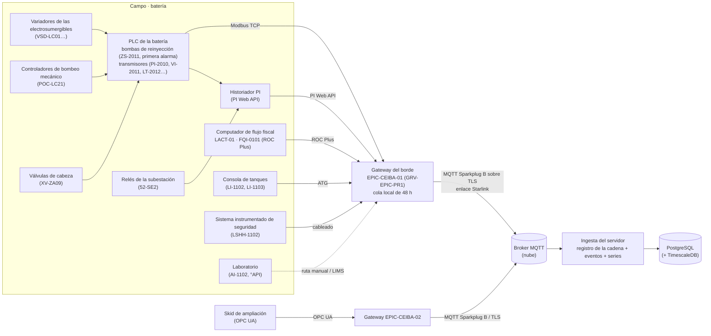

# 4. La cadena de datos: del PLC al número

Este capítulo cuenta cómo llega cada dato del campo a las tablas del capítulo 3 y cómo, con lo que llega, el servidor arma los **insumos del motor** (`Insumos`, `src/entities/insumos.ts`). Es la parte del backend que no se ve en ninguna pantalla y de la que depende todo número: si un evento llega con la hora equivocada o un día fiscal sin dato llega como cero, el libro dice algo falso con apariencia de exacto.

Tres reglas del producto lo atraviesan todo (CONTRATO.md, «Premisa: cadena de custodia»):

| Regla | Qué obliga en la ingesta |
|---|---|
| Todo lo que se muestra sale de un **equipo** | Nada de lo que llega por esta cadena lo escribe una persona. Las dos únicas entradas a mano (configuración firmada y respuesta del operario) no pasan por aquí. |
| La hora la pone el **PLC** | La marca de tiempo de una lectura o de un evento es la de la fuente (`dispositivo.reloj`), no la de llegada al servidor. |
| Un dato ausente **no es cero** | Un hueco del historiador es la falta de filas; un instrumento sin señal es una lectura de calidad mala con valor nulo; un día sin dato del computador de flujo es nulo. Nunca se rellena. |

Y una cuarta, de seguridad: **TRIM es de solo lectura**. El borde nunca escribe en un PLC (`fuente.modo = 'solo-lectura'`, con un CHECK que no admite otro valor). La regla «no arrancar hasta identificar» es de procedimiento: TRIM registra la no conformidad, no bloquea el arranque.

## 4.1 Topología del borde



**Las fuentes del demo.** El registro de la cadena que carga el simulador (`simulador-api/datos/nacimientos.json`, que sale del catálogo de equipos con `simulador-api/generar-semilla.mjs`) tiene 10 gateways (dos por campo), 82 dispositivos y 173 tags; en el modelo del capítulo 3 son 45 conectores (`fuente`: uno por gateway, protocolo y dirección; el simulador junta conector y dispositivo en una sola fila). Por protocolo:

| Protocolo (`fuente.protocolo`) | Tags | Quién estampa la hora (`dispositivo.reloj`) | Ejemplos en La Ceiba |
|---|---:|---|---|
| `pi-web-api` | 73 | el PLC de la batería | PI-2010, FI-2011, II-2011, TI-2011, PDI-2011 (P-201B); PT-1011 (K-101); II-0021 (SE-2) |
| `modbus-tcp` | 46 | el PLC de la batería | VI-2011, LSH-2013, LT-2012 (P-201B); ZI-1011 (K-101); AI-0101, DI-0101 (LACT-01) |
| `opc-ua` | 15 | el PLC del skid | XI-1017, XT-1017, XP-4016 (skid de ampliación, sin asociar) |
| `atg` | 10 | la consola de tanques | LI-1102, LI-1103 (TK-102) |
| `laboratorio` | 9 | la hora de la toma de muestra | AI-3021 (H-302), AI-1102 (TK-102) |
| `sis` | 5 | el sistema instrumentado de seguridad | LSHH-1102 (TK-102) |
| `roc-plus` | 5 | el computador de flujo | FQI-0101 (LACT-01) |
| `ruta-manual` | 5 | la hora en que se cerró la ruta | TI-0021, termografía de SE-2 |
| `calculado` | 5 | el tag del que se deriva | PDT-1011 ← PT-1011 (fórmula `f1-compresor-aire`, versión 2, ventana 15 min) |

La instrumentación de esta fase en las bombas de reinyección es la del contrato: marcha/paro con primera alarma, presión de succión y de descarga, caudal, vibración en línea, temperatura de la cámara de empuje, interruptor de fuga de sello, corriente del motor y nivel del tanque de agua (`perfil_bomba_tag` de P-201B: `p_succion` PI-2010, `p_descarga` PDI-2011, `caudal` FI-2011, `v_bomba` VI-2011, `t_empuje` TI-2011, `fuga_sello` LSH-2013, `corriente` II-2011, `nivel_tanque` LT-2012). **No se mide la energía por barril**: el desgaste interno se ve cuando baja el caudal con la bomba en marcha. En las electrosumergibles: el variador (corriente, frecuencia, desbalance) y el sensor de fondo (presión de entrada, temperatura del motor).

## 4.2 Dos formas de traer los datos (la escoge el cliente)

| | **A. Sparkplug B desde el gateway** (leyendo el PLC, el computador de flujo y la consola de tanques) | **B. Leer el historiador PI** (PI Web API, o un conector del historiador a MQTT) |
|---|---|---|
| Qué es | El gateway del borde lee cada fuente por su protocolo nativo y publica por MQTT Sparkplug B sobre TLS. Es el camino del contrato (`POST /api/ingesta/nacimiento` con la forma de NBIRTH + DBIRTH). | El servidor (o un conector cerca del PI) lee los tags del historiador que el cliente ya tiene. |
| Hora del dato | La del PLC o del computador de flujo, en milisegundos, por métrica. | La que guardó el PI: normalmente la del PLC si la interfaz la trae; si no, la del nodo de la interfaz. Hay que revisarlo tag por tag. |
| Lo que se recibe | Cada cambio (reporte por excepción con banda muerta configurable en el borde) y los eventos discretos exactos (marcha → paro con su primera alarma). | Lo que el PI archivó **después de su compresión** (excepción + compresión de puerta giratoria): los valores intermedios se descartaron. Para el vigía basta; para la hora exacta de un disparo, no siempre. |
| Huecos | El gateway guarda en su cola local mientras no hay enlace y reenvía marcado como histórico. | El PI ya tiene su propio respaldo; un hueco del PI es un hueco real. |
| Descubrimiento | NBIRTH/DBIRTH declaran gateway, dispositivos, tags, unidades, límites y calibración: la cadena **se llena sola** (`registrarNacimiento`). | No hay nacimiento: el registro de tags hay que armarlo desde el AF/punto del PI (descriptor, unidades, límites) con un proceso de carga. |
| Seguridad | Un certificado de cliente por gateway; el broker solo deja publicar bajo su propio nodo. Conexión **saliente** del campo a la nube. | Hay que abrir el PI de la red de operación hacia afuera (o poner un conector en la zona desmilitarizada). Es la discusión más larga con seguridad del cliente. |
| Costo y dependencias | Hardware de borde por campo y su mantenimiento; programar la lectura de cada PLC. | Licencias del PI (PI Web API, conectores), carga de consultas sobre el historiador de producción. |
| Riesgo principal | Que el mapa de registros del PLC esté mal (se lee el registro equivocado y nadie lo nota): por eso el registro de ingeniería y el mapeo de tags. | Que la compresión y la hora del PI escondan el instante real de un evento, y que un cambio en el PI (renombrar un tag) rompa la lectura sin aviso. |

**Mezclas.** El demo ya es una mezcla: los gateways leen 73 tags **del PI local** (`pi-web-api`) y los demás directo del PLC, del computador de flujo y de la consola de tanques, y todo sale por Sparkplug B. Lo que sí conviene, cualquiera que sea la forma: **los eventos** (marcha → paro de las bombas, paros de los controladores de pozo, interruptores de los servicios) y **el fiscal del día** llegan de la fuente primaria (PLC y computador de flujo), no del historiador comprimido, porque de su hora sale el libro. Esta recomendación no decide por el cliente: es lo que el motor necesita para que el diferido de un evento empiece en el segundo correcto.

## 4.3 Sparkplug B: nacimiento, datos y muerte

Sparkplug B (Eclipse Sparkplug 3.0) define sobre MQTT el espacio de temas y la carga útil (protobuf). Temas:

```
spBv1.0/<grupo>/<tipo>/<nodo>[/<dispositivo>]
```

| Elemento de Sparkplug | En TRIM | Tabla y columna |
|---|---|---|
| `grupo` | el campo (`ceiba`) | `gateway.campo_id` (sale del certificado, no del tema) |
| `nodo` (edge node) | el gateway (`EPIC-CEIBA-01`) | `gateway.id` |
| `dispositivo` (device) | lo que el borde lee de una fuente (`P-201B`, `SKID-AMPLIACION`) | `dispositivo.nombre` |
| métrica | un tag (`VI-2011`) | `tag.nombre` |
| `NBIRTH` | el nacimiento del gateway: modelo, serie, firmware, enlace, cola local (`gateway.*` del cuerpo del nacimiento) y el `bdSeq` | `gateway`, `nacimiento.bd_seq` |
| `DBIRTH` | el nacimiento de cada dispositivo: su fuente (protocolo, dirección, reloj) y **todas sus métricas** con tipo, unidad, límite (`limite`, `bajo`, `alto`), cadencia, clase y calibración | `fuente`, `dispositivo`, `tag`, `calibracion` |
| `NDATA` / `DDATA` | lecturas: valor, marca de tiempo en ms (UTC), y si viene de la cola (`is_historical`) | `lectura` |
| `NDEATH` / `DDEATH` | el gateway o el dispositivo se cayó (el `NDEATH` es el testamento MQTT registrado al conectarse, con el mismo `bdSeq`) | `dispositivo.en_linea = false`; las lecturas siguientes faltan (hueco) |
| `STATE` de la aplicación primaria | el servidor dice si está en línea; con el servidor caído, el gateway guarda en su cola | — |
| `seq` (0–255) | número de cada mensaje del nodo; un salto es un mensaje perdido | la ingesta pide **renacer** (`NCMD` `Node Control/Rebirth`): es lo único que el servidor le «escribe» al gateway, y no toca ningún PLC |

**El nacimiento en el contrato.** Mientras no exista el cliente MQTT del servidor (pendiente del lado del servidor), el nacimiento entra por `POST /api/ingesta/nacimiento` con la forma ya traducida:

```json
{ "campo":"ceiba",
  "gateway":{"id":"EPIC-CEIBA-02","modelo":"GRV-EPIC-PR1","serie":"GRVCEI9003","firmware":"3.6.0","enlace":"starlink","bufferH":48},
  "dispositivos":[{ "nombre":"SKID-AMPLIACION",
    "fuente":{"protocolo":"opc-ua","endpoint":"opc.tcp://skid-ceiba.ot.local:4840","reloj":"el PLC del skid"},
    "metricas":[{"nombre":"XI-1017","tipo":"Nivel de interfase","unidad":"%","limite":"35 – 65","bajo":35,"alto":65,"cadenciaS":5,"clase":"continua"}] }] }
→ { "gateway":"EPIC-CEIBA-02", "tags":3, "pendientes":3 }
```

(Es el nacimiento real del segundo gateway de La Ceiba en la semilla del simulador; aquí con una sola métrica de las tres.) Lo que declara cada parte y adónde va está en la tabla anterior. Las reglas de `registrarNacimiento` (`simulador-api/base.mjs`), que el backend tiene que cumplir igual:

1. **Forma completa o nada.** Con una sola falta, `400` con `faltas: ["dispositivos[1].fuente.reloj es obligatorio", …]` y no se escribe nada (una transacción).
2. **Campo y gateway del certificado.** Un gateway inscrito en un campo que se presenta como de otro: `403 gateway-de-otro-campo`, y el hecho queda en `rechazo` (fuera de la transacción que se deshizo).
3. **Un tag es de un solo gateway.** Si un nacimiento declara un tag que ya publica otro gateway del campo: `409 tag-de-otro-gateway` con `tags: [...]`, todo el nacimiento se rechaza y queda en `rechazo`. En la base lo cuida además el trigger `tag_reglas`.
4. **El mapeo.** Si `dispositivos[].nombre` coincide con el código de un equipo del campo, sus tags nacen `descubierto`; si no, `pendiente` (en el demo: los tres tags de `SKID-AMPLIACION` de cada campo). **Un nacimiento nunca deshace un mapeo `manual` o `regla`** (cada reconexión de Sparkplug es un nacimiento nuevo).
5. **Lo que cambia se versiona.** Si un re-nacimiento cambia el límite, la unidad, la cadencia, la clase o la calibración de un tag, la versión anterior va a `historial_tag` con la hora y el gateway. Así la **banda normal** de un tag en cualquier instante se puede reconstruir (la que regía en $t$ es la de la primera fila de `historial_tag` con `reemplazado` > $t$, o la del tag si no hay ninguna).
6. **Calibración que desaparece.** Si el borde deja de declarar la calibración de un tag, se quita (y la anterior queda en el historial): un certificado vencido no se queda pegado.

## 4.4 Inscripción de un gateway nuevo

1. El administrador de la implementación (capacidad `conector:configurar`, con el campo asignado) pide `POST /api/inscripcion { "campo": "ceiba" }` y recibe un código de un solo uso (`KEV4Y-SQCMN`) que vence en 24 h. La base guarda solo su huella SHA-256 (`inscripcion.codigo_huella`).
2. El instalador lo escribe en el gateway. El gateway genera su par de llaves y presenta el código con una solicitud de certificado.
3. **Propuesta para el canje (pendiente en el contrato):** el servidor firma un certificado de cliente cuyo sujeto lleva el campo y el id del gateway, marca la inscripción como canjeada (`inscripcion.canjeado`, `gateway_id`) y guarda la huella del certificado (`gateway.certificado_huella`). Desde ahí el gateway se conecta al broker con TLS mutuo, y la lista de control del broker solo le deja publicar bajo `spBv1.0/<su campo>/+/<su id>/#`.
4. La ingesta toma campo y gateway **del certificado**, nunca del cuerpo ni del tema (en el simulador, que no tiene certificados, vienen en el cuerpo). Un nacimiento sin certificado válido se rechaza (`rechazo.codigo = 'certificado-invalido'`).

## 4.5 Cadencias y paso de la serie

La **cadencia** es cada cuánto publica un tag (`tag.cadencia_s`, del DBIRTH); el **paso** es cada cuánto trae valores la serie que pide el motor (`SerieTag.pasoH`, lo escoge el servidor). No son lo mismo: el vigía ajusta y proyecta con el paso que trae la serie, nunca con uno supuesto (capítulo 5C).

Cadencias del registro del demo (173 tags):

| Cadencia | Tags | Qué son |
|---|---:|---|
| 1 s | 16 | la multifásica MPP-301 de Morichal, leída del PLC (`PLC · 1 s`) |
| 5 s | 15 | los skids de ampliación (OPC UA) |
| 47 s | 88 (83 continuas, 5 discretas) | lo que pasa por el PI (`PI · 47 s`) y buena parte del PLC de la batería |
| 60 s | 5 | el computador de flujo FQI-0101 (`computador de flujo · 1 min`) |
| 120 s | 10 | la consola de tanques (ATG, `2 min`) |
| 300 s | 10 | analizador de BSW y densitómetro (`5 min`) |
| 900 s | 5 | punto de rocío del aire (AIT-1011, `15 min`) |
| 28.800 s | 9 | análisis de laboratorio (`8 h`) |
| 15.552.000 s | 5 | termografía de conexiones (`campaña · cada 180 d`) |
| sin cadencia | 10 | interruptores discretos que publican al cambiar (LSH-2013, LSHH-1102) |

**El paso de las series del demo es de un día**: el catálogo trae doce valores diarios por instrumento (`serieHasta(valores, PASO_DEMO_H)` con `PASO_DEMO_H = 24`, `src/entities/equipos.ts:10-11`), que terminan en `AHORA` (2-oct-2026 14:00) y empiezan el 21-sep-2026 a las 14:00. La función `serie_de(tag, desde, paso, n)` del esquema arma esa forma desde `lectura`: el valor del lugar $i$ es la **última lectura válida** dentro del paso que termina en $\text{desde} + i \cdot \text{paso}$; sin lectura, `null` en su lugar. Con las lecturas de ejemplo da para VI-2011 de La Ceiba `{2.2, 2.1, 2.2, 2.3, 2.2, 2.1, 2.2, 2.2, 2.3, 2.2, 2.4, 0}`, la misma serie del catálogo (`cuadres.sql`). Que el valor sea el último del paso o el promedio es una decisión que el contrato no fija (Huecos); `timescale.sql` deja los dos en sus agregados continuos.

### Muestras por hora de un gateway y cola local necesaria

**Qué es.** Cuántas lecturas publica un gateway por hora en el peor caso (cada tag a su cadencia) y cuánto tiene que guardar su cola local para no perder datos durante una caída del enlace.

**Dónde se ve.** En ninguna pantalla: dimensiona el gateway y el broker. `gateway.buffer_h` (la autonomía declarada) aparece en la procedencia (`tecnico.bufferH`) y en el inventario de Conectores.

**Fórmula.**

$$
N_h = \sum_{k} \frac{3600}{c_k}, \qquad M = N_h \cdot B_h, \qquad S = M \cdot b
$$

| Símbolo | Significado | Unidad | De dónde sale |
|---|---|---|---|
| $c_k$ | cadencia del tag $k$ del gateway | s | `tag.cadencia_s` (DBIRTH) |
| $N_h$ | lecturas por hora del gateway (peor caso: sin reporte por excepción) | lecturas/h | calculado |
| $B_h$ | horas de cola local | h | `gateway.buffer_h` |
| $M$ | lecturas que tiene que guardar la cola | lecturas | calculado |
| $b$ | bytes por lectura en la cola | B | **supuesto de dimensionamiento**, no dato del demo |

Los interruptores sin cadencia (publican al cambiar) no entran en el peor caso: son pocos cambios.

**Ejemplo con los datos del demo (EPIC-CEIBA-01, 30 tags, 28 con cadencia, `bufferH` = 48).** 19 tags a 47 s, 1 a 60 s, 2 a 120 s, 2 a 300 s, 1 a 900 s, 2 a 28.800 s y 1 a 15.552.000 s:

$$
N_h = 19 \cdot \frac{3600}{47} + \frac{3600}{60} + 2 \cdot \frac{3600}{120} + 2 \cdot \frac{3600}{300} + \frac{3600}{900} + 2 \cdot \frac{3600}{28800} + \frac{3600}{15552000} = 1.603{,}57 \ \text{lecturas/h}
$$

$M = 1.603{,}57 \cdot 48 = 76.971$ lecturas. Con un supuesto de $b = 32$ B por lectura (valor de 8 bytes, marca de tiempo de 8, alias y calidad), $S \approx 2{,}46$ MB: la cola de 48 h de un gateway de batería es pequeña; lo que la limita es el almacenamiento del equipo y que el gateway la vacíe en orden al volver el enlace. La multifásica de Morichal a 1 s (16 tags) sola pone $16 \cdot 3600 = 57.600$ lecturas/h: es la que conviene publicar por excepción con banda muerta.

**Casos borde.** Una caída más larga que `buffer_h` pierde lo más viejo (o lo más nuevo, según el gateway): lo perdido queda como **hueco** (sin filas), nunca interpolado. Un tag sin cadencia declarada no entra en la cuenta.

**Quién lo calcula y por dónde viaja.** Es de dimensionamiento (implementación); el servidor puede vigilar la cola real comparando `lectura.recibido − lectura.instante` (sección 4.10).

**Referencia.** `simulador-api/datos/nacimientos.json` (EPIC-CEIBA-01), CONTRATO.md («Cadena de datos (registro)»: `"buffer_h":48, …, "tags":30`).

## 4.6 Calidad del dato

**Procedencia.** Cada número que se muestra tiene su cadena en `v_procedencia`: instrumento (tag, tipo, unidad, equipo, clase ISO, criticidad, banda normal y mapeo), lectura (clase, cadencia, protocolo, modo, **quién estampa la hora**), cálculo (fórmula y versión, si es calculado), custodia (calibración) y, solo con `conector:configurar`, el bloque técnico (gateway, enlace, cola, última vez visto, dirección). Ejemplo real (`cuadres.sql`): PDT-1011 de La Ceiba sale de la fuente `calculado`, su reloj es «el tag del que se deriva», su equipo es K-101 «Sistema de aire de instrumentos» (`compresor-aire`), su fórmula `f1-compresor-aire` versión 2 con ventana de 15 min, por el gateway EPIC-CEIBA-01.

**Calidad de una lectura.** Las fuentes dicen la calidad de distinta forma; la ingesta la resume en `lectura.calidad` y guarda el código crudo en `lectura.codigo_calidad`:

| Fuente | Buena | Incierta | Mala |
|---|---|---|---|
| OPC UA (StatusCode de 32 bits) | dos bits altos `00` | `01` | `10` (p. ej. `0x80310000` = Bad_NoCommunication) |
| PI | valor numérico normal | valor marcado como cuestionable o sustituido | estado digital del sistema en lugar de valor («I/O Timeout», «Bad Input», «Shutdown») |
| Sparkplug B | métrica con valor | propiedad de calidad que diga incierta | métrica con `is_null` o calidad mala |

Una lectura **mala** no entra en la serie: en su lugar va `null`. Un instrumento sin señal con el equipo produciendo es **dato inválido** y la pantalla lo dice («sin señal en línea»); sin señal con el pozo parado es lo esperado en el sensor de fondo de una electrosumergible y no se muestra (CONTRATO.md, «Vigía»). La base lo obliga: `lectura` no acepta `valor` nulo con calidad buena (CHECK `lectura_check`).

**Huecos.** Un hueco es la **ausencia** de lecturas en un paso (el gateway se cayó más de lo que guarda, el historiador no tiene datos). La serie lo devuelve como `null` **en su lugar**, no lo salta (saltarlo comprime el eje del vigía) y nunca lo rellena. Lo mismo el fiscal: un día sin dato del computador de flujo es `null` en `dias[]` (o un arreglo más corto), y el libro lo excluye de lo real y del potencial, lo nombra en `sinFiscal` y no se publica.

**El reloj del PLC.** La hora de un evento la pone el PLC y de ella sale el diferido: un error de reloj de 1 minuto en una caída del aire de instrumentos de La Ceiba (K-101, que cierra sus 18 pozos) o en una parada de su bomba de agua P-201B (que cierra 2 o 3: LC-16, LC-07 y LC-14, los que más agua dan) mueve barriles entre días y entre meses. Por eso:

- Los PLC, los controladores, el computador de flujo y el gateway se sincronizan con NTP (o PTP) contra la misma referencia; la ingesta compara la marca de tiempo de cada mensaje con la hora de llegada y, si la diferencia pasa una tolerancia (propuesta: 2 s en tiempo real, sin límite para lo que llega de la cola marcado como histórico), marca la lectura `incierta` y avisa al administrador.
- Una marca de tiempo **en el futuro** (más allá de la tolerancia) se rechaza.
- La tolerancia del libro supone la resolución de la hora del PLC en 1 s (`RESOLUCION_PLC_H = 1/3600` h, `src/entities/libro.ts:41`): el componente de reloj de un tramo de $h$ horas es $\sqrt{2} \cdot (1/3600)/h$ (capítulo 5A, «Tolerancia»). Un reloj peor que eso hace mentir a la tolerancia.
- Colombia no tiene horario de verano: el día del campo es de 00:00 a 24:00 de Bogotá (05:00 UTC), siempre de 24 h.

## 4.7 Cómo se arma cada insumo del motor

El motor no lee tablas: recibe la interfaz `Insumos` (`src/entities/insumos.ts`), con la forma de los endpoints de insumo del contrato. Lo que sigue es cómo sale cada pieza de lo que llega por la cadena.

### 4.7.1 Eventos de pozo (`EventoPozo`, `GET /api/campos/:campo/pozos/eventos`)

**Fuente.** El controlador de cada pozo (`pozo.controlador`): el variador de la electrosumergible (`VSD-LC14`), el controlador de bombeo mecánico (`POC-LC21`) o la válvula de cabeza de un pozo de flujo natural (`XV-ZA09`). De cada uno se leen su estado de marcha, su código de falla y, en el variador, la frecuencia.

**Cómo se arma.**

| Lo que llega | Evento que se abre | `codigo` |
|---|---|---|
| El variador para por su protección | paro | `GF` falla a tierra, `PH` desbalance de fases, `OL` sobrecarga, `UL` baja carga, `OT` temperatura del motor, `UV` baja tensión (del registro de falla del variador) |
| El controlador para por un enclavamiento de proceso | paro | `PSH` presión alta en la cabeza, `LSHH` nivel muy alto del tanque de agua |
| Alguien o algo manda parar | paro | `CMD` parada por orden |
| La frecuencia del variador baja de la de operación sin parar | frecuencia reducida | `HZ`, con `hz` = la frecuencia a la que quedó |

El evento se **abre** en la transición (marcha → paro, o frecuencia de operación → reducida) con `fin = null`, y se **cierra** en la transición de vuelta (la base solo deja poner `fin` una vez: `evento_solo_cierre`). `senal` es el tag y el código para leer (`POC-LC21 · código CMD`). El servidor **no** escribe la causa: la deduce el motor (capítulo 5B).

**Ejemplos del demo.** `EP-LC21-261001-01`: LC-21 (bombeo mecánico) paró por orden el 1-oct-2026 a las 18:20 y sigue abierto (`fin: null`, `POC-LC21 · código CMD`). `EP-MN07-260214-32`: MN-07 bajó a 47 Hz el 14-feb-2026 a las 23:25 y volvió el 15-feb a las 23:58 (`VSD-MN07 · frecuencia a 47 Hz`); su prueba vigente se hizo a 59 Hz, así que dejó de dar $1 - 47/59 = 20{,}3\ \%$ de su crudo (capítulo 5B). En el demo hay 1.211 eventos de pozo (61 de frecuencia reducida), 4 abiertos en `AHORA` (LC-21; LC-16 y LC-07, cerrados por la parada de P-201B; MN-41, falla a tierra del 25-sep).

**El id.** El demo usa `EP-<pozo>-<AAMMDD>-<consecutivo>`. El backend debe generar un id **determinístico** a partir de (campo, pozo, instante de inicio): así, si el gateway reenvía de su cola un evento que ya había llegado, la ingesta lo reconoce y no lo duplica.

### 4.7.2 Paradas de bomba (`EventoBomba`, `GET /api/campos/:campo/bombas/:equipo/paradas`)

**Fuente.** El PLC de la bomba: la señal de marcha (`ZS-2011` en P-201B, `ZS-3016` en MPP-301), el registro de primera alarma, los transmisores de la bomba y el del tanque de agua.

**Cómo se arma, campo por campo del evento.**

| Campo | Cómo sale |
|---|---|
| `inicio`, `fin` | el paso marcha → paro y el arranque, con la hora del PLC |
| `perdida` | 1 si paró; menor que 1 si siguió en marcha con menos caudal (la multifásica que sube la velocidad a caudal constante, la centrífuga que baja caudal en marcha). El contrato no fija con qué umbral se abre un evento de pérdida parcial: propuesta en Huecos |
| `senal` | el tag y la transición (`ZS-2011 · marcha → paro`) |
| `primeraAlarma` | el **first-out** que congeló el PLC al disparar (`{ tag: "LSH-2013", texto: "fuga de sello detectada" }`). Se lee del registro de primera alarma en el instante del disparo; si el PLC no lo tiene, no se inventa |
| `firma` | la parte que **las señales** señalaban en el instante de parar. La decide el servidor con las lecturas de ese instante: la primera parte cuya salud estaba `fuera` (una variable que la anuncia o la confirma fuera de su banda normal, o su instrumento en alarma) antes del paro, con el tag que la delató. Es lo que hace `firmaAlParar` en el front (`src/entities/causa-senal.ts:168-178`), pero con las lecturas **del instante** y no las de ahora. Se guarda con el evento y no cambia al cerrarse la parada (la base la deja poner una vez) |
| `nivelAlParar` | la última lectura del transmisor del tanque (`tanque.tag_nivel` de la configuración vigente, LT-2012) con instante ≤ inicio: con el aforo da el colchón previsto |

Un disparo que no es de esa máquina (`PAL-1011` del aire de instrumentos en `EV-2011-260128`, `52-SE2` de la subestación en Morichal) se guarda tal cual como primera alarma: el motor no lo usa para la parte y busca el servicio caído a ±15 min (capítulo 5B).

**Ejemplos del demo.** `EV-2011-0809` (La Ceiba): paró el 9-ago-2026 a las 21:14 con primera alarma LSH-2013 «fuga de sello detectada» y el tanque al 77,3 %; arrancó el 11-ago a las 07:59:36. `EV-2011-1002`: paró el 2-oct-2026 a las 03:52:18, sin primera alarma ni firma, con el tanque al 78,7 %, y sigue parada: por eso es «sin identificar» y sale la pregunta (por WhatsApp: **RETIRADO (27-oct-2026)**; hoy, la pregunta de Hoy). `EV-3016-260310` (MPP-301, Morichal): `perdida` 0,36 del 10 al 13-mar-2026. De las 36 paradas del demo, 27 traen primera alarma y **ninguna** trae firma (el demo nunca la manda: el backend real sí).

### 4.7.3 Caídas de servicios (`EventoServicio`, `GET /api/campos/:campo/servicios/eventos`)

**Fuente.** El PLC o el relé del servicio: el interruptor del pórtico (`52-SE2`), la alarma de presión baja del aire (`PAL-1011`), el disparo del tratador (`TSHH-3021`), el compresor de gas. `tipo` sale del registro de ingeniería (`equipo.servicio` del equipo que cae), no del id. **Ejemplo:** `SV-SE-2-260828`: en Morichal se abrió el interruptor del pórtico de 13,8 kV de SE-2 el 28-ago-2026 a las 18:08:46 y se cerró el 29-ago a las 11:07:35 (`tipo: energia`); cerró los 41 pozos de Morichal y paró P-201B. Hay 30 caídas en el demo, todas cerradas. Un servicio caído **ahora** viaja con `fin: null` y su cascada llega hasta ahora (capítulo 3, Huecos 1, resuelto el 8-oct).

### 4.7.4 El fiscal del día (`ProduccionMes`, `GET /api/campos/:campo/produccion-diaria`)

**Fuente.** El computador de flujo del punto de medición oficial (`punto_medicion.tag_fiscal`, FQI-0101 en la LACT-01 de La Ceiba), por su protocolo propio (ROC Plus en el demo): el **registro diario** del archivo de medición electrónica (el que exige API MPMS capítulo 21.2), con el volumen neto del día corregido a condiciones estándar y descontado el agua (BSW del analizador en línea o del laboratorio: `punto_medicion.bsw`).

**Cómo se arma.** Una fila por día en `produccion_fiscal_diaria` (campo, día de Colombia, barriles netos); el día en curso con `cerrado = false` y el acumulado hasta ahora. Cuando la contabilidad de hidrocarburos del campo publica su mes, `mes_fiscal.publicado = true`. El endpoint arma `dias[]` con `null` donde no hay dato (`v_produccion_mes`).

**La hora de cierre del día.** El motor supone días de 00:00 a 24:00 de Colombia. Muchos computadores de flujo cierran su día a otra hora de contrato (las 06:00 es común). Si es así, el registro diario no cae en el día del libro: o se configura el computador con cierre a las 00:00, o la ingesta arma el día con los registros horarios. `punto_medicion.hora_contrato` deja escrita cuál es.

**Ejemplos del demo.** La Ceiba, últimos días: 28, 29 y 30-sep-2026 = 9.642, 11.055 y 11.602 bbl; 1-oct = 11.105 bbl; 2-oct = 5.836 bbl (parcial, hasta las 14:00). El 19-may-2026 el fiscal de Morichal Norte fue **0** (sus 41 pozos cerrados por la caída de energía de SE-2, `SV-SE-2-260518`, del 18-may 19:38 al 20-may 04:52): es una medición, no un hueco, y se guarda como 0; un hueco sería NULL. En el demo no hay ningún día sin dato.

### 4.7.5 Pruebas de pozo (`Prueba`, dentro de `GET /api/campos/:campo/pozos`)

**Fuente.** El separador de prueba automatizado (`pozo.fuente_prueba`: «Separador de prueba automatizado SP-CE1 · FT-CE1011 crudo · FT-CE1012 agua · AT-CE1013 corte de agua» para LC-01), o una estimación desde la propia electrosumergible cuando no hay separador (`origen: estimado`: LC-17, «Estimación desde la electrosumergible VSD-LC17: curva de la bomba, frecuencia y presión de entrada»). Una prueba es el crudo y el agua totalizados durante la prueba divididos por su duración (bbl/d) y la frecuencia del variador durante ella (`hz`). **Ejemplo:** LC-01, 27-ago-2026 08:00: 376 bbl/d de crudo, 10.543 de agua (97 % de agua), a 59,5 Hz. Un pozo sin `origen` y sin pruebas (ZA-09 de La Zarza) no tiene custodia: el motor no le asigna caudal.

### 4.7.6 Series, nivel ahora, metrología

- **Series** (`SerieTag`, `GET …/tags/:tag/serie?desde=&paso=`): `serie_de` sobre `lectura` (o los agregados continuos de `timescale.sql`).
- **Nivel del tanque ahora** (`GET …/tanques/:tanque/nivel`, `/vistas/campos/:campo/ahora`): la última lectura válida del transmisor del tanque (`tanque.tag_nivel` de la versión vigente). Un tanque sin lectura **no aparece**.
- **Metrología** (`GET …/metrologia`): el °API del último análisis de laboratorio y, si existe, el presupuesto de incertidumbre demostrado (`metrologia_campo`). Sin °API, `api: null`.
- **Ajustes de protección del variador** de cada electrosumergible: sin endpoint todavía (capítulo 3, `ajuste_variador`).

## 4.8 Eventos que se pisan: normalizar o rechazar

**El problema.** Dos eventos del mismo pozo que se solapan en el tiempo: un `HZ` abierto y después un paro, o dos paros que el controlador manda dos veces. Si cada uno cobrara su intervalo completo, una hora del pozo se cobraría dos veces y la identidad del libro ($\text{potencial} - \text{real} = \sum \text{diferidos}$) se rompería.

**Lo que hace el motor hoy: normaliza** (`intervalosEfectivos`, `src/entities/libro.ts:118-140`). Por cada pozo, ordena sus eventos con los paros antes que los `HZ` y, entre iguales, por inicio; a cada evento le quita lo que ya cubren los anteriores. Lo que cobra el evento $e$ es

$$
\text{efectivo}(e) = [a_e, b_e) \setminus \bigcup_{e' \prec e} \text{efectivo}(e')
$$

donde $\prec$ es ese orden (un paro manda sobre un `HZ`: con el pozo cerrado no hay frecuencia que reducir; entre dos del mismo tipo, el que empezó primero). El estado actual de un pozo con un paro y un `HZ` abiertos a la vez es el paro (`estadoAhora`, `src/entities/pozos.ts:167`).

**Las dos opciones del contrato** (CONTRATO.md:870-873 y «Pendiente del lado del servidor»):

| | Normalizar (lo que hace el motor) | Rechazar en la ingesta |
|---|---|---|
| Qué se guarda | cada evento tal como lo mandó el controlador (`evento_pozo`) | solo los que no se solapan |
| Custodia | completa: el registro dice lo que pasó en el PLC | se pierde un hecho del PLC (el segundo evento) y el operador no sabe por qué |
| Cuándo se resuelve | al calcular, con una regla escrita y probada | al recibir, con el orden de llegada (que con la cola del gateway no es el orden del PLC) |
| Riesgo | una regla de prioridad discutible en un caso raro | un evento real que se pierde porque llegó antes uno espurio |

**Recomendación técnica, a confirmar con el dueño del producto:** normalizar, que es lo que el motor y la base ya suponen (`evento_pozo` no tiene restricción de no solape), y que la ingesta **marque** los solapes en un reporte para que operación revise el controlador que los produce. En el demo no hay ningún solape (comprobado sobre los 1.211 eventos de `referencia/insumos/*/pozos-eventos.json`): la regla no cambia ningún número del demo, pero el backend real la necesita.

## 4.9 Qué valida la ingesta

| Insumo | Se rechaza (no entra, y queda en la bitácora de la ingesta) | Se acepta con marca |
|---|---|---|
| Nacimiento | forma incompleta (400 con `faltas`), campo desconocido (404), gateway de otro campo (403), tag de otro gateway (409), certificado inválido | tags sin equipo (`pendiente`) |
| Lectura | tag no registrado en el campo del gateway; marca de tiempo en el futuro; valor no numérico en un tag continuo; lectura fuera de las particiones creadas (la base lo rechaza: crear la partición del mes siguiente es un trabajo diario) | calidad incierta o mala; reloj desviado; llegada desde la cola (`is_historical`) |
| Evento de pozo | pozo que no está en el registro (el motor lo ignora: `src/entities/libro.ts:323-324`); código fuera de la lista; `fin` antes de `inicio`; `hz` en un código que no es `HZ` (CHECK) | solape con otro evento del pozo (se normaliza) |
| Parada de bomba | bomba sin perfil en el campo; `perdida` fuera de (0, 1]; cambiar la hora o la primera alarma de una parada ya registrada (la base lo rechaza) | primera alarma que no es de la máquina (queda en la evidencia) |
| Caída de servicio | equipo que no es un servicio del registro (`equipo.servicio` nulo) | abierta (ver Huecos) |
| Fiscal del día | valor negativo o no finito; día de un mes ya publicado sin un recálculo explícito | día sin dato (NULL); día en curso (`cerrado = false`) |
| Prueba de pozo | crudo o agua negativos; pozo desconocido | prueba estimada (`origen: estimado`) |

**Idempotencia.** Todo lo que llega se puede volver a recibir (la cola del gateway reenvía, Meta reintenta): los eventos por su id determinístico, las lecturas por (tag, instante), el fiscal por (campo, día), los mensajes entrantes por su id de Meta. Recibir dos veces lo mismo no cambia nada; recibir dos veces un evento con datos distintos es un error que se reporta (la base no deja reescribir un evento).

## 4.10 Latencias esperadas

El contrato no fija latencias; estas son las del diseño del producto, con su fuente:

| Qué | Objetivo | Por qué |
|---|---|---|
| Del paro de una bomba o de una electrosumergible al WhatsApp de la parada (**RETIRADO (27-oct-2026)**; el mismo plazo vale para la tarjeta de la parada en Hoy) | ≤ 1 min | El registro de mensajes del demo pone la hora de cada aviso de parada a 1 min del inicio del evento (`aLas(t) = t + 60 s`, `src/entities/mensajes.ts:254`). Exige que el evento viaje del PLC al servidor en segundos: por la fuente primaria, no por el historiador comprimido. |
| Recordatorio y escalamiento de «¿qué se dañó?» | 30 min y 2 h | Reglas fijas de `mensajes.ts`. |
| Del cambio de una lectura a la pantalla (vigía, salud) | minutos | El vigía trabaja con tendencias de días; la cadencia del PI (47 s) es más que suficiente. |
| Del cierre del día al fiscal en la base | horas | El registro diario del computador de flujo; el libro del día solo se publica con el mes. |
| De una vista calculada (un campo, un mes) | < 300 ms | Capítulo 7: las pantallas piden sus consultas una tras otra. Es lo que justifica el precálculo de meses cerrados (capítulo 3). |

La ingesta puede medir lo suyo sin instrumentos extra: $\text{latencia} = \text{lectura.recibido} - \text{lectura.instante}$ por gateway; si su mediana sube, el enlace o el broker se están atrasando.

## 4.11 Enlace caído

Lo que pasa cuando el enlace del campo (Starlink en el demo) se cae:

1. **El gateway sigue leyendo** el PLC y guarda en su cola local (`buffer_h` = 48 h en el demo). El broker publica su `NDEATH` (el testamento MQTT): la ingesta marca sus dispositivos fuera de línea. Las pantallas siguen mostrando el último dato con su hora; el vigía no proyecta con una serie que dejó de llegar (capítulo 5C).
2. **Al volver**, el gateway renace (`NBIRTH`/`DBIRTH`: el nacimiento no deshace mapeos) y vacía la cola en orden, con las métricas marcadas como históricas. La ingesta las guarda con su `instante` real (no el de llegada).
3. **Los eventos que llegan tarde** se guardan con la hora del PLC. Lo que el motor calcula sobre ese período cambia: el libro del mes en curso se recalcula en vivo; si el mes ya estaba cerrado y publicado, el precálculo se rehace y queda en `recalculo_mes` con la huella antes y después (capítulo 3).
4. **RETIRADO (27-oct-2026)** **Los mensajes de WhatsApp de eventos que llegaron tarde.** Un aviso de «paró» que se manda horas después del paro ya no sirve para cerrar pozos a tiempo. El contrato no lo dice; propuesta en Huecos: mandar igual el aviso con la hora real de la parada en el texto (la plantilla ya la lleva: `{hora}`) y marcarlo como tardío en el registro.
5. **Si la caída dura más que la cola**, lo perdido queda como hueco (sin filas; `null` en la serie; un día fiscal sin dato si el computador de flujo tampoco lo guardó). Nunca se interpola. Los computadores de flujo guardan su propio archivo de varios días: el fiscal se recupera de ahí, y por eso conviene leerlo por su protocolo propio y no solo del PI.

## 4.12 Huecos y dudas

1. **Las señales que producen los eventos no están en el registro de la cadena del demo.** `ZS-2011`, los controladores de pozo (`VSD-LC14`, `POC-LC21`), `52-SE2`, `PAL-1011` y los interruptores de primera alarma (`PSL-2010`, `TSH-2011`…) no aparecen en `simulador-api/datos/nacimientos.json`: hoy no se puede mostrar la procedencia de un evento ni su hora de reloj. El backend real debe registrarlos como tags del dispositivo que los publica.
2. **Las señales de las electrosumergibles no son tags y no tienen endpoint** (`referencia/insumos/<campo>/electrosumergibles.json`, `"endpoint": null`; nombres como `VSD-LC01 · corriente`). Falta decidir por dónde llegan los ajustes de protección del variador y registrar las cinco señales de cada pozo como tags.
3. **Pérdida parcial de una bomba.** El contrato define `perdida < 1` («siguió en marcha con menos caudal») pero no cuándo se abre ni se cierra ese evento. Propuesta: se abre cuando el caudal medido con la bomba en marcha cae por debajo de una fracción de su capacidad declarada (umbral firmado por ingeniería) durante más de un tiempo mínimo, y `perdida = 1 − caudal/capacidad`. Además, las paradas parciales del demo traen `senal: "ZS-3016 · marcha → paro"` (`EV-3016-260310`, `EV-3016-260725`) y `"ZS-2011 · marcha → paro"` (`EV-G2011-260502`), que contradice «siguió en marcha».
4. **Servicio caído ahora.** (Resuelto el 8-oct: `EventoServicio.fin` es `string | null`, `src/entities/pozos.ts:94-105`, y el motor corta en ahora.) `EventoServicio.fin` era obligatorio en el tipo TS; un servicio que sigue caído no se podía entregar. Ver capítulo 3, Huecos 1.
5. **Valor de la serie en cada paso.** El contrato dice que el servidor escoge el paso y lo declara (`pasoH`), pero no si el valor del lugar $i$ es la lectura en ese instante, la última del paso o el promedio. `serie_de` usa la última válida del paso; `timescale.sql` guarda también el promedio. Afecta la pendiente del vigía: hay que fijarlo y escribirlo en el contrato.
6. **Hora de cierre del día fiscal.** El motor supone 00:00 de Colombia; si el computador de flujo cierra a las 06:00, el día del libro no es el del ticket. `punto_medicion.hora_contrato` lo deja escrito, pero el contrato no dice qué hacer.
7. **Mensajes de eventos que llegan tarde** (después de una caída del enlace): el contrato no dice si se mandan, con qué texto ni cómo se marcan.
8. **Normalizar o rechazar los eventos que se pisan:** recomendación técnica de normalizar (sección 4.8); el contrato pide escoger y escribirlo.
9. **Punto de medición de El Palmar y La Zarza:** el origen del fiscal y el registro de equipos no dicen el mismo tag (capítulo 3, Huecos 7).
10. **Canje del código de inscripción y cliente MQTT**: pendientes del lado del servidor (CONTRATO.md); la sección 4.4 es una propuesta.
11. **Tolerancia de reloj.** El valor de 2 s para marcar una lectura como incierta es una propuesta: lo debe fijar el cliente con lo que logre su sincronización de reloj (y es coherente con la resolución de 1 s que supone la tolerancia del libro).
