# 6 · Las pantallas de la v3, por rol (28-oct-2026)

> **Léalo primero.** Este capítulo describe las pantallas que **hay hoy** (la experiencia v3, 27-oct-2026, y los
> ajustes del 28-oct). Las secciones 6A–6D se escribieron para la v1 y la v2: lo que todavía rige de ellas son las
> **fórmulas, los textos según su valor y los endpoints**; las pantallas que la v3 borró van marcadas **RETIRADO**
> arriba de su archivo, con su reemplazo (`docs/experiencia-v3/borrado.md`). Los números del servidor no cambiaron:
> la v3 cambió qué se muestra y dónde, no cómo se calcula (`docs/backend/CAMBIOS-CONTRATO.md`).

**Cifras del demo** (todo fijo en «hoy, 2 de octubre, 14:00»): la historia es una sola, la bomba de agua P-201B de
La Ceiba que paró a las 03:52. Las capturas se regeneran con `npm run pantallazos:doc -- --solo v3-`
(`docs/backend/capturas/06-v3.mjs`).

## 6.0 Lo que cambió en la v3, en cinco líneas

1. **Una pantalla de inicio por rol, «tipo número»:** un número principal y pocos de apoyo; lo demás, a un toque.
2. **El detalle va en un modal** (`src/shared/ui/Modal.tsx`): centrado en el escritorio, hoja casi completa en el teléfono. Dentro, un bloque por pregunta con la cifra primero (`src/shared/ui/Cifras.tsx`).
3. **El choke en todas partes:** producido · diferido · perdido por tramo (yacimiento, pozos, planta, salida), con la traza de cada barril a un toque. Diferido y perdido van lado a lado y **nunca se suman**; sin registros, el perdido dice «sin registro», nunca 0.
4. **Tonos de «qué atacar»** (anexo C): frenado en rojo pálido, en riesgo en amarillo pálido y bien en verde pálido, este último **solo en resultados**. Lo normal sigue en gris (ISA-101).
5. **Salió:** las pantallas Turno, Diferidos, Mantenimiento, Bombas, Electrosumergibles, el Resumen y Equipos del gerente, la introducción y todo WhatsApp (RETIRADO, CAMBIOS-CONTRATO.md §3). Lo que valía quedó dentro de Hoy, Equipos, Resultados y los modales.

| Rol | Entra a | Inicio | Su número | Su toque |
|---|---|---|---|---|
| Gerente de activo | La planta viva, Resultados | La planta viva | 2.650 bbl/d se dejan de producir | Ver P-201B |
| Ingeniera de producción | La planta viva, Resultados, Equipos, Producción, Pozos, Planta, Agua | La planta viva | salen 9.394 de 11.857 bbl/d | Confirmar las 2 |
| Supervisor | Hoy, Equipos | Hoy | 4 paradas por confirmar | Confirmar las 2 |
| Operador (teléfono) | Hoy | Hoy | Pregunta 1 de 4 | Sello mecánico |
| Jefe de mantenimiento | Hoy, Equipos, Resultados | Hoy | 1 equipo avisa (K-101) | Ver la orden |
| Confiabilidad | Equipos, Confiabilidad | Equipos | 3.059 bbl/d si falla hoy | Abrir P-201A |
| Técnico (teléfono) | Hoy | Hoy | 5 cosas | Contestar · Cerrar la orden |
| Cumplimiento regulatorio | Reporte al regulador | Reporte | 2 paradas sin causa | Exportar el reporte |
| Administrador | Configurar, Filosofía, Conectores, Planta, Agua | Configurar | 3 de 6 pasos | Seguir el paso |

El envío a la ANH es un **valor agregado** de la misma clasificación (no el fin del producto): el rol de cumplimiento existe, pero no es lo que se vende.

## 6.1 La planta viva · gerente (`GET /api/vistas/planta-viva`, `/balance`, `/efectividad`)

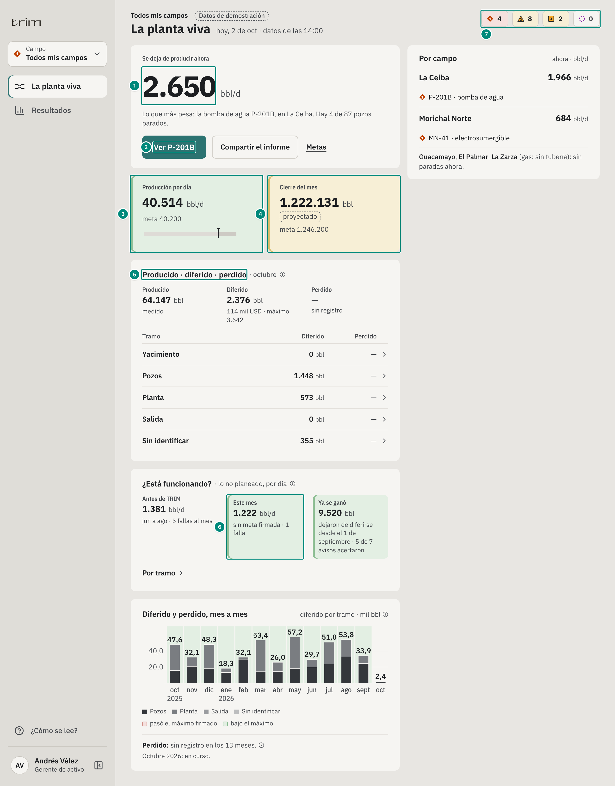

| # | Lo que se ve | Valor (demo) | De dónde sale |
|---|---|---|---|
| 1 | Se deja de producir ahora | 2.650 bbl/d; «Lo que más pesa: la bomba de agua P-201B, en La Ceiba» | riesgo ahora del portafolio (5B §5) |
| 2 | El equipo que más pesa, a un toque | «Ver P-201B» abre su ficha (6.6) | el primero de lo que se pierde ahora |
| 3 | Producción por día contra la meta | 40.514 bbl/d contra 40.200: **verde pálido** (meta cumplida) | libro (5A) y meta firmada |
| 4 | Cierre del mes | 1.222.131 bbl proyectado contra 1.246.200: **amarillo pálido** (por debajo) | proyección del libro (5A) |
| 5 | Producido · diferido · perdido, por tramo | 64.147 · 2.376 (114 mil USD) · sin registro; pozos 1.448, planta 573, sin identificar 355 | `/vistas/balance` (5E); cada fila abre su traza (6.7) |
| 6 | ¿Está funcionando? · este mes | 1.222 bbl/d contra 1.381 antes de TRIM: **verde pálido**; ya se ganó 9.520 bbl, 5 de 7 avisos acertaron | `/vistas/efectividad` |
| 7 | La franja de condiciones | 4 alarmas (rojo pálido) · 8 en atención y 2 avisos (amarillo pálido) · 0 sin comunicación | condiciones del portafolio (ISA-18.2) |

A la derecha, **Por campo**: lo que deja de producir cada campo ahora y su equipo (La Ceiba 1.966 bbl/d, P-201B).

## 6.2 La planta viva · ingeniera de producción

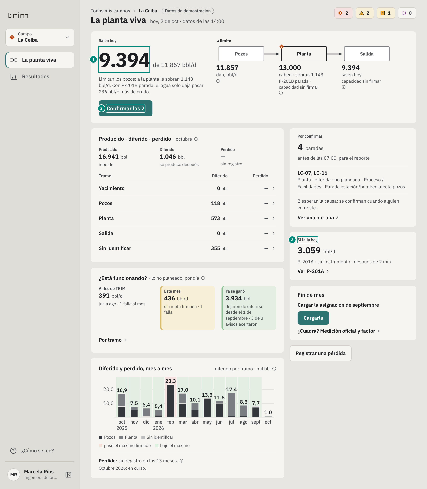

| # | Lo que se ve | Valor | De dónde sale |
|---|---|---|---|
| 1 | Salen hoy | 9.394 de 11.857 bbl/d; limitan los pozos y a la planta le sobran 1.143 bbl/d | la tubería del choke (5E.2) |
| 2 | Confirmar las 2 | las paradas que TRIM ya clasificó, en lote | `POST /api/anh/paradas/confirmar` (5E.9) |
| 3 | Si falla hoy | 3.059 bbl/d si falla P-201A | `/vistas/criticidad` (5E.7) |

Debajo, el mismo balance por tramo del campo (16.941 · 1.046 · sin registro) y «¿Está funcionando?» del campo: antes 391, este mes 436 bbl/d (**amarillo pálido**: va peor por P-201B) y ganado 3.934 bbl.

## 6.3 Hoy · supervisor (`GET /api/vistas/hoy`, `/jornada`)

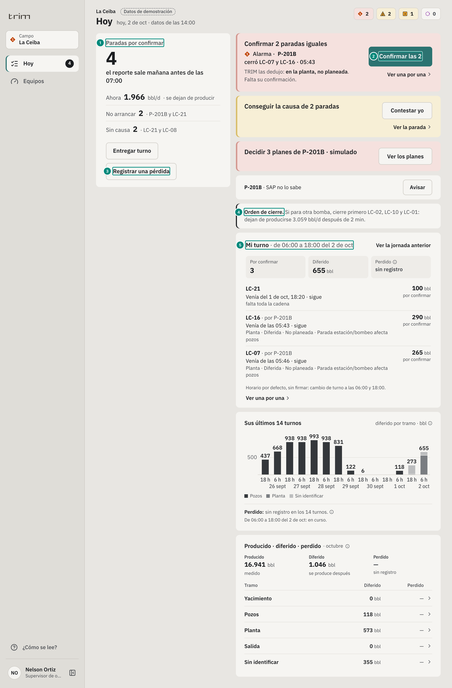

| # | Lo que se ve | Valor | De dónde sale |
|---|---|---|---|
| 1 | Paradas por confirmar | 4; ahora 1.966 bbl/d; no arrancar 2 (P-201B, LC-21); sin causa 2 | `/vistas/hoy` |
| 2 | Confirmar 2 paradas iguales | P-201B cerró LC-07 y LC-16 a las 05:43; TRIM las dedujo en la planta, no planeada. Tarjeta en **rojo pálido** (su equipo está en alarma) | 5E.9 |
| 3 | Registrar una pérdida | pitera, derrame, tea, venteo o rechazo, con botones | `POST /api/perdidas` (5E) |
| 4 | Orden de cierre | si para otra bomba: LC-02, LC-10 y LC-01 primero | 5B §4.2 |
| 5 | Mi turno | de 06:00 a 18:00: por confirmar 3, diferido 655 bbl, perdido sin registro | `/vistas/jornada` |

Las tarjetas de lo que le toca llevan el tono de su equipo: rojo pálido si está en alarma; amarillo pálido si está en atención o aviso.

## 6.4 Hoy · operador y técnico, en el teléfono

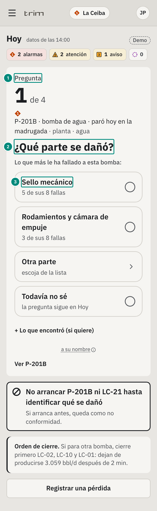 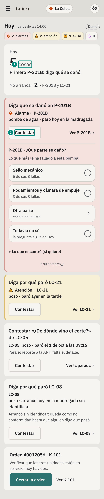

- **Operador.** (1) «Pregunta 1 de 4», (2) «¿Qué parte se dañó?», (3) las opciones con lo que más le ha fallado a esa bomba: sello mecánico 5 de 8 fallas, rodamientos 3 de 8. Un toque responde (`POST /api/paradas/:evento/respuesta`, 5B §3). Debajo: «Registrar una pérdida».
- **Técnico.** (1) «Hoy 5 cosas · Primero P-201B: diga qué se dañó», (2) «Contestar». «Cerrar la orden» abre la hoja de cierre de la orden de SAP (qué hizo, empezó, terminó) sin papel (`POST /api/sap/ordenes/:numero/cierre`).

## 6.5 Hoy del jefe y Equipos de confiabilidad (`/vistas/hoy`, `/vistas/lista-equipos`)

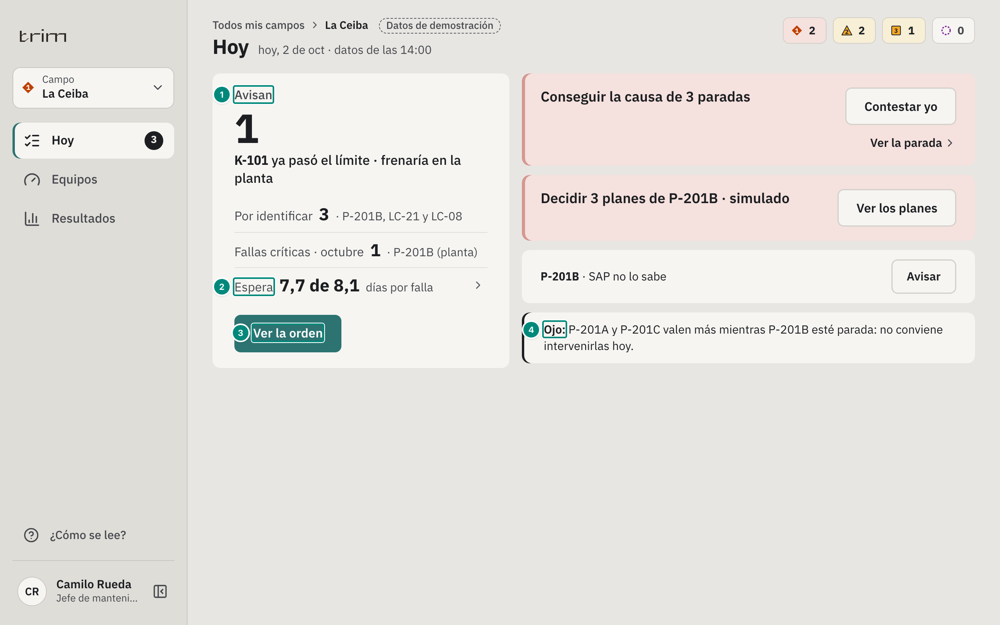

| # | Lo que se ve | Valor |
|---|---|---|
| 1 | Avisan | 1: K-101 ya pasó el límite y frenaría la planta |
| 2 | Espera | 7,7 de 8,1 días por falla son espera; un toque la abre por tramos |
| 3 | Ver la orden | la orden del equipo que avisa |
| 4 | Ojo | P-201A y P-201C valen más mientras P-201B esté parada: no conviene intervenirlas hoy |

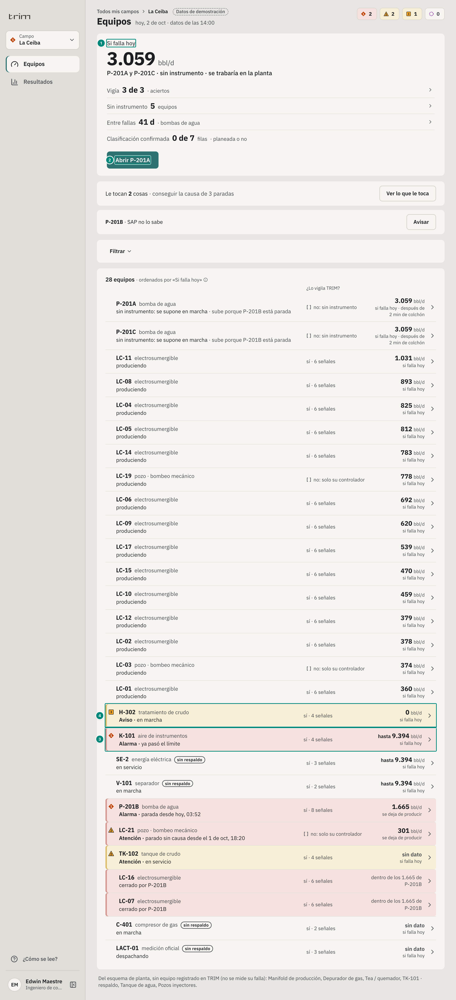

| # | Lo que se ve | Valor |
|---|---|---|
| 1 | Si falla hoy | 3.059 bbl/d: P-201A y P-201C, sin instrumento; vigía 3 de 3; 5 sin instrumento; 41 d entre fallas |
| 2 | Abrir P-201A | su ficha en el nivel 3 |
| 3 | Una fila en alarma | **rojo pálido**, con su marca ISA al inicio |
| 4 | Una fila en atención o aviso | **amarillo pálido**; las filas normales van sin tono (gris) |

## 6.6 El modal de un equipo (la ficha del gerente)

Ver la captura y la tabla del capítulo 1 (`img/cap1-ceiba-p201b-detalle.png`). El orden es fijo, una pregunta por bloque:

| Bloque | Qué dice (P-201B) | Tono |
|---|---|---|
| Ahora | 1.665 bbl/d se dejan de producir · 10,1 h parada desde las 03:52 · 2 pozos cerrados desde las 05:43 · «No arrancar hasta identificar qué se dañó» | rojo pálido (parada y cerrando pozos); amarillo pálido si está en marcha con una parte que avisa |
| Le ha costado | 573 bbl (octubre, 28 mil USD) · 38.838 bbl desde el 1-oct-2025 (1,9 M USD) | — |
| Por qué falla | barra: sello mecánico 72 %, rodamientos 28 % (de los barriles de sus fallas) · 9 fallas, una cada 41 días · 4.593 bbl por falla | — |
| Respaldo | P-201A y P-201C en paralelo, con 30.100 bbl/d libres; el detalle del cabezal y a quién deja sin agua, en la ⓘ | — |
| Si falla hoy | (en un equipo en marcha) la cifra en bbl/d y el colchón | — |
| Qué se está haciendo | Espera que se identifique el daño · hace 10,1 h; el porqué en la ⓘ | — |
| Planes (simulado) | el que más mueve: «Volver antes de 39 h ≈ 2.072 bbl»; «Ver 3 planes más» | — |
| SAP | un renglón por cosa: sin aviso ni orden; sin stock de impulsor y anillos; el kit de sello llega el 9 de oct | — |

Los roles técnicos abren el equipo en su **nivel 3** (una vista entera con sus señales, su tren de agua y su orden de cierre: `img/cap1-morichal-p201b-detalle.png`) y en el **diagnóstico** (6.8).

## 6.7 La traza de un tramo (`GET /api/vistas/balance`, árbol)

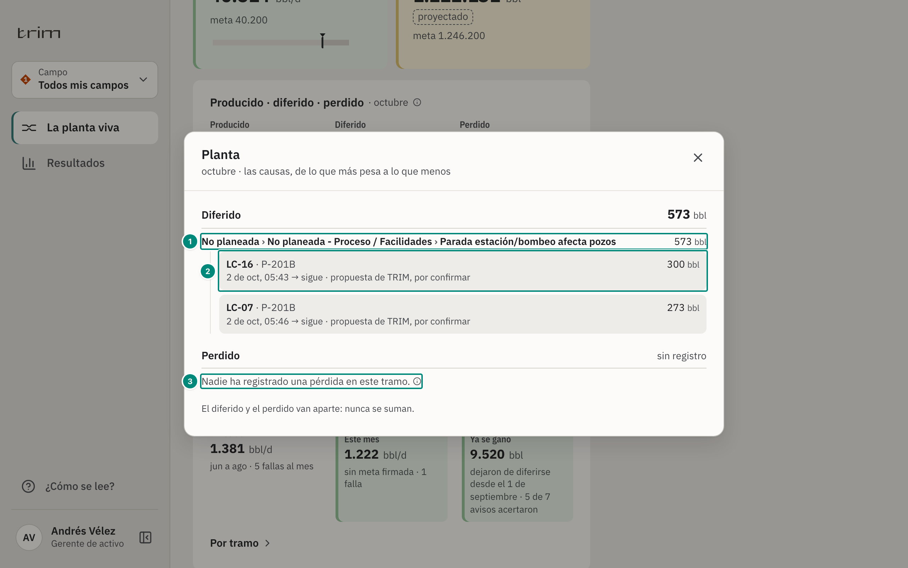

| # | Lo que se ve |
|---|---|
| 1 | **Una cadena de un solo hijo en un renglón:** «No planeada › No planeada - Proceso / Facilidades › Parada estación/bombeo afecta pozos · 573 bbl», no tres renglones con 573. El árbol sigue anidado en la página (las pruebas lo leen) |
| 2 | Cada parada: el pozo, el equipo, sus barriles, desde cuándo y quién la confirmó (aquí, «propuesta de TRIM, por confirmar») |
| 3 | Perdido sin registro: una línea; qué es una pérdida, en la ⓘ. «El diferido y el perdido van aparte: nunca se suman» |

## 6.8 El diagnóstico · el vigía en pantalla (`GET /api/vistas/equipos/:campo/:equipo/tecnico`)

| # | Lo que se ve | Valor |
|---|---|---|
| 1 | Cómo está y por qué | necesita 4,9 % más velocidad que hace 11 días y la caída de presión del filtro se duplicó: entra arena (API 676) |
| 2 | Salud por parte | filtro de entrada: alarma en 5,2 d (4,7–5,7 d), fuera de banda |
| 3 | Zona de la alarma | **rojo pálido** sobre el límite (12 psi) |
| 4 | Entre la banda y la alarma | **amarillo pálido**; la línea discontinua es la proyección (mínimos cuadrados, 5C) |
| 5 | Qué la anuncia | PDT-3011 anuncia, PT-3011 confirma |

## 6.9 Configurar · administrador (`GET /api/vistas/configuracion/estado`)

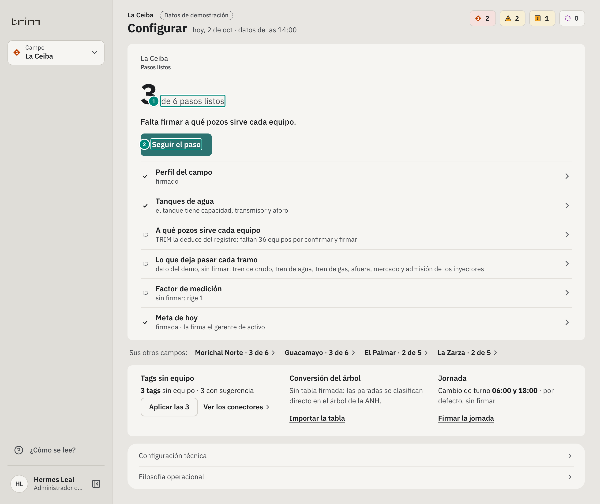

(1) «3 de 6 pasos listos» y el que sigue: firmar a qué pozos sirve cada equipo (36 por confirmar). (2) «Seguir el paso». Debajo, los seis pasos con su estado, sus otros campos con su «N de M», la conversión del árbol de la operadora y la jornada.

## 6.9b El historial del diferido y del perdido (`GET /api/vistas/historial`)

Pedido del dueño (28-oct): «el historial de diferidos y pérdidas para los cargos clave, en gráficos».

| Quién | Dónde | Qué |
|---|---|---|
| Gerente y producción | La planta viva, debajo de «¿Está funcionando?»; y Resultados | 13 meses: una columna por mes con su diferido partido por tramo del choke |
| Jefe de mantenimiento | Resultados | lo mismo, de su campo |
| Confiabilidad | Confiabilidad, al lado de «Fallas por mes» | lo mismo |
| Supervisor | Hoy, debajo de «Mi turno» | sus últimas 14 jornadas (`por=turno`) |

- Cada período es **el balance con ese período**: octubre del portafolio da 2.376 bbl (1.448 pozos · 573 planta · 355 sin identificar), el mismo del bloque «Producido · diferido · perdido».
- El **perdido va aparte**, debajo y nunca sumado. Sin registro lo dice una vez («sin registro en los 13 meses»), sin dibujar ceros.
- El fondo de cada mes **cerrado**: rojo pálido si pasó su máximo firmado (`sobre: true`) y verde pálido si no (`false`). El mes en curso no se juzga. Lo decide el motor (`src/entities/historial.ts`); la pantalla lo pinta (`src/widgets/resultados/Historial.tsx`, con `Columnas` del kit: hasta 5 partes en grises de dato y el fondo por período).
- Mes a mes, en miles de barriles («47,6»); por turno, en barriles.

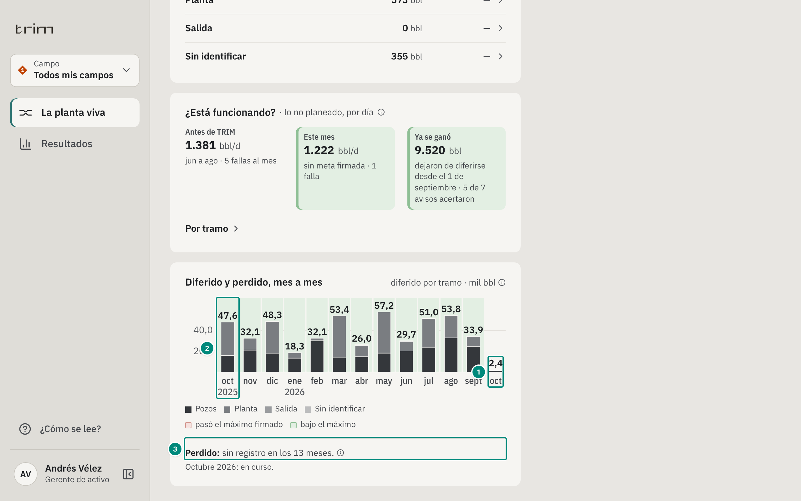

| # | Lo que se ve |
|---|---|
| 1 | Octubre, en curso: 2.376 bbl (2,4 mil), el mismo del balance del mes; no se juzga contra su máximo (sin fondo) |
| 2 | Un mes cerrado bajo su máximo firmado: fondo verde pálido (`sobre: false`). Uno que lo pasa iría en rojo pálido |
| 3 | El perdido, aparte: «sin registro en los 13 meses», sin dibujar ceros |

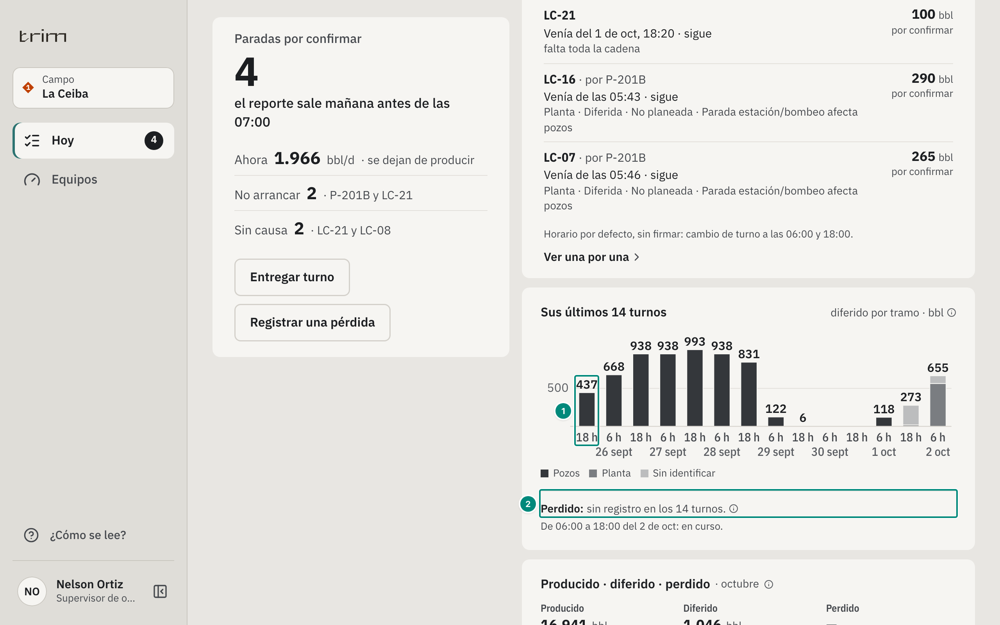

| # | Lo que se ve |
|---|---|
| 1 | Cada jornada de La Ceiba (06:00 y 18:00), con su diferido por tramo; el eje dice la hora de inicio («18 h») y el día |
| 2 | El perdido de las 14 jornadas, aparte |

## 6.10 La propuesta de valor en el producto

Con **«¿Cómo se lee?»** encendido, arriba de cada pantalla va la propuesta de valor (`src/shared/brand/Propuesta.tsx`): «Anticipamos la falla de sus equipos críticos para que produzca más, con inteligencia artificial» y su segunda línea. Apagado, nada: la pantalla de trabajo no suma texto. Qué es hoy esa inteligencia artificial: capítulo 1, nota técnica.

## 6.11 Detalles del marco que el servidor no cambia, pero conviene saber

- **Solo se desplaza el contenido** (`#contenido`, `src/App.tsx`): la página mide la ventana; el panel lateral no se mueve al llegar al final (prueba en `e2e/responsive.spec.ts`).
- **Los tonos** se prueban en `e2e/tonos.spec.ts`; cada pieza dice su tono en `data-tono`.
