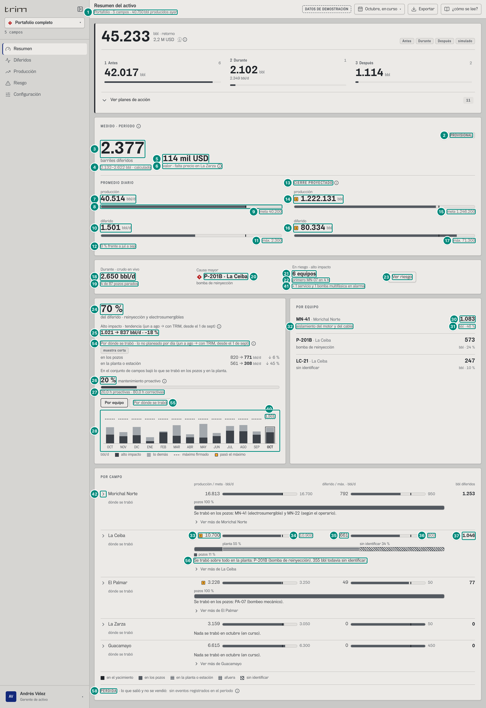
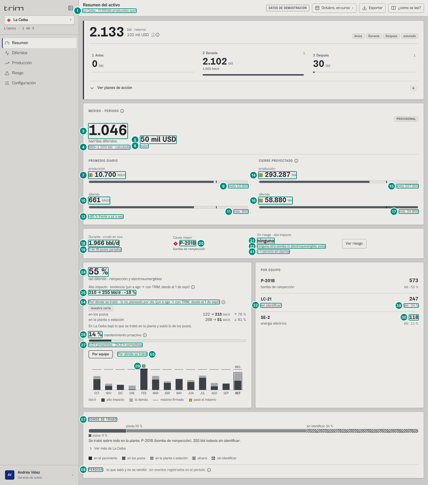
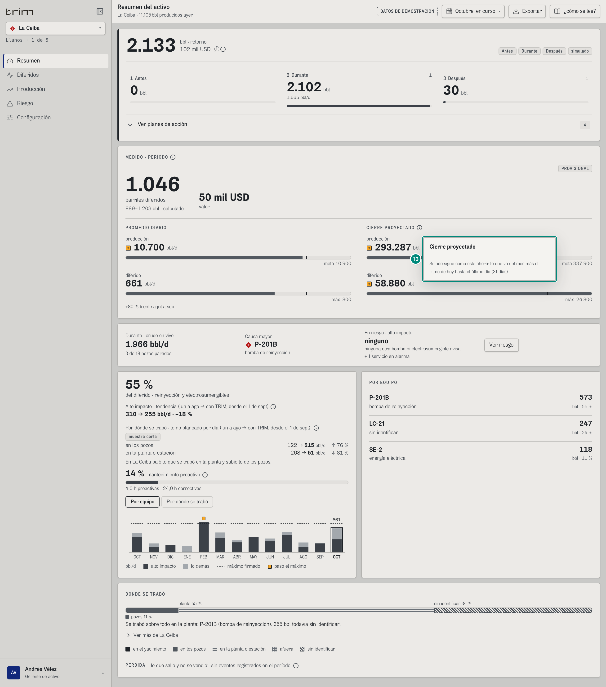
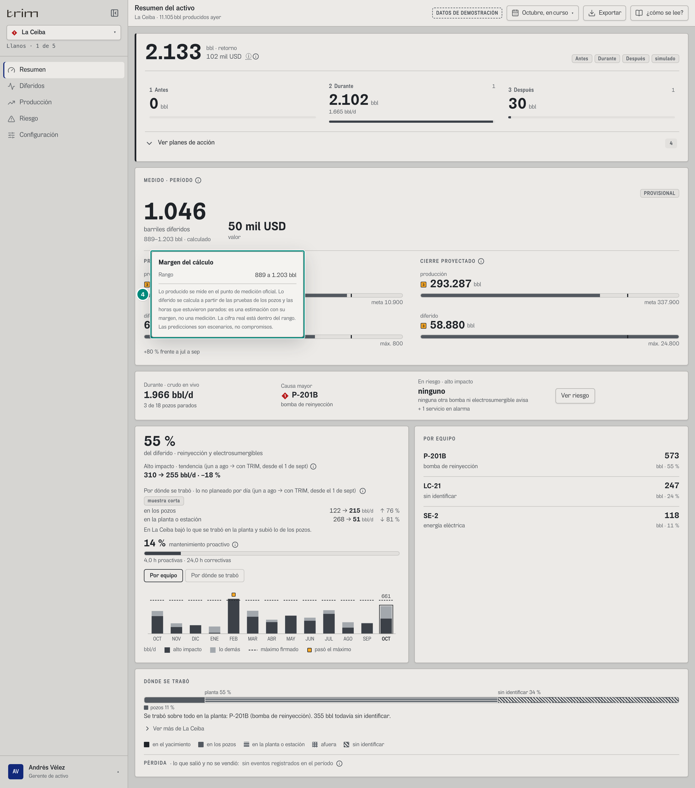
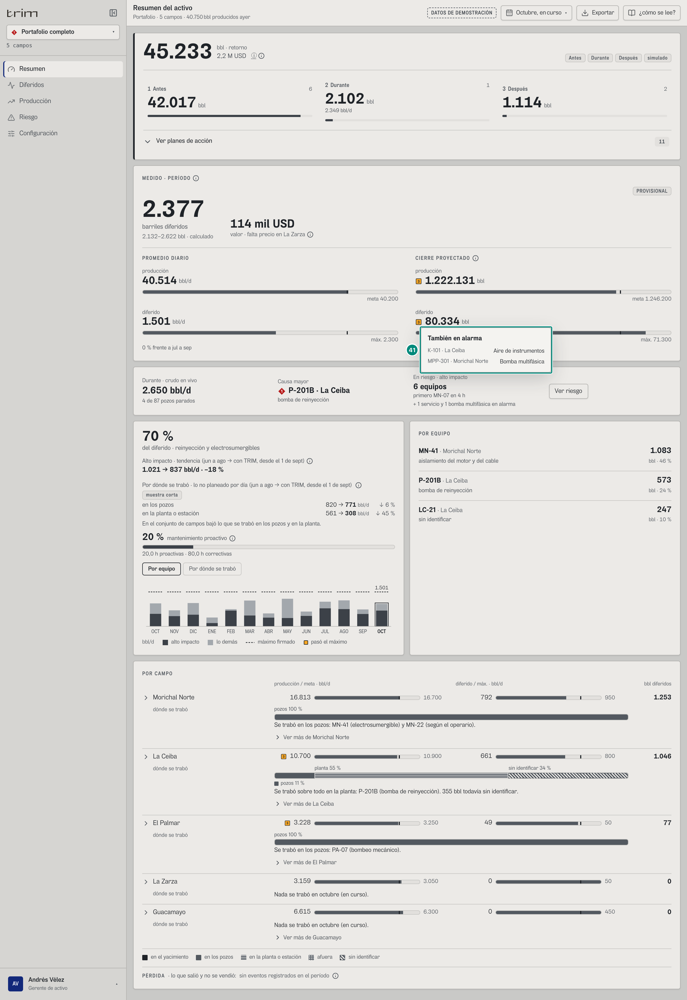
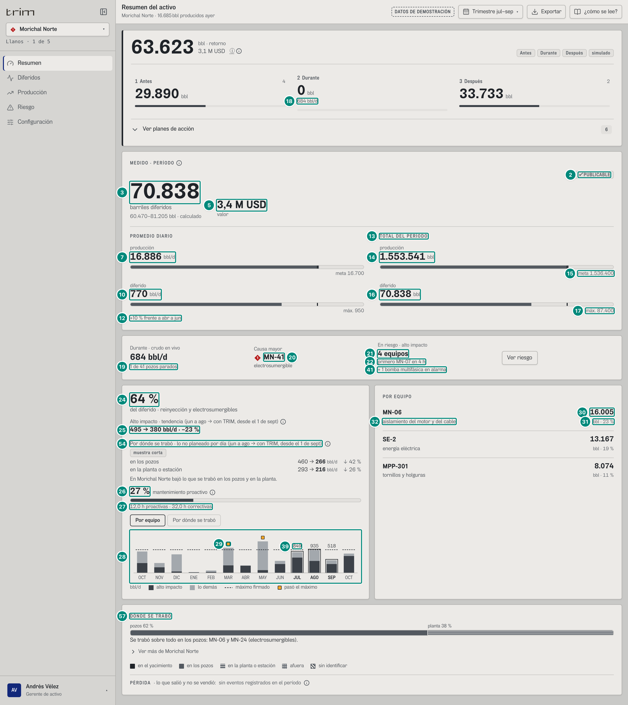
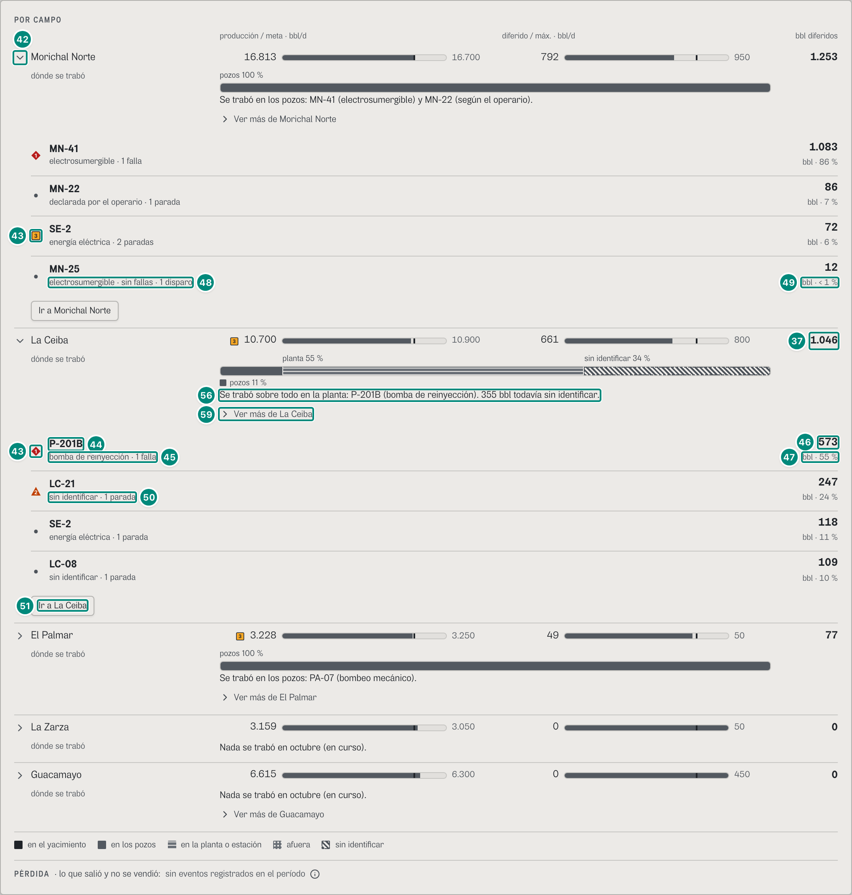
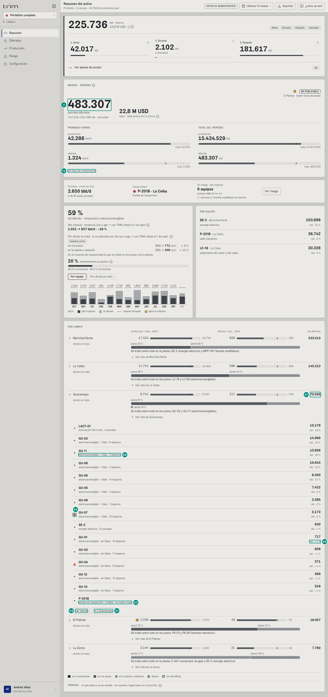
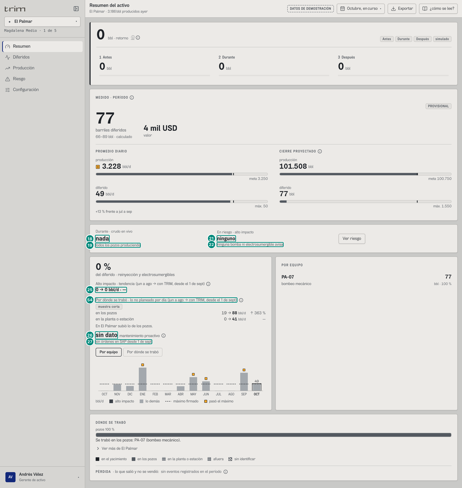

# 6A.1 Resumen del activo — gerente (decisión)

**Para qué.** «Lo perdido, el retorno posible y a qué equipo ir.» (`PARA_QUE_DECISION.resumen`, `src/widgets/Onboarding.tsx:37`).
**Ruta.** `#/ger/resumen/<campo | ceiba~portafolio>/<período>` · **Roles y nivel.** Solo el gerente de activo (`ger`, nivel `decision`) tiene la pantalla «resumen» (`src/entities/roles.ts:47-48`). Con nivel `decision`, `Resumen()` dibuja `ResumenDirectivo` (`src/pages/Resumen.tsx:31-37`). Las variantes `Portafolio` y `ResumenCampo` del mismo archivo existen para niveles de ingeniería/operación, pero ningún rol de hoy las alcanza (5A §Huecos 16); se describen al final.
**Lee.**

| Endpoint (capítulo 7) | Para qué en esta pantalla |
|---|---|
| `GET /api/vistas/diferidos?campos&desde&hasta` (período) | cifra, rango, valor, sello, promedio diario, cierre/total, alto impacto %, por equipo, por campo y, desplegados, los equipos de cada campo (`porEquipo` con `fallas`/`disparos`, y `sinCosto`) |
| `GET /api/vistas/diferidos?campos&desde=2026-06-01&hasta=2026-09-01` y `…&desde=2026-09-01&hasta=ahora` | «antes → con TRIM» (dos intervalos fijos, no dependen del período) |
| `GET /api/vistas/diferidos/mensual?campos` | gráfica mes a mes (Tendencia) |
| `GET /api/vistas/diferidos/base?campos&desde&hasta` | «0 % frente a jul a sep» (o «sin base de comparación» si responde `null`) |
| `GET /api/vistas/riesgo?campos` | perdiéndose ahora, causa mayor, en riesgo de alto impacto y «también en alarma» |
| `GET /api/vistas/ciclo?campos&desde&hasta` | retorno posible ANTES / DURANTE / DESPUÉS (cifra simulada; capítulo 11) |
| `GET /api/catalogo` (arranque) | máquinas de bombeo de la línea, para separar un servicio de una bomba en «también en alarma» (`esServicio`) |
| `GET /api/vistas/estado?campos` | pozos parados, ritmo del cierre proyectado, «producidos ayer» de la cabecera |
| `GET /api/sap/ordenes?campos` | mantenimiento proactivo (el front suma horas; sin órdenes, «sin dato») |
| `GET /api/vistas/choke/reparto?campos&desde&hasta`, `…/choke/mensual?campos`, `…/choke/base?campos&desde&hasta`, `…/choke/arbol` y `GET /api/vistas/campos/:campo/tuberia` | lo nuevo del choke: «Por dónde se trabó · lo no planeado por día», el mes a mes «Por dónde se trabó», el «dónde se trabó» de cada campo y «PÉRDIDA» (filas 54-59; **se explican en 6D.3**, aquí solo se dice qué son) |
| `GET /api/vistas/equipos-hoy?campos` | solo en el portafolio: la marca de prioridad de cada equipo de POR CAMPO desplegado (`useEquiposDeHoy`, `src/widgets/resumen/PorCampo.tsx:57`). El Pareto simple POR EQUIPO no lleva marca |

Todas las cifras del libro se piden **una vez por período** y el front solo divide por días y formatea (capítulo 8).

**Retorno posible (capítulo 11).** El gerente ve **primero** `BloqueCiclo` (simulado), **después** «MEDIDO · PERÍODO» (libro). Retorno = ANTES + DURANTE + DESPUÉS en bbl y USD; chips `Antes · Durante · Después · simulado`; tres columnas «1 / 2 / 3» con cifra y barra; explicación de producto en globo al pasar el cursor, no en párrafos bajo cada columna. La lista de planes va en «**Ver planes de acción**» (plegada por defecto; una línea por plan al expandir; `accion` y supuestos en globo). Sale de `GET /api/vistas/ciclo` con el mismo `campos`/`desde`/`hasta` del período; el front no calcula. Números de ejemplo (portafolio, octubre en curso): retorno ≈ 45.233 bbl (42.017 + 2.102 + 1.114); septiembre cerrado ≈ 59.726 bbl en `referencia/ciclo/portafolio-2026-09.json`. El servidor de producción debe producir ese GET (el demo lo arma en el navegador).

---

## 6A.1.1 Portafolio · octubre en curso

| # | Lo que se ve | En la captura | Cómo se calcula | Texto según el valor | Viene de |
|---|---|---|---|---|---|
| R1 | **Retorno del ciclo** (hero, arriba de todo) | «**45.233** bbl · retorno» + «2,2 M USD» | `retornoBbl` = ANTES.bbl + DURANTE.bbl + DESPUÉS.bbl = 42.017 + 2.102 + 1.114 → capítulo 11 | `n0` + «bbl · retorno»; `usd(valorUsd)`; chips `Antes`, `Durante`, `Después`, `simulado`; ⓘ «Tres palancas». **No** es libro | `GET /api/vistas/ciclo` |
| R2 | Columnas 1 · 2 · 3 | Antes 42.017 · Durante 2.102 · Después 1.114 | Tramos `antes`, `durante`, `despues`; barra = proporción sobre `retornoBbl` | Globo por columna: `PALANCA_PRODUCTO[f]` + equipos; clic → pantalla del rol (Riesgo, Turno, Diferidos…) | ídem |
| R3 | Planes de acción | «Ver planes de acción · **11**» (plegado) | Unión de `planes[]` de los tres tramos, orden por `bbl` desc; máx. 12 en Resumen | Al expandir: `2` · `P-201B` · título · bbl; `accion` en globo. «Ocultar planes» | ídem |
| 1 | Subtítulo de la cabecera: «*Ámbito* · *N campos* · *X* bbl producidos ayer» | «Portafolio · 5 campos · 40.750 bbl producidos ayer» | $\sum_c \text{ayer.bbl}_c$ = 11.105 + 16.685 + 6.611 + 3.186 + 3.163 (fiscal del 1-oct de cada campo) — 5B §5.4 «El estado del campo» (`ayer`) | `n0` + « bbl producidos ayer»; si **algún** campo trae `ayer.bbl = null` → «ayer sin fiscal» (hueco, no suma parcial). Con un campo: «La Ceiba · 11.105 bbl producidos ayer»; «5 campos» solo en el portafolio (`src/widgets/Cabecera.tsx:51-56`) | `GET /api/vistas/estado` → `[].ayer.bbl` |
| 2 | Sello de publicación | «PROVISIONAL» | por el **código** de `motivos`: vacío → publicable; solo `en-curso` → provisional; otro → bloqueado — 5A §«Estado de publicación» y §«Sello de publicación» | «✓ PUBLICABLE» / «PROVISIONAL» (neutro, sin marca) / ■ P3 + chip fuerte «NO PUBLICABLE» y una línea corta por motivo («El Palmar · factor fuera de banda», `CORTO` en `src/widgets/diferidos/Sello.tsx:13-16`). Globo: título «Se puede publicar \| Provisional \| Todavía no se puede publicar» y la frase de `publicacion()` (`src/widgets/diferidos/publicacion.ts:24-31`). En el papel, la frase entera | `GET /api/vistas/diferidos` → `motivos[].codigo`, `motivos[].texto` |
| 3 | Barriles diferidos (cifra de 44 px) | «2.377» | $\text{brecha} = \text{Potencial} - \text{Real} = 66.523{,}755 - 64.147 = 2.376{,}755$ — 5A §«No producido · brecha» | `n0`, sin unidad; debajo «barriles diferidos» (fijo). Sección «**MEDIDO · PERÍODO**» + ⓘ medido vs simulado | `GET /api/vistas/diferidos` → `brecha` |
| 4 | Rango «calculado» | «2.132–2.622 bbl · calculado» | $[\max(0, 2.376{,}755 - 245{,}137),\ 2.376{,}755 + 245{,}137]$ — 5A §«Rango de los barriles diferidos» | `${n0(lo)}–${n0(hi)} bbl · calculado` (`src/widgets/diferidos/Rango.tsx:30-31`). Globo en decisión: título «Margen del cálculo», fila «Rango: 2.132 a 2.622 bbl» (y «Aparte, aproximado: N bbl a frecuencia reducida» si `aproximado > 0`), pista = `NOTA_SIMPLE` (captura `ger-resumen-ceiba-globo-rango`) | `brecha`, `tolerancia`, `aproximado` |
| 5 | Valor en USD | «114 mil USD» | $\sum$ (potencial − real) × precio del día, días con precio = 114.084,224 — 5A §«Valor en USD («falta precio»)» | `usd(v)`: ≥ 10⁶ → «1,3 M USD»; ≥ 10³ → «114 mil USD»; si no «N USD». Sin `valorUsd` → «sin precio» con ⓘ «Sin precio: Falta el precio neto en la configuración.» (`src/widgets/resumen/ResumenDirectivo.tsx:132-136`) | `valorUsd` (ausente si ningún día tuvo precio) |
| 6 | Rótulo del valor | «valor · falta precio en La Zarza» + ⓘ | `sinPrecio` = campos con algún día sin precio | Con valor y `sinPrecio ≠ ∅`: «valor · falta precio en *A, B*» y ⓘ «Valor: Sin contar los días sin precio de La Zarza.»; si no, «valor». (Ojo: el Resumen no usa `valorCampos`, a diferencia del encabezado de Diferidos) | `sinPrecio[]` |
| 7 | PROMEDIO DIARIO · producción | «40.514 bbl/d», sin ■ | $\text{Real}/\max(1/24,\ \text{días}) = 64.147 / 1{,}583 = 40.513{,}895$ — 5A §«Real» y §«Horas y días del período» | `n0` + «bbl/d»; ■ P3 si hay meta y $\text{realDia} < \text{meta.produccionDia}$ (`:74`). Globo «Producción»: «A la fecha: 64.147 de 63.650 bbl» (con período en curso; si no, «Del período») y «Meta del período: 1.246.200 bbl · 31 días»; sin meta, «Meta del período: sin meta firmada en *campos*» | `real`, `meta.dias`, `meta.produccionDia`, `meta.produccion`, `meta.produccionTotal`, `meta.diasTotal` |
| 8 | Barra de la producción | relleno 80,6 %, raya al 80 % | $\min(1{,}25;\ 40.514/40.200)/1{,}25 = 0{,}806$ — capítulo 8 §8.5 `BarraMeta` | gris siempre; sin meta no hay barra ni raya | — |
| 9 | Rótulo de la meta | «meta 40.200» | `meta.produccionDia` = Σ de los tramos firmados por día (10.900 + 16.700 + 6.300 + 3.250 + 3.050) — 5A §«Meta del período» | «meta *n0*»; sin meta: `textoSinMeta(meta, varios)` = «sin meta firmada en La Zarza» | `meta.produccionDia`, `meta.sinMeta` |
| 10 | PROMEDIO DIARIO · diferido | «1.501 bbl/d», sin ■ | $\text{brecha}/\text{días} = 2.376{,}755/1{,}583 = 1.501{,}108$ | ■ P3 si $\text{difDia} > \text{meta.diferidoDia}$ (aquí no: 1.501 < 2.300). Globo «Diferido»: «A la fecha: 2.377 de un máximo de 3.642 bbl», «Máximo del período: 71.300 bbl · 31 días» | `brecha`, `meta.diferido`, `meta.diferidoTotal` |
| 11 | Rótulo del máximo | «máx. 2.300» | `meta.diferidoDia` (800 + 950 + 450 + 50 + 50) | «máx. *n0*» o «sin meta firmada…»; relleno $\min(1{,}25;\ 1.501/2.300)/1{,}25 = 52{,}2\,\%$ | `meta.diferidoDia` |
| 12 | Apoyo del diferido | «0 % frente a jul a sep» | $(1.501{,}108 - 1.508{,}393)/1.508{,}393 = -0{,}0048$ — 5A §«Línea base: los 3 meses antes» | `signo(x)` redondea primero $r = \text{round}(100x)$ y escribe «+», «−» (U+2212) o nada según $r$, `n0(|r|)` « %» «frente a» `base.nombre` (`:44`, `:149`): un cambio que redondea a cero dice «0 %», nunca «−0 %» (aquí −0,48 %; corregido el 9-oct, antes salía «−0 %»). Si el servidor responde `null` (menos de 3 meses publicados antes), dice **«sin base de comparación»**, como el encabezado de Diferidos (`:149`; captura `ger-resumen-portafolio-doce`, 6A.1.5) | `GET /api/vistas/diferidos/base` → `cambio`, `nombre` |
| 13 | Título del bloque derecho | «CIERRE PROYECTADO» + ⓘ | $\text{enCurso} \iff \text{diasTotal} > \text{días} + 0{,}01$ (`:75`) — 5A §«Horas y días del período» | «CIERRE PROYECTADO» solo con el mes en curso; con cualquier otro período «TOTAL DEL PERÍODO» y sin ⓘ. ⓘ literal: «Si todo sigue como está ahora: lo que va del mes más el ritmo de hoy hasta el último día (31 días).» (`:156`; «31» = `n0(meta.diasTotal)`; captura `ger-resumen-ceiba-globo-cierre`) | `meta.dias`, `meta.diasTotal` |
| 14 | Cierre · producción | ■ «1.222.131 bbl» | $\text{Real} + \text{restantes}\cdot\sum_c(\text{potencialBpd}_c - \text{perdiendoBpd}_c) = 64.147 + 29{,}417 \times 39.364{,}910$ (potencial de hoy 42.015,003 menos lo que se pierde 2.650,093) — 5A §«Cierre proyectado del mes» | `n0` + «bbl»; ■ si cierre < `meta.produccionTotal`; relleno $\min(1{,}25;\ 0{,}981)/1{,}25 = 78{,}5\,\%$ | `real` + `GET /api/vistas/estado` → `potencialBpd`, `perdiendoBpd` |
| 15 | Meta del mes completo | «meta 1.246.200» | `meta.produccionTotal` = Σ tramos de los 31 días | «meta *n0*» o «sin meta firmada…» | `meta.produccionTotal` |
| 16 | Cierre · diferido | ■ «80.334 bbl» | $\text{brecha} + \text{restantes}\cdot\sum_c \text{perdiendoBpd}_c = 2.376{,}755 + 29{,}417 \times 2.650{,}093$ | ■ si cierre > `meta.diferidoTotal`; barra llena | `brecha`, `perdiendoBpd` |
| 17 | Máximo del mes completo | «máx. 71.300» | `meta.diferidoTotal` | «máx. *n0*» o «sin meta firmada…» | `meta.diferidoTotal` |
| 18 | Durante · crudo en vivo (antes «Perdiéndose ahora») | «2.650 bbl/d», sin marca | $\sum$ `bblDia` de las filas `perdiendo` = 1.665,183 (P-201B de La Ceiba: LC-16 y LC-07 cerrados) + 684,066 (MN-41) + 300,844 (LC-21, sin identificar) — 5B §5.2 «Perdiéndose ahora». Es el crudo **medido** de todas las filas; la columna «Durante» de la fila R2 (2.349 bbl/d) suma solo las filas `perdiendo` de alto impacto: 1.665,183 + 684,066 (`cicloValor`, `src/entities/escenarios.ts:277-279`) | `n0` + « bbl/d» (`ResumenDirectivo.tsx:188`); el total **ya no lleva marca de alarma** (B-40): la lleva el equipo que lo causa, en «Causa mayor» (fila 20); si la suma es 0: «nada» (`:188`; captura `ger-resumen-palmar`). El rótulo está en `:186` | `GET /api/vistas/riesgo` → `[estado='perdiendo'].bblDia`, `altoImpacto` |
| 19 | Pozos parados | «4 de 87 pozos parados» | $\sum_c \text{parados}_c$ de $\sum_c \text{pozos}_c$ = 3 (La Ceiba: LC-16, LC-07, LC-21) + 1 (MN-41) — 5B §5.4 | «*p* de *n* pozos parados»; si no se pierde nada: «todos los pozos produciendo» (`:189`) | `GET /api/vistas/estado` → `parados`, `pozos` |
| 20 | Causa mayor | ◆ «P-201B · La Ceiba» y «bomba de reinyección» | la **primera** fila `perdiendo` (el servidor las ordena por `bblDia` descendente): P-201B, 1.665,183 bbl/d | marca de prioridad del equipo (◆ P1 si es de alto impacto, ▲ P2 si no: `MarcaPrioridad`, `:195`; desde B-40 la alarma va aquí y no en la cifra de la fila 18) + equipo + « · *Campo*» solo en el portafolio; debajo `TIPO_CAUSA[tipo]` en minúsculas. La celda entera no aparece si no se pierde nada (`:191-200`) | `riesgo[0].equipo`, `campoId`, `tipo`, `altoImpacto` |
| 21 | En riesgo · alto impacto | «6 equipos» | número de filas `en-riesgo` **con** `altoImpacto` (P-201B de Morichal, GU-04, MN-07, GU-07, MN-18, MN-27; `:63`). GU-07 produce, pero su aislamiento «ya llegó a su alarma» (sin horas) — 5B §5.3 | `plural(n, 'equipo', 'equipos')`; 0 → «ninguno» (`:103`) | `riesgo[estado='en-riesgo' ∧ altoImpacto]` |
| 22 | Pie de «en riesgo» | «primero MN-07 en 4 h» | la de alto impacto con `horas` más chicas: MN-07, 3,791 h → `fmtHoras` = «4 h» (GU-07 no trae horas: ya está en su alarma) | En orden (`:96-97`): «primero *E* en *fmtHoras(h)*»; si ninguna trae horas pero hay alguna: «*E* ya pasó el límite» (antes «ya fuera», B-42); si no hay ninguna y se pierde por alto impacto: «ninguna otra bomba ni electrosumergible avisa»; si no: «ninguna bomba ni electrosumergible avisa». Ya no lleva los servicios detrás ni se corta (`:104`, sin `truncate`): lo que no es de alto impacto va en su propio renglón (fila 41) | `riesgo[].horas`, `equipo`, `altoImpacto` |
| 41 | También en alarma | «+ 1 servicio y 1 bomba multifásica en alarma» | `otrosEnAlarma(riesgo)` (`src/widgets/resumen/enAlarma.ts:9-19`): las filas `en-riesgo` **sin** `altoImpacto` (K-101 y MPP-301). Cada una es un **servicio** si `esServicio(r)` = no es electrosumergible **y** no es una máquina de bombeo de la línea del catálogo (`src/shared/api/equipos.ts:208`, la misma regla de Riesgo y Mantenimiento); las demás son bombas de la línea que no cierran pozos (hoy solo la multifásica, `tipo = 'transporte'`). $6 + 1 + 1 = 8$: los ocho en riesgo de la pantalla Riesgo | Renglón propio, con «+ » delante, que se parte si no cabe (`:105`): `plural(s, 'servicio', 'servicios')` y `plural(b, 'bomba multifásica', 'bombas multifásicas')` (o «otra bomba / otras bombas» si alguna no es multifásica), unidos con « y », más « en alarma»; sin ninguna fila así, no hay renglón ni globo. Globo «También en alarma» sobre la celda (`:95`, `:201-203`; captura `ger-resumen-portafolio-globo-alarma`): una fila por equipo, en el orden del servidor, «K-101 · La Ceiba» → «Aire de instrumentos», «MPP-301 · Morichal Norte» → «Bomba multifásica» (`TIPO_CAUSA[tipo]`; « · *Campo*» solo en el portafolio); en el papel se escribe (`imprimir="todo"`) | `riesgo[estado='en-riesgo' ∧ ¬altoImpacto].equipo`, `tipo`, `campoId`; `GET /api/catalogo` (máquinas de bombeo) |
| 23 | Botón «Ver riesgo» | «Ver riesgo» | aparece si el rol tiene la pantalla «riesgo» (`rol.pantallas`) | fijo; lleva a `#/ger/riesgo/…` | rol (sesión) |
| 24 | Alto impacto, % del diferido | «70 %» | $100\cdot 1.668{,}068 / 2.376{,}755 = 70{,}2$ (P-201B de La Ceiba 573,061 + MN-41 1.083,104 + MN-25 11,903) — 5A §«Alto impacto, % del diferido» | `n0` + « %» (`:209`); diferido 0 → «0 %»; debajo, fijo, «del diferido · reinyección y electrosumergibles» | `altoImpacto`, `diferido` |
| 25 | Alto impacto · tendencia (antes → con TRIM) | «Alto impacto · tendencia (jun a ago → con TRIM, desde el 1 de sept)» y «1.021 → 837 bbl/d · −18 %» | $93.940{,}916/92 = 1.021{,}097$ → $26.450{,}357/31{,}583 = 837{,}478$; cambio $-0{,}180$. Baja porque desde la puesta en marcha las electrosumergibles que fallan vuelven en 2 a 5 días (antes 12 a 35), el vigía anticipa las de desgaste (MN-05 y MN-16 pasan a paradas programadas, que no son de alto impacto) y la falla de sello de P-201B de La Ceiba cayó el 9-ago (`EV-2011-0809`), antes de TRIM — 5A §«Antes → con TRIM» | `${n0(antes)} → ${n0(después)} bbl/d · ${signo(cambio)}` (`:216`); antes = 0 → «—» en vez del % (El Palmar: «0 → 0 bbl/d · —», captura `ger-resumen-palmar`). El rótulo escribe la base como el bloque de la fila 54 (B-50): «jun a ago» = los tres meses publicados antes de TRIM (`mesesAntes(inicio)`, `:213`). ⓘ «Tendencia histórica»: «Alto impacto por día desde que entró TRIM (1 de sept) contra los tres meses antes. Es una comparación histórica, no la fase Antes del retorno posible.» (`:214`). **No cambia con el período** de la cabecera; debajo, la misma comparación por tramo (fila 54) | dos `GET /api/vistas/diferidos` → `altoImpacto`, `meta.dias` |
| 26 | Mantenimiento proactivo | «20 %» | $P/(P+K)\cdot100 = 20/(20+80) = 20{,}0$ con las 16 órdenes de SAP de los 5 campos cerradas (o liberadas/creadas) entre el 1-sep y ahora: cinco PM03 de 4 h (LC-14, P-201B de Guacamayo, MPP-301, y las dos que salen del vigía al anticipar MN-05 y MN-16) y la PM03 de K-101 abierta (0 h), contra diez PM01 de 8 h — 5D §«Horas proactivas contra correctivas (`horasPorClase`)» | `n0` + « %» y la barra (ancho = el %) (`:223`, `:230-232`). ⓘ «Mantenimiento proactivo: Horas preventivas o predictivas en SAP desde que entró TRIM (1 de sept). Si no sube, las fallas no bajan.» (`:225`). **Sin órdenes con horas** ($P+K=0$, `porcentaje` ausente) el bloque no desaparece: la cifra dice «sin dato», sin barra, y debajo «sin órdenes en SAP desde 1 de sept» (`fechaCorta` de la puesta en marcha, `:235`; captura `ger-resumen-palmar`: El Palmar y La Zarza no tienen órdenes). No cambia con el período | `GET /api/sap/ordenes?campos` → `clase`, `horasReales`, `cierreTecnico`/`liberada`/`creada` |
| 27 | Horas | «20,0 h proactivas · 80,0 h correctivas» | $P = \sum h$ (PM02 + PM03), $K = \sum h$ (PM01) | `n1(P)` « h proactivas · » `n1(K)` « h correctivas» (`:233`), igual que Mantenimiento; sin órdenes, en su lugar «sin órdenes en SAP desde …» (fila 26) | ídem |
| 28 | Gráfica mes a mes (Tendencia) | 13 barras, oct-25 a oct-26 | por mes $m$: $\text{total}_m = \text{diferido}_m/d_m$ (claro), $\text{alto}_m = \text{altoImpacto}_m/d_m$ (oscuro), raya $= \text{meta.diferidoDia}_m$, con $d_m = \max(1/24, (\min(\text{hasta}_m, \text{ahora}) - \text{desde}_m)/24\,\text{h})$ — 5A §«Tendencia del gerente» | Encima de la gráfica, dos botones (fila 55): «Por equipo» (la de esta fila) y «Por dónde se trabó» (6D.3). Eje Y sin números: techo $= 1{,}1\cdot\max_m \max(\text{total}_m, \text{máx}_m)$ (**sin** redondear a un tope, a diferencia de «Mes a mes» de ingeniería). Mes del período: borde y su cifra `n0(total)` encima; los demás sin cifra. Nombre del mes `corto` en mayúsculas, en negrita el del período. Leyenda fija, fuera del dibujo (`:360-374`): la unidad «bbl/d» (desde el 9-oct va aquí: dentro del dibujo la pisaba la cifra de la barra más alta) y «alto impacto», «lo demás», «máximo firmado», «pasó el máximo». Globo por mes: título «Octubre 2026», «Diferido: 1.501 bbl/d», «De alto impacto: 1.054 bbl/d», «Máximo firmado: 2.300 bbl/d» (o `textoSinMeta`), pista «Clic para ver este mes». Clic → rango a la medida de ese mes | `GET /api/vistas/diferidos/mensual` → `[].libro.diferido`, `altoImpacto`, `meta.diferidoDia`, `meta.sinMeta`, `parcial`, `desde`, `hasta` |
| 29 | Marca «pasó el máximo» | en el portafolio, ninguna (la marca 29 está en la captura de Morichal, 6A.1.3) | $\text{total}_m > \text{máx}_m$ **y** el mes no es parcial (`:295`) | cuadrado P3 con título «Pasó el máximo de diferido firmado». Portafolio: ningún mes pasa los 2.300 (el más alto, mayo, 1.844); La Ceiba, feb 834 ■ (máx. 800); Morichal Norte, mar 1.028 ■ y may 1.291 ■ (máx. 950). Un mes parcial nunca se marca | ídem |
| 40 | Cifra del mes del período | «1.501» | $\text{diferido}_{\text{oct}}/1{,}583 = 2.376{,}755/1{,}583$ | `n0`; solo sobre los meses que tocan el período | ídem |
| 30 | POR EQUIPO · cifra | «1.083» | `porEquipo[0].bbl` = 1.083,104 (MN-41, parada por falla a tierra desde el 25-sep) — 5A §«Pareto por equipo» | las **tres** primeras filas de `porEquipo` (`:90`); vacío: «Nada diferido.» (`:249`) | `porEquipo[0..2].bbl` |
| 31 | Peso del equipo | «bbl · 46 %» | $100\cdot 1.083{,}104/2.376{,}755 = 45{,}6$ | «bbl · *n0(%)* %» (contra `diferido`, no contra la brecha; `:260`). Aquí sigue `n0` y no `pctParte` (ver Huecos 21) | `porEquipo[].bbl`, `diferido` |
| 32 | Parte o tipo | «aislamiento del motor y del cable» (MN-41) | `partes[0]` (la parte con más barriles del equipo); si no tiene: el tipo de causa | `NOMBRE_PARTE[parte]` en minúsculas o `TIPO_CAUSA[tipo]` en minúsculas («bomba de reinyección», «sin identificar», «energía eléctrica»); equipo en negrita y « · *Campo*» en el portafolio. Clic → ficha del equipo en su campo | `porEquipo[].partes[0].parte`, `tipo`, `campoId` |
| 33 | POR CAMPO · producción por día | ■ «10.700» (La Ceiba, segunda fila) | $\text{real}_c/\text{días} = 16.941/1{,}583 = 10.699{,}6$ | `BarraMeta` chica: `n0`, barra, meta a la derecha; ■ si $\text{real}_c/\text{días} < \text{metaProduccion}_c/\text{días}$ (`src/widgets/resumen/PorCampo.tsx:101`, `:123-124`) | `porCampo[].real`, `metaProduccion`, `sinMeta` |
| 34 | Meta por día del campo | «10.900» | $\text{metaProduccion}_c/\text{días} = 17.258{,}333/1{,}583$ | `n0`; con `sinMeta` no hay barra ni número y junto al nombre sale el chip «sin meta firmada» | `porCampo[].metaProduccion` |
| 35 | POR CAMPO · diferido por día | «661», sin ■ | $\text{brecha}_c/\text{días} = 1.046{,}026/1{,}583 = 660{,}6$ | ■ si > máximo por día (`PorCampo.tsx:127-128`); en octubre ningún campo lo pasa | `porCampo[].brecha` |
| 36 | Máximo por día del campo | «800» | $\text{metaDiferido}_c/\text{días}$ | `n0` | `porCampo[].metaDiferido` |
| 37 | Barriles diferidos del campo | «1.046» | `porCampo[].brecha` = 1.046,026 | `n0`, en negrita (`PorCampo.tsx:116`; lector « bbl diferidos»). Filas en el orden del servidor (brecha descendente): Morichal Norte 1.253 · La Ceiba 1.046 · El Palmar 77 · La Zarza 0 · Guacamayo 0 (las dos con brecha −0,000, que se escribe 0). La fila entera es un botón que **despliega** los equipos del campo (6A.1.4); ir al campo es el botón «Ir a *campo*» de la lista. Debajo de las barras de cada fila va «dónde se trabó» (fila 56) | `porCampo[].brecha` |
| 42 | Chevron de la fila | «›» plegado (desplegado, «⌄») | la fila es un `<button aria-expanded aria-controls>` (`PorCampo.tsx:115-118`); el chevron gira 90° al abrir | decorativo (`aria-hidden`): el estado lo dice `aria-expanded`. No sale en el papel (`no-imprimir`), donde los campos van siempre desplegados | estado de la pantalla (no pide nada) |
| 54 | Antes → con TRIM, por tramo | «Por dónde se trabó · lo no planeado por día (jun a ago → con TRIM, desde el 1 de sept)» + chip «muestra corta»; «en los pozos 820 → 771 bbl/d ↓ 6 %»; «en la planta o estación 561 → 308 bbl/d ↓ 45 %»; «En el conjunto de campos bajó lo que se trabó en los pozos y en la planta.» | la comparación de la fila 25 abierta por tramo: lo **no planeado** por día de cada tramo en los tres meses publicados antes de TRIM y desde el 1 de sept (solo los tramos con más de medio barril por día) — 6D.3, 5E §8 | ↓ o ↑ con el % que bajó o subió; «—» si no había base; chip «muestra corta» si con TRIM hay menos de 90 días (aquí 31: un mes no afirma una mejora); sin tres meses publicados antes: «Por dónde se trabó: sin tres meses publicados antes de TRIM con qué comparar.» (`DondeSeTrabo.tsx:191`; montado en `ResumenDirectivo.tsx:219`). No cambia con el período | `GET /api/vistas/choke/base` → `noPlaneado[tramo].baseDia`, `periodoDia`, `cambio`, `texto` |
| 55 | Cómo se parte el mes a mes | botones «Por equipo» (el marcado) y «Por dónde se trabó», encima de la gráfica de la fila 28 | `Tendencia` recibe `porTramo` (`useRepartoMensual`): con «Por dónde se trabó» cada barra se apila en los tramos y lo sin identificar sale rayado; la raya del máximo no cambia — 6D.3, 5E §8 | «Por equipo» es la vista de siempre (alto impacto oscuro, lo demás claro); `aria-pressed` dice cuál está activa; no se imprimen (`ResumenDirectivo.tsx:303-312`) | `GET /api/vistas/choke/mensual` → `[].porTramo` |
| 56 | POR CAMPO · «dónde se trabó» | «dónde se trabó», la barra «planta 55 % · sin identificar 34 % · pozos 11 %» y «Se trabó sobre todo en la planta: P-201B (bomba de reinyección). 355 bbl todavía sin identificar.» (La Ceiba) | el diferido del campo partido por tramo (la barra suma lo de la fila 37) y la frase que arma el motor — 6D.3, 5E §4 | siempre a la vista, debajo de las barras de cada campo (`PorCampo.tsx:133-137`); sin diferido: «Nada se trabó en octubre (en curso).» (La Zarza, Guacamayo); lo demás va plegado en «Ver más de *campo*» (fila 59) | `GET /api/vistas/choke/reparto` → `porChoke`; `GET /api/vistas/campos/:campo/tuberia` → `fraseGerente` |
| 57 | Con un campo: panel «DÓNDE SE TRABÓ» | «DÓNDE SE TRABÓ», la barra y la frase del campo y la leyenda «en el yacimiento · en los pozos · en la planta o estación · afuera · sin identificar» (captura `ger-resumen-ceiba`, 6A.1.2) | lo mismo de la fila 56 en un panel propio: con un solo campo no hay POR CAMPO (`ResumenDirectivo.tsx:268-269`; `PanelDondeSeTrabo`, `DondeSeTrabo.tsx:158`) — 6D.3 | la leyenda solo sale si hay barriles diferidos (B-39) | ídem |
| 58 | Pérdida | «PÉRDIDA · lo que salió y no se vendió: sin eventos registrados en el período» + ⓘ | línea aparte y vacía: TRIM todavía no registra eventos de pérdida (pitera, derrame o tea) y nunca la suma al diferido — 6D.3 | ⓘ «Pérdida: Lo producido que no se vendió: pitera, derrame o tea. Va aparte y nunca se suma a los barriles diferidos: son dos cifras distintas. Cuando TRIM registre pérdidas, van aquí, campo por campo.» (`DondeSeTrabo.tsx:144-155`); al pie de POR CAMPO (`PorCampo.tsx:87`) o del panel de la fila 57 | — (todavía no hay vista de pérdidas) |

**Las cinco filas de POR CAMPO (portafolio, octubre):**

| Campo | Producción bbl/d | Meta | ■ | Diferido bbl/d | Máx. | ■ | bbl |
|---|---:|---:|---|---:|---:|---|---:|
| Morichal Norte | 16.813 | 16.700 | — | 792 | 950 | — | 1.253 |
| La Ceiba | 10.700 | 10.900 | ■ | 661 | 800 | — | 1.046 |
| El Palmar | 3.228 | 3.250 | ■ | 49 | 50 | — | 77 |
| La Zarza | 3.159 | 3.050 | — | 0 | 50 | — | 0 |
| Guacamayo | 6.615 | 6.300 | — | 0 | 450 | — | 0 |

La Zarza no tiene precio pero sí meta: no lleva chip; el precio solo afecta el valor (fila 6). Guacamayo no difiere nada en octubre: sus electrosumergibles que fallaron en septiembre (GU-07, GU-09) volvieron en días y produce sobre su meta (10.474 bbl a la fecha).

**Las tres filas de POR EQUIPO (filas 30-32, portafolio, octubre)**, en el orden del servidor (`porEquipo` por `bbl` descendente; el % es contra `diferido` = 2.376,755): MN-41 · Morichal Norte · «aislamiento del motor y del cable» **1.083** bbl · 46 % (1.083,104 / 2.376,755 = 45,6 %); P-201B · La Ceiba · «bomba de reinyección» (sin parte: la parada abierta del 2-oct no la tiene) **573** bbl · 24 % (24,1 %: solo cerró LC-16 y LC-07, porque P-201A y P-201C toman 30.100 bbl/d más); LC-21 · La Ceiba · «sin identificar» **247** bbl · 10 % (246,525 / 2.376,755 = 10,4 %). `GET /api/vistas/diferidos` → `porEquipo[0..2].equipo`, `campoId`, `bbl`, `partes[0].parte`, `tipo`.

---

## 6A.1.2 Un campo · octubre en curso (La Ceiba)

Mismas filas que el portafolio; solo cambian los valores y lo que se apaga con un campo:

| # | En la captura | Qué cambia |
|---|---|---|
| 1 | «La Ceiba · 11.105 bbl producidos ayer» | sin «N campos» |
| 3 · 4 | «1.046» · «889–1.203 bbl · calculado» | 17.987,026 − 16.941; tol 156,904 |
| 5 · 6 | «50 mil USD» · «valor» | 1.046,026 × 48 = 50.209,2; sin `sinPrecio` → rótulo «valor» sin ⓘ |
| 7 · 9 | ■ «10.700 bbl/d» · «meta 10.900» | 16.941 / 1,583 = 10.699,6; relleno $0{,}982/1{,}25 = 78{,}5\,\%$ |
| 10 · 11 | «661 bbl/d», sin ■ · «máx. 800» | 1.046,026 / 1,583 = 660,6 |
| 12 | «+80 % frente a jul a sep» | base 366,083 bbl/d → 660,648 |
| 14 · 15 | ■ «293.287 bbl» · «meta 337.900» | ritmo de hoy = potencial 11.360,227 − perdiendo 1.966,027 = 9.394,200 bbl/d (15 de 18 pozos producen); $16.941 + 29{,}417 \times 9.394{,}200$; relleno $0{,}868/1{,}25 = 69{,}4\,\%$ |
| 16 · 17 | ■ «58.880 bbl» · «máx. 24.800» | 1.046,026 + 29,417 × 1.966,027 |
| 18 · 19 | «1.966 bbl/d» (sin marca) · «3 de 18 pozos parados» | P-201B 1.665,183 (LC-16 y LC-07, que los operarios cerraron a las 05:43 y 05:46) + LC-21 300,844 sin identificar |
| 20 | ◆ «P-201B» (sin campo) y «bomba de reinyección» | un solo campo: sin « · La Ceiba»; la ◆ P1 es del equipo |
| 21 · 22 · 41 | «ninguno» · «ninguna otra bomba ni electrosumergible avisa» · «+ 1 servicio en alarma» | no hay en riesgo de alto impacto; P-201B ya se está perdiendo (alto impacto) → «ninguna **otra**…»; K-101 (aire de instrumentos: `esServicio`) va en su propio renglón, entero (antes se cortaba al final del pie: Huecos 2, resuelto). Globo «También en alarma»: «K-101 → Aire de instrumentos» (sin campo: es uno solo) |
| 24 · 25 | «55 %» · «310 → 255 bbl/d · −18 %» | 573,061/1.046,026 = 54,8 %; 28.558,295/92 = 310,416 → 8.049,676/31,583 = 254,871 ($-17{,}9\,\%$). Antes de TRIM entran las paradas de P-201B de julio y la falla de sello del 9-ago (`EV-2011-0809`), que cierran tres pozos (1,5 veces el agua sin salida: nadie sabía cuánta sobraba); con TRIM, la del 22-sep (`EV-2011-0922`) y la abierta del 2-oct, que cierran dos (LC-16 y LC-07) |
| 26 · 27 | «14 %» · «4,0 h proactivas · 24,0 h correctivas» | PM03 de LC-14 (4 h) contra tres PM01 de 8 h (P-201B del 22-sep, LC-11 y LC-04); la PM03 de K-101 abierta de octubre suma 0 h. $4/(4+24) = 14{,}3\,\%$ |
| 29 | ■ sobre FEB | 834 > 800 (23.348,830 bbl en 28 días); oct 661 no se marca (parcial) |
| 32 · 38 | «sin identificar» · «bbl · 24 %» (LC-21, segunda fila) | LC-21 no tiene parte ni causa: se escribe `TIPO_CAUSA.pendiente` en minúsculas; 246,525/1.046,026 = 23,6 % |
| 30 (tercera fila; filas 30-31) | «SE-2» · «energía eléctrica» · «118 bbl · 11 %» | tercera fila de `porEquipo` de La Ceiba: SE-2 (alimentador eléctrico), 117,921 bbl; sin parte (un servicio no tiene partes) → el tipo «energía eléctrica» en minúsculas; 117,921/1.046,026 = 11,3 % → «11 %». La cuarta fila (LC-08, 109 bbl) no sale: el Resumen corta en tres (`:90`) |
| 54 · 55 | «Por dónde se trabó · lo no planeado por día (jun a ago → con TRIM, desde el 1 de sept)» y los botones «Por equipo» / «Por dónde se trabó» | con La Ceiba: «en los pozos 122 → 215 bbl/d ↑ 76 %» y «en la planta o estación 268 → 51 bbl/d ↓ 81 %»; «En La Ceiba bajó lo que se trabó en la planta y subió lo de los pozos.»; chip «muestra corta» (filas 54 y 55 de 6A.1.1; 6D.3) |
| 57 · 58 | panel «DÓNDE SE TRABÓ» y línea «PÉRDIDA» | sin POR CAMPO: el bloque de campos solo existe con el portafolio (`ResumenDirectivo.tsx:267-269`); con un campo va en su lugar el panel de la fila 57: la barra «planta 55 % · sin identificar 34 % · pozos 11 %» y «Se trabó sobre todo en la planta: P-201B (bomba de reinyección). 355 bbl todavía sin identificar.» (6D.3) |

Globos de esta captura, literales:

- ⓘ de CIERRE PROYECTADO: «Si todo sigue como está ahora: lo que va del mes más el ritmo de hoy hasta el último día (31 días).»
- Globo del rango: título «Margen del cálculo», «Rango: 889 a 1.203 bbl» y la pista `NOTA_SIMPLE`: «Lo producido se mide en el punto de medición oficial. Lo diferido se calcula a partir de las pruebas de los pozos y las horas que estuvieron parados: es una estimación con su margen, no una medición. La cifra real está dentro del rango. Las predicciones son escenarios, no compromisos.» (`src/widgets/diferidos/Rango.tsx:16-19`).

- Globo «También en alarma» (portafolio, fila 41): «K-101 · La Ceiba — Aire de instrumentos» y «MPP-301 · Morichal Norte — Bomba multifásica», en el orden en que el servidor manda las filas de riesgo (por `bblDia`: K-101 «hasta 9.394 bbl/d» —9.394,199, un techo: cuelga de todo el campo y se cierra lo que esté produciendo, `Riesgo.techo`, `src/entities/diferido.ts:450`, F3 vecino 1—, MPP-301 1.599,752).

---

## 6A.1.3 Un campo · período cerrado (Morichal Norte · trimestre jul–sep)

| # | En la captura | Cómo sale | Qué cambia respecto del mes en curso |
|---|---|---|---|
| 2 | «✓ PUBLICABLE» | `motivos = []` (jul, ago y sep publicados, factores en banda, meta firmada, sin pendiente) | sin marca |
| 3 | «70.838» | 1.624.378,770 − 1.553.541 | rango «60.470–81.205 bbl · calculado» (tol 10.367,546); el globo del rango agrega «Aparte, aproximado: 1.721 bbl a frecuencia reducida» (C-401, compresión) |
| 5 | «3,4 M USD» | 70.837,770 × 48 = 3.400.212,960 | `usd` ≥ 10⁶ → `n1` de millones |
| 7 | «16.886 bbl/d», sin ■ | 1.553.541 / 92 días = 16.886,3 | sobre la meta de 16.700 → relleno $1{,}011/1{,}25 = 80{,}9\,\%$ |
| 10 | «770 bbl/d», sin ■ | 70.837,770 / 92 = 769,976 | bajo el máx. de 950 → relleno $0{,}811/1{,}25 = 64{,}8\,\%$ |
| 12 | «+10 % frente a abr a jun» | base 702,017 → 769,976 | la base son los tres meses antes del **período** |
| 13 | «TOTAL DEL PERÍODO» | `diasTotal = días = 92` → no en curso | sin ⓘ; compara real contra `meta.produccion` y brecha contra `meta.diferido` (`:165-173`). Globo de la producción: «Producción del período · Meta del período: 1.536.400 bbl · 92 días» |
| 14 · 15 | «1.553.541 bbl», sin ■ · «meta 1.536.400» | `real` contra `meta.produccion` (16.700 × 92) | |
| 16 · 17 | «70.838 bbl», sin ■ · «máx. 87.400» | `brecha` contra `meta.diferido` (950 × 92) | |
| 18 · 19 | «684 bbl/d» (sin marca) · «1 de 41 pozos parados» | la única fila `perdiendo` de Morichal **ahora**: MN-41, parada por su electrosumergible (697 × FA 0,981 = 684,066 bbl/d); de alto impacto: su ◆ P1 va con el equipo, en «Causa mayor» (fila 20). Pozos: `estado.parados` = 1 de `estado.pozos` = 41 (5B §5.4) | no depende del período (es «ahora») |
| 20 | ◆ «MN-41» · «electrosumergible» | la fila `perdiendo` más grande **de ahora** (684,066 bbl/d) | perdiéndose ahora, causa mayor y en riesgo **no dependen del período**: son «ahora» |
| 21 | «4 equipos» | filas `en-riesgo` con `altoImpacto` de Morichal: P-201B (succión), MN-07, MN-18, MN-27 | `plural(4, 'equipo', 'equipos')` |
| 22 · 41 | «primero MN-07 en 4 h» · «+ 1 bomba multifásica en alarma» | 4 de alto impacto (P-201B, MN-07, MN-18, MN-27); lo otro en alarma es MPP-301, la multifásica: una máquina de bombeo de la línea, no un servicio (`esServicio` falso, `tipo = 'transporte'`). Antes se leía «1 servicio en alarma» (Huecos 1, resuelto) | |
| 28 · 39 | barras de JUL, AGO y SEP con borde y «849», «935», «518» | los tres meses del período van con borde y cifra | Morichal: lo de alto impacto es poco en mar y may (lo demás es SE-2 y MPP-301) |
| 29 | ■ sobre MAR y MAY | 1.028 > 950 y 1.291 > 950 (meses enteros); septiembre ya no pasa (518: con TRIM, MN-05 y MN-16 se cambiaron antes de fallar y la falla de MN-41 es del 25-sep) | la marca 29 del capítulo está en esta captura (en el portafolio ningún mes pasa) |
| 24 · 25 · 26 · 27 | «64 %» · «495 → 380 bbl/d · −23 %» · «27 %» · «12,0 h proactivas · 32,0 h correctivas» | 24: $100\cdot 45.539{,}600/70.837{,}770 = 64{,}3$ del trimestre de Morichal (5A §«Alto impacto, % del diferido»); 25: los dos intervalos fijos (jun-ago contra 1-sep → ahora) del campo, $45.533{,}232/92 = 494{,}926$ → $12.004{,}294/31{,}583 = 380{,}083$, 5A §«Antes → con TRIM»; 26 · 27: órdenes SAP de Morichal desde el 1-sep, tres PM03 de 4 h (MN-05 y MN-16, anticipadas por el vigía, y MPP-301) contra cuatro PM01 de 8 h (P-201B, MPP-301, MN-33, MN-23): $12/(12+32) = 27{,}3\,\%$ (5D §«Horas proactivas contra correctivas») | el % sí es del período; antes→con TRIM y SAP **no** |
| 30 · 31 · 32 | POR EQUIPO: «MN-06 · aislamiento del motor y del cable · 16.005 bbl · 23 %», «SE-2 · energía eléctrica · 13.167 bbl · 19 %», «MPP-301 · tornillos y holguras · 8.074 bbl · 11 %» | las tres primeras filas de `porEquipo` del trimestre; % contra `diferido` = 70.837,770 (período cerrado: diferido = brecha): 22,6 %, 18,6 % y 11,4 %. MN-41 baja al séptimo lugar (3.832 bbl: su falla empezó el 25-sep) | otras filas que en octubre: el Pareto **sí** es del período |
| 54 · 57 | «en los pozos 460 → 266 bbl/d ↓ 42 %» · «en la planta o estación 293 → 216 bbl/d ↓ 26 %»; panel «pozos 62 % · planta 38 %» y «Se trabó sobre todo en los pozos: MN-06 y MN-24 (electrosumergibles).» | la barra del panel suma los 70.838 bbl del período (cerrado: «DÓNDE SE TRABÓ» sigue el período de la cabecera); la comparación «antes → con TRIM» no (6D.3) | |

La Tendencia de Morichal, para cotejar (bbl/d total/alto, máx. 950): oct 877/403 · nov 405/229 · dic 760/58 · ene 31/24 · feb 98/36 · mar 1.028/308 ■ · abr 303/296 · may 1.291/113 ■ · jun 492/363 · jul 849/628 · ago 935/490 · sep 518/364 · oct 792/692 (en curso). La Ceiba (máx. 800): oct-25 544/421 · nov 249/160 · dic 207/202 · ene 173/24 · feb 834/834 ■ · mar 549/406 · abr 336/278 · may 434/431 · jun 384/310 · jul 563/476 · ago 275/145 · sep 257/249 · oct 661/362. Portafolio (máx. 2.300, ningún mes lo pasa): oct-25 1.534 · nov 1.070 · dic 1.557 · ene 591 · feb 1.146 · mar 1.723 · abr 865 · may 1.844 · jun 988 · jul 1.646 · ago 1.735 · sep 1.131 · oct 1.501.

---

## 6A.1.4 POR CAMPO desplegado (portafolio · octubre en curso)

Decisión del dueño del 8-oct: el gerente no ve Bombas ni Electrosumergibles; lo que le interesa es **de qué campo viene el diferido y qué equipos de ese campo fallan**. Cada fila de POR CAMPO (filas 33-37 y 42) es un botón: un toque la abre o la cierra y debajo sale la lista de los equipos del campo (`src/widgets/resumen/PorCampo.tsx`, montado en `ResumenDirectivo.tsx:268` solo en el portafolio). Cada campo trae además, debajo de sus barras y siempre a la vista, su «dónde se trabó» (fila 56; 6D.3), y «Ver más de *campo*» (fila 59) abre lo demás de eso, no los equipos. Sin señales, tags ni tolerancias. La captura es solo el bloque, con La Ceiba y Morichal Norte abiertos.

**Qué renglones salen** (`PorCampo.tsx:103-106`): las filas de `porEquipo` de ese campo, en el orden del servidor (barriles de mayor a menor; una fila por campo, equipo y tipo, así que un equipo puede salir dos veces: su falla y su parada programada) y, al final, las de `sinCosto` de ese campo (equipos que fallaron sin costar crudo, 6A.1.5). Ningún número se calcula en la pantalla: el front solo divide para el % y escoge el texto.

| # | Lo que se ve | En la captura | Cómo se calcula | Texto según el valor | Viene de |
|---|---|---|---|---|---|
| 37 | Barriles del campo | «1.046» (La Ceiba) | `porCampo[].brecha` (fila 37) | igual que plegado | `porCampo[].brecha` |
| 42 | Chevron abierto | «⌄» junto a «Morichal Norte» (y a «La Ceiba») | `aria-expanded = true`; `aria-controls` apunta a la lista (`PorCampo.tsx:115`, `:139`) | lista con nombre accesible «Equipos de La Ceiba» (`:143`) | — |
| 56 | «dónde se trabó» del campo | la barra «planta 55 % · sin identificar 34 % · pozos 11 %» y «Se trabó sobre todo en la planta: P-201B (bomba de reinyección). 355 bbl todavía sin identificar.» (La Ceiba) | ver la fila 56 de 6A.1.1 — 6D.3, 5E §4 | siempre a la vista, esté la fila plegada o abierta | `GET /api/vistas/choke/reparto` → `porChoke`; `GET /api/vistas/campos/:campo/tuberia` → `fraseGerente` |
| 59 | «Ver más de *campo*» | «Ver más de La Ceiba» (abierto, «Ver menos de La Ceiba») | pliega lo demás de «dónde se trabó»: barriles de cada tramo, lo no planeado de cada tramo, lo que espera a una persona, el inventario entre días y lo que se gana desembotellando — 6D.3 | botón con `aria-expanded`; en el papel va desplegado (`DondeSeTrabo.tsx:56-85`); **no abre los equipos**, eso lo hace la fila (42) | los GET de la fila 56 más `GET /api/vistas/choke/arbol` y `GET /api/vistas/criticidad` |
| 43 | Marca de prioridad del renglón | ◆ P1 en P-201B (La Ceiba); ■ P3 en SE-2 (Morichal Norte) | `marcaDeFila(f, hoy)` (`src/widgets/diferidos/marca.ts:10-11`): la severidad **de hoy** del equipo si el renglón es de una falla suya; **ninguna** (0) si `tipo = 'programada'`. Lo declarado y lo sin identificar sí son fallas (paradas que nadie programó) y llevan la del equipo | `MarcaPrioridad` decorativa (`aria-hidden`); 0 → punto gris. La prioridad va en el nombre accesible del renglón (`:152`): «Prioridad 1 · alarma. P-201B, bomba de reinyección, 1 falla: 573 bbl, 55 % del diferido de La Ceiba». Es la misma función que marca el Pareto de Diferidos (6A.2 fila 19) | `GET /api/vistas/equipos-hoy?campos` → `[].severidad` |
| 44 | Equipo | «P-201B» | `porEquipo[].equipo` | negrita, sin el campo (ya está bajo su campo) | `porEquipo[].equipo` |
| 45 | Lo que es · cuántas veces falló | «bomba de reinyección · 1 falla» | `TIPO_CAUSA[tipo]` en minúsculas · `vecesDe(f)` (`PorCampo.tsx:29-33`): en las filas que traen `fallas` (solo `reinyeccion`, `transporte` y `electrosumergible`), sus fallas y disparos del período (fórmula abajo) | «1 falla» / «N fallas» / «sin fallas»; detrás « · 1 disparo» / « · N disparos» solo si hay | `porEquipo[].tipo`, `fallas`, `disparos` |
| 48 | Electrosumergible que solo disparó | «electrosumergible · sin fallas · 1 disparo» (MN-25) | `fallas = 0`, `disparos = 1`: paró y volvió en menos de 24 h | un disparo no es una falla, pero también difiere (12 bbl) | ídem |
| 50 | Paradas (lo que no es falla de un equipo de la línea) | «sin identificar · 1 parada» (LC-21); también «energía eléctrica · 2 paradas» (SE-2 de Morichal), «declarada por el operario · 1 parada» (MN-22) | servicios, lo programado, lo declarado y lo sin identificar no traen `fallas`: se cuentan sus paradas con barriles, `eventos` = paradas distintas de la fila (5A §«Pareto por equipo») | `plural(eventos, 'parada', 'paradas')` | `porEquipo[].eventos` |
| 46 | Barriles del renglón | «573» | `porEquipo[].bbl` = 573,061 | `n0`, negrita | `porEquipo[].bbl` |
| 47 | Parte del campo | «bbl · 55 %» | $p_e = 100\cdot\text{bbl}_e/\text{diferido}_c = 100 \times 573{,}061 / 1.046{,}026 = 54{,}78$ (base abajo) | `pctParte(p)` (`src/shared/lib/formato.ts:20-21`): `n0(p)` « %»; lector «55 % del diferido de La Ceiba» | `porEquipo[].bbl`, `porCampo[].diferido` |
| 49 | Menos del 1 % | «bbl · < 1 %» (MN-25: $100 \times 11{,}903/1.253{,}234 = 0{,}95$) | ídem | con $0 < p < 1$ dice «< 1 %» (lector «menos del 1 %»), nunca «0 %» ni «1 %»: un número que no es cero no se pinta como cero (corregido el 8-oct: con `n0`, 51 de los 100 renglones de 12 meses dirían «0 %»; con `pctParte`, 56 dicen «< 1 %»). Un renglón con barriles nunca tiene $p = 0$ | ídem |
| 51 | Ir al campo | «Ir a La Ceiba» | `onCampo(c.campoId)` = `setCampo` (`PorCampo.tsx:173`) | lo que antes hacía el toque en la fila; no se imprime (`Boton` lleva `no-imprimir`) | — |

**Fallas y disparos del período** (los calcula el servidor: `src/entities/libro.ts:767-770`, campos opcionales de `FilaEquipo`, `:418-438`):

$$
\text{fallas}_e = \#\{\,k \in H_e : \neg\,\text{disparo}_k \;\wedge\; t^{\text{ini}}_k < h \;\wedge\; t^{\text{fin}*}_k > d \,\}
\qquad
\text{disparos}_e = \#\{\,k \in H_e : \text{disparo}_k \;\wedge\; t^{\text{ini}}_k < h \;\wedge\; t^{\text{fin}*}_k > d \,\}
$$

| Símbolo | Qué es | Unidad | Fuente |
|---|---|---|---|
| $H_e$ | los eventos de la historia de fallas del equipo: las paradas de la bomba del PLC (también las que el tanque absorbió) o los eventos de su electrosumergible | — | `historialDeEquipo(campo, equipo)`, la misma historia de su ficha y de Confiabilidad |
| $[d, h)$ | el período consultado | instante | `desde`, `hasta` |
| $t^{\text{fin}*}_k$ | fin del evento; si sigue abierto, ahora | instante | la regla de período de `porParte` |
| $\text{disparo}_k$ | electrosumergible que volvió a arrancar en menos de 24 h | — | `esDisparo`, `DISPARO_MAX_H = 24` (`libro.ts:460-465`) |

Cuenta la falla abierta y las que no costaron barriles; por eso una bomba puede tener **más fallas que paradas con barriles** (P-201B de Morichal en 12 meses: 8 fallas, `eventos` = 7, porque el tanque absorbió la de enero; 6A.1.5). En una electrosumergible, $\text{fallas} + \text{disparos} = \text{eventos}$ (MN-06 en 12 meses: 1 + 4 = 5). En una bomba, `disparos` = 0. En las filas de otro tipo los dos campos no van y la pantalla cuenta paradas (fila 50). Comprobado en verificar-libro §18 (6 períodos: las 276 filas de bombas y electrosumergibles cuadran con la historia recortada al período).

**La base del % es el diferido del campo, no la cifra de su fila.** La fila muestra $\text{brecha}_c = \text{Potencial}_c - \text{Real}_c$ (fila 37); el % de cada equipo es contra $\text{diferido}_c$ = Σ de los eventos del campo (`porCampo[].diferido`, `PorCampo.tsx:147`), que es exactamente la suma de sus renglones con barriles (identidad de verificar-libro §1): así los % de un campo suman 100. Las dos cifras coinciden cuando no hay inventario entre días: el mes en curso (La Ceiba: 1.046,026 las dos) y los meses enteros. En un rango que corta meses difieren por el residuo (5A §«Residuo · inventario entre días»): del 15-sep al 2-oct La Ceiba dice «7.638» (brecha 7.637,597) y sus equipos suman 8.149,747, la base de sus %; La Zarza, brecha −53,587 y diferido 0, no tiene renglones. El POR EQUIPO del Resumen (fila 31) y el Pareto de Diferidos usan la misma base (`diferido`).

**Los cinco campos en octubre** (marca · equipo · lo que es · veces · bbl · % del campo):

| Campo (fila · base del %) | Renglones |
|---|---|
| Morichal Norte (1.253 · 1.253,234) | ◆ MN-41 · electrosumergible · 1 falla · 1.083 · 86 %; • MN-22 · declarada por el operario · 1 parada · 86 · 7 %; ■ SE-2 · energía eléctrica · 2 paradas · 72 · 6 %; • MN-25 · electrosumergible · sin fallas · 1 disparo · 12 · < 1 % |
| La Ceiba (1.046 · 1.046,026) | ◆ P-201B · bomba de reinyección · 1 falla · 573 · 55 %; ▲ LC-21 · sin identificar · 1 parada · 247 · 24 %; • SE-2 · energía eléctrica · 1 parada · 118 · 11 %; • LC-08 · sin identificar · 1 parada · 109 · 10 % |
| El Palmar (77 · 77,496) | • PA-07 · bombeo mecánico · 1 parada · 77 · 100 % |
| La Zarza (0 · 0) | «Ningún equipo con diferido.» (`PorCampo.tsx:141`) |
| Guacamayo (0 · 0) | «Ningún equipo con diferido.»: GU-07 ◆ está hoy en alarma, pero produce; su falla y la de GU-09 fueron en septiembre y volvieron en días |

Ningún equipo falló sin costar crudo en octubre (`sinCosto` vacío).

**Cuántos se ven.** `useVerMas(renglones, { n, prioridad: marca })` (`PorCampo.tsx:109`): cinco a la vista (seis si son exactamente seis, para no esconder uno solo) y además **toda fila P1**, aunque venga después (ISA-18.2: una alarma no se tapa); el resto, detrás de «ver N más» / «ver menos» (`VerMas`) y con `solo-impresion`, para que salga en el papel. En octubre ningún campo pasa de cuatro renglones.

**En el papel**, todos los campos salen desplegados (`hidden print:block`, `:139`), sin chevrons ni botones; un campo largo se parte entre hojas por sus renglones (`data-partible`, `:114`, y `src/index.css:194`) y el nombre del campo no queda solo al pie de una hoja (`print:break-after-avoid`, `:116`). Portafolio, 12 meses: 101 renglones (los 100 con barriles y P-201B de Guacamayo) en 7 hojas A4 (Exportar → PDF, corrido el 9-oct).

**Un toque en un equipo** abre su ficha ejecutiva con el mismo `abrir` de POR EQUIPO (`ResumenDirectivo.tsx:93`: `setCampo` + `abrirEquipo(eq, false)`).

---

## 6A.1.5 Portafolio · últimos 12 meses (Guacamayo desplegado entero)

Guacamayo abierto y «ver 9 más» tocado (`antes` de la captura), para que se vea el último renglón: P-201B, que falló sin costar crudo.

| # | En la captura | Cómo sale | Qué cambia |
|---|---|---|---|
| 3 | «483.307» | 15.917.836,402 − 15.434.529 (el mismo libro de 6A.2.3) | período cerrado: «TOTAL DEL PERÍODO», sin ⓘ |
| 12 | «sin base de comparación» | `GET …/base` → `null`: no hay tres meses publicados antes del 1-oct-2025 | antes del 8-oct la línea no salía (Huecos 4) |
| 37 | «79.095» | brecha de Guacamayo, 79.094,842 = su diferido (meses enteros) | las filas, por brecha: Morichal Norte 233.213 · La Ceiba 145.213 · Guacamayo 79.095 · El Palmar 18.007 · La Zarza 7.780 |
| 48 | «electrosumergible · 1 falla · 7 disparos» (GU-11, el primero así) | `fallas` 1, `disparos` 7; `eventos` = 8 = 1 + 7 | |
| 43 | ◆ GU-07 (8.º) | severidad de hoy 1: produce, pero el desbalance de corriente de su aislamiento «ya llegó a su alarma» | sin «ver más» tocado, los cinco primeros y GU-07 (P1) quedan a la vista. GU-09 (7.º) ya no lleva marca: volvió a producir sin aviso |
| 49 | «bbl · < 1 %» (GU-01: $100 \times 717{,}273 / 79.094{,}842 = 0{,}91$; SE-2 de Guacamayo, justo antes, da 1,18 % → «1 %») | `pctParte` | 5 de los 15 renglones de Guacamayo; en el portafolio, 56 de los 100 con barriles |
| 52 | «bomba de reinyección · 5 fallas · no costó crudo» (P-201B) | `Libro.sinCosto` (abajo): sin barriles ni % | último renglón del campo |
| 53 | «ver menos» | «ver 9 más» ya tocado | |
| 51 | «Ir a Guacamayo» | `setCampo('guacamayo')` | |

**Guacamayo, 12 meses** (15 renglones; base 79.094,842): • LACT-01 · evacuación del crudo · 4 paradas · 15.179 · 19 %; • GU-02 · 1 falla · 6 disparos · 14.990 · 19 %; • GU-11 · 1 falla · 7 disparos · 13.856 · 18 %; • GU-08 · 1 falla · 7 disparos · 10.643 · 13 %; • GU-06 · 1 falla · 14 disparos · 9.300 · 12 %; • GU-05 · 1 falla · 7 disparos · 7.422 · 9 %; • GU-09 · 1 falla · 7 disparos · 2.285 · 3 %; ◆ GU-07 · 1 falla · 10 disparos · 2.173 · 3 %; • SE-2 · energía eléctrica · 21 paradas · 930 · 1 %; • GU-01 · sin fallas · 10 disparos · 717 · < 1 %; • GU-03 · sin fallas · 11 disparos · 609 · < 1 %; ▲ GU-04 · sin fallas · 6 disparos · 371 · < 1 %; • GU-12 · sin fallas · 10 disparos · 369 · < 1 %; • GU-10 · sin fallas · 7 disparos · 249 · < 1 %; • P-201B · bomba de reinyección · 5 fallas · no costó crudo. Plegada la lista, se ven los cinco primeros y GU-07 (P1); «ver 9 más» esconde los otros nueve, también ▲ GU-04 (solo la P1 se queda a la vista). GU-05, GU-09 y GU-07 fallaron después de la puesta en marcha y volvieron en 2 a 5 días: por eso pesan menos que antes del 9-oct (16.794, 10.740 y 3.631).

**Equipos que fallaron sin costar crudo (`Libro.sinCosto`)** — los calcula el servidor (`src/entities/libro.ts:790-801`; tipo `EquipoSinCosto`, `:444-455`): para cada campo de la consulta, los candidatos son las bombas con paradas en el campo y perfil firmado (`transporte` si es multifásica, si no `reinyeccion`, también la de recobro) y los pozos con electrosumergible (`electrosumergible`); se quitan los que ya tienen fila de su familia en `porEquipo`; se cuentan `fallas` y `disparos` con la regla de 6A.1.4 y quedan los que tienen $\text{fallas} + \text{disparos} > 0$. Orden: más fallas, más disparos, el código del equipo (comparación de texto simple, la misma en cualquier lenguaje). No tocan `porEquipo`, `porParte` ni ningún Pareto. La pantalla los pone al final de su campo (`PorCampo.tsx:105`, `:157`): «*tipo* · *veces* · no costó crudo», sin barriles ni %; lector «P-201B, bomba de reinyección, 5 fallas: no costó crudo» (`:148`, `:152`); llevan la marca de hoy del equipo (son fallas) y entran en «ver N más» como uno más. **P-201B de Guacamayo** es la bomba de recobro: el agua tiene salida alterna y su parada no cierra pozos (5B §5 «Lo que se pierde ahora y lo que está en riesgo»: `bblDia` 0 para recobro), así que sus fallas no cargan barriles. Por período: 5 fallas en 12 meses, 4 en el año a la fecha, 1 en el trimestre, ninguna en septiembre ni en octubre. La serie mensual lo trae en 6 meses (Guacamayo nov, mar, may, jun, ago; P-201B de Morichal ene, `EV-M2011-260103`, la única que el tanque absorbió). Comprobado en verificar-libro §19 (seis períodos, ni uno de más ni de menos contra la historia de fallas).

**Otros campos, 12 meses**, para cotejar: Morichal Norte (233.213; 50 renglones, 39 con «< 1 %»): ■ SE-2 · energía eléctrica · 57 paradas · 103.699 · 44 %; ■ MPP-301 · bomba multifásica · 7 fallas · 22.582 · 10 %; ▲ P-201B · bomba de reinyección · **8 fallas** · 22.117 · 9 % (7 paradas con barriles: la de enero la absorbió el tanque); • MN-06 · 1 falla · 4 disparos · 16.206 · 7 %; • MN-11 · 1 falla · 8 disparos · 12.371 · 5 %; …; ◆ MN-41 · electrosumergible · 1 falla · 3.832 · 2 % (el 10.º: su falla es del 25-sep; P1, a la vista). La Ceiba (145.213; 22 renglones): ◆ P-201B · bomba de reinyección · 8 fallas · 36.742 · 25 %; • LC-16 · 1 falla · 6 disparos · 30.328 · 21 %; • LC-09 · 1 falla · 9 disparos · 22.632 · 16 %; ◆ K-101 · aire de instrumentos · 6 paradas · 17.277 · 12 %; …; **• P-201B · parada programada · 1 parada · 1.523 · 1 %**, sin marca aunque P-201B esté hoy en P1 (`marcaDeFila`): una parada programada no es una alarma y no se queda a la vista por ella. El Palmar (18.007; 8 renglones) y La Zarza (7.780; 6), sin marcas.

---

## 6A.1.6 Un campo sin órdenes de SAP ni nada perdiéndose (El Palmar · octubre en curso)

| # | En la captura | Cómo sale | Qué cambia |
|---|---|---|---|
| 18 · 19 | «nada» · «todos los pozos produciendo» | ninguna fila `perdiendo` en El Palmar | sin marca y sin la celda «Causa mayor» |
| 21 · 22 | «ninguno» · «ninguna bomba ni electrosumergible avisa» | ni en riesgo ni perdiendo de alto impacto | sin renglón «+ … en alarma» ni globo: no hay nada más en riesgo |
| 54 | «en los pozos 19 → 88 bbl/d ↑ 363 %» · «en la planta o estación 0 → 41 bbl/d —» | lo no planeado por día de cada tramo, antes y con TRIM (fila 54 de 6A.1.1): con base 0 no hay % y se escribe «—» (lector «sin base»); «En El Palmar subió lo de los pozos.» | `GET /api/vistas/choke/base` |
| 25 | «0 → 0 bbl/d · —» | El Palmar no tiene reinyección ni electrosumergibles (bombeo mecánico): alto impacto 0 antes y después | con «antes» = 0 no hay %: «—» |
| 26 · 27 | «sin dato» · «sin órdenes en SAP desde 1 de sept» | ninguna orden de El Palmar con horas desde la puesta en marcha: `porcentaje` ausente | antes del 8-oct el bloque desaparecía (Huecos 5); La Zarza dice lo mismo |

El resto, del mismo libro: «77» · «66–89 bbl · calculado» · «4 mil USD» · «valor»; ■ «3.228 bbl/d» · «meta 3.250»; «49 bbl/d» · «máx. 50» · «+13 % frente a jul a sep»; cierre «101.508 bbl» · «meta 100.750» y «77 bbl» · «máx. 1.550»; «0 %» de alto impacto; POR EQUIPO «PA-07 · bombeo mecánico · 77 · bbl · 100 %».

---

## Variantes

- **Portafolio vs campo.** Solo el portafolio tiene «· N campos» en la cabecera, « · *Campo*» junto al equipo (causa mayor, por equipo y el globo «También en alarma») y el bloque POR CAMPO con sus campos desplegables (6A.1.4); con un campo, en su lugar va el panel «DÓNDE SE TRABÓ» (fila 57). `textoSinMeta(meta, varios)` nombra los campos sin meta solo en el portafolio («sin meta firmada en La Zarza»); con un campo dice «sin meta firmada».
- **En curso vs cerrado.** Con el mes en curso: «A la fecha», «CIERRE PROYECTADO» con su ⓘ y barras contra `produccionTotal`/`diferidoTotal`. Con cualquier otro período (cerrado, trimestre, año a la fecha, 12 meses, rango): «Del período», «TOTAL DEL PERÍODO», barras contra `produccion`/`diferido`. El año a la fecha y un rango que llega a hoy **no** cuentan como «en curso» (5A §Huecos 12).
- **Teléfono.** Mismo contenido; POR CAMPO pone nombre y total arriba y las dos barras debajo (`rejilla`, `PorCampo.tsx:62`), también en la lista desplegada; la Tendencia se desplaza en horizontal y arranca al final (`alFinal`).
- **Papel.** POR CAMPO sale con todos los campos desplegados y todos sus renglones, sin chevrons, «ver N más» ni «Ir a» (6A.1.4); el globo «También en alarma» se escribe.
- **Nivel.** Otro nivel no ve esta pantalla (ver abajo).

## Estados

| Estado | Qué se ve | Cómo provocarlo en el demo |
|---|---|---|
| Sin meta firmada en algún campo | barras sin raya ni relleno, rótulo «sin meta firmada en *X*», sin ■; POR CAMPO con chip «sin meta firmada» y barras sin meta; globos «Meta del período: sin meta firmada…»; en la Tendencia, el mes sin raya ni ■ | no hay ruta del demo: hace falta firmar una configuración sin tramos para un campo (5A §«Sin meta firmada», escenario corrido de La Zarza) |
| Falta precio | «valor · falta precio en La Zarza» + ⓘ | cualquier período del portafolio (La Zarza no tiene precio) — captura 6A.1.1 |
| Sin ningún precio | «sin precio» + ⓘ «Falta el precio neto en la configuración.» | `#/ger/resumen/zarza/curso` |
| Provisional / publicable / no publicable | ver fila 2 | `…/curso` (provisional), `…/cerrado` y `…/trimestre` (publicable), `…/ceiba~portafolio/ytd` o `/doce` (no publicable: «El Palmar · factor fuera de banda») |
| Nada perdiéndose | «nada» sin marca, «todos los pozos produciendo», sin la celda «Causa mayor» | `#/ger/resumen/palmar/curso` o `zarza` — captura 6A.1.6 |
| Sin órdenes SAP con horas | «sin dato» · mantenimiento proactivo, sin barra, y «sin órdenes en SAP desde 1 de sept» | `#/ger/resumen/palmar/curso` o `zarza` — captura 6A.1.6 |
| Sin base de comparación | «sin base de comparación» bajo la barra del diferido | `…/doce` (12 meses: no hay tres meses publicados antes del 1-oct-2025) — captura 6A.1.5 |
| Nada en riesgo ni en alarma | «ninguno», «ninguna bomba ni electrosumergible avisa», sin renglón «+ … en alarma» ni globo | `#/ger/resumen/palmar/curso` — captura 6A.1.6 |
| Solo servicios o bombas sin cierre en alarma | «ninguno» y el renglón «+ 1 servicio en alarma» con su globo | `#/ger/resumen/ceiba/curso` (K-101) — captura 6A.1.2 |
| Un campo sin equipos con diferido | desplegado: «Ningún equipo con diferido.» | La Zarza y Guacamayo en `#/ger/resumen/ceiba~portafolio/curso` |
| Un campo donde nada se trabó | «Nada se trabó en octubre (en curso).» en lugar de la barra; el «Ver más» solo sale si hay inventario entre días o algo que se gane desembotellando (La Zarza no lo tiene, Guacamayo sí) | La Zarza y Guacamayo en `#/ger/resumen/ceiba~portafolio/curso` |
| Comparación por tramo sin base | «—» (lector «sin base») donde el tramo no tenía nada antes | `#/ger/resumen/palmar/curso` — captura 6A.1.6 |
| Un equipo que falló sin costar crudo | al final de su campo, «… · *N* fallas · no costó crudo», sin barriles ni % | P-201B de Guacamayo en `…/doce`, `…/ytd` o `…/trimestre` — captura 6A.1.5 |
| Muchos equipos en un campo | cinco a la vista y toda P1; «ver N más» | Guacamayo en `…/doce` («ver 9 más») |

## Interacciones

| Clic / toque | Hace | Pide |
|---|---|---|
| Barra de un mes de la Tendencia | rango a la medida de ese mes (`#/ger/resumen/<campo>/2026-07-01_2026-07-31`) | otra vez el libro, la base y la serie con ese período |
| Fila de POR EQUIPO | cambia al campo del equipo y abre su ficha ejecutiva (`abrirEquipo(eq, false)`) | `GET /api/vistas/equipos/:campo/:equipo/ficha` (otro capítulo) |
| Fila de POR CAMPO | despliega o pliega los equipos del campo (`aria-expanded`); Enter o espacio con el teclado | nada: los equipos vienen en el libro que ya está y la marca en `GET /api/vistas/equipos-hoy`, pedido una vez al montar el bloque |
| «Por equipo» / «Por dónde se trabó» | cambia cómo se parte cada barra del mes a mes (fila 55) | nada: `GET /api/vistas/choke/mensual` se pidió al montar |
| «Ver más de *campo*» / «Ver menos de *campo*» | pliega o despliega lo demás de «dónde se trabó» de ese campo (fila 59) | nada: los GET de la fila 56, ya pedidos |
| Un equipo de la lista | cambia al campo del equipo y abre su ficha ejecutiva, como en POR EQUIPO | `GET /api/vistas/equipos/:campo/:equipo/ficha` |
| «Ir a *campo*» | cambia al campo | los mismos endpoints con un campo |
| «ver N más» / «ver menos» | muestra u oculta el resto de los equipos de ese campo | nada |
| «Ver riesgo» | va a Riesgo | `GET /api/vistas/riesgo`, `…/estado` |
| ⓘ y globos | ver filas 4, 7, 10, 13, 25, 26, 28, 41, 54 y 58 | ninguno |
| Exportar | imprime esta pantalla con membrete, folio y huella (5D §«Membrete y pie del papel»); los ⓘ salen escritos | `POST /api/informes` |

## Lo que no se alcanza hoy: `Portafolio` y `ResumenCampo`

`Resumen()` manda a `Portafolio` (portafolio) o `ResumenCampo` (un campo) a los niveles distintos de `decision` (`src/pages/Resumen.tsx:35-36`), pero ningún rol de ingeniería u operación tiene la pantalla «resumen». Si el producto se la diera a uno, `ResumenCampo` mostraría: el encabezado de Diferidos (6A.2), la franja `Ahora` (abajo), cuatro cifras —«producción contra su meta» (`n0(real/días)` «de *meta* bbl/d», ■ si cumplimiento < 100 %), «sin paradas programadas» (`n1(peNoPlan)` %, 5A §«Sin paradas programadas»; en su globo, «Del potencial, sin programadas» y «No programado (libro)»: es la cuenta del libro, no la de lo no planeado del árbol de causas, que no cuenta lo sin identificar; `src/pages/Resumen.tsx:70-73`), con «Del potencial» (antes «Eficiencia») en el globo de la primera, «sin identificar» (`n0(pendiente)` bbl, ■ si el libro no es publicable y hay pendiente; pista = textos de los motivos) y «evitable cerrando en orden» (`n0(evitablePorOrden)` bbl)—, «DIFERIDO MES A MES» (gráfica de ingeniería, 6A.2), «DÓNDE BAJARLO» y el Pareto por equipo con cinco filas y «Ver los N equipos». El servidor no cambia: son los mismos campos del libro.

**La franja `Ahora`** (`src/widgets/riesgo/Ahora.tsx`, también en `Portafolio`) usa desde el 8-oct las mismas reglas del Resumen del gerente:

| Bloque | Portafolio (demo) | La Ceiba (demo) | Regla |
|---|---|---|---|
| Perdiéndose ahora · 2 de oct, 14:00 | «2.650 bbl/d» (sin marca) · pie «◆ P-201B · La Ceiba · bomba de reinyección · 1.665 bbl/d · 2.349 de alto impacto» | «1.966 bbl/d» (sin marca) · pie con la ◆ de P-201B | la marca de alarma va con el equipo del pie, no con el total (B-40; `Bloque`, `:76`): ◆ P1 si es de alto impacto, ▲ P2 si no (`:37-40`) |
| En riesgo · *N* equipos de alto impacto | «En riesgo · 6 equipos de alto impacto» · «3.661 bbl/d» (sin ■) · ■ «primero MN-07 · Morichal Norte · bomba de fondo en 4 h» (la ■ P3 va con ese equipo, `:41`) · «+ 1 servicio y 1 bomba multifásica en alarma» | «En riesgo · 0 equipos de alto impacto» · «ninguno» · «ninguna otra bomba ni electrosumergible avisa» · «+ 1 servicio en alarma» | cuenta, suma `bblDia` y busca «el primero» **solo** entre filas `en-riesgo` con `altoImpacto` (`:25`, `:29`, `:41-43`; con la regla de antes del 8-oct contaría los ocho y sumaría 14.655 bbl/d, K-101 incluido); sin ninguna, la frase del Resumen (`:45-46`); lo demás, en un renglón aparte que no se corta, con `otrosEnAlarma` (`:26`, `:47`, `aparte` en `:78`) |
| Paradas por identificar | «4» (sin marca) · «2 equipos detenidos: no arrancar hasta identificar el daño» | «3» (sin marca) · «2 equipos detenidos: …» | `contarPorIdentificar(usePreguntas(campos))` (`:20-21`), la misma cuenta de Turno, Mi trabajo, Identificar y Mantenimiento: la cifra es `porIdentificar`; este bloque ya no lleva marca (`s={0}`, `:48`: el total no alarma, B-40) |

La Lectura dice «lo que se perdería por día si **paran**» (`:56`): los bbl/d se llaman «si para»; «si falla hoy» es el costo en bbl de Riesgo.
