# 6A.2 Libro de diferidos — gerente (decisión) e ingeniería (producción, mantenimiento, confiabilidad)

**Para qué.** Decisión: «Mes a mes: a qué equipo y dónde bajar.» (`PARA_QUE_DECISION.diferidos`). Ingeniería: «Por qué, a qué equipo y parte, y si se publica.» (`PARA_QUE.diferidos`, `src/widgets/Onboarding.tsx:23`, `:35`).
**Ruta.** `#/<rol>/diferidos/<campo | campo~portafolio>/<período>` · **Roles y nivel.** `ger` (decisión); `prod`, `jefe`, `conf` (ingeniería). Operación no tiene la pantalla. `src/pages/Diferidos.tsx:40-59` (decisión) y `:61-123` (ingeniería).
**Lee.**

| Endpoint | Qué toma | Nivel |
|---|---|---|
| `GET /api/vistas/diferidos?campos&desde&hasta` | todo el libro del período (`Libro`) | los dos |
| `GET /api/vistas/diferidos/mensual?campos` | Tendencia (decisión), Mes a mes y Factor (ingeniería) | los dos |
| `GET /api/vistas/diferidos/base?campos&desde&hasta` | «+80 % frente a jul a sep» | los dos |
| `GET /api/vistas/equipos-hoy?campos` (los campos que aparecen en el Pareto) | marca de prioridad (solo en las filas de falla del equipo) y nombre largo de cada equipo del Pareto | los dos |
| `GET /api/catalogo` (arranque) | banda del campo (eje y franja del gráfico del factor) | ingeniería |

«Publicable» de POR CAMPO (portafolio de ingeniería) ya no pide `GET /api/configuracion/historial` para el criterio de cierre: desde el 8-oct sale de `motivos` del mismo libro (fila 53).

| Panel | Decisión | Ingeniería |
|---|---|---|
| Encabezado (cifra, rango, sello, valor, diferido por día) | sí, `simple` (sin «N sin identificar»; globo de la cifra sin tolerancia; globo del rango «Margen del cálculo», nota simple) | sí, completo (globo «Rango de tolerancia», nota de cálculo) |
| MES A MES | `Tendencia` (diferido **por día**, alto impacto oscuro) | `MesAMes` (barriles del mes apilados por cómo se identificó) |
| CUADRE · MEDICIÓN OFICIAL | no | sí |
| FACTOR DE ASIGNACIÓN (un campo) / POR CAMPO (portafolio) | no | sí |
| DÓNDE BAJARLO · TIPO DE CAUSA | sí | sí |
| POR EQUIPO | sí, `simple` (sin acumulado ni tolerancia) | sí |
| POR PARTE | no | sí |

El auditor exige que en `#/ger/diferidos/ceiba/curso` se vea «MES A MES» y «DÓNDE BAJARLO» y **no** «FACTOR DE ASIGNACIÓN», «CADENA DE CUSTODIA» ni «Tolerancia» (`e2e/auditoria/rutas.ts:37`, `:51`).

---

## 6A.2.1 Gerente · La Ceiba · octubre en curso

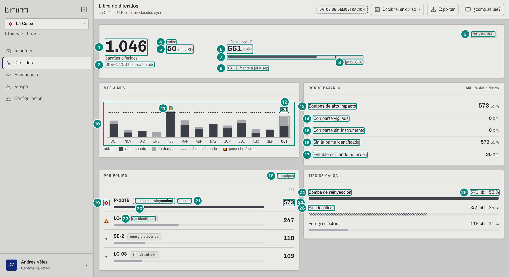

| # | Lo que se ve | En la captura | Cómo se calcula | Texto según el valor | Viene de |
|---|---|---|---|---|---|
| 1 | Barriles diferidos (40 px) | «1.046» | $\text{brecha} = \text{Potencial} - \text{Real} = 17.987{,}026 - 16.941 = 1.046{,}026$ — 5A §«No producido · brecha» | `n0`; debajo «barriles diferidos». Globo «Barriles diferidos» (en todos los niveles): Potencial, Real medido, Diferidos, «Σ de los eventos»: en ingeniería «1.046 bbl ±15,0 % (Res. 40236)» ($\pm = \text{tolerancia}/\text{diferido} = 156{,}904/1.046{,}026$, `n1`); **en decisión, solo «1.046 bbl»**: quien decide no ve tolerancias (capítulo 8 §8.12; su margen es el rango de la fila 2) (`Encabezado.tsx:30-31`, `:55`; capturas `ger-diferidos-ceiba-globo-cifra` y `prod-diferidos-ceiba-globo-cifra`). Siguen Por señal, Declarado, Sin identificar, «Frecuencia reducida (aprox.)» solo si `aproximado > 0`, Período (nombre del período), Cierre «provisional» si algún `fa[].publicado` es falso, si no «publicado»; pista «Potencial (pruebas × factor de asignación) menos lo que midió el punto de medición oficial. Cada barril lleva su evento, su causa y los tags que la prueban.» (`src/widgets/diferidos/Encabezado.tsx:51-62`) | `brecha`, `potencial`, `real`, `diferido`, `tolerancia`, `identificado`, `declarado`, `pendiente`, `aproximado`, `fa[].publicado` |
| 2 | Rango | «889–1.203 bbl · calculado» | $[\max(0,\ \text{brecha}-\text{tol}),\ \text{brecha}+\text{tol}]$, tol = 156,904 — 5A §«Rango de los barriles diferidos» | decisión: globo «Margen del cálculo» + `NOTA_SIMPLE`; ingeniería: «Rango de tolerancia» + `NOTA_DE_CALCULO` (`Rango.tsx:34`). Fila «Aparte, aproximado: N bbl a frecuencia reducida» si hay | `brecha`, `tolerancia`, `aproximado` |
| 3 | Sello | «PROVISIONAL» | por códigos de `motivos` — 5A §«Sello de publicación» | ver 6A.1 fila 2 | `motivos[]` |
| 4 | Rótulo del valor | «valor» | `parcial` $\iff$ hay valor y `valorCampos.con < valorCampos.total` | sin `parcial`: «valor»; con `parcial` y `sinPrecio`: «valor · falta precio en *A, B*»; con `parcial` sin `sinPrecio`: «valor · *con* de *total* campos». ⓘ con `parcial`: «Valor: 4 de 5 campos con precio en todo el período; sin contar los días sin precio de La Zarza.»; sin ningún precio: ⓘ «Sin precio: Falta el precio neto en la configuración.» (`Encabezado.tsx:71-73`) | `valorCampos`, `sinPrecio` |
| 5 | Valor | «50 mil USD» | $1.046{,}026 \times 48 = 50.209{,}2$ — 5A §«Valor en USD» | número y unidad por separado: `usd(v).valor` («50», «370», «22,8») + `usd(v).unidad` («mil USD», «M USD»); sin valor: «sin precio» | `valorUsd` |
| 6 | Diferido por día | «661 bbl/d», sin ■ | $\text{brecha}/\max(1/24,\ \text{días}) = 1.046{,}026/1{,}583 = 660{,}6$ — 5A §«Meta del período» | ■ P3 si hay meta y $> \text{meta.diferidoDia}$ (aquí no: 661 < 800). Globo «Diferido por día»: «Máximo firmado: 800 bbl/d», «Máximo del mes completo: 24.800 bbl» (en curso) o «Máximo del período: …», «Antes (jul a sep): 366 bbl/d» o «Antes: no hay tres meses antes del período» (`:84-87`) | `brecha`, `meta.dias`, `meta.diferidoDia`, `meta.diferidoTotal`, base |
| 7 | Barra contra el máximo | relleno $\min(1{,}25;\ 661/800)/1{,}25 = 66{,}1\,\%$ | 8 §8.5 | gris; sin meta: sin barra | — |
| 8 | Máximo | «máx. 800» | `meta.diferidoDia` | «máx. *n0*» o `textoSinMeta` | `meta.diferidoDia`, `meta.sinMeta` |
| 9 | Línea base | «+80 % frente a jul a sep» | 366,083 → 660,648 — 5A §«Línea base» | igual que en el Resumen, y si el servidor manda `null` dice **«sin base de comparación»** (`:83`); desde el 8-oct el Resumen dice lo mismo (6A.1 fila 12) | `GET /api/vistas/diferidos/base` |
| 10 | MES A MES (decisión) | 13 barras | la misma `Tendencia` del Resumen (6A.1 fila 28) — 5A §«Tendencia del gerente» | Lectura: «Diferido por día de cada mes: lo de alto impacto, oscuro; la raya, el máximo que usted firmó para ese mes…» | `GET /api/vistas/diferidos/mensual` |
| 11 | Pasó el máximo | ■ sobre FEB | $\text{diferido}_m/d_m > \text{meta.diferidoDia}_m$ y no parcial | 834 > 800 (el único mes de La Ceiba; oct-25 544 y jul 563 ya no pasan: con el respaldo de P-201A y P-201C sus paradas cierran tres pozos, no todo el campo) | ídem |
| 12 | Cifra del mes del período | «661» | ídem | solo el mes del período lleva borde y cifra; oct-26 no se marca aunque pase el máximo (parcial) | ídem |
| 13 | Equipos de alto impacto | «573 · 55 %» | `altoImpacto` — 5A §«Palancas («DÓNDE BAJARLO»)» | fila fuerte; `n0(bbl)` y `pctParte(100·bbl/diferido)` en chico: «< 1 %» si queda entre 0 y 1, nunca «0 %» (`Paretos.tsx:243`); vacío si diferido = 0. Globo: título = rótulo, «Barriles: 573 bbl», «Del diferido: 55 %», pista (y en el papel): «Bombas de reinyección y electrosumergibles: el foco del producto.» | `altoImpacto` |
| 14 | Con parte vigilada | «0 · 0 %» | `anticipable` | pista «La parte que falló tiene un instrumento que la vigila: se pudo saber antes.» | `anticipable` |
| 15 | Con parte sin instrumento | «0 · 0 %» | `sinInstrumento` | pista «Se sabe qué parte falló pero nada la vigila en ese equipo: hueco de instrumentación.» | `sinInstrumento` |
| 16 | Sin la parte identificada | «573 · 55 %» | `sinParte` (la parada abierta de P-201B del 2-oct no tiene parte) | pista «Paró sin primera alarma ni firma: hay que preguntar qué se dañó.» | `sinParte` |
| 17 | Evitable cerrando en orden | «30 · 3 %» | `evitablePorOrden` = 30,413 — 5A §«Evitable cerrando en orden»: los operarios cerraron LC-16 y LC-07, los que más agua dan (48.510 bbl/d contra 44.100 sin salida), y se pierden 1.665 bbl/d; con el orden de TRIM (menos crudo por barril de agua primero, una electrosumergible baja a lo más 25 %) serían 1.426. De los 573 bbl que lleva la parada a las 14:00, 30 eran evitables | pista «Al parar la reinyección, cerrar primero los pozos con menos crudo por barril de agua.» | `evitablePorOrden` |
| 18 | Número de equipos | «4 equipos» | `porEquipo.length` | `plural(n, 'equipo', 'equipos')` | `porEquipo` |
| 19 | Marca de cada fila | ◆ P1 (P-201B), ▲ P2 (LC-21), • (SE-2, LC-08) | la severidad **de hoy** del equipo, no la del período — 5B §«El equipo vivo (`EquipoVivo`)» —, y **solo en las filas de falla del equipo**: `marcaDeFila(f, hoy)` (`src/widgets/diferidos/marca.ts:10-11`; `Paretos.tsx:49-50`, `:56`) da 0 a una fila `programada` (la parada programada de hace un año o la de hoy no es una alarma); lo declarado y lo sin identificar sí son fallas y llevan la del equipo. La misma función marca los equipos de POR CAMPO del Resumen (6A.1.4) | `MarcaPrioridad`; una fila P1 nunca queda detrás de «ver N más» (ISA-18.2); una programada ya no se queda a la vista por la P1 de su equipo (6A.2.3) | `GET /api/vistas/equipos-hoy` → `[].severidad` |
| 20 | Tipo de la fila | chip «bomba de reinyección» | `porEquipo[].tipo` — 5A §«Pareto por equipo» | `TIPO_CAUSA[tipo]` en minúsculas; tono fuerte si es de alto impacto | `porEquipo[].tipo` |
| 21 | Pozos | «2 pozos» | `porEquipo[].pozos` (LC-16 y LC-07) | solo si > 1 | `porEquipo[].pozos` |
| 22 | Barriles del equipo | «573» y barra | `porEquipo[].bbl`; barra = bbl / bbl del primero | `n0`; barra oscura si alto impacto, clara si no. Decisión: sin columna «acumulado» ni tolerancia. Globo: título «P-201B» (+ « · Campo» en portafolio), pista = nombre largo del equipo · «*Parte*: N % de sus barriles» (si hay parte); filas Diferidos, Del total (`n1` %), Acumulado (`n1` %), Tipo, Eventos, Pozos afectados y hasta tres partes. Clic → ficha del equipo | `porEquipo[].bbl`, `eventos`, `pozos`, `partes` |
| 23 | Tipo pendiente | chip «sin identificar» (LC-21, LC-08) | tramo sin causa | `TIPO_CAUSA.pendiente` = «Sin identificar» en minúsculas, tono neutro | ídem |
| 24 | TIPO DE CAUSA · fila | «Bomba de reinyección» (negrita) | `porTipo[]` — 5A §«Pareto por tipo de causa» | alto impacto (reinyección, electrosumergible) en negrita y barra oscura | `porTipo[].tipo` |
| 25 | bbl y % del tipo | «573 bbl · 55 %» | $\text{bbl}_k$ y $100\,\text{bbl}_k/\text{diferido}$ | `n0` «bbl ·» `pctParte(%)` (`Paretos.tsx:190`): «< 1 %» si queda entre 0 y 1 (12 meses: «Separación 4.505 bbl · < 1 %»); barra = bbl / bbl del primero | `porTipo[].bbl` |
| 26 | Sin identificar | «Sin identificar · 355 bbl · 34 %» rayada | tipo `pendiente` | barra rayada; **nunca** detrás de «ver más» (`Paretos.tsx:183`) | ídem |

La Ceiba, octubre: el Pareto por tipo trae tres filas: Bomba de reinyección 573 · 55 %, Sin identificar 355 · 34 %, Energía eléctrica 118 · 11 %. Por equipo: P-201B 573 (2 pozos), LC-21 247, SE-2 118, LC-08 109.

## 6A.2.2 Gerente · La Ceiba · septiembre cerrado

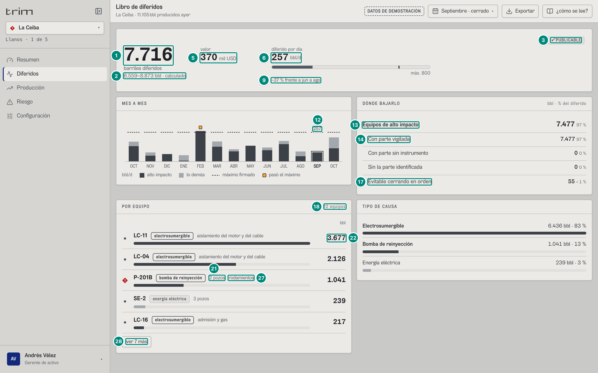

| # | En la captura | Cómo sale | Qué cambia |
|---|---|---|---|
| 1 · 2 | «7.716» · «6.559–8.873 bbl · calculado» | 346.378,059 − 338.662; tol 1.157,409 (±15,0 %) | mes entero: brecha = Σ de los 18 tramos |
| 3 | «✓ PUBLICABLE» | `motivos = []` | globo «Se puede publicar»: «Cuadra con la medición oficial y tiene su cadena de custodia: se puede publicar.» |
| 5 | «370 mil USD» | 7.716,059 × 48 = 370.370,841 | `usd` ≥ 10³ |
| 6 | «257 bbl/d» sin ■ | 7.716,059 / 30 = 257,2 < 800 | |
| 9 | «−37 % frente a jun a ago» | 407,511 → 257,202; el signo es U+2212 | |
| 12 | «257» sobre SEP | mes del período | la cifra se mueve al mes escogido |
| 13 | «7.477 · 97 %» | alto impacto = 6.436,065 (ESP) + 1.040,550 (P-201B); todo «con parte vigilada» (rodamientos de P-201B, partes de ESP) | sin la parte: 0 |
| 18 · 28 | «12 equipos» · «ver 7 más» | se ven 5 y ninguna de las otras 7 es P1 | «ver N más» = filas escondidas; en el papel salen todas |
| 21 · 27 | «2 pozos» · «rodamientos» | P-201B: una sola falla en septiembre, la del 22-sep (`EV-2011-0922`, rodamientos, 1.040,550 bbl), que cerró LC-16 y LC-07. La de sello pasó al 9-ago (`EV-2011-0809`) | la parte top es la de más barriles del equipo |
| 14 · 17 | «Con parte vigilada 7.477 · 97 %», «Con parte sin instrumento 0 · 0 %», «Sin la parte identificada 0 · 0 %», «Evitable cerrando en orden 55 · < 1 %» | palancas del mes (5A §«Palancas («DÓNDE BAJARLO»)»): la parada de P-201B tiene parte con instrumento (rodamientos) y las ESP siempre lo están; evitable 54,996 = lo que se habría perdido de menos en `EV-2011-0922` cerrando en el orden de TRIM (0,71 % → `pctParte` «< 1 %») | |
| 22 | las cinco filas a la vista (filas 19-23): «LC-11 · electrosumergible · aislamiento del motor y del cable · 3.677»; «LC-04 · electrosumergible · aislamiento del motor y del cable · 2.126»; ◆ «P-201B · bomba de reinyección · 2 pozos · rodamientos · 1.041»; «SE-2 · energía eléctrica · 3 pozos · 239»; «LC-16 · electrosumergible · admisión y gas · 217» | `porEquipo` de septiembre por `bbl` (5A §«Pareto por equipo»); en decisión, el chip de la parte va solo (sin acumulado); «N pozos» solo si > 1; la marca es la de **hoy**: ◆ en P-201B; punto gris en LC-11 y LC-04 (sus fallas de aislamiento del 25 y 26-sep volvieron el 29-sep), SE-2 (de La Ceiba no avisa) y LC-16 (cerrado hoy por P-201B) | ver 6A.2.1 filas 19-23 |

Tipos: Electrosumergible 6.436 · 83 %, Bomba de reinyección 1.041 · 13 %, Energía eléctrica 239 · 3 %.

## 6A.2.3 Gerente · portafolio · últimos 12 meses (no publicable)

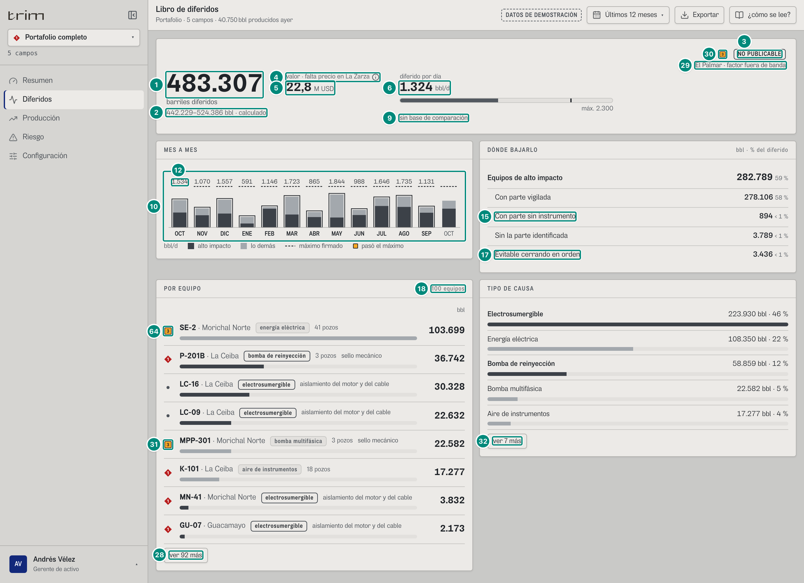

| # | En la captura | Cómo sale | Texto según el valor |
|---|---|---|---|
| 1 · 2 | «483.307» · «442.229–524.386 bbl · calculado» | 15.917.836,402 − 15.434.529; tol 41.078,577 (cuadratura entre campos, 5A §«Tolerancia del libro») | el globo del rango agrega «Aparte, aproximado: 17.901 bbl a frecuencia reducida»; el de la cifra, «Frecuencia reducida (aprox.): 17.901 bbl» y «Σ de los eventos: 483.307 bbl» (el gerente no ve el «±8,5 %»; ingeniería sí) |
| 3 · 30 | ■ «NO PUBLICABLE» | motivo `fa-fuera-de-banda` (palmar, 2026-04) — 5A §«Motivos» | chip fuerte y ■ P3; globo «Todavía no se puede publicar»: «Todavía no se puede publicar. El Palmar, abril de 2026: factor de asignación 0,810 fuera de la banda ±15 %.» |
| 29 | «El Palmar · factor fuera de banda» | una línea corta por (campo, código), sin repetir | `CORTO` (`Sello.tsx:13-16`); no se imprime (en el papel va la frase entera) |
| 4 · 5 | «valor · falta precio en La Zarza» ⓘ · «22,8 M USD» | 22.825.337,087 | `valorCampos = 4 de 5` |
| 6 | «1.324 bbl/d» sin ■ | 483.307,402 / 365 = 1.324,1 < 2.300 | |
| 9 | «sin base de comparación» | `GET …/base` → `null` (no hay tres meses publicados antes del 1-oct-2025) | |
| 10 · 12 | Tendencia con 12 meses al frente y sus cifras (1.534 · 1.070 · 1.557 · 591 · 1.146 · 1.723 · 865 · 1.844 · 988 · 1.646 · 1.735 · 1.131), ninguno con ■ (máx. 2.300) | todos los meses que tocan el período llevan borde y cifra; oct-26 queda sin cifra | |
| 15 | «Con parte sin instrumento · 894 · < 1 %» | la falla de motor de P-201B de Morichal del 7-dic (`EV-M2011-251207`, 894,395 bbl): se sabe qué parte falló pero en esa bomba nada vigila el motor | antes del 9-oct, 0 |
| 17 | «Evitable cerrando en orden · 3.436 · < 1 %» | Σ de las 14 paradas de reinyección de los 12 meses con orden que escoger: La Ceiba 2.407 (siete paradas propias, de 55 a 553 bbl cada una) y Morichal 1.029 (siete; la de septiembre, `EV-M2011-260924`, 201) | antes del 9-oct, 9.633, todo de Morichal: La Ceiba cerraba todo el campo y no había orden que escoger |
| 18 · 28 | «100 equipos» · «ver 92 más» | se ven 5 + toda fila P1 que venga después (K-101, MN-41, GU-07) = 8 | con la regla de antes del 8-oct serían «ver 91 más»: la fila «P-201B · La Ceiba · parada programada» (1.523 bbl, la 38.ª) se quedaría a la vista por la P1 de P-201B |
| 64 · 31 | ■ P3 en SE-2 · Morichal (64) y en MPP-301 · Morichal (31) | severidad de hoy del equipo, en sus filas de falla (MPP-301: «en marcha · perdiendo eficiencia») | ▲ P2 en P-201B · Morichal (22.117, la 6.ª) queda detrás de «ver 92 más»: no es P1. Las filas de parada programada van **sin marca** (`marcaDeFila`): P-201B · La Ceiba (1.523, la 38.ª; con la regla vieja ◆ P1) y MPP-301 · Morichal Norte (845 bbl, la 42.ª; con la regla vieja ■ P3). La de falla de P-201B de La Ceiba (36.742) conserva su ◆ |
| 32 | «ver 7 más» en TIPO DE CAUSA | 12 tipos, se ven 5 | ocultos: Evacuación del crudo 15.179 · 3 %, Bombeo mecánico 12.607 · 3 %, Compresión de gas 6.540 · 1 %, Parada programada 5.385 · 1 %, Tratamiento de crudo 5.124 · 1 %, Separación 4.505 · < 1 %, Declarada por el operario 2.968 · < 1 % (`pctParte`: 0,93 % y 0,61 %; con `n0` dirían «1 %» los dos) |

Palancas de los 12 meses: alto impacto 282.789 · 59 %, con parte vigilada 278.106 · 58 %, sin instrumento 894 · < 1 %, sin la parte 3.789 · < 1 % (la parada de P-201B de Morichal del 24-sep, `EV-M2011-260924`, sin primera alarma), evitable 3.436 · < 1 %. $278.106 + 894 + 3.789 = 282.789$.

TIPO DE CAUSA, las cinco filas a la vista (filas 24-25; % contra `diferido` = 483.307): Electrosumergible 223.930 · 46 %, Energía eléctrica 108.350 · 22 %, Bomba de reinyección 58.859 · 12 %, Bomba multifásica 22.582 · 5 %, Aire de instrumentos 17.277 · 4 % (las siete ocultas, en la fila 32). La reinyección baja de 171.515 a 58.859: P-201B de La Ceiba ya no cierra todo el campo.

POR EQUIPO, las ocho filas a la vista (filas 19-22; marca = severidad de hoy del equipo en sus filas de falla): ■ SE-2 · Morichal Norte · energía eléctrica · 41 pozos · 103.699; ◆ P-201B · La Ceiba · bomba de reinyección · 3 pozos · sello mecánico · 36.742; • LC-16 · La Ceiba · electrosumergible · aislamiento del motor y del cable · 30.328; • LC-09 · La Ceiba · electrosumergible · aislamiento del motor y del cable · 22.632; ■ MPP-301 · Morichal Norte · bomba multifásica · 3 pozos · sello mecánico · 22.582; y, por ser P1 (nunca detrás de «ver más»): ◆ K-101 · La Ceiba · aire de instrumentos · 18 pozos · 17.277; ◆ MN-41 · Morichal Norte · aislamiento del motor y del cable · 3.832; ◆ GU-07 · Guacamayo · aislamiento del motor y del cable · 2.173. GU-09 ya no es P1 (volvió a producir sin aviso). «P-201B · La Ceiba · parada programada · 3 pozos · 1.523» no está entre ellas: sin marca, queda detrás de «ver 92 más» (y en el papel). `GET /api/vistas/diferidos` → `porTipo[]`, `porEquipo[]`; `GET /api/vistas/equipos-hoy` → `severidad`.

---

## 6A.2.4 Ingeniería · La Ceiba · octubre en curso (producción)

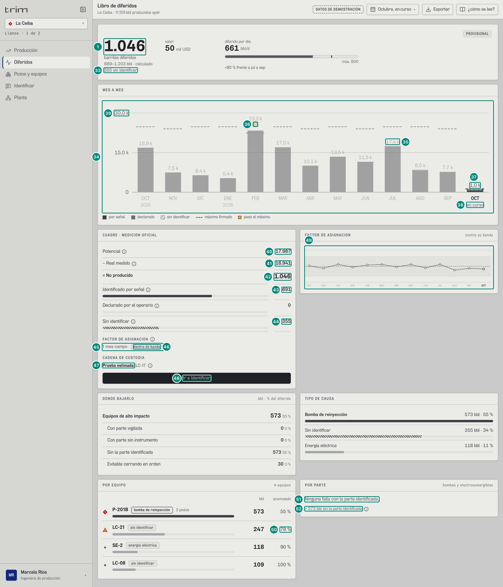

Filas nuevas o distintas de las del gerente (1-9 y 13-26 son iguales, con la salvedad de los globos de ingeniería):

| # | Lo que se ve | En la captura | Cómo se calcula | Texto según el valor | Viene de |
|---|---|---|---|---|---|
| 33 | Sin identificar bajo el rango | «355 sin identificar» | `pendiente` = LC-21 246,525 + LC-08 108,518 — 5A §«Identificado por señal · declarado · sin identificar» | `n0` « sin identificar»; sale siempre en ingeniería, también en 0 («0 sin identificar», Morichal) | `pendiente` |
| 34 | MES A MES (ingeniería) | 13 columnas | por mes: columna apilada `identificado` (oscuro), `declarado` (gris), `pendiente` (rayado); altura = diferido — 5A §«Gráfico «MES A MES» (ingeniería)» | meses fuera del período al 42 % de opacidad; año bajo el primer mes y bajo cada enero («2025», «2026»); leyenda fija «por señal · declarado · sin identificar · máximo firmado · pasó el máximo». Globo de cada mes (no capturable sin cambiar el período, porque el toque lo abre): título «Septiembre 2026»; pista «Mes en curso: cifras parciales, cierre sin publicar.» o «Clic para ver este mes»; filas Diferidos, Identificado por señal, Declarado, Sin identificar, Alto impacto, Máximo firmado (o `textoSinMeta`), Eficiencia (`n1` %), Cierre «sin publicar \| publicable \| no publicable» (`MesAMes.tsx:67-73`) | `GET /api/vistas/diferidos/mensual` → `[].libro.identificado`, `declarado`, `pendiente`, `brecha`, `meta.diferido`, `pe`, `publicable`, `altoImpacto`, `parcial` |
| 35 | Rótulo de la columna | «17,4 k» (julio) | `brecha` del mes | `k(v)`: ≥ 1.000 → `n1(v/1000)` « k», si no `n0` (`:17`). La Ceiba: 16,9 k · 7,5 k · 6,4 k · 5,4 k · 23,3 k · 17,0 k · 10,1 k · 13,5 k · 11,5 k · 17,4 k · 8,5 k · 7,7 k · 1,0 k | `brecha` |
| 36 | Pasó el máximo | ■ sobre FEB (el único) | $\text{brecha}_m > \text{meta.diferido}_m$ (bbl del mes, no por día) y no parcial | 23.349 > 22.400 (febrero: 28 días); oct-25 16.852 y jul 17.441 quedan bajo sus 24.800 | `brecha`, `meta.diferido` |
| 37 | Mes en curso | «1,0 k» con contorno punteado | brecha de octubre a la fecha; raya del máximo **a la fecha** (1.267 bbl) | 1.046 < 1.267; un mes parcial no se marca ■ aunque pase | `parcial` |
| 38 | «en curso» bajo OCT | | `parcial` = algún campo no publicó el mes | fijo | `parcial` |
| 39 | Eje | «30,0 k» | techo $= \text{tope}(1{,}12\cdot\max_m\max(\text{brecha}_m, \text{meta.diferido}_m))$ = tope(1,12 × 24.800) = tope(27.776) = 30.000 (aquí manda el máximo firmado: la brecha más alta, febrero, es 23.349); marcas en 0, mitad y techo | `k()` | — |
| 40 | Potencial | «17.987» | 5A §«Potencial» | `n0`; ⓘ «Potencial: Pruebas instrumentadas de cada pozo × factor de asignación.» | `potencial` |
| 41 | − Real medido | «16.941» | 5A §«Real» | ⓘ «Real medido: Producción fiscal del punto de medición oficial.» | `real` |
| 42 | = No producido | «1.046» | brecha | negrita | `brecha` |
| 43 | Identificado por señal | «691» | $\text{round}(\text{diferido}) - \text{round}(\text{declarado}) - \text{round}(\text{pendiente}) = 1.046 - 0 - 355$ para que la columna sume a la vista; barra = 690,982/1.046,026 = 66,1 % (P-201B 573,061 + SE-2 117,921) | ⓘ «Identificado por señal: Código del controlador, primera alarma del PLC, firma de las señales o programa aprobado. Tolerancia ±15,0 % (Res. 40236).» (`Cuadre.tsx:39-40`; captura `prod-diferidos-ceiba-globo-identificado`) | `diferido`, `declarado`, `pendiente`, `identificado`, `tolerancia` |
| — | Declarado por el operario | «0» | `declarado` | barra gris; ⓘ «La señal no alcanzaba: lo respondió quien estaba en campo. Queda marcado.» | `declarado` |
| 44 | Sin identificar | «355» | `pendiente`; barra rayada 33,9 % | ■ P3 junto a la cifra **solo** si existe el motivo `sin-causa` (`Cuadre.tsx:44`); ⓘ «Eventos que ninguna señal explica y nadie ha respondido todavía.» | `pendiente`, `motivos` |
| — | Inventario entre días | (no sale) | $\lvert\text{residuo}/\text{brecha}\rvert > 0{,}0005$ — 5A §«Residuo · inventario entre días» | sale en un rango que corta meses: «Inventario entre días -512» con ⓘ «El período corta meses: el tanque de venta guarda de un día para otro. En el mes entero da cero.» | `residuo` |
| 45 | Factor de asignación (sub-bloque) | «1 mes-campo» | número de filas de `fa` del período — 5A §«Factor de asignación (FA) del mes». El estado de cada mes lo da `estadoFactor(lb, f)` (`src/widgets/diferidos/publicacion.ts:9-12`, `Cuadre.tsx:23`): «sin-verificar» si el libro trae el motivo `banda-sin-verificar` de ese campo (por el **código**, nunca por la frase); si no, `dentro` o `fuera` según `fa[].dentro` (que vale `false` en los dos casos raros: por sí sola no los distingue) | todos dentro: `plural(n, 'mes-campo', 'meses-campo')` · chip «dentro de banda»; si no, una línea por cada mes que no está dentro (`:56-64`): fuera → «■ El Palmar · 2026-04 · **0,810**» + chip fuerte «fuera de ±15 %»; banda sin verificar → la misma línea **sin** ■ y con chip neutro «banda sin verificar» (el factor puede estar bien: falta con qué compararlo; antes del 8-oct se pintaba como fuera de banda). ⓘ «Factor de asignación: Banda de la Res. 40236, Fig. 10.2. Fuera de banda: revisar pruebas y medición antes de publicar.» | `fa[].dentro`, `fa[].fa`, `fa[].banda`, `fa[].mes`, `motivos[].codigo`, `motivos[].campoId` |
| 46 | Chip | «dentro de banda» | ídem | | |
| 47 | Cadena de custodia | «Prueba estimada: LC-17» | `custodia.estimados` — 5A §«Prueba de pozo (prueba vigente)» | «Prueba estimada: *pozos*» sin marca, ⓘ «Desde la electrosumergible, sin separador.»; si no hay ningún hueco: «Pruebas instrumentadas y corte de agua en línea.» | `custodia.estimados` (claves de `refs.pozos`) |
| 48 | Botón | «Ir a Identificar» | sale si el rol tiene «causa» y `pendiente > 0` | lleva a Identificar | rol, `pendiente` |
| 49 | FACTOR DE ASIGNACIÓN (gráfico) | un punto por mes contra la franja ±15 % | `FA_m` de la serie; franja = $[1-b, 1+b]$ — 5A §«Factor de asignación (FA) del mes» y §«Banda de asignación». Estado de cada punto con `estadoFactor(m.libro, f)` (`Factor.tsx:47`) | círculo hueco dentro, ■ P3 fuera, **círculo punteado sin marca** con la banda sin verificar (`:56-59`); meses fuera del período al 50 %; eje 0,75 · 0,85 · 1,00 · 1,15 · 1,25 (`n2`, `:39`). Desde el 8-oct arranca al final, como las demás gráficas de meses (`ref={alFinal}`, `:31`): a 1.280 px se ve el mes en curso y el eje queda a la izquierda, fuera de la vista (Huecos 20). Globo (captura `prod-diferidos-ceiba-globo-factor`): «Octubre 2026 · factor 0,958», Factor 0,958, Banda 0,85 – 1,15 (con la banda sin verificar: «sin verificar»), Fiscal del mes 16.941 bbl, Cierre en curso, pista «Dentro de la banda», «Fuera de la banda: revisar pruebas, medición y pozos sin prueba» o, sin verificar, la frase del motivo que redacta el servidor («La Zarza: Sin análisis de °API del crudo; no se puede verificar el factor contra la banda de la Res. 40236.», `:50-53`). Lectura: «… La franja gris es la banda que acepta la regulación para este crudo (*fuente de la banda*).» | serie `[].libro.fa` (campo), `[].libro.real`; `GET /api/catalogo` → `campos[c].medicion.banda` |
| 50 | Acumulado del Pareto | «78 %» (LC-21) | $100\cdot\sum_{j\le i}\text{bbl}_j/\text{diferido} = 100 \times (573{,}061 + 246{,}525)/1.046{,}026 = 78{,}4$ | `n0` «%», solo ingeniería y pantallas ≥ sm; globo con «Tolerancia ±*n0* bbl» y pista «tolerancia ±*n1* %» (P-201B: ±86 bbl, ±15,0 %) | `porEquipo[].bbl`, `tolerancia` |
| 51 | POR PARTE vacío | «Ninguna falla con la parte identificada.» | `porParte = []` — 5A §«Pareto por parte» | | `porParte` |
| 52 | Sin la parte | «+ 573 bbl sin la parte identificada» | `sinParte` | sale si > 0; ⓘ «Sin la parte identificada: Barriles de equipos de alto impacto cuya parada no dejó primera alarma ni firma. Están en «paradas por identificar».» | `sinParte` |

Serie del factor de La Ceiba (oct-25 → oct-26): 1,007 · 0,969 · 1,030 · 0,985 · 1,020 · 1,028 · 0,990 · 1,027 · 0,974 · 1,029 · 0,941 · 0,969 · 0,958, todos dentro de ±15 %.

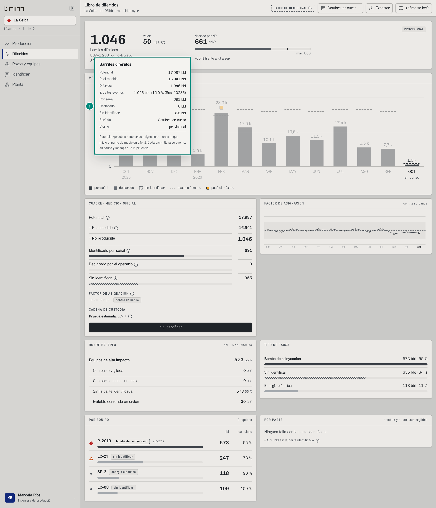
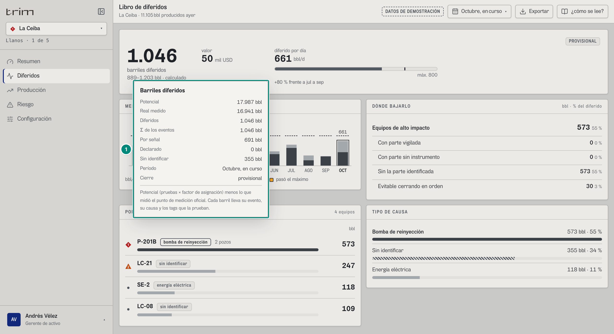
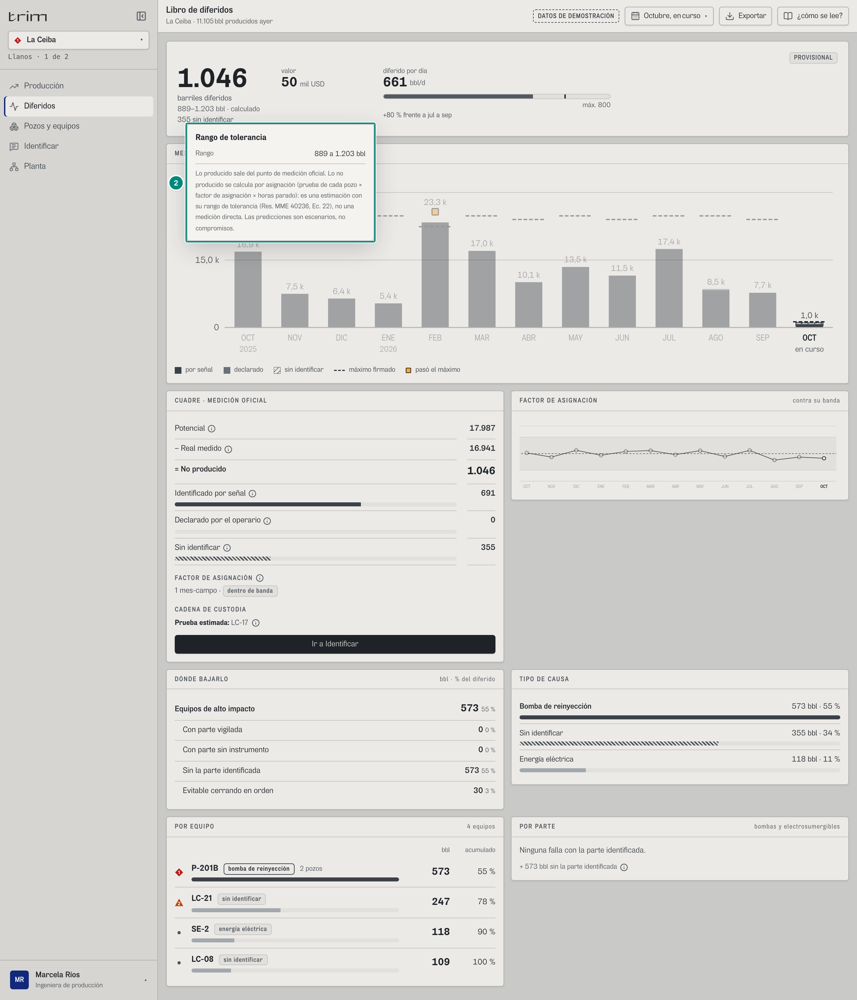
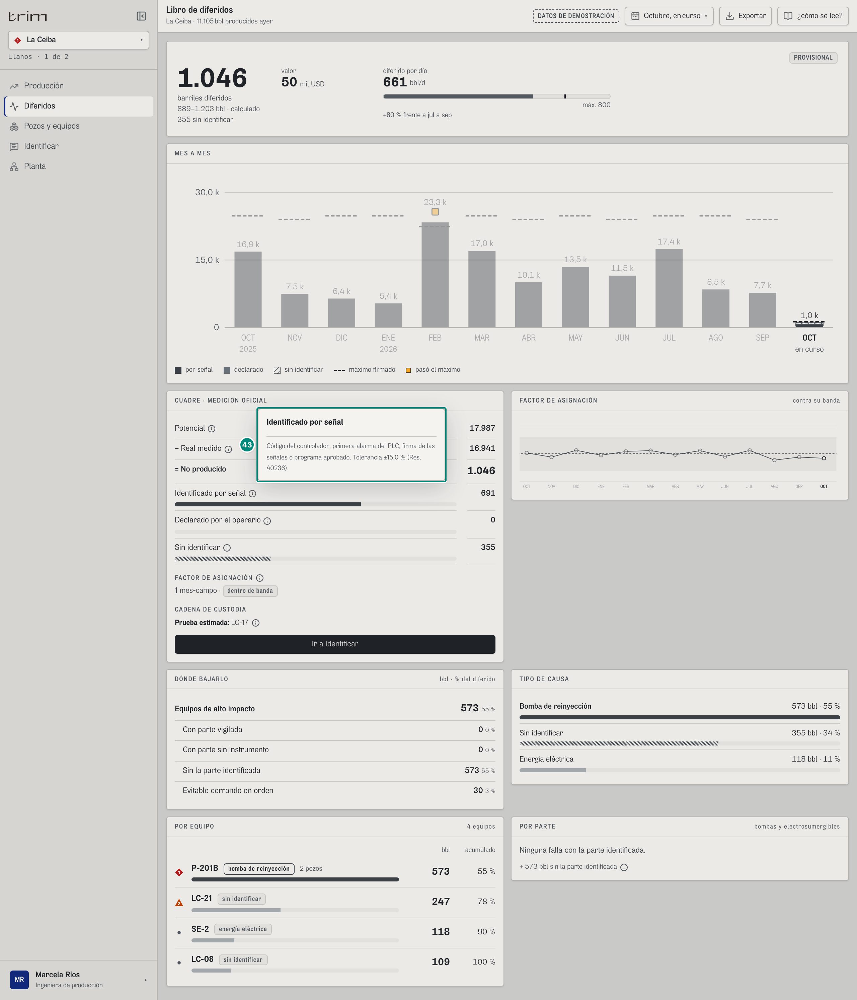
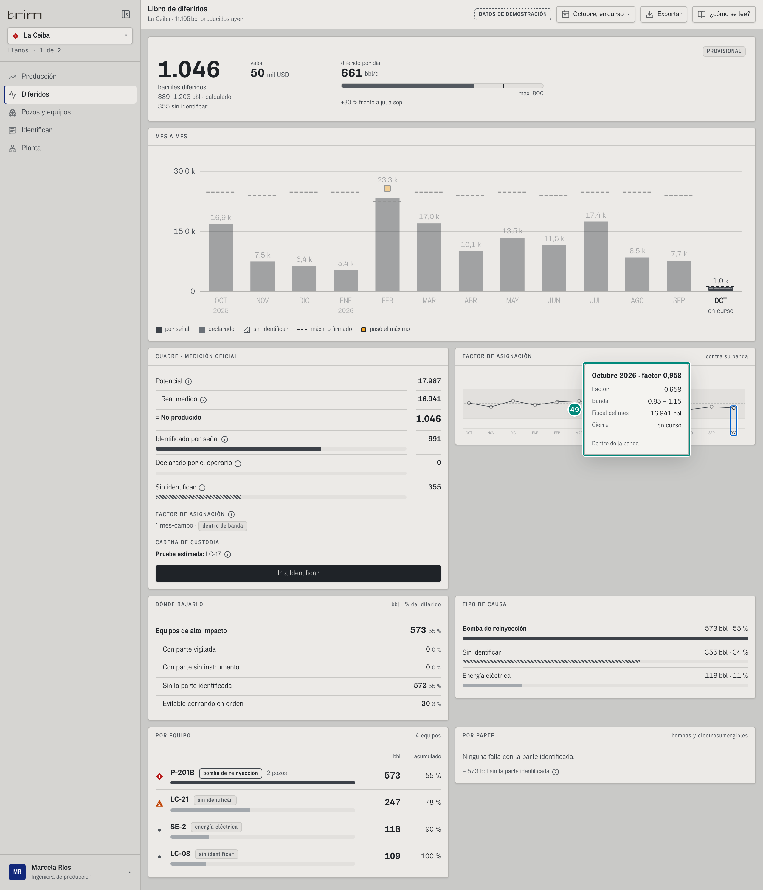

Texto literal de la nota de cálculo (ingeniería, `Rango.tsx:9-13`): «Lo producido sale del punto de medición oficial. Lo no producido se calcula por asignación (prueba de cada pozo × factor de asignación × horas parado): es una estimación con su rango de tolerancia (Res. MME 40236, Ec. 22), no una medición directa. Las predicciones son escenarios, no compromisos.»

## 6A.2.5 Ingeniería · portafolio · octubre en curso (jefe de mantenimiento)

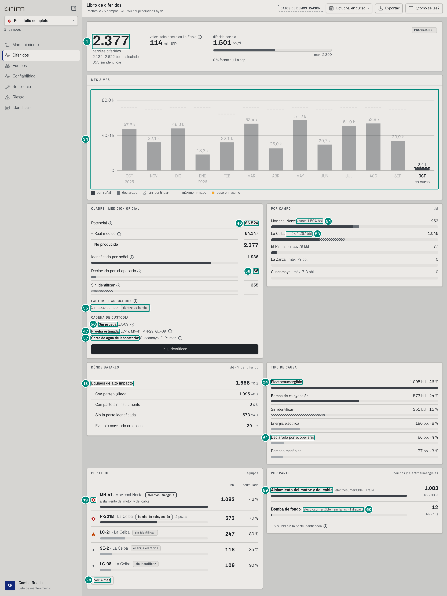

En el portafolio el gráfico del factor se reemplaza por **POR CAMPO** (`Diferidos.tsx:72-105`):

| # | Lo que se ve | En la captura | Cómo se calcula | Texto según el valor | Viene de |
|---|---|---|---|---|---|
| 53 | Máximo del campo | «La Ceiba · máx. 1.267 bbl» y «1.046», sin ■ | ■ si `!sinMeta ∧ brecha_c > metaDiferido_c` (máximo **del período a la fecha**, en bbl: 800 × 38/24 = 1.266,667; aquí 1.046,026 no lo pasa, y en octubre ningún campo lo pasa) — 5A §«Portafolio: varios campos en un libro» | «máx. *n0* bbl» o «sin meta firmada»; cifra `n0(brecha_c)`; ■ junto a la cifra si el campo no se puede publicar: `!campoPublicable(lb, campo)` (`src/widgets/diferidos/publicacion.ts:17-18`, `Diferidos.tsx:84`) = el libro trae **algún motivo de ese campo que no sea `en-curso`** (`sin-fiscal`, `sin-factor`, `banda-sin-verificar`, `fa-fuera-de-banda`, `sin-causa`, `sin-meta`): la misma regla del sello, no una propia de la pantalla. Antes del 8-oct era `sinMeta` ∨ algún `fa` fuera ∨ pendiente/potencial > criterio, que no miraba `sin-fiscal` ni `sin-factor` (5A §Huecos 9): Guacamayo con 3 días sin fiscal en septiembre salía «Publicable: sí»; ahora «no». Lectura: «… junto a la cifra, el que no se puede publicar (el sello dice por qué)». Barra de tres tramos (por señal, declarado, rayado) medida contra la brecha **del portafolio**. Globo: título = campo, pista = nota del campo, filas Diferidos, Del total (`n1` %), Por señal, Declarado, Sin identificar, Alto impacto, Máximo firmado, Publicable sí/no. Clic → ese campo | `porCampo[].brecha`, `metaDiferido`, `sinMeta`, `identificado`, `declarado`, `pendiente`, `altoImpacto`; `motivos[].campoId`, `motivos[].codigo` |
| 54 | Máximo sin ■ | «Morichal Norte · máx. 1.504 bbl» | 950 × 38/24 = 1.504,167 > 1.253,234 | | |
| 55 | Factor del portafolio | «5 meses-campo · dentro de banda» | una fila de `fa` por campo y mes (oct de los 5 campos: 0,958 · 0,981 · 0,969 · 0,987 · 1,032) | | `fa[]` |
| 56 | Sin prueba | «■ Sin prueba: ZA-09» | `custodia.sinPrueba` | ■ P3; ⓘ «Sin prueba: Su crudo llega al punto de medición pero nadie lo asigna: sube el factor del campo. No tiene diferido porque no se le inventa caudal.» | `custodia.sinPrueba` |
| 47 | Prueba estimada | «LC-17, MN-11, MN-29, GU-09» | `custodia.estimados` | | |
| 57 | Corte de agua de laboratorio | «Guacamayo, El Palmar» | `custodia.bswLaboratorio` — 5A §«Corte de agua de laboratorio» | ⓘ «No viene de un analizador en línea: es manual en origen.» | `custodia.bswLaboratorio` |
| 58 | Declarado | «86» | MN-22 de Morichal, declarada por el operario | | `declarado` |
| 61 | Tipo «Declarada por el operario» | «86 bbl · 4 %» | `porTipo` `declarada`: 86,323/2.376,755 = 3,6 % | | |
| 59 | POR PARTE · fila | «Aislamiento del motor y del cable · electrosumergible · 1 falla · 1.083 · bbl · 99 %» | la falla de MN-41 en el período (GU-07 y GU-09 ya no fallan en octubre) — 5A §«Pareto por parte» | nombre en negrita; «*familia* · *N falla(s) \| sin fallas*· *M disparo(s)*»; barra contra la primera; «bbl · *n0(%)* %» (contra el total por parte). Globo: Diferidos, Del total por parte (`n1` %), Familia, Fallas, Disparos (menos de un día) si hay, Horas fuera (`n0` h; aislamiento: 38 h), hasta tres equipos «MN-41 · Morichal Norte: 1.083 bbl»; pista «Clic para ver la salud de esa parte en los equipos» si el rol tiene Bombas | `porParte[]` |
| 60 | Disparo | «sin fallas · 1 disparo» (Bomba de fondo, MN-25, 12 bbl) | ESP que volvió en menos de 24 h | | `porParte[].disparos` |
| 28 | «ver 4 más» | 9 equipos; 5 visibles (MN-41 y P-201B, las dos P1, están entre los cinco) | | | |
| 1 | Encabezado del portafolio (filas 1-9 y 33) | «2.377» · «2.132–2.622 bbl · calculado» · «355 sin identificar» · «valor · falta precio en La Zarza» ⓘ · «114 mil USD» · «1.501 bbl/d», sin ■ · «máx. 2.300» · «0 % frente a jul a sep» | el mismo libro del portafolio de octubre que el Resumen: ver 6A.1.1 filas 3-12 (mismos valores, mismas reglas); «355 sin identificar» = `pendiente` de los cinco campos (todo de La Ceiba) | filas 1-9 y 33 de este capítulo | `GET /api/vistas/diferidos?campos=ceiba,morichal,guacamayo,palmar,zarza` |
| 34 | MES A MES del portafolio (filas 34-39) | columnas «47,6 k» · «32,1 k» · «48,3 k» · «18,3 k» · «32,1 k» · «53,4 k» · «26,0 k» · «57,2 k» · «29,7 k» · «51,0 k» · «53,8 k» · «33,9 k» · «2,4 k» (oct, en curso), ninguna con ■; eje «0» · «40,0 k» · «80,0 k» | `brecha` de cada mes del portafolio (motor): oct-25 47.556 · nov 32.103 · dic 48.274 · ene 18.328 · feb 32.091 · mar 53.427 · abr 25.953 · may 57.150 · jun 29.654 · jul 51.029 · ago 53.798 · sep 33.945 · oct 2.377. ■ si $\text{brecha}_m > \text{meta.diferido}_m$ y no parcial: ningún mes (el más alto, mayo, 57.150 contra 71.300). Techo $= \text{tope}(1{,}12 \times 71.300) = \text{tope}(79.856) = 80.000$: manda el máximo firmado (`tope` de `MesAMes.tsx:11-16`: el primer $m \cdot 10^n \ge v$ con $m \in \{1;\ 1{,}5;\ 2;\ 2{,}5;\ 3;\ 4;\ 5;\ 6;\ 8;\ 10\}$) | `k()` como en la fila 35 | `GET /api/vistas/diferidos/mensual?campos=…` → `[].libro.brecha`, `meta.diferido`, `parcial` |
| 40 | CUADRE del portafolio (filas 40-44) | «Potencial 66.524 − Real medido 64.147 = No producido 2.377» · «Identificado por señal 1.936» · «Declarado por el operario 86» · «Sin identificar 355» | igual que las filas 40-44: $1.936 = 2.377 - 86 - 355$ (cifras redondeadas para que la columna sume a la vista) | | `potencial`, `real`, `brecha`, `declarado`, `pendiente` |
| 13 | DÓNDE BAJARLO del portafolio (filas 13-17) | «Equipos de alto impacto 1.668 · 70 %», «Con parte vigilada 1.095 · 46 %», «Con parte sin instrumento 0 · 0 %», «Sin la parte identificada 573 · 24 %», «Evitable cerrando en orden 30 · 1 %» | 5A §«Palancas»: alto impacto = P-201B de La Ceiba 573 (sin parte) + ESP 1.095 (MN-41 1.083 y MN-25 12, con parte vigilada); evitable = el de La Ceiba (6A.2.1 fila 17) | filas 13-17 | `altoImpacto`, `anticipable`, `sinInstrumento`, `sinParte`, `evitablePorOrden` |
| 24 | TIPO DE CAUSA (filas 24-26) | «Electrosumergible 1.095 · 46 %», «Bomba de reinyección 573 · 24 %», «Sin identificar 355 · 15 %», «Energía eléctrica 190 · 8 %», «Declarada por el operario 86 · 4 %» (fila 61), «Bombeo mecánico 77 · 3 %» (El Palmar) | `porTipo[]` del portafolio; seis tipos: se ven todos (con exactamente seis no se esconde uno solo) | filas 24-26 | `porTipo[]` |
| 19 | POR EQUIPO, las cinco filas a la vista (filas 19-22 y 50) | ◆ «MN-41 · Morichal Norte · electrosumergible · aislamiento del motor y del cable · 1.083 · 46 %»; ◆ «P-201B · La Ceiba · bomba de reinyección · 2 pozos · 573 · 70 %»; ▲ «LC-21 · La Ceiba · sin identificar · 247 · 80 %»; • «SE-2 · La Ceiba · energía eléctrica · 118 · 85 %»; • «LC-08 · La Ceiba · sin identificar · 109 · 90 %» | acumulado = $100\cdot\sum_{j\le i}\text{bbl}_j/\text{diferido}$ con diferido 2.376,755 (fila 50). Detrás de «ver 4 más»: MN-22 86, PA-07 77, ■ SE-2 · Morichal Norte 72 y MN-25 12 | | `porEquipo[]`, `GET /api/vistas/equipos-hoy` |
| 59 · 60 | POR PARTE | «Aislamiento del motor y del cable · 1 falla · 1.083 bbl · 99 %»; «Bomba de fondo · sin fallas · 1 disparo · 12 bbl · 1 %» | el % es contra el total por parte (1.095,007): 1.083,104/1.095,007 = 98,9 % → «99 %»; 11,903/1.095,007 = 1,09 % → «1 %» (`pctParte`, `Paretos.tsx:153`: «< 1 %» solo entre 0 y 1) | | `porParte[]` |

Valores de POR CAMPO (octubre), en el orden del servidor: Morichal Norte 1.253 · máx. 1.504 (declarado 86); La Ceiba 1.046 · máx. 1.267 (por señal 691, sin identificar 355); El Palmar 77 · máx. 79; La Zarza 0 · máx. 79; Guacamayo 0 · máx. 713. Ninguno pasa su máximo ni lleva ■ junto a la cifra («Publicable: sí» en los cinco aunque el libro sea provisional: el `en-curso` no cuenta).

## 6A.2.6 Ingeniería · Morichal Norte · octubre en curso (confiabilidad)

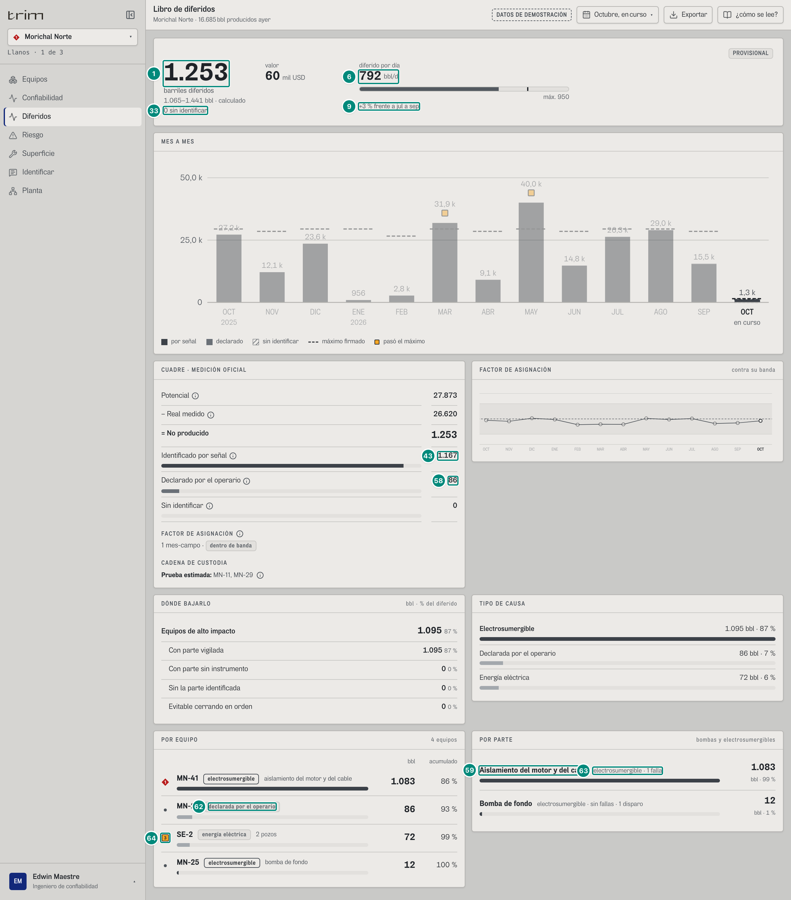

| # | En la captura | Cómo sale |
|---|---|---|
| 1 | «1.253», rango «1.065–1.441 bbl · calculado», valor «60 mil USD» | 27.873,234 − 26.620; tol 187,985; × 48 |
| 33 | «0 sin identificar» | pendiente 0 |
| 6 | «792 bbl/d» sin ■, «máx. 950» | 1.253,234 / 1,583 |
| 9 | «+3 % frente a jul a sep» | 769,976 → 791,516 |
| 43 · 58 | «1.167» · «86» | identificado 1.166,911; declarado 86,323 (MN-22) |
| 62 | chip «declarada por el operario» (MN-22) | tipo `declarada` |
| 64 | ■ P3 en SE-2 (2 pozos, 72 bbl) | severidad de hoy de SE-2 de Morichal: 3 (corriente de barraje subiendo) |
| 59 · 63 | «Aislamiento del motor y del cable · electrosumergible · 1 falla · 1.083 · 99 %»; «Bomba de fondo · sin fallas · 1 disparo · 12 · 1 %» | MN-41 (38 h fuera) y MN-25 |

Palancas: alto impacto 1.095 · 87 % (todo con parte vigilada: las electrosumergibles siempre lo están, 5A §Palancas); sin instrumento, sin la parte y evitable: 0 · 0 %. Tipos: Electrosumergible 1.095 · 87 %, Declarada por el operario 86 · 7 %, Energía eléctrica 72 · 6 %. Cuadre: Potencial 27.873 − Real medido 26.620 = 1.253; por señal 1.167, declarado 86, sin identificar 0; «1 mes-campo · dentro de banda»; «Prueba estimada: MN-11, MN-29». Por equipo (cuatro, todos a la vista; marca = severidad de hoy): ◆ MN-41 · electrosumergible · aislamiento del motor y del cable · 1.083 · 86 %; • MN-22 · declarada por el operario · 86 · 93 %; ■ SE-2 · energía eléctrica · 2 pozos · 72 · 99 %; • MN-25 · electrosumergible · bomba de fondo · 12 · 100 %.

Mes a mes de Morichal (filas 34-39; `brecha` del mes, motor): «27,2 k» (oct-25, 27.200) · «12,1 k» · «23,6 k» · «956» (ene: menos de 1.000 se escribe `n0`) · «2,8 k» · ■ «31,9 k» (mar, 31.881 > 29.450) · «9,1 k» · ■ «40,0 k» (may, 40.022 > 29.450) · «14,8 k» · «26,3 k» · «29,0 k» · «15,5 k» (sep, 15.539: ya no pasa los 28.500) · «1,3 k» (oct, en curso: 1.253 contra 1.504 a la fecha, sin ■). Eje «0» · «25,0 k» · «50,0 k»: techo $= \text{tope}(1{,}12 \times 40.022) = \text{tope}(44.824) = 50.000$. Factor de Morichal: 0,987 · 0,977 · 1,007 · 0,995 · 0,943 · 0,948 · 0,947 · 1,005 · 0,995 · 1,004 · 0,955 · 0,961 · 0,981.

---

## Variantes

- **Por nivel.** Ver la tabla del principio. En decisión, además: el globo de la cifra dice «Σ de los eventos: 1.046 bbl» **sin** la tolerancia (desde el 8-oct; Huecos 3) y el del rango dice «Margen del cálculo».
- **Por rol de ingeniería.** `prod`, `jefe` y `conf` ven lo mismo sobre **sus** campos (el «portafolio» de cada rol es la suma de sus campos asignados: `prod` = La Ceiba + El Palmar; `conf` = La Ceiba + Morichal + Guacamayo; `jefe` y `ger` = los cinco; `src/entities/roles.ts:42-104`); cambia lo que se puede tocar: POR PARTE es clicable (va a Bombas) para `jefe` y `conf` (tienen «bombas»), no para `prod`; «Ir a Identificar» para los tres (tienen «causa»).
- **Portafolio vs campo.** Portafolio: POR CAMPO en vez del gráfico del factor; «· Campo» en cada fila del Pareto; el sub-bloque del factor cuenta meses-campo; la custodia junta los cinco campos.
- **Período.** En curso: «Máximo del mes completo», «PROVISIONAL», mes en curso punteado; cerrado/trimestre: «Máximo del período», «✓ PUBLICABLE»; 12 meses y año a la fecha del portafolio: «NO PUBLICABLE» por abril de El Palmar; 12 meses: «sin base de comparación».
- **Teléfono.** Los paneles se apilan; los gráficos se desplazan en horizontal y arrancan al final; la columna «acumulado» se oculta.

## Estados

| Estado | Qué se ve | Ruta del demo |
|---|---|---|
| Sin meta firmada | sin barra ni raya, «sin meta firmada (en *X*)»; sin raya ni ■ en el mes; POR CAMPO «sin meta firmada» y ■ junto a la cifra | — (escenario de firma, 5A) |
| Sin precio / falta precio | «sin precio» + ⓘ / «valor · falta precio en La Zarza» + ⓘ | `#/ger/diferidos/zarza/curso` · cualquier portafolio |
| Factor fuera de banda | sello «NO PUBLICABLE · El Palmar · factor fuera de banda»; Cuadre «■ El Palmar · 2026-04 · 0,810 · fuera de ±15 %»; gráfico del factor con ■ en abril; POR CAMPO ■ junto a la cifra de El Palmar | `#/ger/diferidos/ceiba~portafolio/doce`, `#/prod/diferidos/palmar/doce` |
| Banda sin verificar (sin °API del crudo o sin producción fiscal publicada: `bandaDe(c).verificable` falso, `src/entities/libro.ts:265-273`; la banda se acota con la fila más ancha, ±20 %) | sello «NO PUBLICABLE · La Zarza · banda sin verificar»; Cuadre «La Zarza · 2026-09 · **1,032** · banda sin verificar» **sin** ■ y con chip neutro; gráfico del factor con todos los puntos de La Zarza punteados y sin marca, globo «Banda: sin verificar» con la frase del motivo; POR CAMPO ■ junto a la cifra de La Zarza («Publicable: no») | — (escenario de verificar-libro §10: `zarza.api = null`; corrido: septiembre del portafolio trae solo el motivo `banda-sin-verificar` de La Zarza, factor 1,032 con `dentro` falso → «sin verificar»; los otros cuatro, dentro; Huecos 17) |
| Días sin fiscal en un campo | sello «… · faltan días de fiscal»; POR CAMPO ■ junto a la cifra de ese campo («Publicable: no») | — (escenario de 5A §9: Guacamayo sin los 3 últimos días de septiembre) |
| Mucho sin identificar (`sin-causa`) | ■ en «Sin identificar» del Cuadre y línea «La Ceiba · mucho sin identificar» | — (La Ceiba está en 1,974 % contra 2 %: 355,044 / 17.987,026) |
| Rango que corta meses | fila «Inventario entre días -512» en el Cuadre | `#/prod/diferidos/ceiba/2026-09-15_2026-10-02` |
| Frecuencia reducida | Cuadre «N bbl aproximados · frecuencia reducida» + ⓘ; globos con «Aparte, aproximado» | `#/conf/diferidos/morichal/2026-02-01_2026-02-28` (1.001 bbl; producción no tiene Morichal) |
| Nada diferido | Paretos «Nada diferido.»; POR PARTE «Ninguna falla con la parte identificada.» | — |

## Interacciones

| Clic | Hace | Pide |
|---|---|---|
| Un mes de la Tendencia o de Mes a mes | rango a la medida de ese mes | libro, base y serie de ese mes |
| Fila de POR EQUIPO | cambia al campo (portafolio) y abre la ficha del equipo | `GET /api/vistas/equipos/:campo/:equipo`, `…/historia`, `…/ficha` |
| Fila de POR PARTE | va a Bombas (si el rol la tiene) | — |
| Fila de POR CAMPO | cambia al campo | — |
| «ver N más» / «ver menos» | muestra el resto (no pide nada) | — |
| «Ir a Identificar» | va a Identificar | `GET /api/vistas/paradas/por-identificar` |
