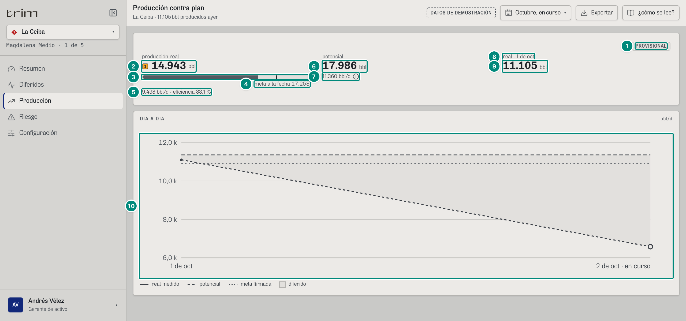
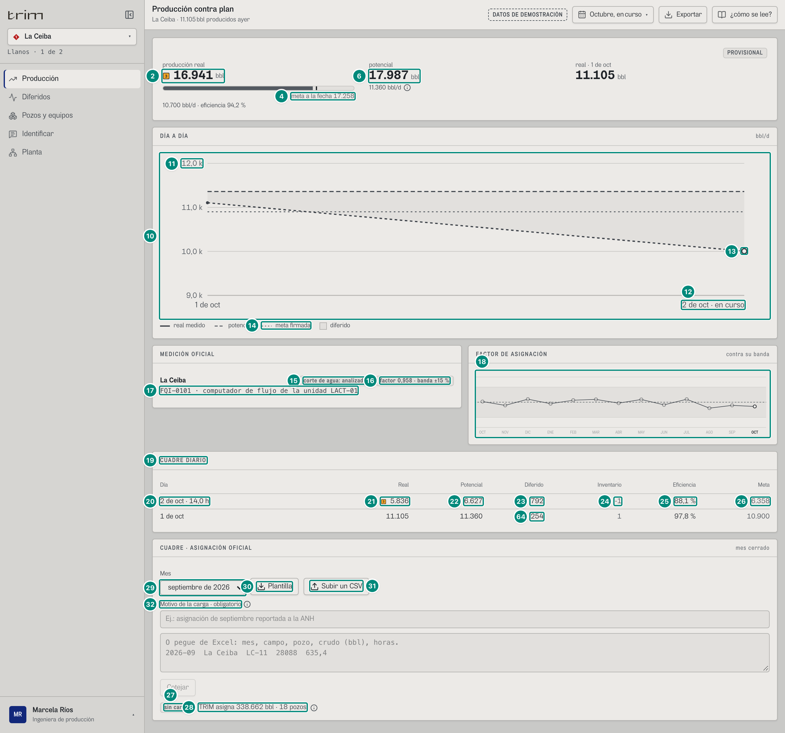
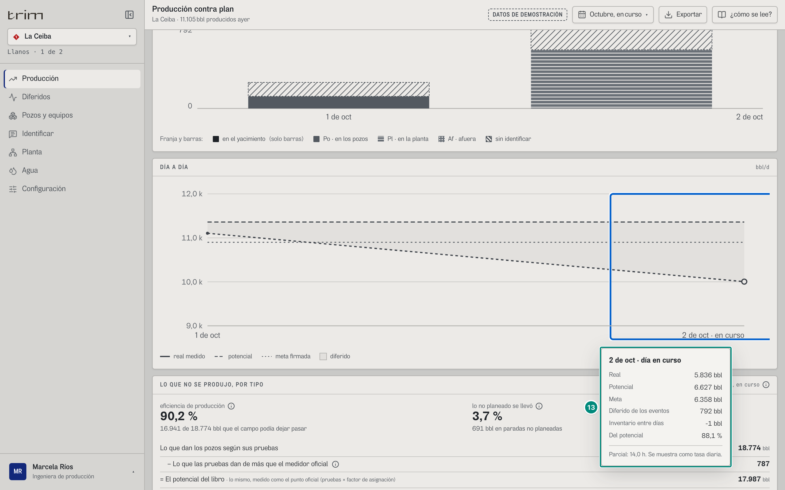
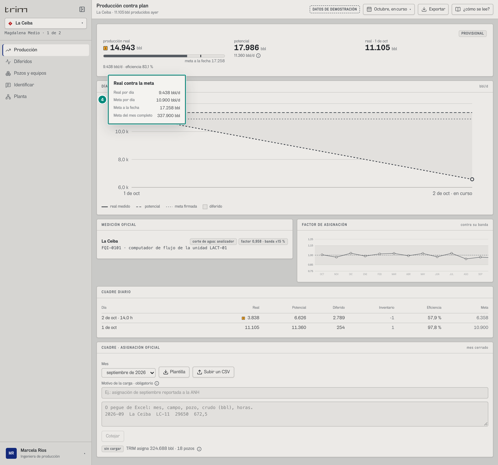
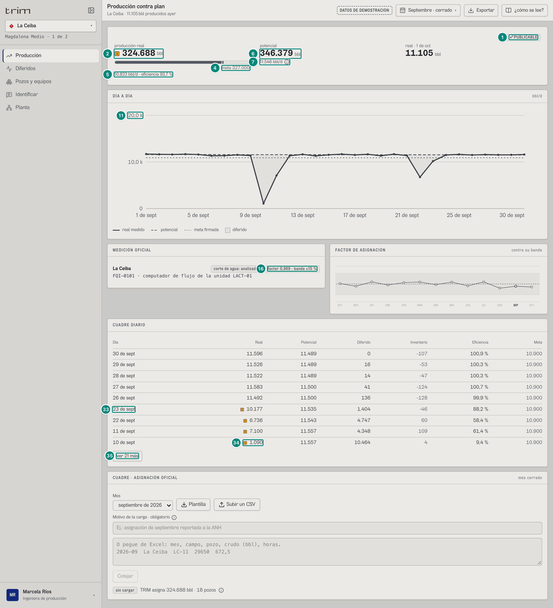
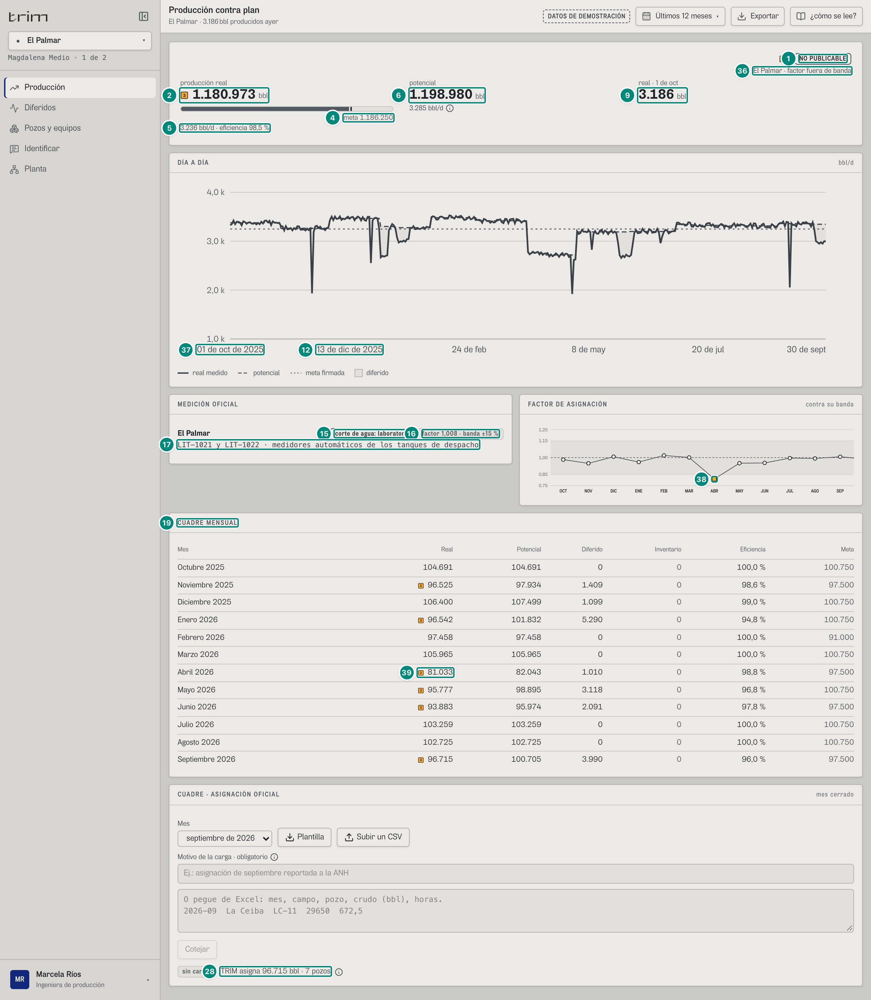
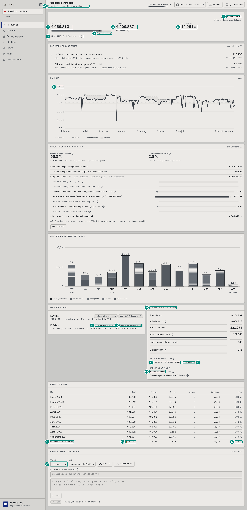
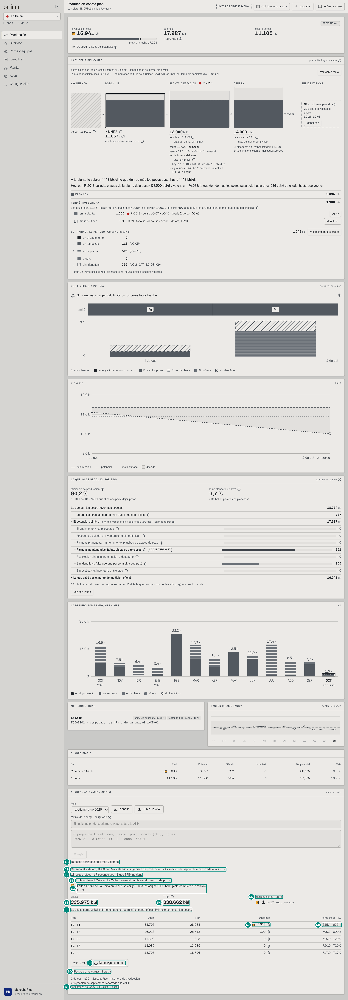
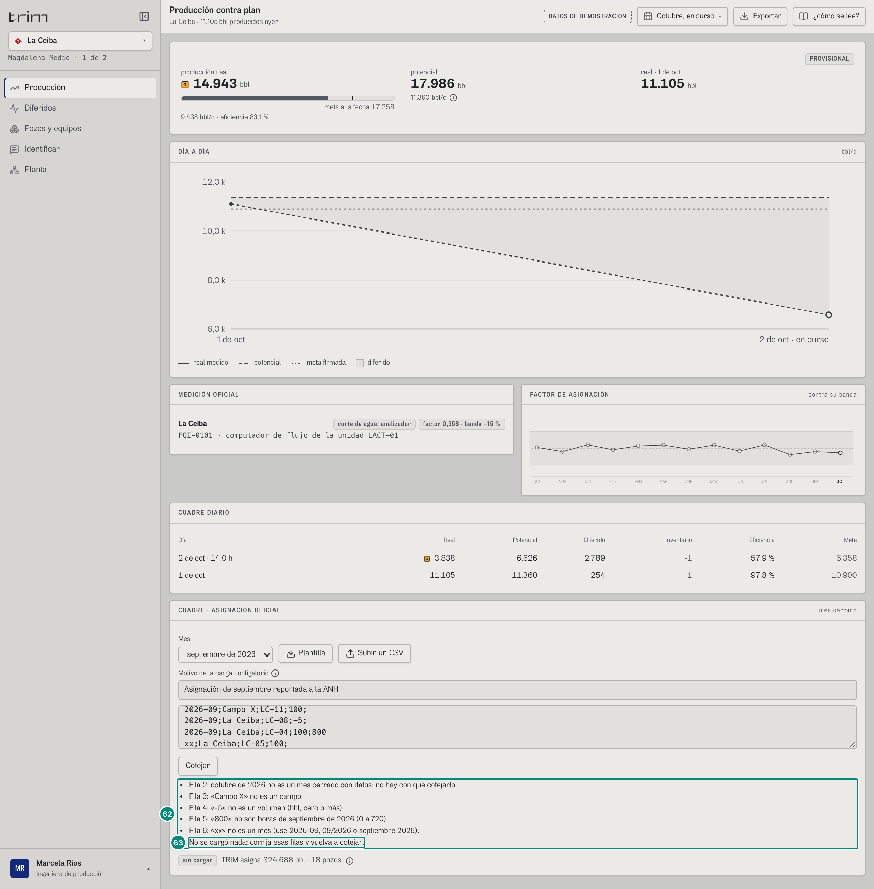

# 6A.3 Producción contra plan — gerente (decisión) y producción (ingeniería)

**Para qué.** Decisión: «Cada día, contra lo posible y la meta.»; ingeniería: «Después: lo medido cada día, custodia y libro publicable.» (`PARA_QUE_DECISION.produccion`, `PARA_QUE.produccion`, `src/widgets/Onboarding.tsx:39`, `:20`).
**Ruta.** `#/<ger | prod>/produccion/<campo | campo~portafolio>/<período>` · **Roles y nivel.** `ger` (decisión: cabecera y DÍA A DÍA); `prod` (ingeniería: además MEDICIÓN OFICIAL, FACTOR o CUADRE, CUADRE DIARIO/MENSUAL y CUADRE · ASIGNACIÓN OFICIAL, y lo nuevo del choke: LA TUBERÍA DEL CAMPO, QUÉ LIMITÓ, DÍA POR DÍA, LO QUE NO SE PRODUJO, POR TIPO y LO PERDIDO POR TRAMO, MES A MES: filas 66-70, **se explican en 6D.1**). `src/pages/Produccion.tsx:41-205`. El portafolio de `prod` son **sus dos campos** (La Ceiba y El Palmar, `src/entities/roles.ts:57`).
**Lee.**

| Endpoint | Qué toma |
|---|---|
| `GET /api/vistas/diferidos?campos&desde&hasta` | `real`, `potencial`, `pe`, `meta`, `motivos`, `fa` (cabecera, sello, chip del factor, Cuadre del portafolio) |
| `GET /api/vistas/produccion/diaria?campos&desde&hasta` | `Dia[]`: gráfica y cuadre diario; la suma de `horas` da el «por día» |
| `GET /api/vistas/diferidos/mensual?campos` | gráfico del factor y meses enteros del cuadre mensual |
| `GET /api/vistas/diferidos?…` por cada mes **recortado** | cuadre mensual de un rango que corta meses (`useLibros`, `:69`) |
| `GET /api/vistas/campos/:campo/tuberia`, `…/choke/serie`, `GET /api/vistas/choke/reparto` y `…/choke/mensual` | lo nuevo del choke en ingeniería (filas 66-70; 6D.1) |
| `GET /api/vistas/estado?campos` | `ayer` (real del último día completo) |
| `GET /api/catalogo` (arranque) | `campos[c].medicion` (`origen`, `banda`) |
| `GET /api/vistas/asignacion?campo&mes` | asignación de TRIM por pozo (cotejo) |
| `GET /api/asignacion-oficial` (arranque) y `POST /api/asignacion-oficial` | la oficial cargada, su rastro y la carga |

El auditor exige: en `#/ger/produccion/ceiba/curso` ver «DÍA A DÍA» y **no** «MEDICIÓN OFICIAL» ni «ASIGNACIÓN OFICIAL»; en `#/prod/produccion/ceiba/curso` ver «MEDICIÓN OFICIAL», «FACTOR DE ASIGNACIÓN» y «CUADRE · ASIGNACIÓN OFICIAL» (`e2e/auditoria/rutas.ts:62`, `:89`).

---

## 6A.3.1 Gerente · La Ceiba · octubre en curso

| # | Lo que se ve | En la captura | Cómo se calcula | Texto según el valor | Viene de |
|---|---|---|---|---|---|
| 1 | Sello | «PROVISIONAL» | 5A §«Sello de publicación» | ver 6A.1 fila 2 | `motivos` |
| 2 | Producción real | ■ «16.941 bbl» | $\text{Real}$ del período — 5A §«Real» y §«Cabecera de Producción» | `n0` + «bbl»; ■ P3 si hay meta y $\text{real} < \text{meta.produccion}$ (`:93`) | `real`, `meta.produccion` |
| 3 | Barra | relleno $\min(1{,}25;\ 16.941/17.258{,}333)/1{,}25 = 78{,}5\,\%$ | 8 §8.5 | gris; sin meta, ni barra ni raya | — |
| 4 | Meta | «meta a la fecha 17.258» | `meta.produccion` = 10.900 × 38/24 — 5A §«Meta del período» | «meta a la fecha *n*» solo con el mes en curso (`enCurso`), si no «meta *n*»; sin meta: `textoSinMeta(meta, portafolio)`. Globo «Real contra la meta» (captura `prod-produccion-ceiba-globo-meta`): «Real por día 10.700 bbl/d», «Meta por día 10.900 bbl/d», «Meta a la fecha 17.258 bbl», «Meta del mes completo 337.900 bbl» (o «Meta del período»); sin meta, «Meta: sin meta firmada» | `meta.produccion`, `meta.produccionTotal` |
| 5 | Apoyo | «10.700 bbl/d · 94,2 % del potencial» + ⓘ | $\text{porDia}(\text{real}) = \text{real}\cdot 24/\sum_d \text{horas}_d = 16.941\times24/38 = 10.699{,}6$; $\text{pe} = 100 \times 16.941/17.987{,}026 = 94{,}2$ — 5A §«Eficiencia» (en el libro sigue siendo `pe`; en pantalla es el «% del potencial», no la «eficiencia de producción» de la escalera: la decisión «Las dos eficiencias», `CORRECCIONES-F3.md`; 6D.1, 5E §4) | `${n0} bbl/d · ${n1(pe)} % del potencial` (`Produccion.tsx:95`). ⓘ «% del potencial»: «Lo real ÷ el potencial de al lado: lo que daban las pruebas de los pozos con el factor de asignación del mes, que las deja medidas como el punto de medición oficial. Por eso solo descuenta lo que no se produjo por paradas.» (`DEL_POTENCIAL`, `:210`); en ingeniería el ⓘ agrega la diferencia con la eficiencia de producción con las cifras del período (`InfoDelPotencial`, `:214-225`). El «por día» de Producción divide por las **horas del día a día**, no por `meta.dias` (dan lo mismo si no hay huecos) | `Dia[].horas`, `real`, `pe` |
| 6 | Potencial | «17.987 bbl» | 5A §«Potencial» | `n0` + «bbl» | `potencial` |
| 7 | Potencial por día | «11.360 bbl/d» + ⓘ | $17.987{,}026\times24/38 = 11.360{,}2$ | ⓘ en ingeniería: «Potencial: Pruebas de los pozos × factor de asignación.»; en decisión: «Potencial: Lo que los pozos podían dar.» (`:101`) | ídem |
| 8 | Rótulo del último día | «real · 1 de oct» | `fechaCorta(estados[0].ayer.fecha)` | «real · *fecha*»; sin fecha: «real · último día» | `GET /api/vistas/estado` → `ayer.fecha` |
| 9 | Real del último día completo | «11.105 bbl» | $\sum_c \text{ayer.bbl}_c$ — 5B §5.4 | si **algún** campo trae `null`: «—» sin unidad y pie «sin fiscal» con ⓘ «Último día completo: Falta el fiscal del último día en algún campo: la suma no está completa.» (`:55`, `:102-103`). **No depende del período** | `ayer.bbl` |
| 10 | DÍA A DÍA | dos días | 5A §«Gráfica «DÍA A DÍA»» — ver 6A.3.2 | | `Dia[]` |

Nivel decisión: solo esto (cabecera + DÍA A DÍA con su Lectura).

## 6A.3.2 Producción (ingeniería) · La Ceiba · octubre en curso

| # | Lo que se ve | En la captura | Cómo se calcula | Texto según el valor | Viene de |
|---|---|---|---|---|---|
| 10 | Gráfica DÍA A DÍA (bbl/d) | 1-oct y 2-oct | todo como **tasa**: $\text{tasa}(d, v) = v\cdot24/\text{horas}_d$; real sólida (`--dato-1`), potencial discontinua, meta punteada, diferido = área entre potencial y real — 5A §«Gráfica «DÍA A DÍA»» | 2-oct: real $5.836\times24/14 = 10.005$; potencial $6.626{,}799\times24/14 = 11.360$; meta 10.900. Día sin fiscal: sin punto, la curva y el área se cortan; día sin meta: sin punto de meta. Puntos chicos solo con ≤ 45 días. Una parada de Tab; flechas, Inicio y Fin recorren los días | `Dia[].real`, `potencial`, `meta`, `horas` |
| 11 | Eje Y | «12,0 k» (marcas «9,0 k» · «10,0 k» · «11,0 k» · «12,0 k») | `escala(lo, hi)`: $lo = 0{,}97\cdot\min(\text{tasas real y meta})$, $hi = 1{,}02\cdot\max(\text{tasa potencial})$; paso 1, 2, 2,5, 5 o 10 × 10ⁿ con ≤ 5 intervalos (`Diaria.tsx:10-15`, `:27`): $0{,}97 \times 10.004{,}6 = 9.704$ (la tasa real del 2-oct) → $1{,}02 \times 11.360{,}2 = 11.587$, paso 1.000, de 9.000 a 12.000 | ≥ 1.000: `n1(v/1000)` « k» | — |
| 12 | Eje X, último día | «2 de oct · en curso» | `fechaCorta`; el último día lleva « · en curso» si `horas < 23,99` | etiquetas espaciadas por su largo (`Diaria.tsx:41-50`): con $L$ = largo en caracteres de la fecha más larga, caben $c = \lfloor 634 / (5{,}4L + 14) \rfloor$ etiquetas y se rotula cada $k = \lceil n/c \rceil$ días (índice $i \bmod k = 0$), siempre el último, y se omite una regular cuyo medio pasaría de $690 - 5{,}4\cdot\text{largo(última)} - 8$. Aquí $n = 2$: «1 de oct» y «2 de oct · en curso». Con otro año: «1 de oct de 2025» (sin cero delante desde B-25; antes «01 de oct de 2025», 6A.7 §8 resuelto) | `Dia[].dia`, `horas` |
| 13 | Día en curso | punto hueco y tramo discontinuo desde el 1-oct | `parcial = horas < 23,99` | «es una tasa de un día a medias, no un desplome». Globo (captura `prod-produccion-ceiba-globo-dia`): título «2 de oct · día en curso», filas Real 5.836 bbl, Potencial 6.627 bbl, Meta 6.358 bbl, Diferido de los eventos 792 bbl, Inventario entre días -1 bbl, Del potencial 88,1 % (antes «Eficiencia»); pista «Parcial: 14,0 h. Se muestra como tasa diaria.» Las cifras del globo van en **bbl del día**, no en tasa. Sin fiscal: «Real: sin fiscal del punto de medición oficial» | `Dia[]` |
| 14 | Leyenda | «real medido · potencial · meta firmada · diferido» | fija | | — |
| 15 | MEDICIÓN OFICIAL · corte de agua | chip «corte de agua: analizador» | `origen.bsw` del punto de medición — 5A §«Panel «MEDICIÓN OFICIAL»» | «corte de agua: analizador \| laboratorio \| sin dato»; tono fuerte si laboratorio | `GET /api/catalogo` → `campos[c].medicion.origen.bsw` |
| 16 | Factor del campo | chip «factor 0,958 · banda ±15 %» | el **último** `fa` del período de ese campo; banda $b$ | `n3(fa)` · «banda ±*n0(b·100)* %»; sin `fa` en el período, el chip no sale | `fa[].fa` (libro) y `medicion.banda.valor` (catálogo) |
| 17 | Fuente de lo real | «FQI-0101 · computador de flujo de la unidad LACT-01» | `origen.fuente` | monoespaciado; sin punto: «Sin punto de medición configurado» | `medicion.origen.fuente` |
| 18 | FACTOR DE ASIGNACIÓN | gráfico mes a mes de OCT a OCT; el eje («0,75» · «0,85» · «1,00» · «1,15» · «1,25») no se ve | igual que en Diferidos (6A.2 fila 49): desde el 8-oct arranca al final (`alFinal`), y a 1.280 px el eje queda a la izquierda, fuera de la vista (6A.7 §20); el recuadro de la marca es lo que se ve del gráfico. Un mes con la banda sin verificar va punteado, sin marca | con un campo; con el portafolio se reemplaza por el Cuadre (6A.3.5) | serie mensual, catálogo, `motivos` |
| 19 | Título del cuadre | «CUADRE DIARIO» | `dias.length > 62` → «CUADRE MENSUAL» | | — |
| 20 | Día | «2 de oct · 14,0 h» | `fechaCorta(dia)` + « · *n1(horas)* h» si `horas < 23,99` — 5A §«Cuadre diario / mensual» | del más reciente al más viejo | `Dia[].dia`, `horas` |
| 21 | Real del día | ■ «5.836» | `Dia.real` | «sin fiscal» si `null`; ■ si `meta ≠ null` y `real < meta` | `Dia[].real`, `meta` |
| 22 | Potencial | «6.627» | `Dia.potencial` = 6.626,799 | `n0` | `Dia[].potencial` |
| 23 | Diferido | «792» | `Dia.diferido` (eventos del día) = 791,961: P-201B (LC-16 y LC-07 desde las 05:43 y 05:46), LC-21 y LC-08 | `n0` | `Dia[].diferido` |
| 24 | Inventario | «-1» | `Dia.residuo` = −1,162 — 5A §«Residuo · inventario entre días» | `n0` con guion «-» (no U+2212); `null` → «—» | `Dia[].residuo` |
| 25 | Del potencial del día (antes «Eficiencia») | «88,1 %» | $100\cdot\text{real}_d/\text{potencial}_d$ (la calcula el front) | `n1` «%»; «—» sin fiscal o potencial 0 | `Dia[].real`, `potencial` |
| 26 | Meta del día | «6.358» | `Dia.meta` = 10.900 × 14/24 | «sin meta firmada» si `null` | `Dia[].meta` |
| 64 | Segunda fila del cuadre | «1 de oct · 11.105 · 11.360 · 254 · 1 · 97,8 % · 10.900» | el día completo (motor): real 11.105 (sin ■: no está bajo la meta 10.900); potencial 11.360,227; diferido de los eventos 254,065 = SE-2 117,9 + LC-21 (desde las 18:20) + LC-08; inventario `residuo` = 1,162 → «1» (el del 2-oct es −1,162: en el mes entero se anulan); del potencial $100 \times 11.105/11.360{,}227 = 97{,}8\,\%$; meta 10.900 × 24/24 | filas 20-26 | `Dia[]` del 1-oct |
| 27 | Sin cargar | chip «sin cargar» | no hay filas oficiales del (mes, campo) elegidos | ⓘ «La Ceiba · septiembre de 2026: Sin asignación oficial cargada. Lo que asigna TRIM es lo que midió el punto de medición oficial.» | `GET /api/asignacion-oficial` → `filas` |
| 28 | Lo que asigna TRIM | «TRIM asigna 338.662 bbl · 18 pozos» | $\sum_p \text{asignado}_p$ del mes cerrado = lo real del mes — 5A §«Asignación de TRIM por pozo» | `n0` · `plural(n, 'pozo', 'pozos')` | `GET /api/vistas/asignacion?campo&mes` → `[].asignado` |
| 29 | Selector de mes | «septiembre de 2026» | solo meses **cerrados**, del más nuevo al más viejo; por omisión el último cerrado | `nombreMes` | `GET /api/catalogo` → `calendario` (`mesCerrado`) |
| 30 · 31 | «Plantilla» · «Subir un CSV» | | solo con `asignacion:cargar` (producción) | Plantilla = 5A §«Formato de la carga (CSV) y plantilla» (`TRIM-asignacion-oficial-ceiba-2026-09.csv`) | — |
| 32 | Motivo | «Motivo de la carga · obligatorio» + ⓘ | ≥ 5 caracteres | ⓘ «Motivo de la carga: Queda en el rastro con su nombre y la hora.» | — |
| 66 | LA TUBERÍA DEL CAMPO | «LA TUBERÍA DEL CAMPO» · «qué limita hoy al campo»; YACIMIENTO → POZOS · 18 → PLANTA O ESTACIÓN → AFUERA → venta, con «◄ LIMITA 11.857 bbl/d», «PASA HOY 9.394 bbl/d» y «PERDIÉNDOSE AHORA 1.966 bbl/d» | el tope del campo hoy, lo que le sobra a cada tramo y lo que pasa y se pierde — 6D.1, 5E §1, 5E §2 | solo ingeniería (`TuberiaDelCampo`, `widgets/choke/Tuberia.tsx:68`); con varios campos, una fila por campo (`TuberiaDeCadaCampo`, `widgets/choke/Campos.tsx`) | `GET /api/vistas/campos/:campo/tuberia` |
| 67 | SE TRABÓ EN EL PERÍODO | «SE TRABÓ EN EL PERÍODO» · «Octubre, en curso» · «1.046 bbl» con «en los pozos 118», «en la planta 573», «sin identificar 355» y «Ver por dónde se trabó» | el diferido del libro (el de 6A.2) partido por tramo, con sus ramas — 6D.1, 5E §4 | dentro de la tubería (`widgets/choke/Tuberia.tsx:560`) | `GET /api/vistas/choke/reparto` → `porChoke` |
| 68 | QUÉ LIMITÓ, DÍA POR DÍA | «QUÉ LIMITÓ, DÍA POR DÍA» · «octubre, en curso» · «Sin cambios: en el período limitaron los pozos todos los días.» y una celda por día («1 de oct», «2 de oct») | la serie diaria de lo que limitó al campo — 6D.1, 5E §8 | `SerieLimita`, `widgets/choke/Serie.tsx:67` (usa `data-dia` como la gráfica de la fila 10: por eso las marcas del DÍA A DÍA se ubican dentro de la suya) | `GET /api/vistas/campos/:campo/choke/serie` |
| 69 | LO QUE NO SE PRODUJO, POR TIPO | «LO QUE NO SE PRODUJO, POR TIPO» · «eficiencia de producción 90,2 %» («16.941 de 18.774 bbl que el campo podía dejar pasar») y «lo no planeado se llevó 3,7 %»; la escalera de «Lo que dan los pozos según sus pruebas 18.774 bbl» a «= Lo que salió por el punto de medición oficial 16.941 bbl» | la escalera de lo que no se produjo, escalón por escalón; **no** es el «% del potencial» de la fila 5 (94,2 %): parte de las pruebas sin el factor — 6D.1, 5E §4 | `Escalera`, `widgets/choke/Escalera.tsx:45` | `GET /api/vistas/choke/reparto` → `porChokeEscalon`, `pe` |
| 70 | LO PERDIDO POR TRAMO, MES A MES | «LO PERDIDO POR TRAMO, MES A MES» · «bbl»: los 13 meses de OCT 2025 a OCT en curso, los mismos totales del MES A MES de Diferidos (6A.2.4 fila 35: «16,9 k», «7,5 k», … «1,0 k»), partidos por tramo | el diferido de cada mes por tramo, suma exacta al libro — 6D.1, 5E §8 | `PorTramoMensual`, `widgets/choke/Mensual.tsx:41` | `GET /api/vistas/choke/mensual` → `[].porTramo` |

Sin el permiso (`asignacion:cargar`), en lugar de los botones y las cajas sale «Solo lectura: la carga producción.» (`AsignacionOficial.tsx:128`). Hoy solo `prod` llega a esta pantalla en ingeniería, y lo tiene.

## 6A.3.3 Producción · La Ceiba · septiembre cerrado

| # | En la captura | Cómo sale |
|---|---|---|
| 1 | «✓ PUBLICABLE» | `motivos = []` |
| 2 · 4 | «338.662 bbl», sin ■ · «meta 327.000» | 11.662 bbl sobre la meta; sin «a la fecha» (no en curso) |
| 5 | «11.289 bbl/d · 97,8 % del potencial» | 338.662 × 24/720 = 11.288,7 |
| 6 · 7 | «346.378» · «11.546 bbl/d» | 346.378,059 × 24/720 |
| 16 | «factor 0,969 · banda ±15 %» | el `fa` de septiembre |
| 33 · 34 | «22 de sept» · ■ «10.578» (22-sep) | a la vista los cinco más recientes (30, 29, 28, 27 y 26-sep, los tres últimos ■) **más todo día sin fiscal o bajo la meta**, que nunca va detrás de «ver más» (`Produccion.tsx:78-79`): 22-sep ■ 10.578, el día de la parada de P-201B (`EV-2011-0922`) |
| 35 | «ver 24 más» | 30 − 6 visibles; en el papel salen todos |
| 11 | DÍA A DÍA (filas 11-12): eje Y «9,0 k» · «10,0 k» · «11,0 k» · «12,0 k»; eje X «1 de sept» · «5 de sept» · «9 de sept» · «13 de sept» · «17 de sept» · «21 de sept» · «25 de sept» · «30 de sept» | Y: $lo = 0{,}97 \times 9.642$ (real del 28-sep, el más bajo) $= 9.352{,}7$; $hi = 1{,}02 \times 11.582{,}6$ (potencial del 3-sep, el más alto) $= 11.814{,}2$; paso 1.000 → de 9.000 a 12.000 (motor; `escala`, `Diaria.tsx:10-15`). Antes del 9-oct el día más bajo era el 10-sep (1.090: P-201B parada y todo el campo cerrado) y el eje iba de 0 a 20.000. X: fecha más larga «30 de sept» (10 caracteres) → $c = \lfloor 634/68 \rfloor = 9$, $k = \lceil 30/9 \rceil = 4$: días 1, 5, 9, …, 25 y el último; el 29 no sale porque su medio (695) pasa del tope (628) |

Filas a la vista, para cotejar: 30-sep 11.602 · 11.489 · 0 · -113 · 101,0 % · 10.900; 29-sep 11.055 · 11.489 · 490 · -56 · 96,2 %; 28-sep ■ 9.642 · 11.489 · 1.891 · -44 · 83,9 %; 27-sep ■ 9.691 · 11.500 · 1.918 · -109 · 84,3 %; 26-sep ■ 10.221 · 11.500 · 1.398 · -119 · 88,9 %; 22-sep ■ 10.578 · 11.543 · 876 · 88 · 91,6 %. Del 26 al 28-sep pesan las fallas de aislamiento de LC-11 (25-sep) y LC-04 (26-sep), que volvieron el 29-sep.

## 6A.3.4 Producción · El Palmar · últimos 12 meses

| # | En la captura | Cómo sale | Texto |
|---|---|---|---|
| 1 · 36 | ■ «NO PUBLICABLE» · «El Palmar · factor fuera de banda» | abril de 2026: FA 0,810 con banda ±15 % | |
| 2 · 4 | ■ «1.180.973 bbl» · «meta 1.186.250» | 3.250 bbl/d × 365 | |
| 5 | «3.236 bbl/d · 98,5 % del potencial» | 1.180.973 × 24/8.760 | |
| 6 | «1.198.980 bbl» · «3.285 bbl/d» | | |
| 9 | «3.186» (real · 1 de oct) | el último día completo, igual en cualquier período | |
| 37 | «1 de oct de 2025» | primer día del eje: fecha de otro año | `FMT_FECHA_ANIO` ya no pone el cero delante (`day: 'numeric'`, `reloj.ts:20`, B-25): «1 de oct de 2025», como «1 de oct»; el hueco quedó resuelto (6A.7 §8) |
| 15 · 17 | «corte de agua: laboratorio» (tono fuerte) · «LIT-1021 y LIT-1022 · medidores automáticos de los tanques de despacho» | El Palmar mide por tanques, con corte de laboratorio | |
| 16 | «factor 1,008 · banda ±15 %» | el último `fa` del período (sep-2026) | |
| 38 | ■ en ABR del gráfico del factor | 0,810 < 0,85 y la banda de El Palmar se puede verificar (`estadoFactor` = «fuera») | globo «Abril 2026 · factor 0,810», pista «Fuera de la banda: revisar pruebas, medición y pozos sin prueba». El gráfico ya arranca en octubre; abril sigue a la vista a 1.280 px |
| 19 | «CUADRE MENSUAL» | 365 días > 62 | una fila por mes tocado: nombre («Abril 2026»), « · *d* de *mes* a *d* de *mes*» si el mes está recortado o « · en curso» si es parcial; Real con ■ si bajo la meta del mes; Potencial; Diferido (`n0(diferido)`); Inventario (`n0(residuo)`); «Del potencial» (`n1(pe)` %; antes «Eficiencia»); Meta (`meta.produccion` o «sin meta firmada») |
| 39 | ■ «81.033» (abril) | 81.033 < 97.500 | |
| 12 | eje X «1 de oct de 2025» · «13 de dic de 2025» · «24 de feb» · «8 de may» · «20 de jul» · «30 de sept» | fecha más larga, p. ej. «13 de dic de 2025» (17 caracteres; con el cero de antes, «01 de oct de 2025», también eran 17) → $c = \lfloor 634/105{,}8 \rfloor = 5$, $k = \lceil 365/5 \rceil = 73$: índices 0, 73, 146, 219, 292 y el último (364) | regla de la fila 12 de 6A.3.2 |
| 28 | «TRIM asigna 96.715 bbl · 7 pozos» | El Palmar, septiembre | |

Las 12 filas: oct-25 104.691 · 104.691 · 0 · 0 · 100,0 % · 100.750; nov 96.525 ■ · 97.934 · 1.409 · 98,6 % · 97.500; dic 106.400 · 107.499 · 1.099 · 99,0 % · 100.750; ene 96.542 ■ · 101.832 · 5.290 · 94,8 % · 100.750; feb 97.458 · 97.458 · 0 · 100,0 % · 91.000; mar 105.965 · 105.965 · 0 · 100,0 %; abr 81.033 ■ · 82.043 · 1.010 · 98,8 % · 97.500; may 95.777 ■ · 98.895 · 3.118 · 96,8 %; jun 93.883 ■ · 95.974 · 2.091 · 97,8 % · 97.500; jul 103.259 · 103.259 · 0 · 100,0 %; ago 102.725 · 102.725 · 0 · 100,0 %; sep 96.715 ■ · 100.705 · 3.990 · 96,0 % · 97.500. Eje Y de la curva 1,0 k a 4,0 k (mínimo real 1.920 el 28-abr).

## 6A.3.5 Producción · portafolio (La Ceiba + El Palmar) · año a la fecha

| # | En la captura | Cómo sale | Texto |
|---|---|---|---|
| 40 | «Portafolio · 2 campos · 14.291 bbl producidos ayer» | 11.105 + 3.186 | |
| 1 | ■ «NO PUBLICABLE» | `en-curso` **y** `fa-fuera-de-banda` (palmar, abril): basta un motivo distinto de `en-curso` | |
| 2 · 4 | «4.069.813 bbl» **sin** ■ · «meta 3.885.354» | 14.150 bbl/d × 274,583 días; el año a la fecha **no** es «en curso» para la pantalla (5A §Huecos 12): dice «meta», no «meta a la fecha» | |
| 5 | «14.822 bbl/d · 96,9 % del potencial» | 4.069.813 × 24/6.590 = 14.821,8; $100 \times 4.069.813/4.200.887{,}054 = 96{,}9$ | |
| 9 | «14.291» | | |
| 15 | dos filas en MEDICIÓN OFICIAL: La Ceiba (analizador · 0,958) y El Palmar (laboratorio, tono fuerte · 0,987) | el último `fa` de cada campo en el período (octubre) | |
| 41 | «CUADRE · MEDICIÓN OFICIAL» en vez del gráfico del factor | portafolio (`:154`) | potencial 4.200.887, real 4.069.813, no producido 131.074, por señal 130.130, declarado 589, sin identificar 355 |
| 42 · 43 | «■ El Palmar · 2026-04 · **0,810**» · chip «fuera de ±15 %» | `fa[]` con `dentro: false` y sin el motivo `banda-sin-verificar` de El Palmar (`estadoFactor`, 6A.2 fila 45) | un mes con la banda sin verificar saldría sin ■ y con chip neutro «banda sin verificar» |
| 44 · 45 · 46 | «Octubre 2026 · en curso» · ■ «22.052» · «22.404» | mes parcial (16.941 de La Ceiba + 5.111 de El Palmar); meta a la fecha (10.900 + 3.250) × 38/24 | |
| 47 | selector «Campo» | sale con más de un campo | |
| 6 | «4.200.887 bbl» · «15.299 bbl/d» (filas 6-7) | potencial del año de los dos campos (4.200.887,054: no cambia con el agua, sale de las pruebas de crudo y del factor); por día $= 4.200.887 \times 24/6.590 = 15.299{,}1$ (6.590 h del día a día) | filas 6-7 de 6A.3.1 |
| 16 | MEDICIÓN OFICIAL (filas 15-17): La Ceiba «corte de agua: analizador» · «factor 0,958 · banda ±15 %» · «FQI-0101 · computador de flujo de la unidad LACT-01»; El Palmar «corte de agua: laboratorio» (fuerte) · «factor 0,987 · banda ±15 %» · «LIT-1021 y LIT-1022 · medidores automáticos de los tanques de despacho» | una fila por campo, el último `fa` de cada uno en el período (octubre) | filas 15-17 de 6A.3.2 |
| 65 | CADENA DE CUSTODIA: «Prueba estimada: LC-17» · «Corte de agua de laboratorio: El Palmar» | `custodia.estimados` y `custodia.bswLaboratorio` de los dos campos en el período (motor) | 6A.2 filas 47 y 57 |
| 11 | DÍA A DÍA (filas 11-12): eje Y «8,0 k» · «10,0 k» · «12,0 k» · «14,0 k» · «16,0 k» · «18,0 k»; eje X «1 de ene» · «1 de feb» · «4 de mar» · «4 de abr» · «5 de may» · «5 de jun» · «6 de jul» · «2 de oct · en curso» | Y: $lo = 0{,}97 \times 9.703$ (25-mar, el día de K-101) $= 9.411{,}9$, $hi = 1{,}02 \times 15.971{,}2$ (1-mar) $= 16.290{,}7$, paso 2.000: de 8.000 a 18.000 (motor). Antes del 9-oct el día más bajo era el 21-abr (3.181) y el eje iba de 0 a 20.000. X: 275 días, fecha más larga de 10 caracteres → $c = 9$, $k = \lceil 275/9 \rceil = 31$: índices 0, 31, …, 186 y el último; el 217 (6 de ago) no sale: su medio (579,7) pasa del tope $690 - 5{,}4 \times 19 - 8 = 579{,}4$ | |

Cuadre mensual del año: ene 465.753 · 476.398 · 10.645 · 97,8 % · 438.650; feb 422.842 · 446.191 · 23.349 · 94,8 % · 396.200; mar 478.087 · 495.108 · 17.021 · 96,6 %; abr 431.355 · 442.434 · 11.079 · 97,5 % · 424.500; may 466.807 · 483.376 · 16.569 · 96,6 %; jun 435.273 · 448.891 · 13.618 · 97,0 %; jul 468.885 · 486.326 · 17.441 · 96,4 %; ago 443.382 · 451.904 · 8.522 · 98,1 %; sep 435.377 · 447.083 · 11.706 · 97,4 % · 424.500; oct 22.052 ■ · 23.176 · 1.124 · 95,2 % · 22.404. Inventario 0 en todos (meses enteros). Solo octubre lleva ■: abril, julio y septiembre ya no quedan bajo la meta (las paradas de P-201B de La Ceiba cierran tres pozos, no el campo).

---

## 6A.3.6 CUADRE · ASIGNACIÓN OFICIAL: carga, cotejo pozo por pozo y rastro

Fórmulas, reglas de lectura del CSV, errores del servidor y textos: 5A §«Formato de la carga (CSV) y plantilla», §«Carga (`POST /api/asignacion-oficial`) y rastro de cargas» y §«Cotejo pozo por pozo (`cotejar`)». Aquí, la pantalla con la carga armada para el documento (la oficial = lo de TRIM de septiembre redondeado, con las horas del PLC a dos decimales, salvo LC-11 +20 % con las mismas horas, LC-16 +300 bbl y +10 h, sin LC-21 y con un pozo LC-99 que no existe; el CSV está en `CSV_OFICIAL` del guion de capturas).

| # | Lo que se ve | En la captura | Cómo sale | Viene de |
|---|---|---|---|---|
| 48 | Resultado de la carga | «18 pozos cargados en 1 mes y campo.» | `plural(filas, 'pozo cargado', 'pozos cargados')` en `plural(grupos, 'mes y campo', 'meses y campos')` | respuesta del `POST` |
| 49 | Quién cargó lo que rige | «Cargada el 2 de oct, 14:00 por Marcela Ríos · ingeniera de producción: «Asignación de septiembre reportada a la ANH».» | `cargaVigente(oficial, cargas, mes, campo)`: `fechaHora(fecha)`, `por`, `motivo`; « · reemplazó N pozos de una carga anterior» si `reemplazados > 0`. `fecha` y `por` los pone el servidor | `carga.fecha`, `carga.por`, `carga.motivo`, `carga.grupos[].reemplazados` |
| 50 | Conteo | «18 pozos leídos · 17 reconocidos · 1 que TRIM no tiene» | leídos = reconocidos + desconocidos | `cotejar` |
| 51 | Pozo desconocido | ◌ «TRIM no tiene LC-99 en La Ceiba: revise el nombre o el maestro de pozos.» | marca de **dato inválido** (círculo punteado morado, ISA-101) | |
| 52 | Pozos faltantes | ■ «Faltan 1 pozo de La Ceiba en lo que se cargó (TRIM les asigna 9.106 bbl): ¿está completo el archivo?» y «LC-21» | pozos de TRIM con asignado > 0,5 que no vinieron | (gramática «Faltan 1 pozo»: 5A §Huecos 11) |
| 53 · 54 | Totales | «oficial 335.975 bbl» · «TRIM 338.662 bbl» + ⓘ «Lo que midió el punto de medición oficial en el mes, repartido por prueba × factor × horas.» | Σ de todas las filas oficiales (también la del pozo desconocido) y Σ asignado | `cotejar` → `totalOficial`, `totalTrim` |
| 55 | Fuera de banda | «fuera de banda · ±15 %» y «■ 1 de 17 pozos cotejados» | $\lvert o - t\rvert > b\cdot\max(o, t)$ con $b$ = banda del campo | |
| 56 | Diferencia de totales | «La oficial suma 2.687 bbl menos que lo que midió el punto oficial. Primero complete los pozos.» | sale si $\lvert\Sigma o - \Sigma t\rvert \ge 1$; «Primero complete los pozos.» si hay faltantes o desconocidos; si no, ⓘ «Diferencia de totales: Las dos deberían sumar lo mismo: si no, una usó otro volumen (por ejemplo, un corte de agua de laboratorio corregido).» | |
| 57 | Diferencia de LC-11 | ■ «5.618» + ⓘ | $33.706 - 28.088{,}184 = 5.617{,}8$; fuera porque $5.618 > 0{,}15\times33.706 = 5.055{,}9$; ⓘ = el motivo «Mismas horas: está en la prueba o el factor que usó cada uno.» (en el papel, en su renglón) | `cotejar` → `filas[].diferencia`, `fuera`, `motivo` |
| 58 | Horas | «635,4 · 635,4» | oficial · PLC, `n1` o «sin dato» | |
| — | Filas | LC-11, LC-16 (300, «Horas: 709,3 oficial, 699,3 según el PLC; explican 368 bbl. El resto, -68 bbl, está en la prueba o el factor.»: $25.718{,}291/699{,}333 \times 9{,}997 = 367{,}6$ y $299{,}709 - 367{,}6 = -67{,}9$), LC-03, LC-10, LC-09 (0, «Cuadra.») y «ver 12 más» | solo los comparables, ordenados por diferencia absoluta; 0,473 se escribe «0». Columnas Pozo · Oficial · TRIM · Diferencia · Horas (oficial · PLC), a la vista: ■ LC-11 33.706 · 28.088 · 5.618 · 635,4 · 635,4; LC-16 26.018 · 25.718 · 300 · 709,3 · 699,3; LC-03 11.398 · 11.398 · 0 · 720,0 · 720,0; LC-10 13.985 · 13.985 · 0 · 720,0 · 720,0; LC-09 18.706 · 18.706 · 0 · 717,9 · 717,9. LC-11 tiene 635,4 h y no 720: estuvo parada por su falla de aislamiento del 25 al 29-sep (oficial = lo cargado; TRIM = `asignado` de `GET /api/vistas/asignacion`; horas PLC = `horas` de TRIM, `n1`) | |
| 59 | «Descargar el cotejo» | CSV `TRIM-cotejo-asignacion-ceiba-2026-09` | columnas: Pozo, Oficial bbl, TRIM bbl, Diferencia bbl, Horas oficiales, Horas PLC, Explican las horas bbl, Fuera de la banda (sí/no), Explicación | |
| 60 · 61 | Rastro | «Rastro de las cargas · 1 carga» (desplegado): «2 de oct, 14:00 · Marcela Ríos · ingeniera de producción», ««Asignación de septiembre reportada a la ANH»», «septiembre de 2026 · La Ceiba: 18 pozos» | toda carga, de la más nueva a la más vieja; « (reemplazó N)» por grupo | `GET /api/asignacion-oficial` → `cargas[]` |

Una fila mala no carga nada:

| # | En la captura | Regla |
|---|---|---|
| 62 | «Fila 2: octubre de 2026 no es un mes cerrado con datos: no hay con qué cotejarlo.» · «Fila 3: «Campo X» no es un campo.» · «Fila 4: «-5» no es un volumen (bbl, cero o más).» · «Fila 5: «800» no son horas de septiembre de 2026 (0 a 720).» · «Fila 6: «xx» no es un mes (use 2026-09, 09/2026 o septiembre 2026).» | `leerAsignacion` en el front (los mismos 422 del servidor); se ven los diez primeros y «y N más.». La fila 1 es la cabecera |
| 63 | «No se cargó nada: corrija esas filas y vuelva a cotejar.» | todo o nada |

**Ojo con las horas de tres decimales.** «718,383» (las horas de LC-08 en el PLC) se lee como **718.383** (coma de miles: tres cifras después de la coma) y la carga se rechaza con «Fila 2: «718,383» no son horas de septiembre de 2026 (0 a 720).». Corrido con `leerAsignacion` el 9-oct; por eso el CSV de la captura lleva las horas a dos decimales. La regla está en `leerNumero` (`src/entities/plan.ts`); el servidor tiene que leer igual o decirlo igual (ver Huecos).

---

## Variantes

- **Decisión vs ingeniería.** Decisión: cabecera (sello, producción real contra meta, potencial con ⓘ «Lo que los pozos podían dar.», real del último día) y DÍA A DÍA; nada de lo del choke (el gerente lo ve en su Resumen y en Diferidos, 6D.3 y 6D.4). Ingeniería: todo, con LA TUBERÍA DEL CAMPO y QUÉ LIMITÓ, DÍA POR DÍA antes de DÍA A DÍA, y LO QUE NO SE PRODUJO, POR TIPO y LO PERDIDO POR TRAMO, MES A MES después (6D.1).
- **Campo vs portafolio.** Un campo: gráfico del FACTOR; portafolio: CUADRE · MEDICIÓN OFICIAL (6A.2 filas 40-47), MEDICIÓN OFICIAL con una fila por campo, selector «Campo» en la asignación y `textoSinMeta` con los campos nombrados.
- **Período.** ≤ 62 días: CUADRE DIARIO; más: CUADRE MENSUAL (meses enteros de la serie, recortados pedidos al libro). Mes en curso: «meta a la fecha», «Meta del mes completo», día parcial.
- **Teléfono.** La tabla del cuadre se desplaza en horizontal (`min-w-[620px]`); la gráfica arranca al final.
- **Papel.** El formulario de la asignación oficial no se imprime (B-28): en su lugar va el campo y el mes, y el cotejo (`AsignacionOficial.tsx:87-88`).

## Estados

| Estado | Qué se ve | Ruta del demo |
|---|---|---|
| Día sin fiscal | gráfica cortada; cuadre «sin fiscal», Inventario «—», Del potencial «—» (y la fila nunca se esconde); sello «faltan días de fiscal» | — (escenario de 5A §9) |
| Último día sin fiscal en algún campo | «real · 1 de oct» «—» y «sin fiscal» + ⓘ; cabecera «ayer sin fiscal» | — |
| Sin meta firmada | sin barra ni raya, «sin meta firmada…»; curva de meta cortada; celdas «sin meta firmada» | — |
| Sin asignación oficial | chip «sin cargar» y lo que asigna TRIM | todas las rutas del demo (arranca vacío) |
| Rol sin `asignacion:cargar` | «Solo lectura: la carga producción.» | — (ningún otro rol tiene Producción en ingeniería) |
| Banda sin verificar (sin °API o sin producción fiscal publicada) | gráfico del factor con los puntos punteados y sin ■; en el portafolio, Cuadre «banda sin verificar» sin ■ (6A.2 filas 45 y 49); sello «… · banda sin verificar». El chip de MEDICIÓN OFICIAL no se entera: dice «factor 1,032 · banda ±20 %» (la fila más ancha), sin decir que no se pudo verificar (`src/pages/Produccion.tsx:146`; 6A.7 §22) | — (escenario de verificar-libro §10, `zarza.api = null`) |

## Interacciones

| Acción | Hace | Pide |
|---|---|---|
| Pasar el cursor o el foco por un día | globo del día | — |
| «Plantilla» | descarga el CSV con los pozos de TRIM del mes | — (lo arma el front con `/vistas/asignacion`) |
| «Subir un CSV» o pegar y «Cotejar» | lee, valida y carga | `POST /api/asignacion-oficial` `{ filas, motivo }` |
| Cambiar «Campo» o «Mes» | coteja ese mes y campo | `GET /api/vistas/asignacion?campo&mes` |
| «Descargar el cotejo» | CSV del cotejo | — |
