# 6A.4 Metas, accesos y configuración — gerente y administrador

**Para qué.** Decisión: «Metas por campo (la global es la suma) y accesos.»; ingeniería: «Lo único que se escribe a mano, con firma.» (`src/widgets/Onboarding.tsx:27`, `:38`).
**Ruta.** `#/<ger | adm>/configuracion/<campo>/<período>` (el período no cambia nada en esta pantalla). · **Roles.** `ger` (decisión; `metas:firmar`, `usuarios:administrar`): pestañas «Metas de los campos» y «Usuarios y accesos». `adm` (ingeniería; `config:firmar`, `conector:configurar`): «Configuración técnica» (primera), «Metas de los campos» (solo lectura) y «Usuarios y accesos» (solo lectura) (`src/pages/Configuracion.tsx:45-50`).
**Lee.**

| Endpoint | Qué toma |
|---|---|
| `GET /api/configuracion/historial` (arranque) | la versión vigente (borrador) y VERSIONES FIRMADAS |
| `GET /api/vistas/potencial-reciente?campos` | «pueden dar ≈ N bbl/d» por campo y la suma |
| `GET /api/vistas/campos/:campo/ahora` | «nivel ahora» de cada tanque |
| `GET /api/catalogo` (arranque) | perfiles de bomba, registro de equipos, pozos, medición oficial (NO SE CONFIGURA) |
| `GET /api/usuarios`, `GET /api/usuarios/historial` (arranque) | USUARIOS Y ACCESOS, HISTORIAL DE ACCESOS |
| `GET /api/planta/cambios` (arranque) | esquema de planta (al final, plegado) |

**Escribe.** `POST /api/configuracion { config, motivo, base }`; `POST /api/usuarios`; `PATCH /api/usuarios/:id`. Todo el detalle de reglas, textos de error y plantillas de las diferencias está en **5D §2 «La firma»**, **5D §«Validación de la configuración»**, **5D §5 «Plan mes a mes»** y **5D.3 §5 «Cambios de acceso»**; aquí se mapea cada elemento de la pantalla.

El auditor exige en `#/ger/configuracion/ceiba/curso` ver «METAS POR CAMPO», «Meta global», «FIRMAR LA VERSIÓN» y «Usuarios y accesos», y **no** «TANQUES DE AGUA», «PARADAS PROGRAMADAS», «NO SE CONFIGURA» ni «Configuración técnica»; en `#/adm/configuracion/ceiba/curso`, ver «TANQUES DE AGUA», «MEMBRETE DEL INFORME» y «Metas de los campos», y no «Meta global» (`e2e/auditoria/rutas.ts:54`, `:57`).

---

## 6A.4.1 Gerente · Metas de los campos · meta vigente (sin cambios)

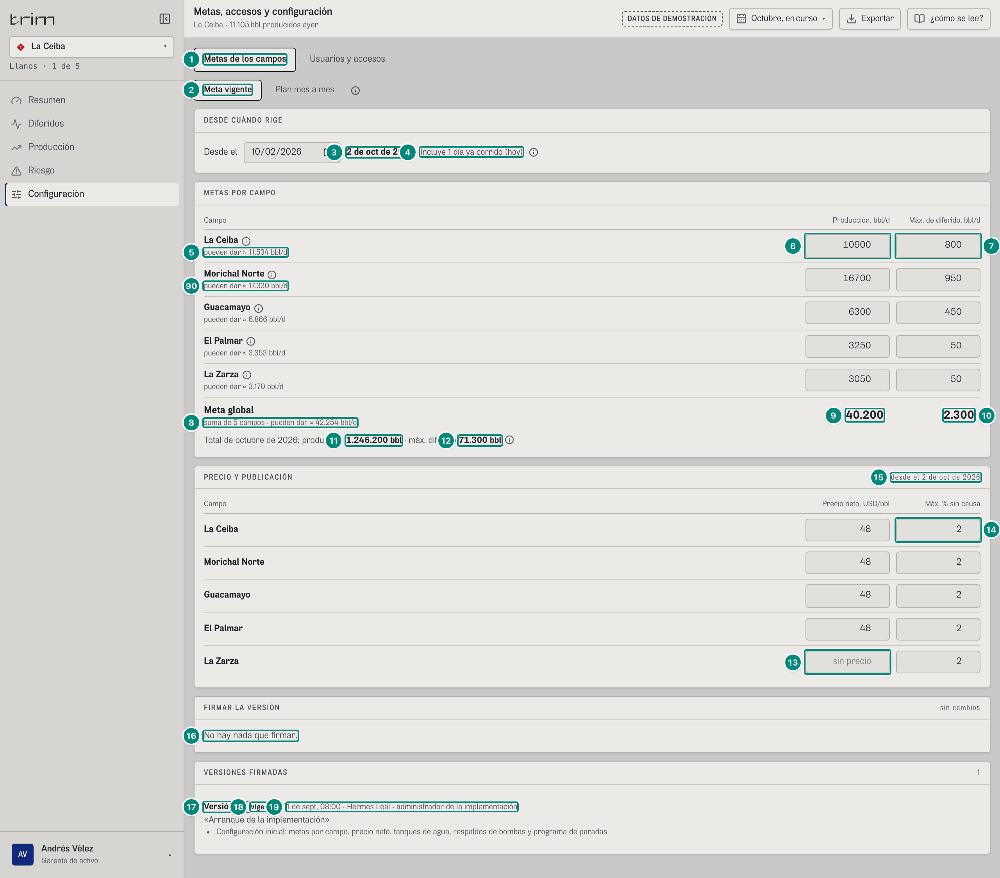

| # | Lo que se ve | En la captura | Cómo se calcula | Texto según el valor | Viene de |
|---|---|---|---|---|---|
| 1 | Pestañas | «Metas de los campos» · «Usuarios y accesos» | por capacidades del rol: con `config:firmar` se agrega «Configuración técnica» primero | pestañas ARIA (flechas, Inicio, Fin) | rol (sesión) |
| 2 | Modo | «Meta vigente» · «Plan mes a mes» + ⓘ | abre en «Plan mes a mes» si algún campo ya tiene ≥ 2 tramos del día 1 desde el mes en curso (`:54-57`) | ⓘ «Dos formas de fijar la meta: Meta vigente: una cifra por campo, desde el día que se escoja. Plan mes a mes: una cifra por mes, cargada del presupuesto.» | `configuracion/historial` (vigente) |
| 3 | Desde cuándo rige | «2 de oct de 2026» | `desde` por omisión = hoy en Colombia; mínimo el día 1 del mes en curso — 5D §«Desde cuándo rige» | `fechaDia(desde)`; la caja es `type=date` (el navegador la escribe a su modo: «10/02/2026» en la captura) | reloj del servidor |
| 4 | Días corridos | «Incluye 1 día ya corrido (hoy)» | `diasEntre(desde, hoy)` | «Incluye N días ya corridos» / «Empieza en N día(s)»; fecha de un mes cerrado: alerta «Esa fecha es de un mes cerrado: escoja el 1 de oct de 2026 o después.». ⓘ «Desde cuándo rige: Lo que va del mes se medirá con lo nuevo. Una sola fecha para toda la firma. No puede ser antes del 1 de oct de 2026: lo de un mes cerrado no se reescribe.» | — |
| 5 | Referencia del campo | «pueden dar ≈ 11.534 bbl/d» | potencial promedio de 30 días (11.534,353) — 5A §«Potencial reciente» | `n0`; si el campo no tiene meta: « · sin meta firmada»; si se cambió la fila: «antes *M* · máx. *X* bbl/d» (o «antes sin meta firmada»). Globo del nombre del campo (ícono ⓘ junto al nombre): «Rige desde 1 oct 2025» o, cambiado, «Lo de antes, desde» / «Lo nuevo, desde» | `GET /api/vistas/potencial-reciente` |
| 6 · 7 | Cajas de La Ceiba | «10900» · «800» | `metaEn(config, campo, desde)` (el tramo que regiría ese día) — 5A §«Tramo de meta firmado» | caja vacía si el campo no tiene meta (nunca la semilla ni 0); con valor inválido, borde grueso y «Tiene que ser mayor que 0.» / «Tiene que ser 0 o más.» (`REGLA_CAJA`) | `configuracion` vigente → `campos[c].metas[]` |
| 8 | Meta global · subtítulo | «suma de 5 campos · pueden dar ≈ 42.254 bbl/d» | $\sum_c$ potencial reciente | «suma de *n* campos» + « · *k* sin meta firmada» si hay | ídem |
| 9 · 10 | Meta global | «40.200» · «2.300» | $\sum_c$ de las cajas — 5D §«Meta global y total del mes» | `n0`; «—» si alguna caja no es número; «sin meta firmada» si falta en un campo y la suma no es número | lo editado/vigente |
| 11 · 12 | Total del mes | «Total de octubre de 2026: producción **1.246.200 bbl** · máx. diferido **71.300 bbl**» + ⓘ | `metaEntre(propuesta, campo, 1-oct, 1-nov)` de cada campo, sumado (mes **completo**) | « · con cambio de meta» si lo nuevo empieza a mitad de mes o algún campo cambia dentro del mes; con un campo sin meta: «sin total: sin meta firmada en algún campo». ⓘ «Total del mes: La suma de los 31 días, cada uno con la meta que rige ese día.» (+ «Del 1 al 1, lo que regía; desde el 2, lo nuevo.» si se parte) | propuesta |
| 13 | Precio de La Zarza | caja vacía con «sin precio» | `netbackUsd` ausente | vacía = sin precio (viaja `null`, nunca 0); paso 0,5 | vigente |
| 14 | Máx. % sin causa | «2» | `criterioSinCausa` (0–20) | borde grueso fuera de rango | vigente |
| 15 | Extra del panel de precio | «desde el 2 de oct de 2026» | la misma fecha de la firma; sin `metas:firmar`: «vigentes hoy» | | — |
| 16 | Firmar | «No hay nada que firmar.» y extra «sin cambios» | `diferenciasPorGrupo(vigente, propuesta)` vacío | con cambios: ver 6A.4.2 | — |
| 17 · 18 · 19 | VERSIONES FIRMADAS | «Versión 1» · chip «vigente» · «1 de sept, 08:00 · Hermes Leal · administrador de la implementación», ««Arranque de la implementación»» y sus `cambios` | historial, la vigente primero — 5D §«VERSIONES FIRMADAS» | cinco a la vista y «ver N más»; contador = número de versiones | `GET /api/configuracion/historial` → `[].version`, `fecha`, `por`, `motivo`, `cambios` |
| 90 | Las otras cuatro filas de METAS POR CAMPO y del panel de precio | Morichal Norte «pueden dar ≈ 17.330 bbl/d» · cajas «16700» · «950»; Guacamayo ≈ 6.866 · «6300» · «450»; El Palmar ≈ 3.353 · «3250» · «50»; La Zarza ≈ 3.170 · «3050» · «50». Precio «48» en La Ceiba, Morichal, Guacamayo y El Palmar; La Zarza vacía («sin precio»); «Máx. sin causa» «2» en los cinco | igual que las filas 5-7 y 13-14, campo por campo: potencial reciente (5A §«Potencial reciente»), `metaEn(config, campo, desde)` (5A §«Tramo de meta firmado») y lo vigente de precio y criterio. $11.534{,}353 + 17.329{,}703 + 6.866{,}481 + 3.352{,}594 + 3.170{,}409 = 42.253{,}539$ → «42.254» (fila 8; la suma se redondea al final: los cinco rótulos redondeados suman 42.253); $10.900 + 16.700 + 6.300 + 3.250 + 3.050 = 40.200$ y $800 + 950 + 450 + 50 + 50 = 2.300$ (filas 9-10) | los mismos que las filas 5-7 y 13-14 | `GET /api/vistas/potencial-reciente` → por campo; `configuracion` vigente → `campos[c].metas[]`, `netbackUsd`, `criterioSinCausa` |

## 6A.4.2 Gerente · editar y firmar (diferencias, avisos y motivo)

Se cambió La Ceiba a 11.500 / 600 bbl/d y el precio de La Zarza a 45 USD/bbl, desde hoy, y se escribió el motivo:

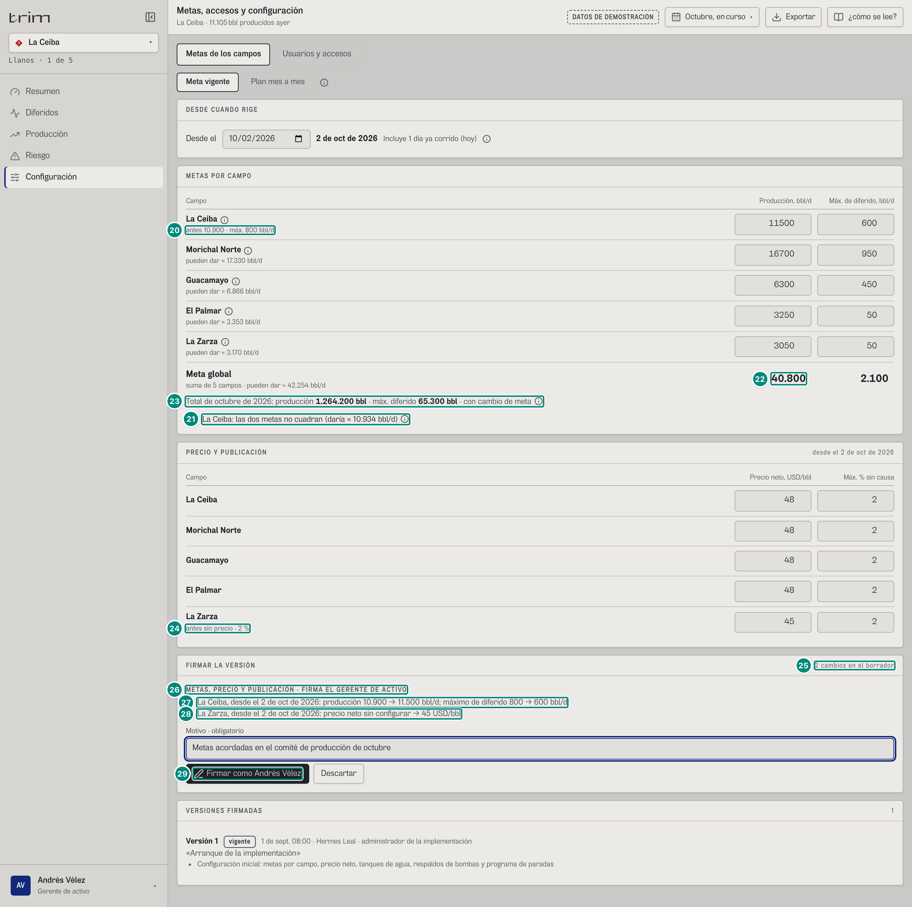

| # | Lo que se ve | En la captura | Regla | Viene de |
|---|---|---|---|---|
| 20 | Lo de antes | «antes 10.900 · máx. 800 bbl/d» | sale en vez de «pueden dar» cuando la fila cambió | vigente |
| 21 | Aviso | ■ «La Ceiba: las dos metas no cuadran (daría ≈ 10.934 bbl/d)» + ⓘ «Detalle: Con los 600 bbl/d de diferido que acepta, el campo daría ≈ 10.934 bbl/d, menos que su meta de 11.500 bbl/d.» | $X > P - M + \max(50;\ 0{,}02P)$: $600 > 11.534 - 11.500 + 230{,}7$ — 5D §«Avisos de metas que no cuadran». Avisa, no bloquea. Otro aviso posible: «no se alcanza ni sin diferido (pueden dar ≈ *P* bbl/d)» si $M > P$; y «*Campo*: rige solo hasta el *fecha*» si ya hay un tramo firmado después | potencial reciente |
| 22 | Meta global | «40.800» (y 2.100) | suma de las cajas | — |
| 23 | Total del mes | «producción 1.264.200 bbl · máx. diferido 65.300 bbl · con cambio de meta» | La Ceiba: $10.900 \times 1 + 11.500 \times 30$ = 355.900; los demás sin cambio | — |
| 24 | Precio cambiado | «antes sin precio · 2 %» | `!Object.is(v, b)` en precio o criterio | — |
| 25 | Contador | «2 cambios en el borrador» | `plural(cambios, 'cambio', 'cambios')` | — |
| 26 · 27 · 28 | Diferencias | «METAS, PRECIO Y PUBLICACIÓN · FIRMA EL GERENTE DE ACTIVO»; «La Ceiba, desde el 2 de oct de 2026: producción 10.900 → 11.500 bbl/d; máximo de diferido 800 → 600 bbl/d»; «La Zarza, desde el 2 de oct de 2026: precio neto sin configurar → 45 USD/bbl» | plantillas exactas de 5D §«Lo que cambió entre dos versiones». Son las mismas que quedan en `Version.cambios` | `diferenciasPorGrupo` (front y servidor) |
| 29 | Botón | «Firmar como Andrés Vélez» | deshabilitado mientras `validarConfig` tenga errores (se listan arriba bajo «CORRIJA ANTES DE FIRMAR»); sin persona activa del rol: hueco «Nadie con acceso activo tiene este rol.» + ⓘ «No hay quién firme: …». «Descartar» vuelve a la vigente | `POST /api/configuracion` |

Al firmar:

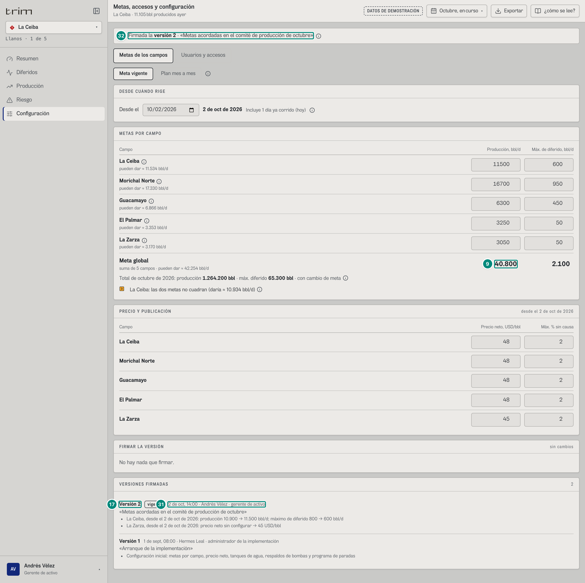

| # | En la captura | Regla |
|---|---|---|
| 30 | «✓ Firmada la **versión 2** · «Metas acordadas en el comité de producción de octubre»» + ⓘ «Desde cuándo rige: Cada cambio rige desde la fecha que lleva; desde ahí las pantallas se miden contra él.» | sale cuando hay más versiones que al entrar; el editor se rehace sobre la nueva |
| 17 · 31 · 32 | «Versión 2» (vigente) · «2 de oct, 14:00 · Andrés Vélez · gerente de activo» · motivo y las dos diferencias | `fecha` = hora del servidor; `por` = «{nombre} · {rol en minúscula}» de la sesión (nunca del cuerpo) |
| 9 | Meta global «40.800» | la nueva vigente |

Errores del servidor que aparecen debajo del motivo (`role="alert"`, texto del servidor): «Falta el motivo: una meta que se mueve sin motivo no es meta.», «Mientras editaba se firmó la versión *n* (*por*). Descarte el borrador y vuelva a editar sobre ella.» (409), etc. — 5D §«Firmar una versión».

## 6A.4.3 Gerente · plan mes a mes (presupuesto pegado)

Pegadas seis filas (una de septiembre, cerrado, y una de Guacamayo con 189.000) y «Revisar»:

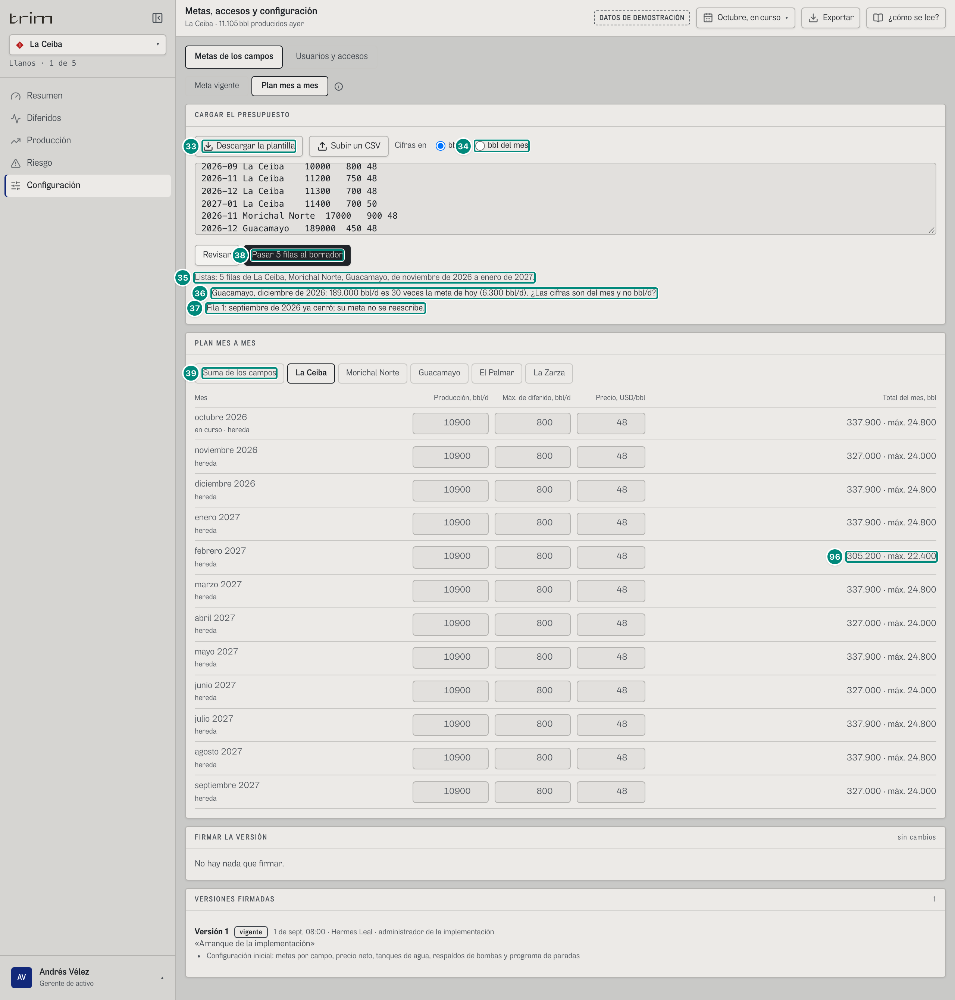

| # | En la captura | Regla (5D §5 «Cargar el presupuesto (`leerPlan`)») |
|---|---|---|
| 33 | «Descargar la plantilla» | `TRIM-plan-mensual-2026-10.csv`: 12 meses × campos desde el mes en curso, con lo que rige hoy |
| 34 | «Cifras en ○ bbl/d ○ bbl del mes» | con «bbl del mes» cada cifra se divide por los días del mes |
| 35 | «Listas: 5 filas de La Ceiba, Morichal Norte, Guacamayo, de noviembre de 2026 a enero de 2027.» | filas leídas |
| 36 | ■ «Guacamayo, diciembre de 2026: 189.000 bbl/d es 30 veces la meta de hoy (6.300 bbl/d). ¿Las cifras son del mes y no bbl/d?» | $r \ge 15$ o $r \le 1/15$ contra la meta que regiría ese mes; avisa, no bloquea; hasta 6 y «y N cifras más así.» |
| 37 | «Fila 1: septiembre de 2026 ya cerró; su meta no se reescribe.» | error de lectura; esa fila no pasa |
| 38 | «Pasar 5 filas al borrador» | solo las buenas |
| 39 | «Suma de los campos» · «La Ceiba» · … | vista de la tabla: un botón por campo más «Suma de los campos» (`aria-pressed`); abre en el campo de la cabecera (`campoInicial`, `src/widgets/configuracion/PlanMensual.tsx:35`) |
| 96 | Tabla de La Ceiba (antes de pasar nada) | doce meses, de octubre de 2026 a septiembre de 2027 (`mesActual` + 11, o hasta el último tramo propio, máximo 24; `PlanMensual.tsx:38-41`). Cajas = `valor(campo, mes)`, lo que rige el día 1 de ese mes en la propuesta: «10900» · «800» · «48» en los doce. Debajo del mes, «en curso · hereda» / «hereda» (tenue) o «cifra propia» (negrita) según `propio(campo, mes)` (`:121-123`). **Total del mes** = `metaEntre(propuesta, campo, 1.º del mes, 1.º del siguiente)` (5D §«Meta global y total del mes»), escrito «*n0(producción)* · máx. *n0(diferido)*» o «sin meta firmada» si falta en algún campo (`:48-53`): 10.900 × 31 = «337.900 · máx. 24.800» (oct, dic, ene, mar, may, jul, ago); × 30 = «327.000 · máx. 24.000» (nov, abr, jun, sep); × 28 = «305.200 · máx. 22.400» (feb-2027). En «Suma de los campos» las columnas son la suma de los campos, sin precio, y el total suma los `metaEntre` de todos |

Después de «Pasar 5 filas al borrador»:

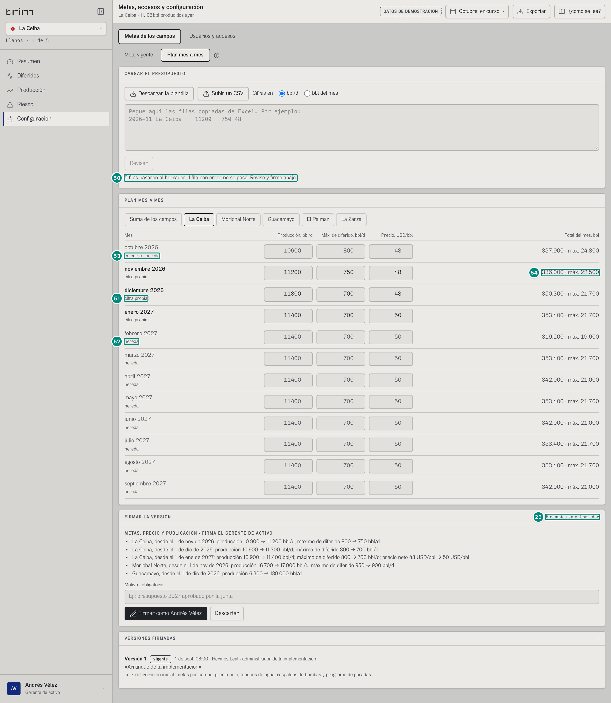

| # | En la captura | Regla |
|---|---|---|
| 50 | «5 filas pasaron al borrador; 1 fila con error no se pasó. Revise y firme abajo.» | nada rige hasta firmar |
| 52 | «febrero 2027 · hereda» (tenue) y su total «319.200 · máx. 19.600» | febrero no tiene fila propia: hereda el tramo de enero (11.400 · 700 · 50); total del mes con 28 días: $11.400 \times 28 = 319.200$, $700 \times 28 = 19.600$. Lo mismo de marzo a septiembre de 2027: «353.400 · máx. 21.700» (31 días) y «342.000 · máx. 21.000» (30 días) |
| 53 | «octubre 2026 · en curso · hereda» (tenue) | un mes sin cifra propia hereda el tramo anterior |
| 51 | «diciembre 2026 · cifra propia» (negrita) | `propio(campo, mes)`: tramo del día 1 en la propuesta. Cajas «11300» · «700» · «48» y total «350.300 · máx. 21.700» ($\times 31$); enero de 2027, también propio: «11400» · «700» · «50» y «353.400 · máx. 21.700». La quinta columna del presupuesto pegado es el **precio neto** (USD/bbl): 48 en las filas que no lo cambian, 50 en enero |
| 54 | «336.000 · máx. 22.500» (noviembre) | Total del mes = `metaEntre` del mes (11.200 × 30; 750 × 30); `sin meta firmada` si falta en algún campo |
| 25 | «5 cambios en el borrador» y la lista, una línea por (campo, desde): «La Ceiba, desde el 1 de nov de 2026: producción 10.900 → 11.200 bbl/d; máximo de diferido 800 → 750 bbl/d»; «La Ceiba, desde el 1 de dic de 2026: producción 10.900 → 11.300 bbl/d; máximo de diferido 800 → 700 bbl/d»; «La Ceiba, desde el 1 de ene de 2027: producción 10.900 → 11.400 bbl/d; máximo de diferido 800 → 700 bbl/d; precio neto 48 USD/bbl → 50 USD/bbl»; «Morichal Norte, desde el 1 de nov de 2026: producción 16.700 → 17.000 bbl/d; máximo de diferido 950 → 900 bbl/d»; «Guacamayo, desde el 1 de dic de 2026: producción 6.300 → 189.000 bbl/d» | cada línea compara el tramo nuevo con lo que **regía** ese día en la vigente (por eso todas dicen «10.900 →» y no «11.200 → 11.300»); solo se escribe lo que cambió (Guacamayo no cambió el máximo: 450 → 450 no sale; el precio 48 → 48 tampoco). Plantillas de 5D §«Lo que cambió entre dos versiones». El valor de 189.000 pasa a la firma: `validarConfig` solo pone tope en 10.000.000 bbl/d (ver Huecos) |

Con ≥ 3 meses propios y el último a ≤ 1 mes del en curso: ■ «El plan llega hasta *mes de año*: falta el presupuesto siguiente.» (ⓘ «El plan se acaba: Cárguelo antes de que se acabe. Después de ese mes sigue rigiendo su última cifra.»).

## 6A.4.4 Gerente · Usuarios y accesos

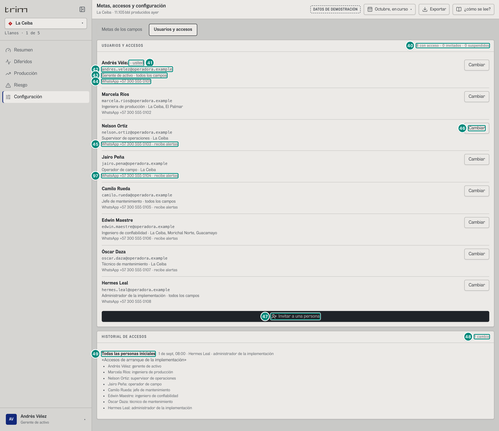

| # | Lo que se ve | En la captura | Regla | Viene de |
|---|---|---|---|---|
| 40 | Conteo | «8 con acceso · 0 invitados · 0 suspendidos» | por `estado` | `GET /api/usuarios` |
| 41 | Propia fila | «Andrés Vélez · usted» | `personaDelRol(usuarios, rolId)` | sesión |
| 42 | Correo | «andres.velez@operadora.example» | solo con el registro completo (`usuarios:administrar`) — 5D.3 §«Quién lee qué» | `correo` |
| 43 | Rol y campos | «Gerente de activo · todos los campos» | `rolPorId(rolId).nombre` · `nombreCampos(campos)` («todos los campos» o los nombres separados por coma) | `rolId`, `campos` |
| 44 · 45 | WhatsApp | «WhatsApp +57 300 555 0101» · «WhatsApp +57 300 555 0103 · recibe alertas» | `telefonoLegible(E.164)` o «sin WhatsApp»; « · recibe alertas» si `alertas` | `telefono`, `alertas` |
| — | Estado | (ninguno en el demo) | chip «invitado · aún no entra» o «suspendido» (fuerte, nombre tachado) | `estado` |
| 46 · 47 | «Cambiar» · «Invitar a una persona» | solo con `usuarios:administrar`; el administrador ve «Solo lectura: los da el gerente de activo.» | | |
| 48 · 49 | HISTORIAL DE ACCESOS | «1 cambio»; «Todas las personas iniciales · 1 de sept, 08:00 · Hermes Leal · administrador de la implementación», «Accesos de arranque de la implementación» y un renglón por persona | del más nuevo al más viejo, cinco y «ver N más» — 5D.3 §«Texto del historial» | `GET /api/usuarios/historial` |
| 97 | Las ocho filas de USUARIOS Y ACCESOS | Andrés Vélez · usted · Gerente de activo · todos los campos · «WhatsApp +57 300 555 0101»; Marcela Ríos · Ingeniera de producción · La Ceiba, El Palmar · «0102»; Nelson Ortiz · Supervisor de operaciones · «0103 · recibe alertas»; Jairo Peña · Operador de campo · «0104 · recibe alertas»; Camilo Rueda · Jefe de mantenimiento · «0105 · recibe alertas»; Edwin Maestre · Ingeniero de confiabilidad · «0106 · recibe alertas»; Óscar Daza · Técnico de mantenimiento · «0107 · recibe alertas»; Hermes Leal · Administrador de la implementación · «0108» | igual que las filas 41-45, persona por persona. En el demo los teléfonos salen de `+5730055501` + el orden del rol (`USUARIOS_INICIALES`, `src/entities/usuarios.ts:172-176`) y `alertas` = el rol está en `ROLES_CON_ALERTAS` (sup, oper, tec, conf, jefe; 5D.3 §«Alertas por rol»); en producción, lo que guarde el registro | `GET /api/usuarios` → `[].nombre`, `rolId`, `campos`, `telefono`, `alertas` |

Invitar sin llenar bien (correo de Nelson Ortiz, teléfono «12345», sin nombre, rol, campos ni motivo):

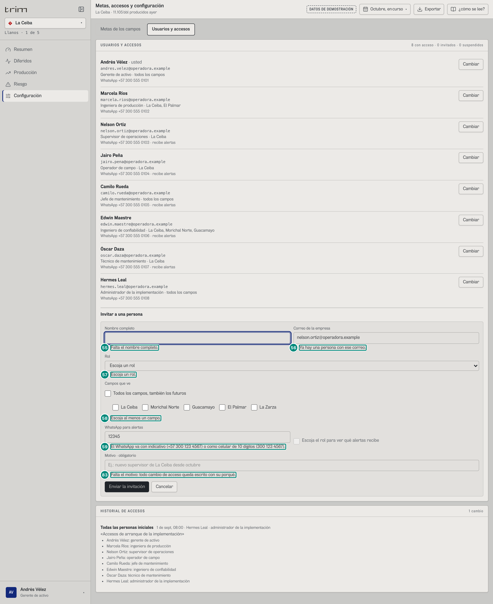

| # | Error (junto a su caja) | Regla de `revisarAcceso` (5D.3) |
|---|---|---|
| 55 | «Falta el nombre completo.» | nombre ≥ 3 |
| 56 | «Ya hay una persona con ese correo.» | correo único |
| 57 | «Escoja un rol.» | rol del producto |
| 58 | «Escoja al menos un campo.» | ≥ 1 campo |
| 59 | «El WhatsApp va con indicativo (+57 300 123 4567) o como celular de 10 dígitos (300 123 4567).» | E.164 |
| 83 | «Falta el motivo: todo cambio de acceso queda escrito con su porqué.» | motivo ≥ 5 |

El foco va a la primera caja con error (orden nombre, correo, rol, campos, whatsapp, alertas, motivo). La casilla de alertas dice «Escoja el rol para ver qué alertas recibe» hasta que se escoja un rol; con un rol sin alertas, «Este rol no recibe alertas por WhatsApp»; con alertas, «Recibe por WhatsApp: *ALERTAS_DEL_ROL*».

---

## 6A.4.5 Administrador · Configuración técnica · La Ceiba

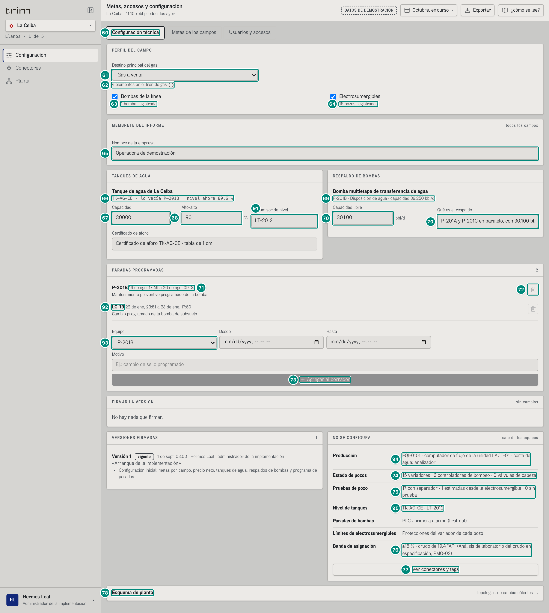

| # | Lo que se ve | En la captura | Regla | Viene de |
|---|---|---|---|---|
| 60 | Pestaña | «Configuración técnica» (primera) | `config:firmar` | rol |
| 61 | Destino del gas | «Gas a venta» | `perfil.gas` (No tiene tren de gas / Gas a tea / Gas para consumo propio / Gas a venta) — 5D §«PERFIL DEL CAMPO» | `campos[c].perfil.gas` |
| 62 | Tren de gas del esquema | «4 elementos en el tren de gas» + ⓘ «Gas: El tren de gas es el del esquema de planta. El gas no se mide en esta fase.» | `planta.gas.length` | `GET /api/planta/cambios` / esquema |
| 63 · 64 | Casillas | «Bombas de la línea · 1 bomba registrada» · «Electrosumergibles · 15 pozos registrados» | bombas con perfil o registradas; pozos con levantamiento ESP | catálogo |
| 65 | Membrete | «Operadora de demostración» | `empresa` (todos los campos) — 5D.4 §«Membrete y pie del papel» | config |
| 66 | Tanque | «TK-AG-CE · lo vacía P-201B · nivel ahora 89,6 %» | `n1(nivel)` o «sin lectura» — 5B §«Tanque de agua» y §«Nivel del tanque ahora» | config + `GET /api/vistas/campos/ceiba/ahora` → `niveles` |
| 67 · 68 | Capacidad · Alto-alto | «30000» bbl · «90» % (alto-alto a 27.000 bbl) | `capacidadBbl`; `altoAlto × 100` (se guarda /100). La caja marca fuera de 100–500.000 bbl y 50–98 % | config |
| 91 | Transmisor de nivel · Certificado de aforo | cajas «LT-2012» y «Certificado de aforo TK-AG-CE · tabla de 1 cm» | `tanques[].tagNivel` y `tanques[].aforo`, texto libre (`src/pages/Configuracion.tsx:375-379`); el tag es el que da «nivel ahora» y el aforo, la tabla con que el nivel se vuelve barriles (5B §«Tanque de agua»). Texto según el valor: sin tag: error «TK-AG-CE: falta el transmisor de nivel.» (`src/entities/configuracion.ts:437`); cambios: «TK-AG-CE: transmisor LT-2012 → *nuevo*», «TK-AG-CE: certificado de aforo cambiado» (`:324-325`) | config → `tanques[].tagNivel`, `aforo` |
| 69 | Bomba con perfil | «P-201B · Disposición de agua · capacidad 89.250 bbl/d» | `PAPEL_NOMBRE[papel]`, capacidad, pozos si es de transporte — 5B §«Perfil de la bomba en el campo». La capacidad es lo que deja mover el cabezal de disposición (89.250), no la placa de 90.000; P-201B mueve 74.200, su parte del agua que entra con los 18 pozos produciendo | catálogo |
| 70 | Respaldo | libre «30100» bbl/d · «P-201A y P-201C en paralelo, con 30.100 bbl/d libres entre las dos: el cabezal de disposición las limita a unos 89.250 cada una» (la caja corta el texto) | `respaldos[]`; sin declarar vale 0 — 5B §«Respaldo». Con 74.200 que mueve P-201B y 30.100 que toman las otras dos, si para quedan 44.100 bbl/d sin salida: eso llena el tanque (1,84 h de colchón el 2-oct) | config |
| 71 · 72 | Programa | «P-201B 19 de ago, 17:49 a 20 de ago, 09:34 · Mantenimiento preventivo programado de la bomba»; papelera deshabilitada | lo que ya empezó no se quita («Ya empezó: no se puede quitar del programa») — 5B §«Programa de paradas» y 5D regla 27 | config |
| 73 | «Agregar al borrador» | deshabilitado hasta equipo, desde, hasta y motivo ≥ 5; desde ≥ ahora | regla 26 | — |
| 92 | Contador y segunda parada | extra «2»; «LC-19 22 de ene, 23:51 a 23 de ene, 17:50 · Cambio programado de la bomba de subsuelo» | contador = paradas del programa de ese campo; filas de la más nueva a la más vieja por `desde`, cinco a la vista y «ver N más» (las que no han empezado nunca se esconden); cada una «**equipo** `fechaHora(desde)` a `fechaHora(hasta)`» y el motivo debajo (`Configuracion.tsx:548`, `:561-577`). Papelera deshabilitada con «Ya empezó: no se puede quitar del programa» en las dos (5B §«Programa de paradas») | config → `programa[campoId=ceiba]` |
| 93 | Equipo de la parada nueva | lista con «P-201B» escogido | opciones = equipos instrumentados del registro del campo + sus pozos (`:543-546`); por omisión el primero | catálogo |
| 74 · 75 · 76 | NO SE CONFIGURA | «15 variadores · 3 controladores de bombeo · 0 válvulas de cabeza»; «17 con separador · 1 estimadas desde la electrosumergible · 0 sin prueba»; «±15 % · crudo de 19,4 °API (Análisis de laboratorio del crudo en especificación, PMO-02)» | conteos de pozos por levantamiento y origen de prueba; `textoBanda(medición)` — 5A §«Banda de asignación» | catálogo |
| 94 | NO SE CONFIGURA · Producción | «FQI-0101 · computador de flujo de la unidad LACT-01 · corte de agua: analizador» | `${origen.fuente} · corte de agua: ${origen.bsw}` del punto de medición oficial (`Configuracion.tsx:608`; 5A §«Panel «MEDICIÓN OFICIAL»»). Texto según el valor: sin punto: «sin punto de medición · corte de agua: —» | `GET /api/catalogo` → `campos[c].medicion.origen` |
| 95 | NO SE CONFIGURA · Nivel de tanques | «TK-AG-CE · LT-2012» | `${tanque.id} · ${tanque.tagNivel}` de cada tanque del campo, unidos con « · » (`:423`, `:611`). Texto según el valor: sin tanque: «sin tanque de agua» | config → `tanques[]` |
| — | NO SE CONFIGURA · Paradas de bombas · Límites de electrosumergibles | «PLC · primera alarma (first-out)» · «Protecciones del variador de cada pozo» | textos fijos (`:612-613`); el segundo renglón solo si el perfil del campo tiene electrosumergibles | perfil firmado |
| 77 | «Ver conectores y tags» | si el rol tiene Conectores | | |
| 78 | «Esquema de planta» (plegado) | topología, no cambia cálculos — 5D.7 | | |

Las dos metas del administrador son de solo lectura:

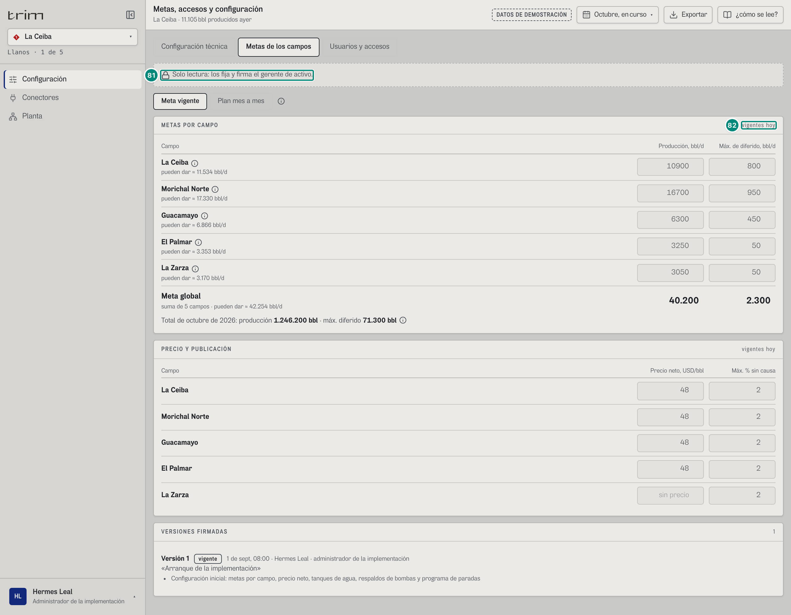

| # | En la captura | Regla |
|---|---|---|
| 81 | «Solo lectura: los fija y firma el gerente de activo.» | sin `metas:firmar`; no ve «DESDE CUÁNDO RIGE» ni el panel de firma, y las cajas muestran lo **vigente hoy** |
| 82 | «vigentes hoy» | extra de los paneles |

Un cambio técnico (gas a «No tiene tren de gas», electrosumergibles apagadas, capacidad del tanque 36.000, respaldo 36.100):

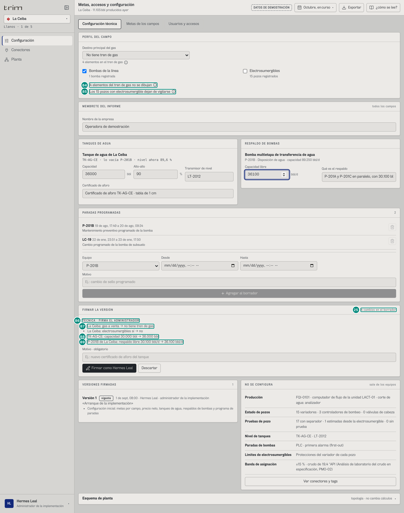

| # | En la captura | Regla |
|---|---|---|
| 84 | ■ «4 elementos del tren de gas no se dibujan» + ⓘ «Qué pasa: El esquema los tiene, pero no se dibujan mientras el campo diga que no tiene gas.» | perfil sin gas con elementos en el esquema |
| 85 | ■ «Los 15 pozos con electrosumergible dejan de vigilarse» + ⓘ «No saldrán sus avisos ni sus predicciones; lo que pierdan se sigue contando en el libro.» | regla de negocio: la familia apagada sale de la vigilancia (riesgo, predicciones, WhatsApp), **no** del libro |
| 25 | «4 cambios en el borrador» | `plural(cambios, 'cambio', 'cambios')`: gas, electrosumergibles, capacidad del tanque y respaldo (fila 25 de 6A.4.2) |
| 86 · 87 · 88 · 89 | «TÉCNICA · FIRMA EL ADMINISTRADOR»: «La Ceiba: gas a venta → no tiene tren de gas», «TK-AG-CE: capacidad 30.000 bbl → 36.000 bbl», «P-201B de La Ceiba: respaldo libre 30.100 bbl/d → 36.100 bbl/d» (y «La Ceiba: electrosumergibles sí → no») | plantillas de 5D §«Lo que cambió entre dos versiones» |

## 6A.4.6 Administrador · Morichal Norte

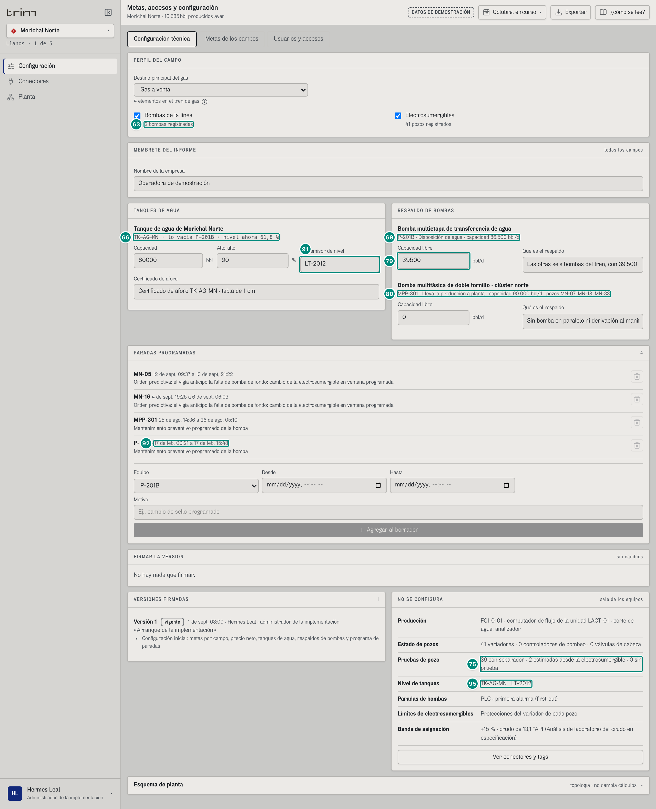

| # | En la captura | Qué cambia |
|---|---|---|
| 66 | «TK-AG-MN · lo vacía P-201B · nivel ahora 61,8 %» | capacidad 60.000 bbl (16.920 libres hasta el alto-alto) |
| 69 · 79 | «P-201B · Disposición de agua · capacidad 86.500 bbl/d» con respaldo «39500» · «Las otras seis bombas del tren, con 39.500 bbl/d libres entre todas: el cabezal de disposición las limita a unos 86.500 cada una» | una de siete bombas en paralelo; mueve 79.900 y si para quedan 40.400 bbl/d sin salida: colchón de 10,05 h con el tanque en 61,8 %. El respaldo cambia el colchón y el orden de cierre (5B §4) |
| 80 | «MPP-301 · Lleva la producción a planta · capacidad 90.000 bbl/d · pozos MN-07, MN-18, MN-33» | bomba multifásica (papel transporte), respaldo 0 «Sin bomba en paralelo ni derivación al manifold»; sus tres pozos (97,8 % de agua) le mandan unos 75.000 bbl/d de líquido |
| 75 | «39 con separador · 2 estimadas desde la electrosumergible · 0 sin prueba» | 41 variadores |
| 63 | «2 bombas registradas» · «41 pozos registrados» | P-201B y MPP-301; 41 pozos con electrosumergible |
| 91 | (filas 67-68 y 91) cajas «60000» · «90» · «LT-2012» · «Certificado de aforo TK-AG-MN · tabla de 1 cm» | tanque TK-AG-MN |
| 92 | extra «4»: «MN-05 12 de sept, 09:37 a 13 de sept, 21:22» y «MN-16 4 de sept, 19:25 a 6 de sept, 06:03» (las dos: «Orden predictiva: el vigía anticipó la falla de bomba de fondo; cambio de la electrosumergible en ventana programada»), «MPP-301 25 de ago, 14:36 a 26 de ago, 05:10» (Mantenimiento preventivo programado de la bomba) y «P-201B 17 de feb, 00:21 a 17 de feb, 15:48» | las cuatro ya empezaron: papelera deshabilitada. Las dos primeras son nuevas del 9-oct: el vigía anticipa las fallas de desgaste de las electrosumergibles y el cambio entra al programa (`PR-VIG-<pozo>-<día>-<parte>`) |
| 95 | (filas 94-95) «FQI-0101 · computador de flujo de la unidad LACT-01 · corte de agua: analizador» · «TK-AG-MN · LT-2012» | en el demo Morichal declara la misma fuente de producción que La Ceiba (dato del catálogo) |

Programa de Morichal: MN-05 (12-13 sep), MN-16 (4-6 sep), MPP-301 (25-26 ago) y P-201B (17 feb), los cuatro pasados. Banda: «±15 % · crudo de 13,1 °API (Análisis de laboratorio del crudo en especificación)».

---

## Variantes

- **Por rol.** Gerente: metas (editables) y accesos (editables). Administrador: técnica (editable), metas y accesos (solo lectura). Otros roles no tienen la pantalla.
- **Por campo.** La técnica es del campo que se mira (tanques, respaldos, programa, perfil, NO SE CONFIGURA); el membrete es de todos los campos; las metas y los accesos muestran **todos** los campos de la persona, cualquiera que sea el campo de la cabecera.
- **Campo sin tanque / sin bombas con perfil.** «Sin tanque de agua configurado.» + ⓘ «*Campo* no tiene tanque de agua configurado: su bomba no cierra pozos por nivel.»; «Ninguna bomba con perfil: no hay respaldo que declarar.» (El Palmar y La Zarza: `#/adm/configuracion/palmar/curso`).
- **Teléfono.** Las tablas de metas y precio se apilan; la del plan se desplaza («Desplace a la derecha: precio y total del mes.»).

## Estados

| Estado | Qué se ve |
|---|---|
| Campo sin meta firmada | cajas vacías, «pueden dar ≈ N bbl/d · sin meta firmada», Meta global «sin meta firmada» si la suma no es número, total del mes «sin total: sin meta firmada en algún campo»; precio «antes sin meta firmada» |
| Errores de validación | «CORRIJA ANTES DE FIRMAR» con la lista de `validarConfig`; botón de firma deshabilitado |
| Nadie activo con el rol | hueco «Nadie con acceso activo tiene este rol.» en vez del formulario de firma |
| Firma rechazada por el servidor | el texto del servidor bajo el motivo |
