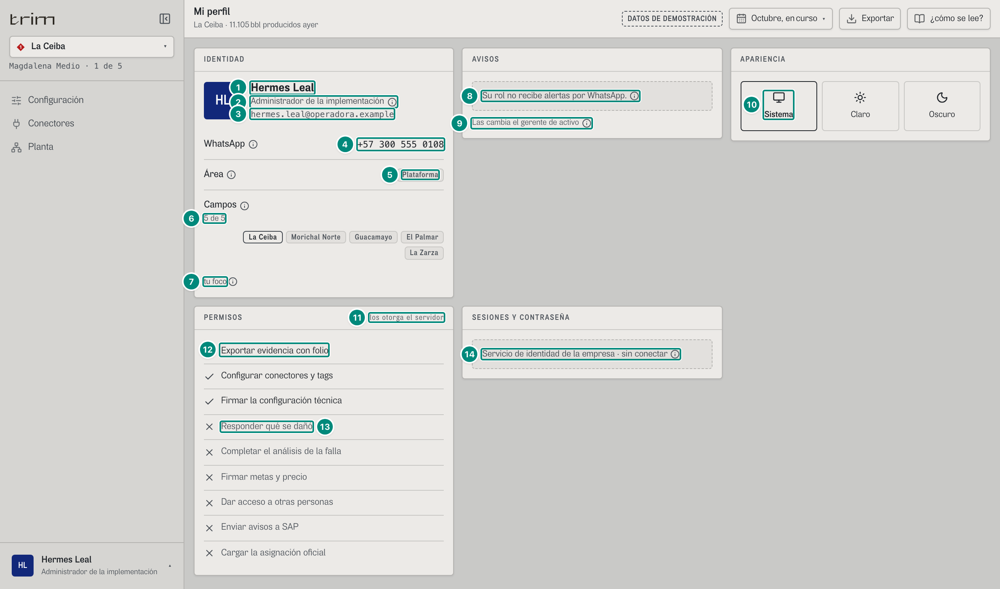
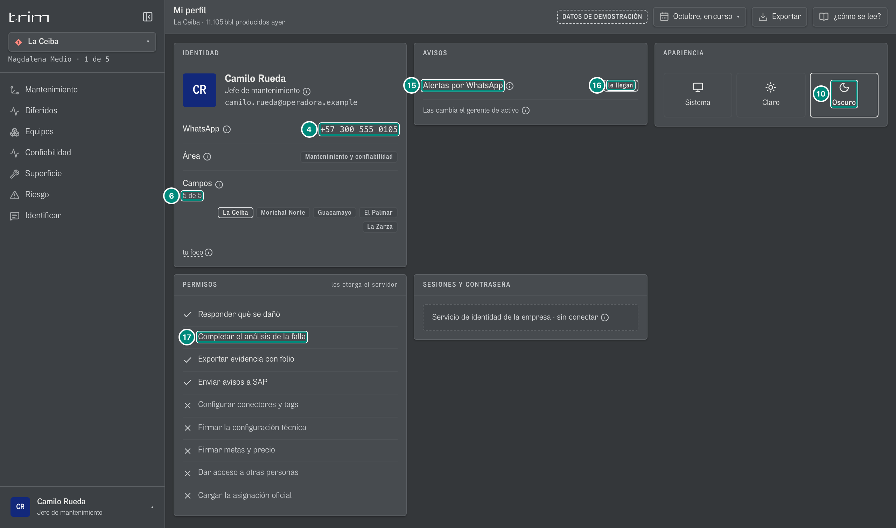
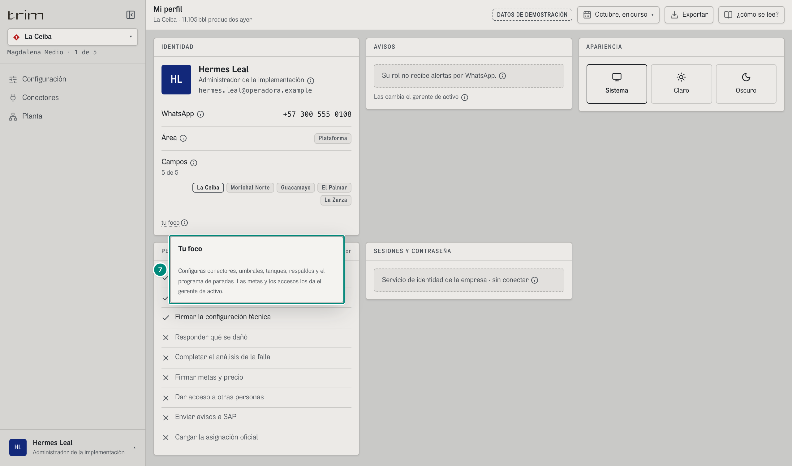

# 6A.5 Mi perfil — toda persona

**Para qué.** «Avisos, apariencia y permisos.» (`PARA_QUE.perfil`, `src/widgets/Onboarding.tsx:29`).
**Ruta.** `#/<rol>/perfil/<campo>/<período>` — toda persona la abre desde el menú de perfil, aunque no esté en las pantallas del rol (`PANTALLAS_COMUNES`, `src/app/url.ts`). El período no cambia nada. · **Roles y nivel.** Todos; lo que cambia por rol es el contenido (alertas, área, campos, permisos), no la forma. `src/pages/Perfil.tsx`.
**Lee.** `GET /api/usuarios` (arranque: el registro de la propia persona) y, cuando exista, `GET /api/sesion` (persona, rol, campos y capacidades del token; capítulo 7 §7.5). **No escribe nada**: teléfono y alertas los cambia el gerente en Accesos; lo único personal, la apariencia, vive en el navegador (`localStorage['trim.tema']`, `src/app/store.ts:128-138`) y no viaja al servidor.

Fichas: 5D.3 §«Capacidad», §«Forma completa (`Usuario`)», §«Número de WhatsApp en E.164», §«Alertas por rol».

| # | Lo que se ve | En la captura | Cómo sale | Texto según el valor | Viene de |
|---|---|---|---|---|---|
| 1 | Nombre e iniciales | «Hermes Leal» · «HL» | la persona del registro con ese rol (`usePersona`); sin nadie con el rol, la persona de fábrica del rol | iniciales = primeras letras de las dos primeras palabras | `GET /api/usuarios` (en producción, `GET /api/sesion`) |
| 2 | Rol | «Administrador de la implementación» + ⓘ «Rol activo: Se cambia desde el menú de perfil, abajo a la izquierda.» | `rol.nombre` | (el cambio de rol es del demo; en producción el rol lo da el token) | sesión |
| 3 | Correo | «hermes.leal@operadora.example» | la propia persona llega completa | «sin correo registrado» si no viene | `usuarios[].correo` |
| 4 | WhatsApp | «+57 300 555 0108» + ⓘ «WhatsApp: Del registro de usuarios: lo cambia el gerente de activo en Accesos.» | `telefonoLegible(E.164)` | «sin número registrado» | `usuarios[].telefono` |
| 5 | Área | chip «Plataforma» + ⓘ «Área: Cómo cuelga en el organigrama.» | `AREAS[rol.area]`: Dirección · Producción y operaciones · Mantenimiento y confiabilidad · Soporte y cumplimiento · Plataforma | | rol |
| 6 | Campos | «5 de 5» y chips (el campo de la cabecera en tono fuerte) + ⓘ «Campos: Los campos a los que tiene acceso. Los asigna el gerente de activo.» | `camposDelRol(rol, usuarios)` de `CAMPOS.length` | | `usuarios[].campos` |
| 7 | Tu foco | «tu foco» ⓘ | `rol.foco` (fijo por rol, `src/entities/roles.ts:40-101`). Administrador: «Configuras conectores, umbrales, tanques, respaldos y el programa de paradas. Las metas y los accesos los da el gerente de activo.» (captura `adm-perfil-globo-foco`) | | rol |
| 8 | AVISOS sin alertas | hueco «Su rol no recibe alertas por WhatsApp.» + ⓘ «Sin alertas: Los avisos los decide la regla de su rol: la regla de mensajes solo avisa a quien actúa sobre el equipo.» | rol ∉ {sup, oper, tec, conf, jefe} | | rol |
| 9 | Quién las cambia | «Las cambia el gerente de activo» + ⓘ «Quién las cambia: Encenderlas, apagarlas o cambiar el número lo hace el gerente de activo en Accesos, con su motivo.» | fijo | | — |
| 10 | APARIENCIA | «Sistema» (marcado) · «Claro» · «Oscuro» | `tema` del navegador | `aria-pressed` | `localStorage` |
| 11 | PERMISOS | extra «los otorga el servidor» | `permisosDelRol(rol.puede)`: primero las concedidas (✓), después las negadas (✕, tenues); `causa:declarar` va concedida por inclusión a quien tiene `causa:completar` — 5D.3 §«Capacidad» | nombre corto a la vista (`PERMISO_CORTO`, `Perfil.tsx:23-33`) y el largo (`CAPACIDAD_NOMBRE`) en el globo y en el papel | sesión → `capacidades` |
| 12 | Concedida | «✓ Exportar evidencia con folio» (y «Configurar conectores y tags», «Firmar la configuración técnica») | `puedeHacer(puede, k)` | | |
| 13 | Negada | «✕ Responder qué se dañó» … «Cargar la asignación oficial» | | | |
| 14 | SESIONES Y CONTRASEÑA | hueco «Servicio de identidad de la empresa · sin conectar» + ⓘ «Sesiones y contraseña: Las sesiones abiertas y el cambio de contraseña los da el servicio de identidad de la empresa; esta versión todavía no se conecta a él.» | fijo: TRIM no guarda contraseñas (OIDC/SSO del cliente) | | — |

## Variante: un rol con alertas (jefe de mantenimiento), en tema oscuro

| # | En la captura | Regla |
|---|---|---|
| 4 | «+57 300 555 0105» | su número |
| 15 · 16 | «Alertas por WhatsApp» + chip fuerte «le llegan»; ⓘ «Alertas por WhatsApp: Las decide la regla de su rol: cada predicción del vigía cuando sale, con su ventana.» | `recibeAlertas(yo)` — 5D.3 §«Alertas por rol». Chip: «le llegan» (fuerte) / «no le llegan: sin número» / «apagadas» / «sin persona con acceso» |
| 17 | «✓ Completar el análisis de la falla» (y «✓ Responder qué se dañó» por inclusión, «✓ Exportar evidencia con folio», «✓ Enviar avisos a SAP») | `permisosDelRol(jefe)` |
| 10 | «Oscuro» marcado | el tema se aplica a toda la aplicación y se recuerda en este navegador |

Otros roles: el gerente ve «Dirección», sin alertas, y ✓ «Exportar evidencia con folio», «Firmar metas y precio», «Dar acceso a otras personas»; producción ve «Campos 2 de 5» (La Ceiba, El Palmar) y ✓ «Cargar la asignación oficial».

## Estados

| Estado | Qué se ve |
|---|---|
| Nadie con acceso activo tiene el rol | nombre de fábrica del rol, «sin correo registrado», chip de alertas «sin persona con acceso» |
| Persona sin número | «sin número registrado»; en roles con alertas, chip «no le llegan: sin número» |
| Alertas apagadas por el gerente | chip «apagadas» |
