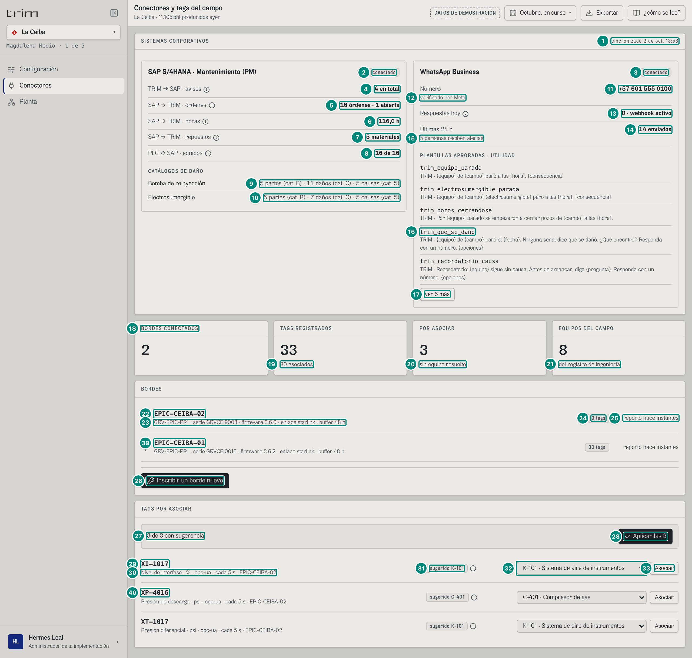
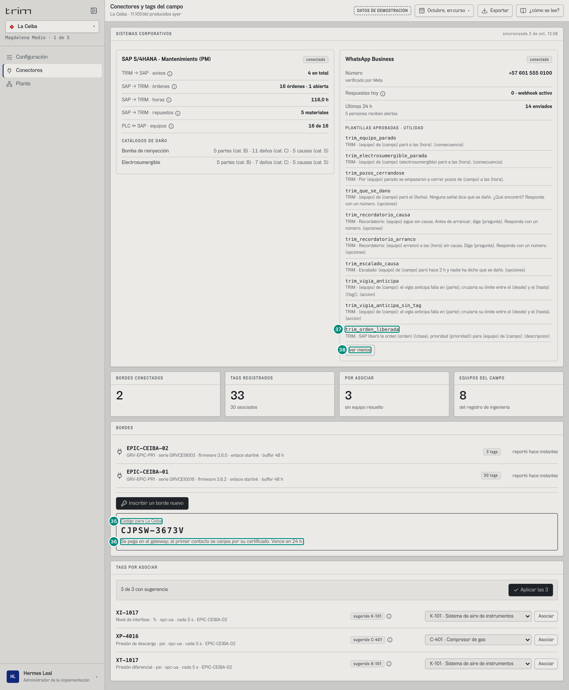
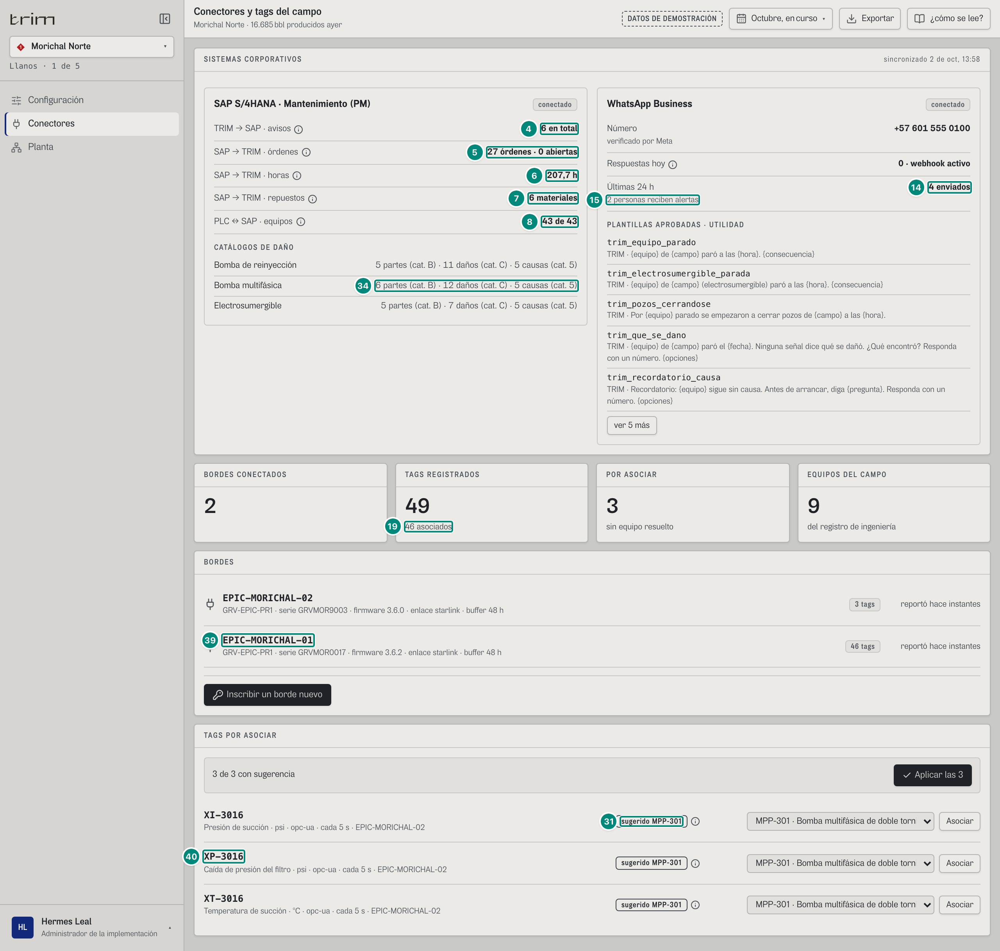

# 6A.6 Conectores y tags del campo — administrador de la implementación

**Para qué.** «Bordes conectados y tags sin equipo resuelto.» (`PARA_QUE.conectores`, `src/widgets/Onboarding.tsx:28`).
**Ruta.** `#/adm/conectores/<campo>/<período>` (el período no cambia nada) · **Roles y nivel.** Solo `adm` (ingeniería) tiene la pantalla; `conector:configurar` habilita inscribir y asociar (sin ella: «Su rol no inscribe bordes: lo hace el administrador.»). `src/pages/Conectores.tsx`, `src/widgets/conectores/Integraciones.tsx`.
**Lee.**

| Endpoint | Qué toma | Ficha |
|---|---|---|
| `GET /api/sap/avisos?campos`, `GET /api/sap/ordenes?campos` | avisos de TRIM, órdenes, abiertas, horas | 5D.6 §1-2 |
| `GET /api/sap/equipos?campo` | flota de alto impacto, identidad SAP, repuestos, catálogo de daños | 5D.6 §«Identidad del equipo en SAP», §«Repuestos críticos»; 5C.6 |
| `GET /api/mensajes?campos` | enviados y sin enviar en las últimas 24 h | 5D.5 §4 |
| `GET /api/vistas/paradas/por-identificar?campos` | respuestas por WhatsApp de hoy | 5B §3.2, 5D.5 §5 |
| `GET /api/usuarios` (arranque) | personas que reciben alertas en el campo | 5D.3 §«Alertas por rol» |
| `GET /api/campos/:campo/inventario` | bordes, tags (total y pendientes), equipos | 5D.8 §«Inventario y pendientes» |
| `GET /api/campos/:campo/tags/pendientes` | tags por asociar | ídem |

**Escribe.** `POST /api/inscripcion { campo }`; `POST /api/campos/:campo/tags/:tag/equipo { equipo, origen: "manual" \| "regla" }` (uno por tag; «Aplicar las N» manda uno por cada sugerencia).

El auditor exige ver «SISTEMAS CORPORATIVOS», «trim_que_se_dano», «conectado» y «CATÁLOGOS DE DAÑO», y no «en este demo» (`e2e/auditoria/rutas.ts:79`).

---

## 6A.6.1 La Ceiba

| # | Lo que se ve | En la captura | Cómo sale | Texto según el valor | Viene de |
|---|---|---|---|---|---|
| 1 | Sincronizado | «sincronizado 2 de oct, 13:58» | `AHORA − 2 min` **fijo en el front** (`Integraciones.tsx:19`) | `fechaHora` | **hueco**: en producción, la hora de la última sincronización con SAP (5D.6 §4) |
| 2 · 3 | Estado de la conexión | chips «conectado» (SAP y WhatsApp) | **fijos** | | **hueco**: estado real de cada conexión |
| 4 | TRIM → SAP · avisos | «4 en total» + ⓘ «Avisos: Con su evidencia, desde la puesta en marcha: M1 solicitud (una parte avisa) · M2 avería (el equipo paró).» | avisos del campo con `origen: 'trim'` (toda la historia) | `n` « en total» | `GET /api/sap/avisos` → `[].origen` |
| 5 | SAP → TRIM · órdenes | «16 órdenes · 1 abierta» + ⓘ «Órdenes: Con su estado: creada, liberada, en ejecución, cerrada.» | todas las órdenes del campo; abiertas = `estado ≠ TECO` | `plural` | `GET /api/sap/ordenes` → `[].estado` |
| 6 | SAP → TRIM · horas | «116,0 h» + ⓘ «Horas: Confirmadas: la reparación activa de cada orden.» | $\sum$ `horasReales` de **todas** las órdenes del campo (no del período) | `n1` « h» | `[].horasReales` |
| 7 | SAP → TRIM · repuestos | «5 materiales» + ⓘ «Repuestos: Los críticos: stock de libre utilización en la bodega del campo.» | materiales distintos en los repuestos de la flota | `plural(n, 'material', 'materiales')` | `GET /api/sap/equipos` → `[].repuestos[].material` |
| 8 | PLC ↔ SAP · equipos | «16 de 16» + ⓘ «Equipos: Los de alto impacto, asociados entre el PLC y SAP. Por ejemplo: P-201B → equipo 10759915 · CO-CEI-BAT1-AGU-P-201B.» | `flota.length de flota.length` (P-201B y 15 pozos con ESP) | **tautológico** en el demo (5D.6 §«Conectores»): debe ser «con `equipoSap` asociado» de «flota» | `GET /api/sap/equipos` → `[].identidad` |
| 9 · 10 | CATÁLOGOS DE DAÑO | «Bomba de reinyección · 5 partes (cat. B) · 11 daños (cat. C) · 5 causas (cat. 5)»; «Electrosumergible · 5 partes (cat. B) · 7 daños (cat. C) · 5 causas (cat. 5)» | una fila por clase de catálogo de la flota: partes = `catalogo.partes.length`; daños = modos distintos de sus partes + 1 («otro»); causas = `CAUSAS_RAIZ.length` (primer nivel de ISO 14224 Table B.3) — 5C.6 §«Clase del catálogo», §«Modos por clase», §«Causas raíz» | `NOMBRE_CLASE_EQUIPO[clase]`; sin flota: «Este campo no tiene equipos de alto impacto.» | `GET /api/sap/equipos` → `[].catalogo` |
| 11 · 12 | Número de WhatsApp | «+57 601 555 0100» · «verificado por Meta» | **constante del front** (`NUMERO_OPERACION`, `Integraciones.tsx:20`) | | **hueco**: el número de la cuenta de WhatsApp Business del cliente (configuración del servidor) |
| 13 | Respuestas hoy | «0 · webhook activo» + ⓘ «Respuestas hoy: Un número del 0 al 9, o el texto con «0».» | preguntas del campo cuya respuesta (`causa.declarado`) llegó por `canal: whatsapp` en las últimas 24 h; «webhook activo» es fijo | | `GET /api/vistas/paradas/por-identificar` → `[].causa.declarado.canal`, `hora` |
| 14 | Últimas 24 h | «14 enviados» | mensajes del campo con `hora` en las últimas 24 h y sin `noEnviado` | `plural(n, 'enviado', 'enviados')`; si hay no enviados: « · ◌ N sin enviar» (dato inválido) + ⓘ «Sin enviar: Un dato no cabía en su plantilla.» — 5D.5 §«Mensajes no enviados» | `GET /api/mensajes` → `[].hora`, `noEnviado` |
| 15 | Personas con alertas | «5 personas reciben alertas» | `recibeAlertas(u, campo)` (sup, oper, jefe, conf, tec en La Ceiba) | `plural(n, 'persona recibe', 'personas reciben')` | `GET /api/usuarios` |
| 16 · 17 | PLANTILLAS APROBADAS · UTILIDAD | «trim_que_se_dano» con su cuerpo «TRIM · {equipo} de {campo} paró el {fecha}. Ninguna señal dice qué se dañó. ¿Qué encontró? Responda con un número. {opciones}»; «ver 5 más» | las diez plantillas aprobadas por Meta, tal cual (nombre y cuerpo con sus parámetros) — 5D.5 §2 | cinco a la vista y «ver N más»; en el papel, todas | `PLANTILLAS` (`src/entities/mensajes.ts`) — fijas del producto |
| 18 | BORDES CONECTADOS | «2» | `inventario.gateways.length` | | `GET /api/campos/:campo/inventario` → `gateways` |
| 19 | TAGS REGISTRADOS | «33» · «30 asociados» | `tags.total` y `total − pendientes` | | `inventario.tags` |
| 20 | POR ASOCIAR | «3» · «sin equipo resuelto» | `tags.pendientes`; el pie solo si > 0 | | ídem |
| 21 | EQUIPOS DEL CAMPO | «8» · «del registro de ingeniería» | `inventario.equipos.length` | | `inventario.equipos` |
| 22 · 23 | Borde | «EPIC-CEIBA-02» · «GRV-EPIC-PR1 · serie GRVCEI9003 · firmware 3.6.0 · enlace starlink · buffer 48 h» | un renglón por gateway | `{modelo} · serie {serie} · firmware {firmware} · enlace {enlace} · buffer {buffer_h} h` | `gateways[]` |
| 24 | Tags del borde | chip «3 tags» | `gateways[].tags` | | ídem |
| 25 | Última vez | «reportó hace instantes» | `hace(ultimo_visto)` contra el reloj de los datos (`AHORA`, no el del computador): < 1 min «hace instantes», < 60 «hace N min», < 48 h «hace N h», si no «hace N d» (`Conectores.tsx:16-22`) | | `gateways[].ultimo_visto` |
| 26 | «Inscribir un borde nuevo» | botón (con `conector:configurar`) | | | `POST /api/inscripcion` |
| 27 · 28 | Sugerencias | «3 de 3 con sugerencia» · «Aplicar las 3» | `sugerir(tag, equipos)` (front): el bloque de dígitos más largo compartido con un tag ya asociado — 5D.8 | durante la escritura «Asociando…»; si alguna falla: «Se asociaron *k* de *n*; no se pudieron asociar: *tag* → *motivo* · …» | `GET …/tags/pendientes` + `inventario.equipos[].tags` |
| 29 · 30 | Tag pendiente | «XI-1017» · «Nivel de interfase · % · opc-ua · cada 5 s · EPIC-CEIBA-02» | `{tipo} · {unidad} · {protocolo} · cada {cadencia(s)} · {gateway}` — 5D.8 §«Las frases de la cadena» (`cadencia`) | | pendientes |
| 31 | Sugerido | chip «sugerido K-101» + ⓘ «Sugerido K-101: Por nomenclatura: comparte el bloque 101 con PT-1011.» | confianza «alta» (≥ 4 dígitos, chip fuerte) o «media» (3 dígitos, neutro) | | front |
| 32 · 33 | Lista y «Asociar» | «K-101 · Sistema de aire de instrumentos» | la sugerencia preseleccionada; «sin asociar» si no hay; `origen: 'regla'` si se asocia la sugerida, `'manual'` si otra | botón deshabilitado sin equipo o mientras corre otra escritura | `POST …/tags/:tag/equipo` |

| 39 | Segundo borde | «EPIC-CEIBA-01» · «GRV-EPIC-PR1 · serie GRVCEI0016 · firmware 3.6.2 · enlace starlink · buffer 48 h» · chip «30 tags» · «reportó hace instantes» | el otro elemento de `gateways[]` del campo, con las mismas reglas de las filas 22-25. $3 + 30 = 33$ tags registrados (fila 19) | | `gateways[]` |
| 40 | Los otros dos tags pendientes | «XP-4016 · Presión de descarga · psi · opc-ua · cada 5 s · EPIC-CEIBA-02» con «sugerido C-401» y la lista en «C-401 · Compresor de gas»; «XT-1017 · Presión diferencial · psi · opc-ua · cada 5 s · EPIC-CEIBA-02» con «sugerido K-101» y la lista en «K-101 · Sistema de aire de instrumentos» | las mismas reglas de las filas 29-33 (un renglón por pendiente; la lista ofrece los equipos del campo, «id · nombre»); «3 de 3 con sugerencia» porque los tres tienen una | | `GET …/tags/pendientes`, `inventario.equipos[]` |

Esta cola de trabajo **no** se corta con «ver N más» (se ven todos los pendientes: «Aplicar las N» los asocia todos). Sin pendientes: «Los *N* tags tienen equipo.».

## 6A.6.2 Inscribir un borde y las diez plantillas

| # | En la captura | Regla |
|---|---|---|
| 35 | «Código para La Ceiba» y el código (`XK5YZ-FYHQN` en la primera corrida; `PBKU9-T5HHH` y `FBZCD-P74MQ` en las del verificador) | 10 caracteres de un alfabeto sin I, L, O, 0 ni 1, en dos grupos de 5; **cambia en cada corrida** — 5D.8 §«Inscribir un borde». El front lo guarda con el campo pedido y no lo muestra bajo otro campo |
| 36 | «Se pega en el gateway; al primer contacto se canjea por su certificado. Vence en 24 h.» | `instruccion` + « Vence en » + `expiraEn` |
| 37 | «trim_orden_liberada» (la décima plantilla) | «ver 5 más» abre las otras cinco: trim_recordatorio_arranco, trim_escalado_causa, trim_vigia_anticipa, trim_vigia_anticipa_sin_tag, trim_orden_liberada |
| 38 | «ver menos» | |

Si la inscripción falla: «No se pudo emitir el código: *motivo*.» (hueco arriba de BORDES). Si el registro no responde: SISTEMAS CORPORATIVOS se ve igual y BORDES dice «No se pudo consultar el registro: *error*.»; mientras llega, «Consultando…».

## 6A.6.3 Morichal Norte

| # | En la captura | Qué cambia |
|---|---|---|
| 4 · 5 · 6 | «6 en total» · «27 órdenes · 0 abiertas» · «207,7 h» | |
| 8 | «43 de 43» | P-201B, MPP-301 y 41 pozos con ESP |
| 34 | «Bomba multifásica · 6 partes (cat. B) · 12 daños (cat. C) · 5 causas (cat. 5)» | tercera clase de catálogo: Morichal tiene MPP-301 |
| 14 · 15 | «4 enviados» · «2 personas reciben alertas» | solo jefe y confiabilidad tienen Morichal con alertas |
| 31 | chip **fuerte** «sugerido MPP-301» (XI-3016, XP-3016, XT-3016) | confianza alta: comparten 4 dígitos (3016) |
| 7 | «6 materiales» | repuestos distintos de la flota de Morichal (P-201B, MPP-301 y las ESP) |
| 19 | (filas 18-21) «2» · «49» · «46 asociados» · «3» · «sin equipo resuelto» · «9» | inventario de Morichal: $49 - 3 = 46$ |
| 39 | (filas 22-25) «EPIC-MORICHAL-02 · GRV-EPIC-PR1 · serie GRVMOR9003 · firmware 3.6.0 · enlace starlink · buffer 48 h» · «3 tags»; «EPIC-MORICHAL-01 · … serie GRVMOR0017 · firmware 3.6.2 …» · «46 tags»; los dos «reportó hace instantes» | `gateways[]` de Morichal |
| 40 | (filas 29-33) «XI-3016 · Presión de succión · psi · opc-ua · cada 5 s · EPIC-MORICHAL-02», «XP-3016 · Caída de presión del filtro · psi · …», «XT-3016 · Temperatura de succión · °C · …»; las tres listas en «MPP-301 · Bomba multifásica de doble tornillo · clúster norte» | pendientes de Morichal con su sugerencia preseleccionada |

Bordes: EPIC-MORICHAL-02 (3 tags) y EPIC-MORICHAL-01 (46 tags); 49 tags, 46 asociados, 3 por asociar, 9 equipos.

## Variantes y estados

- **Por campo**: todo lo de la pantalla es del campo de la cabecera (no hay vista de portafolio; con el portafolio se usa el campo actual).
- **Sin flota de alto impacto**: «Este campo no tiene equipos de alto impacto.» en CATÁLOGOS DE DAÑO.
- **Rol sin `conector:configurar`**: sin botón de inscripción (hueco «Su rol no inscribe bordes: lo hace el administrador.»), sin «Aplicar las N» ni listas «Asociar».
