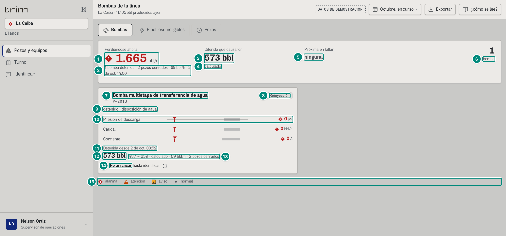
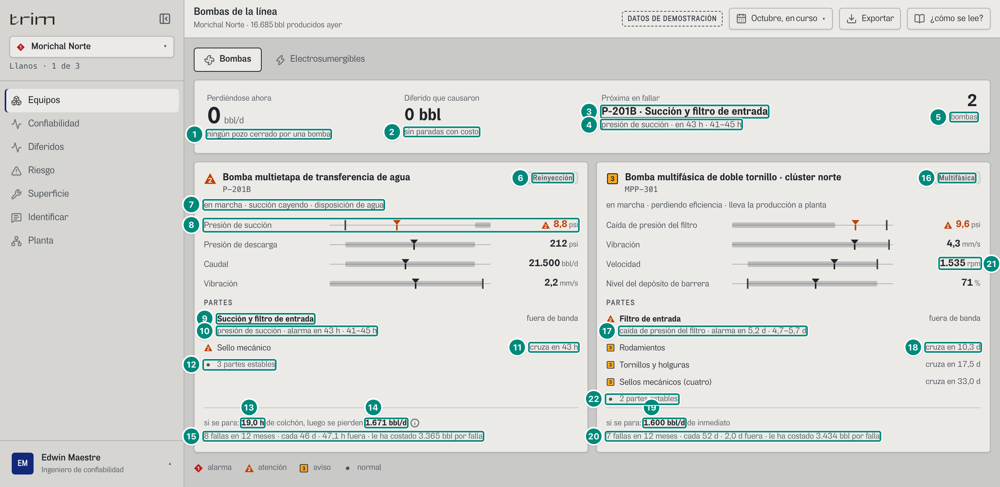
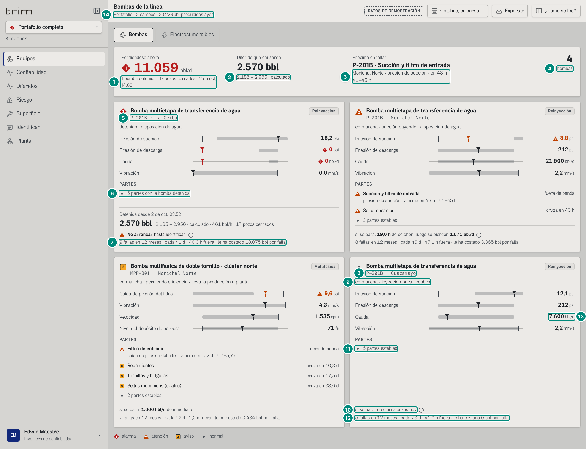
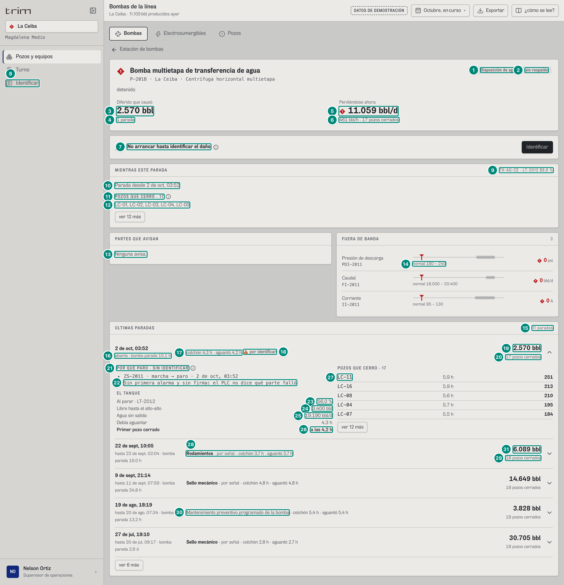
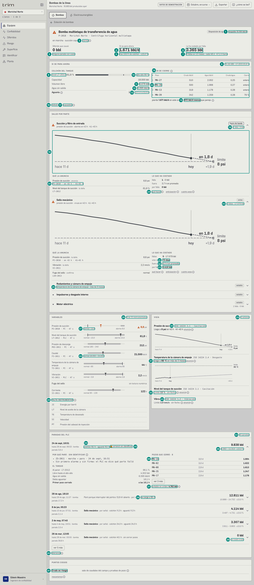
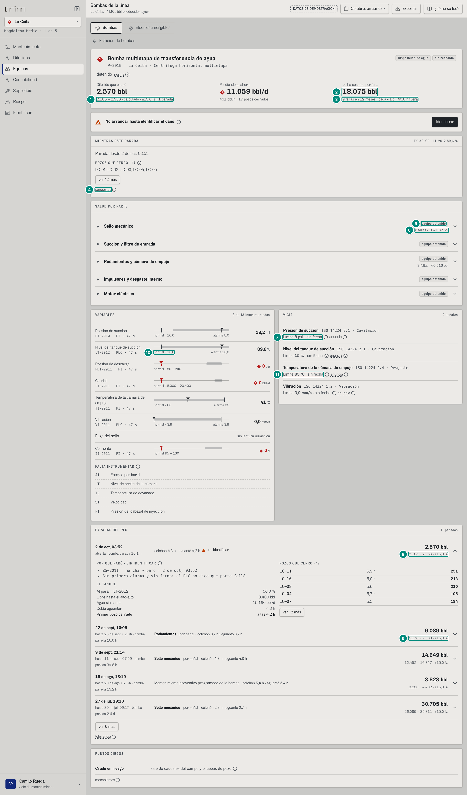

# 6B.1 Bombas — supervisor, operador, técnico, jefe de mantenimiento, confiabilidad

**Para qué.** «Cuáles cuestan crudo, cuánto aguanta el tanque y en qué orden cerrar pozos.» (`PARA_QUE.bombas`, `src/widgets/Onboarding.tsx:13`).

**Ruta.** `#/<rol>/bombas/<campo>[~portafolio]/<período>`; con el detalle de una bomba abierto por clic en su placa (no tiene dirección propia: es estado de la pantalla, `src/pages/Bombas.tsx:18`). Con un equipo en la dirección (`…/curso/P-201B`) se abre **la ficha** del equipo encima (6B.4), no este detalle.

**Roles y nivel.** `sup`, `oper`, `tec` → `operacion`; `jefe`, `conf` → `ingenieria` (`src/entities/roles.ts`). Ningún rol de nivel `decision` tiene la pantalla `bombas` (`ger`: resumen, diferidos, producción, riesgo, configuración), y es a propósito: **el gerente no ve Bombas** (decisión del dueño del 8-oct). La variante directiva que el código tenía sin ruta (`PlacaDirectiva`, la Lectura y la «Próxima en fallar» de decisión, `PARA_QUE_DECISION.bombas`) se quitó; lo que al gerente sí le sirve (de qué campo viene el diferido y qué equipos de ese campo fallan) está en «POR CAMPO» de su Resumen (6A). Un `#/ger/bombas/…` cae en su Resumen (`pantallaDelRol`, `src/app/url.ts:32-33`).

**Qué bombas salen.** Las «bombas de la línea» del catálogo (`esBomba`: P-201B de reinyección/disposición, MPP-301 multifásica) **instrumentadas** en cada campo del ámbito cuyo **perfil firmado** tiene bombas (`perfilDe(config, campo).bombas`). Una bomba instrumentada sin perfil en ese campo sale igual, como hueco («Falta declarar papel, capacidad y respaldo»). Orden (`src/shared/api/equipos.ts:285-289`): primero las que tienen una parada abierta; luego por prioridad (1 antes que 2 antes que 3; 0 al final); luego por las horas de la primera señal que cruza su límite.

**Lee.**

| Endpoint | Para qué |
|---|---|
| `GET /api/vistas/bombas?campos&desde&hasta` → `BombaVista[]` | todo lo de la estación y casi todo el detalle (`pedirBombas`, `src/shared/api/equipos.ts:262`) |
| `GET /api/vistas/bombas/paradas?campo&equipo` → `ParadaMedida[]` | la lista de paradas del detalle (`useParadas`, `Detalle.tsx:44`). El colchón de cada parada se mide con el tanque y el respaldo de la configuración firmada **que regía al parar**, no con la de hoy (`paradaMedida(ev, ctx, versiones)`, 5D·H4 resuelto); en el demo hay una sola versión y los números no cambian |

`BombaVista` (`src/shared/api/equipos.ts:241-256`; códec `BOMBAS`, `src/shared/api/contrato.ts:245`):

| Campo | Qué es | Ficha |
|---|---|---|
| `clave` | `"<campo>:<equipo>"` | — |
| `campo`, `eq` | el campo y el equipo del catálogo en ese campo (`EquipoEnCampo`: `nombre`, `estado`, `severidad`, `norma`…) | 5B §7 «El equipo vivo» |
| `perfil?` | `PerfilBomba` (papel, subtipo, tecnología, capacidad, tags, pozos); ausente = sin perfil | 5B §4.2 |
| `senales[]` | `Senal` por variable instrumentada (valor, unidad, estado, normal, alarma, serie, tendencia, pronóstico, mecanismo, límite) | 5C §1, §2 |
| `veredicto?` | `{ primera, cruzadas, prediccion, historial, porFalla }` | 5B §4.3, §7; 5C §2 |
| `abierta?` | la parada abierta, medida (`ParadaMedida`) | 5B §4.4 |
| `periodo?` | `{ bbl, tolerancia, rango, eventos }` lo cargado a la bomba en el período (`diferidoDeEquipo`) | 5A §3–4 |
| `partes[]` | `SaludParte[]` ordenadas de la peor a la mejor; con parada abierta identificada, la parte causante sale «falló» | 5C §3 |

---

## La estación: cabecera y placas

### Operación, un campo con la bomba parada (La Ceiba)

| # | Lo que se ve | En la captura | Cómo se calcula | Texto según el valor | Viene de |
|---|---|---|---|---|---|
| 1 | «Perdiéndose ahora» | ◆ **11.059** bbl/d, en rojo | $\sum_{b} \text{perdiendo}_b.\text{bblDia}$ sobre las bombas con `veredicto.prediccion.perdiendo.bblDia > 0` (`Bombas.tsx:26-27`; el front suma `bblDia/24` y lo vuelve a multiplicar por 24). Cada `perdiendo` es el crudo asignado de los pozos cuyo evento abierto tiene por causa esa parada: 5B §4.3 «Lo que está perdiendo una bomba parada». La Ceiba: 17 pozos, 11.058,875 bbl/d | `n0` + «bbl/d». Marca: ninguna si no hay pérdida; si alguna bomba que pierde **no** es multifásica → ◆ P1 y la cifra en rojo (`--p1`); si todas son multifásicas → ▲ P2 y la cifra en tinta (`Bombas.tsx:30, 49-50`). Sin pérdida: «0» sin marca | `BombaVista.veredicto.prediccion.perdiendo.bblDia` |
| 2 | Renglón de apoyo | «1 bomba detenida · 17 pozos cerrados · 461 bbl/h · 2 de oct, 14:00» | bombas que pierden; Σ `perdiendo.pozos.length`; $n_0(\sum \text{bblDia}/24)$ = 460,79 → 461; la hora de referencia (`fechaHora(AHORA)`) | `plural(n,'bomba detenida','bombas detenidas')` · `plural(m,'pozo cerrado','pozos cerrados')`; **« · N bbl/h» solo en `operacion`** (`Bombas.tsx:53`); sin pérdida: «ningún pozo cerrado por una bomba» | `perdiendo.pozos[]` |
| 3 | «Diferido que causaron» | **2.570 bbl** | $\sum_b \text{periodo}_b.\text{bbl}$ (`Bombas.tsx:33`): lo que el libro le carga a cada bomba en el período (tramos con `causa.equipo = bomba`, `diferidoDeEquipo`, `src/entities/libro.ts:1288-1296`). La Ceiba: 2.570,257 bbl (la parada abierta `EV-2011-1002`, 17 pozos) | `fmtBbl` = `n0` + « bbl» | `BombaVista.periodo.bbl` |
| 4 | Pie del diferido | «calculado» | — | `medido ≤ 0` → «sin paradas con costo»; `operacion` → «calculado»; `ingenieria` → «`fmtRango(Σ rango)` · calculado» (`Bombas.tsx:60`). Suma en línea de los rangos (conservador: no supone que los sesgos de campos distintos se compensen) | `periodo.rango` |
| 5 | «Próxima en fallar» | «ninguna» | de las bombas **sin parada abierta**, la parte en `fuera` o `avisa` con `primera` de menos horas (`Bombas.tsx:39-41`). 5C §2 «Próxima en fallar». La única bomba de La Ceiba está parada → ninguna | Con una: «**<equipo> · <parte>**» y debajo «<campo · si portafolio><variable en minúscula> · `pronosticoCorto`» («presión de succión · en 43 h · 41–45 h») (`Bombas.tsx:65-72`). Sin ninguna: «ninguna» gris | `partes[].primera.senal.pronostico` |
| 6 | Conteo | **1** bomba | número de `BombaVista` | «bomba»/«bombas» (`length === 1`); si hay bombas sin perfil, « · N sin perfil» (`Bombas.tsx:76-79`) | longitud de la lista |
| 7 | Nombre y marca de la placa | ◆ «Bomba multietapa de transferencia de agua», P-201B | marca = `eq.severidad` del equipo (en el demo es un dato declarado del catálogo, `src/entities/equipos.ts:27`; ver Huecos) | `MarcaPrioridad` 1/2/3/0; en portafolio, « · <campo>» junto al id (`Placa.tsx:49-55`) | `eq.severidad`, `eq.nombre`, `eq.id` |
| 8 | Tipo | «Reinyección» | `tipoNombre(perfil)` (`src/widgets/bombas/vista.ts:8-9`) | sin perfil «Sin perfil»; `multifasica` «Multifásica»; si no «Reinyección» (también la de recobro) | `perfil.subtipo` |
| 9 | Estado y papel | «detenido · disposición de agua» | `eq.estado` + « · » + `PAPEL_NOMBRE[papel]` en minúscula (`Placa.tsx:58-60`; `src/entities/bombas.ts:245-249`: «Lleva la producción a planta», «Disposición de agua», «Inyección para recobro») | texto del servidor | `eq.estado`, `perfil.papel` |
| 10 | Variables de la placa | Presión de descarga ◆ 0 psi · Caudal ◆ 0 bbl/d · Corriente ◆ 0 A | en **operación, solo las señales fuera de banda** (`estado ≠ normal` y con valor; `Placa.tsx:25-27`); en ingeniería, las 4 clave de la familia (`CLAVE`, `src/widgets/bombas/comun.ts:50-53`: inyección = succión, descarga, caudal, vibración; multifásica = caída de presión del filtro, vibración, velocidad, nivel del depósito de barrera). Cada una con `Analogico` (8 §8.6) | valor con los decimales de la serie (`decimalesDe`); marca y color por `DE_ESTADO[estado]`: `alarma` ◆1, `atencion` ▲2, `aviso` ■3. Una variable de la lista sin señal en la placa de ingeniería: «no instrumentada» (`Placa.tsx:71-74`). Operación sin ninguna fuera: «Instrumentos en banda.» (`Placa.tsx:62-64`) | `senales[].valor/estado/normal/alarma/serie` |
| 11 | «Detenida desde …» | «Detenida desde 2 de oct, 03:52» | `fechaHora(abierta.inicio)`; si la parada ya tiene parte: « · <parte en minúscula>»; si no pide respuesta: « · <texto de la causa>»; si pide: nada (lo dice «no arrancar») (`Placa.tsx:120-124`) | la hora del PLC, sin redondear | `abierta.inicio`, `abierta.causa`, `abierta.pide` |
| 12 | Barriles de la parada abierta | **2.570 bbl** | `abierta.bbl`: Σ de los tramos de los pozos que cerró esa parada (5B §4.4). Si la parada la causó **otro** equipo (`cargadoA ≠ eq.id`), en vez de barriles: «La paró <equipo>» + ⓘ «Los barriles se le cargan a <equipo>, no a esta bomba.» (`Placa.tsx:125-129`) | `fmtBbl`, en tinta (la prioridad la dice la forma de la tarjeta) | `abierta.bbl`, `abierta.cargadoA` |
| 13 | Rango y pérdida por hora | «2.185 – 2.956 · calculado · 461 bbl/h · 17 pozos cerrados» | rango = $\text{bbl} \pm \text{tol}$ (5A §4); $n_0(\text{perdiendo.bblDia}/24)$; pozos cerrados | si `bbl > 0`: «`fmtRango` · calculado · »; luego, si hay pérdida, «N bbl/h · plural(pozos)», si no «el tanque todavía absorbe» (`Placa.tsx:134-136`) | `abierta.rango`, `veredicto.prediccion.perdiendo` |
| 14 | «No arrancar» | ▲ **No arrancar** hasta identificar ⓘ | `abierta.pide` (5B §3.2 `estadoIdentificacion`): la parada no dejó primera alarma ni firma | marca ▲ P2 fija; ⓘ «<texto de la causa>. Sin identificar qué se dañó: no arrancar hasta que quien la revise lo registre.» (`Placa.tsx:139-146`). Aserción del auditor: «No arrancar» visible para `oper` (`e2e/auditoria/rutas.ts:63`) | `abierta.pide`, `abierta.causa.texto` |
| 15 | Leyenda | alarma · atención · aviso · normal | fija | — | — |

En operación, con la bomba parada y ninguna parte identificada, la placa **no** muestra el bloque de partes (todas están `detenida`: no hay ninguna que «avise» y en operación no se dibuja el renglón de estables, `Placa.tsx:36-37, 88`).

### Ingeniería, un campo con las bombas en marcha (Morichal)

| # | Lo que se ve | En la captura | Cómo se calcula | Texto según el valor | Viene de |
|---|---|---|---|---|---|
| 1 | Perdiéndose ahora | «0 bbl/d», «ningún pozo cerrado por una bomba» | ninguna bomba con `perdiendo` | sin marca | — |
| 2 | Diferido que causaron | «0 bbl», «sin paradas con costo» | Σ `periodo.bbl` = 0 en octubre (P-201B y MPP-301 no pararon) | `medido ≤ 0` → «sin paradas con costo» | `periodo.bbl` |
| 3 | Próxima en fallar | **P-201B · Succión y filtro de entrada** | la parte `fuera` de P-201B con `primera` = PI-2010 a 43,09 h, que gana a «Filtro de entrada» de MPP-301 (124,31 h). 5C §2 | ver fila 5 de la tabla anterior | `partes[].primera` |
| 4 | Su pronóstico | «presión de succión · en 43 h · 41–45 h» | `pronosticoCorto`: horas 43,086, rango [41,336; 44,990] (5C §2) | «en `fmtHoras(h)`» + « · a–b h» (`rangoCorto` junta la unidad si es la misma; si los dos extremos se escriben igual, sin rango) (`comun.ts:69-82`) | `primera.senal.pronostico` |
| 5 | Conteo | **2** bombas | P-201B y MPP-301 | ver arriba | — |
| 6 | Tipo | «Reinyección» / (16) «Multifásica» | `tipoNombre` | ver arriba | `perfil.subtipo` |
| 7 | Estado y papel | «en marcha · succión cayendo · disposición de agua» | `eq.estado` del equipo vivo (texto declarado en el demo, `equipos.ts:332`) + papel | — | `eq.estado`, `perfil.papel` |
| 8 | Variables clave | ▲ 8,8 psi (succión), 212 psi, 21.500 bbl/d, 2,2 mm/s | las 4 de `CLAVE.inyeccion`. PI-2010 = 8,8 psi, banda normal > 10, alarma baja 8 → `atencion` (fuera de banda, aún no en alarma) | ▲ y tinta naranja en la succión; las demás grises | `senales[]` |
| 9 | Parte que más preocupa | ▲ **Succión y filtro de entrada** · fuera de banda | `peor` = primera parte en `fallo`, `fuera` o `avisa` (`Placa.tsx:22`); va en negrita si no hay parada abierta. Bajo «PARTES» (ingeniería) o «PARTES QUE AVISAN» (operación), cada parte en `fallo`/`fuera`/`avisa` (y en ingeniería también `sin-dato`) en su renglón con su marca `sp.prioridad` y `estadoCorto` a la derecha (5C §3 «Frases de una parte») | `estadoCorto`: «causa de la parada», «fuera de banda», «cruza en N», «lo que la daña, fuera de banda», «bomba detenida», «estable»/«tendencia lenta», «sin instrumentos» (`comun.ts:56-65`) | `partes[].estado/prioridad` |
| 10 | Frase de la peor | «presión de succión · alarma en 43 h · 41–45 h» | `fraseParteCorta(peor)` (`comun.ts:87-102`; 5C §3) | solo bajo la peor y sin parada abierta (`Placa.tsx:101-103`) | `partes[0]` |
| 11 | Otra parte que avisa | ▲ Sello mecánico · «cruza en 43 h» | el sello tiene la presión de succión como variable que **la daña** (cavitación): misma `primera` | `estadoCorto(avisa con primera)` = «cruza en `fmtHoras`» | `partes[1]` |
| 12 | Renglón de estables | • «3 partes estables» | partes que no avisan (`Placa.tsx:37`), en un renglón gris con globo (nombre + estado de cada una) | `plural(n,'parte','partes')` + «estable(s)», o «con la bomba detenida» si todas son `detenida` (`Placa.tsx:106-112`); el globo sale entero en el papel | `partes[]` |
| 13 | Si se para: colchón | «si se para: **19,0 h** de colchón» | `fmtHoras(colchon.horas, true)`: 19,0499 h (5B §4.2 «Colchón del tanque») | cuatro casos, en este orden (`Placa.tsx:152-172`): recobro (`!inmediato`) «si se para: no cierra pozos hoy» + ⓘ «No cierra pozos hoy. Baja el soporte de presión.»; **colchón infinito** (disposición con agua sin salida $\le 0$: el respaldo libre mueve toda el agua, `respaldoAbsorbe`, `src/widgets/bombas/comun.ts:20`, la misma condición con que el motor pone el costo en 0) «si se para: no cierra pozos» + ⓘ «El respaldo absorbe toda el agua: parar no cierra pozos.»; con colchón «si se para: **X h** de colchón, luego se pierden **N bbl/d**»; sin colchón «si se para: **N bbl/d** de inmediato». Solo si la bomba **no** está parada | `veredicto.prediccion.colchon.horas` |
| 14 | … luego se pierden | **1.671 bbl/d** ⓘ | crudo en orden de cierre: 1.670,66 bbl/d (5B §4.2 «Orden de cierre») | ⓘ «Si se para ahora» solo si `crudoParejoBpd > crudoBpd + 1`: «El tanque aguanta 19,0 h; luego se pierden 1.671 bbl/d cerrando los pozos en orden (2.543 bbl/d cerrando parejo).» | `prediccion.crudoBpd`, `crudoParejoBpd` |
| 15 | Historia (solo ingeniería) | «8 fallas en 12 meses · cada 46 d · 47,1 h fuera · le ha costado 3.365 bbl por falla» | 5B §7 «Fallas del equipo»: 8 fallas; $n_0(366{,}58/30{,}4) = 12$; MTBF 45,82 d; MDT 47,09 h; lo que **le ha costado** cada falla, $\overline{\text{bbl}} = \frac{1}{n_c}\sum_{i \in \text{cerradas}} \text{bbl}_i = 26.917{,}2 / 8 = 3.364{,}6$ (`veredicto.porFalla` = `HistorialEquipo.bblPorFalla`: histórico). **No** es el «≈ 2.086 bbl si falla hoy» de Riesgo (5B §5: crudo de hoy × horas de cada falla que pasan del colchón de hoy), y por eso nunca se rotula «costo por falla» | solo si `fallas > 0`; cada pieza se omite si no existe (MTBF con ≥ 2 fallas; MDT con fallas cerradas; «le ha costado…» con `porFalla`). Las horas fuera con la regla única `fmtHoras(mdtH, true)` (8 §8.2; la misma de la ficha y Confiabilidad): bajo 48 h, horas con un decimal; desde 48 h, días con un decimal (`Placa.tsx:173-180`). Aserción `rutas.ts:72`: «2,0 d fuera» sí; «bbl/falla» y «48,7 h fuera» no | `veredicto.historial`, `veredicto.porFalla` |
| 16 | Tipo multifásica | «Multifásica» | — | — | — |
| 17 | Frase de la peor (MPP-301) | «caída de presión del filtro · alarma en 5,2 d · 4,7–5,7 d» | PDT-3011 9,6 psi (banda < 8, alarma 12): cruza en 124,31 h → `fmtHoras` ≥ 48 h = días con un decimal | — | `partes[0]` |
| 18 | Otras partes | ■ Rodamientos · «cruza en 10,3 d» (y Tornillos 17,5 d, Sellos 33,0 d) | partes `avisa` de prioridad 3 (5C §3 «Prioridad de la parte») | — | `partes[]` |
| 19 | Si se para (multifásica) | «si se para: **1.600 bbl/d** de inmediato» | papel `transporte`: sin tanque, el crudo de los 3 pozos del clúster (1.599,75 bbl/d) (5B §4.3) | rama «de inmediato» | `prediccion.crudoBpd` |
| 20 | Historia MPP-301 | «7 fallas en 12 meses · cada 52 d · 2,0 d fuera · le ha costado 3.434 bbl por falla» | 5B §7: MDT 48,68 h ≥ 48 h → $n_1(48{,}68/24) = 2{,}0$ d (antes de la corrección decía «48,7 h fuera»); $24.034{,}6 / 7 = 3.433{,}5$ bbl por falla (en Riesgo, «si falla hoy» = 3.244,5) | ver 15 | `veredicto.historial`, `veredicto.porFalla` |
| 21 | Variables clave de MPP-301 | ▲ «Caída de presión del filtro 9,6 psi» · «Vibración 4,3 mm/s» · «Velocidad 1.535 rpm» · «Nivel del depósito de barrera 71 %» | las 4 de `CLAVE.multifasica` (`src/widgets/bombas/comun.ts:50-53`), en ese orden; PDT-3011 9,6 psi con banda normal < 8 y alarma 12 → `atencion` ▲ (5C §1 «Estado de un dispositivo»); las otras tres en banda, gris | como la fila 8: valor con los decimales de la serie, marca por `DE_ESTADO[estado]` | `senales[]` de MPP-301 |
| 22 | Estables de MPP-301 | • «2 partes estables» | la multifásica tiene 6 partes en su catálogo (5C §3 «Catálogo de partes por familia»; 6A.6: «6 partes (cat. B)»); avisan 4 (filtro, rodamientos, tornillos, sellos), quedan 2 | como la fila 12 | `partes[]` |

### Ingeniería, portafolio (`#/conf/bombas/morichal~portafolio/curso`)

Solo las filas nuevas o distintas:

| # | Lo que se ve | En la captura | Cómo se calcula | Texto según el valor | Viene de |
|---|---|---|---|---|---|
| 1 | Apoyo de «Perdiéndose ahora» | «1 bomba detenida · 17 pozos cerrados · 2 de oct, 14:00» | igual que en operación | **sin** «· 461 bbl/h» (solo operación) | — |
| 2 | Pie del diferido | «2.185 – 2.956 · calculado» | Σ de los rangos de las 4 bombas: [2.184,72; 2.955,80] (las otras tres tienen `[0, 0]`) | `fmtRango` (`n0(max(0,a)) – n0(b)`) | `periodo.rango` |
| 3 | Próxima en fallar | «Morichal Norte · presión de succión · en 43 h · 41–45 h» | igual; en portafolio se antepone el campo (`Bombas.tsx:69`) | — | — |
| 4 | Conteo | **4** bombas | La Ceiba P-201B, Morichal P-201B y MPP-301, Guacamayo P-201B (Palmar y La Zarza no tienen bombas en su perfil firmado) | — | — |
| 5 | Id y campo | «P-201B · La Ceiba» | en portafolio cada placa dice su campo (`Placa.tsx:52-54`) | — | `campo.nombre` |
| 6 | Partes con la bomba parada | «5 partes con la bomba detenida» | en ingeniería el renglón gris junta las partes que no avisan; todas `detenida` → «con la bomba detenida» | ver fila 12 de Morichal | `partes[]` |
| 7 | Historia La Ceiba | «9 fallas en 12 meses · cada 41 d · 40,0 h fuera · le ha costado 18.075 bbl por falla» | 5B §7 (ejemplo La Ceiba P-201B): 8 fallas cerradas, $144.598{,}2 / 8 = 18.074{,}8$ bbl; MDT 39,99 h | fila 15 de Morichal | `veredicto.historial`, `veredicto.porFalla` |
| 8 | Guacamayo | ● «P-201B · Guacamayo» | severidad 0 (en marcha, sin partes que avisen) | punto gris | `eq.severidad` |
| 9 | Estado y papel | «en marcha · inyección para recobro» | papel `recobro` | — | `perfil.papel` |
| 10 | Si se para (recobro) | «si se para: no cierra pozos hoy» ⓘ | `prediccion.inmediato = false` (5B §4.3) | ⓘ «No cierra pozos hoy. Baja el soporte de presión.» | `prediccion.inmediato` |
| 11 | Partes | «5 partes estables» | — | — | — |
| 12 | Historia Guacamayo | «5 fallas en 12 meses · cada 73 d · 41,0 h fuera · le ha costado 0 bbl por falla» | 5 fallas, MTBF 73,32 d, MDT 41,03 h; **le ha costado 0 bbl por falla**: de recobro, sus paradas no cierran pozos (por eso en el Resumen del gerente sale como «no costó crudo», 6A) | — | `veredicto.historial`, `veredicto.porFalla` |
| 13 | Variables de Guacamayo | «Presión de succión 12,1 psi» · «Presión de descarga 212 psi» · «Caudal 7.600 bbl/d» · «Vibración 2,2 mm/s», todas grises | las 4 de `CLAVE.inyeccion` (succión, descarga, caudal, vibración) de P-201B de Guacamayo, en banda | fila 8 de Morichal | `senales[]` |
| 14 | Cabecera de la aplicación | «Portafolio · 3 campos · 33.229 bbl producidos ayer» | el portafolio de confiabilidad son La Ceiba, Morichal Norte y Guacamayo: $11.105 + 16.685 + 5.439$ (fiscal del 1-oct de cada uno; 6A.1 fila 1) | | `GET /api/vistas/estado` → `[].ayer.bbl` |

En La Ceiba (ingeniería, 4 variables clave) la presión de succión de la bomba parada se ve **normal** (18,2 psi > 10: con la bomba parada la succión sube) y la vibración «0,0 mm/s» normal; las alarmas son descarga, caudal y corriente en 0 (consecuencia de la parada, 5C §3).

### Variantes de la estación

- **Operación** (`sup`, `oper`, `tec`): idénticas entre sí (mismo componente, mismo nivel). Las diferencias con ingeniería: solo variables fuera de banda (10), «PARTES QUE AVISAN» sin renglón de estables, «Ninguna parte avisa.» si no hay ninguna y la bomba está en marcha (`Placa.tsx:148-151`), « · N bbl/h» en la cabecera (2), pie del diferido solo «calculado» (4), sin la línea de historia (15) y por tanto sin «le ha costado». El operador y el técnico no ven el botón «Exportar» (no tienen `evidencia:exportar`).
- **Ingeniería** (`jefe`, `conf`): ver Morichal y portafolio.
- **Decisión**: no hay. El gerente no tiene la pantalla (decisión del 8-oct) y su variante se quitó del código (`PlacaDirectiva`, su Lectura, la «Próxima en fallar» de decisión y «sin datos» en el conteo). El servidor no tiene que producir nada para ese nivel en `/vistas/bombas`.
- **Período.** Solo cambia `periodo` (Diferido que causaron): todo lo demás es «ahora». Septiembre cerrado en La Ceiba: 20.739 bbl (2 paradas). La Lectura dice «Diferido que causaron es lo que ya se perdió en el período por paradas de estas bombas (se le carga a la bomba que paró)».

### Estados

| Estado | Qué se ve |
|---|---|
| Bomba sin perfil en el campo | Tipo «Sin perfil»; en vez de variables, hueco «Falta declarar papel, capacidad y respaldo.» + ⓘ «Sin perfil: Falta declarar su papel, capacidad y respaldo en este campo. Sin eso no se puede calcular el crudo en riesgo.»; sin partes, sin «si se para», sin historia (`Placa.tsx:77-86`). La cabecera suma « · N sin perfil». No ocurre en el demo |
| Ninguna bomba en el ámbito | «Sin bombas multifásicas ni de inyección instrumentadas.» (`Bombas.tsx:101-105`). Un campo sin bombas en su perfil no llega aquí: la subpantalla «Bombas» no se ofrece y, si se pide por dirección, se abre la primera subpantalla que el campo sí tiene con el aviso «<campo> no tiene bombas en su perfil: se abrió <otra>.» (`src/widgets/Subpantallas.tsx:21-27`) |
| Bomba en marcha sin partes que avisen | Operación: «Ninguna parte avisa.»; ingeniería: solo el renglón «N partes estables» |
| Parada abierta que todavía no cierra pozos | «Detenida desde…», barriles 0 y «el tanque todavía absorbe» en vez de bbl/h (`Placa.tsx:135`) |
| Parada causada por otro equipo (un servicio) | «La paró <equipo>» + ⓘ, sin barriles |
| Colchón infinito (el respaldo absorbe todo) | `colchon.horas` llega `null` (JSON) y se lee `Infinity`; con `aguaSinSalidaBpd ≤ 0` la placa dice «si se para: no cierra pozos» + ⓘ «El respaldo absorbe toda el agua: parar no cierra pozos.» (fila 13). Antes decía «más de 3 meses de colchón, luego se pierden 0 bbl/d» (5B·H13, resuelto el 8-oct). No ocurre en el demo |

### Interacciones

- Clic en una placa (todo el recuadro es un botón con `aria-label` «Abrir el detalle de <nombre>»): abre el **detalle** (abajo). No pide endpoint nuevo salvo `/vistas/bombas/paradas`.
- ⓘ y globos: «No arrancar», «Si se para ahora», «Si se para», «La paró …», renglón de partes estables. En el papel salen escritos.

---

## El detalle de una bomba

**Ruta.** La misma de la estación, con la placa abierta (el auditor la abre en `#/conf/bombas/morichal/curso`, `#/sup/bombas/ceiba/curso` y `#/jefe/bombas/ceiba/curso`: `ABRIR_BOMBA`, `e2e/auditoria/rutas.ts:32`). «← Estación de bombas» vuelve.

**Lee.** `BombaVista` (ya traída) + `GET /api/vistas/bombas/paradas?campo&equipo` → `ParadaMedida[]`, toda la historia, más reciente primero (5B §4.4).

### Operación, bomba parada (La Ceiba, supervisor)

| # | Lo que se ve | En la captura | Cómo se calcula | Texto según el valor | Viene de |
|---|---|---|---|---|---|
| 1 | Papel | «Disposición de agua» | `PAPEL_NOMBRE[perfil.papel]` | chip | `perfil.papel` |
| 2 | Respaldo | «sin respaldo» | `prediccion.respaldoLibreBpd` = 0 (respaldo firmado de La Ceiba: «Única bomba del tren de agua», 0 bbl/d; 5B §4.2 «Respaldo») | `> 0` → «respaldo `n0` bbl/d»; si no «sin respaldo» (`Detalle.tsx:94`) | `veredicto.prediccion.respaldoLibreBpd` |
| 3 | «Diferido que causó» | **2.570 bbl** | `periodo.bbl` (igual que la placa) | sin barriles: «0 bbl» (`Detalle.tsx:103-107`) | `periodo.bbl` |
| 4 | Pie | «1 parada» | `periodo.eventos` = paradas distintas con tramos en el período | operación: `plural(eventos,'parada','paradas')`; ingeniería antepone «`fmtRango` · calculado · `fmtTol` · »; sin barriles: «ninguna parada con costo» | `periodo.eventos`, `rango`, `tolerancia` |
| 5 | «Perdiéndose ahora» | ◆ **11.059 bbl/d** | `perdiendo.bblDia` (5B §4.3) | aparece **en vez de** «Si se para ahora» cuando la bomba pierde; marca = `eq.severidad`, cifra en tinta (`Detalle.tsx:108-110, 266-274`) | `prediccion.perdiendo.bblDia` |
| 6 | Pie | «461 bbl/h · 17 pozos cerrados» | $n_0(\text{bblDia}/24)$, pozos | `plural` | `perdiendo.pozos` |
| 7 | Franja «No arrancar» | ▲ «No arrancar hasta identificar el daño» ⓘ | `abierta.pide` | ⓘ «La parada no dejó primera alarma ni una firma clara en las señales. Quien la revise tiene que decir qué parte se dañó. TRIM no bloquea el PLC: es la regla de operación, y si arranca sin identificar queda como no conformidad.» (`Detalle.tsx:126-136`). Aserción `rutas.ts:65` | `abierta.pide` |
| 8 | Botón «Identificar» | Identificar | solo si el rol tiene la pantalla `causa` (todos los de esta pantalla la tienen) | abre «Identificar» | — |
| 9 | Encabezado del panel | «MIENTRAS ESTÉ PARADA» · «TK-AG-CE · LT-2012 89,6 %» | título «MIENTRAS ESTÉ PARADA» si `prediccion.parada`, si no «SI SE PARA AHORA»; extra = tanque · tag de nivel · `n1(nivel.pct)` % (`Detalle.tsx:305-306`). El panel solo existe si `prediccion.inmediato` (no en recobro) | — | `prediccion.colchon.tanque.id/nivel` |
| 10 | Desde | «Parada desde 2 de oct, 03:52» | `fechaHora(prediccion.parada.inicio)` | — | `prediccion.parada.inicio` |
| 11 | Pozos que cerró | «POZOS QUE CERRÓ · 17» ⓘ | `perdiendo.pozos.length` | ⓘ «Se pierden 11.059 bbl/d mientras siga parada. Al arrancar, los pozos vuelven a producir a medida que el tanque baja.» (`Detalle.tsx:328-339`) | `perdiendo.pozos[]` |
| 12 | Lista | «LC-01, LC-02, LC-03, LC-04, LC-05» y «ver 12 más» | los ids en el orden que manda el servidor; cinco y «ver N más» (8 §8.7); en el papel, todos | — | `perdiendo.pozos[].id` |
| 13 | «PARTES QUE AVISAN» | «Ninguna avisa.» | partes en `fallo`, `fuera`, `avisa` (`Detalle.tsx:487-506`); con la bomba parada sin parte identificada, todas `detenida` | por cada una: marca, nombre, chip `ESTADO_PARTE` (fuerte salvo `avisa`), `fraseParteCorta` y **«Qué hacer:» escrito** (no detrás de una ⓘ); extra = cuántas | `partes[]`, `parte.accion` |
| 14 | «FUERA DE BANDA» · 3 | ◆ «Presión de descarga · PDI-2011 · 0 psi · normal 180 – 240»; ◆ «Caudal · FI-2011 · 0 bbl/d · normal 18.000 – 20.400»; ◆ «Corriente · II-2011 · 0 A · normal 95 – 130» | señales con `estado ≠ normal` y valor (`Detalle.tsx:489, 507-515`), con `Analogico` en detalle (banda y alarma escritas, 8 §8.6); el «3» del encabezado es cuántas. Las bandas son los límites del tag (5C §1 «Límite de cada tag»); con la bomba parada las tres miden 0 y quedan en alarma (consecuencia de la parada, 5C §3) | «Todo en banda.» si no hay | `senales[].tag/valor/normal/alarma/estado` |
| 15 | Paradas | «ÚLTIMAS PARADAS» · «11 paradas» | `ParadaMedida[]` de toda la historia (La Ceiba: 9 fallas + la programada `EV-2011-260819` + la que paró K-101 `EV-2011-260128`) | título «PARADAS DEL PLC» en ingeniería; «Sin paradas registradas.» si no hay | `/vistas/bombas/paradas` |
| 16 | Fila: inicio y duración | «2 de oct, 03:52» / «abierta · bomba parada 10,1 h» | `fechaHora(inicio)`; «abierta» o «hasta `fechaHora(fin)`»; « · bomba parada » + `fmtHoras(horasParada, true)` (10,13 h). La duración va **rotulada**: es la de la bomba parada, de su paro a su arranque (`ParadaMedida.horasParada`); la historia de la ficha (6B.4) mide otra, de la parada hasta que reabrió el último pozo, y la rotula «N pozos cerrados hasta X» (6B·H6, resuelto el 8-oct) | ≥ 48 h en días: «2,6 d» (`Detalle.tsx:411`) | `ParadaMedida.inicio/fin/abierto/horasParada` |
| 17 | Colchón en corto | «colchón 4,3 h · aguantó 4,2 h» | previsto 4,25 h; observado 4,245 h (5B §4.4) | tabla «Textos del colchón según el valor» de 5B §4.4 (`Detalle.tsx:401-402`); solo en disposición con tanque y nivel al parar | `colchon.previsto.horas`, `colchon.observadoH` |
| 18 | Marca de identificación | ▲ «por identificar» | `pide && !arrancoSinIdentificar` | ▲ «por identificar»; si arrancó sin respuesta, ■ «arrancó sin identificar» (`Detalle.tsx:424-425`) | `pide`, `arrancoSinIdentificar` |
| 19 | Barriles | **2.570 bbl** | `ParadaMedida.bbl` | `fmtBbl` | `bbl` |
| 20 | Pie | «17 pozos cerrados» | operación: `plural(pozos,'pozo cerrado','pozos cerrados')`; ingeniería: «`fmtRango` · `fmtTol`»; `bbl ≤ 0`: «no costó crudo» (`Detalle.tsx:430`) | — | `pozos`, `rango`, `tolerancia` |
| 21 | Al abrir: por qué paró | «POR QUÉ PARÓ · SIN IDENTIFICAR» ⓘ | `COMO[causa.como]` en mayúscula | con `pide`, la frase va en la ⓘ («Paró sin primera alarma: hay que identificar qué se dañó»); sin `pide`, escrita debajo (`Detalle.tsx:438-440`) | `causa.como`, `causa.texto` |
| 22 | Evidencia | «ZS-2011 · marcha → paro · 2 de oct, 03:52» · «Sin primera alarma y sin firma: el PLC no dice qué parte falló» | `causa.evidencia[]` tal cual (5B §3) | si alguien la declaró: «Declarado por <por> · <hora>» | `causa.evidencia`, `causa.declarado` |
| 23 | El tanque: al parar | «Al parar · LT-2012 56,0 %» | `colchon.previsto.nivel.pct` | `n1` | `colchon.previsto.nivel` |
| 24 | Libre | «Libre hasta el alto-alto 3.400 bbl» | $(0{,}90 - 0{,}56)\cdot 10.000$ (5B §4.4) | `n0` | `colchon.previsto.libreBbl` |
| 25 | Agua sin salida | «19.190 bbl/d» | mediana de FI-2011 − respaldo 0 | `n0` | `colchon.previsto.aguaSinSalidaBpd` |
| 26 | Debía aguantar / primer pozo | «Debía aguantar 4,3 h» · «Primer pozo cerrado a las 4,2 h» | previsto vs observado | sin cierres: `tanqueAbierto(...)` o «lo absorbió sin cerrar pozos» (`Detalle.tsx:453-455`; `comun.ts:25-27`) | `colchon.observadoH` |
| 27 | Pozos de la parada | «POZOS QUE CERRÓ · 17»: LC-11 5,9 h **251**, LC-16 5,9 h **213**, LC-08 5,6 h **210**, LC-04 5,7 h **195**, LC-07 5,5 h **184** y «ver 12 más» | tramos de la parada agrupados por pozo: Σ horas, Σ bbl, ordenados por bbl (`Detalle.tsx:387-392`) | horas `fmtHoras(h,true)`; « · frecuencia reducida» si algún tramo es aproximado; «Ninguno.» si no cerró | `ParadaMedida.tramos[]` |
| 28 | Otra fila | «Rodamientos · por señal · colchón 3,7 h · aguantó 3,7 h» | parte identificada (negrita) · `COMO[como]` · colchón | piezas separadas por « · »; « · se carga a <equipo>» si la causó otro; « · programada» si es del programa sin decirlo (`Detalle.tsx:415-423`). **En el teléfono esta columna no se ve** (6B.6) | `causa.parte/como`, `cargadoA` |
| 29 | Pie operación | «18 pozos cerrados» | ver 20 | — | — |
| 30 | Programada | «Mantenimiento preventivo programado de la bomba · colchón 5,4 h · aguantó 5,4 h» | causa del programa sin parte: el texto, sin «por el programa aprobado» | — | `causa.texto` |
| 31 | Las otras tres paradas a la vista | «22 de sept, 10:05 · hasta 23 de sept, 02:04 · bomba parada 16,0 h» · Rodamientos · por señal · colchón 3,7 h · aguantó 3,7 h · **6.089 bbl** · 18 pozos cerrados; «9 de sept, 21:14 · hasta 11 de sept, 07:59 · bomba parada 34,8 h» · Sello mecánico · por señal · colchón 4,8 h · aguantó 4,8 h · **14.649 bbl** · 18 pozos cerrados; «19 de ago, 18:19 · hasta 20 de ago, 07:34 · bomba parada 13,2 h» · la programada (fila 30) · **3.828 bbl** · 18 pozos cerrados; «27 de jul, 19:10 · hasta 30 de jul, 09:17 · bomba parada 2,6 d» · Sello mecánico · por señal · colchón 2,8 h · aguantó 2,7 h · **30.705 bbl** · 18 pozos cerrados | `ParadaMedida[]` de P-201B de La Ceiba, de la más reciente a la más vieja; mismas reglas de las filas 16-20 y 28 (2,6 d: ≥ 48 h se escribe en días) | — | `/vistas/bombas/paradas` |

La lista de paradas muestra cinco y «ver 6 más»; **nunca esconde** la abierta ni una que espera respuesta y no arrancó (`useVerMas` con prioridad 1, `Detalle.tsx:46`). En el papel salen todas. La primera de la lista viene abierta.

### Ingeniería, bomba en marcha (Morichal P-201B, confiabilidad)

| # | Lo que se ve | En la captura | Cómo se calcula | Texto según el valor | Viene de |
|---|---|---|---|---|---|
| 1 | Respaldo | «respaldo 15.100 bbl/d» | respaldo firmado de Morichal: P-201A en paralelo con 15.100 bbl/d libres (5B §4.2) | — | `prediccion.respaldoLibreBpd` |
| 2 | Norma | ⓘ «norma» (solo ingeniería) | `perfil.norma` | texto del perfil | `perfil.norma` |
| 3 | Diferido que causó | «0 bbl» · «ninguna parada con costo» | octubre sin paradas | — | `periodo` |
| 4 | «Si se para ahora» | **1.671 bbl/d** | `prediccion.crudoBpd` = 1.670,66 (orden de cierre, 5B §4.2) | sin pérdida, la cifra es «Si se para ahora»: recobro → «no cierra pozos» con pie «recobro: el efecto llega en semanas»; colchón infinito (`respaldoAbsorbe`: disposición con agua sin salida $\le 0$) → «no cierra pozos» con pie «el respaldo absorbe toda el agua»; si no, `n0(crudoBpd)` bbl/d (`Detalle.tsx:111-116`) | `prediccion.inmediato/crudoBpd/aguaSinSalidaBpd` |
| 5 | Pie | «tras 19,0 h de colchón · ±15,0 %» | colchón 19,0499 h; tolerancia de la predicción 0,15 (banda del campo, 5B §4.3) | con colchón «tras X h de colchón»; sin colchón «de inmediato»; con colchón infinito, «el respaldo absorbe toda el agua» (fila 4); « · ±N %» (`fmtTol`) solo en ingeniería | `prediccion.colchon.horas`, `tolerancia` |
| 6 | «Le ha costado por falla» (solo ingeniería) | **3.365 bbl** | `veredicto.porFalla` = bbl promedio de sus fallas cerradas = 26.917,2 / 8 = 3.364,65 (5B §7): lo que **ya** costó cada falla. El «si falla hoy» de Riesgo (≈ 2.086 bbl, con el colchón de hoy) es otra cifra (5B §5) | sin dato: «sin fallas». El rótulo era «Costo por falla»: aserción `rutas.ts:70` exige «Le ha costado por falla» y prohíbe «Costo por falla» (`Detalle.tsx:117-122`) | `veredicto.porFalla` |
| 7 | Pie | «8 fallas en 12 meses · cada 46 d · 47,1 h fuera» | fallas, $n_0(\text{días}/30{,}4)$, MTBF, MDT con `fmtHoras(mdtH, true)` (la regla única: «2,0 d fuera» en MPP-301, como la placa y la ficha) | sin fallas: «sin fallas en la historia que hay» (`Detalle.tsx:117-122`) | `veredicto.historial` |
| 8 | Encabezado | «SI SE PARA AHORA» · «TK-AG-MN · LT-2012 61,8 %» | ver fila 9 de operación. Aserción `rutas.ts:70` exige el título en mayúsculas | — | `prediccion.colchon` |
| 9 | Barra del nivel | «nivel LT-2012 61,8 %» | `BarraMeta` del nivel contra el alto-alto como máximo (8 §8.5): ancho $\min(1{,}25;\ 61{,}8/90)/1{,}25 = 54{,}9\,\%$, raya en 80 % | la barra es gris; **no lleva cuadrado P3** aunque se pase (el nivel no es una meta) | `colchon.nivel.pct`, `tanque.altoAlto` |
| 10 | Raya | «alto-alto 90 %» | `n0(altoAlto × 100)` | — | `colchon.tanque.altoAlto` |
| 11 | Capacidad y volumen libre | «Capacidad 18.000 bbl» · «Volumen libre 5.076 bbl» | $V_\text{libre} = (0{,}90 - 0{,}618)\cdot 18.000$ (5B §4.2 «Colchón del tanque») | `n0` | `colchon.tanque.capacidadBbl`, `colchon.libreBbl` |
| 12 | Agua sin salida | «6.395 bbl/d» | $21.495 - 15.100$ (5B §4.2 «Agua sin salida») | `n0` | `colchon.aguaSinSalidaBpd` |
| 13 | Aguanta | «19,0 h (17,1 h a 21,0 h)» ⓘ | $h = 5.076/(6.395/24) = 19{,}05$ h; rango $h(1\pm\varepsilon)$, $\varepsilon = 0{,}1003$ → [17,14; 20,96] | `fmtHoras(h, true)`; el rango entre paréntesis y la ⓘ «Tolerancia del colchón» («Aforo del tanque de agua ±0,7 %: … · Caudal de agua ±10,0 %: …», `fmtComponente`) **solo en ingeniería** (`Detalle.tsx:319-324`). Con colchón infinito (`respaldoAbsorbe`) dice «no se llena», sin horas ni rango (antes «más de 3 meses»; 5B·H13, resuelto el 8-oct) | `colchon.horas/rango/componentes` |
| 14 | Orden de cierre | tabla # · Pozo · Crudo bbl/d · Agua bbl/d · Crudo/agua · Cierre: MN-27 510 · 2.052 · 0,25 · entero … MN-39 342 · 1.259 · 0,28 · 78 % | 5B §4.2 «Orden de cierre y crudo en riesgo» | crudo y agua `n0`; razón `n2`; cierre «entero» si $\phi \ge 0{,}999$, si no `n0(φ×100)` %; hasta 12 pasos, cinco a la vista y «ver N más», y «y N pozos más: se cierra todo el campo.» si hay más de 12 (`Detalle.tsx:340-356`) | `prediccion.orden.pasos[]` |
| 15 | Ahorro | «pierde **1.671 bbl/d** en este orden · **872 bbl/d menos** que parejo» ⓘ | ahorro = parejo − en orden = 872,26 | « · N bbl/d menos que parejo» y la ⓘ «Cerrando parejo (la misma fracción a todos) serían 2.543 bbl/d.» solo si `ahorroBpd > 1` | `orden.crudoBpd`, `ahorroBpd`, `crudoParejoBpd` |
| 16 | ⓘ método | «método» | `prediccion.metodo` + «.» | solo con la bomba en marcha («Hay que quitar 6.395 bbl/d de agua: se cierran primero los pozos con menos crudo por barril de agua.») | `prediccion.metodo` |
| 17 | ⓘ supuestos | «supuestos» | `prediccion.supuestos.join(' · ')` (5B §4.3) | solo ingeniería (aserción `rutas.ts:65` lo prohíbe en operación; `rutas.ts:70` lo exige aquí) | `prediccion.supuestos` |
| 18 | Salud por parte | «Succión y filtro de entrada» · chip «fuera de banda» · «1 falla · 0 bbl» | `BloqueParte` (`src/widgets/bombas/BloqueParte.tsx`): marca `sp.prioridad`, nombre, `fraseParteCorta`, chip `ESTADO_PARTE` (fuerte en `fallo`/`fuera`), y la historia de la parte «N falla(s) · N bbl» (oculta en el teléfono). 5C §3 «Dónde se ve…» | abierta de entrada si `fallo`/`fuera`/`avisa` | `partes[]`, `historial.porParte[]` |
| 19 | Proyección | gráfico «hace 11 d · hoy · +1,9 d», raya «límite 8 psi», «en 1,8 d» | `Proyeccion` de `sp.primera` (5C §2 «El dibujo de la tendencia») | rótulo del cruce en días con un decimal; tope 45 d | `primera.senal.tendencia/serie/pronostico/limite` |
| 20 | Qué la anuncia | «Presión de succión · anuncia» · «PI-2010 · en 43 h · 41–45 h» · «8,8 psi» | cada variable de la parte con su papel (`anuncia`/`la daña`/`confirma`), tag y pronóstico corto («ya cruzó» si cruzado) | valor `toLocaleString('es-CO')` + unidad; «sin señal» en magenta; «Falta instrumentar: …» si la plantilla pide más; «Nada de lo que la anuncia está instrumentado.» | `sp.medidas`, `sp.sinSenal`, `sp.discretas`, `sp.faltan` |
| 21 | Lo que ha costado: MTBF de la parte | «una cada **73 días**» (sello) | días ÷ fallas de la parte, con ≥ 2 | fila omitida con < 2 fallas | `porParte[].mtbfDias` |
| 22 | Horas fuera de la parte | «fuera 2,2 d en promedio» | MDT de las fallas cerradas de la parte (53,34 h → ≥ 48 h → días) | `fmtHoras(mdtH, true)`; omitida si 0 | `porParte[].mdtH` |
| 23 | Por falla | «por falla **3.416 bbl**» | 17.079,4 / 5 | — | `porParte[].bblPorFalla` |
| 24 | ⓘ de la parte | «qué hacer», «anticipación», «cuánto pesa» | textos del catálogo de partes (5C §3) | «<acción> Ítem ISO 14224: <ítem>.»; «<anticipación>»; «<peso>. Fuente: <fuente>.» | `parte.accion/itemIso/anticipacion/peso` |
| 25 | Parte estable | «Rodamientos y cámara de empuje» · «temperatura de la cámara de empuje · más de 3 meses» · «estable» | `lenta`: cruza en 4.145 h > 2.160 h (5C §2 «Horizonte») | — | `sp.lenta` |
| 26 | Variables | «VARIABLES» · «8 de 13 instrumentadas» | variables de la plantilla de la familia con tag en el perfil / total de la plantilla (`Detalle.tsx:163`) | — | `perfil.tags`, plantilla de la familia (catálogo) |
| 27 | Analógico en detalle | «PI-2010 · PI · 47 s» · «normal > 10,0» · «alarma 8,0» · ▲ 8,8 psi | `sub` = tag · origen (sistema y cadencia del instrumento); banda y alarma escritas (8 §8.6) | una variable sin lectura numérica (un interruptor): «sin lectura numérica» | `senales[]`, `perfil.tags` |
| 28 | Falta instrumentar | «FALTA INSTRUMENTAR» ⓘ: JI Energía por barril, LT Nivel de aceite de la cámara, TE Temperatura de devanado, SI Velocidad, PT Presión del cabezal de inyección | variables de la plantilla sin tag; cada una con globo «Dónde» | ⓘ «Lo que pide la norma y esta bomba no tiene…» | plantilla − `perfil.tags` |
| 29 | Vigía | «VIGÍA» · «4 señales» | señales con mecanismo, por horas de cruce (5C §2 «Panel VIGÍA») | «sin señales» + «Ninguna variable instrumentada anuncia degradación.» | `senales[].mecanismo/pronostico` |
| 30 | Mecanismo | «ISO 14224 2.1 · Cavitación» | `mecanismo.codigo · nombre` | — | `senal.mecanismo` |
| 31 | Cruce lejano | «Llega a **85 °C** en más de 3 meses» | TI-2011 cruza en 4.145 h > horizonte | 5C §2 | `pronostico` |
| 32 | Sin fecha | «Límite **15 %** · sin fecha» ⓘ | `sin-tendencia` o `no-atribuible` | la ⓘ «Sin fecha» con el motivo | `pronostico.motivo` |
| 33 | Paradas | «PARADAS DEL PLC» · «10 paradas» | historia de paradas de Morichal P-201B | ver operación | `/vistas/bombas/paradas` |
| 34 | Colchón | «colchón 16,1 h · aguantó 16,1 h» | `EV-M2011-260924`: previsto 16,15, observado 16,14 (5B §4.4) | — | `colchon` |
| 35 | No conformidad | ■ «arrancó sin identificar» | arrancó el 28-sep sin respuesta (5B §3.2) | ■ P3 | `arrancoSinIdentificar` |
| 36 | Rango | «8.362 – 11.313 · ±15,0 %» | 9.837,8 ± 15 % | solo ingeniería | `rango`, `tolerancia` |
| 37 | Evitable | «evitable en orden: **4.762 bbl**» ⓘ | 5B §4.5 (ejemplo `EV-M2011-260924`) | solo si `> 0`; ⓘ «Cerrando primero los de menos crudo por barril de agua se habrían perdido 4.762 bbl menos.»; también « N bbl aproximados» + ⓘ si hubo frecuencia reducida | `evitable`, `aproximado` |
| 38 | Cargada a otro | «Paró porque interruptor del pórtico 13,8 kV abierto · por señal · **se carga a SE-2**» | `cargadoA ≠ equipo`: los barriles son del servicio (12.811 bbl en la ventana de la parada) | — | `cargadoA` |
| 39 | Absorbida | «0 bbl» · «no costó crudo» · «colchón 40,1 h · sin cerrar pozos» | `EV-M2011-260326`: el tanque lo absorbió (es falla con 0 bbl) | — | `bbl`, `colchon` |
| 40 | ⓘ tolerancia | «tolerancia» | `FUENTE_METODO` (`src/entities/metrologia.ts`) | solo ingeniería | — |
| 41 | Puntos ciegos | «Crudo en riesgo · sale de caudales del campo y pruebas de pozo» ⓘ; ⓘ «mecanismos» | `NO_DA[subtipo]` (`src/entities/bombas.ts:115-126`) y `MECANISMOS_ESTADO` | — | catálogo |
| 42 | Orden de cierre, los otros pasos | «2 · MN-36 · 500 · 1.906 · 0,27 · entero», «3 · MN-13 · 319 · 1.178 · 0,28 · entero» (entre MN-27 y MN-39 de la fila 14) | mismos campos que la fila 14 | fila 14 | `prediccion.orden.pasos[]` |
| 43 | Salud por parte, lo demás a la vista | Succión y filtro: «Nivel del tanque de succión · la daña · LT-2012 · 61,8 %» y lo que ha costado «falla 1 · 0 bbl · fuera 3,7 h en promedio · por falla 0 bbl»; Sello mecánico: «avisa · 5 fallas · 17.079 bbl», «Presión de succión · la daña · PI-2010 · en 43 h · 41–45 h · 8,8 psi», «Vibración · la daña · VI-2011 · 2,2 mm/s», «Fuga del sello · confirma · LSH-2013 · normal» (un interruptor sin lectura numérica dice su estado con su nombre para leer, `NOMBRE_ESTADO`: «atención», nunca la clave «atencion»; `BloqueParte.tsx:29`); Rodamientos y cámara de empuje (fila 25); Motor eléctrico «estable · 1 falla · 0 bbl» | `BloqueParte` por parte, mismas reglas de las filas 18-24; «fuera 3,7 h» = MDT de la única falla de la succión (< 48 h, en horas); con una falla no hay «una cada N días» (fila 21) | filas 18-24 | `partes[]`, `historial.porParte[]` |
| 44 | VARIABLES, las ocho a la vista | ▲ PI-2010 · 8,8 psi · normal > 10,0 · alarma 8,0 (fila 27); LT-2012 · PLC · 47 s · 61,8 % · normal > 15,0 · alarma 15,0; PDI-2011 · PI · 47 s · 212 psi · normal 180 – 240; FI-2011 · PI · 47 s · 21.500 bbl/d · normal 19.350 – 24.000; TI-2011 · PI · 47 s · 44 °C · normal < 85 · alarma 85; VI-2011 · PLC · 47 s · 2,2 mm/s · normal < 3,9 · alarma 3,9; II-2011 · PI · 47 s · 122 A · normal 95 – 130; y la octava, instrumentada pero sin serie numérica, con su nombre y «sin lectura numérica» | una por variable de la plantilla que tiene tag en el perfil (`Detalle.tsx:163-176`), con las reglas de la fila 27; «47 s» = cadencia del instrumento (5C §1 «Cadencia del instrumento vs paso de la serie») | fila 27 | `senales[]`, `perfil.tags` |
| 45 | VIGÍA, las otras señales | «Temperatura de la cámara de empuje · ISO 14224 2.4 · Desgaste · Llega a 85 °C en más de 3 meses» (fila 31; su proyección «límite 85 °C · hace 11 d · hoy · +45 d», tope de 45 días); «Nivel del tanque de succión · Límite 15 % · sin fecha» (fila 32); «Vibración · ISO 14224 1.2 · Vibración · Límite 3,9 mm/s · sin fecha» | `mecanismo.codigo · nombre` y el pronóstico de cada señal con mecanismo (5C §2 «Panel VIGÍA») | filas 29-32 | `senales[].mecanismo/pronostico` |
| 46 | PARADAS DEL PLC, lo demás a la vista | la abierta de la lista (fila 34-37): «24 de sept, 16:51 · hasta 28 de sept, 06:53 · bomba parada 3,6 d» · **9.838 bbl**; abierta, su tanque «Al parar · LT-2012 66,1 % · Libre hasta el alto-alto 4.302 bbl · Agua sin salida 6.395 bbl/d · Debía aguantar 16,1 h · Primer pozo cerrado a las 16,1 h» y «POZOS QUE CERRÓ · 8»: MN-16 3,0 d 1.664 · MN-02 3,0 d 1.622 · MN-08 2,9 d 1.613 · MN-35 2,9 d 1.247 · MN-17 2,9 d 1.178 · «ver 3 más». Luego «28 de ago, 18:10 · hasta 29 de ago, 11:27 · bomba parada 17,3 h» (fila 38) · 12.811 bbl · «10.889 – 14.732 · ±15,0 %»; «8 de jun, 05:23 · hasta 10 de jun, 07:51 · bomba parada 2,1 d» · colchón 11,3 h · aguantó 11,3 h · 4.114 bbl · «3.497 – 4.731 · ±15,0 %»; «2 de may, 07:45 · hasta 4 de may, 19:51 · bomba parada 2,5 d» · colchón 24,0 h · aguantó 24,0 h · 3.307 bbl · «2.811 – 3.803 · ±15,0 %»; «26 de mar, 12:05 · hasta 28 de mar, 03:55 · bomba parada 39,8 h» (fila 39); «ver 5 más» | `ParadaMedida[]` de P-201B de Morichal; las reglas de las filas 16-28 de la operación y 34-39; libre = $(0{,}90 - 0{,}661) \times 18.000$ (5B §4.4) | filas 16-28, 34-39 | `/vistas/bombas/paradas` |

### Ingeniería, bomba parada (La Ceiba, jefe de mantenimiento)

Solo lo que cambia frente a la operación de la misma bomba:

| # | Lo que se ve | En la captura | Cómo se calcula | Texto según el valor | Viene de |
|---|---|---|---|---|---|
| 1 | Pie del diferido | «2.185 – 2.956 · calculado · ±15,0 % · 1 parada» | rango y tolerancia relativa del libro (5A §4) | — | `periodo` |
| 2 | Le ha costado por falla | **18.075 bbl** | 144.598,2 / 8 fallas cerradas (5B §7; la novena sigue abierta y no entra) | ver fila 6 de Morichal | `veredicto.porFalla` |
| 3 | Pie | «9 fallas en 12 meses · cada 41 d · 40,0 h fuera» | MDT 39,99 h de las 8 cerradas, `fmtHoras(h, true)` | — | `historial` |
| 4 | ⓘ supuestos en «MIENTRAS ESTÉ PARADA» | «supuestos» (sin «método»: con la bomba parada el método solo repetiría «Parada desde…») | `Detalle.tsx:370-375` | — | `prediccion.supuestos` |
| 5 | Salud por parte | todas «equipo detenido», marca gris | con parada abierta sin parte identificada nada se evalúa (5C §3) | si la parada tuviera parte, esa saldría «falló» (`parteFallo`, `src/shared/api/equipos.ts:273`) | `partes[]` |
| 6 | Historia de la parte | «5 fallas · 104.082 bbl» (sello), «3 fallas · 40.516 bbl» (rodamientos) | `historial.porParte` | — | `porParte[]` |
| 7 | Vigía | las 4 señales «sin fecha» ⓘ («La bomba está detenida: no hay tendencia que proyectar»), sin proyección | 5C §2 | — | `pronostico` |
| 8 | Rango de cada parada | «2.185 – 2.956 · ±15,0 %» | ver 36 arriba | — | `ParadaMedida.rango` |
| 9 | Rangos de las otras paradas | 22-sep 6.089 bbl «5.176 – 7.003 · ±15,0 %»; 9-sep 14.649 «12.452 – 16.847 · ±15,0 %»; 19-ago 3.828 «3.253 – 4.402 · ±15,0 %»; 27-jul 30.705 «26.099 – 35.311 · ±15,0 %» | $\text{bbl} \pm \text{tolerancia}$ de cada parada (5A §4); en ingeniería reemplazan a «18 pozos cerrados» | — | `ParadaMedida.rango/tolerancia` |
| 10 | VARIABLES de la bomba parada | «8 de 13 instrumentadas»: PI-2010 · 18,2 psi · normal > 10,0 · alarma 8,0; LT-2012 · 89,6 % · normal > 15,0 · alarma 15,0; ◆ PDI-2011 · 0 psi · normal 180 – 240; ◆ FI-2011 · 0 bbl/d · normal 18.000 – 20.400; TI-2011 · 41 °C · normal < 85 · alarma 85; VI-2011 · 0,0 mm/s · normal < 3,9 · alarma 3,9; ◆ II-2011 · 0 A · normal 95 – 130 (todas «· PI · 47 s» o «· PLC · 47 s») y la octava «sin lectura numérica» | como la fila 44 de Morichal; el nivel 89,6 % es el mismo «nivel ahora» del tanque (6A.4 fila 66) | — | `senales[]` |
| 11 | VIGÍA de la bomba parada | «4 señales», todas «sin fecha»: Presión de succión · ISO 14224 2.1 · Cavitación · «Límite 8 psi»; Nivel del tanque de succión · 2.1 · «Límite 15 %»; Temperatura de la cámara de empuje · 2.4 · Desgaste · «Límite 85 °C»; Vibración · 1.2 · «Límite 3,9 mm/s» | con la bomba detenida ninguna se proyecta (fila 7) | — | `senales[].mecanismo/pronostico` |

### Variantes del detalle

- **Operación** (`sup`, `oper`, `tec`; aserción `rutas.ts:65`): «SI SE PARA AHORA»/«MIENTRAS ESTÉ PARADA» en versión simple (sin rango del colchón, sin ⓘ de tolerancia ni supuestos; con la bomba parada, sin ⓘ método), «PARTES QUE AVISAN» + «FUERA DE BANDA», «ÚLTIMAS PARADAS» con «N pozos cerrados» en vez del rango; sin «Le ha costado por falla», «norma», «SALUD POR PARTE», «VARIABLES», «VIGÍA», «PUNTOS CIEGOS», ⓘ «tolerancia».
- **Ingeniería** (`jefe`, `conf`; aserción `rutas.ts:70`): todo lo de arriba.
- **Recobro** (Guacamayo P-201B): sin panel «SI SE PARA AHORA» (`pr.inmediato` falso, `Detalle.tsx:146`); la cifra dice «no cierra pozos» con pie «recobro: el efecto llega en semanas».
- **Multifásica** (MPP-301): el panel no tiene colchón ni orden; trae «POZOS QUE PASAN POR ELLA» con los supuestos menos el último («MN-07: 607 bbl/d · prueba del 2026-09-13», …) (`Detalle.tsx:363-368`).
- **Sin perfil**: «← Estación de bombas» y un panel «<id> · <campo>» con el hueco «Sin perfil en <campo>: falta declarar papel, capacidad y respaldo.» + ⓘ (`Detalle.tsx:55-69`).

### Interacciones del detalle

Cada parada y cada parte se abren y cierran (`aria-expanded`); «ver N más» en pozos cerrados, orden de cierre y paradas; «Identificar» lleva a la pantalla de causa. Nada pide un endpoint nuevo.
