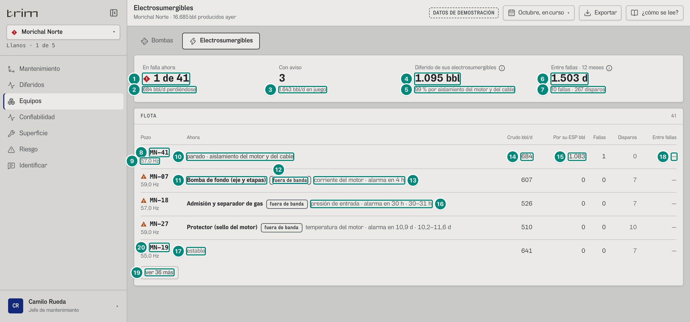
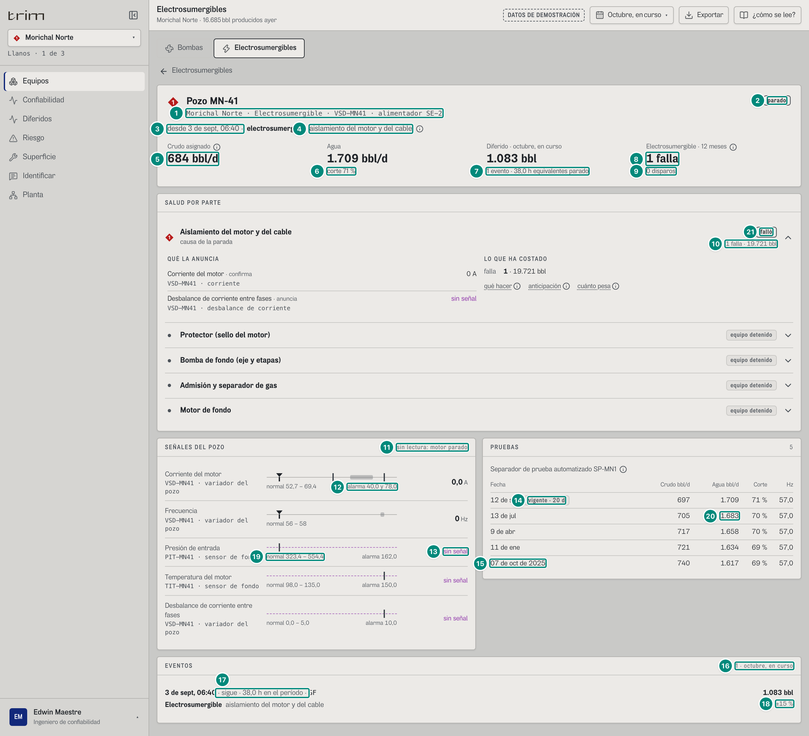
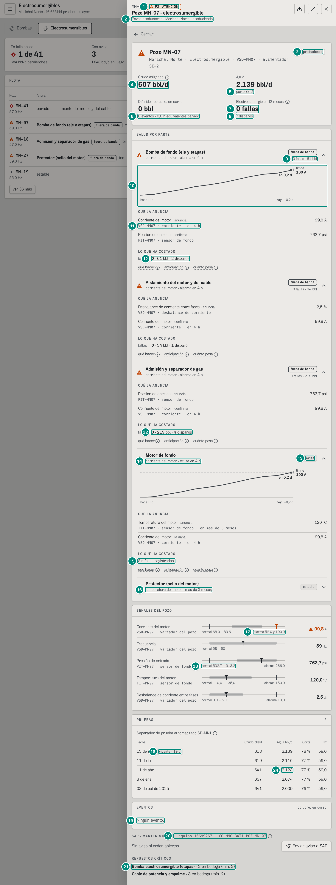
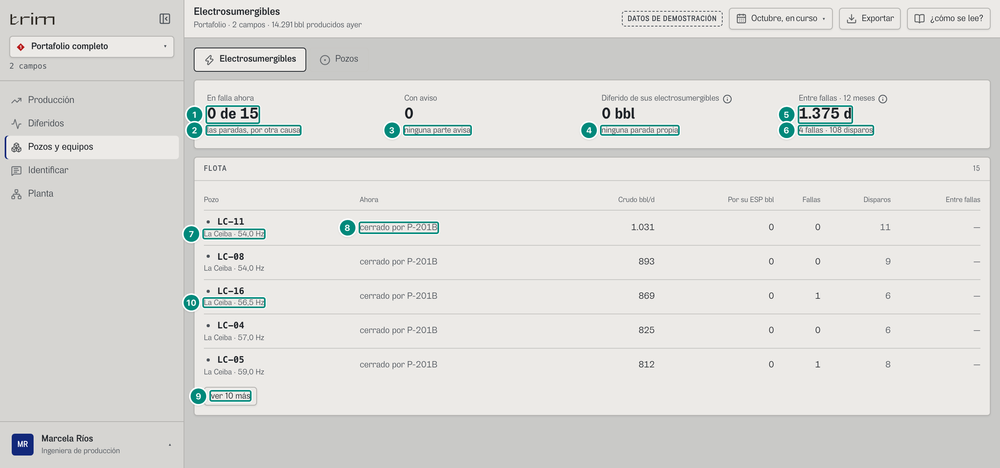
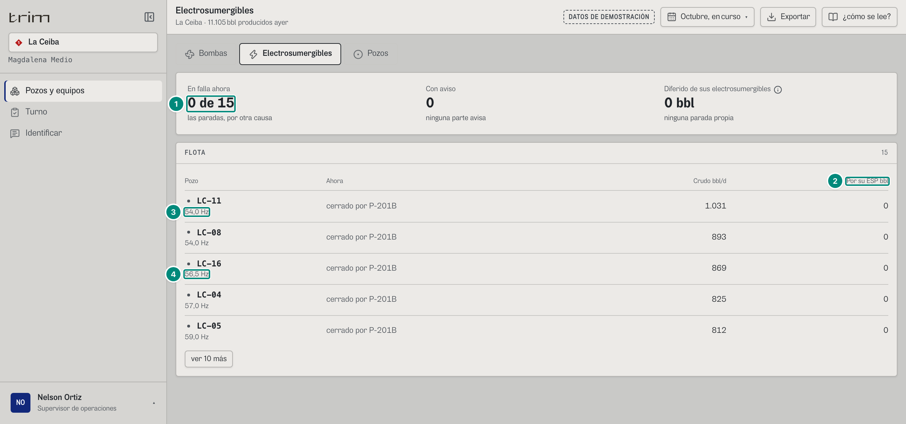
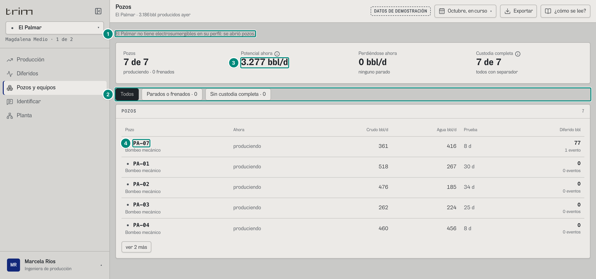

# 6B.2 Electrosumergibles — producción, supervisor, operador, técnico, jefe de mantenimiento, confiabilidad

**Para qué.** «Cuál va a fallar, qué parte y cuánto crudo arriesga.» (`PARA_QUE.esp`, `src/widgets/Onboarding.tsx:14`).

**Ruta.** `#/<rol>/esp/<campo>[~portafolio]/<período>`. La fila abierta (detalle del pozo) es estado de la pantalla (`src/pages/Esp.tsx:32`); con un pozo en la dirección (`…/curso/MN-07`) se abre la **ficha** del pozo encima.

**Roles y nivel.** `prod`, `jefe`, `conf` → `ingenieria`; `sup`, `oper`, `tec` → `operacion`. Ningún rol de decisión tiene la pantalla, a propósito: **el gerente no ve Electrosumergibles** (decisión del dueño, 8-oct). Su variante, que el código tenía sin ruta («Fallas en N meses», su Lectura, la fila que abría la ficha ejecutiva), se quitó; lo que le interesa (qué equipos de cada campo fallan y cuánto diferido cargan) está en «POR CAMPO» de su Resumen (6A).

**Qué pozos salen.** Los pozos con levantamiento `electrosumergible` de los campos del ámbito cuyo **perfil firmado** tiene electrosumergibles (`pedirFlotaEsp`, `src/shared/api/diferidos.ts:326-333`). La Ceiba: 15; Morichal: 41; Guacamayo: 12; Palmar y La Zarza: ninguno.

**Lee.**

| Endpoint | Para qué |
|---|---|
| `GET /api/vistas/electrosumergibles?campos&desde&hasta` → `[{ fila: FilaPozo, partes: SaludParte[], historial: HistorialEquipo }]` | la flota, la tabla y tres de las cuatro cifras |
| `GET /api/vistas/diferidos?campos&desde&hasta` → `Libro` | «Diferido de sus electrosumergibles» (`porTipo`, `porParte`) |
| `GET /api/vistas/pozos/:campo/:pozo?desde&hasta` → `DetallePozo` | la fila abierta (6B.3) |

`FilaPozo` (`src/shared/api/diferidos.ts:233-256`) se describe en 6B.3; aquí se usan `pozo`, `produce`, `hz`, `causa`, `crudoBpd`, `diferidoEsp` y `prueba.hz`.

---

## La flota

### Ingeniería, un campo (Morichal, jefe de mantenimiento)

| # | Lo que se ve | En la captura | Cómo se calcula | Texto según el valor | Viene de |
|---|---|---|---|---|---|
| 1 | «En falla ahora» | ◆ **1 de 41** | $a$ = pozos que **no producen** y cuya causa es `electrosumergible` (su propia ESP) de $N$ pozos de la flota (`Esp.tsx:64`). 5C §4 «Pantalla Electrosumergibles» | «a de N»; ◆ P1 si $a > 0$ (`Esp.tsx:120, 200`) | `fila.produce`, `fila.causa.tipo` |
| 2 | Pie | «684 bbl/d perdiéndose» | $\sum$ `crudoBpd` de esos pozos: MN-41 = 697 × FA 0,981 = 684,07 | sin fallas pero con paradas por otra causa: «las paradas, por otra causa»; sin paradas: «todas produciendo» (`Esp.tsx:121`) | `fila.crudoBpd` |
| 3 | «Con aviso» | 3 · «1.643 bbl/d en juego» | pozos que **producen** con alguna parte `fuera` o `avisa`; $\sum$ su crudo: MN-07 606,5 + MN-18 526,1 + MN-27 510,4 = 1.642,94 | «N bbl/d **en juego**» (como la cabecera de Riesgo: lo que se dejaría de producir por día si paran); sin ninguno: «0» y «ninguna parte avisa» (`Esp.tsx:122-123`). Antes decía «bbl/d si fallan», que choca con «≈ N bbl si falla hoy» de Riesgo, que es un costo en **bbl**, no una tasa. Aserción `rutas.ts:74`: «bbl/d en juego» sí, «bbl/d si fallan» no | `partes[].estado`, `fila.crudoBpd` |
| 4 | «Diferido de sus electrosumergibles» ⓘ | **1.095 bbl** | fila `electrosumergible` del Pareto por tipo del libro del período (5A §8 «Pareto por tipo»): $D_\text{ESP} = \sum_{\text{tramos con causa = su propia ESP}} \text{bbl} = 1.083{,}1 + 12{,}0 = 1.095{,}0$ bbl (la falla de MN-41 y el **disparo** de MN-25). Suma fallas **y** disparos: es lo mismo que suma la columna «Por su ESP bbl» de la tabla (fila 15) y el libro | `n0` + « bbl»; ⓘ «Diferido de sus electrosumergibles»: «Lo que se les cargó en el período por su propia electrosumergible: fallas y disparos. Un disparo no es una falla, pero también difiere.» (`Esp.tsx:127-129`). Antes se rotulaba «Diferido por sus fallas» con disparos adentro (6B·H9, resuelto el 8-oct: se rotuló lo que de verdad suma, en vez de excluir los disparos, para que cuadre con la tabla y con el libro) | `Libro.porTipo[tipo=electrosumergible].bbl` |
| 5 | Pie | «99 % por aislamiento del motor y del cable» | primera fila de `porParte` de la familia ESP ÷ diferido ESP: 1.083,1 / 1.095,0 = 98,9 % (5A §8 «Pareto por parte») | `n0(%)` + « % por <parte en minúscula>»; sin filas de parte: «parte sin identificar» si hay diferido, «ninguna parada propia» si no (`Esp.tsx:128`) | `Libro.porParte[]` |
| 6 | «Entre fallas · 12 meses» ⓘ (solo ingeniería) | **1.503 d** | $\text{MTBF}_\text{flota} = D \cdot N / \sum n_f = 366{,}58 \times 41 / 10$ (5C §4) | `n0` + « d»; sin fallas: «—»; el rótulo lleva $n_0(D/30{,}4)$ meses; ⓘ «Fallas y disparos»: «Un disparo es una parada que vuelve a arrancar en menos de 24 h: no es una falla. La falla es la que obliga a sacar el equipo del pozo. «Entre fallas» se calcula con dos fallas o más en la historia que hay (12 meses); con menos, no se inventa.» (`Esp.tsx:130-133`) | `historial.dias`, `historial.fallas` |
| 7 | Pie | «10 fallas · 267 disparos» | Σ fallas, Σ disparos de la flota | `plural` | `historial.fallas/disparos` |
| 8 | Pozo y marca | ◆ **MN-41** | marca `sevPozo` (`src/widgets/pozos/estado.ts:12-14`): parado por otro → 0; parado por su ESP (alto impacto) → 1; parado por otra causa propia → 2; frenado → 3; produce con la peor parte `fuera`/`avisa` → su prioridad (o 3); si no, 0 | el id es un botón (teclado); el clic de la fila abre el detalle | `fila.pozo.id` |
| 9 | Debajo del pozo | «57,0 Hz» | `n1(fila.hz ?? prueba.hz)` (en portafolio, antepuesto el campo) | sin Hz si la prueba no lo trae | `fila.hz`, `fila.prueba.hz` |
| 10 | «Ahora» de un pozo parado por sí | «parado · aislamiento del motor y del cable» | causa propia | `cerrado por <equipo>` (gris) si lo cerró otro; chip «sin identificar» si la causa es `pendiente`; si no «parado · <parte o tipo de causa en minúscula>» (`Esp.tsx:92-96`) | `fila.causa` |
| 11 | «Ahora» de un pozo que avisa | **Bomba de fondo (eje y etapas)** | `partes[0]` (la peor) en `fuera` o `avisa` | nombre en negrita | `partes[0].parte.nombre` |
| 12 | Chip | «fuera de banda» | `ESTADO_PARTE[estado]` | tono fuerte en `fuera`, neutro en `avisa` | `partes[0].estado` |
| 13 | Frase corta | «corriente del motor · alarma en 4 h» | `fraseParteCorta` (5C §3): corriente 99,8 A cruza la alarma de 100 A en 3,79 h (rango 3,64–3,96: los dos extremos se escriben «4 h», así que no hay rango) | en el papel se reemplaza por la frase larga (globo: «corriente del motor salió de su banda normal; llega a su alarma en 4 h») | `partes[0].primera/fuera` |
| 14 | Crudo bbl/d | 684 | `crudoBpd` = prueba vigente × FA del mes | `n0` | `fila.crudoBpd` |
| 15 | Por su ESP bbl | 1.083 | `diferidoEsp`: tramos del período con causa = su propia ESP (`causa.equipo = pozo` y `tipo = electrosumergible`) | `n0`; un pozo cerrado por otro tiene 0 aquí aunque haya perdido crudo | `fila.diferidoEsp` |
| 16 | Otra fila | «presión de entrada · alarma en 30 h · 30–31 h» | MN-18: PIP cruza en 30,16 h [29,6; 30,7] | `rangoCorto` | — |
| 17 | Fila sin aviso | «estable» | `ESTADO_PARTE[partes[0].estado]` en gris | sin partes: «—» | `partes[0].estado` |
| 18 | Fallas · Disparos · Entre fallas (solo ingeniería) | 1 · 0 · «—» | `historial.fallas`, `historial.disparos`, MTBF del pozo (≥ 2 fallas) | «N d» o «—» (en el demo ninguna ESP tiene dos fallas: siempre «—») | `historial` |
| 19 | «ver 36 más» | — | cinco a la vista; **ninguna fila con marca ni una que produce sin dato de sus partes queda escondida** (`Esp.tsx:51-53`). Orden (`Esp.tsx:40-52`): primero las que «quedan»; luego falló por sí → fuera → avisa → cerrada por otro → resto; luego horas de la primera señal que cruza; luego crudo | en el papel salen todas (`Esp.tsx:186`) | — |
| 20 | Las otras filas a la vista | ▲ «MN-07 · 59,0 Hz · Bomba de fondo (eje y etapas) · fuera de banda · corriente del motor · alarma en 4 h · 607 · 0 · 0 · 7 · —»; ▲ «MN-18 · 57,0 Hz · Admisión y separador de gas · fuera de banda · presión de entrada · alarma en 30 h · 30–31 h · 526 · 0 · 0 · 7 · —»; ▲ «MN-27 · 59,0 Hz · Protector (sello del motor) · fuera de banda · temperatura del motor · alarma en 10,9 d · 10,2–11,6 d · 510 · 0 · 0 · 10 · —»; • «MN-19 · 55,0 Hz · estable · 641 · 0 · 0 · 7 · —» | las reglas de las filas 8-18, fila por fila (columnas Crudo · Por su ESP · Fallas · Disparos · Entre fallas). MN-27: la temperatura del motor cruza su alarma a más de 48 h → `fmtHoras` en días con un decimal («10,9 d», rango «10,2–11,6 d»); MN-19, sin aviso, es la que sigue en el orden de la fila 19 | — | `fila`, `partes[0]`, `historial` |

El encabezado del panel «FLOTA» dice el número de pozos (41).

### Fila abierta: una electrosumergible parada por su propia falla (MN-41, confiabilidad)

Al tocar una fila (operación o ingeniería) la tabla se reemplaza por el **detalle del pozo** (`DetallePozo`, 6B.3) con «← Electrosumergibles». Las reglas generales del detalle están en 6B.3; aquí, lo que el caso de una ESP parada por sí misma muestra:

| # | Lo que se ve | En la captura | Cómo se calcula | Texto según el valor | Viene de |
|---|---|---|---|---|---|
| 1 | Identidad | «Morichal Norte · Electrosumergible · VSD-MN41 · alimentador SE-2» | campo · `LEVANTAMIENTO_NOMBRE` · controlador · alimentador eléctrico | — | `fila.pozo` |
| 2 | Chip de estado | «parado» | `!produce` | «parado» (fuerte) / «a N Hz» / «produciendo» | `fila.produce/hz` |
| 3 | Desde | «desde 3 de sept, 06:40 ·» | `fechaHora(evento.inicio)` (hora del PLC) | — | `fila.evento.inicio` |
| 4 | Por qué | **electrosumergible** aislamiento del motor y del cable ⓘ | `TIPO_CAUSA[tipo]` en minúscula (o «cerrado por <equipo>» si lo cerró otro) + parte; ⓘ «Por qué paró»: «El variador disparó por falla a tierra. Código GF (…). Se le carga a MN-41 (por señal).» | sin chip: la causa no pide respuesta | `fila.causa`, `fila.evento.codigo` |
| 5 | Crudo asignado | **684 bbl/d** ⓘ | prueba vigente 697 × FA 0,981 | ⓘ «Prueba vigente × factor de asignación del mes.» | `fila.crudoBpd` |
| 6 | Agua (solo ingeniería) | **1.709 bbl/d**, «corte 71 %» | agua de la prueba vigente (sin factor); corte = agua / (agua + crudo **de prueba**) = 1.709 / 2.406 = 71,0 % | `n0` | `fila.aguaBpd`, `fila.prueba.crudoBpd` |
| 7 | Diferido del período | **1.083 bbl** · «1 evento · 38,0 h equivalentes parado» | Σ tramos del pozo en el período (5A §3); horas equivalentes = Σ horas × factor (1 parado): del 1-oct 00:00 a AHORA = 38,0 h | `fmtHoras(h, true)` | `fila.diferido/eventos/horasParado` |
| 8 | Electrosumergible · 12 meses (solo ingeniería) | **1 falla** ⓘ | `historial.fallas` (la abierta cuenta) | ⓘ «Fallas y disparos» | `historial.fallas` |
| 9 | Pie | «0 disparos» | `historial.disparos`; « · 1 falla cada N d» solo con MTBF (≥ 2 fallas) | `plural` | `historial` |
| 10 | Salud por parte | ◆ **Aislamiento del motor y del cable** · «causa de la parada» · chip «falló» · «1 falla · 19.721 bbl»; las otras cuatro «equipo detenido» | con el pozo parado por **su propia** electrosumergible, la parte de la causa de su evento abierto sale `fallo` con prioridad 1 (`parteQueFallo(p, ctx)`, `src/entities/esp.ts:141`: evento abierto, causa `electrosumergible` del mismo pozo, su parte; aquí el código GF del variador → aislamiento). `saludDeEsp(p, ctx)` (`esp.ts:152`) pide el contexto, así que ningún llamador se la salta. Las demás no se evalúan (`detenida`). Pasa igual en GU-07 y GU-09 de Guacamayo; nunca en un pozo cerrado por otro equipo (LC-14) | chip `ESTADO_PARTE.fallo` = «falló», fuerte; la frase corta de una parte en `fallo` es «causa de la parada» (`src/widgets/bombas/comun.ts:101`); la parte en `fallo` se abre de entrada (`BloqueParte.tsx:23`). Antes salía «equipo detenido» como las demás (5C·H1, resuelto el 8-oct) | `partes[].estado/prioridad`, `historial.porParte[]` |
| 11 | Señales del pozo (ingeniería) | extra «sin lectura: motor parado» | con el pozo parado, el sensor de fondo y el desbalance no transmiten (5C §4 «Estado y lectura») | el porqué va una vez en el encabezado del panel; el renglón dice solo «PIT-MN41 · sensor de fondo» | `senales[]` |
| 12 | Corriente con el motor parado | 0,0 A · «normal 52,7 – 69,4» · «alarma 40,0 y 78,0» | se mide 0 y queda `normal` (la parada ya la marca el controlador) | — | `senales[corriente]` |
| 13 | Sin señal | «sin señal» (magenta, escala punteada) | un instrumento sin lectura viaja con `valor: null` y estado «sin señal» (CONTRATO.md, «Formas que se repiten»): es un **dato inválido** (ISA-101), no un cero ni un texto | nunca «0» ni «—» a secas; con el pozo parado es lo esperado y el porqué va una vez en el encabezado (fila 11) | `senales[].valor = null` |
| 14 | Prueba vigente | «12 de sept» · chip «vigente · 20 d» | `diasDesdePrueba` = 20,29 d | `n0` | `fila.prueba`, `fila.diasDesdePrueba` |
| 15 | Prueba de otro año | «07 de oct de 2025» | `fechaCorta` con el año (ver Huecos: el día sale con cero a la izquierda) | — | `pozo.pruebas[].fecha` |
| 16 | Eventos | «EVENTOS» · «1 · octubre, en curso» | tramos del pozo en el período | — | `DetallePozo.tramos` |
| 17 | Evento | «3 de sept, 06:40 · sigue · 38,0 h en el período · GF» / **Electrosumergible** aislamiento del motor y del cable | la hora es la **del PLC** (`evento.inicio`: 3-sep 06:40), no la del tramo. El tramo se recorta al período (empieza el 1-oct 00:00) y eso se dice: horas del tramo = 1-oct 00:00 → AHORA = 38,0 h | recortado = el tramo empieza después del evento o termina antes que él (`DetallePozo.tsx:229-230`); abierto: «sigue» + « · N h en el período» si está recortado; cerrado sin recortar: `fmtHoras(h, true)`; cerrado y recortado: «N h en el período». El globo agrega «En el período · 1 de oct, 00:00 · 38,0 h» (`DetallePozo.tsx:226-252`). Antes decía «1 de oct, 00:00 · sigue · GF» (6B·H11, resuelto el 8-oct) | `tramos[].inicio/horas/abierto`, `evento.inicio/fin/codigo`, `causa` |
| 18 | Barriles del evento | **1.083 bbl** · «±15 %» | 684,07 × 38 / 24 (5A §3 «Tramo») | ingeniería: «±`n0(sesgo×100)` %»; «aproximado» (frecuencia reducida) o «sin custodia» (sin prueba) mandan sobre el ± | `tramos[].bbl/sesgo/aproximado/sinCustodia` |
| 19 | Las otras señales del pozo | Frecuencia «VSD-MN41 · variador del pozo · 0 Hz · normal 56 – 58»; Presión de entrada «PIT-MN41 · sensor de fondo» · «sin señal» · «normal 323,4 – 554,4» · «alarma 162,0»; Temperatura del motor «TIT-MN41 · sensor de fondo» · «normal 98,0 – 135,0» · «alarma 150,0»; Desbalance de corriente «normal 0,0 – 5,0» · «alarma 10,0» | ajustes de protección del variador (5C §4 «Banda y alarma de la ESP»): frecuencia de la prueba $f = 57$ → $[f-1;\ f+1]$; presión de entrada base $P_0 = 462$ psi → $[0{,}7P_0;\ 1{,}2P_0] = [323{,}4;\ 554{,}4]$, alarma baja $\text{round}(0{,}35P_0) = 162$; temperatura base $T_0 = 108$ °C → $[T_0-10;\ 135]$, alarma 150; desbalance fijo $[0;\ 5]$ %, alarma 10. La corriente de la fila 12 sale igual: $I_0 = 62$ A → $[52{,}7;\ 69{,}4]$, alarmas $\text{round}(0{,}65I_0) = 40$ y $\text{round}(1{,}25I_0) = 78$ | `n1` en las bandas; la frecuencia con los decimales de su serie (`n0`) | `senales[].normal/alarma` (hoy sin endpoint: 5C §4) |
| 20 | PRUEBAS | «PRUEBAS · 5» · «Separador de prueba automatizado SP-MN1» ⓘ; filas Fecha · Crudo · Agua · Corte · Hz: «12 de sept · vigente · 20 d · 697 · 1.709 · 71 % · 57,0»; «13 de jul · 705 · 1.683 · 70 % · 57,0»; «9 de abr · 717 · 1.658 · 70 % · 57,0»; «11 de ene · 721 · 1.634 · 69 % · 57,0»; «07 de oct de 2025 · 740 · 1.617 · 69 % · 57,0» | las pruebas del pozo, de la más nueva a la más vieja, con las reglas de 6B.3 filas 13-15 (corte $= n_0(100\cdot\text{agua}/(\text{agua}+\text{crudo}))$; Hz con `n1`) | | `pozo.pruebas[]`, `pozo.fuentePrueba` |
| 21 | La parte que falló, abierta | chip «falló»; «QUÉ LA ANUNCIA»: «Corriente del motor · confirma · VSD-MN41 · corriente · 0 A», «Desbalance de corriente entre fases · anuncia · VSD-MN41 · desbalance de corriente · sin señal»; «LO QUE HA COSTADO»: «falla 1 · 19.721 bbl»; ⓘ «qué hacer», «anticipación», «cuánto pesa» | `BloqueParte` con las reglas de 6B.1 (detalle de ingeniería, filas 18-24): las variables de la parte con su papel; el desbalance no transmite con el motor parado (`valor: null` → «sin señal», fila 13); lo que ha costado sale de `historial.porParte` (aislamiento: 1 falla, 0 disparos, 19.721,2 bbl, la falla abierta incluida); sin «una cada N días» (< 2 fallas) ni «fuera» (sin fallas cerradas) | valor `toLocaleString('es-CO')` + unidad; sin lectura, «sin señal» en magenta | `partes[aislamiento].medidas/sinSenal`, `historial.porParte[]` |

### La ficha de una electrosumergible que avisa (MN-07, `#/jefe/esp/morichal/curso/MN-07`)

Con el pozo en la dirección se abre la **ficha** (`PanelEquipo`, 6B.4) de un equipo de clase `pozo`: el mismo `DetallePozo` (con «← Cerrar») y, por ser electrosumergible, el bloque SAP (`PanelEquipo.tsx:153-158`).

| # | Lo que se ve | En la captura | Cómo se calcula | Texto según el valor | Viene de |
|---|---|---|---|---|---|
| 1 | Cabecera de la ficha | «MN-07» ▲ «P2 · ATENCIÓN» | `EquipoVivo.severidad` del pozo (`src/entities/equipo-vivo.ts:56-57`): produce y su peor parte (`fuera`, P2) → 2 | `Severidad_`: «NORMAL», «P1 · ALARMA», «P2 · ATENCIÓN», «P3 · AVISO» (`src/shared/ui/primitivas.tsx:38-48`) | `/vistas/equipos/:campo/:equipo` → `severidad` |
| 2 | Sistema · campo · estado | «Pozos productores · Morichal Norte · produciendo» | `EquipoVivo.estado` del pozo: «produciendo», «produciendo a N Hz», «cerrado por <equipo>» o «detenido · <nombre del código>» (`equipo-vivo.ts:79`) | — | `sistema`, `estado` |
| 3 | Chip | «produciendo» | ver fila 2 de MN-41 | — | `fila.produce` |
| 4 | Crudo asignado | **607 bbl/d** | 618 × 0,981 = 606,5 | — | `fila.crudoBpd` |
| 5 | Corte | «corte 78 %» | 2.139 / (2.139 + 618) = 77,6 % | `n0` | `fila.aguaBpd`, `prueba.crudoBpd` |
| 6 | Diferido | «0 bbl» · «0 eventos · 0,0 h equivalentes parado» | sin tramos en el período | — | `fila` |
| 7 | Electrosumergible | **0 fallas** | 7 eventos propios, todos disparos (< 24 h) (5C §4 «Falla vs disparo») | — | `historial.fallas` |
| 8 | Pie | «7 disparos» | — | — | `historial.disparos` |
| 9 | Parte | Bomba de fondo · «fuera de banda» · «0 fallas · 61 bbl» | `BloqueParte`; historia de la parte (fallas + bbl de todos sus eventos, también disparos) | «N falla(s) · N bbl» (sin `plural`: «0 fallas») | `partes[]`, `historial.porParte[]` |
| 10 | Proyección | corriente hacia «límite 100 A», «en 0,2 d», eje «hoy · +0,2 d» | `Proyeccion` (5C §2): el cruce queda a menos de 46 px de «hoy» → «hoy · +0,2 d» juntos | — | `primera.senal` |
| 11 | Qué la anuncia | «VSD-MN07 · corriente · en 4 h» | tag · pronóstico corto | — | `sp.medidas[]` |
| 12 | Lo que ha costado | «fallas **0** · 61 bbl · 2 disparos» | `porParte[bomba]`: 0 fallas, 2 disparos, 61,2 bbl | sin MTBF (< 2 fallas) ni «fuera» (sin fallas cerradas) | `historial.porParte[]` |
| 13 | Parte que avisa por lo que la daña | Motor de fondo · chip «avisa» | la corriente (que **la daña**) está fuera y cruza (5C §4) | chip neutro | `partes[]` |
| 14 | Su frase | «corriente del motor · cruza en 4 h» | `fraseParteCorta` con `primera` | — | `sp.primera` |
| 15 | Sin historia | «Sin fallas registradas.» | la parte no tiene entrada en `porParte` | — | — |
| 16 | Parte estable | Protector · «temperatura del motor · más de 3 meses» | `lenta`: cruza en 8.712 h > 2.160 h | — | `sp.lenta` |
| 17 | Señales del pozo | Corriente ▲ 99,8 A · «normal 68,0 – 89,6» · «alarma 52,0 y 100,0» | ajustes de protección del variador (5C §4 «Banda y alarma de la ESP») | ▲ y tinta naranja: `atencion` | `senales[]` |
| 18 | Prueba vigente | «vigente · 19 d» | 18,9 d | — | `diasDesdePrueba` |
| 19 | Eventos | «Ningún evento.» | sin tramos en el período | extra = solo el período | `tramos` |
| 20 | SAP | «SAP · MANTENIMIENTO · equipo 10699267 · CO-MNO-BAT1-POZ-MN-07» ⓘ; «Sin aviso ni orden abiertos» + «Enviar aviso a SAP» | `BloqueSap` (6B.4; 5D §6) | — | `/sap/equipos/MN-07?campo=morichal`, `/sap/avisos`, `/sap/ordenes` |
| 21 | Repuestos críticos | «Bomba electrosumergible (etapas) · 2 en bodega (mín. 2)», «Cable de potencia y empalme · 3 en bodega (mín. 2)» | stock ≥ mínimo → sin marca (5D §6 «Repuestos críticos») | — | `repuestos[]` |
| 22 | Las otras partes | ▲ «Aislamiento del motor y del cable · fuera de banda · 0 fallas · 34 bbl»: «Desbalance de corriente entre fases · anuncia · VSD-MN07 · desbalance de corriente · 2,5 %», «Corriente del motor · confirma · VSD-MN07 · corriente · en 4 h · 99,8 A», lo que ha costado «fallas 0 · 34 bbl · 1 disparo»; ▲ «Admisión y separador de gas · fuera de banda · 0 fallas · 219 bbl»: «Presión de entrada · anuncia · PIT-MN07 · sensor de fondo · 763,7 psi», «fallas 0 · 219 bbl · 4 disparos»; en la Bomba de fondo, además, «Presión de entrada · confirma · PIT-MN07 · 763,7 psi»; en el Motor de fondo «Corriente del motor · la daña · VSD-MN07 · corriente · en 4 h · 99,8 A»; en el Protector «Temperatura del motor · anuncia · TIT-MN07 · sensor de fondo · en más de 3 meses · 120 °C» | `BloqueParte` de cada parte (orden de 5C §3 «Orden de las partes»: Bomba de fondo, Aislamiento, Admisión, Motor de fondo, Protector) con las reglas de las filas 9-16; la historia de cada parte sale de `historial.porParte` (motor: admisión 4 disparos 219 bbl, bomba 2 · 61, aislamiento 1 · 34) | | `partes[]`, `historial.porParte[]` |
| 23 | Las otras señales | Frecuencia «VSD-MN07 · variador del pozo · 59 Hz · normal 58 – 60»; Presión de entrada «PIT-MN07 · sensor de fondo · 763,7 psi · normal 532,7 – 913,2 · alarma 266,0»; Temperatura del motor «TIT-MN07 · 120,0 °C · normal 110,0 – 135,0 · alarma 150,0»; Desbalance «VSD-MN07 · 2,5 % · normal 0,0 – 5,0 · alarma 10,0» | bandas del variador (5C §4 «Banda y alarma de la ESP», ejemplo MN-07) | fila 17 | `senales[]` |
| 24 | PRUEBAS | «PRUEBAS · 5» · «Separador de prueba automatizado SP-MN1»; «13 de sept · vigente · 19 d · 618 · 2.139 · 78 % · 59,0»; «11 de jul · 619 · 2.110 · 77 % · 59,0»; «11 de abr · 641 · 2.123 · 77 % · 59,0»; «8 de ene · 637 · 2.074 · 77 % · 59,0»; «08 de oct de 2025 · 641 · 2.039 · 76 % · 59,0» | 6B.3 filas 13-15 | | `pozo.pruebas[]` |

### Portafolio y otro campo (producción, `#/prod/esp/ceiba~portafolio/curso`)

El portafolio de producción son La Ceiba y El Palmar («Portafolio · 2 campos»); El Palmar no tiene electrosumergibles, así que la flota son las 15 de La Ceiba, todas cerradas por la parada de P-201B.

| # | Lo que se ve | En la captura | Cómo se calcula | Texto según el valor | Viene de |
|---|---|---|---|---|---|
| 1 | En falla ahora | **0 de 15** | ninguna parada tiene por causa su propia ESP | sin marca | — |
| 2 | Pie | «las paradas, por otra causa» | hay pozos parados (`algunaParada`) pero ninguno por su ESP | — | — |
| 3 | Con aviso | 0 · «ninguna parte avisa» | ninguna produce | — | — |
| 4 | Diferido de sus electrosumergibles | 0 bbl · «ninguna parada propia» | sin diferido con causa en su propia ESP (las 15 las cerró P-201B: su diferido es de la bomba) | sin diferido: «ninguna parada propia»; con diferido sin parte: «parte sin identificar» (`Esp.tsx:128`) | `Libro.porTipo`, `Libro.porParte` |
| 5 | Entre fallas | **1.375 d** | 366,58 × 15 / 4 = 1.374,7 | — | `historial` |
| 6 | Pie | «4 fallas · 108 disparos» | — | — | — |
| 7 | Sub de la fila | «La Ceiba · 54,0 Hz» | en portafolio, el campo; luego el Hz de la prueba (el pozo está cerrado: `fila.hz` no viene) | — | `pozo.campoId`, `prueba.hz` |
| 8 | Ahora | «cerrado por P-201B» (gris, sin marca) | `cerradoPorOtro`: es consecuencia; la alarma es de P-201B | — | `fila.causa.equipo` |
| 9 | ver 10 más | — | orden: todas «cerradas por otro» (rango 3), luego por crudo: LC-11 1.031, LC-08 893, LC-16 869, LC-04 825, LC-05 812 | — | — |
| 10 | Las cinco filas a la vista | «LC-11 · La Ceiba · 54,0 Hz · cerrado por P-201B · 1.031 · 0 · 0 · 11 · —»; «LC-08 · 54,0 Hz · … · 893 · 0 · 0 · 9 · —»; «LC-16 · 56,5 Hz · … · 869 · 0 · 1 · 6 · —»; «LC-04 · 57,0 Hz · … · 825 · 0 · 0 · 6 · —»; «LC-05 · 59,0 Hz · … · 812 · 0 · 1 · 8 · —» | columnas Crudo · Por su ESP · Fallas · Disparos · Entre fallas (filas 14-18 de Morichal): «Por su ESP» 0 porque las cierra P-201B; Hz de la prueba (fila 7); «Entre fallas» «—» con menos de dos fallas | | `fila`, `historial` |

### Operación (`#/sup/esp/ceiba/curso`)

| # | Lo que cambia | En la captura | Regla |
|---|---|---|---|
| 1 | Tres cifras | «En falla ahora 0 de 15», «Con aviso 0», «Diferido de sus electrosumergibles 0 bbl» ⓘ | la cuarta («Entre fallas») solo en ingeniería (`Esp.tsx:130-134`) |
| 2 | Columnas | Pozo · Ahora · Crudo bbl/d · **Por su ESP bbl** | sin Fallas, Disparos ni Entre fallas (`Esp.tsx:179-181`) |
| 3 | Hz | «54,0 Hz» | igual que en ingeniería |
| 4 | Las cinco filas | «LC-11 · 54,0 Hz · cerrado por P-201B · 1.031 · 0»; «LC-08 · 54,0 Hz · 893 · 0»; «LC-16 · 56,5 Hz · 869 · 0»; «LC-04 · 57,0 Hz · 825 · 0»; «LC-05 · 59,0 Hz · 812 · 0» | las mismas de 6B.2 portafolio (fila 10) sin el campo ni las columnas de ingeniería; «Con aviso 0 · ninguna parte avisa» y «Diferido de sus electrosumergibles 0 bbl · ninguna parada propia» como en el portafolio (filas 3-4) |

La Lectura de operación e ingeniería es la misma («Cada electrosumergible avisa por su variador…», `Esp.tsx:137-145`).

### Un campo sin electrosumergibles (`#/prod/esp/palmar/curso`)

| # | Lo que se ve | En la captura | Regla | Viene de |
|---|---|---|---|---|
| 1 | Aviso | «El Palmar no tiene electrosumergibles en su perfil: se abrió pozos.» | la subpantalla `esp` no se ofrece si ningún campo del ámbito tiene `electrosumergibles` en su perfil firmado (`hayEquipo`, `src/app/grupos.ts`); pedida por dirección, se abre la primera que el rol prefiere y se dice (`src/widgets/Subpantallas.tsx:21-27`). Aserción `rutas.ts:58` | perfil firmado (`GET /api/configuracion/historial`) |
| 2 | Filtros de Pozos | «Todos · Parados o frenados · 0 · Sin custodia completa · 0» | sin ESP en el alcance, no se ofrece el filtro «Electrosumergible con aviso» ni la columna «Electrosumergible» (`src/pages/Pozos.tsx:33, 155, 193`) | — |
| 3 | Cifras de Pozos de El Palmar | «Pozos 7 de 7 · produciendo · 0 frenados»; «Potencial ahora 3.277 bbl/d»; «Perdiéndose ahora 0 bbl/d · ninguno parado» (sin marca); «Custodia completa 7 de 7 · todos con separador» | las reglas de 6B.3 filas 1-7 sobre los 7 pozos de El Palmar (todos produciendo y todos con prueba del separador; los cinco a la vista son de bombeo mecánico) | `GET /api/vistas/pozos?campos=palmar` |
| 4 | Tabla «POZOS · 7» | «PA-07 · Bombeo mecánico · produciendo · 361 · 416 · 8 d · 77 · 1 evento»; «PA-01 · … · 518 · 267 · 30 d · 0 · 0 eventos»; «PA-02 · 476 · 185 · 34 d · 0»; «PA-03 · 262 · 224 · 25 d · 0»; «PA-04 · 460 · 456 · 8 d · 0»; «ver 2 más» | 6B.3 filas 11-23 (sin columna «Electrosumergible»): ningún pozo tiene marca ni salvedad, así que el orden es por diferido (PA-07, con 77 bbl de un evento del período, primero) y a la vista quedan cinco. $361 + 518 + 476 + 262 + 460 = 2.077$; los dos escondidos suman los 1.200 restantes de los 3.277 | `FilaPozo[]` |

Si la pantalla se abriera con flota vacía (no ocurre: la subpantalla no se ofrece), diría «<ámbito> no tiene pozos con electrosumergible.» (`Esp.tsx:60-62`).

### Variantes y estados

- **Decisión**: no hay (el gerente no tiene la pantalla; la variante se quitó del código el 8-oct).
- **Período**: cambia «Diferido de sus electrosumergibles» y la columna «Por su ESP bbl» (septiembre cerrado en Morichal: 40.483 bbl, «46 % por aislamiento…»; 5C §4). Todo lo demás es «ahora».
- **«Si falla hoy» (Riesgo, 6C), no aquí.** Esta pantalla da tasas: «bbl/d perdiéndose» y «bbl/d en juego». El costo en barriles de una falla de hoy lo da Riesgo: $\text{costo} = Q_\text{pozo hoy} \cdot \bar d / 24$, con $\bar d$ = horas fuera promedio de sus fallas cerradas o, si no ha fallado, de las electrosumergibles del campo (`costoDe: 'flota'`), y su ⓘ lo escribe con la regla única de horas (`textoHoras`): «20,3 d fuera, el promedio de las electrosumergibles del campo (esta no ha fallado)» en Morichal (MN-07: $606{,}53 \times 486{,}3 / 24 = 12.290{,}8$ bbl) y «25,7 d fuera» en Guacamayo (GU-04: $647{,}23 \times 616{,}1 / 24 = 16.614{,}9$ bbl). Antes decía «20 días fuera» / «26 días fuera» (y «1 días» con menos de 36 h).
- **Teléfono**: la tabla se vuelve una tarjeta por pozo (marca, id, «<parte> · <estado>» o «cerrado por…»/«parado · …»/«en marcha», crudo bbl/d y «N bbl por su ESP») (`Esp.tsx:148-170`).
- **Una ESP que produce sin dato de sus partes** (`partes[0].estado = sin-dato`): queda siempre a la vista (`Esp.tsx:51`); no ocurre en el demo.

### Interacciones

Clic en una fila (o Enter en el id): detalle del pozo en la misma pantalla. Globo de la columna «Ahora» con la frase larga de la parte (`fraseParte`). «ver N más».
