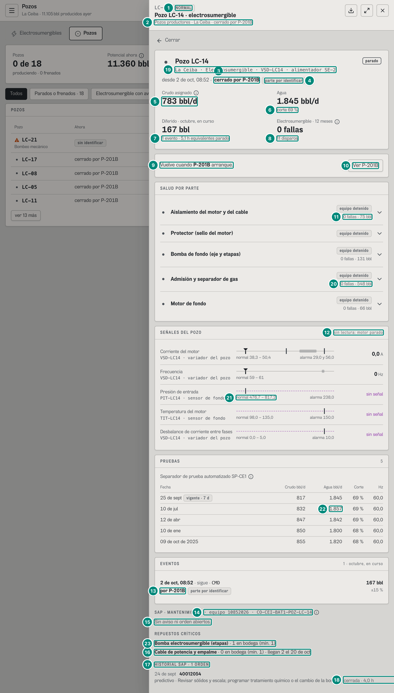

# 6B.3 Pozos — producción, supervisor

**Para qué.** «Caudal de cada pozo, su origen y qué lo para.» (`PARA_QUE.pozos`, `src/widgets/Onboarding.tsx:20`).

**Ruta.** `#/<rol>/pozos/<campo>[~portafolio]/<período>`. Una fila abierta reemplaza la tabla por el detalle del pozo con «← Pozos» (estado de la pantalla, `src/pages/Pozos.tsx:38, 78-81`; el auditor abre la primera fila en `#/prod/pozos/ceiba/curso`, `ABRIR_FILA`, `e2e/auditoria/rutas.ts:34`). Con un pozo en la dirección (`…/curso/LC-21`) se abre la **ficha** del pozo encima (`PanelEquipo` → `DetallePozo` con «← Cerrar»): mismo contenido, más el bloque SAP si el pozo tiene electrosumergible.

**Roles y nivel.** `prod` → `ingenieria`; `sup` → `operacion`. (Ningún otro rol tiene la pantalla.)

**Lee.**

| Endpoint | Para qué |
|---|---|
| `GET /api/vistas/pozos?campos&desde&hasta` → `FilaPozo[]` | la tabla y la cabecera (`pedirFilasPozos`, `src/shared/api/diferidos.ts:279`) |
| `GET /api/vistas/pozos/:campo/:pozo?desde&hasta` → `DetallePozo \| null` | el detalle (`pedirPozo`, `diferidos.ts:298-310`) |
| configuración firmada (perfil del campo, ya cargada al arrancar) | si hay electrosumergibles en el alcance (`conEsp`, `Pozos.tsx:32-33`) |

`FilaPozo` (`src/shared/api/diferidos.ts:233-256`, una por pozo del campo, calculada «ahora» salvo lo del período):

| Campo | Qué es | Ficha |
|---|---|---|
| `pozo` | el registro del pozo (`id`, `campoId`, `levantamiento`, `controlador`, `alimentador`, `origen` de su prueba: `instrumento` / `estimado` / …, `pruebas[]`, `fuentePrueba`) | 5A §1 «La prueba de pozo» |
| `produce`, `hz`, `evento`, `causa` | estado ahora (`estadoAhora`) y la causa de su evento abierto (`causaDeEvento`) | 5B §1 «Estado del pozo ahora», 5B §2 |
| `crudoBpd` | prueba vigente × FA del mes (`crudoAsignado`) | 5A §2–3 |
| `aguaBpd` | agua de la prueba vigente (sin factor) | 5A §1 |
| `prueba`, `diasDesdePrueba` | la prueba vigente y su edad en días (`(AHORA − fecha)/1 d`) | — |
| `diferido`, `eventos`, `horasParado` | Σ bbl de sus tramos del período (sea cual sea la causa), número de tramos, Σ horas × factor | 5A §3 «Tramo» |
| `diferidoEsp` | solo lo de su propia electrosumergible | 6B.2 |
| `salud?` | `saludDeEsp(pozo)[0]`: la peor parte de su ESP | 5C §4 |

---

## La tabla

### Ingeniería (producción, La Ceiba)

| # | Lo que se ve | En la captura | Cómo se calcula | Texto según el valor | Viene de |
|---|---|---|---|---|---|
| 1 | «Pozos» | **0 de 18** | $N - \#\{\lnot\text{produce}\}$ de $N$ (`Pozos.tsx:47, 135`) | «a de N» | `produce` |
| 2 | Pie | «produciendo · 0 frenados» | frenados = producen con `hz` (frecuencia reducida) | `plural(n,'frenado','frenados')` | `hz` |
| 3 | «Potencial ahora» ⓘ | **11.360 bbl/d** | $\sum_p \text{crudoBpd}_p$ sobre **todos** los pozos (11.359,71); es el mismo `potencialBpd` del estado del campo (5B §5.4) | `n0` + « bbl/d»; ⓘ «La prueba vigente de cada pozo por el factor de asignación del mes.» | `crudoBpd` |
| 4 | «Perdiéndose ahora» | ◆ **11.360 bbl/d** (rojo) | $\sum$ `crudoBpd` de los pozos que **no producen** (`Pozos.tsx:50`): los 18. **No** suma la fracción de los frenados (Riesgo sí la suma, 5B §5.2) | marca (`Pozos.tsx:66`): ◆ P1 y cifra roja si alguna causa es de alto impacto (`reinyeccion`, `electrosumergible`); ▲ P2 si no; sin marca con 0 | `crudoBpd`, `causa.tipo` |
| 5 | Pie | «18 pozos parados» | — | `plural(n,'pozo parado','pozos parados')`; con 0: «ninguno parado» | — |
| 6 | «Custodia completa» ⓘ (solo ingeniería) | **17 de 18** | pozos con prueba del separador = $N$ − sin prueba − estimados (`Pozos.tsx:83`) | ⓘ «Pozos con prueba del separador de prueba. Una estimada sale de la electrosumergible, no de un separador. Un pozo sin prueba no tiene a quién asignarle su crudo: sube el factor del campo y su diferido no se puede calcular.» | `pozo.origen`, `pozo.pruebas` |
| 7 | Pie | «1 estimada» | LC-17 (prueba estimada) | «N estimada(s)» · «N sin prueba»; si no hay ninguna de las dos: «todos con separador» (`Pozos.tsx:84-85`) | — |
| 8 | Filtro | «Parados o frenados · 18» | parados + frenados | botones con `aria-pressed`; el filtro filtra la misma lista | — |
| 9 | Filtro | «Electrosumergible con aviso · 0» | pozos que producen con `salud` en `fuera`/`avisa` | solo si hay ESP en el alcance (`conEsp`) | `salud.estado` |
| 10 | Filtro | «Sin custodia completa · 1» | sin prueba + estimados | solo ingeniería; filtra `origen ≠ instrumento` | `pozo.origen` |
| 11 | Pozo y marca | ▲ **LC-21** | `sevPozo` (`src/widgets/pozos/estado.ts:12-14`): parado por otro → 0 (gris); parado por causa propia de alto impacto → 1; parado por otra causa propia (aquí: sin identificar) → 2; frenado por sí → 3; produce con la ESP que avisa → la prioridad de la parte (o 3); si no, 0 | el id es un botón (teclado); el clic de la fila abre el detalle | `pozo.id`, `produce`, `causa`, `hz`, `salud` |
| 12 | Debajo del id | «Bombeo mecánico» | `LEVANTAMIENTO_NOMBRE`, salvo que la columna «Electrosumergible» ya lo diga (pozo ESP); en portafolio, el campo (`Pozos.tsx:93`) | — | `pozo.levantamiento` |
| 13 | «Ahora» | chip «sin identificar» | produce sin `hz` → «produciendo» gris; si no: «a N Hz · » (si frenado) + quién: «cerrado por <equipo>» si lo cerró otro (en el papel « · <tipo de causa>»); chip «sin identificar» si la causa es `pendiente`; si no `TIPO_CAUSA` en minúscula; sin causa «parado» (`Pozos.tsx:88-91, 108-113`) | globo: título `TIPO_CAUSA` (o «Evento abierto»), pista = `causa.texto`, filas «Se le carga a», «Código», «Señal»/«Otra señal» (las dos primeras evidencias) | `causa`, `evento.codigo`, `causa.evidencia` |
| 14 | Crudo bbl/d | 301 | `crudoBpd` = 314 × FA 0,958 = 300,83 | `n0`; **sin prueba: «—»** (no 0) | `crudoBpd` |
| 15 | Agua bbl/d | 234 | `aguaBpd` | `n0`; sin prueba «—» | `aguaBpd` |
| 16 | Prueba (solo ingeniería) | «10 d» | `diasDesdePrueba` = 10,29 | separador (`instrumento`) → «N d» (el lector oye «separador · N d»); `estimado` → chip «estimada · N d»; sin prueba vigente → chip fuerte «sin prueba» (`Pozos.tsx:119-124`) | `diasDesdePrueba`, `pozo.origen` |
| 17 | Electrosumergible | «—» | pozo sin ESP | solo con ESP en el alcance; parte en minúscula + chip `ESTADO_PARTE` si `fallo`/`fuera`/`avisa` (neutro en `avisa`); si no, el estado en gris («equipo detenido», «estable») (`Pozos.tsx:125-127`) | `salud` |
| 18 | Diferido bbl | **247** | `diferido`: Σ bbl de sus tramos del período, **sea cual sea la causa** (un pozo cerrado por la bomba aparece aquí, pero cuenta en la bomba en los Paretos) | `n0` | `diferido` |
| 19 | Pie | «1 evento» | `eventos` (tramos) | `plural(n,'evento','eventos')` | `eventos` |
| 20 | Otra fila | • «cerrado por P-201B» | `cerradoPorOtro`: causa con `equipo ≠ pozo` | gris, sin marca. Globo de «Ahora» (fila 13) de un pozo cerrado por la bomba, p. ej. LC-08: las dos primeras evidencias de la causa, sin repetir: «Señal» = «ZS-2011 · marcha → paro · 2 de oct, 03:52» (el paro de la bomba), «Otra señal» = «VSD-LC08 · código CMD · 2 de oct, 08:22» (el cierre del pozo); la tercera, el porqué de la bomba sin identificar («Sin primera alarma y sin firma: …», también en `causa.porQueNo`). Antes las dos primeras eran el mismo paro de la bomba (6B·H13, resuelto el 8-oct) | `causa.equipo`, `causa.evidencia[]` |
| 21 | Prueba estimada | chip «estimada · 5 d» | LC-17, `origen: estimado`, 4,96 d | — | — |
| 22 | ESP detenida | «equipo detenido» | con el pozo parado su ESP no se evalúa | — | `salud.estado` |
| 23 | «ver 13 más» | — | cinco a la vista; ningún pozo con marca **ni con salvedad** queda escondido (`Pozos.tsx:76`). Salvedad (`Pozos.tsx:64-65`): sin prueba, o (en ingeniería) prueba que no es del separador, o ESP produciendo sin dato. Orden (`Pozos.tsx:72`): marca (1, 2, 3, luego 0) → con salvedad primero → diferido descendente | en el papel salen todas (`Pozos.tsx:199`) | — |
| 24 | Las otras filas a la vista | «LC-17 · cerrado por P-201B · 539 · 1.430 · estimada · 5 d · equipo detenido · 129 · 1 evento»; «LC-08 · cerrado por P-201B · 893 · 1.211 · 15 d · equipo detenido · 318 · 2 eventos»; «LC-05 · … · 812 · 1.060 · 12 d · … · 300 · 2 eventos»; «LC-11 · … · 1.031 · 1.635 · 8 d · … · 251 · 1 evento» | las reglas de las filas 11-22, fila por fila. Orden (fila 23): LC-21 (▲) primero, LC-17 (salvedad: prueba estimada) después, y el resto por diferido descendente (318, 300, 251). LC-08 y LC-05 tienen 2 eventos (motor): LC-08 = 108,5 bbl de su parada del 1-oct, 22:15, sin identificar (6B.5 fila 15) + 209,6 del cierre por P-201B; LC-05 = 117,9 de la caída de SE-2 del 1-oct, 09:16 + 182,2 del cierre por P-201B. La columna Diferido suma **todas** las causas (fila 18) | — | `FilaPozo[]` |

El encabezado del panel «POZOS» dice cuántas filas deja el filtro (18).

### Operación (supervisor, La Ceiba)

| # | Lo que cambia | En la captura | Regla |
|---|---|---|---|
| 1 | Tres cifras | «Pozos», «Potencial ahora», «Perdiéndose ahora 11.360 bbl/d» | sin «Custodia completa» (`Pozos.tsx:140`). Aserción `rutas.ts:66`: «Custodia» y «Sin custodia completa» no deben aparecer |
| 2 | Filtros | «Todos · Parados o frenados · 18 · Electrosumergible con aviso · 0» | sin el de custodia; si el rol cambia a uno de operación con el filtro de custodia puesto, se vuelve a «Todos» (`Pozos.tsx:58`) |
| 3 | Columnas | Pozo · Ahora · Crudo · Agua · **Electrosumergible** · Diferido | sin «Prueba» |
| 4 | Orden | LC-21, **LC-08**, LC-05, LC-11, LC-16 | en operación la prueba estimada no es salvedad: LC-17 (129 bbl) baja a su lugar por diferido y queda tras «ver 13 más» |
| 5 | Filas a la vista | «LC-08 · cerrado por P-201B · 893 · 1.211 · equipo detenido · 318 · 2 eventos»; «LC-05 · 812 · 1.060 · 300 · 2 eventos»; «LC-11 · 1.031 · 1.635 · 251 · 1 evento»; «LC-16 · 869 · 2.299 · 213 · 1 evento» (y LC-21 como en ingeniería) | columnas Crudo · Agua · Electrosumergible · Diferido de 6B.3 filas 14-19, sin «Prueba» |

La Lectura es la misma para los dos niveles («El estado de cada pozo lo dice su controlador…», `Pozos.tsx:144-151`).

### Estados de la tabla

| Estado | Qué se ve |
|---|---|
| Pozo sin prueba | Crudo y Agua «—»; Prueba chip fuerte «sin prueba»; siempre a la vista (salvedad); su diferido es 0 con el tramo marcado `sinCustodia` (5A §3) |
| Pozo frenado (HZ) | «a 45,0 Hz · <causa>» en «Ahora»; marca ■ P3 si es causa propia; cuenta en «frenados» y en el filtro «Parados o frenados» |
| Campo sin ESP | sin filtro ni columna «Electrosumergible» (El Palmar, 6B.2) |
| Portafolio | el campo debajo de cada id; en el teléfono, « · <campo>» junto al id |
| Teléfono | una tarjeta por pozo: marca, id, «produciendo» o «a N Hz · <causa>», crudo bbl/d y «N bbl diferidos» (`Pozos.tsx:165-183`) |

---

## El detalle de un pozo (`DetallePozo`)

`src/widgets/pozos/DetallePozo.tsx`. Se ve desde Pozos (fila o dirección), desde Electrosumergibles (6B.2) y en la ficha de cualquier pozo (6B.4). `DetallePozo` (`src/shared/api/diferidos.ts:286-296`) trae `fila` (la `FilaPozo` del pozo), `tramos` (sus tramos del período, más reciente primero), `historicos` (todos sus eventos con causa), `senales` y `partes` (solo ESP) e `historial` (solo ESP). Un pozo que no existe en el campo responde `null` y la pantalla dice «No hay un pozo <id> en <campo>.» (`DetallePozo.tsx:43`).

### Un pozo parado sin causa identificada (LC-21, ficha, producción)

| # | Lo que se ve | En la captura | Cómo se calcula | Texto según el valor | Viene de |
|---|---|---|---|---|---|
| 1 | Cabecera de la ficha | «LC-21» ▲ «P2 · ATENCIÓN» | severidad del pozo como equipo vivo (`src/entities/equipo-vivo.ts:56-57`, la misma regla que `sevPozo`) | `Severidad_` | `/vistas/equipos/ceiba/LC-21` → `severidad` |
| 2 | Sistema · campo · estado | «Pozos productores · La Ceiba · detenido · parada por orden» | `estado` = «detenido · <CODIGO[código]>» (`CMD` = «parada por orden») | ver 6B.2 fila 2 | `EquipoVivo.estado` |
| 3 | Identidad | «La Ceiba · Bombeo mecánico · POC-LC21 · alimentador SE-2» | campo · levantamiento · controlador · alimentador | — | `fila.pozo` |
| 4 | Chip | «parado» | `!produce` | «parado» fuerte / «a N Hz» / «produciendo»; en ingeniería, además «prueba estimada» (neutro) o «sin prueba» (fuerte) si la prueba no es del separador (`DetallePozo.tsx:75-78`) | `fila.produce/hz`, `pozo.origen` |
| 5 | Desde | «desde 1 de oct, 18:20 ·» | `fechaHora(evento.inicio)` | solo si hay evento abierto | `fila.evento.inicio` |
| 6 | Qué falta | chip «sin identificar» ⓘ | `estadoIdentificacion(causa, fin).pide` (5B §3.2): si lo cerró otro equipo, «parte por identificar»; si no, «sin identificar» (`DetallePozo.tsx:56-57`). Antes del chip, en negrita, «cerrado por <equipo>» o el tipo de causa (no con `pendiente`) y la parte | ⓘ «Por qué paró» (o «Por qué está frenado»): «Ninguna señal explica por qué paró: hay que identificarlo. Código CMD (parada por orden). Se le carga a LC-21 (sin identificar).» (`DetallePozo.tsx:89-90`) | `fila.causa`, `fila.evento` |
| 7 | «Crudo asignado» ⓘ | **301 bbl/d** | prueba vigente 314 × FA del mes 0,958 = 300,83 (5A §2) | ⓘ «Prueba vigente × factor de asignación del mes.»; sin prueba: «sin prueba» + ⓘ «No se le inventa caudal: sin prueba no hay de dónde sacarlo.» | `fila.crudoBpd` |
| 8 | «Agua» (solo ingeniería) | **234 bbl/d** | agua de la prueba vigente | `n0`; sin prueba «—» | `fila.aguaBpd` |
| 9 | Corte | «corte 43 %» | $\text{agua}/(\text{agua} + \text{crudo de la prueba}) = 234/(234+314) = 42{,}7\,\%$ (`DetallePozo.tsx:99`) | `n0` + « %»; vacío si crudo + agua = 0 | `aguaBpd`, `prueba.crudoBpd` |
| 10 | «Diferido · <período>» | **247 bbl** | Σ tramos del período (5A §3); el rótulo lleva el nombre del período en minúscula (la ficha tapa el selector de la cabecera) | `n0` + « bbl» | `fila.diferido` |
| 11 | Pie | «1 evento · 19,7 h equivalentes parado» | horas × factor: del 1-oct 18:20 a AHORA = 19,67 h | «N evento(s) · `fmtHoras(h, true)` equivalentes parado» | `fila.eventos/horasParado` |
| 12 | Franja | ▲ «No arrancar hasta identificar por qué paró.» + «Identificar» | `pide`, evento abierto, causa propia (`DetallePozo.tsx:111-118`); el botón solo con la pantalla `causa` en el rol | — | `fila.causa`, `fila.evento.fin` |
| 13 | Pruebas (solo ingeniería) | «PRUEBAS» · 5 · «Separador de prueba automatizado SP-CE1» ⓘ | la primera parte de `fuentePrueba` (hasta « · » o «: »); la ⓘ «De dónde sale la prueba» trae la frase entera («… · FT-CE1181 crudo · …») | extra = número de pruebas; sin pruebas: «sin custodia» y el hueco «**Sin prueba:** hay que probarlo.» + ⓘ «Su crudo llega al punto de medición oficial pero nadie lo asigna: sube el factor del campo y su diferido no se puede calcular.» | `pozo.pruebas`, `pozo.fuentePrueba` |
| 14 | Prueba vigente | «22 de sept» chip «vigente · 10 d» | la de `fila.prueba` | `fechaCorta`; otro año «09 de oct de 2025» | `prueba`, `diasDesdePrueba` |
| 15 | Corte de cada prueba | «43 %» | $n_0(\text{agua}/(\text{agua}+\text{crudo})\times100)$ por fila; columna «Hz» solo para electrosumergible (`n1`, «—» si no trae) | — | `pozo.pruebas[]` |
| 16 | Eventos | «EVENTOS» · «1 · octubre, en curso» | tramos del período; extra «N · <período>» o solo el período | «Ningún evento.» | `DetallePozo.tramos` |
| 17 | Un evento | «1 de oct, 18:20 · sigue · **CMD**» / chip «sin identificar» | la hora **del PLC** (`evento.inicio`), no la del tramo; «sigue» o la duración `fmtHoras(h, true)`; si el tramo está **recortado** al período (empieza después del evento o termina antes que él), se dice: « · N h en el período» (abierto: «sigue · N h en el período»); código; « a N Hz» si es HZ; debajo, en negrita, «por <equipo>» si lo cargó otro, o `TIPO_CAUSA`; la parte; el chip de identificación. LC-21 paró dentro del período: sin recorte. Con recorte, ver MN-41 (6B.2, fila 17: «3 de sept, 06:40 · sigue · 38,0 h en el período · GF») | globo (y papel): «<hora del PLC> · <tipo>», pista = `causa.texto`, filas «Se le carga a», «Cómo se identificó», «Código» y, si está recortado, «En el período · <inicio del tramo> · <horas>» (`DetallePozo.tsx:226-252`). Antes la fila escribía el inicio del tramo (6B·H11, resuelto el 8-oct) | `tramos[].inicio/horas/abierto`, `evento.inicio/fin` |
| 18 | Barriles del evento | **247 bbl** · «±15 %» | Σ del tramo (5A §3) | ingeniería: «±`n0(sesgo×100)` %»; «aproximado» (HZ) y «sin custodia» mandan; operación sin pie | `tramos[].bbl/sesgo` |
| 19 | Las otras pruebas | «12 de jul · 313 · 229 · 42 %»; «11 de abr · 314 · 225 · 42 %»; «9 de ene · 318 · 223 · 41 %»; «09 de oct de 2025 · 328 · 223 · 40 %» (y la vigente «22 de sept · 314 · 234 · 43 %», filas 14-15) | una fila por prueba de `pozo.pruebas`, de la más nueva a la más vieja; corte de la fila 15; sin columna Hz (bombeo mecánico) | fecha de otro año con el día en dos cifras (Huecos 14) | `pozo.pruebas[]` |

### Un pozo con electrosumergible cerrado por otro equipo (LC-14, `#/prod/pozos/morichal/curso/LC-14`)

La dirección pide Morichal, pero producción no tiene Morichal asignado (`prod`: La Ceiba y El Palmar): la dirección no abre un campo ajeno (`src/app/url.ts:66-73`) y la ficha se abre sobre **La Ceiba**, el LC-14 de La Ceiba. Es el caso de una ESP sana cerrada por la parada de P-201B.

| # | Lo que se ve | En la captura | Cómo se calcula | Texto según el valor | Viene de |
|---|---|---|---|---|---|
| 1 | Severidad | «NORMAL» (gris) | cerrado por otro equipo → 0 (la alarma es de P-201B) | — | `EquipoVivo.severidad` |
| 2 | Estado | «Pozos productores · La Ceiba · cerrado por P-201B» | `estado` del pozo | — | `EquipoVivo.estado` |
| 3 | Quién | «desde 2 de oct, 08:52 · **cerrado por P-201B**» | causa con `equipo ≠ pozo` | — | `fila.causa.equipo` |
| 4 | Qué falta | chip «parte por identificar» ⓘ | la parada de P-201B pide respuesta: lo que falta es la **parte de la bomba**, no por qué paró el pozo | ⓘ «Se cerró porque la bomba de reinyección estaba parada y el tanque de agua lleno. Código CMD (parada por orden). Se le carga a P-201B (sin identificar).» | `fila.causa`, `estadoIdentificacion` |
| 5 | Crudo asignado | **783 bbl/d** | 817 × 0,958 | — | `fila.crudoBpd` |
| 6 | Corte | «corte 69 %» | 1.845 / (1.845 + 817) | — | — |
| 7 | Diferido | 167 bbl · «1 evento · 5,1 h equivalentes parado» | cerrado desde las 08:52 (último pozo que cerró la bomba) | — | `fila` |
| 8 | Electrosumergible · 12 meses | «0 fallas» · «11 disparos» | 11 eventos propios, todos < 24 h | — | `historial` |
| 9 | Franja | «Vuelve cuando **P-201B** arranque.» | `pide`, abierto y **cerrado por otro** (`DetallePozo.tsx:122-127`): en vez de «No arrancar», a quién esperar | — | `fila.causa` |
| 10 | Botón | «Ver P-201B» | abre la ficha de P-201B (`abrirEquipo`) | — | — |
| 11 | Salud por parte | todas «equipo detenido»; «0 fallas · 75 bbl» | historia de cada parte (disparos) | — | `partes`, `historial.porParte` |
| 12 | Señales | «sin lectura: motor parado» | ver 6B.2 | — | `senales` |
| 13 | Evento | «2 de oct, 08:52 · sigue · CMD» / «**por P-201B**» chip «parte por identificar» · 167 bbl · ±15 % | tramo cargado a P-201B | — | `tramos[]` |
| 14 | SAP | «SAP · MANTENIMIENTO · equipo 10852026 · CO-CEI-BAT1-POZ-LC-14» ⓘ | identidad SAP (5D §6) | — | `/sap/equipos/LC-14?campo=ceiba` |
| 15 | Sin aviso | «Sin aviso ni orden abiertos.» | sin aviso ni orden abiertos y **sin** la capacidad `sap:aviso` (producción): solo la frase; con la capacidad, la frase y el botón «Enviar aviso a SAP» (6B.4) | — | `/sap/avisos`, `/sap/ordenes` |
| 16 | Repuesto en tránsito | «Cable de potencia y empalme · 0 en bodega (mín. 1) · llegan 2 el 20 de oct» | falta pero viene en camino: sin ■ | «llega/llegan N el <fecha>» | `repuestos[].enTransito` |
| 17 | Historial SAP (ingeniería) | «HISTORIAL SAP · 1 ORDEN» | órdenes del equipo, de la más reciente | «ORDEN»/«ÓRDENES» | `/sap/ordenes` |
| 18 | Una orden | «24 de sept **40012054** predictivo · Revisar sólidos y escala; … cerrada · 4,0 h» | «<fechaCorta(creada)> <número> <clase> · <descripción> <estado> · <n1(horas reales)> h» | cinco y «ver N más» | `OrdenSap` |
| 19 | Identidad | «La Ceiba · Electrosumergible · VSD-LC14 · alimentador SE-2» | como LC-21 (fila 3) | — | `fila.pozo` |
| 20 | Historia de cada parte | Aislamiento «0 fallas · 75 bbl», Bomba de fondo «0 fallas · 131 bbl», Admisión «0 fallas · 548 bbl», Motor de fondo «0 fallas · 66 bbl» (el Protector, sin historia) | `historial.porParte` (motor): admisión 6 disparos 548 bbl, bomba 2 · 131, aislamiento 2 · 75, motor 1 · 66; $6 + 2 + 2 + 1 = 11$ disparos (fila 8) | «N falla(s) · N bbl», sin `plural` | `historial.porParte[]` |
| 21 | Bandas de las señales | Corriente «VSD-LC14 · variador del pozo · 0,0 A · normal 38,3 – 50,4 · alarma 29,0 y 56,0»; Frecuencia «0 Hz · normal 59 – 61»; Presión de entrada «PIT-LC14 · sensor de fondo · normal 476,7 – 817,2 · alarma 238,0»; Temperatura «TIT-LC14 · normal 98,0 – 135,0 · alarma 150,0»; Desbalance «normal 0,0 – 5,0 · alarma 10,0» | 5C §4 «Banda y alarma de la ESP» con $I_0 = 45$ A, $f = 60$ Hz, $P_0 = 681$ psi, $T_0 = 108$ °C: $[0{,}85I_0;\ 1{,}12I_0] = [38{,}3;\ 50{,}4]$, alarmas $\text{round}(0{,}65I_0) = 29$ y $\text{round}(1{,}25I_0) = 56$; $[f-1;\ f+1]$; $[0{,}7P_0;\ 1{,}2P_0]$, alarma $\text{round}(0{,}35P_0) = 238$ | con el motor parado: 0 y «sin señal» (fila 12) | `senales[]` |
| 22 | PRUEBAS | «PRUEBAS · 5» · «Separador de prueba automatizado SP-CE1»; «25 de sept · vigente · 7 d · 817 · 1.845 · 69 % · 60,0»; «10 de jul · 832 · 1.857 · 69 % · 60,0»; «12 de abr · 847 · 1.842 · 69 % · 60,0»; «10 de ene · 850 · 1.800 · 68 % · 60,0»; «09 de oct de 2025 · 855 · 1.820 · 68 % · 60,0» | como LC-21 (filas 13-15) más la columna Hz (`n1`) por ser electrosumergible; la vigente da el crudo de la fila 5 (817 × 0,958) | | `pozo.pruebas[]` |
| 23 | Otro repuesto | «Bomba electrosumergible (etapas) · 1 en bodega (mín. 1)» | stock = mínimo → sin marca (5D §6 «Repuestos críticos») | | `repuestos[]` |

### Variantes del detalle

| Nivel | Qué ve |
|---|---|
| `ingenieria` (producción, jefe, confiabilidad) | Agua y corte, «Electrosumergible · N meses», chips de prueba estimada / sin prueba, «SALUD POR PARTE» (`BloqueParte`, 6B.1), «SEÑALES DEL POZO» (todas), «PRUEBAS», «±N %» en cada evento |
| `operacion` (supervisor; y desde Electrosumergibles, operador y técnico) | sin Agua, sin ESP · N meses, sin PRUEBAS; «PARTES QUE AVISAN» (solo `fallo`/`fuera`/`avisa`, con la frase corta, globo con la frase larga y ⓘ «qué hacer»; «Ninguna parte avisa.»); «FUERA DE BANDA» (señales en aviso, atención o alarma) y «SIN SEÑAL · con el pozo produciendo» (un instrumento sin lectura viaja con `valor: null` y estado «sin señal»: es un dato inválido, ISA-101, y se dice «sin señal» en magenta, nunca 0 ni «—»); con el pozo parado la falta de lectura es lo esperado y no se repite (`src/widgets/pozos/estado.ts:28-33`) |

**Estados.** Pozo produciendo sin evento: sin la línea «desde …» ni franjas. Pozo frenado por causa propia: chip «a N Hz», ⓘ «Por qué está frenado». Evento cerrado que pide respuesta (arrancó sin identificar): no hay franja «No arrancar» (`!f.evento?.fin`), pero el chip del evento sigue. Pozo sin prueba: «sin prueba» en vez del crudo, «—» en el agua, «sin custodia» en PRUEBAS.

**Interacciones.** «← Pozos»/«← Electrosumergibles»/«← Cerrar»; «Identificar» → pantalla de causa; «Ver <equipo>» → ficha del equipo que lo cerró; globos de cada evento (en el papel, escritos).
