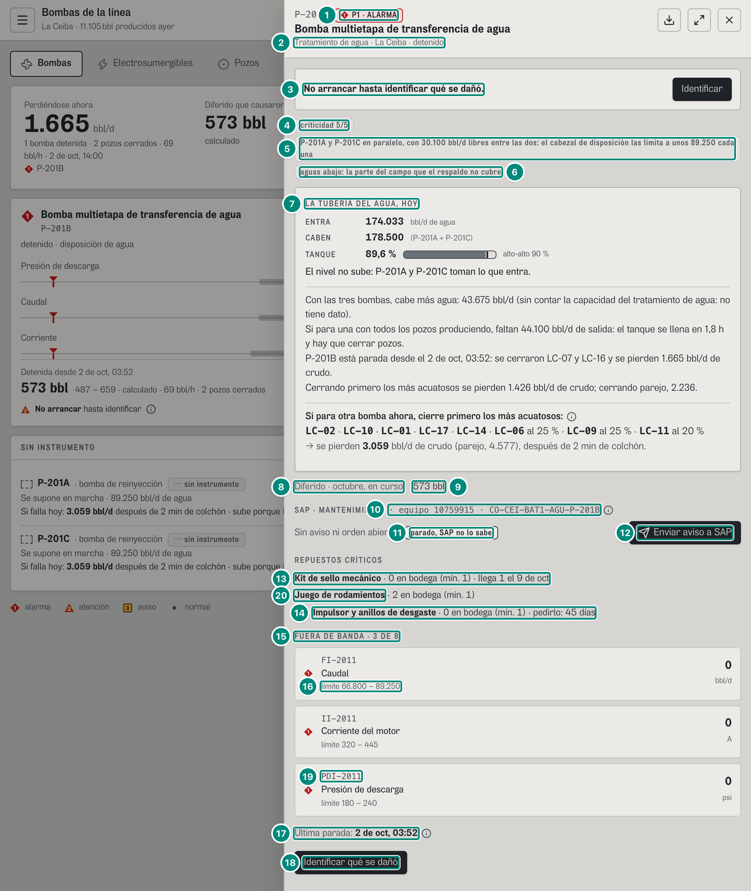
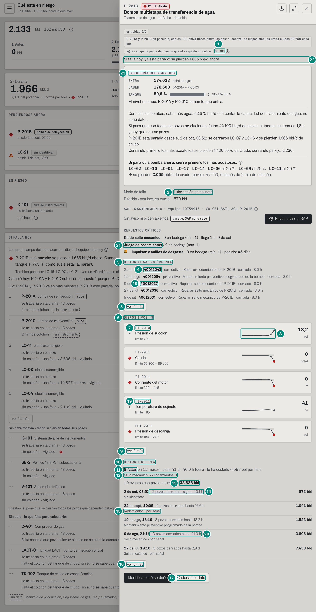
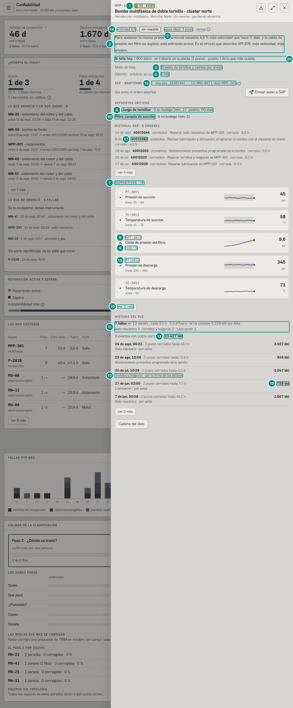
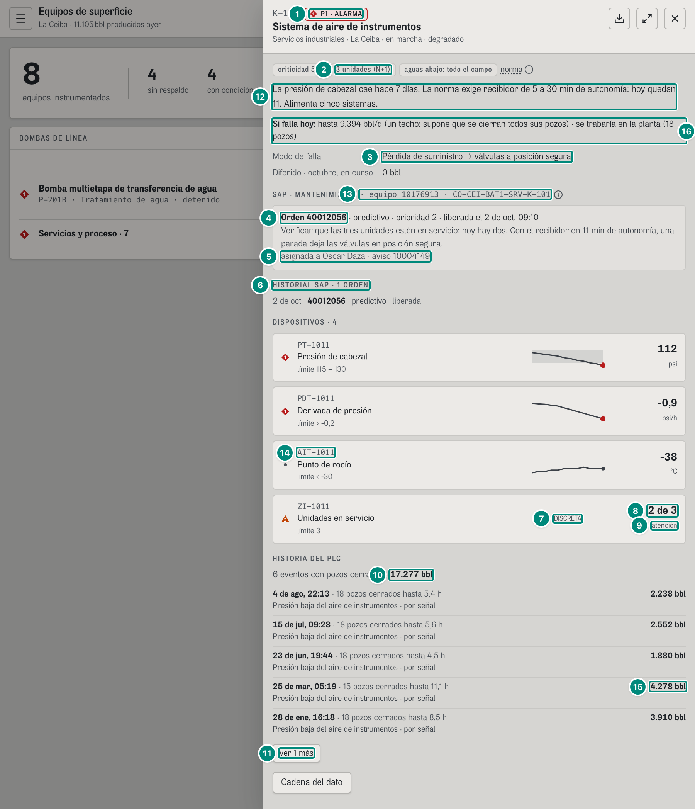
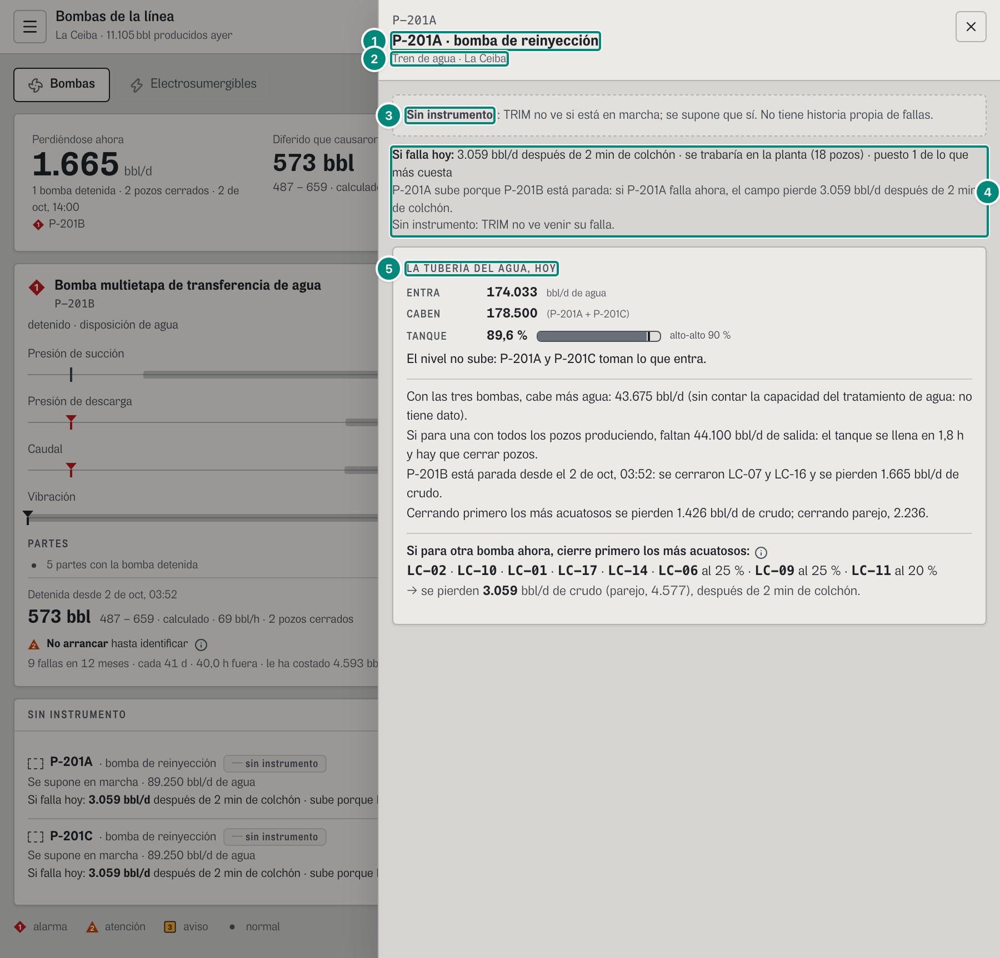
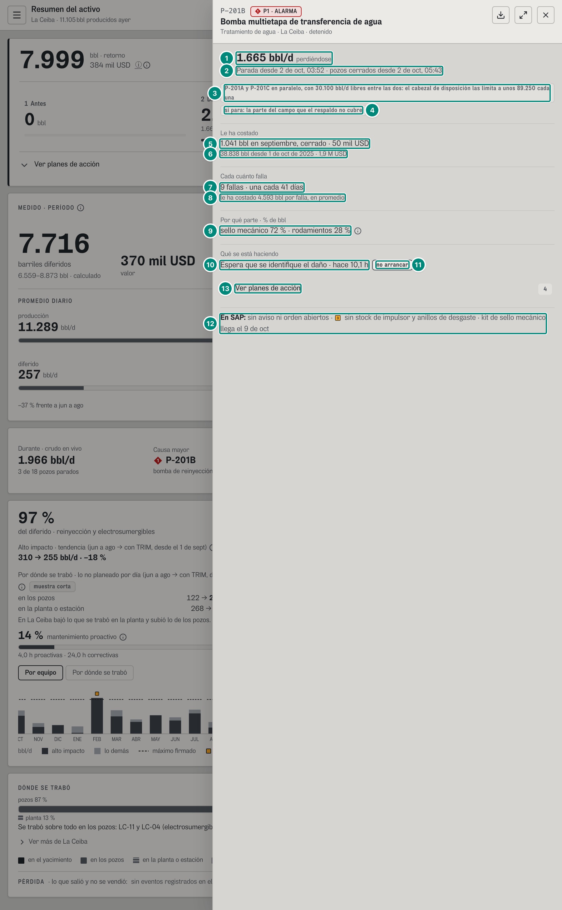
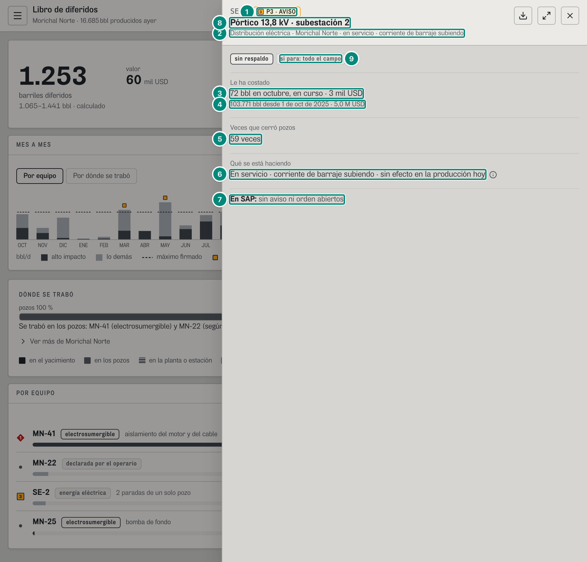

# 6B.4 La ficha de un equipo — todos los roles

**Para qué.** Lo que hay que saber de **un** equipo sin salir de la pantalla en que se está: cómo está, qué lo dice, qué le ha costado, qué dice SAP y qué hacer. Flota sobre cualquier pantalla (`src/widgets/PanelEquipo.tsx`), siempre montada pero calculada solo con un equipo abierto.

**Ruta.** Cualquier pantalla con el id del equipo al final: `#/<rol>/<pantalla>/<campo>/<período>/<equipo>` (`src/app/url.ts:61, 88`). Se abre también con un clic en un equipo (Riesgo, Turno, Diferidos, Superficie, Planta, Resumen…). Abrir un equipo **no** deja entrada en el historial; Escape o «×» la cierran; el botón de expandir la pasa a casi toda la pantalla.

**Qué ficha sale** (`PanelEquipo.tsx:158-249`):

| Nivel del rol | Clase del equipo | Contenido |
|---|---|---|
| `decision` | cualquiera | **ficha ejecutiva** (`src/widgets/equipo/FichaEjecutiva.tsx`) + una línea de SAP |
| `operacion` / `ingenieria` | `pozo` | el **detalle del pozo** (`DetallePozo`, 6B.3) con «← Cerrar», y el bloque SAP si el pozo tiene electrosumergible |
| `operacion` / `ingenieria` | `catalogo` (bomba, servicio, proceso, medición) | la **ficha técnica**: chips, lectura (en una bomba de reinyección parada, «LA TUBERÍA DEL AGUA, HOY» en su lugar), diferido, SAP, dispositivos, historia; en ingeniería además «Si falla hoy» y «Cadena del dato» |
| cualquiera | un equipo del tren de agua **sin registro propio** (P-201A y P-201C: sin instrumento, no están en `equipos`) | la **ficha mínima** (`FichaMinima`, `PanelEquipo.tsx:332-367`; abajo): lo que sí se sabe, «Si falla hoy» (no en decisión) y la tubería del agua |

**Lee.**

| Endpoint | Para qué | Quién |
|---|---|---|
| `GET /api/vistas/equipos/:campo/:equipo` → `EquipoVivo \| null` | cabecera, chips, lectura, dispositivos (5B §7 «El equipo vivo») | todas |
| `GET /api/vistas/diferidos?campos=<campo>&desde&hasta` → `Libro.porEquipo` | «Diferido · <período>» (`useBarrilesDeEquipos`, `src/shared/api/diferidos.ts:402-408`) | técnica |
| `GET /api/vistas/paradas/por-identificar?campos` | «No arrancar…», «Identificar qué se dañó» | técnica, ejecutiva, SAP |
| `GET /api/vistas/equipos/:campo/:equipo/historia` → `{ eventos, bomba? }` | «HISTORIA DEL PLC», «Última parada» (5B §7) | técnica (no para pozos) |
| `GET /api/vistas/equipos/:campo/:equipo/ficha?desde&hasta` → `FichaEquipo` | toda la ficha ejecutiva (`pedirFichaEquipo`, `src/shared/api/equipos.ts:211-232`) | decisión |
| `GET /api/vistas/riesgo?campos` | estado y «qué se está haciendo» de la ejecutiva; aviso SAP sugerido | decisión, SAP |
| `GET /api/sap/equipos/:equipo?campo` + `GET /api/sap/avisos?campos` + `GET /api/sap/ordenes?campos` | bloque SAP (5D §6) | todas |
| `GET /api/vistas/campos/:campo/agua` → `TuberiaAgua` | «LA TUBERÍA DEL AGUA, HOY» (`AguaHoy`) y saber si una bomba de reinyección está parada (`paradaDelTren`, `PanelEquipo.tsx:67-69`) y si el equipo abierto es del tren sin registro propio (la ficha mínima) | todas (el pedido se hace siempre; solo se pinta en bombas de disposición y en la ficha mínima) |
| `GET /api/vistas/criticidad?campos` → `VistaCriticidad` | «Si falla hoy» de la ficha (`SiFallaHoyFicha`, `PanelEquipo.tsx:190`) y de la ficha mínima | ingeniería (y la mínima en operación) |
| `GET /api/vistas/ciclo?campos&desde&hasta` → `CicloValor` | «Ver planes de acción» de la ejecutiva (`PlanesDe`; capítulo 11) | decisión |
| `GET /api/campos/:campo/tags/:tag/procedencia` | «Cadena del dato» (5D §8) | ingeniería, al pedirla |

**Cabecera (todos los niveles).** Id en monoespaciada + chip de severidad (`Severidad_`: «NORMAL», «P1 · ALARMA», «P2 · ATENCIÓN», «P3 · AVISO»; `src/shared/ui/primitivas.tsx:38-48`), nombre del equipo entero, y «<sistema> · <campo> · <estado>». Botones: exportar la ficha en PDF (solo con `evidencia:exportar`, `src/widgets/informe/Exportar.tsx:128-140`; operador y técnico no lo ven), expandir/contraer, cerrar.

---

## Ficha técnica, operación (P-201B, supervisor, `#/sup/bombas/ceiba/curso/P-201B`)

| # | Lo que se ve | En la captura | Cómo se calcula | Texto según el valor | Viene de |
|---|---|---|---|---|---|
| 1 | Severidad | «P1 · ALARMA» | `EquipoVivo.severidad` (en el demo, dato declarado de la instancia del equipo en el campo; ver Huecos) | `Severidad_` | `severidad` |
| 2 | Sistema · campo · estado | «Tratamiento de agua · La Ceiba · detenido» | `sistema`, nombre del campo, `estado` | texto del servidor | `sistema`, `estado` |
| 3 | Franja | «**No arrancar hasta identificar qué se dañó.**» + «Identificar» | solo en **operación** y si hay una pregunta del equipo que pide respuesta y **sigue sin arrancar** (`pide && !fin`, `PanelEquipo.tsx:52-53, 174-179`). Aserción `rutas.ts:112` | el botón, si el rol tiene la pantalla `causa` | `/vistas/paradas/por-identificar` |
| 4 | Criticidad | «criticidad 5/5» | `criticidad` del registro del equipo | chip | `criticidad` |
| 5 | Redundancia | «P-201A y P-201C en paralelo, con 30.100 bbl/d libres entre las dos: el cabezal de disposición las limita a unos 89.250 cada una» (chip normal) | bombas: del **respaldo firmado** (`respaldoEnCampo`, `src/entities/equipos.ts:481-489`): sin respaldo declarado «respaldo sin declarar en la configuración»; `libreBpd > 0` el `detalle` del respaldo; 0 «sin respaldo». Otros equipos: su registro («3 unidades (N+1)») | tono fuerte solo con «sin respaldo» | `redundancia` |
| 6 | Aguas abajo | «aguas abajo: la parte del campo que el respaldo no cubre» | bombas por papel: transporte «N pozos»; recobro «soporte de presión del yacimiento»; disposición «todo el campo» (sin respaldo) / «la parte del campo que el respaldo no cubre» / «sin declarar: falta el respaldo en la configuración». Otros: su registro | chip | `aguasAbajo` |
| 7 | La tubería del agua, hoy | «LA TUBERÍA DEL AGUA, HOY» · ENTRA **174.033** · CABEN **178.500** (P-201A + P-201C) · TANQUE **89,6 %** · «El nivel no sube: P-201A y P-201C toman lo que entra.» · «Si para otra bomba ahora, cierre primero los más acuatosos: LC-02 · LC-10 · LC-01 · …» | en una bomba de reinyección **parada** la `lectura` fija del registro («Detenida. P-201A y P-201C no alcanzan a tomar toda su agua…», `src/entities/equipos.ts:30`) **ya no se pinta**: la dice el motor con la tubería del agua de hoy (`{!paradaDelTren && 
{eq.lectura}
}`, `PanelEquipo.tsx:189`; `AguaHoy`, `PanelEquipo.tsx:191`; B-17). `paradaDelTren` = es de disposición y su `marcha` en el tren es `parada` (`PanelEquipo.tsx:69`). Qué es cada cifra y cuándo cambia: 6D.2 y 5E §6 | `AguaHoy` solo sale en una bomba de **disposición** de un campo que no es de gas (`AguaHoy.tsx:27`); con la bomba en marcha, el diagnóstico fijo sigue (MPP-301, K-101) | `GET /api/vistas/campos/:campo/agua` → `siParaOtra`, `frases`, `tramos[]` |
| 8 | «Diferido · <período>» | «Diferido · octubre, en curso» | el nombre del período en minúscula | — | período de la cabecera |
| 9 | Valor | **573 bbl** | fila del equipo en el Pareto por equipo del libro del período (5A §8 «Pareto por equipo»); 0 si no está | `n0` + « bbl» | `Libro.porEquipo[campoId, equipo].bbl` |
| 10 | SAP | «SAP · MANTENIMIENTO · equipo 10759915 · CO-CEI-BAT1-AGU-P-201B» ⓘ | identidad del equipo en SAP (5D §6 «Identidad») | ⓘ «De dónde sale: Avisos, órdenes, horas y stock vienen de SAP. La orden la crea el planeador en SAP; TRIM envía el aviso y avisa cuando la orden se libera.» (`src/widgets/sap/BloqueSap.tsx:68-71`) | `/sap/equipos/:equipo` → `identidad` |
| 11 | Estado en SAP | «Sin aviso ni orden abiertos» + chip «parado, SAP no lo sabe» | prioridad: orden abierta (estado ≠ TECO) → la orden; si no, aviso abierto → el aviso; si no, el formulario plegado (con `sap:aviso`) o «Sin aviso ni orden abiertos.» (sin la capacidad) (`BloqueSap.tsx:73-79`). El chip sale si el equipo está **parado**: `marcha = detenido`, o una fila de riesgo «perdiendo», o una pregunta abierta (`BloqueSap.tsx:149, 167-176`) | — | `/sap/avisos`, `/sap/ordenes`, `/vistas/riesgo`, preguntas |
| 12 | «Enviar aviso a SAP» | botón principal | variante principal si está parado; abre el formulario del aviso (M2 avería si parado, M1 solicitud si no) prellenado: «Parada de P-201B, sin causa identificada», parte sugerida, prioridad SAP desde la severidad (1→1, 2→2, si no 3), evidencia (hasta 5 líneas). Envía `POST /api/sap/avisos` (5D §6) | — | — |
| 13 | Repuesto en tránsito | «**Kit de sello mecánico** · 0 en bodega (mín. 1) · llega 1 el 9 de oct» | stock < mínimo con tránsito: sin marca | «<descripción> · <stock> en bodega (mín. <mínimo>)» + « · llega(n) N el <fechaCorta>» o « · pedirlo: N días» (`BloqueSap.tsx:81-100`) | `repuestos[]` |
| 14 | Repuesto que falta | ■ «**Impulsor y anillos de desgaste** · 0 en bodega (mín. 1) · pedirlo: 45 días» | stock < mínimo y sin tránsito → ■ P3 (`FueraDeMeta`) | — | `repuestos[].stock/minimo/plazoDias` |
| 15 | Encabezado de dispositivos | «FUERA DE BANDA · 3 DE 8» | operación: solo los dispositivos con estado ≠ normal **o sin lectura** (`valor: null`) (`PanelEquipo.tsx:76`); «N» = los visibles menos los sin lectura (`sinLectura`: estado «sin señal» o `valor: null`, `PanelEquipo.tsx:81`); «M» = todos; « · K SIN SEÑAL» si hay (`PanelEquipo.tsx:202`) | ingeniería: «DISPOSITIVOS · M»; sin ninguno fuera: «Todo dentro de banda.» | `dispositivos[].estado` |
| 16 | Un dispositivo | ◆ «FI-2011 · Caudal · límite 66.800 – 89.250» · **0** bbl/d | marca `MarcaEstado` (estado → prioridad); tag, tipo, «límite <texto>» (en el papel antes va el origen); valor `num` (los decimales que trae) y unidad. **Sin lectura** (`sinLectura(d)`: estado «sin señal» **o** `valor: null`, `src/shared/lib/formato.ts:43`) es un dato inválido (ISA-101): círculo magenta, el origen a la vista, «SIN SEÑAL» en vez de la minigráfica, «—» con «sin señal» debajo en magenta; nunca un 0 ni «null» (`num(null)` = «—»). Sin unidad (un interruptor), debajo va su estado con nombre para leer (`NOMBRE_ESTADO`: «atención», no «atencion») (`PanelEquipo.tsx:88-123`) | globo: «Valor» (sin lectura: «sin señal»), «Límite», «Estado» (`NOMBRE_ESTADO`), «Origen», «Minigráfica»; pista «Clic para ver la cadena técnica de este dato». En operación no hay minigráfica | `dispositivos[].valor/estado/unidad` |
| 17 | Última parada (solo operación) | «Última parada: **2 de oct, 03:52**» ⓘ | el evento más reciente de la historia del equipo (`historia.eventos[0]`); « · <parte>» si la tiene | ⓘ «Por qué paró» con el texto de la causa (`PanelEquipo.tsx:231-236`) | `/historia` → `eventos[0]` |
| 18 | «Identificar qué se dañó» | botón | con `causa:declarar`, la pantalla `causa` y una pregunta del equipo que pide respuesta (aunque ya haya arrancado) (`PanelEquipo.tsx:239-245`) | — | preguntas |
| 19 | Los otros dos fuera de banda | ◆ «II-2011 · Corriente del motor · límite 320 – 445 · 0 A»; ◆ «PDI-2011 · Presión de descarga · límite 180 – 240 · 0 psi» | las reglas de la fila 16; con la bomba parada los tres miden 0 (5C §3) | — | `dispositivos[]` |
| 20 | Repuesto con stock | «Juego de rodamientos · 2 en bodega (mín. 1)» | stock ≥ mínimo: sin marca ni tránsito (filas 13-14) | — | `repuestos[]` |

Los dispositivos van de cinco en cinco con «ver N más», pero **ningún dispositivo que no esté normal queda escondido** (`PanelEquipo.tsx:257-267`). Si alguno está sin lectura (`disp.some(sinLectura)`): hueco «**Sin señal**: valor de ruta manual» + ⓘ «Hay dispositivos sin señal en línea: lo que se vea de ellos es de una ruta manual. No se estima el valor faltante.» (`PanelEquipo.tsx:220-229`). En el demo, `/vistas/equipos/:campo/:equipo` trae `valor: null` (nunca el texto «—») en el fiscal sin dato del día y en las señales sin lectura de una electrosumergible (`src/entities/equipo-vivo.ts:43, 69`); ningún equipo del catálogo los tiene hoy. Un equipo sin instancia en el campo: «**Sin conectar en <campo>**» + ⓘ «… No se muestran aquí las de otro campo: serían el número de otra máquina.»

## Ficha técnica, ingeniería (P-201B, jefe de mantenimiento, `#/jefe/riesgo/ceiba/curso/P-201B`)

Lo que agrega ingeniería (la operación no tiene «HISTORIA DEL PLC», «Modo de falla» ni «Si falla hoy»: aserción `rutas.ts:112`):

| # | Lo que se ve | En la captura | Cómo se calcula | Texto según el valor | Viene de |
|---|---|---|---|---|---|
| 1 | ⓘ norma | «norma» | `EquipoVivo.norma` | — | `norma` |
| 2 | Modo de falla | «Lubricación de cojinete» | `modoFalla` del registro (en un pozo con ESP, la peor parte o «Aislamiento, bomba de fondo, admisión») | — | `modoFalla` |
| 3 | Historial SAP | «HISTORIAL SAP · 9 ÓRDENES» | órdenes del equipo, de la más reciente a la más vieja | `plural(n,'ORDEN','ÓRDENES')` | `/sap/ordenes` |
| 4 | Una orden | «22 de sept **40012043** correctivo · Reparar rodamientos de P-201B cerrada · 8,0 h» | `fechaCorta(creada)`, número, `NOMBRE_CLASE` (PM01 correctivo, PM02 preventivo, PM03 predictivo), descripción (no se repite la de la orden abierta), `NOMBRE_ESTADO_ORDEN` (CRTD «creada, sin liberar», REL «liberada», PCNF «en ejecución», CNF «ejecutada», TECO «cerrada»), « · `n1(horasReales)` h» si hay | — | `OrdenSap` |
| 5 | «ver 4 más» | — | cinco y el resto en el papel | — | — |
| 6 | Dispositivos | «DISPOSITIVOS · 8» | todos | — | `dispositivos` |
| 7 | Tag | «PI-2010 · Presión de succión · límite > 10 · 18,2 psi» | normal en gris | — | — |
| 8 | Minigráfica | (la línea a la derecha) | `Sparkline` de la serie con la banda sombreada; la banda sale de **parsear el texto** `limite` (`banda()`, `src/shared/lib/formato.ts:68-79`; ver Huecos); sin serie: «SIN SEÑAL» (magenta) o «DISCRETA» | punto final del color de la prioridad | `dispositivos[].serie`, `limite` |
| 9 | «ver 3 más» | — | — | — | — |
| 10 | «HISTORIA DEL PLC» | — | `Historia` (`PanelEquipo.tsx:275-325`; 5B §7 «Cómo se ve la historia») | — | `/historia` |
| 11 | Fallas (solo bombas con perfil) | «**9 fallas** en 12 meses · cada 41 d · 40,0 h fuera · le ha costado 4.593 bbl por falla» | `historia.bomba`: fallas, $n_0(\text{días}/30{,}4)$, MTBF, MDT con `fmtHoras(h, true)` y, al final, lo que **le ha costado** cada falla, `bblPorFalla` = Σ bbl de las fallas cerradas ÷ cuántas (36.741,6 / 8 = 4.592,7; 5B §7) | MDT < 48 h en horas con un decimal; ≥ 48 h en días («2,0 d fuera» en MPP-301, igual que la placa y el detalle desde el 8-oct); « · le ha costado N bbl por falla» solo si hay `bblPorFalla` (`PanelEquipo.tsx:302-311`). Nunca «costo por falla»: esa es la cifra de Riesgo, «si falla hoy» | `bomba.fallas/mtbfDias/mdtH/bblPorFalla` |
| 12 | Por parte | «sello mecánico 5 · rodamientos 3» | `porParte[]`: «<parte en minúscula> <fallas>» | — | `bomba.porParte` |
| 13 | Eventos | «10 eventos con pozos cerrados · **38.838 bbl**» | `eventosCargadosA` (5B §7): las 9 fallas (37.314,7) y la programada (1.523,4); Σ bbl = 38.838,0. La del 28-ene que paró K-101 no entra: se le carga a K-101 | «Ningún pozo cerrado por este equipo en la historia.» si no hay | `eventos[]` |
| 14 | Un evento | «2 de oct, 03:52 · 2 pozos cerrados · sigue · 10,1 h» / «sin identificar» / 573 bbl | inicio de la causa; pozos distintos; duración **hasta que reabrió el último pozo**, rotulada como tal: cerrado, «N pozos cerrados hasta X»; abierto, «N pozos cerrados · sigue · X». No es la de la bomba parada: «22 de sept, 10:05 · 2 pozos cerrados hasta 16,6 h» aquí y «bomba parada 16,0 h» en la lista de paradas del detalle de la bomba (6B·H6, resuelto el 8-oct) | segunda línea: «<Parte> · <cómo>»; si no hay parte y la causa tiene ≤ 6 palabras, la causa (+ « · <cómo>» salvo la programada); si no, solo el cómo. Globo: «Hasta que reabrió el último pozo» (abierto: «Pozos cerrados, sigue»), «Barriles», «Cómo se identificó», pista = causa (`PanelEquipo.tsx:278-298`) | `eventos[].inicio/fin/pozos/bbl/causa` |
| 15 | Otro | «Rodamientos · por señal» | — | — | — |
| 16 | «ver 5 más» | — | — | — | — |
| 17 | «Cadena del dato» | botón | abre la cadena del primer dispositivo (`PanelEquipo.tsx:246`); cada fila también la abre | — | `/campos/:campo/tags/:tag/procedencia` |
| 18 | Las otras órdenes a la vista | «12 de ago · 40012054 · preventivo · Mantenimiento preventivo programado de la bomba · cerrada · 8,0 h»; «9 de ago · 40012037 · correctivo · Reparar sello mecánico de P-201B · cerrada · 8,0 h»; «27 de jul · 40012036 · correctivo · Reparar sello mecánico de P-201B · cerrada · 8,0 h»; «9 de jul · 40012031 · correctivo · Reparar sello mecánico de P-201B · cerrada · 8,0 h» | `OrdenSap[]` del equipo con las reglas de la fila 4 (tras las horas, «confirmadas» solo para el lector de pantalla, `BloqueSap.tsx:62`) | — | `/sap/ordenes` |
| 19 | Los otros dispositivos a la vista | ◆ «FI-2011 · Caudal · límite 66.800 – 89.250 · 0 bbl/d»; ◆ «II-2011 · Corriente del motor · límite 320 – 445 · 0 A»; «TI-2011 · Temperatura de cojinete · límite < 85 · 41 °C»; ◆ «PDI-2011 · Presión de descarga · límite 180 – 240 · 0 psi», cada uno con su minigráfica | reglas de las filas 7-8 (cinco a la vista y «ver 3 más») | — | `dispositivos[]` |
| 20 | Los otros eventos a la vista | «22 de sept, 10:05 · 2 pozos cerrados hasta 16,6 h · Rodamientos · por señal · 1.041 bbl»; «19 de ago, 18:19 · 3 pozos cerrados hasta 18,2 h · Mantenimiento preventivo programado de la bomba · 1.523 bbl»; «9 de ago, 21:14 · 3 pozos cerrados hasta 41,0 h · Sello mecánico · por señal · 3.806 bbl»; «27 de jul, 19:10 · 3 pozos cerrados hasta 2,9 d · Sello mecánico · por señal · 7.453 bbl» | `eventosCargadosA` (5B §7) con las reglas de la fila 14 (duración hasta que reabrió el último pozo; ≥ 48 h en días) | — | `/historia` → `eventos[]` |
| 21 | Repuestos | «Kit de sello mecánico · 0 en bodega (mín. 1) · llega 1 el 9 de oct», «Juego de rodamientos · 2 en bodega (mín. 1)», ■ «Impulsor y anillos de desgaste · 0 en bodega (mín. 1) · pedirlo: 45 días» | los de la ficha de operación (filas 13, 14 y 20) | — | `repuestos[]` |
| 22 | «Si falla hoy» | «Si falla hoy: ya está parado: se pierden 1.665 bbl/d ahora» | `SiFallaHoyFicha` (`PanelEquipo.tsx:190`, `src/widgets/riesgo/SiFallaHoy.tsx:243`), **solo en ingeniería**: con la bomba ya parada dice lo que se pierde ahora (`perdiendoBpd`); con el equipo en marcha, lo que costaría que fallara hoy, dónde se trabaría y su puesto (K-101 y MPP-301, filas 16 y 20 de sus tablas). Cómo se calcula y cómo cambia el texto: 6D.5 y 5E §7 | — | `GET /api/vistas/criticidad` → `ranking[]` y `campos[].parados[]` |
| 23 | La tubería del agua, hoy | «LA TUBERÍA DEL AGUA, HOY» | el mismo bloque que ve la operación (fila 7 de la ficha de operación): `AguaHoy` no depende del nivel, solo de que la bomba sea de disposición. 6D.2 | — | `GET /api/vistas/campos/:campo/agua` |

### Otros equipos del catálogo en la ficha técnica

**MPP-301, confiabilidad** (`#/conf/confiabilidad/morichal/curso/MPP-301`):

| # | Lo que se ve | En la captura | Regla / origen |
|---|---|---|---|
| 1 | Severidad | «P3 · AVISO» | `severidad` (dato de la instancia) |
| 2 | Aguas abajo | «aguas abajo: 3 pozos» | papel `transporte` → `perfil.pozos.length` |
| 3 | Lectura | «Para sostener la misma presión diferencial necesita 4,9 % más velocidad que hace 11 días, y la caída de presión del filtro se duplicó: está entrando arena…» | `lectura` (texto declarado; en producción debería generarlo el servidor o un ingeniero) |
| 4 | Modo de falla | «Erosión de tornillos y camisa por arena» | `modoFalla` |
| 5 | Diferido · octubre | «0 bbl» | no está en el Pareto por equipo del período |
| 6 | Repuesto | ■ «**Juego de tornillos** · 0 en bodega (mín. 1) · pedirlo: 60 días» | falta y sin tránsito → ■ |
| 7 | Dispositivos | «DISPOSITIVOS · 16» | las 16 variables de la plantilla multifásica instrumentadas |
| 8–9 | Uno fuera de banda | ▲ «PDT-3011 · Caída de presión del filtro · límite < 8» · 9,6 psi | estado `atencion` → ▲; la minigráfica pinta la raya del límite y el punto final naranja |
| 10 | «ver 11 más» | | |
| 11 | Historia | «**7 fallas** en 12 meses · cada 52 d · 2,0 d fuera · le ha costado 3.226 bbl por falla» · «sello mecánico 4 · tornillos y holguras 2 · lubricación 1» | 5B §7; MDT 48,68 h → «2,0 d»; $22.582{,}4 / 7 = 3.226{,}1$ bbl (lo histórico; «si falla hoy» en Riesgo = 3.244,5) |
| 12 | Eventos | «8 eventos con pozos cerrados · **23.427 bbl**» | las 7 fallas (22.582,4) y la programada `EV-3016-260825` (844,5 bbl): 23.427,0 |
| 13 | Cómo se identificó | «Tornillos y holguras · por la firma de las señales» | `COMO.firma` |
| 14 | Criticidad y redundancia | «criticidad 5/5» · «sin respaldo» (fuerte) | registro del equipo y respaldo firmado de MPP-301 («Sin bomba en paralelo ni derivación al manifold», 0 bbl/d; 6A.4.6) — reglas de las filas 4-5 de P-201B |
| 15 | SAP | «equipo 10385444 · CO-MNO-BAT1-AGU-MPP-301»; «Sin aviso ni orden abiertos» sin chip | identidad (5D §6 «Identidad del equipo en SAP»); sin chip porque está en marcha (fila 11 de P-201B) |
| 16 | Repuesto con stock | «Filtro canasta de succión · 4 en bodega (mín. 2)» | sin marca |
| 17 | HISTORIAL SAP · 9 ÓRDENES | «24 de sept · 40012044 · correctivo · Reparar sello mecánico de MPP-301 · cerrada · 8,0 h»; «6 de sept · 40012060 · predictivo · Revisar lubricación y alineación; programar el cambio con el repuesto en mano. · cerrada · 4,0 h»; «18 de ago · 40012055 · preventivo · Mantenimiento preventivo programado de la bomba · cerrada · 8,0 h»; «25 de jul · 40012033 · correctivo · Reparar tornillos y holguras de MPP-301 · cerrada · 8,0 h»; «27 de jun · 40012028 · correctivo · Reparar lubricación de MPP-301 · cerrada · 8,0 h»; «ver 4 más» | reglas de la fila 4 de la ficha de ingeniería de P-201B |
| 18 | Los otros dispositivos a la vista | «PT-3011 · Presión de succión · límite 35 – 60 · 45 psi»; «TE-3011 · Temperatura de succión · límite 45 – 75 · 58 °C»; «PT-3012 · Presión de descarga · límite 320 – 360 · 345 psi»; «TE-3012 · Temperatura de descarga · límite < 90 · 71 °C» (en banda, gris) | filas 7-8 de P-201B |
| 19 | Los otros eventos a la vista | «24 de sept, 06:23 · 3 pozos cerrados hasta 46,1 h · Sello mecánico · por señal · 3.027 bbl»; «25 de ago, 15:06 · 3 pozos cerrados hasta 12,9 h · Mantenimiento preventivo programado de la bomba · 845 bbl»; «27 de jun, 02:00 · 3 pozos cerrados hasta 11,1 h · Lubricación · por señal · 758 bbl»; «7 de jun, 00:09 · 3 pozos cerrados hasta 41,2 h · Sello mecánico · por señal · 2.867 bbl» (con el de la fila 13, «25 de jul, 10:28 · 3 pozos cerrados hasta 3,0 d · … · 5.047 bbl»); «ver 3 más» | fila 14 de P-201B |
| 20 | «Si falla hoy» | «Si falla hoy: 1.600 bbl/d · se trabaría en la planta (3 pozos) · puesto 1 de lo que más cuesta» | `SiFallaHoyFicha` (fila 22 de P-201B): MPP-301 no tiene tanque, así que la cifra va sin colchón y es la misma de la fila 19 de su placa (6B.1), el crudo de sus 3 pozos; «puesto N de lo que más cuesta» solo si tiene puesto. 6D.5 |

Sin orden abierta y en marcha: «Sin aviso ni orden abiertos» sin chip y el botón «Enviar aviso a SAP» en variante normal (no principal).

**K-101, jefe de mantenimiento** (`#/jefe/equipo/ceiba/curso/K-101`, un servicio con orden abierta):

| # | Lo que se ve | En la captura | Regla / origen |
|---|---|---|---|
| 1 | Severidad | «P1 · ALARMA» | — |
| 2 | Redundancia | «criticidad 5/5» · «3 unidades (N+1)» · «aguas abajo: todo el campo» | registro del equipo (no es bomba: no hay respaldo firmado; reglas de las filas 4-6 de P-201B) |
| 3 | Modo de falla | «Pérdida de suministro → válvulas a posición segura» | — |
| 4 | Orden abierta | «**Orden 40012056** · predictivo · prioridad 2 · liberada el 2 de oct, 09:10» y su descripción | `LineaOrden` (`BloqueSap.tsx:132-140`): número, clase, prioridad, estado; si `liberada`, « · liberada el <fechaHora>» (sin repetir «liberada» si el estado ya lo es) |
| 5 | A quién | «asignada a Óscar Daza · aviso 10004149» | técnico de la orden por su id en el registro de usuarios; si no está, «la cuadrilla <puesto>»; « · aviso N» si viene de un aviso |
| 6 | Historial | «HISTORIAL SAP · 1 ORDEN» · «2 de oct **40012056** predictivo liberada» | la orden abierta en el historial no repite su descripción; sin horas confirmadas, sin « · N h» |
| 7 | Discreta | «ZI-1011 · Unidades en servicio · límite 3» · «DISCRETA» | dispositivo sin serie y con estado: variable discreta; el límite es el texto del registro («3» unidades) |
| 8–9 | Valor y estado de una discreta | «2 de 3» · «atención» | `valor` texto; sin unidad, debajo va el estado **con su nombre para leer** (`NOMBRE_ESTADO`, `src/shared/lib/formato.ts:48-50`: `atencion` → «atención»); el contrato sigue mandando la clave `atencion`. Antes se escribía la clave (6B·H12, resuelto el 8-oct) |
| 10 | Historia | «6 eventos con pozos cerrados · **17.277 bbl**» | sin renglón de fallas (no es bomba con perfil) |
| 11 | «ver 1 más» y el evento de otro año | «ver 1 más» | cinco a la vista; el sexto, el más viejo, queda detrás (en el papel sale): «**15 de nov de 2025, 09:52** · 18 pozos cerrados hasta 5,6 h» / «Presión baja del aire de instrumentos · por señal» · 2.419 bbl, con `fechaHora` con año; la causa tiene 6 palabras → se escribe |
| 12 | Lectura | «La presión de cabezal cae hace 7 días. La norma exige recibidor de 5 a 30 min de autonomía: hoy quedan 11. Alimenta cinco sistemas.» | `lectura` (texto declarado de la instancia en el demo, `src/entities/equipos.ts`; ver Huecos 1) |
| 13 | SAP | «equipo 10176913 · CO-CEI-BAT1-SRV-K-101»; descripción de la orden «Verificar que las tres unidades estén en servicio: hoy hay dos. Con el recibidor en 11 min de autonomía, una parada deja las válvulas en posición segura.» | identidad (5D §6) y `OrdenSap.descripcion` |
| 14 | Los otros dispositivos («DISPOSITIVOS · 4») | ◆ «PT-1011 · Presión de cabezal · límite 115 – 130 · 112 psi»; ◆ «PDT-1011 · Derivada de presión · límite > -0,2 · -0,9 psi/h»; «AIT-1011 · Punto de rocío · límite < -30 · -38 °C» (normal) y la discreta de las filas 7-9 | reglas de las filas 7-8 de P-201B; los negativos con guion «-» como los da el límite |
| 15 | Los eventos a la vista | «4 de ago, 22:13 · 18 pozos cerrados hasta 5,4 h · 2.238 bbl»; «15 de jul, 09:28 · 18 pozos cerrados hasta 5,6 h · 2.552 bbl»; «23 de jun, 19:44 · 18 pozos cerrados hasta 4,5 h · 1.880 bbl»; «25 de mar, 05:19 · 15 pozos cerrados hasta 11,1 h · 4.278 bbl»; «28 de ene, 16:18 · 18 pozos cerrados hasta 8,5 h · 3.910 bbl»; (fila 11) 2.419 bbl — todos «Presión baja del aire de instrumentos · por señal» | $2.237{,}5 + 2.551{,}7 + 1.880{,}3 + 4.278{,}2 + 3.909{,}8 + 2.419{,}5 = 17.277{,}0$ (fila 10). El del 25-mar cierra 15: el aire se cayó 49 min después de que parara P-201B, y los otros 3 (LC-16, LC-14 y LC-07) los cerró la parada de la bomba y se le cargan a ella, no a K-101 (`EV-2011-260325`, 6B.1) |
| 16 | «Si falla hoy» | «Si falla hoy: hasta 9.394 bbl/d (un techo: supone que se cierran todos sus pozos) · se trabaría en la planta (18 pozos)» | `SiFallaHoyFicha` (fila 22 de P-201B), con `grupo = 'techo'`: K-101 alimenta todo el campo y la cifra supone que se cierra todo lo que hoy produce (11.360 − 1.966 = 9.394 bbl/d, la misma de «Si para» en Turno: 6B.5 fila 19); sin puesto: los techos van aparte de la lista ordenada (el grupo «Sin cifra todavía · techo si se cierran todos sus pozos» de Riesgo). 6D.5 |

Un aviso abierto sin orden se vería «**Aviso N** · avería|solicitud · prioridad P · hace N h (o «recién enviado») · <creado por>», la descripción, chip «sin orden» y ⓘ «La crea el planeador en SAP, y cuando la libere TRIM le avisa al técnico.» (`BloqueSap.tsx:116-130`).

### Un equipo sin registro propio: la ficha mínima (P-201A, jefe de mantenimiento, `#/jefe/bombas/ceiba/curso/P-201A`)

P-201A y P-201C de La Ceiba (y las seis de Morichal, la de Guacamayo) son bombas del tren de agua **sin instrumento**: no están en el registro de equipos, así que `/vistas/equipos/:campo/:equipo` responde `null`. Antes no abrían nada; hoy abren esta ficha (B-37), a la que se llega con «Abrir» en «SIN INSTRUMENTO» de Bombas (6B.1, fila 20) o con la dirección. Es la misma en todos los niveles; en decisión (`nivel === 'decision'`) va sin «Si falla hoy» (`PanelEquipo.tsx:361`).

| # | Lo que se ve | En la captura | Cómo se calcula | Texto según el valor | Viene de |
|---|---|---|---|---|---|
| 1 | Nombre | «P-201A» y, en el título, «P-201A · bomba de reinyección» | `fila.nombre` de la fila de criticidad del equipo, o el id si no hay fila (`PanelEquipo.tsx:332-367`) | «bomba de recobro» si su papel es `recobro` | `GET /api/vistas/criticidad` → `ranking[].nombre` |
| 2 | Sistema y campo | «Tren de agua · La Ceiba» | fijo «Tren de agua» + el campo (`useCampo`) | — | — |
| 3 | Lo que no se sabe | «**Sin instrumento**: TRIM no ve si está en marcha; se supone que sí. No tiene historia propia de fallas.» | `Hueco` fijo: no se inventa lo que no hay (sin señales, sin eventos, sin SAP) | — | — |
| 4 | «Si falla hoy» | «Si falla hoy: 3.059 bbl/d después de 2 min de colchón · se trabaría en la planta (18 pozos) · puesto 1 de lo que más cuesta» y debajo «P-201A sube porque P-201B está parada: …» y «Sin instrumento: TRIM no ve venir su falla.» | `SiFallaHoyFicha` (fila 22 de la ficha de P-201B); aquí sale también en operación, no en decisión (`nivel !== 'decision'`, `PanelEquipo.tsx:361`). Con P-201B parada, si cae otra bomba hay que cerrar pozos: por eso sube al puesto 1. 6D.5 y 5E §7 | cada línea sale solo si aplica: «sube porque…» con `subio`, «Sin instrumento…» con `!vigilado` | `GET /api/vistas/criticidad` |
| 5 | La tubería del agua, hoy | «LA TUBERÍA DEL AGUA, HOY» | `AguaHoy` con la bomba abierta (`PanelEquipo.tsx:362`): el mismo bloque de la ficha de P-201B (fila 7 de operación). 6D.2 | — | `GET /api/vistas/campos/:campo/agua` |

---

## Ficha ejecutiva (decisión)

### Una bomba parada (P-201B, gerente, septiembre cerrado, `#/ger/resumen/ceiba/cerrado/P-201B`)

Las reglas de cada renglón están en 5B §7 («Ficha ejecutiva»); aquí, el valor de la captura y de dónde sale. Aserción `rutas.ts:73`: «Qué se está haciendo», «Le ha costado», «pozos cerrados desde» presentes; nada de `NO_DECISION` («Presión de succión», «Energía por barril», «VIGÍA», «FACTOR DE ASIGNACIÓN», «CADENA DE CUSTODIA», «Tolerancia», «DISPOSITIVOS»).

| # | Lo que se ve | En la captura | Cómo se calcula | Texto según el valor | Viene de |
|---|---|---|---|---|---|
| 1 | Cifra | ◆ **1.665 bbl/d** perdiéndose | fila `perdiendo` del equipo en Riesgo (5B §5.2) | marca = `eq.severidad`; sin fila «perdiendo» no hay cifra | `/vistas/riesgo` → `bblDia` |
| 2 | Estado | «Parada desde 2 de oct, 03:52 · pozos cerrados desde 2 de oct, 05:43» | `desde` y `cierreDesde` de la fila (05:43: LC-16, por el LSHH del tanque) | « · pozos cerrados desde …» solo si `cierreDesde − desde > 1 min`; pozo cerrado por otro: «Cerrado por <equipo> desde <fecha>»; en riesgo: «En marcha · si para, N bbl/d» con `siPara` (`src/shared/ui/costoHoy.ts:43`), que dice «hasta N bbl/d» si la cifra es un techo (K-101: «En marcha · si para, hasta 9.394 bbl/d»); los bbl/d se llaman «si para» en todas partes y «si falla hoy» es el costo en bbl de Riesgo; si no, nada (el estado ya va en la cabecera) (`FichaEjecutiva.tsx:44-50`) | `desde`, `cierreDesde` |
| 3 | Redundancia | «P-201A y P-201C en paralelo, con 30.100 bbl/d libres entre las dos: el cabezal de disposición las limita a unos 89.250 cada una» | ver ficha técnica, fila 5 | solo equipos del catálogo | `eq.redundancia` |
| 4 | Si para | «si para: la parte del campo que el respaldo no cubre» | `aguasAbajo` | — | `eq.aguasAbajo` |
| 5 | Le ha costado | «1.041 bbl en septiembre, cerrado · 50 mil USD» | lo cargado al equipo en el período (`diferidoDeEquipo`) y su valor con el precio de cada día (`valorDeTramos`, 5A §6 «Valor en USD»): 1.040,55 bbl (la parada de rodamientos del 22-sep, 2 pozos); 49.946 USD | `usd()`: ≥ 1 M «n1 M USD», ≥ 1.000 «n0 mil USD»; sin precio, sin valor | `/ficha` → `periodo.bbl/usd` |
| 6 | Pie | «38.838 bbl desde 1 de oct de 2025 · 1,9 M USD» | toda la historia (`desdeHistoria` = inicio del calendario fiscal): 38.838,04 bbl (las 9 fallas y la programada, fila 13 de la ficha técnica); 1.864.226 USD | `fechaCorta` (con año) | `/ficha` → `historia`, `desdeHistoria` |
| 7 | Cada cuánto falla | «9 fallas · una cada 41 días» | `hist` (5B §7) | sin fallas: «No ha fallado · N disparos que volvieron a arrancar» o «No ha fallado»; sin MTBF, solo «N fallas» | `/ficha` → `hist` |
| 8 | Pie | «le ha costado 4.593 bbl por falla, en promedio» | `bblPorFalla` = Σ bbl de las fallas cerradas ÷ cuántas = 36.741,6 / 8 (5B §7): lo que **ya** costó | «le ha costado N bbl por falla, en promedio» solo si hay `bblPorFalla` (`FichaEjecutiva.tsx:104`); antes decía «N bbl por falla, en promedio», sin decir que es lo histórico | `hist.bblPorFalla` |
| 9 | Por qué parte | «sello mecánico 72 % · rodamientos 28 %» ⓘ | bbl de las fallas (no disparos) con parte, por parte, ÷ total, las dos mayores: 26.344,4 / 36.741,6 = 71,7 %; 10.397,2 / 36.741,6 = 28,3 % | `n0` %; ⓘ «Porcentaje de los barriles de sus fallas.» | `hist.eventos[]` |
| 10 | Qué se está haciendo | «Espera que se identifique el daño · hace 10,1 h» ⓘ | pregunta abierta del equipo: horas desde su inicio hasta AHORA | orden de las reglas (`FichaEjecutiva.tsx:53-78`): pregunta abierta → esta frase + chip «no arrancar» + ⓘ «Quien la revise tiene que registrar qué se dañó: por regla no se arranca hasta identificarlo.»; pozo cerrado por otro → «Su pozo está bien · espera a <equipo>»; falla abierta → «Parada por <parte> · lleva N h · suele durar <MDT>»; perdiendo → el motivo; en riesgo **con parte** → «<Parte> avisa · límite en N» + ⓘ «Mantenimiento tiene la acción en su pantalla.»; en riesgo **sin parte** (un servicio en alarma, K-101) → su estado con mayúscula + ⓘ su `lectura` (antes «Una parte avisa»); con historia de fallas (bomba con perfil, electrosumergible) → «En marcha · ninguna parte avisa»; un pozo sin electrosumergible → su estado; si no (un servicio u otro equipo sin partes vigiladas, ni en riesgo ni cerrando pozos) → «<Estado> · sin efecto en la producción hoy» + ⓘ su `lectura` si su severidad no es 0 (SE-2, abajo) | preguntas, riesgo, `hist`, `eq.estado/lectura/severidad/clase` |
| 11 | Chip | «no arrancar» | ver 10 | — | — |
| 12 | SAP en una línea | «**En SAP:** sin aviso ni orden abiertos · ■ sin stock de impulsor y anillos de desgaste · kit de sello mecánico llega el 9 de oct» | `BloqueSap` en decisión (`BloqueSap.tsx:47-54`): «orden N <estado>», «aviso N abierto, sin orden todavía» o «sin aviso ni orden abiertos»; de los repuestos con stock < mínimo, « · ■ sin stock de …» solo los que **no** vienen en camino (`sinStock`, `BloqueSap.tsx:38`) y, sin marca, « · <repuesto> llega el <fechaCorta>» los que sí (`enCamino`, `:39-40`; la misma `llega` que usa la ficha técnica, fila 13 de operación) | antes contaba el kit en tránsito como «sin stock» y el gerente leía una falta que el supervisor no ve marcada (6B·H8, resuelto el 8-oct). Aserción `rutas.ts:73`: «llega el 9 de oct» sí, «sin stock de kit» no | SAP: `repuestos[].stock/minimo/enTransito.llega` |
| 13 | Planes del equipo | «Ver planes de acción» · **4** | `PlanesDe` con `planesDeEquipo(ciclo, campoId, equipo)` (`FichaEjecutiva.tsx:23-24, 116`): los planes del ciclo de valor (capítulo 11) que tocan a P-201B, plegados; el 4 es cuántos | sin planes del equipo, el bloque no sale; las cifras de los planes son simuladas (capítulo 11 §11.1b) | `GET /api/vistas/ciclo` → planes del equipo |

Con «Octubre, en curso» la misma ficha dice «573 bbl en octubre, en curso · 28 mil USD» (573,06 bbl; 27.507 USD).

### Un servicio (SE-2, gerente, `#/ger/diferidos/morichal/curso/SE-2`)

| # | Lo que se ve | En la captura | Regla / origen |
|---|---|---|---|
| 1 | Severidad | «P3 · AVISO» | `severidad` |
| 2 | Estado | «Distribución eléctrica · Morichal Norte · en servicio · corriente de barraje subiendo» | cabecera |
| — | (sin cifra ni estado) | — | no tiene fila «perdiendo»; en «en riesgo» solo entran servicios de severidad 1 o 2 (5B §5.3 b), y SE-2 es 3: no hay renglón superior |
| 3 | Le ha costado | «72 bbl en octubre, en curso · 3 mil USD» | 71,90 bbl, 3.451 USD (UV de MN-22 y MN-31 el 1-oct) |
| 4 | Pie | «103.771 bbl desde 1 de oct de 2025 · 5,0 M USD» | 103.771,32 bbl; 4.981.023 USD |
| 5 | Veces que cerró pozos | «59 veces» | equipo sin historia de fallas (no es bomba con perfil ni ESP): número de eventos cargados (`veces`), `plural(n,'vez','veces')` |
| 6 | Qué se está haciendo | «En servicio · corriente de barraje subiendo · sin efecto en la producción hoy» ⓘ | un servicio sin partes vigiladas, ni en riesgo ni cerrando pozos (fila 10 de P-201B): su estado + « · sin efecto en la producción hoy»; ⓘ con su `lectura` porque está en aviso (P3). Antes decía «En marcha · ninguna parte avisa» (6B·H10, resuelto el 8-oct). En el demo la `lectura` de SE-2 en Morichal es «Sin lectura declarada en este campo.» y la ⓘ dice solo eso (ver Huecos 21) |
| 7 | SAP | «**En SAP:** sin aviso ni orden abiertos» | sin repuestos declarados |
| 8 | Nombre del equipo | «Pórtico 13,8 kV · subestación 2» | `nombre` del registro (cabecera de la ficha: «nombre del equipo entero») |
| 9 | Redundancia y si para | «sin respaldo» (chip fuerte) · «si para: todo el campo» | registro del equipo: `redundancia` y `aguasAbajo` (filas 3-4 de P-201B; solo equipos del catálogo, `FichaEjecutiva.tsx:91-96`). Junto a la fila 6 se lee: si parara cerraría todo el campo, pero hoy no le quita producción |

Para una bomba en marcha con una parte que avisa (P-201B de Morichal, septiembre cerrado) los renglones serían: «En marcha · si para, 783 bbl/d»; «3.789 bbl en septiembre, cerrado · 182 mil USD» (3.788,54 bbl; 181.850 USD); «8 fallas · una cada 46 días» / «le ha costado 2.765 bbl por falla, en promedio»; «sello mecánico 95 % · motor eléctrico 5 %» (17.434,5 y 894,4 de 18.328,9: la succión, con 0 bbl, queda tercera); «Si para ahora · el tanque aguanta 10 h · luego se pierden 783 bbl/d» (`fmtHoras` sin decimal; con colchón infinito diría «no cierra pozos: el respaldo absorbe toda el agua», `FichaEjecutiva.tsx:111-114`); «Succión y filtro de entrada avisa · límite en 43 h» (5B §7).

### Variantes

| Variante | Qué cambia |
|---|---|
| Período | Solo «Diferido · <período>» (técnica) y «Le ha costado» (ejecutiva). Lo demás es «ahora» o toda la historia |
| Equipo sin conectar en el campo | Hueco «Sin conectar en <campo>» y lista vacía; la severidad sale 0 y el estado «sin lectura en este campo» (`src/entities/equipos.ts:450`) |
| Pozo | Ver 6B.3 (detalle del pozo) y 6B.2 (MN-07): en la ficha, el detalle del pozo y el bloque SAP si tiene ESP |
| Equipo que no está en el campo | `/vistas/equipos/:campo/:equipo` responde `null` y no se abre nada (`PanelEquipo.tsx:78`), salvo si es una bomba del tren de agua sin instrumento (P-201A, P-201C…): esa abre la ficha mínima; la ejecutiva diría «Este equipo no está en <campo>.» (`FichaEjecutiva.tsx:28`) |
| Teléfono | 6B.6 |

### Interacciones

Clic en un dispositivo (técnica): la **cadena del dato** de ese tag reemplaza el contenido (Escape vuelve a la ficha); «Identificar»/«Identificar qué se dañó» cierran la ficha y van a la pantalla de causa; «Enviar aviso a SAP» abre el formulario (`POST /api/sap/avisos`); «Ver <equipo>» (pozo cerrado por otro) abre la ficha de ese equipo; exportar → `POST /api/informes` con `equipo` (5D §4).
