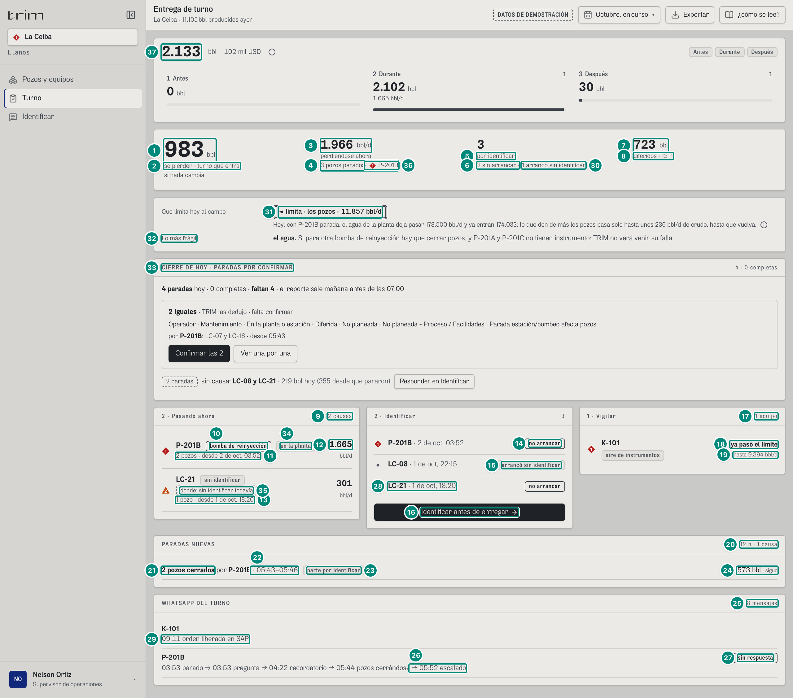
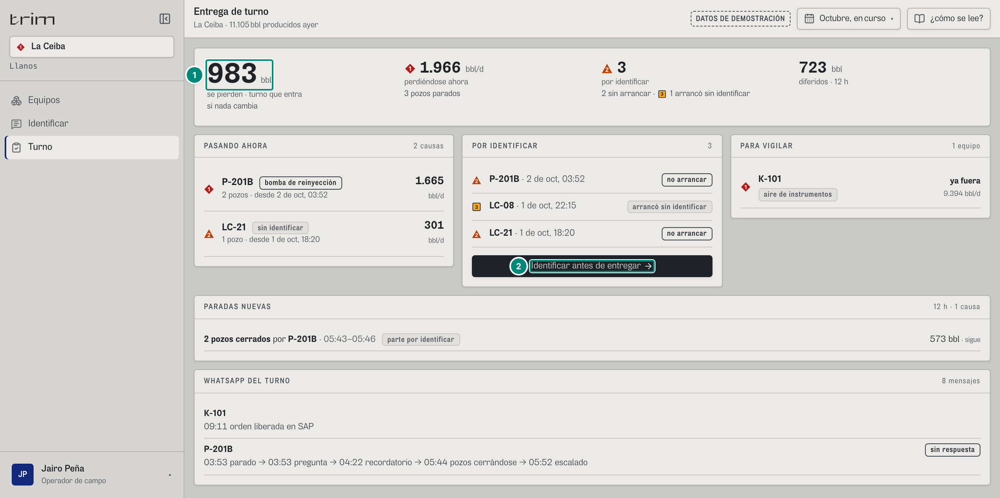

# 6B.5 Turno — supervisor, operador

**Para qué.** «Durante: turno en curso e identificar. Antes: qué vigilar.» (`PARA_QUE.turno`, `src/widgets/Onboarding.tsx:22`). Título de la pantalla: «Entrega de turno».

**Ruta.** `#/<rol>/turno/<campo>[~portafolio]/<período>`. **El período de la cabecera no aplica**: el turno son siempre las **12 horas que terminan en AHORA** (`TURNO_H = 12`, rotación 7×7 sobre una operación 24/7, `src/pages/Turno.tsx:32`). En el demo, del 2-oct 02:00 al 2-oct 14:00. De arriba abajo: el cinturón `CicloCifras` (capítulo 11), las cuatro cifras del turno, «Qué limita hoy al campo» y «Lo más frágil» (`HoyLimita`), «CIERRE DE HOY» (`CierreDeHoy`), los paneles «**2 · Pasando ahora**», «**2 · Identificar**» y «**1 · Vigilar**» (palancas Durante / Antes), «PARADAS NUEVAS» y «WHATSAPP DEL TURNO» (este, **RETIRADO (27-oct-2026)**). Lo que trajo el choke —el tramo que limita, lo más frágil, el cierre de hoy y el chip del tramo— lo explica 6D.6; aquí va cada cosa en una fila corta (31-36).

**Roles y nivel.** `sup`, `oper` → `operacion`, con `campos: ['ceiba']` los dos. Las cifras son las mismas, pero las dos pantallas **ya no son idénticas**: (1) «Exportar» solo para el supervisor (el operador no tiene `evidencia:exportar`); (2) el operador no ve el modelo del tramo —ni «Qué limita hoy al campo» y «Lo más frágil», ni el chip «en la planta» de «Pasando ahora»— porque contesta lo que vio (`veTramo = rol.id !== 'oper' && rol.id !== 'tec'`, `src/pages/Turno.tsx:89`; U2 §3.1); (3) en «CIERRE DE HOY» el operador no tiene el botón «Confirmar las 2», solo «Lo confirma supervisión o producción, que firman el día.» (`CierreDeHoy.tsx:41, 107`). Ver «Operador», abajo, y 6D.6.

**Lee.** La pantalla no pide nada propio: combina las respuestas de abajo y **el front hace las cuentas** (5B §6). El servidor tiene que devolver esos insumos idénticos.

| Endpoint | Para qué |
|---|---|
| `GET /api/vistas/riesgo?campos` → `Riesgo[]` | «perdiéndose ahora», «se pierden · turno que entra», «2 · Pasando ahora», «1 · Vigilar» (5B §5) |
| `GET /api/vistas/diferidos?campos&desde=AHORA−12h&hasta=AHORA` → `Libro` | «diferidos · 12 h», «PARADAS NUEVAS» (`tramos`) |
| `GET /api/vistas/paradas/por-identificar?campos` → `Pregunta[]` | «por identificar», «2 · Identificar», el estado de cada hilo de WhatsApp (**RETIRADO (27-oct-2026)**) |
| `GET /api/mensajes?campos` → `Mensaje[]` (**RETIRADO (27-oct-2026)**, R1) | «WHATSAPP DEL TURNO» (5D §5) |
| `GET /api/usuarios` (al arrancar) | nombres de quienes recibieron cada mensaje |
| `GET /api/vistas/ciclo?campos&desde=AHORA−12h&hasta=AHORA` → `CicloValor` | el cinturón «2.133 bbl · 102 mil USD» y «1 Antes / 2 Durante / 3 Después» (`CicloCifras`, `Turno.tsx:48, 220`; capítulo 11) |
| `GET /api/vistas/equipos-hoy?campos` → `EquipoVivo[]` por campo | la **marca de cada equipo** en «2 · Identificar» (`hoy(equipo, campo).severidad`, `Turno.tsx:54, 142`; B-20) |
| `GET /api/vistas/campos/:campo/tuberia?desde=AHORA−12h&hasta=AHORA` → `TuberiaCampo` · `GET /api/vistas/criticidad?campos` → `VistaCriticidad` · `GET /api/vistas/anh/paradas?campos&desde=hoy 00:00&hasta=AHORA` | «Qué limita hoy al campo», «Lo más frágil» y el chip del tramo; «CIERRE DE HOY» (`HoyLimita.tsx`, `CierreDeHoy.tsx`; 6D.6) |

| # | Lo que se ve | En la captura | Cómo se calcula | Texto según el valor | Viene de |
|---|---|---|---|---|---|
| 1 | Turno que entra | **983** bbl | $\left(\sum_{\text{perdiendo}} \text{bblDia}\right)\cdot 12/24 = 1.966{,}03 \times 0{,}5 = 983{,}0$ (5B §6 «Se pierden en el turno que entra») | `n0` + «bbl»; globo «Turno que entra: Lo que se pierde ahora, sostenido las 12 horas del turno.» con «Perdiéndose ahora 1.966 bbl/d» y «Turno 12 h» (`Turno.tsx:222-227`) | `Riesgo[estado=perdiendo].bblDia` |
| 2 | Rótulos | «se pierden · turno que entra» / «si nada cambia» | fijos | — | — |
| 3 | Perdiéndose ahora | **1.966** bbl/d, en tinta y sin marca | $\sum$ `bblDia` de las filas «perdiendo»: P-201B 1.665,2 (LC-16 y LC-07) + LC-21 300,8 | **Un total no es una alarma** (B-40): va sin marca, haya filas o no (sin filas, «0»); la marca va en el equipo que lo causa (fila 36) (`Turno.tsx:228-236`) | `Riesgo.bblDia` |
| 4 | Pozos parados | «3 pozos parados» | $\sum$ `pozos` de esas filas (2 + 1) | `plural(n,'pozo parado','pozos parados')` | `Riesgo.pozos` |
| 5 | Por identificar | **3** «por identificar», sin marca | **la cuenta única** de Turno, Mi trabajo, Identificar y Mantenimiento: `contarPorIdentificar(preguntas)` (`src/shared/api/diferidos.ts:129` → `cuentaPorIdentificar`, `src/entities/causa-senal.ts:348`; `Turno.tsx:52`) sobre las preguntas de **toda la historia** del campo: $P = \#\{q : q.\text{pide}\}$ = 3 (P-201B, LC-08, LC-21) y, de ellas, $A = \#\{q : q.\text{pide} \wedge q.\text{arrancoSinIdentificar}\}$ = 1 (LC-08); sin arrancar $= P - A$ = 2 (la resta la hace `ApoyoPorIdentificar`). Con `pide`, «arrancó sin identificar» equivale a tener `fin` (5B §3.2), así que el número es el de antes | **sin marca** (B-40): la cifra es un total. La urgencia —rige «no arrancar» mientras $P - A > 0$— va en las palabras de cada fila (14 y 28). Una pregunta respondida tarde deja de pedir y sale de $P$, pero sigue como no conformidad en Identificar | `Pregunta.pide/arrancoSinIdentificar` |
| 6 | Debajo de la cifra | «2 sin arrancar · 1 arrancó sin identificar», sin marca | $P - A$ = 2 (P-201B, LC-21) y $A$ = 1 (LC-08) | `ApoyoPorIdentificar` (`src/shared/ui/PorIdentificar.tsx:9-18`), las mismas palabras en Turno, Mi trabajo y Mantenimiento: «N sin arrancar» y «1 arrancó / N arrancaron sin identificar»; **sin marca** (B-40: la marca es de cada fila, el total ya no lleva ■ P3); un tramo en 0 no se escribe; con los dos en 0, nada (`Turno.tsx:240`) | `Pregunta.pide/arrancoSinIdentificar` |
| 7 | Diferidos | **723** bbl | `Libro.diferido` del libro de las 12 h: 723,48 bbl (los 2 pozos de P-201B desde las 05:43 y 05:46, 573,1, más 12 h de LC-21, 150,4) (5B §6 «Diferidos · 12 h») | `n0` | `Libro.diferido` |
| 8 | Rótulo | «diferidos · 12 h» | `TURNO_H` | — | — |
| 9 | «2 · Pasando ahora» | «2 causas» | filas «perdiendo» | `plural(n,'causa','causas')`; sin filas «nada parado» y «Todos los pozos produciendo.» | `Riesgo[]` |
| 10 | Una causa | ◆ **P-201B** chip «bomba de reinyección» | fila de riesgo (`filaPerdiendo`, `Turno.tsx:113`): equipo (+ campo en portafolio), chip `TIPO_CAUSA[tipo]` en minúscula (fuerte si alto impacto), el chip del tramo (fila 34) y la parte si la hay | marca ◆ si alto impacto, ▲ si no | `Riesgo.equipo/tipo/parte/altoImpacto` |
| 11 | Debajo | «2 pozos · desde 2 de oct, 03:52» | `plural(pozos,'pozo','pozos')` · `desde` | — | `Riesgo.pozos/desde` |
| 12 | Por día | **1.665** bbl/d | `n0(bblDia)` | globo (y papel): «Pozos parados 2», «Perdiéndose 1.665 bbl/d», «**En el turno 833 bbl**» ($n_0(\text{bblDia}\cdot 12/24) = n_0(832{,}6)$), «Desde 2 de oct, 03:52», «Pozos cerrados desde 2 de oct, 05:43» (solo si difiere más de 1 min); pista = `motivo` | `Riesgo.bblDia/cierreDesde/motivo` |
| 13 | Otra causa | ▲ LC-21 chip «sin identificar» · «1 pozo · desde 1 de oct, 18:20» · 301 | `pendiente` no es de alto impacto → ▲; entre el chip y la línea de abajo va «dónde: sin identificar todavía» (fila 35) | — | — |
| 14 | «2 · Identificar» | ◆ P-201B · 2 de oct, 03:52 · chip **«no arrancar»** | una fila por pregunta que pide: la **marca del equipo de hoy** (`hoy(equipo, campo).severidad`, `Turno.tsx:142`; P-201B es P1 → ◆), equipo (+ campo) · `fechaHora(inicio)` | chip fuerte «no arrancar» (`!fin`) o neutro «arrancó sin identificar». La marca ya **no** depende de si arrancó (B-20: un equipo lleva su marca de hoy en toda la pantalla): la urgencia de identificar va en el chip. Esas filas nunca quedan detrás de «ver más» (`Turno.tsx:106-107, 140-148`). Aserción `rutas.ts:92`: «no arrancar» presente | `Pregunta[]` · `EquipoVivo.severidad` |
| 15 | No conformidad | • LC-08 · 1 de oct, 22:15 · «arrancó sin identificar» | arrancó sin que nadie respondiera (5B §3.2): es la $A$ de la fila 5 | la marca es la de hoy del equipo: LC-08 produce y está normal, `•` (severidad 0), no la ■ P3 de antes; la no conformidad la dice el chip (`Turno.tsx:142`) | `Pregunta.arrancoSinIdentificar` · `EquipoVivo.severidad` |
| 16 | Botón | «Identificar antes de entregar →» | con la pantalla `causa` en el rol y al menos una pregunta | sin el permiso: «Lo responde quien estuvo en el equipo.»; sin preguntas: «Todas las paradas tienen causa.» | — |
| 17 | «1 · Vigilar» | «1 equipo» | filas «en riesgo», lo que ya pasó el límite primero y luego por horas (5B §5.3, §6) | `plural(n,'equipo','equipos')`; sin filas «Ninguna parte va hacia su límite.» | `Riesgo[estado=en-riesgo]` |
| 18 | Cuándo | ◆ K-101 · «**ya pasó el límite**» | `horas` ausente → «ya pasó el límite» (B-42); si no, `fmtHoras(horas)` (`Turno.tsx:166`) | marca: la prioridad de la fila, **subida al menos a ▲ P2 si cruza dentro del turno** (`horas < 12`, `Turno.tsx:104`); K-101 es ◆ (prioridad 1, sin horas) | `Riesgo.horas/prioridad` |
| 19 | Si para | «hasta 9.394 bbl/d» | `siPara(r, esServicio(r))` (`src/shared/ui/costoHoy.ts:43`): lo que se deja de producir por día si para. Para K-101 es un **techo** (`Riesgo.techo`: se supone que se cierra todo lo que produce y depende del equipo): el aire de instrumentos alimenta todo el campo, así que pone en juego el crudo de los 15 pozos que hoy producen, 11.360,2 − 1.966,0 = 9.394,2 (5B §5.3 b); por eso dice «hasta», nunca la cifra sola | debajo, la parte + chip de estado, o el chip del tipo («aire de instrumentos») si no tiene parte; globo «Parte», «Cruza su límite» (con «ya pasó el límite» si no hay horas), «**Si para**»: `siParaLargo`, que con techo agrega «(un techo: si se cierran todos los pozos que dependen de él)» y, de un servicio sin nada produciendo, «cierra lo que esté produciendo en el campo» (`Turno.tsx:153-154, 168`); pista = `motivo`. «Si para» (bbl/d) no es «si falla hoy» (costo en bbl de Riesgo, 6D.5) | `Riesgo.bblDia/techo/parte/estadoParte/tipo` |
| 20 | «PARADAS NUEVAS» | «12 h · 1 causa» | eventos que **empezaron** en el turno, agrupados por causa (5B §6 «Paradas nuevas») | `plural(n,'causa','causas')`; sin ninguna «Ningún pozo paró.» | `Libro.tramos` |
| 21 | Un grupo | «**2 pozos cerrados** por **P-201B**» | grupo con más de un pozo | un solo pozo: «**HH:MM** · **<pozo>**» (+ « · por <equipo>») | `tramos[].causa.evento` |
| 22 | Horas | «· 05:43–05:46» | primer y último cierre del grupo, solo la hora | — | `tramos[].evento.inicio` |
| 23 | Cómo | chip «parte por identificar» | lo cerró otro equipo y `como = ninguno` → «parte por identificar»; si no, `COMO[como]` («por señal», …). Aserción `rutas.ts:92`: «parte por identificar» sí, «(sin identificar)» no | — | `causa.como`, `causa.equipo` |
| 24 | Barriles | «573 bbl · sigue» | Σ bbl del grupo en el libro de 12 h; « · sigue» si algún tramo sigue abierto | globo: «Lo cerró <equipo>», «Barriles», «Cómo se identificó»; pista = causa | `tramos[].bbl/abierto` |
| 25 | «WHATSAPP DEL TURNO» (**RETIRADO (27-oct-2026)**) | «8 mensajes» | mensajes con `hora ≥ AHORA − 12 h` que **sí** salieron | `plural(n,'mensaje','mensajes')` + « · N sin enviar» si los hay | `Mensaje[]` |
| 26 | Un hilo | «P-201B · 03:53 parado → 03:53 pregunta → 04:22 recordatorio → 05:44 pozos cerrándose → 05:52 escalado» (los pozos se cierran al minuto del primer cierre, 05:43, antes del escalado: con el tanque al 78,7 % el colchón era de 1,8 h) | un hilo por evento (o por orden, o por regla y equipo); cada paso con su hora y `PASO_CORTO` (`src/entities/mensajes.ts:53-56`: «parado», «pozos cerrándose», «pregunta», «aviso del vigía», «orden liberada en SAP», «recordatorio», «escalado»), ordenados por hora y por `ORDEN_PASO` (`mensajes.ts:152-154`); los hilos, del más reciente al más viejo | globo (y papel): una fila por paso, «HH:MM <paso>» → a quién llegó («Nelson Ortiz, Jairo Peña»); lo que no salió va en la fila: « · ◌ no se envió a <persona>: <motivo>» (`NoEnviado`) | `Mensaje.hora/regla/insistencia/para/noEnviado/evento` |
| 28 | Tercera pregunta y contador | ▲ «LC-21 · 1 de oct, 18:20» · chip «no arrancar»; extra del panel «3» | la de LC-21 sigue sin arrancar; su marca es la del equipo de hoy (▲ P2: su causa no es de alto impacto); el extra es $P$ de la fila 5 (`pi.porIdentificar`: 3). Orden de las filas: las del servidor (P-201B, LC-08, LC-21) | igual que las filas 14-15 | `Pregunta[]` |
| 29 | Otro hilo | «K-101 · 09:11 orden liberada en SAP» (sin chip de estado) | el hilo de la orden 40012056 de K-101 (regla «orden liberada en SAP», 5D §5); va primero porque su último paso (09:11) es más reciente que el de P-201B (05:52); un hilo sin evento no lleva estado (fila 27) | fila 26 | `Mensaje[]` con `regla = orden` |
| 27 | Estado del hilo | chip fuerte «sin respuesta» | de la pregunta del evento del hilo: sin respuesta → chip; con respuesta → «respondió <por>[ por WhatsApp]: «<texto>»» (por WhatsApp: **RETIRADO (27-oct-2026)**); un hilo sin evento (la orden de K-101) no lleva estado | — | `Pregunta.causa.declarado` |
| 30 | Las que arrancaron, debajo de la cifra | «1 arrancó sin identificar», sin marca | $A$ de la fila 5 (LC-08): la misma no conformidad de la fila 15, contada | «arrancó»/«arrancaron» según $A$ (`PorIdentificar.tsx:15`); con $A = 0$ no se escribe; sin ■ P3 (B-40) | `Pregunta.arrancoSinIdentificar` |
| 31 | Qué limita hoy | chip «◄ limita · los pozos · 11.857 bbl/d» y debajo «Hoy, con P-201B parada, el agua de la planta deja pasar 178.500 bbl/d y ya entran 174.033: lo que den de más los pozos pasa solo hasta unos 236 bbl/d de crudo, hasta que vuelva.» ⓘ | el tramo más angosto de la tubería del campo (`TuberiaCampo.limita`), con lo que deja pasar (`potencialBpd`) y la frase de hoy (`fraseHoy`, o `frase` si hoy no hay un equipo parado que lo cambie) (`HoyLimita.tsx:50-62`). 5E §1, 5E §2. Qué dice en cada caso: 6D.6 | «limita» va en gris con doble contorno: no es una alarma, todo campo tiene un tramo que limita; sin dato, «sin dato» (`HoyLimita.tsx:62`); solo supervisor (`veTramo`) | `GET /api/vistas/campos/:campo/tuberia` → `limita`, `tramos[].potencialBpd`, `fraseHoy` |
| 32 | Lo más frágil | «**el agua.** Si para otra bomba de reinyección hay que cerrar pozos, y P-201A y P-201C no tienen instrumento: TRIM no verá venir su falla.» | lo que una sola falla vuelve el tramo más angosto (`HoyLimita.tsx:35-45`): con una bomba ya parada, sus hermanas que subieron en «Si falla hoy» (`subio`, familia `bomba`, `bpd > 0`) y cuáles no están vigiladas; con todas en marcha, la frase del agua «si para una». 5E §7 y 6D.6 | solo si hay algo frágil; «no tiene/tienen instrumento» según cuántas; sin puesto ni lista (el supervisor no tiene «Si falla hoy» como lista) | `GET /api/vistas/criticidad` → `ranking[].subio/vigilado`; `GET /api/vistas/campos/:campo/agua` → `sinUna`, `frases` |
| 33 | Cierre de hoy | «CIERRE DE HOY · PARADAS POR CONFIRMAR» · «4 · 0 completas» · «4 paradas hoy · 0 completas · faltan 4 · el reporte sale mañana antes de las 07:00» · «2 iguales · TRIM las dedujo · falta confirmar» · «Confirmar las 2» · «2 paradas sin causa: LC-08 y LC-21 · 219 bbl hoy (355 desde que pararon)» | las paradas del día operacional de hoy (`GET /api/vistas/anh/paradas?campos&desde=hoy 00:00&hasta=AHORA`), cuántas están completas, y lo que TRIM propuso agrupado por cadena idéntica de 6 pasos, con un toque por grupo (`CierreDeHoy.tsx:34-81`). Cómo se arma y qué confirma: 6D.6 y 6D.7; la cadena, 5E §9 | lo confirma quien firma el día (`anh:confirmar`: supervisor y producción); el operador lee «Lo confirma supervisión o producción, que firman el día.» en vez del botón (`CierreDeHoy.tsx:41, 107`) | `GET /api/vistas/anh/paradas`, `GET /api/vistas/paradas/por-identificar` |
| 34 | Chip del tramo | chip «en la planta» junto a «bomba de reinyección» | dónde se trabó lo que se pierde ahora: el tramo de la causa en `TuberiaCampo.perdiendoAhora` (`DondeSeTrabo`, `HoyLimita.tsx:80-87`), con la palabra de `DONDE_CHOKE`. 5E §3; 6D.6 | solo supervisor (`veTramo`, `Turno.tsx:128`); sin tramo para la fila, nada | `GET /api/vistas/campos/:campo/tuberia` → `perdiendoAhora[].tramo` |
| 35 | Lo que aún no tiene causa | «dónde: sin identificar todavía» (gris, discontinuo) en LC-21 | LC-21 sigue sin causa identificada: `perdiendoAhora` no le asigna un tramo y sale la «Falta» (`HoyLimita.tsx:86`); se llena cuando alguien responde en Identificar. 6D.6 | `DONDE_CHOKE['sin-asignar']` | ídem |
| 36 | Quién lo causa | ◆ **P-201B** al final de «3 pozos parados» | el equipo que más pesa en lo que se pierde ahora (`causaMayor`: alto impacto primero y, a igualdad, más bbl/d; `Turno.tsx:86`) lleva la marca que el total ya no lleva: ◆ si es de alto impacto, ▲ si no (`Turno.tsx:229-234`) | solo si hay filas «perdiendo» | `Riesgo.equipo/altoImpacto/bblDia` |
| 37 | Cinturón del ciclo | «**2.133** bbl · 102 mil USD» ⓘ y debajo «1 Antes 0 bbl · 2 Durante 2.102 bbl (1.665 bbl/d) · 3 Después 30 bbl» | el retorno simulado de las tres palancas **en las últimas 12 h** (`useCiclo(ids, inicioTurno, AHORA)`, `Turno.tsx:48, 220`); no entra al libro ni a un informe. Capítulo 11 §11.1b | las cifras son simuladas; el porqué, en ⓘ y globos | `GET /api/vistas/ciclo` |

Los cinco paneles muestran cinco filas y «ver N más»; lo escondido sale en el papel. Las aserciones del auditor para `#/sup/turno/ceiba/curso` (`rutas.ts:92`) exigen «pozos cerrados por P-201B», «WHATSAPP DEL TURNO» (**RETIRADO (27-oct-2026)**), «escalado», «no arrancar», «parte por identificar» y prohíben «(sin identificar)», «preguntarle al operario» y «LO QUE TRIM MANDÓ».

### Operador

| # | Lo que se ve | En la captura | Regla |
|---|---|---|---|
| 1 | Turno que entra | **983** bbl | las mismas cifras: nada del turno depende del nivel |
| 2 | Botón | «Identificar antes de entregar →» | el operador también tiene la pantalla `causa` |
| 3 | Cierre de hoy | «CIERRE DE HOY · PARADAS POR CONFIRMAR» y, donde el supervisor tiene «Confirmar las 2», el texto «Lo confirma supervisión o producción, que firman el día.» | el operador no tiene `anh:confirmar` (`CierreDeHoy.tsx:41, 107`); lee el cierre y responde en Identificar. 6D.6 |

Lo que el operador **no** ve, y por eso la captura es más corta: «Qué limita hoy al campo» y «Lo más frágil», y el chip «en la planta» de «Pasando ahora» (`veTramo`, `Turno.tsx:89, 128, 257`: «el operador no ve el modelo del tramo: contesta lo que vio»), y «Exportar» en la cabecera (no tiene `evidencia:exportar`). Todo lo demás es igual al supervisor.

### Portafolio y estados

- **Portafolio** (`~portafolio`): a cada equipo se le agrega « · <campo>»; las cifras suman los campos del ámbito; «Qué limita hoy al campo» y «Lo más frágil» salen una vez por campo, con su nombre encima (`HoyLimita.tsx:49`, 6D.6). **Ningún rol de operación lo alcanza en el demo** (`sup` y `oper` tienen solo `ceiba`): `#/sup/turno/ceiba~portafolio/curso` muestra «Usted no tiene asignado el portafolio: le mostramos La Ceiba.» y el turno de La Ceiba. Los valores son los del motor con los cinco campos (5B §6): 1.325 bbl (2.650,09 × 0,5); 2.650 bbl/d · 4 pozos (P-201B de La Ceiba 1.665,2, MN-41 684,1, LC-21 300,8); 4 por identificar · 2 sin arrancar · 2 arrancaron sin identificar (LC-08 y la P-201B de Morichal del 24-sep); 1.077 bbl (1.077,42: La Ceiba 723,5 y Morichal 353,9, MN-41 342,0 y el disparo de MN-25 11,9); 2 causas nuevas: P-201B La Ceiba y MN-25.
- **Sin nada parado**: «0» sin marca, «nada parado», «Todos los pozos produciendo.».
- **Un mensaje que no salió** (`noEnviado`): no cuenta en «N mensajes», se dice « · N sin enviar» en el encabezado y en la fila del paso con su motivo (5D §5 «Mensajes no enviados»).

### Interacciones

Clic en una fila de «2 · Pasando ahora» o «1 · Vigilar»: ficha del equipo (6B.4). «Identificar antes de entregar»: pantalla de causa. Globos de cada fila (escritos en el papel). «ver N más».
