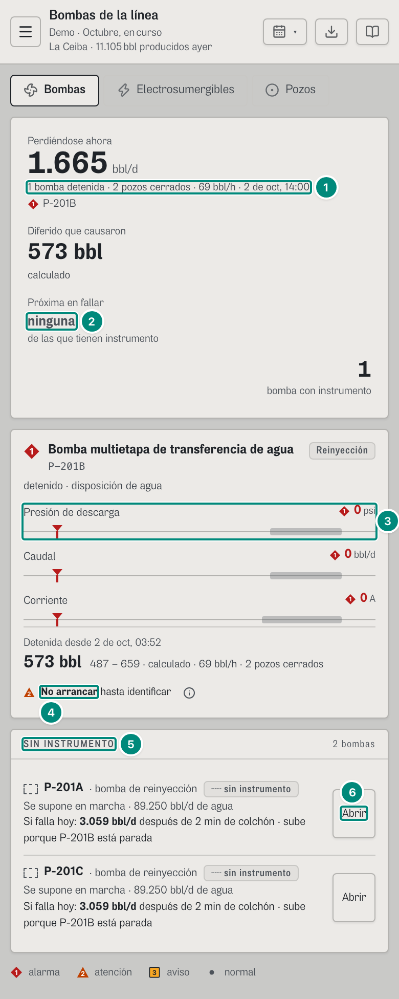
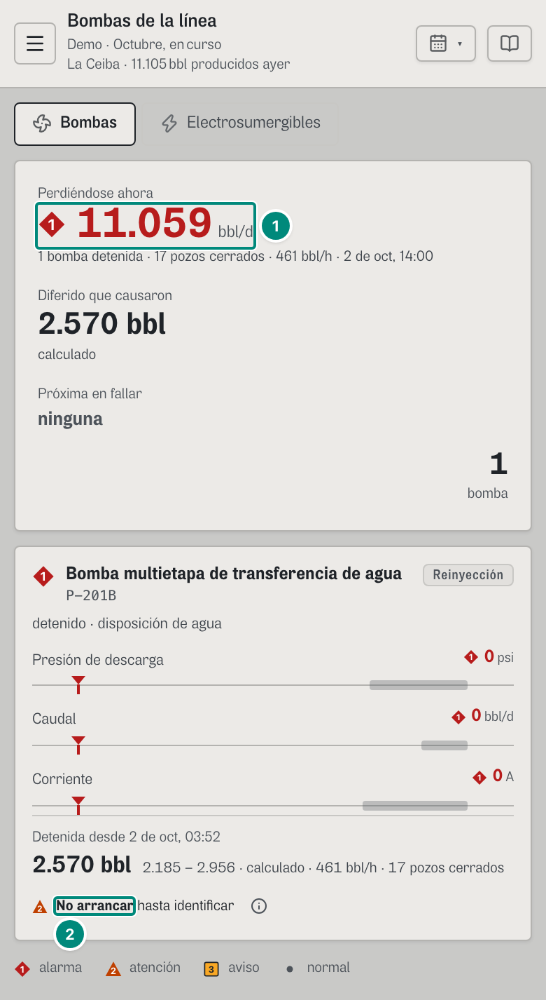
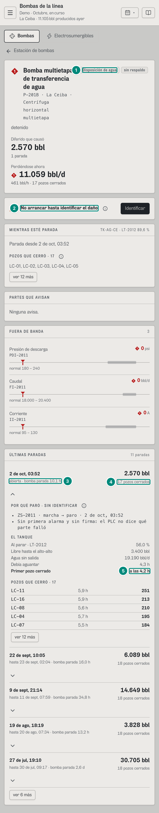
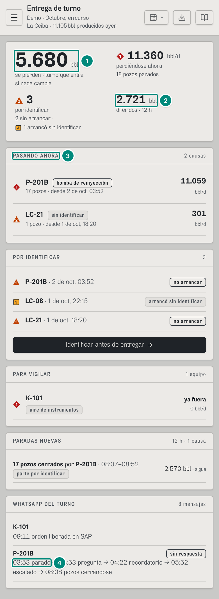
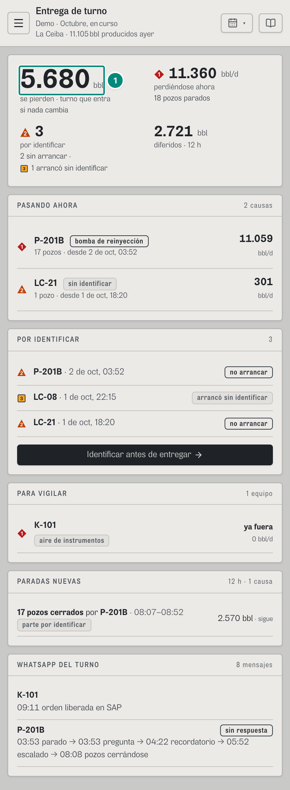
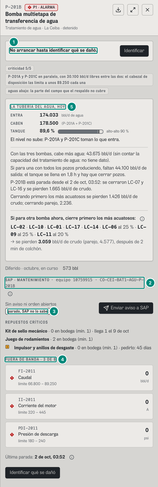
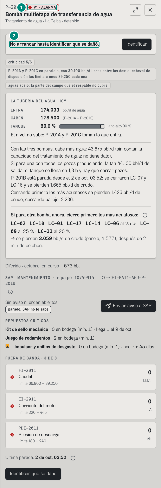

# 6B.6 En el teléfono (390 px) — supervisor y operador

El supervisor y el operador miran sobre todo desde el teléfono, en campo. Las cifras y los textos son **los mismos** que en el escritorio (mismos endpoints, mismas reglas): lo que cambia es la disposición, lo que se pliega y lo que se esconde. Las capturas son de un iPhone 13 (390 × 844, `telefono: true`). «Mi trabajo» del técnico lo documenta otra parte del capítulo 6.

Reglas generales del teléfono (ancho < 640 px, `sm` de Tailwind; < 1024 px, `lg`):

| Qué | En el teléfono | Código |
|---|---|---|
| Riel de navegación | escondido; botón ☰ en la cabecera abre un cajón | `src/App.tsx` (`escritorio`, `nav`) |
| Cabecera de la pantalla | título, «Demo · <período>», «<campo> · N bbl producidos ayer»; botones solo con ícono (período, exportar si el rol puede, «¿cómo se lee?») | `src/widgets/Cabecera.tsx` |
| Cifras de cabecera | rejilla `auto-fit` con mínimos de 150–190 px: en 390 px quedan **una o dos por renglón** | `Bombas.tsx:46`, `Turno.tsx:200` |
| Indicador analógico | en un contenedor < 460 px pasa a **dos renglones**: nombre y valor arriba, barra a todo el ancho abajo (en el escritorio, una fila: nombre · barra · valor) | `src/index.css:156-165` |
| Ficha de un equipo | ocupa **todo el ancho** (en el escritorio, 560 px a la derecha) | `PanelEquipo.tsx:121-124` |
| Tablas largas | Pozos y Electrosumergibles pasan a **una tarjeta por fila** | `Pozos.tsx:165-183`, `Esp.tsx:148-170` |
| Blancos de toque | 24 px mínimo en ⓘ y globos (`min-h-6`) | `Placa.tsx:108` y otros |

## Bombas

| # | Lo que se ve | Qué cambia |
|---|---|---|
| 1 | «1 bomba detenida · 17 pozos cerrados · 461 bbl/h · 2 de oct, 14:00» | la cabecera se apila: «Perdiéndose ahora», «Diferido que causaron» y «Próxima en fallar» uno debajo de otro; el conteo («1 bomba») queda solo, a la derecha |
| 2 | «ninguna» | igual que en el escritorio |
| 3 | Indicador de la presión de descarga | dos renglones (nombre y ◆ 0 psi arriba, la barra abajo) |
| 4 | «No arrancar hasta identificar» | igual; la ⓘ con blanco de 24 px |

| # | Lo que se ve | Qué cambia |
|---|---|---|
| 1 | ◆ **11.059** bbl/d | igual que el supervisor; la cabecera no trae el botón de exportar (el operador no tiene `evidencia:exportar`) |
| 2 | «No arrancar» | — |

### El detalle de la bomba

| # | Lo que se ve | Qué cambia |
|---|---|---|
| 1 | Chips «Disposición de agua», «sin respaldo» | quedan a la derecha del nombre, que se parte en varios renglones con el id y la tecnología |
| 2 | «No arrancar hasta identificar el daño» + «Identificar» | igual |
| 3 | Fila de una parada: «2 de oct, 03:52» / «abierta · bomba parada 10,1 h» | **la columna del medio desaparece** (`hidden sm:block`, `Detalle.tsx:413`): en el teléfono la fila no dice la parte ni cómo se identificó, ni «colchón X h · aguantó Y h», ni la marca ▲ «por identificar» / ■ «arrancó sin identificar». Eso se ve solo **al abrir la parada** («POR QUÉ PARÓ», «EL TANQUE») |
| 4 | «17 pozos cerrados» | a la derecha, con los barriles |
| 5 | «Primer pozo cerrado a las 4,2 h» | dentro de la parada abierta; «EL TANQUE» y «POZOS QUE CERRÓ» se apilan (rejilla `auto-fit` de 260 px) |

Otros pliegues del detalle en el teléfono: en «SALUD POR PARTE» (ingeniería) la historia de cada parte («5 fallas · 104.082 bbl») no se ve (`hidden sm:block`, `BloqueParte.tsx:43`); «ORDEN DE CIERRE» se desplaza a lo ancho dentro de su caja (`desplazable`, ancho mínimo 360 px); los paneles «PARTES QUE AVISAN» y «FUERA DE BANDA» se apilan.

## Turno

| # | Lo que se ve | Qué cambia |
|---|---|---|
| 1 | **5.680** bbl · «se pierden · turno que entra» | las cuatro cifras en una rejilla de **2 × 2**; debajo de «▲ 3 por identificar», «2 sin arrancar ·» y «■ 1 arrancó sin identificar» se parten en dos renglones (6B.5, filas 5-6 y 30) |
| 2 | **2.721** bbl · «diferidos · 12 h» | — |
| 3 | «PASANDO AHORA» | los tres paneles de arriba («PASANDO AHORA», «POR IDENTIFICAR», «PARA VIGILAR») se **apilan** en vez de ir lado a lado |
| 4 | «03:53 parado → 03:53 pregunta → 04:22 recordatorio → 05:52 escalado → 08:08 pozos cerrándose» | el hilo de WhatsApp parte la cadena en dos renglones; el chip «parte por identificar» de «PARADAS NUEVAS» baja debajo de «17 pozos cerrados por P-201B · 08:07–08:52» |

| # | Lo que se ve | Qué cambia |
|---|---|---|
| 1 | **5.680** bbl | idéntico al supervisor, sin el botón de exportar |

## La ficha de P-201B

| # | Lo que se ve | Qué cambia |
|---|---|---|
| 1 | «No arrancar hasta identificar qué se dañó.» + «Identificar» | primera cosa de la ficha, a todo el ancho |
| 2 | «SAP · MANTENIMIENTO · equipo 10759915 · CO-CEI-BAT1-AGU-P-201B» | el título se parte y su ⓘ queda **sola en el renglón siguiente** (`BloqueSap.tsx:68-71`; está al lado del título, nunca dentro) |
| 3 | «Sin aviso ni orden abiertos» + chip «parado, SAP no lo sabe» | el chip baja debajo de la frase; «Enviar aviso a SAP» a la derecha |
| 4 | «FUERA DE BANDA · 3 DE 8» | igual; las filas de dispositivos sin minigráfica (en operación no se dibuja en ningún ancho) |

| # | Lo que se ve | Qué cambia |
|---|---|---|
| 1 | «P1 · ALARMA» | la cabecera de la ficha **no tiene el botón de exportar** (el operador no puede); quedan expandir y cerrar, y el nombre del equipo cabe en un renglón |
| 2 | «No arrancar hasta identificar qué se dañó.» | igual que el supervisor |

## Lo que no cambia

Las mismas cifras, los mismos textos según el valor, las mismas marcas ISA-101 y las mismas reglas de «ver N más» (ninguna fila de prioridad 1 se esconde). Lo que en el teléfono se esconde por espacio (la columna del medio de las paradas, la historia de cada parte) sigue en el detalle abierto o en el papel.
