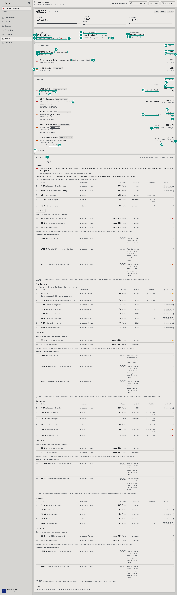
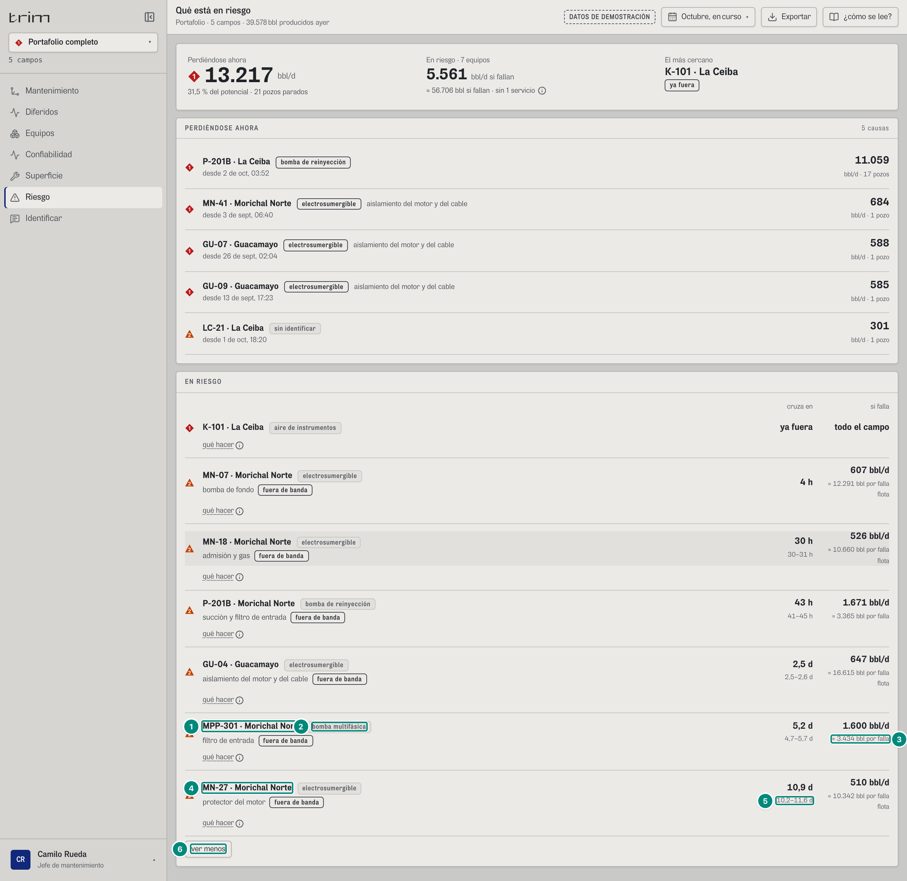
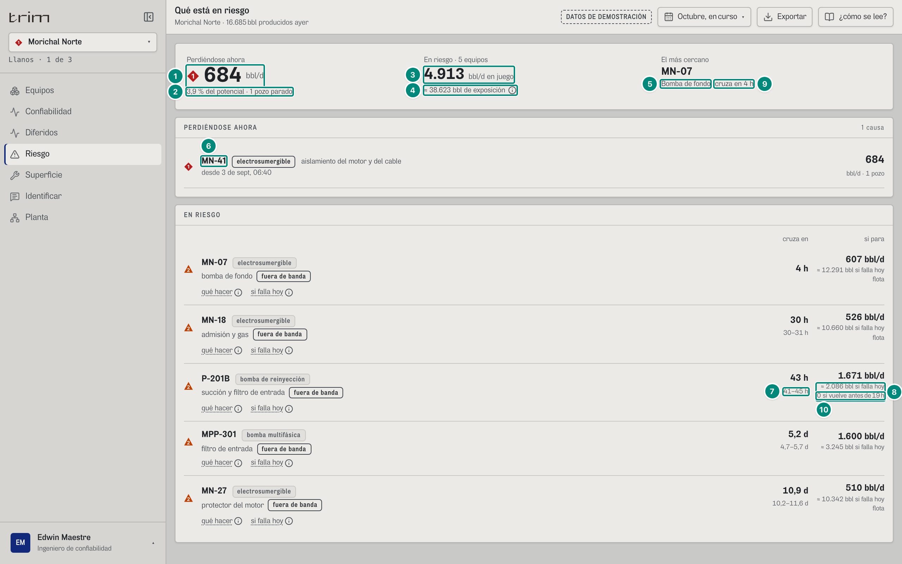
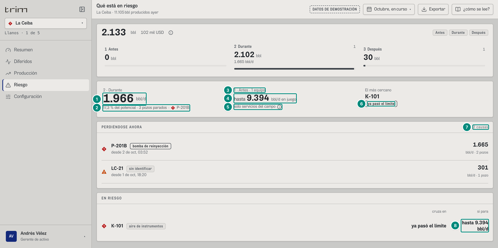

## 6C.1 Riesgo — «Qué está en riesgo» · jefe de mantenimiento, confiabilidad, gerente

**Para qué.** «Antes y Durante: a qué equipo ir hoy, en bbl y si falla hoy.» (nivel `decision`: «Qué se pierde ahora y qué va a fallar.») — `src/widgets/Onboarding.tsx:25` y `:40` (`PARA_QUE.riesgo`, `PARA_QUE_DECISION.riesgo`).
**Ruta.** `#/<rol>/riesgo/<campo>[~portafolio]/<período>` · **Roles y nivel.** `jefe` (ingeniería), `conf` (ingeniería), `ger` (decisión). Operación no la tiene: Turno y Mi trabajo repiten lo mismo (`src/entities/roles.ts:37-43`). Agrega campos (`agrega: true`): en portafolio suma los campos del rol.
**Lee.** `GET /api/vistas/riesgo?campos` → `Riesgo[]` (filas) y `GET /api/vistas/estado?campos` → `EstadoCampo[]` (solo para el potencial). `GET /api/vistas/criticidad?campos` → `{ ranking, campos }` (**solo ingeniería**: el tramo de «se trabaría en…» de cada fila de «En riesgo», `Riesgo.tsx:44-45`, y todo el panel «SI FALLA HOY»). `GET /api/vistas/ciclo?campos&desde&hasta` → cinturón `CicloCifras` arriba (retorno + columnas 1/2/3; capítulo 11). **El período no cambia nada** en riesgo: todo es «ahora» (`AHORA`); el tramo DESPUÉS del ciclo sí usa `desde`/`hasta`. Fórmulas: 5B §5 «Lo que se pierde ahora y lo que está en riesgo»; lo que costaría que un equipo fallara hoy (`costoFalla`, `colchonH`, `mdtFuente`, `costoDe`): [5B §5.3, ficha «Costo por falla»](../05b-paradas-agua/05-riesgo-ahora.md). Dónde se trabaría cada equipo (el tramo) → 5E §1, 5E §1; «Si falla hoy» en grupos, el techo «hasta», el puesto y «sube» → 5E §7. Paneles: «**1 · Antes**» (en riesgo) y «**2 · Durante**» (perdiendo); sin párrafo puente entre cinturón y grillas. Para ingeniería (jefe, confiabilidad), después de «EN RIESGO» sigue el panel **«SI FALLA HOY»** (todos los equipos del campo por lo que le quitarían al campo por día si fallaran hoy, en tres grupos): no se explica aquí sino en la **6D.5**; aquí solo van sus tres anuncios en esta pantalla (filas 30 a 32). El gerente no lo ve.

> El demo calcula con `AHORA = 2026-10-02T14:00-05:00`. Los números de abajo son los de la captura y los del caso `referencia/riesgo/portafolio.json` (y `ceiba.json`, `morichal.json`), que el backend debe reproducir sin redondear.

### Captura 1 · jefe, portafolio, «ver 3 más» cerrado

| # | Lo que se ve | En la captura | Cómo se calcula | Texto según el valor | Viene de |
|---|---|---|---|---|---|
| 1 | Marca del equipo que más pierde, al final del apoyo (el total ya no lleva marca) | «P-201B» con su ◆ 1 (rombo rojo), a la derecha de «4 pozos parados ·» | la **primera** fila `perdiendo` (el orden del servidor: `bblDia` descendente, 5B §5.1): `perdiendo[0]` da el equipo y su marca (`Riesgo.tsx:185`). Sin filas `perdiendo` no se dibuja. El total de la cifra 2 no lleva marca de alarma: la lleva el equipo que lo causa (B-40; antes un ◆ delante de la cifra, que decía «hay algo de alto impacto» sin decir qué) | ◆ P1 si `altoImpacto`, si no ▲ P2 (nunca ■ P3). Un total sin marca y el equipo con ella: igual en Turno, el Resumen y la franja «Ahora» (abajo) | `riesgo[0].equipo`, `.altoImpacto` |
| 2 | **Perdiéndose ahora** (rótulo «2 · Durante» encima de la cifra) | **2.650** bbl/d | $\sum_{\text{estado}=\text{perdiendo}} \text{bblDia}$ = 1.665,2 + 684,1 + 300,8 = 2.650,1 → 5B §5.2 «Perdiéndose ahora» | `n0` + «bbl/d». Con 0 se ve «0 bbl/d» (sin marca) | `GET /api/vistas/riesgo` → `bblDia` de las filas `perdiendo` |
| 3 | Apoyo: lo perdido sobre el potencial y los pozos | «6,3 % del potencial · 4 pozos parados» | $\dfrac{\sum \text{bblDia}_{\text{perdiendo}}}{\sum_{\text{campos}} \text{potencialBpd}} \times 100$ = 2.650,1 / 42.015,0 = 6,31 % ; pozos = $\sum$ `pozos` de las filas `perdiendo` (2+1+1) → 5B §5.4 «El estado del campo» | `n1` + « % del potencial · » + `plural(n,'pozo parado','pozos parados')`. Sin potencial (ningún campo con factor): «0,0 %» (`Riesgo.tsx:184`) | `GET /api/vistas/estado` → `potencialBpd`; `riesgo[].pozos` |
| 4 | Rótulo «1 · Antes · N equipos» | «1 · Antes · 8 equipos» | número de filas `en-riesgo` | `plural(n,'equipo','equipos')` | `riesgo[]` con `estado = 'en-riesgo'` |
| 5 | **En riesgo** (bbl/d en juego) | «hasta **14.655** bbl/d en juego» | $\sum_{\text{en-riesgo}} \text{bblDia}$ = 9.394,2 (K-101) + 1.599,8 (MPP-301) + 783,1 (P-201B de Morichal) + 647,2 (GU-04) + 606,5 (MN-07) + 588,1 (GU-07) + 526,1 (MN-18) + 510,4 (MN-27) = 14.655,2 → 5B §5.3 «En riesgo». Casi dos tercios son de K-101: si el aire cae, se cierra lo que produce La Ceiba (15 de 18 pozos). **«hasta»**: K-101 trae `techo: true` (5E §7) y la suma lo hereda (`sumaSiPara`, `costoHoy.ts:50-53`); sin ningún techo entre las filas la cifra va sola (Morichal: «4.026 bbl/d en juego», captura 3) | `{techo ? "hasta " : ""}` + `n0` + « bbl/d en juego» (`Riesgo.tsx:190`, `data-en-juego`; antes «bbl/d si fallan», y sin «hasta»). Es lo que se perdería por día si pararan, con K-101 como techo (si se cierran todos los pozos que dependen de él); no se suma con la cifra 2: todavía no se pierde | `riesgo[].bblDia` |
| 6 | Pie corto: la exposición | «≈ 45.262 bbl de exposición · sin 1 servicio» | $\sum_{\text{en-riesgo}} \text{costoFalla}$ (las filas que lo traen) = 1.234,6 (P-201B de Morichal) + 3.244,5 (MPP-301) + 10.639,5 (GU-04) + 10.578,8 (MN-07) + 1.487,8 (GU-07) + 9.175,2 (MN-18) + 8.901,3 (MN-27) = 45.261,6. Cada `costoFalla` es lo que costaría que **ese** equipo fallara hoy, con una sola cuenta para todas las familias (por eso se puede sumar): la suma es cuánto hay expuesto equipo por equipo, **no** que fallen todos a la vez → [5B §5.3, ficha «Costo por falla»](../05b-paradas-agua/05-riesgo-ahora.md) | `pieCorto` (`Riesgo.tsx:73-77`): sin filas → «nada en riesgo»; con alguna cifra → «≈ {n0} bbl de exposición» + « · {k} sin historia» (equipos que no son servicio y no traen `costoFalla`) + « · sin {plural(s,'servicio','servicios')}»; ninguna cifra y todas servicio → «solo servicios del campo»; ninguna cifra con alguno sin historia → «sin historia para estimar». Un 0 por definición (bomba de recobro, respaldo que absorbe toda el agua) **sí** cuenta como cifra; una ausente («sin historia») no | `riesgo[].costoFalla` |
| 7 | ⓘ «Exposición» | (globo) | la frase `pieCosto` (`Riesgo.tsx:66-71`) | Texto literal aquí: «Suma de lo que costaría cada equipo si fallara hoy, uno por uno. Sin contar 1 servicio del campo.» Salvedades, cada una como frase: «{plural(k,'equipo','equipos')} sin historia para estimar», «Sin contar {plural(s,'servicio del campo','servicios del campo')}»; sin ninguna cifra: «Son servicios del campo: lo que cuesta su caída depende de cuánto dure.» o «Sin historia de fallas para estimar lo que costaría una.» Solo se dibuja si hay filas en riesgo; en el papel sale escrito («Exposición: …») | ídem |
| 8 | **El más cercano** | «K-101 · La Ceiba» | la **primera** fila `en-riesgo` después de ordenar por `horas` ascendente con `horas` ausente = −1 (`Riesgo.tsx:47`): lo que ya está fuera va primero. K-101 y GU-07 están los dos «ya pasó el límite»; el orden estable deja primero el del servidor (`bblDia` descendente: 9.394 contra 588) | equipo + « · {campo}» solo en portafolio; debajo el nombre de la parte (`NOMBRE_PARTE`, con mayúscula) si hay; sin filas: «ninguno» en gris | `riesgo[]` |
| 9 | Chip «ya pasó el límite» | «ya pasó el límite» | `horas === undefined` en esa fila (la variable ya llegó a su alarma o el equipo es un servicio en alarma sin pronóstico) | chip fuerte «ya pasó el límite» (`Riesgo.tsx:202`; antes «ya fuera»); si hay horas: «cruza en {fmtHoras(h)}» (ver captura 3) | `riesgo[].horas` |
| 10 | Extra del panel PERDIÉNDOSE AHORA | «3 causas» | número de filas `perdiendo` (una por equipo causante y tipo) | `plural(n,'causa','causas')`; sin filas: «nada» y el texto «Todos los pozos produciendo.» | `riesgo[]` |
| 11 | Fila: equipo y campo | «P-201B · La Ceiba»; las otras de PERDIÉNDOSE AHORA: «MN-41 · Morichal Norte», «LC-21 · La Ceiba» (orden del servidor: `bblDia` descendente, 5B §5.1); en EN RIESGO: «K-101 · La Ceiba», «GU-07 · Guacamayo», «MN-07 · Morichal Norte», «MN-18 · Morichal Norte», «P-201B · Morichal Norte» (orden por `horas`, fila 8) | `equipo` (+ « · » + nombre del campo solo en portafolio, `campoPorId(c).nombre`) | el nombre del campo sale del registro (`GET /api/campos`); un id sin registrar se ve «id (campo sin registrar)» | `riesgo[].equipo`, `.campoId` |
| 12 | Chip del tipo de causa | «bomba de reinyección» (P-201B de La Ceiba y de Morichal); «electrosumergible» (MN-41, GU-07, MN-07, MN-18); «sin identificar» (LC-21, `tipo = pendiente`); «aire de instrumentos» (K-101, `tipo = aire`) | `TIPO_CAUSA[tipo]` en minúscula → 5B §2.1 «La forma de una causa» | tono **fuerte** (borde oscuro) si `altoImpacto`, neutro si no (LC-21 «sin identificar» va neutro) | `riesgo[].tipo` |
| 13 | Desde cuándo | «desde 2 de oct, 03:52» (P-201B); MN-41 «desde 25 de sept, 06:40»; LC-21 «desde 1 de oct, 18:20» (MN-41 y LC-21: su propio primer cierre) | `desde` = inicio de la parada de bomba o del servicio que causó; si la causa es el propio pozo, el primer cierre → 5B §5.2 | `fechaHora` (con año si es de otro año: «19 de oct de 2025, 02:02»); sin `desde` no se escribe la línea | `riesgo[].desde` |
| 14 | bbl/d de la fila | **1.665** (P-201B, 1.665,183); 684 (MN-41, 684,066); 301 (LC-21, 300,844) | `bblDia` de ese grupo = 1.665,183 (los 2 pozos que cerraron los operarios en la parada abierta, LC-16 y LC-07; crudo asignado = prueba vigente × FA) → 5B §5.2 | `n0` | `riesgo[].bblDia` |
| 15 | Apoyo de la fila | «bbl/d · 2 pozos» (P-201B); las otras dos «bbl/d · 1 pozo» | `pozos` | `plural(n,'pozo','pozos')` | `riesgo[].pozos` |
| 16 | Parte de la fila | «aislamiento del motor y del cable» (MN-41 y, en EN RIESGO, GU-07; también GU-04, tras «ver 3 más»); EN RIESGO: MN-07 «bomba de fondo», MN-18 «admisión y gas», P-201B de Morichal «succión y filtro de entrada»; K-101 y LC-21 sin parte | `parte` del primer pozo del grupo → 5C §3 «Catálogo de partes por familia» | `NOMBRE_PARTE[parte].toLowerCase()`; sin parte no se escribe nada (P-201B de La Ceiba no la tiene: la parada está «por identificar») | `riesgo[].parte` |
| 17 | Marca de la fila LC-21 | ▲ 2 (◆ 1 en P-201B y MN-41; en EN RIESGO ◆ 1 en K-101 y GU-07 y ▲ 2 en las otras tres) | PERDIÉNDOSE: `altoImpacto ? 1 : 2` (`Riesgo.tsx:86, 101`; el servidor manda la misma regla en `prioridad`). EN RIESGO: `prioridad` del servidor tal cual (`Riesgo.tsx:87, 131`): la de la salud de la parte (2: parte fuera de banda con pronóstico; 1: GU-07, su desbalance de corriente ya llegó a la alarma) o, en un servicio, su severidad (K-101 = 1) → 5B §5.1 y §5.3 | ◆ P1 / ▲ P2 / ■ P3 (8 §8.4) | `riesgo[].altoImpacto`, `riesgo[].prioridad` |
| 18 | Columna «cruza en» de K-101 | «ya pasó el límite» | `horas` ausente → 5C §2 «Pronóstico de cruce» | «ya pasó el límite» (negrita, `Riesgo.tsx:146`; antes «ya fuera»); si hay horas, `fmtHoras(h)` | `riesgo[].horas` |
| 19 | Columna «si para» de K-101 | «hasta 9.394 bbl/d» | servicio (`esServicio`, `src/shared/api/equipos.ts:53`: ni electrosumergible ni máquina de bombeo de la línea del catálogo; la misma regla en Riesgo, Mantenimiento, el Resumen y la franja «Ahora») con `bblDia` = el crudo asignado de los pozos de La Ceiba que producen ahora (15 de 18: 9.394,2): si el aire cae, se cierran; K-101 trae `techo: true`, así que se dice «hasta» (no es una cifra exacta: supone que se cierran todos los pozos que dependen de él) | encabezado de la columna «si para» (antes «si falla»); servicio con 0 (ningún pozo produciendo; no ocurre hoy) → «todo el campo»; con `techo` → «hasta » + `n0(bblDia)` + « bbl/d»; si no, `n0(bblDia)` + « bbl/d» (`siPara`, `costoHoy.ts:43-44`; `Riesgo.tsx:153`). Debajo: con `costoFalla` → «≈ {n0} bbl si falla hoy» (fila 26); servicio → nada; otro sin `costoFalla` → «sin historia» | `riesgo[].bblDia`, `.tipo`, `.equipo` |
| 20 | «qué hacer» ⓘ | (globo) | `accion` de la fila → 5B §5.3 | Globo «Qué hacer · K-101»: «Verificar que las tres unidades estén en servicio: hoy hay dos. Con el recibidor en 11 min de autonomía, una parada deja las válvulas en posición segura.» No se dibuja en nivel `decision` ni si no hay `accion` (`Riesgo.tsx:163-166`) | `riesgo[].accion` |
| 21 | Chip del estado de la parte | «fuera de banda» (las cuatro filas a la vista con parte: GU-07, MN-07, MN-18, P-201B; y las tres de «ver 3 más») | `estadoParte` de la peor parte → 5C §3 «Estado de una parte» | `ESTADO_PARTE[estadoParte]`: `fuera` → «fuera de banda» (tono fuerte), `avisa` → «avisa» (neutro) | `riesgo[].estadoParte` |
| 22 | «cruza en» de MN-07 | **4 h** (MN-07, 3,791 h); MN-18 «30 h» (30,16 h); P-201B de Morichal «43 h» (43,09 h); GU-07 «ya pasó el límite» | horas hasta que la primera variable de la parte llegue a su alarma = 3,791 h → 5C §2 «Pronóstico de cruce» | `fmtHoras(h)` = `textoHoras(h)` del motor (`src/entities/salud.ts:166`, una sola regla para pantalla y motivo): < 48 h → `n0` + « h»; hasta 90 d → `n1(h/24)` + « d»; más → «más de 3 meses». Sin rango debajo porque 3,64 h y 3,95 h se escriben los dos «4 h» (`entre`, `Riesgo.tsx:257-262`) | `riesgo[].horas`, `.rango` |
| 23 | «si para» de MN-07 | **607 bbl/d** (MN-07); MN-18 «526 bbl/d» (526,05); P-201B de Morichal «783 bbl/d» (783,07: los 4 pozos que cerraría en orden, con el tope del 25 % a la reducción de frecuencia: MN-27 entero, MN-36 y MN-13 al 25 %, MN-39 al 16 %, 5B §5.3 (a)); GU-07 «588 bbl/d» (588,08) | crudo asignado del pozo = 606,53 → 5B §5.3 (c) | `n0` + « bbl/d»; el lector oye «si para 607 bbl/d» | `riesgo[].bblDia` |
| 24 | «flota» | «flota» (MN-07, MN-18 y, tras «ver 3 más», GU-04 y MN-27; P-201B de Morichal y GU-07 no: `costoDe = 'propio'`) | `costoDe = 'flota'`: el pozo nunca ha fallado y su tiempo fuera es el promedio de las electrosumergibles del campo (418,60 h en Morichal; 394,55 h en Guacamayo) → 5B §5.3 «Tiempo fuera promedio de la flota ESP» | `deFlota(r, nivel)` (`src/shared/ui/costoHoy.ts:35-36`, `Riesgo.tsx:159`): solo en nivel `ingenieria`; Mantenimiento lo marca igual. Su ⓘ «si falla hoy» (fila 29) dice «17,4 d fuera, el promedio de las electrosumergibles del campo (esta no ha fallado).» | `riesgo[].costoDe`, `.mdtFuente` |
| 25 | Rango corto | «30–31 h» (MN-18); P-201B de Morichal «41–45 h» (41,34–44,99 h); MN-07 sin rango (fila 22); GU-07 sin rango (ya pasó el límite) | `[rango[0], rango[1]]` = 29,64–30,70 h → 5C §2 | `entre`: si las dos puntas tienen la misma unidad se escribe «a–b unidad» («41–45 h», «2,5–2,6 d»); si no, «x–y» completos; si se escriben igual, vacío | `riesgo[].rango` |
| 26 | **Si falla hoy** | «≈ 1.235 bbl si falla hoy» (P-201B Morichal); GU-07 «≈ 1.488» (historia propia); de flota: MN-07 «≈ 10.579», MN-18 «≈ 9.175» | lo que costaría que el equipo fallara **hoy** (decisión del dueño, 8-oct) → [5B §5.3, ficha «Costo por falla»](../05b-paradas-agua/05-riesgo-ahora.md). **Bomba de disposición con tanque:** $Q_{\text{hoy}} \cdot \frac{1}{n}\sum_i \max(0,\ d_i - h) / 24$, con $Q_{\text{hoy}}$ = crudo que se pierde si para hoy (`prediccion().crudoBpd` = 783,07), $d_i$ = horas de sus 8 fallas cerradas sin disparos (86,03 · 50,48 · 60,09 · 39,84 · 49,58 · 3,67 · 20,36 · 66,71) y $h$ = colchón de hoy (`colchonH` = 10,05 h): los excesos son 75,97 · 40,43 · 50,04 · 29,79 · 39,52 · 0 · 10,30 · 56,66, promedio 37,840 h → 783,07 × 37,840 / 24 = **1.234,6** (lo que ya le costó cada falla es otra cifra: 2.764,7, «le ha costado por falla»). **Electrosumergible con historia propia:** $\text{crudoAsignado} \cdot \text{MDT}_{\text{propio}}/24$ = 588,079 × 60,717 / 24 = 1.487,8 (GU-07: su única falla cerrada, 26-sep, duró 60,72 h). **Electrosumergible de flota:** $\text{crudoAsignado} \cdot \text{MDT}_{\text{flota}}/24$ = 606,532 × 418,60 / 24 = 10.578,8; 526,054 × 418,60 / 24 = 9.175,2 | `costoHoy` (`src/shared/ui/costoHoy.ts:15-16`): «≈ {n0} bbl si falla hoy»; sin cifra: «sin historia» (un servicio, nada). Un 0 por definición se escribe «≈ 0 bbl si falla hoy». Lo que el equipo **ya** costó por falla (`bblPorFalla`, 2.764,7 en P-201B) es otra cifra y se rotula «le ha costado por falla» (ficha y Confiabilidad), nunca aquí | `riesgo[].costoFalla`, `.costoDe` |
| 27 | «ver 3 más» | «ver 3 más» | 8 filas; se ven 5 y nunca se esconde una de `prioridad = 1` (`listaCorta.ts:14`) → aquí K-101 y GU-07 (P1) van primeras; se esconden GU-04, MPP-301 y MN-27 | `ver {n} más` / `ver menos`; lo escondido sale en el papel (`.solo-impresion`) | — |
| 28 | Colchón: «0 si vuelve antes de 10 h» | «0 si vuelve antes de 10 h» (P-201B de Morichal) | `colchonH` = 10,0515 h: las horas que aguanta hoy el tanque si la bomba para (el colchón de la predicción, 5B §4: 16.920 bbl libres hasta el alto-alto / 40.400 bbl/d sin salida × 24); una reparación más corta no cierra pozos y no cuesta crudo → [5B §5.3, ficha «Costo por falla»](../05b-paradas-agua/05-riesgo-ahora.md) | `colchonCorto` (`costoHoy.ts:22-25`): solo con `costoFalla` y con 1 h ≤ `colchonH` ≤ 2.160 h (el horizonte); las horas con `textoHoras(colchonH, true)`, **truncadas** hacia abajo (10,05 → «10 h»; 18,6 → «18 h», porque una reparación de 18,8 h sí cuesta; 55,2 → «2,3 d»), con espacios duros para que la «h» no quede sola en la columna angosta. Sin tanque, multifásica, ESP o servicio: no sale | `riesgo[].colchonH` |
| 29 | ⓘ «si falla hoy» | (globo «Si falla hoy · P-201B») | `detalleCostoHoy` (`costoHoy.ts:29-31`): el `mdtFuente` del servidor con mayúscula y punto y, con colchón, « Una reparación más corta no cuesta crudo.» Sale en **todos** los niveles (también el gerente) cuando la fila trae `costoFalla` y `mdtFuente` (`Riesgo.tsx:163-168`) | Literal: «El promedio de sus 8 fallas cerradas, sin las 10 h que aguanta hoy el tanque. Una reparación más corta no cuesta crudo.» Otros `mdtFuente` del motor (`diferido.ts:518-531, 632-633`): MPP-301 «el promedio de sus 7 fallas cerradas»; flota «17,4 d fuera, el promedio de las electrosumergibles del campo (esta no ha fallado)» (Guacamayo «16,4 d fuera, …»); ESP con historia propia «{textoHoras(mdt)} fuera, el promedio de sus N fallas cerradas» («de su falla cerrada» con una: GU-07 «2,5 d fuera, el promedio de su falla cerrada»); recobro «una bomba de recobro no cierra pozos hoy»; respaldo total «el respaldo absorbe toda el agua: parar no cierra pozos»; tanque ya en el alto-alto «…; el tanque ya está en el alto-alto, no aguanta nada»; disposición sin colchón calculado «…, sin descontar el tanque (no hay colchón calculado): es un techo». En el papel sale escrito | `riesgo[].mdtFuente` |
| 30 | Dónde se trabaría (solo ingeniería) | «se trabaría en la planta» (K-101); «se trabaría en el pozo» (GU-07, MN-07, MN-18); P-201B de Morichal «…en la planta» | el tramo de la topología de cada equipo (`tramoDe`, `Riesgo.tsx:44-45`; el mismo de «SI FALLA HOY»): `pozo` → «en el pozo», `planta` → «en la planta», `exportacion` → «afuera (oleoducto, transportador o cliente)», `reservorio` → «en el yacimiento»; sin asignar → «sin identificar todavía» → 5E §1, 5E §1 | `se trabaría {DONDE_CHOKE[tramo]}` (`Riesgo.tsx:143`, `src/entities/choke.ts:146-152`); sin tramo no se escribe (el gerente no lo ve: `ingenieria ? … : undefined`, `Riesgo.tsx:119`) | `GET /api/vistas/criticidad` → `ranking[].tramo`, `campos[].parados[].tramo` |
| 31 | Enlace al panel de abajo (solo ingeniería) | «ver «Si falla hoy»» en la cabecera de EN RIESGO | botón que baja a `#si-falla-hoy` y le pasa el foco (`Riesgo.tsx:229-236`) | `no-imprimir`; no hay en el papel | — |
| 32 | Panel «SI FALLA HOY» (solo ingeniería) | «SI FALLA HOY» · «de lo que más le quita al campo por día a lo que menos» (el panel sigue hacia abajo; no está marcado por dentro) | todos los equipos de cada campo, no solo los que avisan, por lo que le quitarían al campo por día si fallaran hoy: tres grupos (con puesto; «Sin cifra todavía · techo si cierran todos sus pozos»; «Sin dato»), lo ya parado arriba y lo que decide cada rol con la lista → **6D.5**, 5E §7 | solo con `ingenieria` (`Riesgo.tsx:247-250`; el gerente no lo ve); en el papel sale entero | `GET /api/vistas/criticidad` → `ranking`, `campos` |

**Globo de una fila «perdiendo»** (al pasar el cursor o tocar; en el papel sale entero, `imprimir="todo"`): título «{equipo} · {TIPO_CAUSA}», pista = `motivo` («Se cerró porque la bomba de reinyección estaba parada y el tanque de agua lleno»), filas «Pozos parados 2», «Perdiéndose 1.665 bbl/d», «Por hora 69 bbl/h» (`n0(bblDia/24)`), «Desde 2 de oct, 03:52», «Pozos cerrados desde 2 de oct, 05:43» (solo si `cierreDesde − desde > 1 min`: el tanque aguantó 1,84 h) y, **solo en nivel `decision`**, «Del potencial {n1} %» (`Riesgo.tsx:90-98`). Si el motivo lo escribió una persona (`declaradoPor`), en el papel la pista dice «Lo contestó {rol}» y no el texto (`pistaEnPapel`, `Riesgo.tsx:93-94`; F3, «D2 en el papel»).

**Globo de una fila «en riesgo»** (en el papel sale solo la pista, `imprimir="pista"`; `Riesgo.tsx:124-129`): «Parte», «Cruza su límite · en 43 h (41–45 h)» o «ya pasó el límite», «Si para · 783 bbl/d» (servicio con 0: «cierra lo que esté produciendo en el campo»; un techo, «hasta»: K-101 hoy, «Si para · hasta 9.394 bbl/d (un techo: si se cierran todos los pozos que dependen de él)», `siParaLargo`, `costoHoy.ts:46-48`), «Si falla hoy · ≈ 1.235 bbl» (solo si hay `costoFalla`); pista = `motivo`. Ejemplo P-201B Morichal: «Succión y filtro de entrada: presión de succión salió de su banda normal; llega a su alarma en 43 h». De dónde sale la cifra de «si falla hoy» ya no va en este globo (antes «Costo por falla: …», solo ingeniería): va en el ⓘ «si falla hoy» de la fila (fila 29), para todos los niveles.

### Captura 2 · jefe, portafolio, «ver más» abierto

Lo demás (la cabecera y las cinco primeras filas de cada lista) es igual que en la captura 1 y se explica en su tabla.

| # | Lo que se ve | En la captura | Cómo se calcula | Texto según el valor | Viene de |
|---|---|---|---|---|---|
| 1 | Sexta fila | «GU-04 · Guacamayo» ▲ 2 · «electrosumergible» · parte «aislamiento del motor y del cable» · «fuera de banda» · cruza en «2,5 d» (61,08 h / 24 = 2,545) · rango «2,5–2,6 d» (60,25–61,93 h) · si para «647 bbl/d» (647,18) · «flota» | orden por `horas`: 61,08 h → 5B §5.3 | `fmtHoras` ≥ 48 h → `n1(h/24)` + « d» | `riesgo[]` |
| 2 | Si falla hoy de GU-04 | «≈ 10.639 bbl si falla hoy» y «flota» debajo (la caja de la marca ciñe los dos renglones) | de flota, con el tiempo fuera de las electrosumergibles **de Guacamayo**: 647,177 × 394,55 / 24 = 10.639,5 (ⓘ «16,4 d fuera, el promedio de las electrosumergibles del campo (esta no ha fallado).») → 5B §5.3 (c) | ídem captura 1, fila 26 | `riesgo[].costoFalla`, `.mdtFuente` |
| 3 | Séptima fila | «MPP-301 · Morichal Norte» ▲ 2 · parte «filtro de entrada» · «fuera de banda» · cruza en «5,2 d» (124,31 h / 24 = 5,18) · rango «4,7–5,7 d» (113,34–137,63 h) · si para «1.600 bbl/d» (1.599,75: los 3 pozos de su clúster, 5B §5.3 (a)) | orden por `horas`: 124,31 h → 5B §5.3 | `fmtHoras` ≥ 48 h → `n1(h/24)` + « d»; marca = `prioridad` de la parte | `riesgo[]` |
| 4 | Chip del tipo | «bomba multifásica» | `TIPO_CAUSA['transporte']`; `altoImpacto: false` (no es reinyección) pero **sí** lleva «si falla hoy» y entra en la exposición de la cabecera (cifra 6; `Riesgo.tsx:150-153`). No es un servicio: `esServicio` la cuenta como bomba de la línea | chip neutro | `riesgo[].tipo` |
| 5 | Si falla hoy | «≈ 3.245 bbl si falla hoy» | multifásica (sin tanque): $Q_{\text{hoy}} \cdot \bar d / 24$ = 1.599,75 × 48,676 / 24 = **3.244,5**, con $\bar d$ = promedio de sus 7 fallas cerradas (lo que ya le costó cada falla es otra cifra: 3.226,1, «le ha costado por falla») → [5B §5.3, ficha «Costo por falla»](../05b-paradas-agua/05-riesgo-ahora.md) | ídem captura 1, fila 26; sin colchón, no lleva «0 si vuelve…»; ⓘ «El promedio de sus 7 fallas cerradas.» | `riesgo[].costoFalla` |
| 6 | Octava fila | «MN-27 · Morichal Norte» ▲ 2 · «electrosumergible» · parte «protector del motor» · «fuera de banda» · cruza en «10,9 d» · si para «510 bbl/d» (510,35) · «≈ 8.901 bbl si falla hoy» · «flota» | 261,54 h / 24 = 10,9 d; costo de flota 510,35 × 418,60 / 24 = 8.901,3 → 5B §5.3 (c) | ídem captura 1 | `riesgo[]` |
| 7 | Rango en días | «10,2–11,6 d» | 245,9–279,3 h → `n1(h/24)` | — | `riesgo[].rango` |
| 8 | «ver menos» | — | el botón alterna | — | — |

### Captura 3 · confiabilidad, Morichal (un campo)

| # | Lo que se ve | En la captura | Cómo se calcula | Texto según el valor | Viene de |
|---|---|---|---|---|---|
| 1 | Perdiéndose ahora («2 · Durante») | **684** bbl/d (sin marca) | solo MN-41 (684,07) | ídem captura 1 | `riesgo` |
| 2 | Apoyo | «3,9 % del potencial · 1 pozo parado · ◆ MN-41» | 684,1 / 17.604,1 = 3,886 %; al final, la marca y el equipo de la primera fila `perdiendo` (MN-41, ◆ P1: fila 1 de la captura 1) | singular «1 pozo parado» | `estado[].potencialBpd` |
| 3 | En riesgo | «1 · Antes · 5 equipos» · **4.026** bbl/d en juego | 5 filas `en-riesgo`; 1.599,8 + 783,1 + 606,5 + 526,1 + 510,4 = 4.025,8; ninguna de las cinco es un techo: sin «hasta» (fila 5 de la captura 1) | — | `riesgo` |
| 4 | Pie corto | «≈ 33.134 bbl de exposición» | 1.234,6 + 3.244,5 + 10.578,8 + 9.175,2 + 8.901,3 = 33.134,4; sin salvedades (ningún servicio, todos con historia propia o de flota) | ⓘ «Exposición»: «Suma de lo que costaría cada equipo si fallara hoy, uno por uno.» | `riesgo[].costoFalla` |
| 5 | Parte del más cercano | «MN-07» · «Bomba de fondo» | la primera fila `en-riesgo` por `horas` (3,791 h); `NOMBRE_PARTE['bomba']` (con mayúscula aquí, en minúscula en las filas) | — | `riesgo[0].equipo`, `.parte` |
| 9 | «cruza en 4 h» | «cruza en 4 h» | `fmtHoras(3,791)` | cuando hay horas el más cercano dice «cruza en …», no lleva chip | `riesgo[0].horas` |
| 6 | Fila sin campo | «MN-41» (PERDIÉNDOSE AHORA, extra «1 causa»: ◆ 1 · «electrosumergible» · «aislamiento del motor y del cable» · «desde 25 de sept, 06:40» · 684 · «bbl/d · 1 pozo»); en EN RIESGO, en este orden: MN-07, MN-18, P-201B, MPP-301, MN-27 (todas ▲ 2; cinco filas: no hay «ver más»), cada una con su «se trabaría en el pozo» (MN-07, MN-18, MN-27) o «se trabaría en la planta» (P-201B, MPP-301) | en un solo campo no se escribe « · campo»; los valores de cada fila son los de las capturas 1 y 2 (5B §5.2 y §5.3) | `plural(n,'causa','causas')` | `riesgo[]` |
| 7 | «cruza en» y rango | «41–45 h» (P-201B, «43 h»); MN-07 «4 h»; MN-18 «30 h» · «30–31 h»; MPP-301 «5,2 d» · «4,7–5,7 d»; MN-27 «10,9 d» · «10,2–11,6 d» | P-201B 43,09 h (41,34–44,99 h); los demás, captura 1 filas 22 y 25 y captura 2 | `fmtHoras` y `entre` (captura 1) | `riesgo[].horas`, `.rango` |
| 8 | «si para» y «si falla hoy» | «783 bbl/d» · «≈ 1.235 bbl si falla hoy» (P-201B); MN-07 «607 bbl/d» · «≈ 10.579 bbl si falla hoy» · flota; MN-18 «526 bbl/d» · «≈ 9.175 …» · flota; MPP-301 «1.600 bbl/d» · «≈ 3.245 …»; MN-27 «510 bbl/d» · «≈ 8.901 …» · flota | ver captura 1, filas 23, 24 y 26, y captura 2, filas 5 y 6 | — | `riesgo[].bblDia`, `.costoFalla`, `.costoDe` |
| 10 | Colchón | «0 si vuelve antes de 10 h» (P-201B) | `colchonH` = 10,05 h → captura 1, fila 28 | solo la bomba de disposición con tanque | `riesgo[].colchonH` |

Debajo de EN RIESGO sigue «SI FALLA HOY» de Morichal (la captura lo deja fuera de las marcas): **6D.5**. Confiabilidad lo ve con «modelo choke ⓘ» y la línea de dónde va el próximo instrumento; el jefe, con lo que no debe intervenir hoy.

### Captura 4 · gerente, La Ceiba (nivel decisión)

| # | Lo que se ve | En la captura | Cómo se calcula | Texto según el valor | Viene de |
|---|---|---|---|---|---|
| 1 | Perdiéndose ahora («2 · Durante») | **1.966** bbl/d (sin marca) | P-201B 1.665,2 + LC-21 300,8 = 1.966,0 | — | `riesgo` |
| 2 | Apoyo | «17,3 % del potencial · 3 pozos parados · ◆ P-201B» | 1.966,0 / 11.360,2 = 17,31 %; al final, la marca y el equipo de la primera fila `perdiendo` (P-201B, ◆ P1: fila 1 de la captura 1): de los 18 pozos de La Ceiba producen 15; parados LC-16 y LC-07 (cerrados por la parada de P-201B) y LC-21 (5B §5.4) | — | `estado` |
| 3 | En riesgo | «1 · Antes · 1 equipo» | solo K-101 (servicio) | — | `riesgo` |
| 4 | bbl/d en juego | «hasta **9.394** bbl/d en juego» | K-101 entra con el crudo de los 15 pozos que producen: si el aire cae, se cierran; K-101 es un techo (`techo: true`) y la suma lo hereda: «hasta» (captura 1, fila 5) | — | `riesgo[].bblDia` |
| 5 | Pie corto | «solo servicios del campo» | ninguna fila trae `costoFalla` y la única es servicio | ⓘ «Exposición»: «Son servicios del campo: lo que cuesta su caída depende de cuánto dure.» (en el papel, «Exposición: Son servicios del campo: …», 6C.8 captura 11) | `riesgo` |
| 6 | El más cercano | «K-101» + «ya pasó el límite» | — | — | — |
| 7 | Extra y filas | «2 causas»: ◆ 1 «P-201B» · «bomba de reinyección» · «desde 2 de oct, 03:52» · **1.665** · «bbl/d · 2 pozos»; ▲ 2 «LC-21» · «sin identificar» · «desde 1 de oct, 18:20» · 301 · «bbl/d · 1 pozo» | dos filas `perdiendo` (5B §5.2); en un campo, sin « · campo» | ídem captura 1 (filas 10-17) | `riesgo[]` |
| 8 | Si para | ◆ 1 «K-101» · «aire de instrumentos» · «ya pasó el límite» · «hasta 9.394 bbl/d» | servicio con 9.394,2 bbl/d (prioridad 1 = su severidad); en nivel `decision` no lleva «qué hacer»; sin `costoFalla`, sin ⓘ «si falla hoy» y nada bajo la cifra | — | `riesgo[]` |

**Variantes.**
- **Nivel `decision` (gerente).** Sin «qué hacer» (`!directivo && r.accion`, `Riesgo.tsx:165`); sin «flota» (`deFlota`); sin «se trabaría en…», sin «ver «Si falla hoy»» y sin el panel «SI FALLA HOY» (son de `ingenieria`, `Riesgo.tsx:44, 119, 229, 247`); el ⓘ «si falla hoy» **sí** sale (de dónde sale la cifra vale para todos); el globo de cada fila «perdiendo» agrega «Del potencial»: P-201B en La Ceiba = 1.665,2 / 11.360,2 = **14,7 %** (en portafolio sería 4,0 %). La Lectura agrega «En puntos del potencial: lo perdido sobre el potencial del campo.» (antes «de eficiencia»: «eficiencia» queda solo para la del choke, la de la escalera de Producción, F3 vecino 2)
- **Nivel `ingenieria` (jefe, conf).** «flota» bajo «si falla hoy», «qué hacer» en cada fila con `accion`, «se trabaría en…» bajo cada equipo, el enlace «ver «Si falla hoy»» y el panel «SI FALLA HOY» (6D.5).
- **Campo vs portafolio.** En portafolio cada equipo lleva « · {campo}»; el potencial es la suma de los cinco campos (42.015,0 bbl/d). Las cifras de cada campo y del portafolio están en 5B §5.5 (Guacamayo: «0 bbl/d» sin marca · «0,0 % del potencial · 0 pozos parados»; «En riesgo · 2 equipos» · «1.235 bbl/d en juego» · «≈ 12.127 bbl de exposición»; el más cercano GU-07 · Aislamiento del motor y del cable · «ya pasó el límite»; GU-04 cruza en 2,5 d).
- **Período.** No cambia nada (es «ahora»): `#/jefe/riesgo/ceiba/cerrado` muestra lo mismo que `/curso`.

**Estados.**
- Sin nada perdiéndose: cifra «0 bbl/d» sin marca, apoyo «0,0 % del potencial · 0 pozos parados», panel con «nada» y «Todos los pozos produciendo.» (Guacamayo, El Palmar y La Zarza hoy: `referencia/riesgo/palmar.json` y `zarza.json` vacíos; `guacamayo.json` solo con las dos filas en riesgo.)
- Sin nada en riesgo: «1 · Antes · 0 equipos», «0 bbl/d en juego», pie «nada en riesgo» sin ⓘ, «El más cercano: ninguno», panel con «Ningún equipo avisa.» (`Riesgo.tsx:236`; el mismo texto en «1 · Intervenir» de Mantenimiento y AVISANDO de Mi trabajo: las tres listas son de equipos, también servicios sin parte).
- Equipo sin historia (sin fallas cerradas propias ni flota): «sin historia» bajo «si para», sin ⓘ «si falla hoy»; la cabecera agrega « · N sin historia». Bomba de recobro o con un respaldo que absorbe toda el agua: «≈ 0 bbl si falla hoy» con su ⓘ («Una bomba de recobro no cierra pozos hoy.», «El respaldo absorbe toda el agua: parar no cierra pozos.»), y cuenta en la exposición como cifra.
- Campo sin la familia en su perfil firmado: sus bombas o ESP no entran (5B §5.3).

**Interacciones.**
- Clic en una fila (las dos listas) → cambia al campo de la fila (`setCampo`) y abre la ficha del equipo (`abrirEquipo(equipo, false)`), también si es una ESP: la ficha la documenta el capítulo de la ficha del equipo (pide `GET /api/vistas/equipos/:campo/:equipo`, `…/historia`, `…/ficha`).
- `#/jefe/riesgo/ceiba/curso/P-201B` abre la misma pantalla con la ficha de P-201B (ruta del auditor).
- «ver N más» / «ver menos»; ⓘ «Exposición», «qué hacer» y «si falla hoy» (globo; en el papel salen escritos).

**Lectura («¿cómo se lee?»)** (`Riesgo.tsx:209-219`, literal): «**Perdiéndose ahora** es el crudo de los pozos que están apagados en este momento, cada uno cargado al equipo que lo apagó. **En riesgo** son las bombas de la línea y las electrosumergibles que producen pero tienen una parte que avisa: lo que se perdería por día si paran, y lo que costaría que fallaran hoy con el tiempo fuera que suelen tener (la exposición lo suma). [decisión: En puntos del potencial: lo perdido sobre el potencial del campo.] La lista va ordenada por cuándo cruza su límite: primero lo que ya está fuera. El ⓘ «si falla hoy» de cada fila dice de dónde sale la cifra («flota»: el equipo nunca ha fallado y se estimó con su flota en el campo). Un servicio del campo no lleva esa cifra: lo que cuesta su caída depende de cuánto dure.»

### La franja «Ahora» (`widgets/riesgo/Ahora.tsx`): la misma lectura en una línea

No es parte de la pantalla Riesgo: es la franja de nivel 1 (ISA-101) que abre **Resumen** (un campo) y **Portafolio** (v2); su captura está en el capítulo de esas pantallas. Sus reglas, del código:

| Bloque | Valor | Marca | Pie |
|---|---|---|---|
| «Perdiéndose ahora · {fechaHora(AHORA)}» («· 2 de oct, 14:00») | $\sum$ `bblDia` de `perdiendo` → `n0` + « bbl/d», o «nada» | la marca va con el equipo del pie, no con el total (B-40; `Ahora.tsx:37`): ◆ P1 si esa primera fila es de alto impacto, ▲ P2 si no; nada si 0 | la primera fila `perdiendo` (la de más bbl/d, orden del servidor): «{equipo}[ · campo] · {tipo} · {n0} bbl/d» + « · {n0(alto)} de alto impacto» (portafolio: «P-201B · La Ceiba · bomba de reinyección · 1.665 bbl/d · 2.349 de alto impacto», con MN-41; La Ceiba: «P-201B · bomba de reinyección · 1.665 bbl/d · 1.665 de alto impacto»); sin nada: «todos los pozos produciendo» |
| «En riesgo · {n} {equipo/equipos} de alto impacto» | $\sum$ `bblDia` de las filas `en-riesgo` **con `altoImpacto`** (`Ahora.tsx:25, 43`) → `n0` + « bbl/d», o «ninguno». Portafolio: 6 equipos, 783,1 + 647,2 + 606,5 + 588,1 + 526,1 + 510,4 = 3.661,3 → «3.661 bbl/d»; La Ceiba: «ninguno» | ■ P3 junto al equipo del pie (`proxima || enRiesgo[0]`, `Ahora.tsx:41`); nada si no hay ninguno | la que antes cruza entre esas (solo filas con `horas`; GU-07, que ya pasó el límite, no entra): «primero {equipo}[ · campo] · {parte} en {fmtHoras}» (portafolio: «primero MN-07 · Morichal Norte · bomba de fondo en 4 h»); si ninguna tiene horas: «{equipo}: {motivo}»; sin filas: «ninguna otra bomba ni electrosumergible avisa» si hay alto impacto perdiéndose, si no «ninguna bomba ni electrosumergible avisa» (la frase del Resumen). Debajo, en su propio renglón, lo que está en riesgo sin ser de alto impacto, dicho por lo que es (`otrosEnAlarma`, `src/widgets/resumen/enAlarma.ts:9-19`, con `esServicio`): «+ 1 servicio y 1 bomba multifásica en alarma» (portafolio: K-101 y MPP-301), «+ 1 servicio en alarma» (La Ceiba); lo que no es servicio ni de alto impacto se dice «bomba(s) multifásica(s)» si todas son de transporte, si no «otra(s) bomba(s)» |
| «Paradas por identificar» | `contarPorIdentificar(preguntas).porIdentificar` (`Ahora.tsx:20`; la cuenta única de Turno, Mi trabajo, Identificar y Mantenimiento: las preguntas con `pide`, hayan arrancado o no) o «ninguna». La Ceiba 3, portafolio 4 | sin marca: es un total (B-40; `s={0}`, `Ahora.tsx:48`); la urgencia la dice el pie, «no arrancar hasta identificar el daño» | «{n} equipo(s) detenido(s): no arrancar hasta identificar el daño» (La Ceiba y portafolio: «2 equipos detenidos: …») / «arrancaron sin identificar: no conformidad» / «todas las paradas tienen causa» |

**(Resuelto el 8-oct.)** El rótulo «de alto impacto» contaba **todas** las filas `en-riesgo` (en el portafolio de entonces decía «7 equipos de alto impacto» con K-101 y MPP-301 dentro); ahora cuenta solo `altoImpacto` y lo demás va en el renglón «+ … en alarma» (6C.9, punto 3). La Lectura dice «lo que se perdería por día si paran» (antes «si fallan»). Lee `GET /api/vistas/riesgo` y `GET /api/vistas/paradas/por-identificar`.
