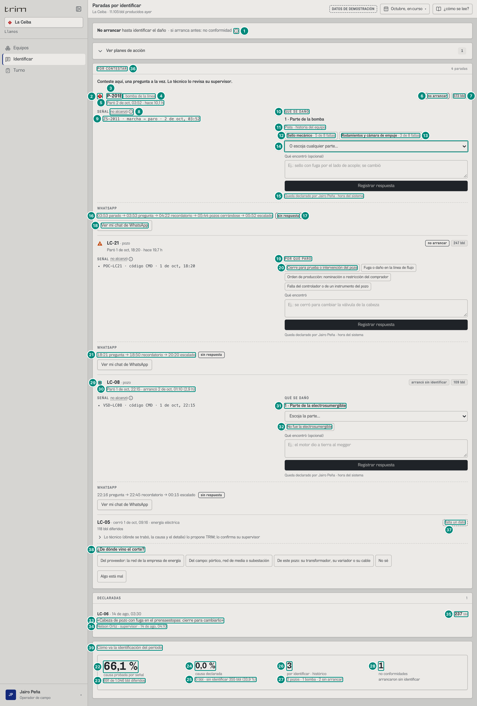
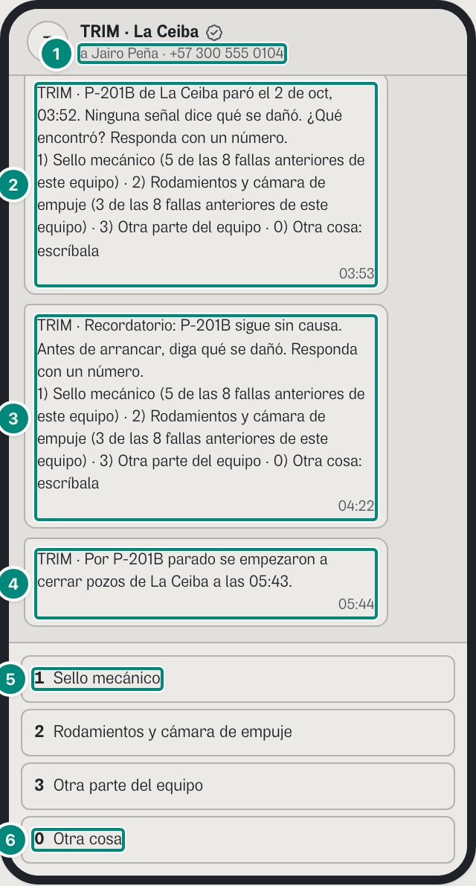
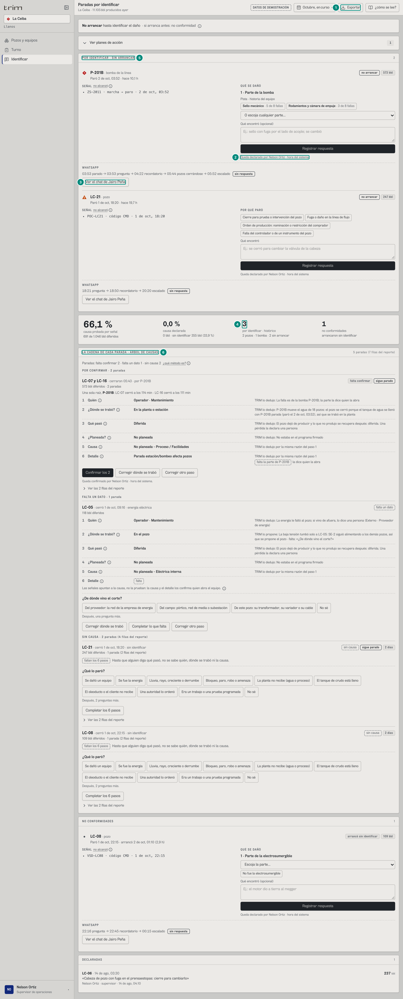
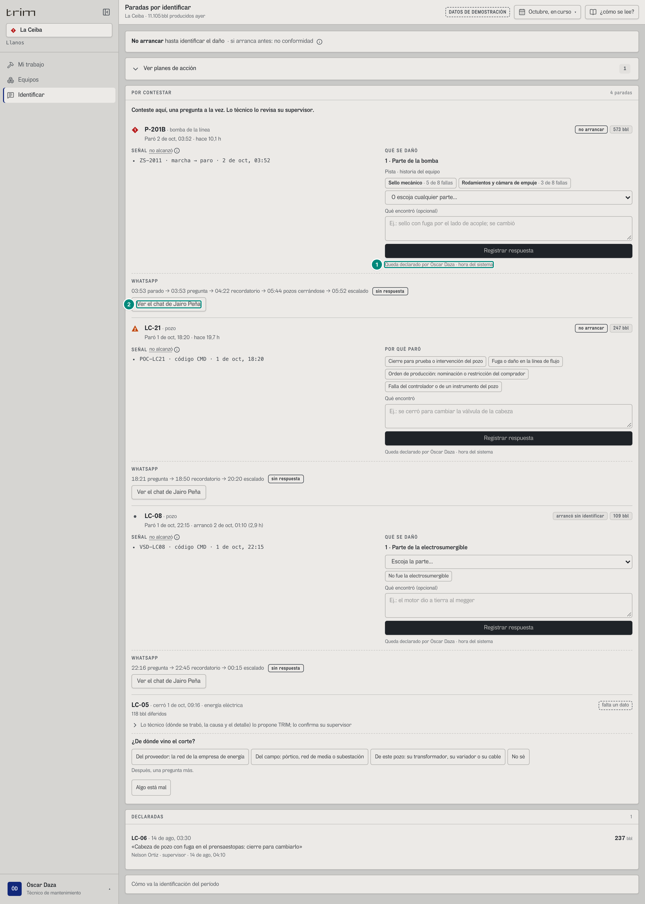
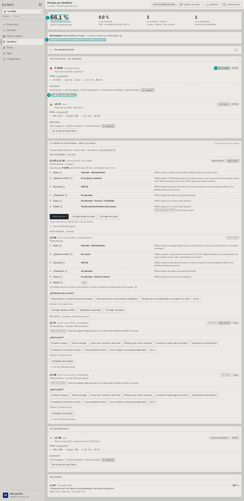
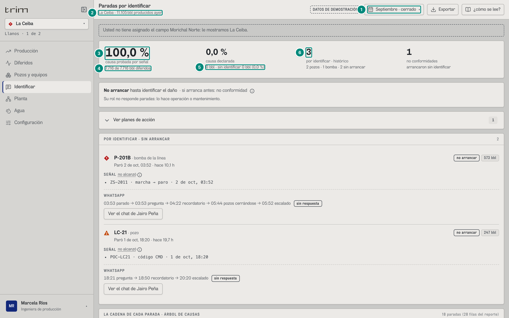
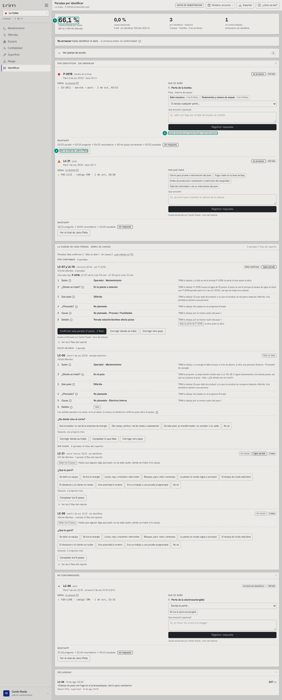
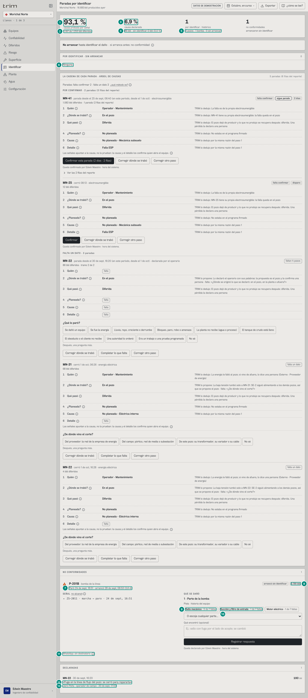
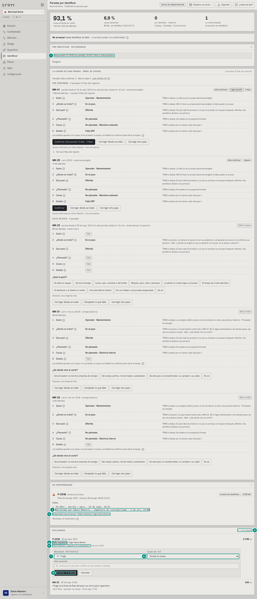

## 6C.2 Identificar — «Paradas por identificar» · operador, supervisor, técnico, producción, jefe, confiabilidad

**Para qué.** «Durante: identificar antes de arrancar (causa → SAP/ISO).» (`src/widgets/Onboarding.tsx:26`, `PARA_QUE.causa`).
**Ruta.** `#/<rol>/causa/<campo>[~portafolio]/<período>` · **Roles y nivel.** `oper`, `sup`, `tec` (operación); `prod`, `jefe`, `conf` (ingeniería). El gerente no la tiene. Agrega campos (portafolio: cada tarjeta dice su campo). **Dos formas de la pantalla** (`Causa.tsx:100-102, 196-211, 213-251`): el operador y el técnico (`deCampo`: los roles que no están en `ROLES_QUE_CONTESTAN.revisa`, `src/entities/anh-clasificacion.ts:359-364`) ven **una sola lista «POR CONTESTAR»** (primero lo que pregunta el libro, después lo que pregunta el árbol), «DECLARADAS» y, plegados al final, los indicadores («Cómo va la identificación del período», B-02 y B-54); supervisión, producción, el jefe y confiabilidad ven los paneles por separado y, entre ellos, el árbol de 6 pasos de la Circular 024 («LA CADENA DE CADA PARADA · ÁRBOL DE CAUSAS»: **6D.7**).
**Lee.** `GET /api/vistas/diferidos?campos&desde&hasta` → `Libro` (solo `diferido`, `identificado`, `declarado`, `pendiente`); `GET /api/vistas/paradas/por-identificar?campos` → `Pregunta[]` (**toda la historia**, no el período); `GET /api/vistas/paradas/:evento/opciones` → `{ catalogo?, sugeridas?, sospechosa? }` (una por tarjeta); `GET /api/mensajes?campos` → `Mensaje[]`; `GET /api/vistas/equipos-hoy?campos` → la marca de hoy de cada equipo (`severidad`: la de la tarjeta, B-20); `GET /api/vistas/anh/paradas?campos&desde&hasta` → `ParadaAnh[]` (el árbol, **6D.7**); de arranque: `GET /api/usuarios`, `GET /api/paradas/respuestas`, `GET /api/analisis`.
**Escribe.** `POST /api/paradas/:evento/respuesta` (formulario), el webhook de WhatsApp (el chat simulado) y `POST /api/analisis/:evento` (análisis de confiabilidad). Reglas y textos de rechazo: 5D §5 «La respuesta» y 5C §6 «El análisis».

Fórmulas: qué es una pregunta, `pide` y `arrancoSinIdentificar` → 5B §3.2 «¿Pide respuesta? ¿Arrancó sin identificar?»; identificado/declarado/pendiente → 5A §3 «Identificado por señal · declarado · sin identificar» y 5B §3.2 «Cifras de identificación del período»; opciones numeradas → 5D §5.3 «Opciones numeradas»; reglas del hilo de WhatsApp (pregunta, recordatorio 30 min, escalamiento 2 h) → 5D §5.1 «Tabla de reglas»; catálogo de daños, modos y mecanismo sugerido → 5C §6.

Arriba de las listas, si aplica: `PlanesDe` con planes «durante · identificar» (**plegado**; capítulo 11). La cifra y las tres listas de la pantalla salen de las mismas preguntas (`Causa.tsx:69-72`):

$$
\text{porIdentificar} = \{p : p.\text{pide}\} \quad
\text{pendientes} = \{p : p.\text{pide} \land \lnot p.\text{arrancoSinIdentificar}\} \quad
\text{noConformes} = \{p : p.\text{arrancoSinIdentificar}\} \quad
\text{declaradas} = \{p : \lnot p.\text{pide} \land p.\text{causa.declarado}\}
$$

La cifra «por identificar» es la **cuenta única** (`contarPorIdentificar`, `src/shared/api/diferidos.ts:129` → `cuentaPorIdentificar`, `src/entities/causa-senal.ts:348`): las que piden respuesta, hayan arrancado o no; la misma en Mantenimiento, Turno, Mi trabajo y la franja «Ahora» (antes aquí y en Mantenimiento se contaban solo las `pendientes`, y en Mi trabajo todas las que piden: 6C.9 punto 1, resuelto). Abajo se parten en dos paneles: «POR IDENTIFICAR · SIN ARRANCAR» (`pendientes`, «no arrancar») y «NO CONFORMIDADES» (las que arrancaron sin identificar, también las que se respondieron después). Así $|\text{porIdentificar}| = |\text{pendientes}| + |\text{noConformes} \cap \text{pide}|$: en La Ceiba 3 = 2 + 1. El operador y el técnico las ven en **una sola lista** (`POR CONTESTAR`, `delLibro = pendientes + noConformes sin declarar`, `Causa.tsx:195`): cada tarjeta dice con su chip «no arrancar» o «arrancó sin identificar» en cuál estaría. Un total no lleva marca de alarma (B-40): la marca de cada tarjeta es la de hoy del equipo (B-20).

Una pregunta respondida **después** de arrancar está a la vez en «NO CONFORMIDADES» (no se borra: arrancó sin identificar) y en «DECLARADAS» (ya tiene causa). Ver la captura 9.

### Captura 1 · operador, La Ceiba, octubre en curso

| # | Lo que se ve | En la captura | Cómo se calcula | Texto según el valor | Viene de |
|---|---|---|---|---|---|
| 1 | Regla de operación ⓘ | «No arrancar hasta identificar el daño · si arranca antes: no conformidad» | fija (`Causa.tsx:163-176`) | Globo «Regla de operación» (`REGLA`, `Causa.tsx:44`): «Un pozo o una bomba que paró sin causa identificable por su señal no se arranca hasta que quien lo revise registre aquí qué se dañó. TRIM no escribe en el PLC ni bloquea el arranque: la regla es de procedimiento. Si arranca antes, la parada queda como no conformidad, con la hora del PLC.» Debajo, según el rol: «Su rol no responde paradas: lo hace operación o mantenimiento.» (sin `causa:declarar` y con tarjetas) o «Nadie con acceso activo tiene este rol.» + ⓘ «La respuesta la da una persona con acceso, no un rol.» | `rol.puede`, persona |
| 2 | Marca de la tarjeta (la de hoy del equipo) | ◆ 1 (P-201B); LC-21 ▲ 2 | `hoy(p.equipo, p.campoId)?.severidad ?? 0` (`useEquiposDeHoy`, `Causa.tsx:63-64, 328`): la misma marca de hoy que el equipo lleva en el resto de la aplicación (B-20). Antes la tarjeta calculaba `arrancoSinIdentificar ? 3 : !fin ? 2 : 3`; ahora la urgencia de identificar la dicen las palabras «no arrancar» (fila 6) | ◆ P1 (P-201B está detenida), ▲ P2 (LC-21); un punto gris sin forma de alarma si el equipo hoy está normal (LC-08, fila 29) | `GET /api/vistas/equipos-hoy` → `severidad` |
| 3 | Equipo (botón) | «P-201B» | `pregunta.equipo` | abre la ficha del equipo (y cambia al campo) | `pregunta.equipo` |
| 4 | Sobre qué | «· bomba de la línea» | `sobre = 'bomba'` → «bomba de la línea», `'pozo'` → «pozo»; en portafolio « · {campo}» | — | `pregunta.sobre` |
| 5 | Cuándo paró y cuánto lleva | «Paró 2 de oct, 03:52 · hace 10,1 h» (P-201B); LC-21 «Paró 1 de oct, 18:20 · hace 19,7 h» (19,667 h) | `fechaHora(inicio)`; abierta: `AHORA − inicio` = 10,128 h; cerrada: «arrancó {fechaHora(fin)} ({fmtHoras(fin − inicio, precisa)})» | `fmtHoras(h, true)`: < 48 h → `n1` + « h»; si no, `n1(h/24)` + « d» (Morichal: 86,0 h → «3,6 d») | `pregunta.inicio`, `.fin` |
| 6 | Chip «no arrancar» | «no arrancar» | `!fin` | chip fuerte; no sale si ya arrancó | `pregunta.fin` |
| 7 | Barriles de la parada | «573 bbl» (P-201B); LC-21 «247 bbl»; LC-08 «109 bbl» | $\sum$ de los tramos de pozo cargados a esa parada, en **toda la historia** (es la pregunta de bomba: 573,06 bbl, los de LC-16 y LC-07 desde que los cerraron, 05:43 y 05:46, hasta las 14:00; LC-21: 246,53; LC-08: 108,52) → 5B §3.2 «Qué es una pregunta» | chip `n0` + « bbl» | `pregunta.bbl` |
| 8 | ⓘ «no alcanzó» | (globo) | `causa.porQueNo` (solo si el servidor lo manda con nombre; se quita de la lista de evidencia) | Globo «Por qué no alcanzó la señal»: P-201B «Sin primera alarma y sin firma: el PLC no dice qué parte falló»; pozos «Ningún servicio caído, ninguna bomba de la línea parada, fuera del programa y sin código de falla» (5B §2.2 «Regla 6», §3.1) | `pregunta.causa.porQueNo` |
| 9 | SEÑAL (evidencia) | «ZS-2011 · marcha → paro · 2 de oct, 03:52» (P-201B); LC-21 «POC-LC21 · código CMD · 1 de oct, 18:20»; LC-08 «VSD-LC08 · código CMD · 1 de oct, 22:15» | `causa.evidencia` menos `porQueNo`, una por renglón en mono. Bomba: «{tag de marcha} · marcha → paro · {fechaHora(inicio)}» (5B §3.1); pozo: «{tag del controlador} · código {código} · {fechaHora(inicio)}» (5B §2.2, «Regla 6»: `evidencia = [base, porQueNo]`) | tal cual; si la parada ya se declaró, aparece «Declarado por {persona · rol} · {fechaHora}» (captura 9) | `pregunta.causa.evidencia` |
| 10 | Título del formulario | «QUÉ SE DAÑÓ» | el equipo tiene catálogo de daños (`opciones.catalogo`) y no se tocó «No fue la electrosumergible» | «QUÉ SE DAÑÓ» (bomba o pozo con ESP) / «POR QUÉ PARÓ» (pozo sin catálogo, fila 19) | `GET …/opciones` → `catalogo.clase` |
| 11 | Fuente de la pista | «Pista · historia del equipo» | `sugeridas.conEvidencia`; fuente: si alguna opción trae `fuente = 'senal'` → «señal e historia», si no «historia del equipo» (`Causa.tsx:294, 376`) | sin evidencia no hay pista y el desplegable dice «Escoja la parte…» | `sugeridas.opciones[].fuente` |
| 12 | Opción sugerida 1 | «Sello mecánico · 5 de 8 fallas» | fallas **anteriores** del equipo con esa parte / fallas anteriores → 5D §5.3 | `pista()` (`Causa.tsx:447-450`): con `veces` y `total` → «{veces} de {total} falla(s)»; sin ellos (señal) → el `porque` del servidor («PT-2013 salió de su banda normal»). Las opciones sin parte («Otra parte del equipo», «0») no salen como botón | `sugeridas.opciones[].veces/.total` |
| 13 | Opción sugerida 2 | «Rodamientos y cámara de empuje · 3 de 8 fallas» | ídem (3 de 8) | máx. 3 sugeridas (5D §5.3) | ídem |
| 14 | Desplegable de partes | «O escoja cualquier parte…» | todas las partes del catálogo de la clase, en su orden (sello, succión, rodamientos, impulsores, motor) → 5C §3 «Catálogo de partes» | primera opción «O escoja cualquier parte…» con pista, «Escoja la parte…» sin ella | `catalogo.partes` |
| 15 | Quién queda declarado | «Queda declarado por Jairo Peña · hora del sistema» | la persona de la sesión (`usePersona`) | la hora la pone el servidor, no el navegador. En el papel y en el PDF de «Exportar» no va el nombre sino el rol: «Queda declarado por el operador de campo · hora del sistema» (`DichoEnPapel`, `Causa.tsx:435`; F3, «D2 en el papel») | sesión |
| 16 | Hilo de WhatsApp | «03:53 parado → 03:53 pregunta → 04:22 recordatorio → 05:44 pozos cerrándose → 05:52 escalado» | los mensajes de `GET /api/mensajes` con `evento = pregunta.id`, agrupados por (HH:MM, tipo), ordenados por hora y en el mismo minuto por `ORDEN_PASO` (parada, pregunta, recordatorio, escalamiento, cierre, parte, orden) (`Causa.tsx:466-482`) → 5D §5.1 | `PASO_CORTO`: «parado», «pregunta», «recordatorio», «escalado», «pozos cerrándose». El globo (y el papel) dice a quién: «03:53 parado · Nelson Ortiz, Jairo Peña», «05:44 pozos cerrándose · Nelson Ortiz, Jairo Peña», «05:52 escalado · Nelson Ortiz». El cierre va antes del escalado: el tanque aguantó 1,84 h y los pozos se cerraron a las 05:43, antes de que se cumplieran las 2 h sin respuesta | `mensajes[].hora/.regla/.insistencia/.para` |
| 17 | Estado de la respuesta | chip «sin respuesta» | `causa.declarado` | por WhatsApp: «respondió {por} · {HH:MM}: «{texto}»» (negrita); en pantalla: «respondido en pantalla»; nada: chip fuerte «sin respuesta» | `pregunta.causa.declarado.canal` |
| 18 | «Ver mi chat de WhatsApp» | botón | `primero` = el primer mensaje de pregunta (no insistencia, enviado); el botón abre el chat de **esa** persona | «Ver mi chat de WhatsApp» si es la persona de la sesión; «Ver el chat de {nombre}» si es otra (captura 3); «Cerrar el chat» abierto. El chat que se abrió **sigue abierto** cuando la respuesta llega (B-05): la tarjeta pasa a «respondido por WhatsApp» con el chat y su cierre (`chats`, `Causa.tsx:67`; `RespondidaConChat`, `Causa.tsx:257`) → 6D.8. No se imprime (`no-imprimir`). Sin destinatario: «WhatsApp: sin destinatario» + ⓘ (captura 8) | `mensajes`, `GET /api/usuarios` |
| 19 | Formulario de pozo sin catálogo | «POR QUÉ PARÓ» | LC-21 es de bombeo mecánico: sin catálogo de daños | las cuatro `CAUSAS_POZO` como botones; el texto «Qué encontró» es obligatorio (≥ 8 caracteres) | `catalogo` ausente |
| 20 | Causa de pozo | «Cierre para prueba o intervención del pozo» | `CAUSAS_POZO` (fijas, sin orden de probabilidad) → 5D §5.3 | al tocarla se copia al texto | — |
| 21 | Hilo de LC-21 | «18:21 pregunta → 18:50 recordatorio → 20:20 escalado»; el de LC-08 (no conformidad): «22:16 pregunta → 22:45 recordatorio → 00:15 escalado» | pregunta a inicio + 1 min, recordatorio + 30 min, escalamiento + 2 h (solo si la pregunta fue a operadores) | sin «parado»: un pozo sin ESP no dispara la regla `parada` | `mensajes` |
| 22 | % causa probada por señal | **66,1 %** | $\dfrac{\text{identificado}}{\text{diferido}} \times 100$ = 691,0 / 1.046,0 (por señal: los 573,1 bbl de los pozos que cerró la parada de P-201B, cuya causa —la bomba parada— sí la prueba el PLC aunque la parte de la bomba no, y 117,9 de SE-2) → 5A §3 «Identificado por señal…» | `n1` + « %»; diferido 0 → 0 | `GET /api/vistas/diferidos` → `identificado`, `diferido` |
| 23 | Apoyo | «691 de 1.046 bbl diferidos» | ídem | `n0` | ídem |
| 24 | % causa declarada | **0,0 %** | declarado / diferido = 0 / 1.046,0 | `n1` + « %» | `declarado` |
| 25 | Apoyo | «0 bbl · sin identificar 355 bbl (33,9 %)» | pendiente = 355,04 bbl (LC-21 + LC-08 dentro del período: 246,53 + 108,52); 355,04 / 1.046,0 = 33,94 % | `n0` y `n1` | `pendiente` |
| 26 | Por identificar · histórico | **3** (sin marca) | $\#\{\text{pide}\}$ en **toda la historia** (no cambia con el período): P-201B y LC-21, que siguen paradas, y LC-08, que arrancó sin identificar (la cuenta única; antes decía 2, sin LC-08). Es un total: no lleva marca de alarma (B-40); la urgencia va en el «no arrancar» de cada equipo | sin marca (antes ▲ P2 si alguna seguía parada, `parados > 0`): `Causa.tsx:140` | `pregunta.pide` |
| 27 | Apoyo | «2 pozos · 1 bomba · 2 sin arrancar» | pozos = porIdentificar − bombas (LC-21 y LC-08); bombas = las que piden con `sobre = 'bomba'` (P-201B); sin arrancar = `pendientes` con `!fin` (P-201B y LC-21) (`Causa.tsx:96-98, 143`) | `plural(…,'pozo','pozos')`, `plural(…,'bomba','bombas')`, número | ídem |
| 28 | No conformidades | **1** (sin marca) (y el extra del panel NO CONFORMIDADES: «1»; el lector oye «1 no conformidad») | $\#\{\text{arrancoSinIdentificar}\}$ (LC-08) | sin marca (antes ■ P3 si > 0); rótulo «no conformidades» y «arrancaron sin identificar» | `pregunta.arrancoSinIdentificar` |
| 29 | Marca de la tarjeta de la no conformidad (LC-08) | punto gris (• «Normal») | la marca de hoy de LC-08: el pozo volvió a producir (`severidad` 0) → fila 2. Que «arrancó sin identificar» lo dice el chip de la tarjeta (`Causa.tsx:342`), no la forma de la marca (antes ■ 3) | punto gris, sin color ni forma de alarma (`MarcaPrioridad s={0}`, ISA-101) | `equipos-hoy` → `severidad`; `pregunta.arrancoSinIdentificar` |
| 30 | Paró y arrancó | «Paró 1 de oct, 22:15 · arrancó 2 de oct, 01:10 (2,9 h)» | `fin − inicio` = 2,917 h | ver fila 5 | `pregunta.fin` |
| 31 | Paso 1 de la ESP | «1 · Parte de la electrosumergible» | catálogo `bomba-electrosumergible` sin historia: `conEvidencia = false`, sin pista, «Escoja la parte…» | «Parte de la bomba» / «Parte de la electrosumergible» | `catalogo.clase` |
| 32 | «No fue la electrosumergible» | botón | `NO_FUE_ESP_CORTO` (`src/entities/mensajes.ts:184`); solo con catálogo de ESP | al tocarlo el formulario pasa a «POR QUÉ PARÓ» con las causas del pozo y aparece «Volver a las partes» | — |
| 33 | Declarada: lo que dijo | «LC-06 · 14 de ago, 03:30» y debajo «Cabeza de pozo con fuga en el prensaestopas: cierre para cambiarlo» (extra del panel DECLARADAS: «1») | cabecera de la fila: `equipo` · (en portafolio, campo ·) `fechaHora(inicio)` (`Causa.tsx:613`); `causa.declarado.texto`; extra = número de declaradas | con parte: «**{parte}** · {lo que vio}» y el texto solo si no es el generado «{parte}: {vio}» (`Causa.tsx:604-617`); sin parte: ««{texto}»» | `pregunta.causa.declarado`, `.parte` |
| 34 | Quién y cuándo | «Nelson Ortiz · supervisor · 14 de ago, 04:10» | `declarado.por` · `fechaHora(declarado.hora)` | + « · por WhatsApp» si `canal = 'whatsapp'`; + « · sin parte» si es una bomba declarada sin parte | `pregunta.causa.declarado` |
| 35 | Barriles de la declarada | «237 bbl» (LC-06) | `pregunta.bbl` (236,51) | `n0` | `pregunta.bbl` |
| 36 | Panel de lo que le toca contestar | «POR CONTESTAR» · extra «4 paradas» (el lector oye «4 paradas por contestar en Octubre, en curso») y debajo «Conteste aquí, una pregunta a la vez. Lo técnico lo revisa su supervisor.» | una sola lista para el operador y el técnico (`ArbolIdentificar`, `deCampo`, `ArbolIdentificar.tsx:76-86`): primero las tarjetas del libro (`delLibro`: P-201B, LC-21 y LC-08, filas 2 a 35) y después las paradas del árbol que le preguntan algo a su rol (`suyas`: LC-05, filas 37 y 38). Extra = paradas del árbol que le tocan + `nAntes` = 1 + 3. Una parada que ya espera la respuesta del libro no se pregunta dos veces (`excluir`, B-02), y lo que TRIM ya dedujo y no le pide nada va plegado: «Estas ya las dedujo TRIM: no tiene que hacer nada» (`YaDeducidas`, no sale hoy). Para los demás roles el panel es «POR IDENTIFICAR · SIN ARRANCAR» (captura 3, fila 5) | sin nada pendiente: «No le falta contestar nada en octubre, en curso.» | `pregunta.pide`, `.arrancoSinIdentificar`; `GET /api/vistas/anh/paradas` |
| 37 | Parada del árbol que le toca contestar | «LC-05 · cerró 1 de oct, 09:16 · energía eléctrica» · «118 bbl diferidos» y el chip «falta un dato» (discontinuo) | una parada de pozo con su propuesta del árbol de 6 pasos y una pregunta abierta para el rol (`lePreguntan`, `ArbolIdentificar.tsx:69-73`): LC-05 cerró por energía eléctrica y le falta saber de dónde vino el corte → **6D.7** (el árbol, la pregunta a la vez, «Algo está mal»), 5E §9 | chip «falta un dato» (discontinuo: nada se rellena); el detalle técnico queda plegado («Lo técnico (dónde se trabó, la causa y el detalle) lo propone TRIM; lo confirma su supervisor») | `GET /api/vistas/anh/paradas` → `ParadaAnh` |
| 38 | La pregunta de campo | «¿De dónde vino el corte?» con «Del proveedor: la red de la empresa de energía», «Del campo: pórtico, red de media o subestación», «De este pozo: su transformador, su variador o su cable», «No sé» y «Algo está mal» | `propuesta.preguntas` (`quien: 'campo'`: la contestan todos los roles de campo, `ROLES_QUE_CONTESTAN.campo`); una a la vez → 6D.7 | tocar una opción guarda la respuesta del operador y deja lo que esa respuesta determina; «No sé» no fija nada y escala al supervisor (U1 §2.4) | `ParadaAnh.propuesta.preguntas` |
| 39 | Indicadores plegados | «Cómo va la identificación del período» (un renglón plegado, al final) | `
` (`Causa.tsx:205-208`): las cuatro cifras de las filas 22 a 28; la captura lo abre (`antes`) | plegado solo para el operador y el técnico (B-54); en el papel sale abierto (`print:open:block`); los demás roles las ven arriba o después del panel de las paradas (capturas 3 a 8) | — |

**Orden de la pantalla según el rol.** Operador y técnico (`deCampo`, `Causa.tsx:102, 196-211`): la regla, los planes, «POR CONTESTAR», «DECLARADAS» y, plegado, «Cómo va la identificación del período». Supervisor (`opera`, `Causa.tsx:100`): la regla, «POR IDENTIFICAR · SIN ARRANCAR», la cabecera de cifras (quien opera llega a responder), el árbol, «NO CONFORMIDADES» y «DECLARADAS». Producción, jefe y confiabilidad (`ingenieria`): la cabecera arriba y después lo mismo (`Causa.tsx:213-251`; capturas 3 a 8). La captura 1 abre los indicadores para que se vean (fila 39).

**Globo de la cabecera** (toda la franja, «Identificación del período»): «Cuánto del diferido tiene causa probada por una señal, cuánto declaró un operario y cuánto falta.» · «Por señal 691 bbl · 66,1 %» · «Declarado 0 bbl · 0,0 %» · «Sin identificar 355 bbl · 33,9 %» · «Período Octubre, en curso».

### Captura 2 · el chat de WhatsApp del operador (solo el teléfono simulado)

Se abre con «Ver mi chat de WhatsApp» de la tarjeta de P-201B. El historial es desplazable (máx. 380 px) y arranca abajo: el primer mensaje («TRIM · P-201B de La Ceiba paró a las 03:52. Tiene respaldo (P-201A y P-201C en paralelo), pero no para todo su caudal: si no arranca a tiempo, puede haber que cerrar pozos.», 03:53) queda arriba, fuera del recorte. La consecuencia sale del respaldo firmado y se dice **en corto** (`respaldoCorto`, `src/entities/mensajes.ts:173-174`, `:288-293`): quién es el respaldo y nada más; las cifras del cabezal de disposición (lo que dejan libre, a cuánto las limita) son de ingeniería y van en la pantalla, no por WhatsApp (B-05). El chat que se abrió **sigue abierto** cuando la respuesta llega (fila 18 de la captura 1; **6D.8**).

| # | Lo que se ve | En la captura | Cómo se calcula | Texto según el valor | Viene de |
|---|---|---|---|---|---|
| 1 | Destinatario | «a Jairo Peña · +57 300 555 0104» | la persona del primer mensaje de pregunta; `telefonoLegible(e164)` → 5D §3 «Número de WhatsApp en E.164» | sin teléfono: «sin número». Cabecera «TRIM · {campo}» + insignia «cuenta de empresa verificada» | `GET /api/usuarios` |
| 2 | Pregunta (plantilla `trim_que_se_dano`) | «TRIM · P-201B de La Ceiba paró el 2 de oct, 03:52. Ninguna señal dice qué se dañó. ¿Qué encontró? Responda con un número.⏎1) Sello mecánico (5 de las 8 fallas anteriores de este equipo) · 2) Rodamientos y cámara de empuje (3 de las 8 fallas anteriores de este equipo) · 3) Otra parte del equipo · 0) Otra cosa: escríbala» · 03:53 | `mensajes[].texto` (sale de la plantilla y sus parámetros) → 5D §5.2 «Las diez plantillas» | hora `HH:MM` en Colombia | `GET /api/mensajes` → `texto`, `hora` |
| 3 | Recordatorio (`trim_recordatorio_causa`) | «TRIM · Recordatorio: P-201B sigue sin causa. Antes de arrancar, diga qué se dañó. Responda con un número. 1) Sello mecánico (5 de las 8 fallas anteriores de este equipo) · 2) Rodamientos y cámara de empuje (3 de las 8 fallas anteriores de este equipo) · 3) Otra parte del equipo · 0) Otra cosa: escríbala» · 04:22 (las mismas opciones: «{n}) {parte} ({veces} de las {total} fallas anteriores de este equipo)», 5D §5.3) | inicio + 30 min, solo si no hubo respuesta antes | si el equipo ya arrancó a esa hora: `trim_recordatorio_arranco` («… arrancó a las {hora} sin causa. Diga …») | ídem |
| 4 | Cierre (`trim_pozos_cerrandose`) | «TRIM · Por P-201B parado se empezaron a cerrar pozos de La Ceiba a las 05:43.» · 05:44 | primer pozo cerrado por esa parada + 1 min | — | ídem |
| 5 | Respuesta rápida | «1 Sello mecánico» (y «2 Rodamientos y cámara de empuje», «3 Otra parte del equipo») | `pregunta.opciones` del mensaje (las de su hora, sin las lecturas de hoy) menos la «0», y al final «0 Otra cosa» | tocar una parte pregunta «TRIM · ¿Qué vio en {parte}? Responda con un número.» con los modos; «3 Otra parte del equipo» lista todas las partes; «No fue la electrosumergible» lista `CAUSAS_POZO` | `mensajes[].opciones` |
| 6 | «0 Otra cosa» | «0 Otra cosa» | siempre | pide «TRIM · Escriba qué encontró.» y abre la caja «Escriba qué encontró» + «Enviar» | — |

El escalado de las 05:52 **no** está en este chat: fue al supervisor (5D §5.1). Lo que no se envió (`noEnviado`) tampoco aparece en el teléfono: se dice en el hilo de la tarjeta con el ◌ morado «no se envió a {nombres}: {motivo}» (`NoEnviado.tsx`). Al responder, el chat muestra la burbuja de la persona y el cierre «TRIM · Así queda lo que usted contestó: {equipo}, {lo que dijo}. El resto del reporte lo revisa su supervisor.» con dos respuestas rápidas, «1 Está bien» («TRIM · Listo. Gracias, {nombre}. Su respuesta queda guardada a las {HH:MM}.») y «2 Algo está mal» («TRIM · Entendido. Lo revisa su supervisor en Identificar; usted no tiene que hacer nada más.»: la parada queda para revisar a nombre de quien contestó, B-05); si respondió otra persona, «TRIM · Ya respondió {por}: «{texto}». Gracias.»; si el servidor rechaza, «TRIM · {error}» (`Telefono.tsx:55-69, 78-92`). El detalle del chat y del cierre: **6D.8**. Responder aquí es responder **por WhatsApp** (en el demo, el webhook se simula en el navegador: 5D §5 «El webhook»).

### Captura 3 · supervisor, La Ceiba

Lo demás (las tres listas, sus tarjetas y las cifras) es igual que en la captura 1 y se explica en su tabla; aquí, solo lo que cambia.

| # | Lo que se ve | En la captura | Cómo se calcula | Texto según el valor | Viene de |
|---|---|---|---|---|---|
| 1 | Exportar | botón | el supervisor tiene `evidencia:exportar` (el operador y el técnico no) | ver 6C.8 | `rol.puede` |
| 2 | Quién declara | «Queda declarado por Nelson Ortiz · hora del sistema» | persona de la sesión; en el papel, el rol («por el supervisor de operaciones») y no el nombre (`DichoEnPapel`) | — | sesión |
| 3 | Chat de otra persona | «Ver el chat de Jairo Peña» | la pregunta fue al operador (con alertas) y no al supervisor: el supervisor ve el chat de quien la recibió | — | `mensajes`, `usuarios` |
| 4 | Por identificar | **3** (sin marca) | la misma cifra de la fila 26 de la captura 1 (el operador la ve plegada); aquí va a la vista, después del panel de las paradas (`opera`) | — | — |
| 5 | Panel de las que siguen paradas | «POR IDENTIFICAR · SIN ARRANCAR» · extra «2» (el lector oye «2 sin arrancar») | `pendientes` (`Causa.tsx:70, 223`): piden y no han arrancado. Se llamaba «POR IDENTIFICAR» y su extra (2) no coincidía con la cifra «por identificar» (3): el nombre dice qué parte de la cifra lista; las que arrancaron están en NO CONFORMIDADES (2 + 1 = 3) | vacío: «Ninguna.» | `pregunta.pide`, `.arrancoSinIdentificar` |
| 6 | El árbol de 6 pasos | «LA CADENA DE CADA PARADA · ÁRBOL DE CAUSAS» · extra «5 paradas (7 filas del reporte)» | `ArbolIdentificar` (`Causa.tsx:241`, `ArbolIdentificar.tsx:90-110`): cada parada del período en el árbol de la Circular 024 (quién, ¿dónde se trabó?, qué pasó, ¿planeada?, causa, detalle), agrupada por lo que le falta («POR CONFIRMAR», «FALTA UN DATO», «SIN CAUSA»); lo explica entero la **6D.7**, 5E §9 | solo quien revisa (sup, prod, jefe, conf) lo ve como panel; el operador y el técnico, dentro de «POR CONTESTAR» (captura 1, filas 36 a 38) | `GET /api/vistas/anh/paradas` |

### Captura 4 · técnico, La Ceiba

Lo demás (las tres listas, sus tarjetas y las cifras) es igual que en la captura 1 y se explica en su tabla; aquí, solo lo que cambia.

| # | Lo que se ve | En la captura | Cómo se calcula | Texto según el valor | Viene de |
|---|---|---|---|---|---|
| 1 | Quién declara | «Queda declarado por Óscar Daza · hora del sistema» | el técnico tiene `causa:declarar`; ve la misma pantalla del operador (una sola lista «POR CONTESTAR»; al técnico, además, el árbol le pregunta la causa y el detalle, `ROLES_QUE_CONTESTAN.causa`). En el papel, el rol y no el nombre | sin Exportar | sesión |
| 2 | Chat | «Ver el chat de Jairo Peña» | ídem captura 3 | — | — |

### Captura 5 · producción, La Ceiba (sin permiso para responder)

Lo demás (las tres listas, sus tarjetas y las cifras) es igual que en la captura 1 y se explica en su tabla; aquí, solo lo que cambia.

| # | Lo que se ve | En la captura | Cómo se calcula | Texto según el valor | Viene de |
|---|---|---|---|---|---|
| 1 | Cabecera arriba | **66,1 %** | nivel `ingenieria`: la cabecera va antes de la regla; es un total, sin marca (B-40) | — | `Libro` |
| 2 | Sin permiso | «Su rol no responde paradas: lo hace operación o mantenimiento.» | `hayTarjetas && !puede` (`causa:declarar` ni `causa:completar`) | una vez, en la franja; las tarjetas no muestran formulario | `rol.puede` |
| 3 | Chat | «Ver el chat de Jairo Peña» | se puede ver, no responder (el chat simulado sí deja tocar: es el teléfono de Jairo) | — | — |
| 4 | «no arrancar» | chip | — | — | — |

### Captura 6 · producción, dirección a Morichal en «cerrado»

`#/prod/causa/morichal/cerrado`: la ingeniera de producción **no tiene Morichal** (campos asignados `ceiba`, `palmar`): la dirección no abre un campo ajeno, se queda en La Ceiba y se reescribe como `#/prod/causa/ceiba/cerrado` (`src/app/url.ts:75-81`). El período «cerrado» sí se aplica.

Las tres listas son las de la captura 1 (toda la historia, no cambian con el período) y se explican en su tabla; aquí, lo que cambia.

| # | Lo que se ve | En la captura | Cómo se calcula | Texto según el valor | Viene de |
|---|---|---|---|---|---|
| 1 | Período | «Septiembre · cerrado» | `PERIODOS` → 6C.8 | — | — |
| 2 | Campo | «La Ceiba · 11.105 bbl producidos ayer» | Morichal no está asignado | — | `GET /api/campos`, sesión |
| 3 | % por señal | **100,0 %** | 7.716,1 / 7.716,1 (septiembre no tiene nada declarado ni pendiente en La Ceiba) | — | `Libro` |
| 4 | Apoyo | «7.716 de 7.716 bbl diferidos» | → 5A, tabla de cifras | — | ídem |
| 5 | Apoyo | «0 bbl · sin identificar 0 bbl (0,0 %)» | — | — | ídem |
| 6 | Por identificar · histórico | **3** (sin marca) | **no cambia con el período**: las preguntas son de toda la historia; LC-21 y P-201B siguen abiertas en octubre y LC-08 arrancó sin identificar. Como la captura 5, un total sin marca (B-40) | por eso dice «· histórico» | `por-identificar` |

### Captura 7 · jefe de mantenimiento, La Ceiba

Lo demás (las tres listas, sus tarjetas y las cifras) es igual que en la captura 1 y se explica en su tabla; aquí, solo lo que cambia.

| # | Lo que se ve | En la captura | Cómo se calcula | Texto según el valor | Viene de |
|---|---|---|---|---|---|
| 1 | Cabecera arriba | 66,1 % | ingeniería | — | — |
| 2 | Responde | «Queda declarado por Camilo Rueda · hora del sistema» | `causa:completar` incluye `causa:declarar` (`puedeHacer`, `tipos.ts`) | — | `rol.puede` |
| 3 | Chat | «Ver el chat de Jairo Peña» | — | — | — |

### Captura 8 · confiabilidad, Morichal (no conformidad de bomba, sin destinatario)

| # | Lo que se ve | En la captura | Cómo se calcula | Texto según el valor | Viene de |
|---|---|---|---|---|---|
| 1 | % por señal | **93,1 %** | 1.166,9 / 1.253,2 | — | `Libro` |
| 2 | Apoyo | «1.167 de 1.253 bbl diferidos» | — | — | ídem |
| 3 | % declarada | **6,9 %** | 86,3 / 1.253,2 (los barriles de octubre del cierre de MN-22, declarado por el operador el 30-sep) | — | `declarado` |
| 4 | Apoyo | «86 bbl · sin identificar 0 bbl (0,0 %)» | — | — | `pendiente` |
| 5 | Histórico | «0 pozos · 1 bomba · 0 sin arrancar» y cifra «1» (sin marca, como todos los totales: B-40) (y el extra del panel POR IDENTIFICAR · SIN ARRANCAR: «0») | en Morichal pide solo P-201B (24-sep), que arrancó sin identificar: cuenta en la cifra (la cuenta única; antes decía 0) y en NO CONFORMIDADES, no en el panel de las paradas | sin ▲ porque ninguna sigue parada | `por-identificar` |
| 6 | Lista vacía | «Ninguna.» | — | — | — |
| 7 | No conformidad de bomba | ▲ 2 «P-201B · bomba de la línea» · chip «arrancó sin identificar» · «Paró 24 de sept, 16:51 · arrancó 28 de sept, 06:53 (3,6 d)» · SEÑAL «ZS-2011 · marcha → paro · 24 de sept, 16:51»; en la cabecera, «no conformidades» **1** y el extra del panel «1» | P-201B arrancó sin que nadie dijera la parte (`arrancoSinIdentificar`); la marca es la de hoy de la bomba en Morichal («succión cayendo»: ▲ P2, B-20); 86,03 h → `fmtHoras(h, precisa)` = 3,6 d | chip «arrancó sin identificar» (en la tarjeta, no en la forma de la marca; antes ■ P3) | `pregunta` `EV-M2011-260924` |
| 8 | Barriles | «3.789 bbl» | 3.788,54 bbl cargados a esa parada (los pozos que cerró en las 86,0 h) | — | `pregunta.bbl` |
| 9 | Pista | «Sello mecánico · 5 de 7 fallas» | 7 fallas anteriores a esa parada: 5 sello, 1 succión, 1 motor | — | `sugeridas` |
| 10 | Pista | «Succión y filtro de entrada · 1 de 7 fallas» (y «Motor eléctrico · 1 de 7 fallas») | — | — | ídem |
| 11 | Sin destinatario | «WhatsApp: sin destinatario» ⓘ | ningún mensaje de pregunta (ni uno no enviado) para ese evento: en Morichal no hay operador ni supervisor con alertas (5D §5.1). De los 337 mensajes del demo, las preguntas (regla `causa`, 11) son todas de La Ceiba; de Morichal solo hay 20 avisos del vigía (regla `parte`) al jefe y a confiabilidad | ⓘ «Nadie de este campo tiene número con las alertas encendidas; la pregunta está solo en esta pantalla.» | `mensajes` |
| 12 | Declarada | «MN-22 · 30 de sept, 16:20» · «Fuga en la línea de flujo del pozo: se cerró para repararla» · «193 bbl» (extra del panel DECLARADAS: «1») | MN-22, sin parte (no lleva análisis); `bbl` = 192,82 (todos sus tramos, 30-sep 16:20 → 1-oct 06:05) | — | `pregunta.causa.declarado`, `pregunta.bbl` |
| 13 | Quién | «Jairo Peña · operador de campo · 30 de sept, 17:02» | — | — | ídem |

### Captura 9 · confiabilidad responde y abre el análisis de causa raíz

Pasos (`antes` de la captura): tocar «Sello mecánico · 5 de 7 fallas», «Fuga hacia afuera», «Registrar respuesta» y «Completar el análisis».

Lo demás es igual que en la captura 8 y se explica en su tabla, salvo la cifra «por identificar · histórico»: al responder, P-201B ya no `pide` y la cifra baja de 1 a **0** («0 pozos · 0 bombas · 0 sin arrancar»); la tarjeta sigue en NO CONFORMIDADES («no conformidades» 1, chip «arrancó sin identificar») y además pasa a DECLARADAS. A diferencia de la captura 8, junto a «SEÑAL» no sale el ⓘ «no alcanzó»: la causa ahora es declarada y no trae `porQueNo`.

| # | Lo que se ve | En la captura | Cómo se calcula | Texto según el valor | Viene de |
|---|---|---|---|---|---|
| 1 | Aviso de la respuesta | «Respondido: P-201B (en pantalla, 14:00). Pasó a «Declaradas».» | las respondidas en esta sesión (`ctx.respuestas[p.id]`); el foco pasa aquí si el botón que lo tenía desapareció | «({por WhatsApp \| en pantalla}, {HH:MM})»; varias se separan con « · » | respuesta del `POST` |
| 2 | Evidencia nueva | «Declarado por Edwin Maestre · ingeniero de confiabilidad · 2 de oct, 14:00» | el servidor agrega la respuesta a la evidencia de la causa (con la hora del servidor = `AHORA` en el demo) | — | `pregunta.causa.evidencia` |
| 3 | Respondido tras arrancar | «Respondido tras arrancar: «Sello mecánico: fuga hacia afuera»» | `causa.declarado` en una tarjeta que sigue en «NO CONFORMIDADES» (`respondidaTarde`) | el texto generado es «{parte}: {modo en minúscula}» | `declarado.texto` |
| 4 | Extra de DECLARADAS | «2 · 1 sin análisis» (el lector oye «2 declaradas · 1 sin análisis») | declaradas con `parte` y sin análisis (`Causa.tsx:94, 178`) | « · {n} sin análisis» solo si > 0; esas van primero y nunca detrás de «ver N más» | `GET /api/analisis` |
| 5 | Parte y lo que vio | «**Sello mecánico** · fuga hacia afuera» | `declarado.parte` + `nombreModo(modo, parte)` → 5C §6 «Qué vio» | — | `declarado.modo` |
| 6 | Quién | «Edwin Maestre · ingeniero de confiabilidad · 2 de oct, 14:00» | — | — | — |
| 7 | Mecanismo · ISO 14224 B.2 | «1.1 · Fuga» | arranca con `MECANISMO_SUGERIDO[modo]` (la fuga externa `ELP` → `1.1`), agrupado por familia (Mecánico, Material, Instrumento, Eléctrico, Influencia externa, Misceláneo) → 5C §6 «Mecanismos y el mecanismo sugerido» | lista «{código} · {nombre}» (37 mecanismos) | `src/entities/catalogo.ts:97-104` |
| 8 | Causa raíz · B.3 | «Escoja la causa…» | primer nivel de B.3: 1 Diseño, 2 Fabricación o instalación, 3 Operación o mantenimiento, 4 Gestión, 5 Misceláneo · causa combinada o común → 5C §6 «Causas raíz» | — | `iso14224.ts` |
| 9 | Guardar | «Guardar el análisis» | `POST /api/analisis/:evento` `{ mecanismo, causaRaiz, nota }` | un error del servidor se dice bajo el formulario (`role="alert"`) | 5C §6 «El análisis» |

**El análisis guardado** se lee en una línea (`Causa.tsx:544-547`): «Análisis: 1.1 fuga · causa raíz: operación o mantenimiento · «{nota}» · {por}» con el botón «Corregir» (solo con `causa:completar`). Corregir no borra: lo anterior queda debajo, «Antes: {mecanismo} · causa raíz {código} · «{nota}» · {por} · {fechaHora}» (`GET /api/analisis` guarda versiones; `useAnalisisAnteriores`). Quien no tiene `causa:completar` (operador, supervisor, técnico, producción) ve el chip «análisis pendiente» + ⓘ «Mecanismo y causa raíz los completa confiabilidad o el jefe de mantenimiento.» Con datos del demo **no hay** ninguna declarada con parte: este estado solo aparece después de responder con una parte.

**Variantes.**
- **Rol.** Operador y técnico: regla → planes → POR CONTESTAR → DECLARADAS → indicadores plegados. Supervisor: regla → POR IDENTIFICAR · SIN ARRANCAR → cabecera → árbol → NO CONFORMIDADES → DECLARADAS. Producción, jefe y confiabilidad: cabecera → regla → POR IDENTIFICAR · SIN ARRANCAR → árbol → NO CONFORMIDADES → DECLARADAS. Exportar solo para quien tiene `evidencia:exportar` (sup, prod, jefe, conf; no oper ni tec).
- **En el papel** (F3, «D2 en el papel»). En el papel y en el PDF de «Exportar» no sale lo que una persona escribió ni su nombre, sino su rol: «Queda declarado por el operador de campo · hora del sistema»; en la evidencia «Declarado por el operador de campo» (`causaParaSalir`); «Respondido tras arrancar: lo contestó el operador de campo» y «respondió el operador de campo · 06:05»; en «DECLARADAS», «Lo contestó el operador de campo» en lugar de la respuesta, y en el análisis solo el rol de quien lo hizo. El chat de WhatsApp no se imprime (`no-imprimir`); los destinatarios de cada paso del hilo («03:53 pregunta: Jairo Peña») sí salen: es el registro de a quién se avisó (decidido en F3).
- **Portafolio.** `#/jefe/causa/ceiba~portafolio/curso`: las cifras son del portafolio (2.377 bbl; por señal 1.935 = 81,4 %; declarado 86 = 3,6 %; sin identificar 355 = 14,9 %, 5B §3.2), cada tarjeta dice su campo, y aparecen la no conformidad de Morichal y la de El Palmar (PA-04, respondida tarde). «por identificar · histórico» **4** · «2 pozos · 2 bombas · 2 sin arrancar» (P-201B y LC-21 de La Ceiba, sin arrancar; LC-08 y P-201B de Morichal, que arrancaron); «no conformidades» **3** (LC-08, P-201B de Morichal y PA-04: la respondida tarde ya no pide, así que no entra en la cifra de 4 pero sigue siendo no conformidad). Antes la cifra decía 2.
- **Período.** Solo cambian las tres cifras de identificación; las listas son de toda la historia.
- **Disparo de ESP en «DECLARADAS».** Una ESP declarada con parte que arrancó en menos de 24 h lleva chip «disparo, no falla» + ⓘ «Arrancó en {fmtHoras(h, precisa)}: cuenta como disparo, no como falla de la electrosumergible.» (5B §3.3).

**Estados.** Con una parada de bomba **abierta** y una parte de esa bomba fuera de límite hoy, bajo la SEÑAL sale «Sospechosa: **{parte en minúscula}** · {fraseParte}» (`GET …/opciones` → `sospechosa`), y las partes fuera o que avisan encabezan las sugeridas con `fuente = 'senal'` («Pista · señal e historia»; el porqué «{tag} llegó a su alarma» / «{tag} salió de su banda normal» / «{tag} venía avisando»). En el demo no ocurre: P-201B de La Ceiba está detenida y sus partes no traen lecturas fuera. Sin pendientes: «Ninguna.»; sin no conformidades: «Ninguna.»; sin declaradas: «Ninguna todavía.»; sin destinatario: «WhatsApp: sin destinatario»; con ESP sin historia: «Escoja la parte…» sin pista.

**Interacciones y errores del formulario** (front, `Causa.tsx:304-312`; los 403/404/409/422 del servidor se muestran tal cual, 5D §5 «La respuesta en pantalla»):
- con partes y sin parte: «Diga qué parte de la bomba se dañó.» / «Diga qué parte de la electrosumergible se dañó, o que no fue ella.»
- sin modo: «Diga qué vio en esa parte.»; «Otra cosa» sin texto: «Escribió «Otra cosa»: diga qué vio, con al menos una frase corta.» (el rótulo pasa a «Qué vio (obligatorio)»)
- sin catálogo o «No fue la electrosumergible» sin texto: «Escoja una de las causas o escriba qué encontró, con al menos una frase corta.» (mínimo `TEXTO_LIBRE_MINIMO = 8` caracteres)
- el ⓘ «ISO 14224» del paso 2 dice «Se registra en el catálogo como ítem «{itemIso}» · daño {código} ({nombre del modo})».

**Lectura («¿cómo se lee?»).** POR IDENTIFICAR · SIN ARRANCAR: «Cada una trae lo que dijo su señal; el ⓘ junto a «señal» dice por qué no alcanzó. Responde quien revisó el equipo o estuvo en el pozo. Las pistas (la parte que estaba fuera de límite al parar, o las que más han fallado en ese equipo) son una pista, no una respuesta. Toque o pase el cursor por la línea de WhatsApp para ver a quién le llegó cada mensaje.» DECLARADAS: «Lo que respondió la gente de campo. Entra al libro como «declarado», separado de lo que probó una señal, y se puede auditar: quién, cuándo y si fue antes o después de arrancar. Primero las que esperan el análisis de confiabilidad.»
