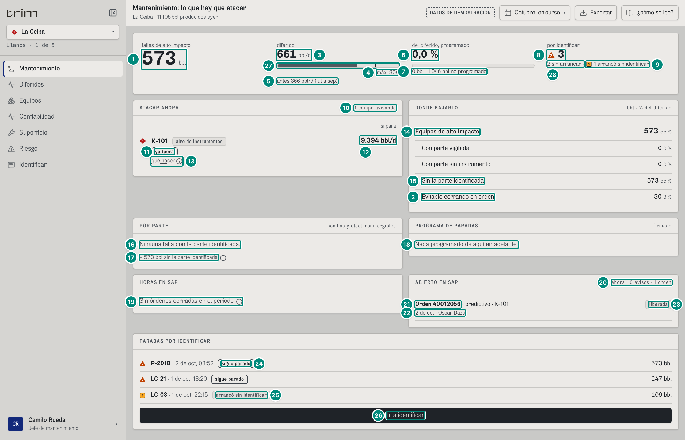
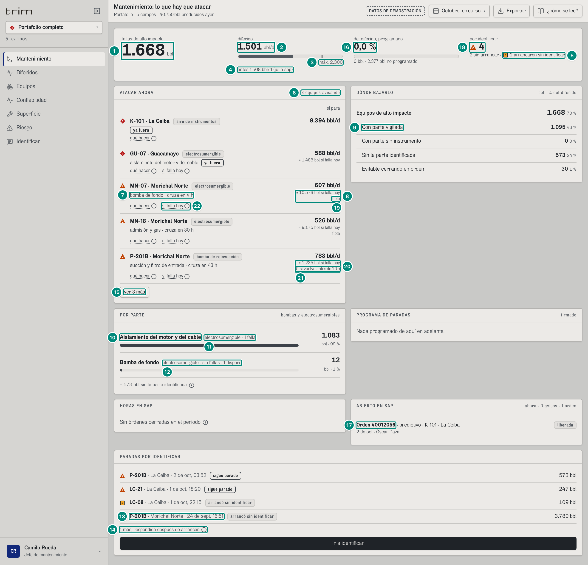
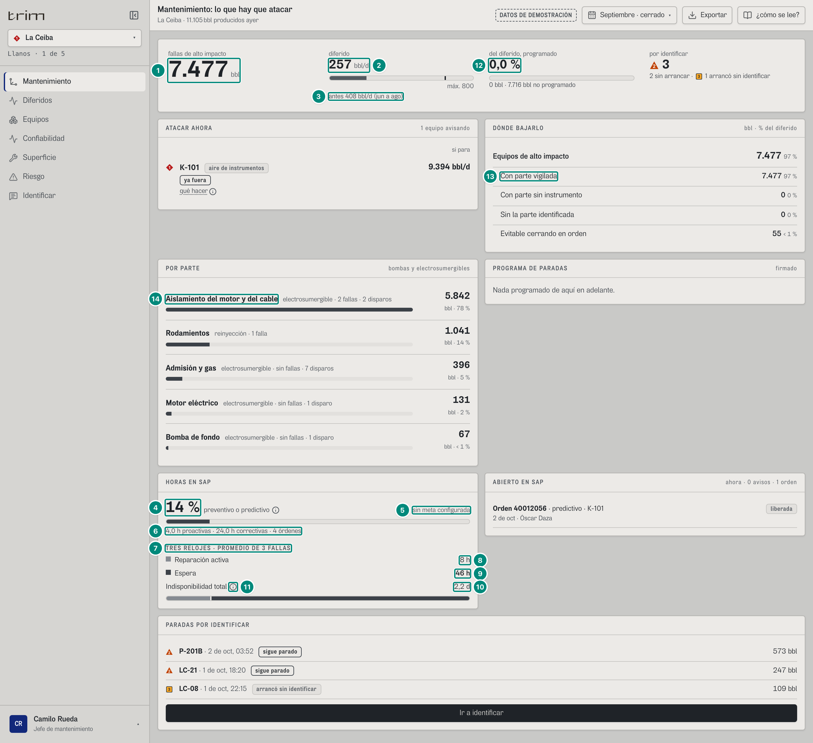

## 6C.3 Mantenimiento — «Mantenimiento: lo que hay que atacar» · jefe de mantenimiento

**Para qué.** «Qué atacar para bajar el diferido de alto impacto.» (`src/widgets/Onboarding.tsx:16`).
**Ruta.** `#/jefe/mantenimiento/<campo>[~portafolio]/<período>` · **Roles y nivel.** Solo `jefe` (ingeniería); es su pantalla de inicio. Agrega campos.
**Lee.** `GET /api/vistas/diferidos?campos&desde&hasta` → `Libro` (`altoImpacto`, `planeado`, `noPlaneado`, `anticipable`, `sinInstrumento`, `sinParte`, `evitablePorOrden`, `brecha`, `diferido`, `meta`, `porParte`); `GET /api/vistas/diferidos/base?campos&desde&hasta` → `LineaBase`; `GET /api/vistas/riesgo?campos`; `GET /api/vistas/paradas/por-identificar?campos`; `GET /api/sap/avisos?campos`, `GET /api/sap/ordenes?campos`, `GET /api/vistas/relojes?campos&desde&hasta`; el programa de paradas de la configuración firmada vigente (arranque: `GET /api/configuracion/historial`); `GET /api/usuarios` (nombre del técnico).

La pantalla junta tres lecturas: **cinturón de retorno** (`CicloCifras` + `GET /api/vistas/ciclo`, capítulo 11), **la balanza en barriles** (lo de alto impacto, el diferido por día contra el máximo, lo programado contra lo no programado), **qué atacar ahora** (panel «**1 · Intervenir**») y **lo de SAP**. Al final, **planes del ciclo** en bloque plegado «Ver planes de acción» (sin panel «PLANES · ANTES, DURANTE Y DESPUÉS» con texto abierto). Componentes: `src/pages/Mantenimiento.tsx`, `PlanesDe` (`src/widgets/ciclo/Ciclo.tsx`), `ParetoPartes` y `Palancas` (`src/widgets/diferidos/Paretos.tsx`), `src/widgets/sap/PanelSapMantenimiento.tsx`, `src/widgets/sap/TresRelojes.tsx`.

### Captura 1 · La Ceiba, octubre en curso

| # | Lo que se ve | En la captura | Cómo se calcula | Texto según el valor | Viene de |
|---|---|---|---|---|---|
| 1 | **fallas de alto impacto** | **573** bbl | $\sum$ bbl de los tramos cuya causa es de alto impacto (bomba de reinyección o electrosumergible); excluye lo programado porque es otro tipo de causa → 5A §3 «Alto impacto». Aquí son solo los pozos que cerró la parada abierta de P-201B (LC-16 y LC-07, 573,06 bbl a las 14:00) | `n0` + «bbl». Su desglose está en «DÓNDE BAJARLO» (filas 14-15) | `Libro.altoImpacto` |
| 3 | **diferido** por día | **661** bbl/d, **sin** ■ | $\text{difDia} = \dfrac{\text{brecha}}{\max(1/24,\ \text{meta.dias})}$ = 1.046,0 / 1,5833 d (1-oct 00:00 → 2-oct 14:00 = 38 h) = 660,6 → 5A §6 «Meta del período» y §5 «Horas y días del período». 661 ≤ 800: no lleva la marca ■ P3 de «fuera de meta» (`hayMeta && difDia > meta.diferidoDia`, `Mantenimiento.tsx:141`), que es aviso, no alarma: el número queda en tinta normal (8 §8.4) | `BarraMeta` (8 §8.5): `n0` + «bbl/d» | `Libro.brecha`, `Libro.meta.dias` |
| 27 | La barra y su raya | barra al 66 %, raya al 80 % | $\min(1{,}25,\ 660{,}6/800)/1{,}25 = 66{,}1\,\%$; raya en $1/1{,}25 = 80\,\%$ | gris siempre; sin meta, ni barra ni raya | ídem |
| 4 | Máximo firmado | «máx. 800» | `meta.diferidoDia` del tramo firmado → 5A §6 «Tramo de meta firmado» | `máx. {n0}`; sin meta en algún campo: `textoSinMeta` («sin meta firmada», o en portafolio «sin meta firmada en {campos}») y sin ■ | `Libro.meta` |
| 5 | Línea base | «antes 366 bbl/d (jul a sep)» | `baseDia` = brecha de los 3 meses publicados antes / sus días = 366,08 bbl/d → 5A §6 «Línea base» | «antes {n0(baseDia)} bbl/d ({nombre})»; sin base: no se escribe | `GET /api/vistas/diferidos/base` → `baseDia`, `nombre` |
| 6 | **del diferido, programado** | **0,0 %** | $\dfrac{\text{planeado}}{\text{diferido}} \times 100$ (0 si diferido = 0) → 5A §3 «Sin paradas programadas» | `n1` + « %»; barra gris de ese ancho | `Libro.planeado`, `.diferido` |
| 7 | Apoyo | «0 bbl · 1.046 bbl no programado» | `planeado` · `noPlaneado` | `n0` | `Libro.planeado`, `.noPlaneado` |
| 8 | **por identificar** | ▲ **3** | `contarPorIdentificar(preguntas).porIdentificar` (`src/shared/api/diferidos.ts:129` → `cuentaPorIdentificar`, `src/entities/causa-senal.ts:332`): las preguntas con `pide` en toda la historia, **hayan arrancado o no** (P-201B y LC-21, que siguen paradas, y LC-08, que arrancó sin identificar). Es la cuenta única: la misma cifra en Identificar, Turno, Mi trabajo y la franja «Ahora» → 5B §3.2. Antes de la corrección esta cifra decía 2 (sin las que arrancaron) y no llevaba marca | ▲ P2 si alguna sigue parada (`porIdentificar − arrancaronSinIdentificar > 0`: «no arrancar», `Mantenimiento.tsx:159`); sin ninguna parada, número sin marca | `GET /api/vistas/paradas/por-identificar` → `pide`, `arrancoSinIdentificar` |
| 9 | Las que arrancaron | ■ «1 arrancó sin identificar» | `.arrancaronSinIdentificar`: de las que piden, las que ya arrancaron (`arrancoSinIdentificar`; con `pide`, equivale a tener `fin`) | `ApoyoPorIdentificar` (`src/shared/ui/PorIdentificar.tsx:10-19`, las mismas palabras en Turno y Mi trabajo): «■ {m} arrancó sin identificar» / «arrancaron sin identificar» (■ P3: no conformidad, la misma marca de cada fila); en 0 no se escribe | ídem |
| 10 | Extra de ATACAR AHORA | «1 equipo avisando» (la fila: ◆ 1 «K-101» · «aire de instrumentos»; la marca es `prioridad` del servidor, 6C.1 fila 17) | filas `en-riesgo` de `GET /api/vistas/riesgo`, ordenadas por `horas` ascendente con ausente = −1 (lo que ya está fuera primero) | `plural(n,'equipo avisando','equipos avisando')`; vacío: «Ningún equipo avisa.» (`Mantenimiento.tsx:174`; antes «Ninguna parte va hacia su límite.», 6C.9 punto 5) | `riesgo[]` |
| 11 | Estado de K-101 | chip «ya fuera» | `horas` ausente | con horas: «{parte en minúscula} · cruza en {fmtHoras}»; sin horas: parte + chip fuerte «ya fuera»; sin parte y con tag, el tag en mono | `riesgo[].horas`, `.parte`, `.tag` |
| 12 | Columna «si para» | «9.394 bbl/d» | las mismas cifras, en el mismo orden y con los mismos rótulos que la fila de Riesgo (6C.1, captura 1, filas 19, 26 y 28; `Mantenimiento.tsx:95-103`): delante `siPara` = «{n0(bblDia)} bbl/d» (K-101 es servicio, `esServicio`, `src/shared/api/equipos.ts:53`: lo que cerraría es el crudo de los 15 pozos de La Ceiba que producen, 9.394,2) o «todo el campo» (servicio con 0 bbl/d); debajo `costoHoy` «≈ {n0} bbl si falla hoy», `colchonCorto` «0 si vuelve antes de {h}» y, en ingeniería, «flota» (`deFlota`) | encabezado de columna «si para»; un servicio sin `costoFalla` no lleva nada debajo; otro equipo sin él, «sin historia». Antes la cifra principal era el costo por falla («≈ … bbl · si falla») y los bbl/d solo salían sin costo (6C.9 punto 6, resuelto) | `riesgo[].bblDia`, `.costoFalla`, `.colchonH`, `.costoDe` |
| 13 | «qué hacer» ⓘ | (globo) | `accion` | «Qué hacer · K-101»: «Verificar que las tres unidades estén en servicio: hoy hay dos. Con el recibidor en 11 min de autonomía, una parada deja las válvulas en posición segura.» Junto a él, si la fila trae `costoFalla` y `mdtFuente`, el ⓘ «si falla hoy» (`detalleCostoHoy`, como en Riesgo; captura 2, fila 22) | `riesgo[].accion`, `.mdtFuente` |
| 14 | DÓNDE BAJARLO · Equipos de alto impacto | «573 · 55 %» | 573,06 / 1.046,0 = 54,8 % → 5A §8 «Palancas» | `n0(bbl)` y `n0(100·bbl/diferido)` %; el diferido contra el máximo **no** se repite aquí (`conMaximo={false}`) | `Libro.altoImpacto` |
| 15 | Sin la parte identificada | «573 · 55 %» | la parada abierta de P-201B no tiene parte → 5A §8 | filas «Con parte vigilada 0 · 0 %», «Con parte sin instrumento 0 · 0 %» y «Evitable cerrando en orden 30 · 3 %» (fila 2) | `Libro.sinParte`, `.anticipable`, `.sinInstrumento`, `.evitablePorOrden` |
| 2 | Evitable cerrando en orden | «30 · 3 %» | `evitablePorOrden` = 30,41 bbl: lo que la parada abierta de P-201B habría ahorrado hasta las 14:00 si la **misma agua** que quitaron los operarios (LC-16 y LC-07, 48.510 bbl/d, cerrando primero los que más agua dan) se hubiera quitado en el orden de TRIM, con el tope del 25 % a la reducción de frecuencia: $573{,}06 \times (1 - 1.576{,}8 / 1.665{,}2)$ (`evitableDeEvento`, `src/entities/libro.ts:912`). Se mide con el agua que se quitó, no con la que hacía falta (44.100 bbl/d, que en orden costarían 1.426 bbl/d) → 5A §8 «Palancas»; 30,41 / 1.046,0 = 2,9 % | ídem fila 14; un porcentaje entre 0 y 1 se escribe «< 1 %» (captura 3, fila 13) | `Libro.evitablePorOrden` |
| 16 | POR PARTE vacío | «Ninguna falla con la parte identificada.» | `porParte` vacío → 5A §8 «Pareto por parte» | — | `Libro.porParte` |
| 17 | Sin parte | «+ 573 bbl sin la parte identificada» ⓘ | `sinParte` | ⓘ «Barriles de equipos de alto impacto cuya parada no dejó primera alarma ni firma. Están en «paradas por identificar».» | `Libro.sinParte` |
| 18 | PROGRAMA DE PARADAS | «Nada programado de aquí en adelante.» | paradas del programa firmado del campo con `hasta ≥ AHORA`, por `desde` | con filas: «**{equipo}**[ · campo]», motivo, «{fechaHora(desde)} a {fechaHora(hasta)}»; extra fijo «firmado» | configuración vigente → `programa` (5D §2) |
| 19 | HORAS EN SAP vacío | «Sin órdenes cerradas en el período» ⓘ | $P + K = 0$ en el período (octubre en curso no tiene órdenes cerradas; la abierta cuenta con 0 h) → 5D §6 «Horas proactivas contra correctivas» | ⓘ «No hay órdenes cerradas en {período en minúscula}. Escoja un período cerrado (el mes anterior, por ejemplo) para ver las horas.» Sin «TRES RELOJES» (la vista responde `null`) | `GET /api/sap/ordenes`, `GET /api/vistas/relojes` |
| 20 | Extra de ABIERTO EN SAP | «ahora · 0 avisos · 1 orden» | avisos `!cerrado && !orden`; órdenes con `estado ≠ TECO` (no depende del período) → 5D §6 «Mantenimiento: ABIERTO EN SAP» | `plural` en los dos | `GET /api/sap/avisos`, `/ordenes` |
| 21 | Orden abierta | «Orden 40012056 · predictivo · K-101» | `numero` · `NOMBRE_CLASE[clase]` · equipo (+ campo en portafolio). El número sale de la regla del demo, que numera en orden las órdenes que arma con los eventos (5D §6): con las PM03 nuevas de las intervenciones del vigía, la de K-101 pasó a 40012056 | clase PM01 «correctivo», PM02 «preventivo», PM03 «predictivo» | `ordenes[]` |
| 22 | Liberada y a cargo | «2 de oct · Óscar Daza» | `fechaCorta(liberada)` (precedida de «liberada » si el estado no es REL) · técnico | técnico = persona del registro por `tecnico`; sin técnico: «cuadrilla {puesto}» | `ordenes[].liberada`, `.tecnico`, `.puesto` |
| 23 | Estado | chip «liberada» | `NOMBRE_ESTADO_ORDEN[estado]` | CRTD «creada, sin liberar», REL «liberada», PCNF «en ejecución», CNF «ejecutada» | `ordenes[].estado` |
| 24 | Parada por identificar | ▲ 2 «P-201B · 2 de oct, 03:52» «sigue parado» 573 bbl; ▲ 2 «LC-21 · 1 de oct, 18:20» «sigue parado» 247 bbl | orden: primero las pendientes (`pide && !arrancoSinIdentificar`), luego las no conformes que todavía `pide` (`Mantenimiento.tsx:46`); dentro, el orden del servidor (5B §3.2). ▲ P2 y chip fuerte si `!fin && !arrancoSinIdentificar`; ■ P3 si no (`Mantenimiento.tsx:115-124`) | «arrancó sin identificar» / «sigue parado» / «por identificar»; a la derecha `n0(bbl)` bbl | `pregunta` (`equipo`, `inicio`, `fin`, `bbl`) |
| 25 | No conforme | ■ 3 «LC-08 · 1 de oct, 22:15» «arrancó sin identificar» 109 bbl | `arrancoSinIdentificar` | — | ídem |
| 26 | «Ir a identificar» | botón | solo si el rol tiene la pantalla Identificar y hay alguna sin identificar | lleva a `#/jefe/causa/…` | — |
| 28 | Las que siguen paradas | «2 sin arrancar ·» | `porIdentificar − arrancaronSinIdentificar` = 3 − 1 = 2 (P-201B y LC-21) | «{n} sin arrancar»; en 0 no se escribe (`PorIdentificar.tsx:15`) | ídem fila 8 |

**Aviso abierto sin orden** (no hay en el demo hoy: el M1 de K-101 ya tiene orden): «**Aviso {n}** · {equipo}[ · campo]», «hace {fmtHoras(AHORA − creado)}» + chip «sin orden», y ■ P3 si es de prioridad 1 y lleva más de 4 h sin orden (`PanelSapMantenimiento.tsx:90`). Globo: «Aviso {n} · {equipo}», pista = descripción, «Enviado hace {fmtHoras}», «Orden: sin orden todavía».

**Globos.** Fila de ATACAR AHORA: «{equipo} · {TIPO_CAUSA}», pista `motivo`, filas «Parte», «Cruza su límite · en {fmtHoras}» o «ya fuera», «Instrumento · {tag}», «Si para · {siPara}» (servicio con 0 bbl/d: «cierra lo que esté produciendo en el campo»; K-101 hoy: «9.394 bbl/d»), «Si falla hoy · ≈ {n0(costoFalla)} bbl» (solo con `costoFalla`) (`Mantenimiento.tsx:74-80`). Cifra «del diferido, programado»: «Programado y no programado» · «Lo programado estaba en el programa de paradas aprobado; lo demás son fallas o restricciones. La mide el PLC.» · «Programado 0 bbl», «No programado 1.046 bbl», «De alto impacto 573 bbl», «Con la parte vigilada 0 bbl» (en el papel sale la pista). Orden abierta: «Orden {n} · {equipo}», pista = descripción («Verificar que las tres unidades estén en servicio: hoy hay dos. …»), «Clase», «Estado», «Liberada {fechaCorta}», «A cargo».

### Captura 2 · portafolio, octubre en curso

Las reglas de cada fila son las de la captura 1 (y K-101, su «qué hacer» y la orden 40012056 son los mismos); aquí, los valores del portafolio.

| # | Lo que se ve | En la captura | Cómo se calcula | Texto según el valor | Viene de |
|---|---|---|---|---|---|
| 1 | fallas de alto impacto | **1.668** bbl | 1.668,07 de 2.376,8 (70 %): los 573,1 de la parada de P-201B de La Ceiba y 1.095,0 de electrosumergibles de Morichal (MN-41 1.083,1, MN-25 11,9) → 5A tabla de cifras | — | `Libro.altoImpacto` |
| 2 | diferido por día | **1.501** bbl/d, sin ■ | 2.376,8 / 1,5833 = 1.501,1 | sin ■ porque 1.501 ≤ 2.300 | `Libro` |
| 3 | Máximo del portafolio | «máx. 2.300» | suma de los máximos firmados de los campos (`metaEntre`) → 5D §2 «Meta global y total del mes» | — | `Libro.meta.diferidoDia` |
| 4 | Base | «antes 1.508 bbl/d (jul a sep)» | 1.508,39 → 5A §6 | — | `LineaBase` |
| 5 | Por identificar | ▲ **4** y «2 sin arrancar · ■ 2 arrancaron sin identificar» | la cuenta única (captura 1, filas 8, 9 y 28) sobre los cinco campos: piden P-201B y LC-21 (La Ceiba, siguen paradas), LC-08 (La Ceiba) y P-201B (Morichal, 24-sep), que arrancaron sin que nadie dijera la parte. PA-04 (El Palmar) también arrancó sin identificar, pero se respondió después: ya no `pide` y **no** entra en esta cifra (sí en las no conformidades de Identificar, y abajo como «1 más, respondida después de arrancar», fila 14). Antes de la corrección decía «2» y «3 arrancaron sin identificar» (con PA-04) | — | `por-identificar` |
| 6 | Extra | «8 equipos avisando» | — | — | `riesgo` |
| 7 | Parte y cruce | «bomba de fondo · cruza en 4 h» (MN-07 · Morichal Norte); luego MN-18 · Morichal Norte «admisión y gas · cruza en 30 h», P-201B · Morichal Norte «succión y filtro de entrada · cruza en 43 h»; primero ◆ 1 K-101 · La Ceiba «ya fuera» y ◆ 1 GU-07 · Guacamayo «aislamiento del motor y del cable» «ya fuera»; las otras tres con ▲ 2 | → 6C.1 (mismas filas, mismo orden por `horas`) | «{parte} · cruza en {fmtHoras}» | `riesgo[].equipo`, `.parte`, `.horas`, `.prioridad` |
| 8 | Si falla hoy | «≈ 10.579 bbl si falla hoy» con «flota» debajo (MN-07; la caja de la marca ciñe el renglón entero); MN-18 «≈ 9.175 bbl si falla hoy» · flota; P-201B de Morichal «≈ 1.235 bbl si falla hoy» y «0 si vuelve antes de 10 h»; GU-07 «≈ 1.488 bbl si falla hoy» (historia propia, sin «flota»). Delante, los bbl/d «si para»: 607, 526, 783 y 588; K-101 «9.394 bbl/d» | → [5B §5.3, ficha «Costo por falla»](../05b-paradas-agua/05-riesgo-ahora.md) y 6C.1, captura 1, filas 23, 26 y 28 | ídem captura 1, fila 12 | `riesgo[].bblDia`, `.costoFalla`, `.colchonH` |
| 9 | DÓNDE BAJARLO | «Con parte vigilada 1.095 · 46 %» (las fallas de ESP de octubre, todas vigilables); el panel entero: «Equipos de alto impacto 1.668 · 70 %», «Con parte vigilada 1.095 · 46 %», «Con parte sin instrumento 0 · 0 %», «Sin la parte identificada 573 · 24 %» (P-201B de La Ceiba), «Evitable cerrando en orden 30 · 1 %» (la misma de La Ceiba, captura 1, fila 2) | cada fila: $\text{bbl}$ y $n_0(100 \cdot \text{bbl}/\text{diferido})$ con diferido = 2.376,8 → 5A §8 «Palancas» | ídem captura 1, fila 14 | `Libro.altoImpacto`, `.anticipable`, `.sinInstrumento`, `.sinParte`, `.evitablePorOrden` |
| 10 | POR PARTE, primera fila | «Aislamiento del motor y del cable» | → 5A §8 «Pareto por parte» | nombre en negrita, barra proporcional a la primera | `Libro.porParte[]` |
| 11 | Fallas de la fila | «electrosumergible · 1 falla» — 1.083 bbl · 99 % | MN-41 (abierta desde el 25-sep, > 24 h); 1.083,1 / 1.095,0 = 98,9 % | «{familia} · {N falla(s) \| sin fallas}{ · M disparo(s)}», `n0` %| ídem |
| 12 | Disparo | «electrosumergible · sin fallas · 1 disparo» — 12 bbl · «1 %» | un evento de bomba de fondo que arrancó en < 24 h (MN-25); 11,9 / 1.095,0 = 1,09 % | `pctParte` (`src/shared/lib/formato.ts:20`, `Paretos.tsx:153`): `n0` + « %» (1,09 → «1 %»); solo entre 0 y 1 % se escribe «< 1 %» (el lector oye «menos del 1 %», captura 3, fila 14), nunca «0 %» | ídem |
| 13 | Parada por identificar de otro campo | «P-201B · Morichal Norte · 24 de sept, 16:51» ■ 3 «arrancó sin identificar» · 3.789 bbl; antes, las de La Ceiba: ▲ 2 «P-201B · La Ceiba · 2 de oct, 03:52» «sigue parado» 573 bbl, ▲ 2 «LC-21 · La Ceiba · 1 de oct, 18:20» «sigue parado» 247 bbl, ■ 3 «LC-08 · La Ceiba · 1 de oct, 22:15» «arrancó sin identificar» 109 bbl; en POR PARTE, «+ 573 bbl sin la parte identificada» | no conforme; sigue en la lista porque `pide` (nadie dijo la parte) | — | `por-identificar` |
| 14 | Respondidas tarde | «1 más, respondida después de arrancar» ⓘ | arrancaron sin identificar y ya no `pide` (PA-04, respondida a las 09:30 del 22-jun después de arrancar) (`Mantenimiento.tsx:47, 217-222`) | ⓘ «1 parada más arrancó sin identificar y se respondió después de arrancar: ya tiene causa, pero queda como no conformidad (en Identificar).» (plural: «{n} paradas más arrancaron … se respondieron … ya tienen causa, pero quedan como no conformidades (en Identificar).»). Antes decía «cuenta como no conforme arriba», y arriba ya no se cuentan las no conformes | ídem |
| 15 | «ver 3 más» | — | 8 filas; K-101 y GU-07 (P1) siempre visibles; escondidas GU-04, MPP-301 y MN-27 (en el papel salen) | — | — |
| 16 | del diferido, programado | **0,0 %** · «0 bbl · 2.377 bbl no programado» | $\text{planeado}/\text{diferido}$ = 0 / 2.376,8 (ningún campo tuvo paradas programadas en octubre) → 5A §3 | ídem captura 1, filas 6-7 | `Libro.planeado`, `.noPlaneado` |
| 17 | Orden abierta | «Orden 40012056 · predictivo · K-101 · La Ceiba» · «2 de oct · Óscar Daza» · «liberada» | la misma orden de la captura 1; en portafolio con « · campo» | ídem captura 1, filas 21-23 | `GET /api/sap/ordenes` |
| 18 | Cifra «por identificar» | ▲ **4** | ver fila 5 | ▲ P2: dos siguen paradas | `por-identificar` |
| 19 | «flota» | «flota» (MN-07, MN-18; tras «ver 3 más», GU-04 y MN-27) | `deFlota(r, nivel)`: nivel `ingenieria` y `costoDe = 'flota'` (`Mantenimiento.tsx:101`); la misma marca que en Riesgo (antes Mantenimiento no la ponía) | — | `riesgo[].costoDe` |
| 20 | Si falla hoy de P-201B | «≈ 1.235 bbl si falla hoy» | 783,07 × 37,840 / 24 = 1.234,6 → 6C.1, captura 1, fila 26 | — | `riesgo[].costoFalla` |
| 21 | Colchón | «0 si vuelve antes de 10 h» | `colchonH` = 10,05 h → 6C.1, captura 1, fila 28 | — | `riesgo[].colchonH` |
| 22 | ⓘ «si falla hoy» | (globo «Si falla hoy · MN-07») | `detalleCostoHoy` → 6C.1, captura 1, fila 29 | «17,4 d fuera, el promedio de las electrosumergibles del campo (esta no ha fallado).» | `riesgo[].mdtFuente` |

### Captura 3 · La Ceiba, septiembre cerrado (HORAS EN SAP con datos)

Lo que es «ahora» o «toda la historia» (por identificar y no conformes, ATACAR AHORA, ABIERTO EN SAP, PARADAS POR IDENTIFICAR) es igual que en la captura 1 y se explica en su tabla; aquí, lo que cambia con el período.

| # | Lo que se ve | En la captura | Cómo se calcula | Texto según el valor | Viene de |
|---|---|---|---|---|---|
| 1 | fallas de alto impacto | **7.477** bbl | 97 % de 7.716 → 5A tabla de cifras | — | `Libro.altoImpacto` |
| 2 | diferido por día | **257** bbl/d (sin ■) | 7.716,1 / 30 d = 257,2; 257 ≤ 800 | sin marca: está bajo el máximo | `Libro` |
| 3 | Base | «antes 408 bbl/d (jun a ago)» | 407,51 | — | `LineaBase` |
| 4 | % proactivo | **14 %** | $P/(P+K) = 4/(4+24)$ = 14,3 → 5D §6 «Horas proactivas contra correctivas» | `n0` + « %» (ojo: entero, no `n1`) | `GET /api/sap/ordenes` (suma el front) |
| 5 | Sin meta | «sin meta configurada» | fijo: no hay meta de % proactivo en la configuración | — | — |
| 6 | Detalle | «4,0 h proactivas · 24,0 h correctivas · 4 órdenes» | PM03 `40012057` (LC-14, la intervención que pidió el vigía) 4 h + PM01 `40012043` (P-201B, rodamientos) 8 h + PM01 `40012046` (LC-11) 8 h + PM01 `40012048` (LC-04) 8 h | `n1` h; `plural(n,'orden','órdenes')` | ídem |
| 7 | Título de los relojes | «TRES RELOJES · PROMEDIO DE 3 FALLAS» | `fallas` = PM01 en TECO, con evento y cierre técnico en el período, cuya parada del PLC tiene horas → 5D §6 «Los tres relojes» | `plural(n,'FALLA','FALLAS')` | `GET /api/vistas/relojes` → `fallas` |
| 8 | Reparación activa | «8 h» | $\bar A = \frac{1}{n}\sum \min(h_i, T_i)$ = 8 h | `fmtHoras` (< 48 h → `n0` h); ausente → «sin dato» | `activaH` |
| 9 | Espera | **«46 h»** (negrita) | $\bar E = \bar T - \bar A$ = 53,93 − 8 = 45,93 h | ídem | `esperaH` |
| 10 | Indisponibilidad total | «2,2 d» | $\bar T$ = (84,65 + 61,15 + 15,99) / 3 = 53,93 h (LC-11 del 25-sep, LC-04 del 26-sep y P-201B del 22-sep) | ídem (≥ 48 h → `n1(h/24)` d); con «excluidas» > 0 se agrega «{n} orden(es) fuera del promedio» + ⓘ | `totalH`, `excluidas` |
| 11 | ⓘ «Tres relojes» | (globo) | — | «Reparación activa: horas confirmadas en SAP. Espera: repuesto, permisos, cuadrilla. Indisponibilidad total: la parada que ve el PLC. Separarlos deja ver si la parada larga es de mantenimiento o de la espera del repuesto (ISO 14224).» | — |
| 12 | del diferido, programado | **0,0 %** · «0 bbl · 7.716 bbl no programado» | $\text{planeado}/\text{diferido}$ = 0 / 7.716,1 → 5A §3 | ídem captura 1, filas 6-7 | `Libro.planeado`, `.noPlaneado` |
| 13 | DÓNDE BAJARLO | «Con parte vigilada 7.477 · 97 %»; el panel: «Equipos de alto impacto 7.477 · 97 %», «Con parte vigilada 7.477 · 97 %», «Con parte sin instrumento 0 · 0 %», «Sin la parte identificada 0 · 0 %», «Evitable cerrando en orden 55 · < 1 %» | altoImpacto = anticipable = 7.476,62; $n_0(100 \cdot 7.476{,}62 / 7.716{,}06) = 97$; evitable 55,00 (la parada de P-201B del 22-sep), 55,00 / 7.716,06 = 0,71 % → «< 1 %» → 5A §8 «Palancas» | ídem captura 1, fila 14 | `Libro.altoImpacto`, `.anticipable`, `.sinInstrumento`, `.sinParte`, `.evitablePorOrden` |
| 14 | POR PARTE | «Aislamiento del motor y del cable» · «electrosumergible · 2 fallas · 2 disparos» · 5.842 bbl · 78 %; «Rodamientos» · «reinyección · 1 falla» · 1.041 · 14 %; «Admisión y gas» · «electrosumergible · sin fallas · 7 disparos» · 396 · 5 %; «Motor eléctrico» · «electrosumergible · sin fallas · 1 disparo» · 131 · 2 %; «Bomba de fondo» · «electrosumergible · sin fallas · 1 disparo» · 67 · «< 1 %» | `porParte` del libro de septiembre: 5.842,06 (LC-11 y LC-04, las dos fallas; LC-01 y LC-12, disparos) · 1.040,55 (P-201B, 22-sep) · 395,98 · 131,40 · 66,62 bbl; % = $100 \cdot \text{bbl}/\sum \text{porParte.bbl}$ con $\sum$ = 7.476,62 (`Paretos.tsx:125, 153`): 78,1 · 13,9 · 5,3 · 1,76 · 0,89 → 5A §8 «Pareto por parte». El sello de P-201B ya no está en septiembre: esa falla es del 9-ago (`EV-2011-0809`) | «{familia} · {plural(fallas,'falla','fallas') o 'sin fallas'}{ · plural(disparos,'disparo','disparos')}»; barra proporcional a la primera; el % con `pctParte` (`formato.ts:20`): `n0` + « %», y entre 0 y 1 «< 1 %» | `Libro.porParte[]` (`parte`, `familia`, `bbl`, `fallas`, `disparos`) |

La barra bajo los relojes es la indisponibilidad total partida en activa (8/53,93 = 14,8 %) y espera (85,2 %), gris (ISA-101: no es alarma), separada por una raya del color del panel.

**Variantes.**
- **Portafolio.** Cada fila lleva « · campo»; el máximo y la base suman los campos; «Ir a identificar» también.
- **Período.** Cambian el libro (cifras 1-7, Palancas, Por parte), las horas de SAP y los relojes; **no** cambian ATACAR AHORA, ABIERTO EN SAP, PROGRAMA DE PARADAS ni PARADAS POR IDENTIFICAR (son «ahora» o «toda la historia»). Ejemplo 5 campos, septiembre: «20 %» (20 h / 100 h, 15 órdenes: 5 PM03 de 4 h, las intervenciones que pidió el vigía, entre ellas los cambios programados de MN-05 y MN-16, y 10 PM01 de 8 h) y relojes de 10 fallas: activa 8 h, espera «3,7 d» (88,72 h), total «4,0 d» (96,72 h).
- **Sin meta firmada.** La barra «diferido» queda solo con la cifra y «sin meta firmada» (sin raya ni ■).

**Estados.** Sin nada en riesgo: «Ningún equipo avisa.» (el mismo texto que Riesgo y Mi trabajo); programa vacío: «Nada programado de aquí en adelante.»; SAP vacío: «Nada abierto en SAP.»; sin preguntas que pidan: «por identificar» 0 sin marca y sin renglón debajo; el panel PARADAS POR IDENTIFICAR **no aparece** si no hay ni sin identificar ni respondidas tarde; con solo respondidas tarde dice «Todas las paradas tienen causa.» + la nota.

**Interacciones.** Clic en una fila de ATACAR AHORA, de un aviso o de una orden → cambia al campo y abre la ficha del equipo. Clic en una fila de POR PARTE → Confiabilidad (o Bombas si el rol no la tiene) (`onIr={irA('confiabilidad') ?? irA('bombas')}`). «ver N más» en ATACAR AHORA y en PARADAS POR IDENTIFICAR (ahí nunca se esconde una que sigue parada: prioridad 1 si `!fin && !arrancoSinIdentificar`).

**Lectura («¿cómo se lee?»).** «El indicador de mantenimiento se mueve antes que el diferido: si las fallas de alto impacto se anticipan (la parte avisó y se intervino a tiempo), pasan a ser paradas programadas, más cortas y en la ventana que uno escoge. Diferido: el promedio por día contra el máximo firmado (la raya). Atacar ahora: primero lo que ya está fuera, luego lo que cruza antes su límite; toque o pase el cursor por una fila para ver el porqué.» HORAS EN SAP: «Horas confirmadas en las órdenes de SAP cerradas en el período: preventivo y predictivo (lo que se hace antes de que falle) contra correctivo (lo que se hace porque falló). Si el proactivo no sube, las fallas no bajan. Los tres relojes: la barra es la parada total, partida en reparación activa y espera.» ABIERTO EN SAP: «TRIM no crea órdenes: manda el aviso a SAP y el planeador crea la orden. Avisos: lo que TRIM envió y todavía no tiene orden. Órdenes: las abiertas, con su estado y su técnico. Toque o pase el cursor por una fila para ver la descripción.» PROGRAMA DE PARADAS: «Lo que está aquí cuenta como programado, no como falla. Se cambia en la configuración, con firma: así una falla no se puede volver programada después.» PARADAS POR IDENTIFICAR: «Sin la parte que falló no hay de qué aprender: el vigía no sabe qué mirar la próxima vez.»

**Lo que es simulado en el demo.** Las órdenes y avisos de SAP se derivan del PLC con una regla fija (5D §6 «Regla de la simulación del demo»): la reparación activa es siempre ≤ 8 h, por eso los relojes dan «8 h» casi siempre. El backend real lee SAP PM (órdenes, horas confirmadas) y cruza cada PM01 con su parada del PLC por `evento`.
