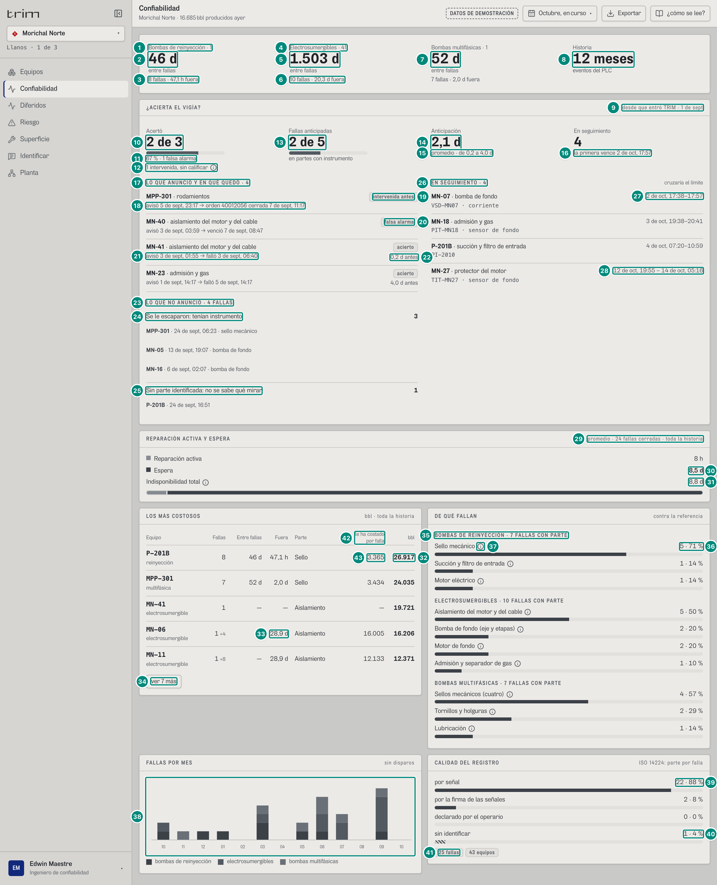
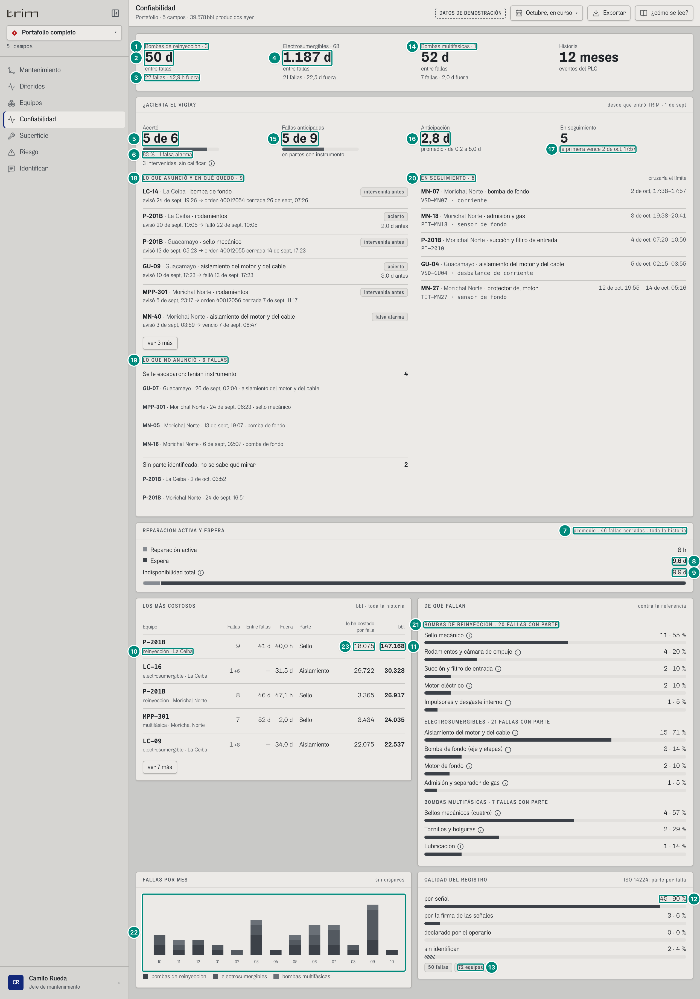

## 6C.4 Confiabilidad — confiabilidad, jefe de mantenimiento

**Para qué.** «Cada cuánto fallan, de qué parte y qué tan bien se registró.» (`src/widgets/Onboarding.tsx:17`).
**Ruta.** `#/<rol>/confiabilidad/<campo>[~portafolio]/<período>` · **Roles y nivel.** `conf`, `jefe` (ingeniería; también la planeadora `plan`, de v2). Agrega campos.
**Lee.** `GET /api/vistas/confiabilidad?campos` → `[{ campoId, equipo, familia, h: HistorialEquipo }]`; `GET /api/vistas/relojes?campos&desde=<inicio de la historia>&hasta=AHORA`; `GET /api/vistas/predicciones?campos` → `{ registro, fallas }`; `GET /api/sap/ordenes?campos` (número de la orden PM03 de una intervenida); el calendario de meses (arranque, `GET /api/catalogo`).
**El período de la cabecera no cambia nada**: todo es **toda la historia** (desde el 1-oct-2025, 366,58 días) y «¿ACIERTA EL VIGÍA?» desde la puesta en marcha (1-sep-2026).

Fórmulas: historia de fallas, MTBF y MDT de un equipo → 5B §7 «Fallas del equipo» y 5C §4 «Historia de fallas del equipo»; disparo vs falla → 5B §3.3; cifras por familia, «DE QUÉ FALLAN», «CALIDAD DEL REGISTRO», «LOS MÁS COSTOSOS» → 5C §4 «Confiabilidad por familia»; calificación de predicciones y las cuatro cifras → 5C §5 «Pantalla ¿ACIERTA EL VIGÍA?»; tres relojes → 5D §6 «Los tres relojes».

### Captura 1 · confiabilidad, Morichal

| # | Lo que se ve | En la captura | Cómo se calcula | Texto según el valor | Viene de |
|---|---|---|---|---|---|
| 1 | Familia y equipos | «Bombas de reinyección · 1» | `NOMBRE_FAMILIA[f]` · número de equipos de la familia en el ámbito; una tarjeta por familia presente, en el orden reinyección, electrosumergibles, multifásicas | — | `confiabilidad[].familia` |
| 2 | **Entre fallas** (MTBF de la flota) | **46 d** | $\text{MTBF} = \dfrac{D \cdot N}{\sum n_f}$ = 366,58 × 1 / 8 = 45,82 d; $D$ = días de historia (`h.dias`), $N$ = equipos, $n_f$ = fallas propias (sin disparos ni paradas que causó otro equipo) | `n0` + « d»; sin fallas «—» | `h.dias`, `h.fallas` |
| 3 | Fallas y tiempo fuera | «8 fallas · 47,1 h fuera» | MDT = promedio de horas de las fallas **cerradas** de la familia (8 → 47,09 h) | `plural(n,'falla','fallas')` + « · {fmtHoras(mdt, precisa)} fuera» (< 48 h → `n1` h; si no, `n1(h/24)` d) | `h.eventos[].horas` |
| 4 | Electrosumergibles | «Electrosumergibles · 41» | 41 pozos con ESP en Morichal | — | — |
| 5 | MTBF ESP | **1.503 d** | 366,58 × 41 / 10 = 1.502,99 | con 10 fallas y 267 disparos; los disparos no cuentan | ídem |
| 6 | Fallas ESP | «10 fallas · 20,3 d fuera» | MDT de 9 fallas cerradas (MN-41 sigue abierta) = 486,34 h = 20,3 d (el mismo «tiempo fuera de la flota» que usa Riesgo, 5B §5.3) | — | ídem |
| 7 | Multifásicas | **52 d** (7 fallas · 2,0 d fuera) | 366,58 / 7 = 52,37 d; MDT 48,68 h → «2,0 d» | — | ídem |
| 8 | **Historia** | «12 meses» · «eventos del PLC» | $n_0(D / 30{,}4)$ = 366,58 / 30,4 = 12,06 | `n0` + « meses» | `h.dias` |
| 9 | Desde cuándo | «desde que entró TRIM · 1 de sept» | `PUESTA_EN_MARCHA` = 2026-09-01 (configuración) | `fechaCorta` | `configuracion.ts` |
| 10 | **Acertó** | **2 de 3** | $A$ de $A+F$ (aciertos de aciertos + falsas alarmas); barra = $A/(A+F)$ | «—» si $A+F = 0$ | `GET /api/vistas/predicciones` → `registro[].calificacion` |
| 11 | Pie | «67 % · 1 falsa alarma» | tasa = 2/3 = 66,7 % | `n0` + « % · » + `plural(F,'falsa alarma','falsas alarmas')` | ídem |
| 12 | Intervenidas | «1 intervenida, sin calificar» ⓘ | $I$ = intervenidas (se le hizo mantenimiento antes del vencimiento) | ⓘ «Intervenidas antes»: «Se le hizo mantenimiento a la parte antes de que fallara: es lo que se busca, pero no prueba que iba a fallar. No cuenta como acierto ni como falsa alarma.»; no sale si $I = 0$ | ídem |
| 13 | **Fallas anticipadas** | **2 de 5** · «en partes con instrumento» | $A$ de $|W|$, $W$ = fallas `vigiladas` desde la puesta en marcha → 5C §5 «Fallas vistas» | barra $A/|W|$ (no se dibuja con $|W| = 0$) | `fallas[].visibilidad` |
| 14 | **Anticipación** | **2,1 d** | $\bar a = \frac{1}{A}\sum (\text{falla.inicio} - \text{emitida})$ = (0,2 + 4,0)/2 | `n1` + « d»; sin aciertos «—» | `registro[].emitida`, `.falla.inicio` |
| 15 | Rango | «promedio · de 0,2 a 4,0 d» | mín. y máx. de $a_k$ | sin aciertos: «sin aciertos todavía» | ídem |
| 16 | **En seguimiento** | «En seguimiento» **4** · «la primera vence 2 de oct, 17:57» | predicciones con `calificacion = 'seguimiento'`, ordenadas por `hasta` | `fechaHora(hasta)` de la primera; sin ninguna: «nada en seguimiento» | `registro[].hasta` |
| 17 | LO QUE ANUNCIÓ Y EN QUÉ QUEDÓ | «· 4» | vencidas, de la emisión más reciente a la más vieja | cinco a la vista y «ver N más»; una falsa alarma nunca se esconde | `registro` |
| 18 | Fila intervenida | «MPP-301 · rodamientos» · «avisó 5 de sept, 23:17 → orden 40012056 cerrada 7 de sept, 11:17» | la orden PM03 del mismo equipo con `cierreTecnico = intervencion` | «avisó {emitida} → falló {inicio}» / «→ orden {n \| predictiva} cerrada {fecha}» / «→ venció {hasta}» | `registro`, `GET /api/sap/ordenes` |
| 19 | Chip | «intervenida antes» | `RESULTADO[calificacion]` | «acierto» / «intervenida antes» / «falsa alarma» | `registro[].calificacion` |
| 20 | Chip | «falsa alarma»: «MN-40 · aislamiento del motor y del cable» · «avisó 3 de sept, 03:59 → venció 7 de sept, 08:47» | venció sin falla ni intervención; «venció» = `hasta` de la ventana | — | ídem |
| 21 | Fila acierto | «avisó 3 de sept, 01:55 → falló 3 de sept, 06:40» (MN-41 · aislamiento del motor y del cable); el otro acierto: «MN-23 · admisión y gas» · «avisó 1 de sept, 14:17 → falló 5 de sept, 14:17» · «acierto» · «4,0 d antes» | orden de la lista: de la emisión más reciente a la más vieja (MPP-301, MN-40, MN-41, MN-23) | — | ídem |
| 22 | Anticipo | «0,2 d antes» | (06:40 − 01:55) / 24 h = 0,198 d | `n1` + « d antes»; solo en aciertos | ídem |
| 23 | LO QUE NO ANUNCIÓ | «· 4 FALLAS» | se le escaparon + las no vigiladas | `plural(n,'FALLA','FALLAS')` | `fallas` |
| 24 | Se le escaparon | «Se le escaparon: tenían instrumento» · 3: «MPP-301 · 24 de sept, 06:23 · sello mecánico», «MN-05 · 13 de sept, 19:07 · bomba de fondo», «MN-16 · 6 de sept, 02:07 · bomba de fondo» | vigiladas que no son la falla de ningún acierto; fecha = `inicio` de la falla, parte en minúscula | cada una «**equipo** · fecha · parte» y abre la ficha | ídem |
| 25 | No vigiladas | «Sin parte identificada: no se sabe qué mirar» · 1 (P-201B · 24 de sept, 16:51) | un grupo por visibilidad (`NOMBRE_VISIBILIDAD`): «Parte sin instrumento: el vigía no la ve» (con «falta: …»), «Sin parte identificada: no se sabe qué mirar», «Familia apagada en el perfil del campo» | sin ninguna: «Ninguna falla sin anunciar desde la puesta en marcha.» | `fallas[].visibilidad`, `.faltan` |
| 26 | EN SEGUIMIENTO | «· 4» y rótulo «cruzaría el límite» | — | — | `registro` |
| 27 | Ventana del mismo día | «2 de oct, 17:38–17:57» (MN-07 · bomba de fondo · VSD-MN07 · corriente); «3 de oct, 19:38–20:41» (MN-18 · admisión y gas · PIT-MN18 · sensor de fondo); «4 de oct, 07:20–10:59» (P-201B · succión y filtro de entrada · PI-2010) | `desde`–`hasta` de la predicción | mismo día: «{d}, {h1}–{h2}»; distinto: «{fechaHora} – {fechaHora}» | `registro[].desde/.hasta/.tag` |
| 28 | Ventana de días distintos | «12 de oct, 19:55 – 14 de oct, 05:16» (MN-27 · protector del motor · TIT-MN27 · sensor de fondo) | — | — | ídem |
| 29 | Extra de REPARACIÓN ACTIVA Y ESPERA | «promedio · 24 fallas cerradas · toda la historia» | `relojes.fallas` = PM01 en TECO con evento y su parada del PLC, cerradas en toda la historia | `plural(n,'falla cerrada','fallas cerradas')`; sin datos: «toda la historia» y «Sin fallas cerradas con orden en SAP.» | `GET /api/vistas/relojes` |
| 30 | Espera | **8,5 d** | $\bar E$ = 204,45 h | `fmtHoras` (≥ 48 h → `n1(h/24)` d); en negrita | `esperaH` |
| 31 | Indisponibilidad total | 8,8 d | $\bar T$ = 212,27 h; reparación activa $\bar A$ = 7,82 h → «8 h» | ídem; barra: activa 3,7 % · espera 96,3 % | `totalH`, `activaH` |
| 32 | LOS MÁS COSTOSOS, bbl | «26.917» (P-201B · reinyección · 8 · 46 d · 47,1 h · Sello · le ha costado 3.365); a la vista también MPP-301 · multifásica · 7 · 52 d · 2,0 d · Sello · 3.434 · 24.035 (24.034,56); MN-41 · electrosumergible · 1 · — · — · Aislamiento · — · 19.721 (19.721,21); MN-06 · 1 +4 · — · 28,9 d · Aislamiento · 16.005 · 16.206 (16.206,23); MN-11 · 1 +8 · — · 28,9 d · Aislamiento · 12.133 · 12.371 (12.370,72) | `h.bbl` = barriles de los tramos cargados a sus fallas **y disparos** en toda la historia; la tabla son los 12 con fallas > 0, por bbl y luego fallas (`Confiabilidad.tsx:38`) | `n0`; columnas: Fallas `{fallas}` + « +{disparos}» en chico; Entre fallas `n0(mtbfDias)` d o «—» (menos de 2 fallas); Fuera `fmtHoras(mdtH, precisa)` o «—»; Parte = primera palabra de la parte que más falla; «le ha costado por falla» (fila 42); bbl. En el teléfono se ocultan «Entre fallas», «Fuera» y «le ha costado por falla» | `h.bbl`, `.fallas`, `.disparos`, `.mtbfDias`, `.mdtH`, `.porParte[0]`, `.bblPorFalla` |
| 33 | Fuera de una ESP | «28,9 d» (MN-06, 692,73 h; MN-11, 692,75 h) | `mdtH` del equipo | MN-41 dice «—»: su única falla sigue abierta | `h.mdtH` |
| 34 | «ver 7 más» | — | 12 filas, 5 a la vista; en el papel salen todas | — | — |
| 35 | DE QUÉ FALLAN | «BOMBAS DE REINYECCIÓN · 7 FALLAS CON PARTE»; «ELECTROSUMERGIBLES · 10 FALLAS CON PARTE»; «BOMBAS MULTIFÁSICAS · 7 FALLAS CON PARTE» | fallas sin disparos **con parte**, por familia (la octava de P-201B no tiene parte) | `plural(total,'FALLA','FALLAS')` | `h.eventos[].parte` |
| 36 | Fila de parte | «5 · 71 %» (Sello mecánico); reinyección: Succión y filtro de entrada 1 · 14 %, Motor eléctrico 1 · 14 %; electrosumergibles: Aislamiento del motor y del cable 5 · 50 %, Bomba de fondo (eje y etapas) 2 · 20 %, Motor de fondo 2 · 20 %, Admisión y separador de gas 1 · 10 %; multifásicas: Sellos mecánicos (cuatro) 4 · 57 %, Tornillos y holguras 2 · 29 %, Lubricación 1 · 14 % | $n_{\text{parte}} / \text{total} \times 100$ = 5/7 | `n0` %; barra del mismo ancho; partes en el orden de más a menos | ídem |
| 37 | ⓘ referencia publicada | (globo) | `partesDe(familia)[].peso` | «Referencia · Sello mecánico»: «60 % de las fallas de bombas: el componente que más falla. European Sealing Association, ESA-MSD-2025-01 (28-oct-2025): 3.500 fallas de bombas en 18 usuarios.» (cada parte tiene la suya, `src/entities/partes.ts`) | catálogo |
| 38 | FALLAS POR MES | barras apiladas por familia; eje con el mes en dos cifras: «10 11 12 01 02 03 04 05 06 07 08 09 10» | por mes del calendario (13 meses, oct-2025 a oct-2026), fallas sin disparos con `inicio` en el mes; alto = $n / \max$ del mes más alto. Morichal (reinyección/ESP/multifásica): oct 1/1/0, nov 0/0/1, dic 1/0/0, ene 1/0/0, feb 0, mar 2/1/1, abr 0, may 1/0/1, jun 1/2/2, jul 0/2/1, ago 0, sep 1/4/1, oct 0 | colores `--dato-1/2/3` por familia (no son prioridades); `title` de cada barra «{AAAA-MM} · {familia}: {n}»; rótulo del eje `mes.slice(5)` (`Confiabilidad.tsx:184`) | `h.eventos[].inicio` |
| 39 | CALIDAD DEL REGISTRO | «por señal 22 · 88 %»; «por la firma de las señales 2 · 8 %»; «declarado por el operario 0 · 0 %»; (fila 40) «sin identificar 1 · 4 %». Extra del panel «ISO 14224: parte por falla» (fijo) | fallas (sin disparos) por `como`: señal 22, firma 2, declarado 0, ninguno 1 → 5B §2-3 | `COMO[c]`: «por señal», «por la firma de las señales», «declarado por el operario», «sin identificar»; `n0` %; barra: «sin identificar» rayada, «declarado» `--dato-3` | `h.eventos[].como` |
| 40 | Sin identificar | «1 · 4 %» | P-201B 24-sep | — | ídem |
| 41 | Chips | «25 fallas» · «43 equipos» | fallas sin disparos (incluye las abiertas) y equipos de la flota (1 + 41 + 1) | `plural` | `confiabilidad` |
| 42 | Columna «le ha costado por falla» | encabezado «le ha costado / por falla» | lo que **ya** costó, en promedio, cada falla cerrada del equipo: $\text{bblPorFalla} = \frac{1}{n_c}\sum_{\text{fallas cerradas}} \text{bbl}$, sin disparos ni la falla abierta (que lleva barriles parciales); las que absorbió el tanque cuentan como 0 (`historialDeEquipo`, `src/entities/libro.ts:1280`) → 5B §7 «Fallas del equipo». Columna nueva (decisión del dueño, 8-oct): es la cifra histórica, distinta de «si falla hoy» de Riesgo, que descuenta el colchón de hoy | `n0`; sin fallas cerradas «—» (MN-41: su única falla sigue abierta); el rótulo es siempre «le ha costado por falla», nunca «costo por falla» a secas (`Confiabilidad.tsx:118-120, 134`) | `h.bblPorFalla` |
| 43 | Le ha costado, P-201B | «3.365» | 26.917,18 bbl / 8 fallas cerradas = 3.364,65 (MPP-301: 24.034,56 / 7 = 3.433,51 → «3.434»; MN-06: su falla cerrada 16.004,82 → «16.005», sin los barriles de sus 4 disparos, que sí están en «bbl»; MN-11 «12.133») | — | `h.bblPorFalla` |

**Globo de una tarjeta de familia** (y en el papel, debajo, «{disparos} disparos · {bbl} bbl en la historia»): «MTBF de la flota: días de historia por equipo ÷ fallas, sin contar disparos ni paradas que causó otro equipo.» · «Equipos 1» · «Fallas 8» · «Disparos 0» · «Tiempo fuera promedio 47,1 h» · «Barriles en la historia 26.917 bbl». Electrosumergibles: «Disparos 267», «113.847 bbl»; multifásicas «24.035 bbl».

### Captura 2 · jefe de mantenimiento, portafolio

Las reglas son las de la captura 1; lo que no cambia con el ámbito («Historia 12 meses», «desde que entró TRIM · 1 de sept», la reparación activa «8 h») se explica allí.

| # | Lo que se ve | En la captura | Cómo se calcula | Texto según el valor | Viene de |
|---|---|---|---|---|---|
| 1 | Reinyección del portafolio | «Bombas de reinyección · 3» | P-201B de La Ceiba, Morichal y Guacamayo | — | `confiabilidad` |
| 2 | MTBF | **50 d** | 366,58 × 3 / 22 = 49,99 | — | ídem |
| 3 | Fallas | «22 fallas · 42,9 h fuera» | 21 cerradas, promedio 42,94 h | — | ídem |
| 4 | MTBF ESP | «Electrosumergibles · 68» · **1.187 d** · «21 fallas · 22,5 d fuera» | 366,58 × 68 / 21 = 1.187,03; MDT 539,04 h = 22,5 d | — | ídem |
| 5 | Acertó | **5 de 6** | → 5C §5 (portafolio) | — | `predicciones` |
| 6 | Pie | «83 % · 1 falsa alarma» (+ «3 intervenidas, sin calificar») | 5/6 = 83,3 %; → 5C §5, tabla «Fórmulas de las cuatro cifras», columna Portafolio | `plural(I,'intervenida','intervenidas')` | ídem |
| 7 | Relojes | «promedio · 46 fallas cerradas · toda la historia» | → 5D §6 (5 campos, 12 meses) | — | `relojes` |
| 8 | Espera | **9,6 d** | 230,11 h | — | `esperaH` |
| 9 | Total | 9,9 d | 237,94 h (activa 7,83 h → «8 h») | — | `totalH` |
| 10 | Campo en la tabla | «reinyección · La Ceiba» | en portafolio cada fila agrega « · campo» | — | `campoId` |
| 11 | bbl | «147.168» | P-201B de La Ceiba: «9» fallas, «41 d» entre fallas, «40,0 h» fuera, «Sello», le ha costado «18.075» por falla (fila 23), 147.168,44 bbl. A la vista también: LC-16 · La Ceiba «1 +6» · — · «31,5 d» (755,58 h) · Aislamiento · 29.722 · 30.328 (30.327,66); P-201B · Morichal Norte 8 · 46 d · 47,1 h · Sello · 3.365 · 26.917; MPP-301 · Morichal Norte 7 · 52 d · 2,0 d · Sello · 3.434 · 24.035; LC-09 · La Ceiba «1 +8» · — · «34,0 d» (815,25 h) · Aislamiento · 22.075 · 22.537 (22.536,57); «ver 7 más» | ídem captura 1, fila 32 | `h.bbl` |
| 12 | Calidad | «por señal 45 · 90 %»; «por la firma de las señales 3 · 6 %»; «declarado por el operario 0 · 0 %»; «sin identificar 2 · 4 %» | 50 fallas: señal 45, firma 3, declarado 0, ninguno 2 | ídem captura 1, fila 39 | `h.eventos[].como` |
| 13 | Chips | «50 fallas» · «72 equipos» | 3 + 68 + 1 equipos; 22 + 21 + 7 fallas | `plural` | `confiabilidad` |
| 14 | Multifásicas | «Bombas multifásicas · 1» · **52 d** · «7 fallas · 2,0 d fuera» | MPP-301 de Morichal (la única): 366,58 / 7 = 52,37 d; MDT 48,68 h | ídem captura 1, fila 7 | `h` |
| 15 | Fallas anticipadas | **5 de 9** · «en partes con instrumento» | → 5C §5, columna Portafolio | ídem captura 1, fila 13 | `fallas[].visibilidad` |
| 16 | Anticipación | **2,8 d** · «promedio · de 0,2 a 5,0 d» | los cinco aciertos: MN-41 0,2 d y MN-23 4,0 d (Morichal), P-201B de La Ceiba rodamientos 2,0 d y sello 5,0 d (avisó 4-sep 21:14, falló 9-sep 21:14; está tras «ver 3 más»), GU-09 3,0 d (Guacamayo): (0,2 + 4,0 + 2,0 + 5,0 + 3,0) / 5 = 2,84 → 5C §5 | ídem captura 1, filas 14-15 | `registro[]` |
| 17 | En seguimiento | «En seguimiento» **5** · «la primera vence 2 de oct, 17:57» | las 4 de Morichal + GU-04 | ídem captura 1, fila 16 | `registro[].hasta` |
| 18 | LO QUE ANUNCIÓ Y EN QUÉ QUEDÓ | «· 9»; a la vista: «LC-14 · La Ceiba · bomba de fondo» «avisó 24 de sept, 19:26 → orden 40012054 cerrada 26 de sept, 07:26» (intervenida antes); «P-201B · La Ceiba · rodamientos» «avisó 20 de sept, 10:05 → falló 22 de sept, 10:05» «acierto» «2,0 d antes»; «P-201B · Guacamayo · sello mecánico» «avisó 13 de sept, 05:23 → orden 40012055 cerrada 14 de sept, 17:23»; «GU-09 · Guacamayo · aislamiento del motor y del cable» «avisó 10 de sept, 17:23 → falló 13 de sept, 17:23» «3,0 d antes»; «MPP-301 · Morichal Norte · rodamientos» (orden 40012056); «MN-40 · Morichal Norte · …» «avisó 3 de sept, 03:59 → venció 7 de sept, 08:47» «falsa alarma»; «ver 3 más» | cinco a la vista más la falsa alarma, que nunca se esconde (5C §5 «Listas») | ídem captura 1, filas 18-22 | `registro[]`, `GET /api/sap/ordenes` |
| 19 | LO QUE NO ANUNCIÓ | «· 6 FALLAS»: «Se le escaparon: tenían instrumento» 4 (GU-07 · Guacamayo · 26 de sept, 02:04 · aislamiento del motor y del cable; MPP-301 · Morichal Norte · 24 de sept, 06:23 · sello mecánico; MN-05 · Morichal Norte · 13 de sept, 19:07 · bomba de fondo; MN-16 · Morichal Norte · 6 de sept, 02:07 · bomba de fondo); «Sin parte identificada: no se sabe qué mirar» 2 (P-201B · La Ceiba · 2 de oct, 03:52; P-201B · Morichal Norte · 24 de sept, 16:51) | → 5C §5 «Fallas vistas» | ídem captura 1, filas 23-25 | `fallas[]` |
| 20 | EN SEGUIMIENTO | «· 5»: las cuatro de Morichal (captura 1, filas 27-28) y «GU-04 · Guacamayo · aislamiento del motor y del cable» «VSD-GU04 · desbalance de corriente» «5 de oct, 02:15–03:55» | por `hasta` | ídem | `registro[]` |
| 21 | DE QUÉ FALLAN | «BOMBAS DE REINYECCIÓN · 20 FALLAS CON PARTE»: Sello mecánico 11 · 55 %, Rodamientos y cámara de empuje 4 · 20 %, Succión y filtro de entrada 2 · 10 %, Motor eléctrico 2 · 10 %, Impulsores y desgaste interno 1 · 5 %; «ELECTROSUMERGIBLES · 21 FALLAS CON PARTE»: Aislamiento del motor y del cable 15 · 71 %, Bomba de fondo (eje y etapas) 3 · 14 %, Motor de fondo 2 · 10 %, Admisión y separador de gas 1 · 5 %; «BOMBAS MULTIFÁSICAS · 7 FALLAS CON PARTE»: Sellos mecánicos (cuatro) 4 · 57 %, Tornillos y holguras 2 · 29 %, Lubricación 1 · 14 % | ídem captura 1, filas 35-36 | ídem | `h.eventos[].parte` |
| 22 | FALLAS POR MES | barras por mes (reinyección/ESP/multifásica): oct-25 2/2/0, nov 1/1/1, dic 2/1/0, ene 1/1/0, feb 0/1/0, mar 4/2/1, abr 1/0/0, may 2/1/1, jun 2/2/2, jul 2/3/1, ago 1/1/0, sep 3/6/1, oct-26 1/0/0; eje «10 11 12 01 02 03 04 05 06 07 08 09 10» | ídem captura 1, fila 38 | ídem | `h.eventos[].inicio` |
| 23 | Le ha costado, P-201B de La Ceiba | «18.075» | sus 8 fallas cerradas (la del 2-oct sigue abierta y no entra): 144.598,2 bbl / 8 = 18.074,77; es la misma cifra que la placa de Bombas y la ficha dicen «le ha costado 18.075 bbl por falla» | ídem captura 1, fila 42 | `h.bblPorFalla` |

**Variantes.**
- **Período.** Ninguna cifra cambia con el período (toda la historia o desde la puesta en marcha).
- **Ámbito sin equipos de alto impacto.** «CONFIABILIDAD» con «{ámbito} no tiene equipos de alto impacto.» (`Confiabilidad.tsx:42`).
- **Familia ausente.** No sale su tarjeta ni su bloque en DE QUÉ FALLAN ni en el gráfico (El Palmar y La Zarza solo tienen la bomba de reinyección).
- **Ruta del auditor** `#/conf/confiabilidad/morichal/curso/MPP-301`: la misma pantalla con la ficha de MPP-301 abierta (la ficha la documenta otro capítulo).

**Interacciones.** Cualquier fila (tabla, predicciones, fallas sin anunciar, seguimiento) cambia al campo y abre la ficha del equipo. ⓘ por parte con la referencia publicada. «ver N más» en la tabla y en las vencidas.

**Lectura («¿cómo se lee?»).** Cabecera: «Una falla es una parada propia del equipo: la que causó otro equipo (se cayó la energía, paró la bomba de la línea) o la que estaba en el programa no cuenta. En la electrosumergible, un disparo que vuelve a arrancar en menos de un día tampoco: la falla es la que obliga a sacarla del pozo. Con menos de dos fallas no se calcula el tiempo entre fallas. Toque o pase el cursor por una flota para ver sus disparos y sus barriles; el ⓘ de cada parte da su referencia publicada.» ¿ACIERTA EL VIGÍA?: «Cada predicción se califica al vencer su ventana: acierto si esa parte falló; intervenida si se le hizo mantenimiento antes (es lo que se busca, pero no prueba que iba a fallar y no cuenta como acierto); falsa alarma si no pasó nada. Y la otra cara: las fallas que nadie anunció. «Fallas anticipadas» cuenta solo las de partes con instrumento: las demás el vigía no las podía ver. En seguimiento, la que vence primero va arriba.» CALIDAD DEL REGISTRO: «Cómo se supo qué parte falló. Lo que dice una señal (primera alarma, código del variador) o la firma de las señales es evidencia; lo declarado depende de quien respondió; lo que no tiene parte no le enseña nada al vigía.»

**Lo que es simulado en el demo.** El registro de predicciones antes de hoy sale de una regla fija (5C §5 «Registro histórico del demo»): un backend real guarda cada predicción al emitirla y la califica al vencer. Las órdenes PM03 de las intervenidas y los relojes salen de la simulación de SAP (5D §6).
