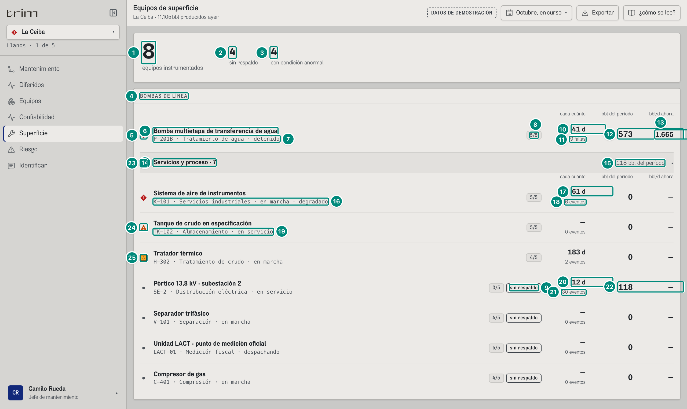
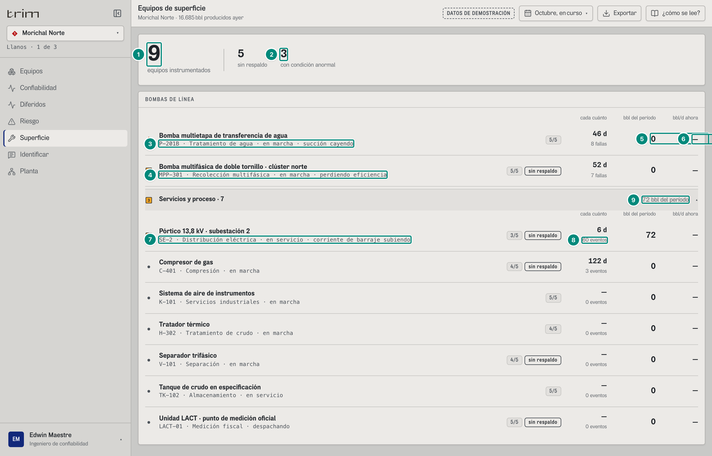

## 6C.5 Superficie — «Equipos de superficie» · jefe de mantenimiento, confiabilidad

**Para qué.** «Por condición y barriles, con su historia del PLC.» (`src/widgets/Onboarding.tsx:18`).
**Ruta.** `#/<rol>/equipo/<campo>[~portafolio]/<período>` · **Roles y nivel.** `jefe`, `conf` (ingeniería; también `plan`, v2). Agrega campos.
**Lee.** `GET /api/vistas/equipos?campos` → `FilaEquipo[]` (`{ eq: EquipoVivo, campoId, bomba, eventos, bblHistoria, fallas?, mtbfDias? }`, `src/shared/api/equipos.ts:146-157`); `GET /api/vistas/diferidos?campos&desde&hasta` → `porEquipo` (los bbl del período de cada equipo); `GET /api/vistas/riesgo?campos` (lo que se pierde ahora y lo que está en juego).
**Alcance de este capítulo.** La tabla y lo que la abre. La ficha del equipo abierta (`#/jefe/equipo/ceiba/curso/K-101`, `PanelEquipo`) la documenta el capítulo de la ficha.

Fórmulas: el equipo «vivo» (estado, marcha, criticidad, redundancia, aguas abajo, lectura) → 5B §7 «El equipo vivo»; eventos con pozos cerrados → 5B §7 «Eventos con pozos cerrados (`eventosCargadosA`)»; fallas y MTBF de una bomba → 5B §7 «Fallas del equipo»; bbl del período por equipo → 5A §8 «Pareto por equipo»; perdiendo / en riesgo → 5B §5.

**Orden de la tabla** (`Equipo.tsx:57-58`): por condición (P1, P2, P3 y al final lo normal: `atencion(s) = s === 0 ? 9 : s`), luego por bbl del período descendente, luego por bbl de toda la historia. Con `FOCO_BOMBAS = true` (`src/shared/config/producto.ts:23`) las bombas de la línea van arriba («BOMBAS DE LÍNEA») y el resto se pliega en «Servicios y proceso · N», que **no esconde** una alarma: su resumen lleva la peor marca.

### Captura 1 · jefe, La Ceiba, octubre en curso (servicios desplegados)

| # | Lo que se ve | En la captura | Cómo se calcula | Texto según el valor | Viene de |
|---|---|---|---|---|---|
| 1 | **equipos instrumentados** | **8** | filas = equipos del catálogo instrumentados en el campo (`eq.instrumentado`) | número | `GET /api/vistas/equipos` |
| 2 | **sin respaldo** | **5** | filas con `redundancia = 'sin respaldo'` (P-201B, V-101, LACT-01, C-401, SE-2) | — | `eq.redundancia` |
| 3 | **con condición anormal** | **4** | filas con `severidad > 0` (P-201B, K-101, TK-102, H-302) | — | `eq.severidad` |
| 4 | Título | «BOMBAS DE LÍNEA» | `FOCO_BOMBAS` (sin el foco: «EQUIPOS» y una sola lista) | — | — |
| 5 | Marca de la fila | ◆ 1 | `eq.severidad` | ◆ 1 / ▲ 2 / ■ 3 / punto gris | `eq.severidad` |
| 6 | Nombre | «Bomba multietapa de transferencia de agua» (P-201B); servicios: «Sistema de aire de instrumentos» (K-101), «Tanque de crudo en especificación» (TK-102), «Tratador térmico» (H-302), «Pórtico 13,8 kV · subestación 2» (SE-2), «Separador trifásico» (V-101), «Unidad LACT · punto de medición oficial» (LACT-01), «Compresor de gas» (C-401) | `eq.nombre` | — | `eq` |
| 7 | Código, sistema y estado | «P-201B · Tratamiento de agua · detenido» | `{id} · {sistema} · {estado}`; en portafolio el sistema se cambia por el nombre del campo | `estado` es texto del servidor (`marcha` es el dato que se compara) | `eq.id`, `.sistema`, `.estado` |
| 8 | Criticidad | chip «5/5» (P-201B, K-101, TK-102, LACT-01); «4/5» (H-302, V-101, C-401); «3/5» (SE-2) | `eq.criticidad` | «{n}/5»; se oculta en el teléfono | `eq.criticidad` |
| 9 | Sin respaldo | chip fuerte «sin respaldo» (P-201B, SE-2, V-101, LACT-01, C-401: las 5 de la cifra 2) | solo si `redundancia = 'sin respaldo'` (para una bomba sale del respaldo firmado: `libreBpd = 0`) | — | `eq.redundancia` |
| 10 | **cada cuánto** (bombas) | **41 d** | bomba con perfil: `mtbfDias` de su historia = 40,73 d (9 fallas en 366,58 d) | `n0` + « d»; menos de 2 fallas: «—»; el lector oye «entre fallas …» | `FilaEquipo.mtbfDias` |
| 11 | Cuántas | «9 fallas» | `fallas` (propias; las que causó otro equipo no cuentan) | `plural(n,'falla','fallas')` | `FilaEquipo.fallas` |
| 12 | **bbl del período** | **2.570** | `porEquipo` del libro del período para ese equipo y campo → 5A §8 | `n0`; 0 si no difirió | `Libro.porEquipo[].bbl` |
| 13 | **bbl/d ahora** | **11.059** | $\sum$ `bblDia` de las filas `perdiendo` de ese equipo (`Equipo.tsx:55-57`) | `n0`; 0 → «—»; columna oculta en pantallas angostas (< 768 px). Lo que se perdería por día **si para** (filas `en-riesgo`) **no** se suma aquí: todavía no se pierde y va al globo («Si para») | `riesgo[].bblDia` |
| 14 | Servicios y proceso | «Servicios y proceso · 7» | filas que no son bomba de la línea | marca = la peor de esas filas (`peorFuera`, aquí ◆ 1 por K-101) | — |
| 15 | bbl del período de servicios | «118 bbl del período» | $\sum$ bbl del período de esas filas (SE-2) | `n0` | `porEquipo` |
| 16 | K-101 | «K-101 · Servicios industriales · en marcha · degradado» | — | — | `eq` |
| 23 | Marca de K-101 | ◆ 1 | — | — | `eq.severidad` |
| 17 | **cada cuánto** (otros equipos) | «73 d» (K-101); H-302 «183 d» (366,58 / 2); SE-2 «13 d» (fila 20); TK-102, V-101, LACT-01 y C-401 «—» (0 eventos) | sin perfil de bomba: $D / n$ con $n$ = eventos con pozos cerrados en toda la historia, si $n \ge 2$ = 366,58 / 5 = 73,3 | «entre eventos»; < 2: «—» | `FilaEquipo.mtbfDias`, `.eventos` |
| 18 | Cuántos | «5 eventos» (K-101); H-302 «2 eventos»; SE-2 «28 eventos»; TK-102, V-101, LACT-01, C-401 «0 eventos» | `eventos` = eventos distintos que le cargaron pozos cerrados | `plural(n,'evento','eventos')` | `FilaEquipo.eventos` |
| 19 | TK-102 | «TK-102 · Almacenamiento · en servicio» | — | — | `eq` |
| 24 | Marca de TK-102 | ▲ 2 | severidad declarada (`LI-1102` en atención) | — | `eq.severidad` |
| 25 | Marca de H-302 | ■ 3 «H-302 · Tratamiento de crudo · en marcha» (SE-2, V-101, LACT-01 y C-401: punto gris) | severidad declarada (`TI-3021` en aviso; tiene respaldo H-301) | — | `eq.severidad` |
| 20 | SE-2 | «13 d» | 366,58 / 28 eventos = 13,09 | — | ídem |
| 21 | Cuántos | «28 eventos» | — | — | ídem |
| 22 | bbl del período de SE-2 | «118» (las otras seis filas de servicios: «0 bbl del período» y «— bbl/d perdiéndose») | lo que sus caídas difirieron en octubre | — | `porEquipo` |

**Globo de cada fila** (`Equipo.tsx:65-75`; en el papel la pista): título = nombre, pista = `eq.lectura`, filas «Estado», «Criticidad {n}/5», «Redundancia», «Aguas abajo», «Diferido · {período en minúscula} {n0} bbl», «Eventos con pozos cerrados {n} en {n0(D/30,4)} meses», «Fallas propias {n}» (solo bombas), «Entre eventos {n0} d» o «menos de dos: no se calcula», «Perdiéndose ahora {n0} bbl/d» o «—», «Si para {n0} bbl/d» (solo si hay; $\sum$ `bblDia` de sus filas `en-riesgo`; antes «En juego si falla»: los bbl/d se llaman «si para» en todas las pantallas y «si falla hoy» es solo la cifra en bbl de Riesgo y Mantenimiento). Ejemplo P-201B: lectura «Detenida, el agua no tiene salida: el tanque se llena y hay que cerrar los pozos del campo.»; «Redundancia sin respaldo», «Aguas abajo todo el campo», «Diferido · octubre, en curso 2.570 bbl», «Eventos con pozos cerrados 10 en 12 meses», «Fallas propias 9», «Entre eventos 41 d», «Perdiéndose ahora 11.059 bbl/d». K-101: «Redundancia 3 unidades (N+1)», lectura «La presión de cabezal cae hace 7 días. La norma exige recibidor de 5 a 30 min de autonomía: hoy quedan 11. Alimenta cinco sistemas.»

### Captura 2 · confiabilidad, Morichal (servicios desplegados)

Las reglas de cada columna son las de la captura 1; aquí, los valores de Morichal.

| # | Lo que se ve | En la captura | Cómo se calcula | Texto según el valor | Viene de |
|---|---|---|---|---|---|
| 1 | equipos instrumentados | **9** · «5 sin respaldo» (MPP-301, SE-2, C-401, V-101, LACT-01; P-201B de Morichal tiene respaldo) | MPP-301 suma a los 8 de siempre | — | `GET /api/vistas/equipos` |
| 2 | con condición anormal | **3** | P-201B (▲ 2), MPP-301 (■ 3), SE-2 (■ 3) | — | `eq.severidad` |
| 3 | P-201B | «P-201B · Tratamiento de agua · en marcha · succión cayendo» ▲ 2 · «5/5» · «entre fallas 46 d» · «8 fallas» | en marcha con una parte que avisa | — | `eq` |
| 4 | MPP-301 | «Bomba multifásica de doble tornillo · clúster norte» · «MPP-301 · Recolección multifásica · en marcha · perdiendo eficiencia» ■ 3 · «5/5» · «sin respaldo» · «52 d» · «7 fallas» | 366,58 / 7 = 52,4 d (fallas propias) | — | `eq` |
| 5 | bbl del período | «0» | en octubre no difirieron | — | `porEquipo` |
| 6 | bbl/d ahora | «—» | no pierden nada ahora; lo que perderían si paran (1.671 y 1.600 bbl/d) va al globo, «Si para · 1.671 bbl/d» y «Si para · 1.600 bbl/d» | — | `riesgo` |
| 7 | SE-2 | «SE-2 · Distribución eléctrica · en servicio · corriente de barraje subiendo» ■ | — | — | `eq` |
| 8 | Eventos | «60 eventos» · «6 d» (SE-2, «3/5», «sin respaldo»); C-401 «122 d» · «3 eventos» (366,58 / 3 = 122,2) · «4/5» · «sin respaldo»; V-101 «4/5» · «sin respaldo», K-101 «5/5», TK-102 «5/5», H-302 «4/5», LACT-01 «5/5» · «sin respaldo»: «—» · «0 eventos» | 366,58 / 60 = 6,11 | — | `FilaEquipo` |
| 9 | bbl del período | «72» (SE-2; el resumen «Servicios y proceso · 7» ■ 3 dice «72 bbl del período»; las demás filas «0») | lo que difirieron sus caídas en octubre | — | `porEquipo` |

**Variantes.** Portafolio: el sistema de la segunda línea se cambia por el campo; la tabla junta todos los campos con el mismo orden. Período: solo cambia «bbl del período» (y el orden dentro de cada condición). Teléfono: se ocultan la criticidad, «sin respaldo» y «bbl/d ahora» (`hidden sm:flex`, `md:block`).

**Estados.** Lo normal lleva el punto gris; un instrumento «sin señal» no sube la severidad (SE-2 de La Ceiba tiene `TI-0021` sin señal y queda en punto gris; el dato inválido se ve dentro de la ficha). Un instrumento sin lectura viaja con `valor: null` y estado «sin señal» (las pantallas lo reconocen por cualquiera de los dos: `sinLectura`, `src/shared/lib/formato.ts:43-44`); nunca un «—» como valor.

**Interacciones.** Un clic en una fila cambia al campo y abre la ficha del equipo (`abrirEquipo(id, false)`); el resumen «Servicios y proceso» abre y cierra el plegado (un `
`: en el papel sale como esté).

**Lectura («¿cómo se lee?»).** «Ordenados por condición y, dentro de cada una, por los barriles que cuestan en el período. Un clic abre la ficha del equipo. Las columnas: cada cuánto falla (días entre fallas, o entre eventos con pozos cerrados) con cuántas van, barriles diferidos del período y lo que se está perdiendo ahora. Servicios y proceso son aire, energía, compresión, separación, tratamiento y medición. La historia de cada equipo (cuántas veces cerró pozos y cada cuánto) sale del registro de eventos del PLC, no de un formulario. Los pozos y sus electrosumergibles tienen su propia pantalla.»

**Lo que es simulado en el demo.** La **severidad, el estado y la lectura** de los equipos del catálogo están escritos en los datos del demo (`src/entities/equipos.ts:27, 61, 109, 130, 169, 322, 337`), no se deducen de sus dispositivos. El backend real tiene que calcularlos desde el estado de los instrumentos (alarma → 1, atención → 2, aviso → 3; 8 §8.4) y la marcha del PLC. Ver «Huecos y dudas» (MPP-301: dispositivo en atención y equipo en P3).
