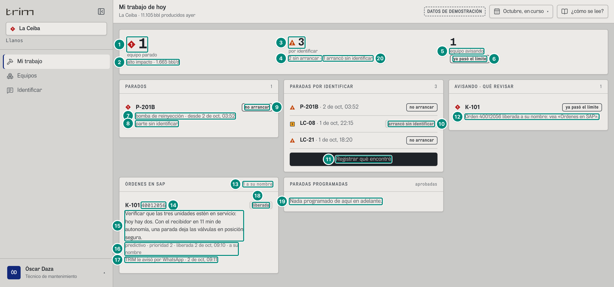
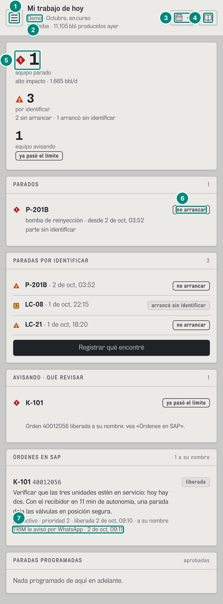

## 6C.6 Mi trabajo — «Mi trabajo de hoy» · técnico de mantenimiento

**Para qué.** «Qué está parado o avisa, y qué revisar.» (`src/widgets/Onboarding.tsx:16`, `PARA_QUE.trabajo`).
**Ruta.** `#/tec/trabajo/<campo>/<período>` · **Roles y nivel.** Solo `tec` (operación); es su inicio. **No agrega campos** (sin `agrega`: en portafolio se pide escoger un campo, `SoloCampo`). El período no cambia nada.
**Lee.** `GET /api/vistas/riesgo?campos`; `GET /api/vistas/paradas/por-identificar?campos`; `GET /api/sap/ordenes?campos` (y avisos, sin uso aquí); `GET /api/mensajes?campos` (los avisos `orden` dirigidos a la persona); el programa de paradas de la configuración vigente; la persona de la sesión (`usePersona`).

Fórmulas: perdiendo / en riesgo → 5B §5; preguntas → 5B §3.2; órdenes de SAP, estados y el aviso por WhatsApp de una orden liberada (**RETIRADO (27-oct-2026)**; la orden se ve en el Hoy del técnico) → 5D §6 «Mi trabajo (técnico)» y 5D §5.1 (regla `orden`).

### Captura 1 · técnico, La Ceiba, escritorio

| # | Lo que se ve | En la captura | Cómo se calcula | Texto según el valor | Viene de |
|---|---|---|---|---|---|
| 1 | **equipos parados** | ◆ **1** | filas `perdiendo` **de alto impacto** (P-201B; LC-21 no cuenta: es un pozo sin identificar) | ◆ P1 si > 0; «equipo parado» / «equipos parados» | `riesgo[]` (`estado`, `altoImpacto`) |
| 2 | Apoyo | «alto impacto · 1.665 bbl/d» | $\sum$ `bblDia` de esas filas | `n0` | `riesgo[].bblDia` |
| 3 | **por identificar** | ▲ **3** | `contarPorIdentificar(preguntas).porIdentificar` (`Trabajo.tsx:32`): las preguntas con `pide`, hayan arrancado o no (P-201B, LC-21 y LC-08). Es la cuenta única: la misma cifra en Identificar, Mantenimiento, Turno y la franja «Ahora» (antes Identificar y Mantenimiento decían 2) → 5B §3.2 | ▲ P2 si alguna sigue parada (`porIdentificar − arrancaronSinIdentificar > 0`, `Trabajo.tsx:94`) | `pregunta.pide`, `.arrancoSinIdentificar` |
| 4 | Apoyo | «2 sin arrancar ·» | `porIdentificar − arrancaronSinIdentificar` = 3 − 1 (P-201B y LC-21) | `ApoyoPorIdentificar` (`src/shared/ui/PorIdentificar.tsx:9-18`, `Trabajo.tsx:96`): «{n} sin arrancar» y «■ {m} arrancó/arrancaron sin identificar» (fila 20), las mismas palabras que Turno y Mantenimiento; un tramo en 0 no se escribe | `pregunta.fin` |
| 5 | **equipos avisando** | «1» · «equipo avisando» | filas `en-riesgo` (aquí K-101: un servicio en alarma avisa sin parte, por eso se cuentan equipos y no partes) | «equipo avisando» / «equipos avisando» (`Trabajo.tsx:101`; antes «parte avisando», 6C.9 punto 4, resuelto) | `riesgo[]` |
| 6 | Pie | chip «ya pasó el límite» | el primero por `horas` (ausente = −1): con horas «el primero cruza en {fmtHoras}»; sin horas: chip fuerte «ya pasó el límite» si es uno solo, «{k} ya pasaron el límite» si hay varios (antes «ya fuera», B-42) (cuenta los que no tienen horas) (`Trabajo.tsx:102-105`) | — | `riesgo[].horas` |
| 7 | PARADOS: tipo y desde | «bomba de reinyección · desde 2 de oct, 03:52» (◆ 1 «P-201B»; extra del panel PARADOS «1», y AVISANDO · QUÉ REVISAR «1»: `parados.length`, `avisan.length`, `Trabajo.tsx:117, 147`) | `TIPO_CAUSA[tipo]` en minúscula + `fechaHora(desde)` | — | `riesgo[].tipo`, `.desde` |
| 8 | Parte | «parte sin identificar» | `NOMBRE_PARTE[parte]` en minúscula o «parte sin identificar» | — | `riesgo[].parte` |
| 9 | «no arrancar» | chip | hay una pregunta abierta (`!fin`) del mismo equipo y campo; si no, a la derecha `n0(bblDia)` bbl/d | — | `por-identificar` |
| 10 | PARADAS POR IDENTIFICAR | extra «3» (`pi.porIdentificar`, `Trabajo.tsx:137`: la misma cifra de arriba); ▲ 2 «P-201B · 2 de oct, 03:52» «no arrancar»; ■ 3 «LC-08 · 1 de oct, 22:15» «arrancó sin identificar»; ▲ 2 «LC-21 · 1 de oct, 18:20» «no arrancar» (orden del servidor: de la más reciente a la más vieja, 5B §3.2) | marca ▲ 2 si `!fin`, ■ 3 si arrancó; chip «no arrancar» o «arrancó sin identificar» | lista corta: las que siguen paradas nunca se esconden | `pregunta` |
| 11 | «Registrar qué encontré» | botón | si el rol tiene Identificar; si no: «Su rol no responde paradas.» | lleva a `#/tec/causa/…` | — |
| 12 | AVISANDO · instrucción | «Orden 40012056 liberada a su nombre: vea «Órdenes en SAP».» | hay una orden **de la persona** abierta para ese equipo (`ordenMia`); si no, se escribe la `accion` de la fila (con su aviso de seguridad, sin ⓘ) | — | `riesgo[].accion`, `ordenes[]` |
| 13 | Extra de ÓRDENES EN SAP | «1 a su nombre» | órdenes abiertas (REL, PCNF, CRTD) con `tecnico = persona.id`; sin ninguna suya: «{n} abiertas» | — | `GET /api/sap/ordenes` |
| 14 | Número de la orden | «40012056» (K-101; el número sale de la regla del demo y se corrió con las PM03 de las intervenciones del vigía: antes 40012053) | — | mono | `ordenes[].numero` |
| 15 | Tarea | «Verificar que las tres unidades estén en servicio: hoy hay dos. Con el recibidor en 11 min de autonomía, una parada deja las válvulas en posición segura.» | `descripcion` de SAP, escrita (no en ⓘ) porque es suya | las de otros puestos van bajo «DE OTROS PUESTOS» con ⓘ «qué hacer» | `ordenes[].descripcion` |
| 16 | Datos de la orden | «predictivo · prioridad 2 · liberada 2 de oct, 09:10 · a su nombre» | `NOMBRE_CLASE` · prioridad SAP (1-4, no es la prioridad de alarma) · liberada o «creada {fechaHora}» · «a su nombre» o «puesto {puesto}» | + «Repuestos reservados: {cantidad} × {descripción}, …» si tiene | `ordenes[]` |
| 17 | Aviso por WhatsApp (**RETIRADO (27-oct-2026)**) | «TRIM le avisó por WhatsApp · 2 de oct, 09:11» | el mensaje `regla = 'orden'` con ese número y `para = persona` (liberada 09:10 + 1 min) | si no se envió: ◌ «TRIM no pudo avisarle por WhatsApp ({fechaHora}): {motivo}» (dato inválido, morado) | `GET /api/mensajes` → `orden`, `hora`, `noEnviado` |
| 18 | Estado | chip «liberada» | `NOMBRE_ESTADO_ORDEN[estado]` | — | `ordenes[].estado` |
| 19 | PARADAS PROGRAMADAS | «Nada programado de aquí en adelante.» | programa firmado con `hasta ≥ AHORA` | «**{equipo}** · {fechaHora(desde)} a {fechaHora(hasta)}» + motivo; extra «aprobadas» | configuración vigente |
| 20 | Las que arrancaron | ■ «1 arrancó sin identificar» | `arrancaronSinIdentificar`: de las que piden, LC-08 (arrancó a la 01:10 del 2-oct sin que nadie dijera qué falló) | ■ P3 (no conformidad, la misma marca de su fila en PARADAS POR IDENTIFICAR); en 0 no se escribe | `pregunta.arrancoSinIdentificar` |

### Captura 2 · técnico, La Ceiba, teléfono (390 px)

| # | Lo que se ve | En la captura | Cómo se calcula | Texto según el valor | Viene de |
|---|---|---|---|---|---|
| 1 | Menú | botón ☰ «Abrir la navegación» | debajo de 1024 px el riel es un cajón (6C.8) | — | — |
| 2 | Sello en el subtítulo | «Demo · Octubre, en curso» | en el teléfono el sello «DATOS DE DEMOSTRACIÓN» se reduce a «Demo» en el subtítulo (el lector oye «Datos de demostración») | 6C.8 | — |
| 3 | Período | solo el ícono | el nombre del período va en el subtítulo | — | — |
| 4 | «¿cómo se lee?» | solo el ícono | — | — | — |
| 5 | equipos parados | ◆ 1 | igual que en escritorio | — | — |
| 6 | «no arrancar» | chip | — | — | — |
| 7 | Aviso (**RETIRADO (27-oct-2026)**) | «TRIM le avisó por WhatsApp · 2 de oct, 09:11» | — | — | — |

En el teléfono los paneles van en una columna, los botones tienen alto de dedo (`min-h-10`) y el técnico no ve «Exportar» (no tiene `evidencia:exportar`).

**Estados.** Sin parados: «Ningún equipo de alto impacto parado.»; sin preguntas: «Todas las paradas tienen causa.»; sin avisos: «Ningún equipo avisa.» (`Trabajo.tsx:148`; el mismo texto que Riesgo y Mantenimiento; antes «Ninguna parte va hacia su límite.»); sin órdenes: «Sin órdenes abiertas.»

**Interacciones.** Clic en un parado, un aviso o una orden → ficha del equipo (cambia al campo). «Registrar qué encontré» → Identificar. «qué hacer» ⓘ en las órdenes de otros puestos (en el papel sale escrito).

**Lectura («¿cómo se lee?»).** «Lo que hay que hacer hoy en {ámbito}, sacado de los equipos. Cuando abra un equipo que paró sin que la señal dijera por qué, registre qué encontró: es lo único que se escribe, y es lo que le enseña al vigía qué mirar la próxima vez. En «Avisando», primero lo que está más cerca de su límite. En las órdenes de otros puestos, toque «qué hacer» para ver la tarea.» ÓRDENES EN SAP: «Las crea y las libera el planeador en SAP; TRIM no las escribe. Cuando SAP libera una a su nombre, TRIM le avisa por WhatsApp. Se notifican y se cierran en SAP.» (lo de WhatsApp: **RETIRADO (27-oct-2026)**)

**Lo que es simulado en el demo.** La orden `40012056` (PM03, REL, técnico `tec`) y su aviso M1 son la acción inmediata de K-101 armada por la regla del demo (5D §6); el técnico es la persona del registro de TRIM resuelta por su correo en SAP. El backend real lee la orden de SAP y manda la plantilla `trim_orden_liberada` al liberarse.
