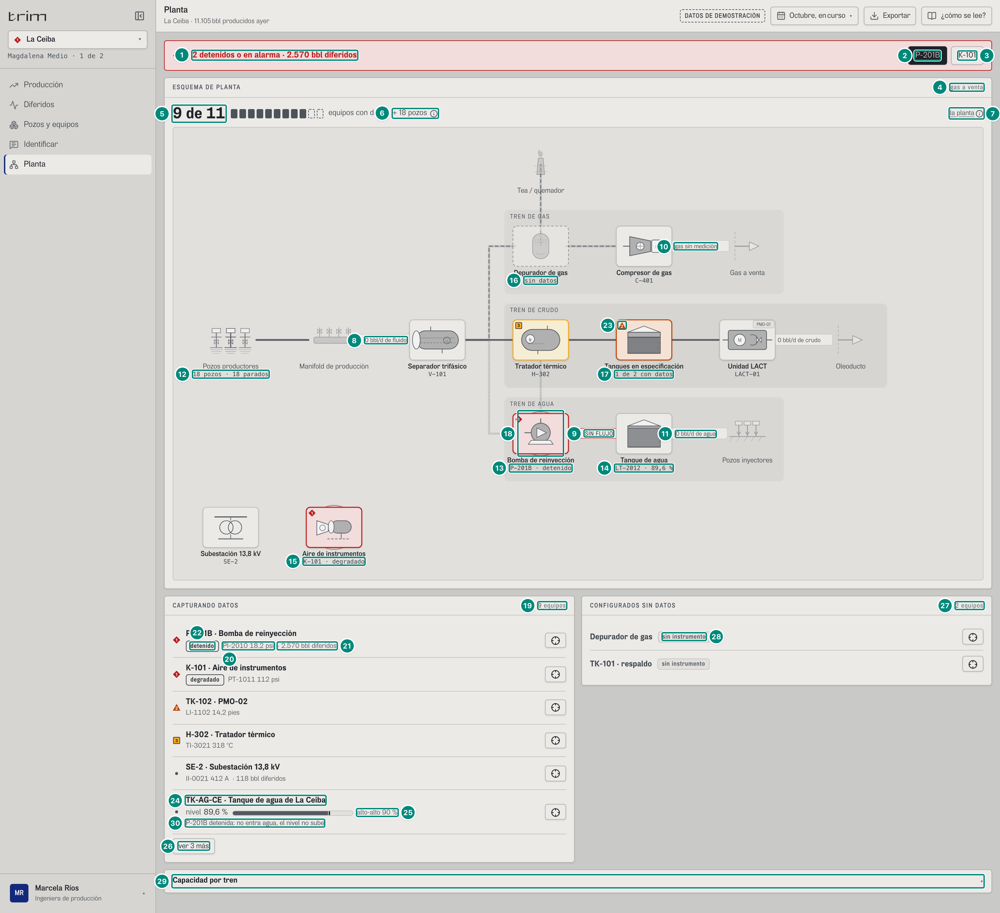
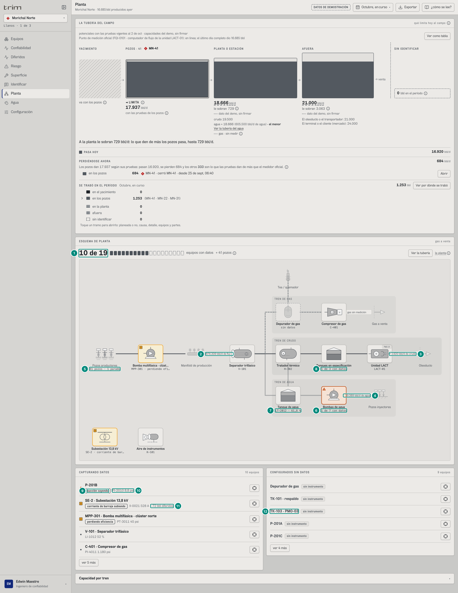
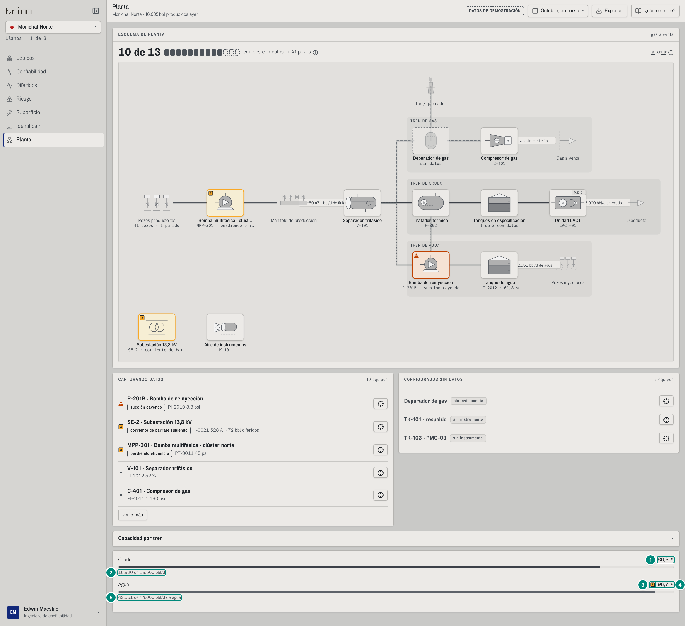
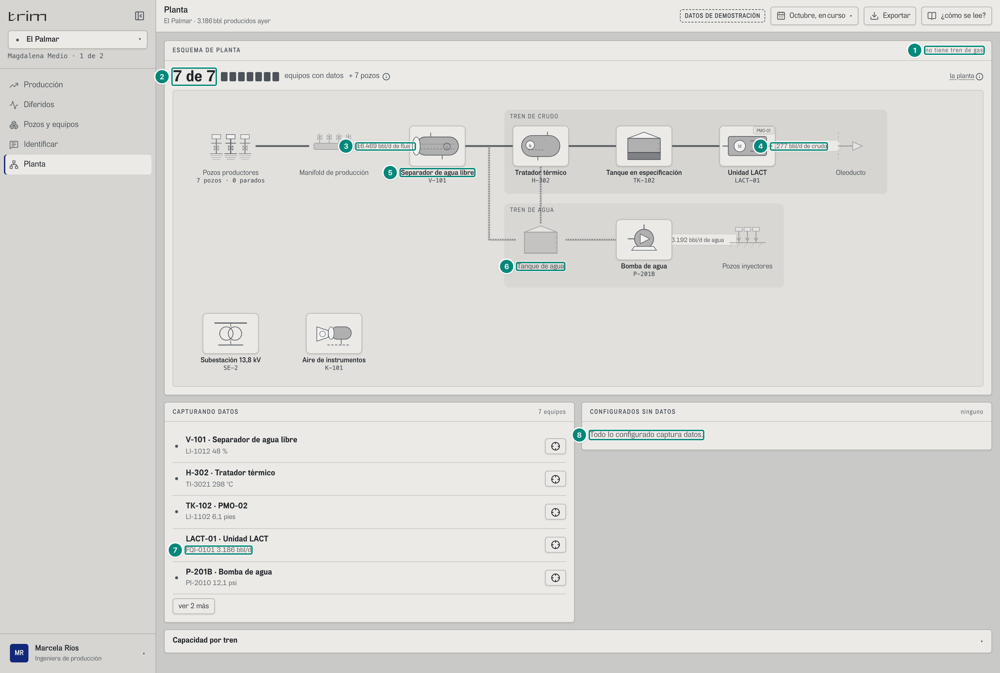
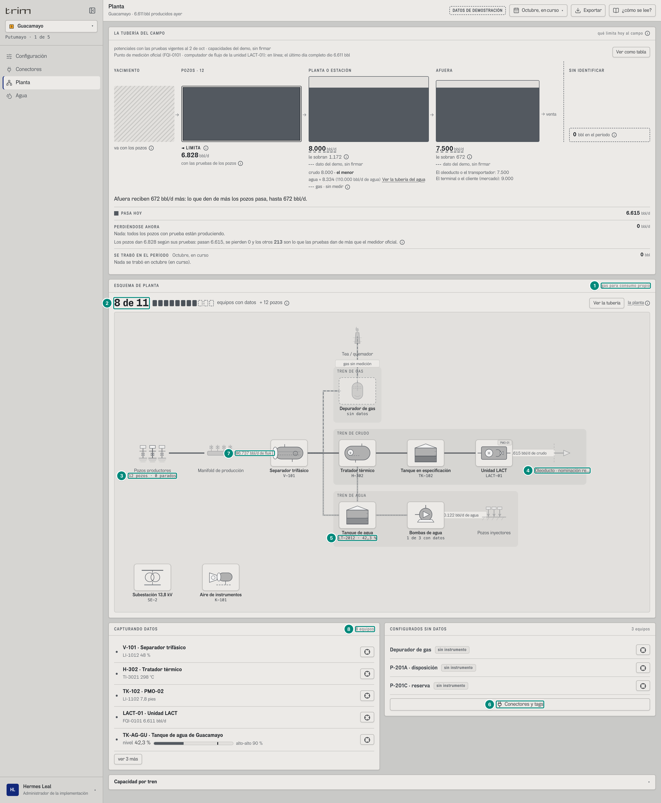
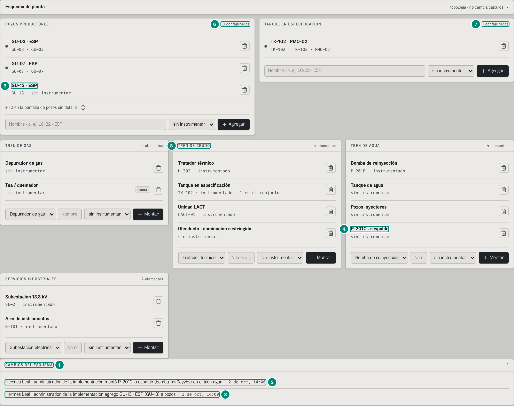
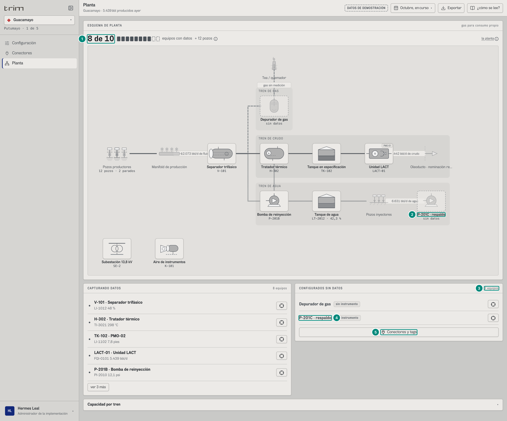

## 6C.7 Planta — producción, confiabilidad, administrador

**Para qué.** «Dónde está el problema. Gris es normal; color, anormal.» (`src/widgets/Onboarding.tsx:26`).
**Ruta.** `#/<rol>/planta/<campo>/<período>` · **Roles y nivel.** `prod`, `conf`, `adm` (ingeniería). **No agrega campos** (en portafolio, `SoloCampo` pide escoger uno).
**Lee.** El esquema del campo con el perfil firmado aplicado (`usePlanta`: `GET /api/catalogo` → `campos[campo].planta` + `GET /api/planta/cambios` + perfil de la configuración vigente); `GET /api/vistas/campos/:campo/ahora` → `{ caudales, niveles }`; `GET /api/vistas/equipos-hoy?campos` → `EquipoEnCampo` de cada equipo (instrumentado, dispositivos, severidad, marcha, estado); `GET /api/vistas/estado?campos` (pozos y parados); `GET /api/vistas/diferidos?campos&desde&hasta` → `porEquipo` (bbl del período); la configuración vigente (tanque de agua de la bomba de reinyección: `tanqueDe`) y los perfiles de bomba del registro (`pedirPerfilesBomba`).
**Escribe.** Nada desde esta pantalla. El administrador cambia el esquema en Configuración → «Esquema de planta» (`POST /api/planta/cambios`), y la planta lo dibuja (captura 6).

Fórmulas y reglas: el modelo del esquema, «captura datos» vs «configurado sin datos», tuberías «sin flujo», perfil sin gas y los cambios del administrador → **5D §7 «Planta»** (todas las cifras de esta pantalla las calcula el front sobre esos datos); los caudales de ahora → 5B §5 (`caudalesAhora`, `diferido.ts:574`); el estado del campo (pozos, parados) → 5B §5.4; el tanque de agua (nivel, alto-alto) → 5B §4.2 «Tanque de agua» y «Nivel del tanque ahora»; con la bomba de reinyección ya detenida, cuánto sube el tanque (`Prediccion.llenado`, `GET /api/vistas/bombas/prediccion` → `llenado`) → 5B §4 y CONTRATO.md «Predicción»; bbl del período por equipo → 5A §8 «Pareto por equipo».

**Regla visual (ISA-101).** Gris es normal; el color aparece solo con condición anormal y siempre con su forma (◆ ▲ ■). La caja llena = captura datos; punteada = configurada sin datos; sin caja = paso de proceso o límite de batería (`salida`, `manifold`, `tea`, `inyeccion`, `pozos`). En marcha y sin nada anormal, el nodo lleva **solo su código**; en marcha con algo, lo que acompaña («degradado», «succión cayendo»); detenido, el estado entero. El fluido se distingue por el trazo: multifásico 3 px, crudo 2,4 px, gas a trazos, agua punteada (`Planta.tsx:25-34`).

### Captura 1 · producción, La Ceiba, ventana de 1.512 px

| # | Lo que se ve | En la captura | Cómo se calcula | Texto según el valor | Viene de |
|---|---|---|---|---|---|
| 1 | Franja de alarma | ◆ «2 detenidos o en alarma · 2.570 bbl diferidos» | capturan con `sev = 1` (P-201B, K-101; el tanque al 89,6 % no llega a su alto-alto 90 % y, con el campo cerrado, no sube: fila 14); bbl = $\sum$ bbl del período de esos equipos (2.570 + 0) (`Planta.tsx:178, 491-512`) | singular «detenido o en alarma»; no aparece si no hay ninguno; en el papel se escriben los códigos y nombres | `equipos-hoy`, `porEquipo` |
| 2 | Botón P-201B | «P-201B» (principal) | el primero en alarma | abre la ficha; un tanque en alto-alto no tiene ficha: «Ubicar … en el dibujo» | — |
| 3 | Botón K-101 | «K-101» | — | — | — |
| 4 | Destino del gas | «gas a venta» | `NOMBRE_GAS[perfil.gas]` del perfil firmado | «gas a venta», «gas para consumo propio», «no tiene tren de gas» | configuración → perfil |
| 5 | **Cobertura** | **9 de 11** + casillas | capturan / (capturan + sin datos) → 5D §7 «Equipos que capturan datos» | casillas: llenas = captura, punteadas = sin datos (gris, no alarma) | `equipos-hoy`, `campos/:c/ahora` |
| 6 | Pozos | «+ 18 pozos» ⓘ | `EstadoCampo.pozos` (cada pozo tiene su controlador; no cuentan en la cobertura) | ⓘ «Además de los 11 equipos: 18 pozos, cada uno con su controlador.» | `GET /api/vistas/estado` |
| 7 | ⓘ «la planta» | (globo) | `cfg.nota` del esquema | «La bomba que mueve el agua no tiene respaldo: si para, el tanque se llena y se cierran los pozos. Es el cuello de botella del campo.» | catálogo |
| 8 | Caudal multifásico | «0 bbl/d de fluido» (y en el tren de crudo «0 bbl/d de crudo») | crudo + agua de los pozos que producen ahora (0: los 18 están cerrados) | `n0` + «bbl/d de fluido» / «de crudo» / «de agua»; gas: «gas sin medición»; se rotula en la tubería más a la derecha de esa corriente **que siga corriendo** | `campos/:c/ahora` → `caudales` |
| 9 | SIN FLUJO | ◆ «SIN FLUJO» | la tubería que **sale** de un equipo detenido (`marcha = 'detenido'`) lleva el aviso con la marca de la severidad de ese equipo, en vez del rótulo de caudal; las que **tocan** un equipo detenido se dibujan quietas (opacidad baja) | globo de la tubería: «{Corriente} · {de} → {a}», «Caudal ahora», «Estado sin flujo \| corriendo», pista «Sin flujo: el equipo de aguas arriba está detenido.» | `equipos-hoy` → `marcha` |
| 10 | Gas | «gas sin medición» | el gas no se mide en esta fase | — | — |
| 11 | Agua | «0 bbl/d de agua» | — | — | `caudales.agua` |
| 12 | Nodo de pozos | «18 pozos · 18 parados» | `EstadoCampo.pozos`, `.parados` | `plural`; clic → pantalla Pozos (si el rol la tiene) | `estado` |
| 13 | Nodo de la bomba | «P-201B · detenido» | detenido: `{id} · {primer tramo del estado}` | ◆ con latido (círculo rojo) | `equipos-hoy` |
| 14 | Tanque de agua | «LT-2012 · 89,6 %», **gris** (sin marca) | nivel del transmisor que declara la configuración firmada; el glifo se llena al 89,6 %. La prioridad (`tanqueSev`, `Planta.tsx:117-130`; ISA-18.2: la da el tiempo hasta la consecuencia, no un porcentaje): en el alto-alto → P1 (hay que cerrar pozos); con la bomba de reinyección **detenida** → la prioridad del llenado que calcula el motor (`Prediccion.llenado.prioridad`, `diferido.ts:263-273`): 1 ya en el alto-alto, 2 si llega en menos de 24 h, 3 hasta 90 días, 0 si no sube o más allá; con la bomba en marcha → gris, por alto que esté. La Ceiba: P-201B detenida y **0 de 18 pozos produciendo** → $Q_{\text{entra}}$ = 0 bbl/d, no sube → prioridad 0, gris | ver fila 30 (el aviso). El nodo del dibujo lleva el mismo color y, para el lector y el globo, el aviso | `campos/:c/ahora` → `niveles`; `GET /api/vistas/bombas/prediccion` → `llenado` |
| 15 | Aire | «K-101 · degradado» ◆ 1; los demás nodos del dibujo, en marcha y normales, solo con su código bajo la etiqueta del esquema: «Separador trifásico» V-101, C-401, «Tratador térmico» H-302 (■ 3), «Unidad LACT» LACT-01 con su punto de medición «PMO-01», «Subestación 13,8 kV» SE-2 | en marcha con algo anormal: `{id} · {lo que sigue a «en marcha»}`; normal: solo `{id}`; el pie se recorta a 24 caracteres con «…» (`Planta.tsx:49-50`); el punto de medición `n.pmo` va en su círculo (`Planta.tsx:394-397`) | ◆ | `equipos-hoy` |
| 16 | Sin datos | «sin datos» (depurador) | configurado sin equipo instrumentado | caja punteada; globo «Datos: configurado, sin datos todavía» · «Qué falta: montar el instrumento y declarar su tag» | esquema |
| 17 | Conjunto parcial | «1 de 2 con datos» (tanques: TK-102 sí, TK-101 no) | miembros que capturan / miembros | — | esquema + `equipos-hoy` |
| 18 | Latido | círculo pulsante | `sev === 1` | solo P1 | — |
| 19 | CAPTURANDO DATOS | «9 equipos»; a la vista: ◆ 1 «P-201B · Bomba de reinyección» (filas 20-22), ◆ 1 «K-101 · Aire de instrumentos» «degradado» «PT-1011 112 psi», ▲ 2 «TK-102 · PMO-02» «LI-1102 14,2 pies», ■ 3 «H-302 · Tratador térmico» «TI-3021 318 °C», «SE-2 · Subestación 13,8 kV» «II-0021 412 A · 118 bbl diferidos», y el tanque de agua (fila 24) | cada fila: «{id} · {etiqueta del esquema}» (`Planta.tsx:443`), chip con lo anormal del estado, la lectura clave (fila 20) y, si difirió en el período, «· {n0} bbl diferidos» | lo anormal primero (sev 1, 2, 3, normal) y luego por bbl del período | — |
| 20 | Lectura clave | «PI-2010 18,2 psi» | el primer dispositivo con número y con lectura (`lecturaClave`, `Planta.tsx:56-59`; uno con `valor: null` o «sin señal» se salta): `{tag} {num(valor)} {unidad}` | `num` respeta los decimales del instrumento (`null` → «—», nunca se pinta como lectura) | `equipos-hoy` → `dispositivos` |
| 21 | bbl diferidos | «· 2.570 bbl diferidos» | bbl del período del equipo (solo si > 0) | — | `porEquipo` |
| 22 | Estado anormal | chip fuerte «detenido» | `estadoCorto`: lo que no es «en marcha» | lo normal no se escribe | `eq.estado` |
| 23 | Marca de TK-102 | ▲ 2 (en el dibujo, el conjunto de tanques) | severidad del equipo | — | `eq.severidad` |
| 24 | Tanque de agua en la lista | «TK-AG-CE · Tanque de agua de La Ceiba» · punto gris | va siempre a la vista (prioridad 1 en la lista corta) si está a menos de 10 puntos del alto-alto **o** si la bomba que lo vacía está detenida (`MARGEN_TANQUE = 10`, `Planta.tsx:47, 179`): estar a la vista no le da color; su marca es la de la fila 14 | barra `BarraMeta` chica «nivel 89,6 %» contra «alto-alto 90 %» y, debajo, el aviso (fila 30) | config + `niveles` |
| 25 | Alto-alto | «alto-alto 90 %» | `tanque.altoAlto × 100` | — | configuración firmada |
| 26 | «ver 3 más» | — | 9 filas, 5 + el tanque a la vista; en el papel todas | — | — |
| 27 | CONFIGURADOS SIN DATOS | «2 equipos» («TK-101 · respaldo» y el depurador) | elementos del esquema sin equipo instrumentado o sin ningún dispositivo con señal (`captura`, `Planta.tsx:54`: instrumentado y con al menos un dispositivo con lectura, `!sinLectura(d)`) | vacío: «ninguno» y «Todo lo configurado captura datos.» | — |
| 28 | Por qué | chip «sin instrumento» | sin equipo asociado; «sin señal» si el equipo existe y ningún dispositivo tiene lectura (`sinLectura`, `src/shared/lib/formato.ts:43-44`: estado «sin señal» **o** `valor: null`, que es como viaja un instrumento sin lectura); el tanque sin lectura: «sin señal · {tagNivel}» | — | — |
| 29 | Capacidad por tren | desplegable | solo nivel `ingenieria`; en el papel sale abierto | ver captura 3 | catálogo `caudales.crudoCap/aguaCap` |
| 30 | Aviso del tanque | «P-201B detenida: no entra agua, el nivel no sube» | solo con la bomba de reinyección detenida y el tanque bajo el alto-alto (`avisoTanque`, `Planta.tsx:131-134`), con el llenado del motor: $Q_{\text{sin salida}} = \max(0,\ Q_{\text{entra}} - Q_{\text{respaldo libre}} - (1-\text{pérdida})\,Q_{\text{mueve}}) \cdot f_{\text{sin bomba}}$ y $h = V_{\text{libre hasta el alto-alto}} / (Q_{\text{sin salida}}/24)$ (`llenadoDe`, `diferido.ts:263-273`), con $Q_{\text{entra}}$ = el agua de los pozos que producen **ahora** (`caudalesAhora`, la de la prueba vigente), no la que movía la bomba. La Ceiba: 0 de 18 pozos produciendo → $Q_{\text{entra}}$ = 0 → $h$ = ∞ (`null` en el cable). Antes de la corrección la pantalla usaba el colchón de la predicción («si parara ahora con todo produciendo», 0,05 h) y habría dicho «llega al alto-alto en menos de 1 h»: falso con el campo cerrado. Con LC-04 y LC-16 produciendo (mundo de prueba de verificar-libro §19) entrarían 3.486 bbl/d y llegaría en 0,28 h: P2 | con horas finitas: «{bomba} detenida: llega al alto-alto en {fmtHoras(h)}» (bajo 1 h, «en menos de 1 h»); sin subir: «… no entra agua, el nivel no sube» ($Q_{\text{entra}}$ = 0) o «… el respaldo toma el agua que entra, el nivel no sube»; no sale en el alto-alto ni con la bomba en marcha. Va bajo la barra, en el globo del nodo («Sube») y en lo que oye el lector del nodo | `GET /api/vistas/bombas/prediccion` → `llenado.aguaEntraBpd`, `.colchon.horas`, `.prioridad` |

**Globo de un nodo** (`Planta.tsx:359-373`): equipo con datos → «Estado», «Criticidad {n}/5», «Aguas abajo», «Lectura», «Con datos {k} de {n}» (conjunto), «Punto de medición {pmo}», «Diferido · {período} {n0} bbl» o «no ha diferido»; pozos → «Pozos {n} con su controlador», «Parados ahora {n}»; tanque de agua → «Nivel», «Alto-alto», «Sube» (el aviso de la fila 30, si lo hay), «Transmisor», «Capacidad {n0} bbl»; proceso → «Tipo», «Datos: no tiene instrumento propio». El nodo clicable es un botón para el lector: «{etiqueta}: {id} · {estado}[ · {prioridad}]. Abre el equipo».

### Captura 2 · confiabilidad, Morichal

Las reglas de cada elemento son las de la captura 1; aquí, los valores de Morichal.

| # | Lo que se ve | En la captura | Cómo se calcula | Texto según el valor | Viene de |
|---|---|---|---|---|---|
| 1 | Cobertura | **10 de 13** | sin datos: depurador, TK-101, TK-103 | — | ver captura 1 |
| 2 | Fluido | «59.471 bbl/d de fluido» | 16.920 + 42.551 | — | `caudales` |
| 3 | Crudo | «16.920 bbl/d de crudo» | potencial 17.604,1 − MN-41 parado 684,1 | — | `caudales.crudo` |
| 4 | Agua | «42.551 bbl/d de agua» | agua de los pozos que producen (prueba vigente × corte) | — | `caudales.agua` |
| 5 | Pozos | «41 pozos · 1 parado» | — | singular | `estado` |
| 6 | Bomba | ▲ 2 «P-201B · succión cayendo»; otros nodos: ■ 3 «MPP-301 · perdiendo efi…» (pie recortado a 24 caracteres), ■ 3 «Subestación 13,8 kV» «SE-2 · corriente de bar…», V-101, C-401, H-302, LACT-01 con «PMO-01», K-101 (solo su código) | en marcha con algo: `{id} · {lo que acompaña}` | — | `equipos-hoy` |
| 7 | Tanque | «LT-2012 · 61,8 %» | — | sin color: lejos del alto-alto y la bomba marcha | `niveles` |
| 8 | Conjunto | «1 de 3 con datos» (TK-102, TK-101, TK-103) | — | — | — |
| 9 | Estado en la lista | chip «succión cayendo» (▲ 2 «P-201B · Bomba de reinyección»); CAPTURANDO DATOS «10 equipos»: además ■ 3 «SE-2 · Subestación 13,8 kV» «corriente de barraje subiendo», ■ 3 «MPP-301 · Bomba multifásica · clúster norte» «perdiendo eficiencia», «V-101 · Separador trifásico», «C-401 · Compresor de gas»; «ver 5 más» | ídem captura 1, fila 19 | — | `equipos-hoy` |
| 10 | Lectura | «PI-2010 8,8 psi»; SE-2 «II-0021 528 A»; MPP-301 «PT-3011 45 psi»; V-101 «LI-1012 52 %»; C-401 «PI-4011 1.180 psi» | `{tag} {num(valor)} {unidad}` del primer dispositivo con número y señal | — | `dispositivos` |
| 11 | SE-2 | «· 72 bbl diferidos» | — | — | `porEquipo` |
| 12 | Sin datos | «TK-103 · PMO-03» «sin instrumento»; CONFIGURADOS SIN DATOS «3 equipos» (con «TK-101 · respaldo» y el depurador) | punto de medición configurado sin instrumento | — | esquema |

### Captura 3 · Capacidad por tren (Morichal)

Lo demás es igual que en la captura 2 y se explica en su tabla (con la capacidad abierta la cobertura dice «10 de 13 equipos con datos + 41 pozos»).

| # | Lo que se ve | En la captura | Cómo se calcula | Texto según el valor | Viene de |
|---|---|---|---|---|---|
| 1 | Uso del tren de crudo | 86,8 % | $\text{uso} = \dfrac{\text{caudal ahora}}{\text{capacidad}} \times 100$ = 16.920 / 19.500 | `n1` + « %»; barra del color de la corriente hasta 100 % | `caudales.crudo`, `.crudoCap` |
| 2 | Detalle | «16.920 de 19.500 bbl/d» | — | — | ídem |
| 3 | Marca ■ | ■ 3 | `FueraDeMeta si={uso > 90}` | por encima de 90 % no queda margen para una parada parcial | — |
| 4 | Uso del tren de agua | ■ **96,7 %** (negrita) | 42.551 / 44.000 | > 90 %: negrita, ■ P3 y pista «Por encima del 90 % no queda margen para una parada parcial» | `caudales.agua`, `.aguaCap` |
| 5 | Detalle | «42.551 de 44.000 bbl/d de agua» | — | globo: «Caudal ahora», «Capacidad», «Uso {n1} %», «Holgura {n0} bbl/d» (1.449) | ídem |

En La Ceiba los dos trenes están en 0,0 % (0 de 12.000 bbl/d de crudo; 0 de 20.400 de agua).

### Captura 4 · producción, El Palmar (perfil sin gas)

| # | Lo que se ve | En la captura | Cómo se calcula | Texto según el valor | Viene de |
|---|---|---|---|---|---|
| 1 | Sin gas | «no tiene tren de gas» | perfil `gas = 'no'` → el tren de gas se vacía antes de dibujar (no se reserva su carril) → 5D §7 «Perfil sin gas» | la Lectura dice «Este campo no tiene tren de gas.» | perfil firmado |
| 2 | Cobertura | **7 de 7** (CAPTURANDO DATOS «7 equipos»; nodo de pozos «7 pozos · 0 parados») | todo captura; pozos y parados de `EstadoCampo` | — | `equipos-hoy`, `estado` |
| 3 | Fluido | «5.826 bbl/d de fluido» | 3.277 + 2.549 | — | `caudales` |
| 4 | Crudo | «3.277 bbl/d de crudo» | nadie parado: = potencial | — | ídem |
| 5 | Separador | «Separador de agua libre» | el esquema de El Palmar (FWKO) | — | catálogo |
| 6 | Tanque de agua | sin pie | El Palmar no tiene tanque de agua en la configuración firmada: el nodo se dibuja como proceso (sin caja ni «sin datos») | — | configuración |
| 7 | LACT | «FQI-0101 3.186 bbl/d»; la lista (todo normal, solo la lectura): «V-101 · Separador de agua libre» «LI-1012 48 %», «H-302 · Tratador térmico» «TI-3021 298 °C», «TK-102 · PMO-02» «LI-1102 6,1 pies», «LACT-01 · Unidad LACT», «P-201B · Bomba de reinyección» «PI-2010 12,1 psi»; «ver 2 más». En el dibujo, solo códigos: V-101, H-302, «Tanque en especificación» TK-102, LACT-01 con «PMO-01», P-201B, «Subestación 13,8 kV» SE-2, K-101 | la serie fiscal: el último día con dato (= «3.186 bbl producidos ayer»); las demás, ídem captura 1 filas 19-20 | — | `dispositivos` |
| 8 | Sin datos | «Todo lo configurado captura datos.» | — | extra «ninguno» | — |

### Captura 5 · administrador, Guacamayo (gas para consumo propio)

| # | Lo que se ve | En la captura | Cómo se calcula | Texto según el valor | Viene de |
|---|---|---|---|---|---|
| 1 | Destino del gas | «gas para consumo propio» | perfil `consumo`: sin salida «Gas a venta» ni compresor | — | perfil |
| 2 | Cobertura | **8 de 9** | sin datos: depurador | — | — |
| 3 | Pozos | «12 pozos · 2 parados» | GU-07 y GU-09 | — | `estado` |
| 4 | Oleoducto | «Oleoducto · nominación re…» | etiqueta recortada a 26 caracteres en el dibujo | el pie de un nodo se recorta a 24 caracteres con «…» | esquema |
| 5 | Tanque | «LT-2012 · 42,3 %» | — | — | `niveles` |
| 6 | Conectores | «Conectores y tags» | solo si el rol tiene la pantalla Conectores y hay algo sin datos (CONFIGURADOS SIN DATOS «1 equipo»: el depurador) | lleva a `#/adm/conectores/…` | — |
| 7 | Caudales | «12.073 bbl/d de fluido» = «5.442 bbl/d de crudo» + «6.631 bbl/d de agua» | crudo = potencial 6.615,65 − GU-07 588,12 − GU-09 585,22 = 5.442,32; agua de los pozos que producen = 6.631 → 5B §5 (`caudalesAhora`) | ídem captura 1, filas 8-11 | `campos/:c/ahora` → `caudales` |
| 8 | CAPTURANDO DATOS | «8 equipos»: «V-101 · Separador trifásico» «LI-1012 48 %», «H-302 · Tratador térmico» «TI-3021 298 °C», «TK-102 · PMO-02» «LI-1102 7,8 pies», «LACT-01 · Unidad LACT» «FQI-0101 5.439 bbl/d», «P-201B · Bomba de reinyección» «PI-2010 12,1 psi»; «ver 3 más». En el dibujo, solo códigos: V-101, H-302, TK-102, LACT-01 con «PMO-01», P-201B, «Subestación 13,8 kV» SE-2, K-101 | todo normal: sin marca ni chip, solo la lectura | ídem captura 1, filas 19-20 | `equipos-hoy` |

### Captura 6 · el administrador cambia el esquema de Guacamayo

Guion [guiones/planta.mjs](../capturas/guiones/planta.mjs) (Playwright, no el generador, porque escribe en cajas de texto; va en `docs/backend/capturas/guiones/` y se corre con `node docs/backend/capturas/guiones/planta.mjs [--salida docs/backend/img] [--puerto 5197]`): en `#/adm/configuracion/guacamayo/curso` → «Esquema de planta» → en «POZOS PRODUCTORES» se agrega «GU-13 · ESP» sin instrumentar; en «TREN DE AGUA» se monta una «Bomba de reinyección» llamada «P-201C · respaldo», sin instrumentar → y se va a Planta por el riel (el cambio vive en la sesión del demo; en producción lo guarda el servidor). La primera captura es solo el bloque «Esquema de planta» (lo de arriba es la Configuración técnica del campo, que se explica en 6A §4).

| # | Lo que se ve | En la captura | Cómo se calcula | Texto según el valor | Viene de |
|---|---|---|---|---|---|
| 1 | Panel | «CAMBIOS DEL ESQUEMA» · extra «2» | `GET /api/planta/cambios` del campo, del más nuevo al más viejo; extra = cuántos (`Esquema.tsx:89`) | el panel no sale si no hay cambios | 5D §7 «Aplicar un cambio» |
| 2 | Cambio | «Hermes Leal · administrador de la implementación montó P-201C · respaldo (bomba-mv0cyybs) en el tren agua · 2 de oct, 14:00» | `{por} {cambio} · {fechaHora}`; el id de un elemento nuevo es `{símbolo}-{Date.now() en base 36}` (lo pone el front; **cambia en cada corrida**, por eso la captura no siempre dice el mismo; el servidor debería asignarlo, 6C.9 punto 18); la hora es `AHORA` (2 de oct, 14:00) porque en el demo el servidor la pone | — | `CambioPlanta` |
| 3 | Cambio | «… agregó GU-13 · ESP (GU-13) a pozos · 2 de oct, 14:00» | el id del miembro sale del nombre (`idLimpio`) | — | ídem |
| 4 | Nuevo elemento | «P-201C · respaldo» · «sin instrumentar» | — | — | `POST /api/planta/cambios` → `planta` |
| 5 | Nuevo miembro | «GU-13 · ESP» · «GU-13 · sin instrumentar» | id del miembro = `idLimpio(nombre)` (primer tramo antes de «·», en mayúsculas); «sin instrumentar» porque no se escogió equipo | renglón de un miembro: «{id} · {equipo}[ · {pmo}]» o «{id} · sin instrumentar» (`Esquema.tsx:131-133`) | ídem |
| 6 | Conjunto «POZOS PRODUCTORES» | extra «13 configurados»; miembros «GU-03 · ESP» («GU-03 · GU-03»), «GU-07 · ESP» («GU-07 · GU-07»), «GU-13 · ESP»; «+ 10 en la pantalla de pozos sin detallar» + ⓘ «En el esquema salen agrupados en un solo nodo.» | extra = miembros (3) + `restantes.cuantos` (10) (`Esquema.tsx:124`); antes del cambio decía «12 configurados» | — | catálogo → `campos.guacamayo.planta` + cambios |
| 7 | Conjunto «TANQUE EN ESPECIFICACIÓN» | extra «1 configurados»; «TK-102 · PMO-02» («TK-102 · TK-102 · PMO-02») | ídem (sin restantes); el plural es fijo («1 configurados») | — | ídem |
| 8 | Trenes | «TREN DE GAS · 2 elementos» (Depurador de gas y Tea / quemador «rama», sin instrumentar); «TREN DE CRUDO · 4 elementos» («Tratador térmico» «H-302 · instrumentado», «Tanque en especificación» «TK-102 · instrumentado · 1 en el conjunto», «Unidad LACT» «LACT-01 · instrumentado», «Oleoducto · nominación restringida» sin instrumentar); «TREN DE AGUA · 4 elementos» (Bomba de reinyección «P-201B · instrumentado», Tanque de agua, Pozos inyectores, y el nuevo P-201C); «SERVICIOS INDUSTRIALES · 2 elementos» («Subestación 13,8 kV» «SE-2 · instrumentado», «Aire de instrumentos» «K-101 · instrumentado») | extra = `cfg[tren].length`; renglón «{equipo} · instrumentado[ · {n} en el conjunto]» o «sin instrumentar» (`Esquema.tsx:65-72`); sin gas en el perfil, el tren de gas no se ofrece | el plural «elementos» es fijo | ídem |

| # | Lo que se ve | En la captura | Cómo se calcula | Texto según el valor | Viene de |
|---|---|---|---|---|---|
| 1 | Cobertura | **8 de 10** | el elemento nuevo cuenta como configurado sin datos | — | esquema + `equipos-hoy` |
| 2 | Nodo nuevo | «P-201C · respaldo» · «sin datos» (caja punteada) | `armar()` lo pone al final del tren de agua, conectado a lo anterior | — | `planta` |
| 3 | Sin datos | «2 equipos» | — | — | — |
| 4 | Fila nueva | «P-201C · respaldo» · chip «sin instrumento» | — | — | — |
| 5 | Conectores | «Conectores y tags» | — | — | — |

El pozo agregado al conjunto **no** cambia «+ 12 pozos» ni «12 pozos · 2 parados»: esas cifras salen del estado del campo (los controladores que mandan datos), no del esquema dibujado.

**Variantes.** Teléfono (< 640 px): primero la cobertura y las listas; el dibujo va a un clic («Ver el esquema») y el destino del gas se escribe junto a la cobertura. Período: solo cambian los «bbl diferidos» de las filas, los globos («Diferido · {período}») y la franja de alarma. Campo sin esquema registrado: «PLANTA · {CAMPO}» con el hueco «{campo} no tiene esquema de planta registrado.» (nunca la planta de otro campo).

**Interacciones.** Nodo de equipo → ficha; nodo de pozos → Pozos; ⌖ (mira) en cada fila → resalta el nodo en el dibujo 3,2 s y lo trae a la vista; «Conectores y tags»; «Capacidad por tren» (desplegable).

**Lectura («¿cómo se lee?»)** (`Planta.tsx:268-275`): «Gris es normal; el color aparece solo donde hay condición anormal, siempre con su forma. Lo que captura datos va lleno; lo configurado que todavía no da datos va punteado: es lo que falta por instrumentar. Un equipo en marcha y sin nada anormal lleva solo su código; toque o pase el cursor por un equipo o una tubería para ver su estado y su caudal. Los caudales son los de ahora. {Este campo no tiene tren de gas. | El gas no se mide en esta fase.}» + la leyenda (captura datos, configurado sin datos, sin caja, forma y color, solo el código, y un trazo por corriente). CAPTURANDO DATOS: «Lo que se está midiendo ahora, lo anormal primero. Un clic abre el equipo; la mira (⌖) lo marca en el dibujo. Lo normal no se escribe: solo la lectura.» CONFIGURADOS SIN DATOS: «Están en el registro del campo, pero todavía no dan datos: es lo que falta por instrumentar. «Sin señal»: su instrumento está declarado y no da señal. «Sin instrumento»: falta montarlo y declarar su tag.»
