## 6C.8 El marco común de la aplicación — todos los roles

Lo que rodea a cada pantalla: la **cabecera** (título, campo y lo producido ayer, sello de demostración, período, Exportar, «¿cómo se lee?»), el **riel** (selector de campo o portafolio con su marca de prioridad, las pantallas del rol, el menú de la persona), la **introducción** de cada rol, las **subpantallas** de «Pozos y equipos», el **papel** (membrete, pie, folio y huella) y los **límites de error**. Código: `src/App.tsx`, `src/widgets/Cabecera.tsx`, `Riel.tsx`, `MenuPerfil.tsx`, `Onboarding.tsx`, `Subpantallas.tsx`, `src/widgets/informe/{Exportar,Membrete,periodo}.tsx`, `src/shared/ui/Lectura.tsx`, `comoSeLee.ts`, `src/pages/SoloCampo.tsx`, `src/shared/ui/LimiteDeError.tsx`.

**Lee.** `GET /api/vistas/estado?campos` (lo producido ayer y la severidad de cada campo, para la cabecera y el riel); de arranque: `GET /api/campos` (nombre y cuenca), `GET /api/usuarios` (persona de cada rol y sus campos), `GET /api/configuracion/historial` (empresa del membrete, versión vigente, perfiles), `GET /api/informes` (último folio). **Escribe.** `POST /api/informes` (Exportar). Fórmulas: estado del campo → 5B §5.4; períodos → 5D §1 «Períodos de la cabecera» y 5A §5; informes, folio, huella, CSV → 5D §4; roles, pantallas, capacidades → 5D §3.

### Estructura (`App.tsx`)

| Pieza | Regla |
|---|---|
| Riel | desde 1.024 px, fijo a la izquierda (236 px; «Contraer la navegación» lo deja en 60 px con íconos y la marca del campo); debajo, un cajón que abre ☰ «Abrir la navegación» y se cierra al navegar o con «Cerrar la navegación» (captura 10). Solo uno de los dos se monta (`App.tsx:19-24`) |
| Vista | la pantalla de la dirección; si el alcance es portafolio y la pantalla **no suma campos** (`agrega` falso: Mi trabajo, Planta, Configuración, Conectores, Perfil), se muestra `SoloCampo`: panel «{título} · elija un campo» con un botón por campo: marca de severidad, nombre, «{cuenca} · {n0} bbl último día \| sin fiscal · {n} pozo(s) parado(s)» |
| Sin perfil | una subpantalla de «Pozos y equipos» que el campo no tiene en su perfil firmado no se pinta vacía: «Este campo no tiene en su perfil ninguno de los equipos de esta pantalla. El perfil lo firma el administrador en Configuración técnica.» o «{campos}: sin perfil firmado en la configuración, no se sabe qué equipos tiene(n).» |
| Límites de error | navegación, cabecera, vista y ficha del equipo fallan por separado. Textos: «{Esta pantalla \| La navegación \| La cabecera \| La ficha del equipo} no se pudo cargar.» (código que no llegó: «Revise la señal y toque «Reintentar»…»); «… no pudo traer sus datos.» + «No hubo respuesta del servidor. Revise la señal y toque «Reintentar».» (estado 0) o **«El servidor respondió con un error: {message}.»** (un 4xx/5xx o una respuesta que no cumple el contrato) + «Lo que ya respondió en esta sesión sigue guardado.»; «… no se pudo mostrar.» (error de dibujo). Salidas: «Reintentar», «Volver al inicio» (pantalla de inicio del rol), «Cerrar la ficha» |
| Papel | `Membrete` arriba y `PieInforme` abajo, solo al imprimir (captura 11) |

**Cómo leer las capturas del marco.** En todas, la cabecera y el riel se explican en las capturas 1 (cabecera y riel) y 4 (selector de campo); debajo de cada menú o diálogo queda una pantalla de fondo, que **no** se vuelve a explicar aquí: cada captura dice cuál es y dónde están sus cifras.

### Captura 1 · cabecera y riel (jefe, portafolio)

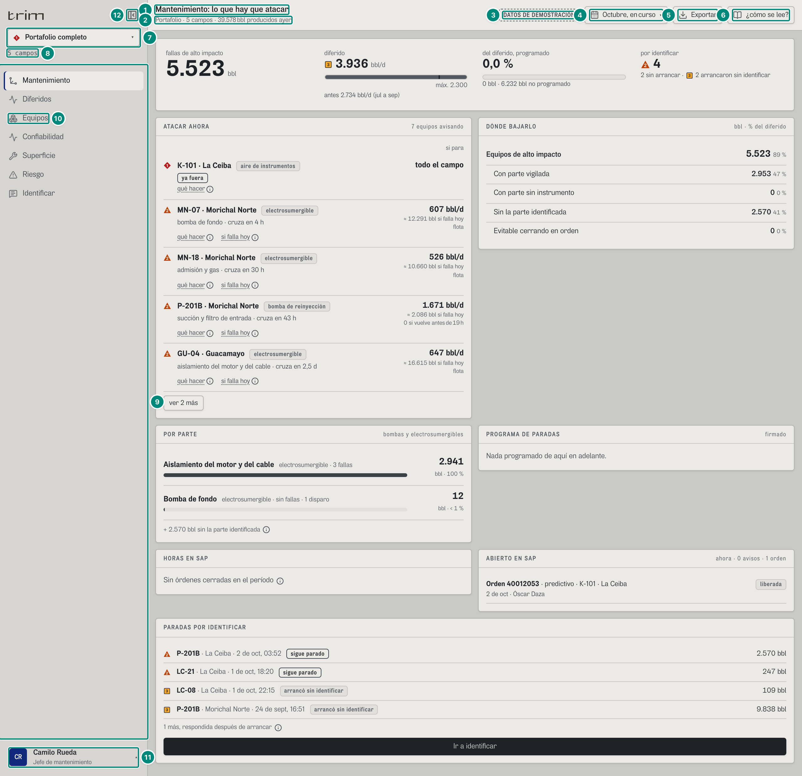

Fondo: Mantenimiento del jefe en el portafolio, explicada en 6C.3, captura 2 (`jefe-mantenimiento-portafolio`).

| # | Lo que se ve | En la captura | Cómo se calcula | Texto según el valor | Viene de |
|---|---|---|---|---|---|
| 1 | Título | «Mantenimiento: lo que hay que atacar» | `PANTALLAS[pantalla].titulo` (`src/app/pantallas.tsx:46-65`) | fijo por pantalla | — |
| 2 | Subtítulo | «Portafolio · 5 campos · 39.578 bbl producidos ayer» | $\sum_{\text{campos}} \text{EstadoCampo.ayer.bbl}$ = 11.105 + 16.685 + 5.439 + 3.186 + 3.163; el «ayer» es el último día completo del punto de medición oficial (`fiscalDeAyer`, 5B §5.4) | campo: «{nombre} · {n0} bbl producidos ayer»; portafolio: «Portafolio · {n} campos · …»; **si algún campo no tiene el fiscal de ayer: «ayer sin fiscal»** (hueco, nunca una suma parcial) | `GET /api/vistas/estado` → `ayer.bbl` |
| 3 | Sello | «DATOS DE DEMOSTRACIÓN» | `FUENTE = 'demo'`; un botón que abre la nota (captura 3) | en el producto no aparece; en el teléfono se reduce a «Demo» en el subtítulo | `src/shared/api/fuente.ts` |
| 4 | Período | «Octubre, en curso» | `textoPeriodo` (`Cabecera.tsx:25-34`): en curso → el nombre del calendario («Octubre, en curso»); otro → el nombre de `PERIODOS`; rango → sus fechas («1 de sept a 10 de sept», un solo día: una fecha); si es parcial y no dice «en curso», se agrega «, en curso» con espacio duro | en el teléfono solo el ícono (el período va al subtítulo) | `src/entities/campos.ts:69-75` |
| 5 | Exportar | botón | solo con `evidencia:exportar` (gerente, producción, supervisor, jefe, confiabilidad, administrador; **no** operador ni técnico) | captura 8 | `rol.puede` |
| 6 | ¿cómo se lee? | botón | alterna `comoSeLee` (`aria-pressed`) | captura 9 | estado de la aplicación |
| 7 | Selector de campo | ◆ 1 «Portafolio completo» ▾ (en un campo, su marca: ◆ 1 La Ceiba) | marca = severidad del campo mirado; en portafolio la **peor** de todos (`peorSeveridad`: 1 > 2 > 3 > normal) (`Riel.tsx:58-62`) | se abre solo si el rol tiene más de un campo; texto: «Portafolio completo» o el nombre del campo | `EstadoCampo.severidad` |
| 8 | Bajo el selector | «5 campos» | portafolio: «{n} campos»; varios: «{cuenca} · 1 de {n}»; uno: «{cuenca}» | — | `GET /api/campos`, `usuarios[].campos` |
| 9 | Pantallas del rol | Mantenimiento, Diferidos, Equipos, Confiabilidad, Superficie, Riesgo, Identificar | `rol.pantallas` visibles (sin las de v2: agua, evidencia, regulatorio); bombas, electrosumergibles y pozos van en **una** entrada «Pozos y equipos» (o «Equipos» si el rol no tiene Pozos) que lleva a la última subpantalla que el rol abrió y que este campo tenga; si el campo no tiene ninguna, la entrada no sale | la activa con raya azul (`aria-current`) | `src/entities/roles.ts`, `src/app/grupos.ts` |
| 10 | Entrada de grupo | «Equipos» | `nombreGrupo` (`pantallas.tsx:78-79`) | — | — |
| 11 | Persona | «CR · Camilo Rueda · Jefe de mantenimiento» | la persona del registro con ese rol (`personaDelRol`) | + « · sin acceso activo» si no hay nadie activo con el rol | `GET /api/usuarios` |
| 12 | Contraer | botón | — | — | — |

**Severidad del campo** (`EstadoCampo.severidad`, 5B §5.4): 1 si algo de alto impacto lo está frenando ahora, 2 si otra causa, 3 si hay algo en riesgo, 0 si nada. Demo: La Ceiba 1, Morichal 1, Guacamayo 1, El Palmar 0, La Zarza 0.

### Captura 2 · el período

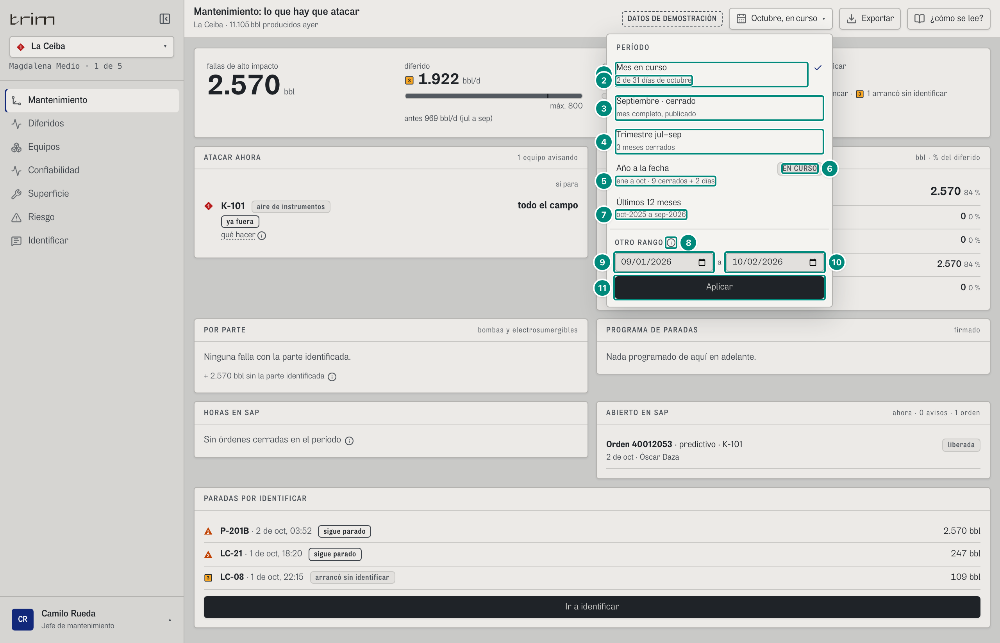

Fondo: Mantenimiento del jefe en La Ceiba, explicada en 6C.3, captura 1 (`jefe-mantenimiento-ceiba`).

| # | Lo que se ve | En la captura | Cómo se calcula | Texto según el valor | Viene de |
|---|---|---|---|---|---|
| 1 | Mes en curso | «Mes en curso» ✓ | `curso` = [1-oct 00:00, AHORA) | ✓ en el período activo (si no hay rango a mano) | `PERIODOS` |
| 2 | Detalle | «2 de 31 días de octubre» | `{día} de {días del mes} días de {mes}` → 5D §1 | — | `CAL.mesEnCurso` |
| 3 | Cerrado | «Septiembre · cerrado» · «mes completo, publicado» | [1-sep, 1-oct) | rótulo fijo, aunque el mes no estuviera publicado en todos los campos (el estado real lo da el sello del libro, 5A §7) | ídem |
| 4 | Trimestre | «Trimestre jul–sep» · «3 meses cerrados» | [1-jul, 1-oct) | — | ídem |
| 5 | Año a la fecha | «ene a oct · 9 cerrados + 2 días» | [1-ene, AHORA) | — | ídem |
| 6 | Marca de parcial | chip «EN CURSO» | `parcial` y el nombre no dice «en curso» | — | ídem |
| 7 | Doce meses | «Últimos 12 meses» (rótulo fijo) · «oct-2025 a sep-2026» | [1-oct-2025, 1-oct-2026) | — | ídem |
| 8 | ⓘ «Rango a la medida» | (globo) | — | «Si el rango llega hasta hoy, el período queda en curso y las cifras son parciales. El volumen se acumula; la tasa en BPDC no.» | — |
| 9 | Desde | 09/01/2026 | valor inicial 2026-09-01; mínimo `PRIMER_DIA` (2025-10-01), máximo «hasta» | — | `src/app/url.ts:22` |
| 10 | Hasta | 10/02/2026 | inicial = hoy (`diaIso(AHORA)`); máximo `ULTIMO_DIA` | — | ídem |
| 11 | Aplicar | botón | `setRango`: se endereza si viene al revés y se recorta a los días con datos; «hasta» es inclusivo (se suma un día, sin pasar de AHORA) | fuera de los datos: «Escoja dos fechas entre el 2025-10-01 y el 2026-10-02: fuera de esos días no hay datos.» (en `role="alert"`, el menú no se cierra); con un rango activo, abajo «Activo: {n} día(s) · {d} a {h}» | `src/app/store.ts:225` |

El período viaja en la dirección: `curso`, `cerrado`, `trimestre`, `ytd`, `doce` o `AAAA-MM-DD_AAAA-MM-DD`. El servidor recibe solo `desde` y `hasta` (ISO con zona, `hasta` exclusivo) en cada vista: **lo único que el servidor aporta al calendario es AHORA** (5D §1).

### Captura 3 · el sello de demostración

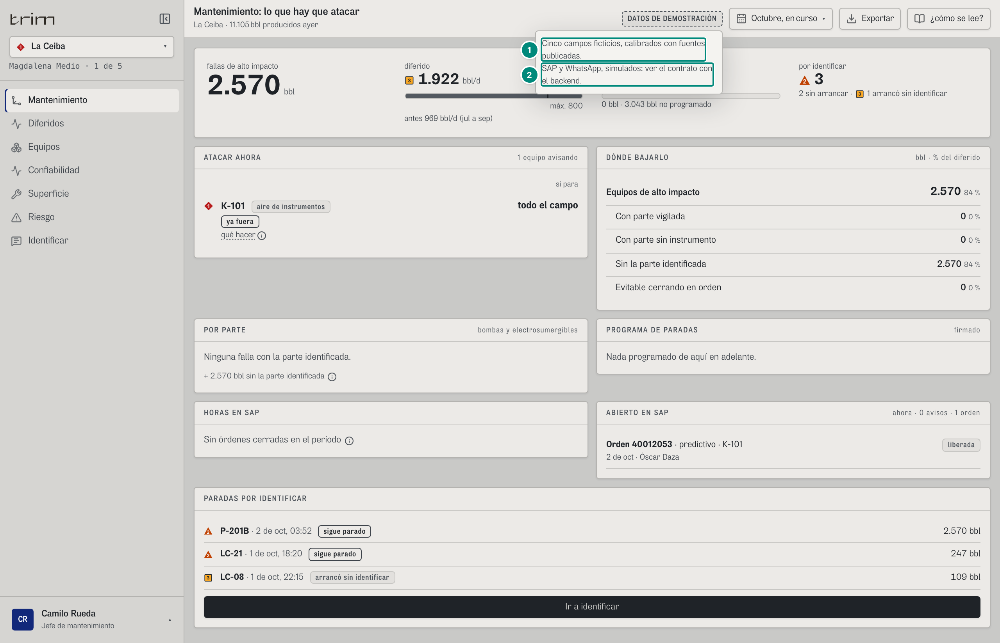

Fondo: Mantenimiento del jefe en La Ceiba (6C.3, captura 1).

| # | Lo que se ve | En la captura | Cómo se calcula | Texto según el valor | Viene de |
|---|---|---|---|---|---|
| 1 | Nota | «Cinco campos ficticios, calibrados con fuentes publicadas.» | fija | — | `Cabecera.tsx:88` |
| 2 | Nota | «SAP y WhatsApp, simulados: ver el contrato con el backend.» | fija | — | `Cabecera.tsx:89` |

En el papel del demo el sello sale en el membrete y arriba de **cada** hoja (`@page @top-center`, `Membrete.tsx:21-28`). Con `VITE_FUENTE=http` (el producto) no aparece en ningún lado.

### Captura 4 · el selector de campo

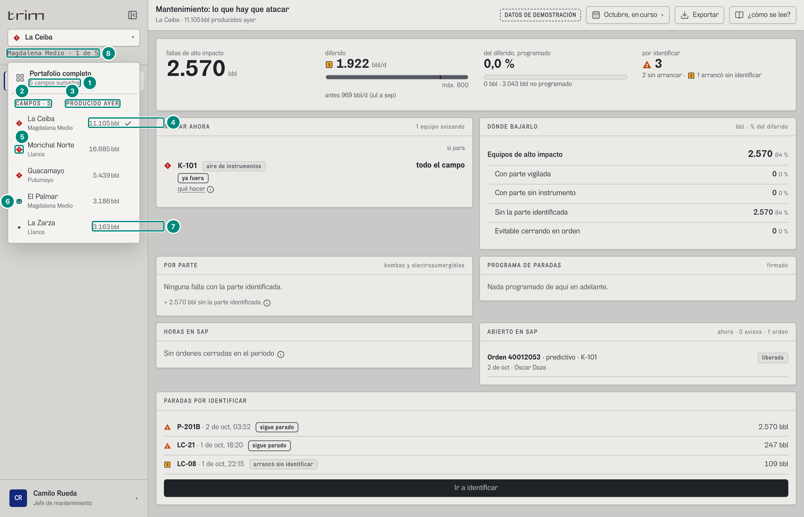

Fondo: Mantenimiento del jefe en La Ceiba (6C.3, captura 1).

| # | Lo que se ve | En la captura | Cómo se calcula | Texto según el valor | Viene de |
|---|---|---|---|---|---|
| 1 | Portafolio | «Portafolio completo» · «5 campos sumados» | se ofrece solo si el rol tiene más de un campo **y** alguna pantalla que suma (`portafolioPermitido`, `store.ts:153-155`) | ✓ si está activo | `usuarios[].campos` |
| 2 | Encabezado | «CAMPOS · 5» | campos asignados a la persona del rol (los da el gerente en Accesos), no los de fábrica | — | `GET /api/usuarios` |
| 3 | Columna | «PRODUCIDO AYER» | — | — | — |
| 4 | Lo producido ayer | «11.105 bbl» ✓ (La Ceiba; Morichal Norte «16.685 bbl», Guacamayo «5.439 bbl», El Palmar «3.186 bbl», La Zarza fila 7); en la cabecera, «La Ceiba · 11.105 bbl producidos ayer» | `EstadoCampo.ayer.bbl` | `n0` + « bbl»; `null` → «sin fiscal»; ✓ en el campo activo | `GET /api/vistas/estado` |
| 5 | Marca de Morichal | ◆ 1 | `EstadoCampo.severidad` | ◆ ▲ ■ o punto gris | ídem |
| 6 | Marca de El Palmar | punto gris | severidad 0 | — | ídem |
| 7 | La Zarza | «3.163 bbl» | — | — | ídem |
| 8 | Bajo el selector | «Magdalena Medio · 1 de 5» | campo: «{cuenca} · 1 de {n}» | — | `GET /api/campos` |

### Captura 5 · el menú de la persona y el cambio de rol (solo demo)

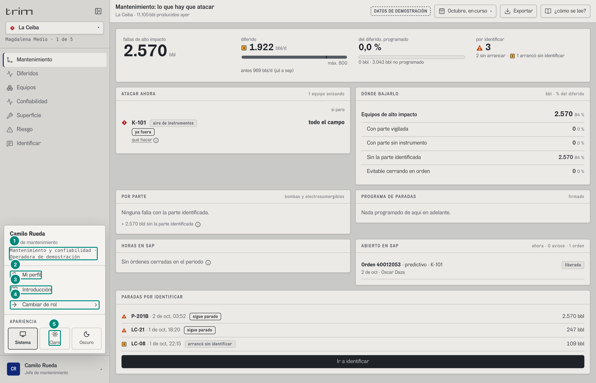

Fondo: Mantenimiento del jefe en La Ceiba (6C.3, captura 1).

| # | Lo que se ve | En la captura | Cómo se calcula | Texto según el valor | Viene de |
|---|---|---|---|---|---|
| 1 | Área y empresa | «Mantenimiento y confiabilidad · Operadora de demostración» | `AREAS[rol.area].nombre` · `config.empresa` (la del membrete) | — | configuración vigente |
| 2 | Mi perfil | botón | lleva a `#/<rol>/perfil/…` (pantalla común a todos) | — | — |
| 3 | Introducción | botón | vuelve a abrir la introducción del rol | captura 6 | — |
| 4 | Cambiar de rol | botón | abre la lista (captura siguiente) | — | — |
| 5 | Apariencia | Sistema · Claro · Oscuro | `localStorage['trim.tema']` (preferencia del navegador, no del servidor) | — | — |

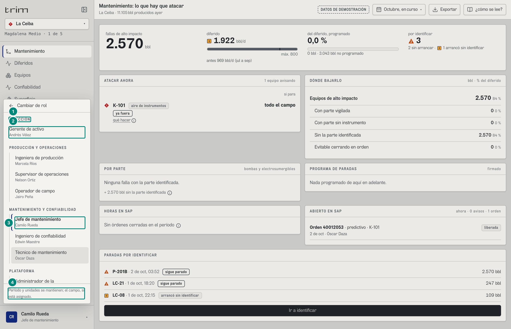

Fondo: Mantenimiento del jefe en La Ceiba (6C.3, captura 1).

| # | Lo que se ve | En la captura | Cómo se calcula | Texto según el valor | Viene de |
|---|---|---|---|---|---|
| 1 | Área | «Dirección» (y Producción y operaciones, Mantenimiento y confiabilidad, Plataforma) | organigrama: áreas con roles visibles | mayúsculas por estilo | `AREAS`, `ROLES_VISIBLES` |
| 2 | Rol y persona | «Gerente de activo · Andrés Vélez» | `personaDelRol(usuarios, rol)` | sin persona: «nadie asignado» | `GET /api/usuarios` |
| 3 | Rol actual | «Jefe de mantenimiento · Camilo Rueda» con raya | — | — | — |
| 4 | Nota | «Período y unidades se mantienen; el campo, si está asignado.» | al cambiar de rol se conserva el período; el campo solo si la nueva persona lo tiene | — | — |

**Cambiar de rol es del demo, no del producto**: en producción la persona, su rol, su nivel, sus campos y sus capacidades salen del token de sesión (`GET /api/sesion`, que falta: 7 §7.5). No hay «Cerrar sesión» todavía (vuelve cuando exista la sesión del servidor, `MenuPerfil.tsx:99-100`).

### Captura 6 · la introducción de cada rol (dos pasos)

Aparece la primera vez que se entra con un rol (marca `localStorage['trim.intro.<rol>']`) o desde «Introducción» en el menú. Es un diálogo modal: Escape o el fondo la cierran, y al cerrar se marca como vista.

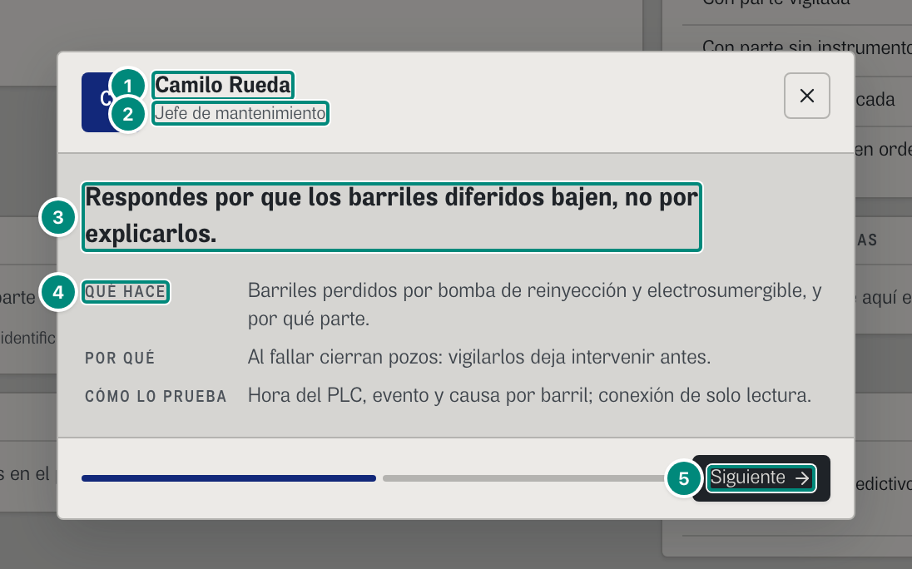

| # | Lo que se ve | En la captura | Cómo se calcula | Texto según el valor | Viene de |
|---|---|---|---|---|---|
| 1 | Persona | «Camilo Rueda» (con sus iniciales «CR») | la persona del registro con ese rol (si el gerente le pasó el rol a otra, saluda a la nueva) | — | `GET /api/usuarios` |
| 2 | Rol | «Jefe de mantenimiento» | `rol.nombre` | — | `roles.ts` |
| 3 | Lo que decide | «Respondes por que los barriles diferidos bajen, no por explicarlos.» | `rol.foco` | uno por rol (tabla de abajo) | `roles.ts:38-104` |
| 4 | Promesa | «QUÉ HACE · Barriles perdidos por bomba de reinyección y electrosumergible, y por qué parte.» · «POR QUÉ · Al fallar cierran pozos: vigilarlos deja intervenir antes.» · «CÓMO LO PRUEBA · Hora del PLC, evento y causa por barril; conexión de solo lectura.» | fija para todos (`PROMESA`, `Onboarding.tsx:42-46`) | — | — |
| 5 | Siguiente | botón | paso 1 de 2 (dos rayas abajo) | — | — |

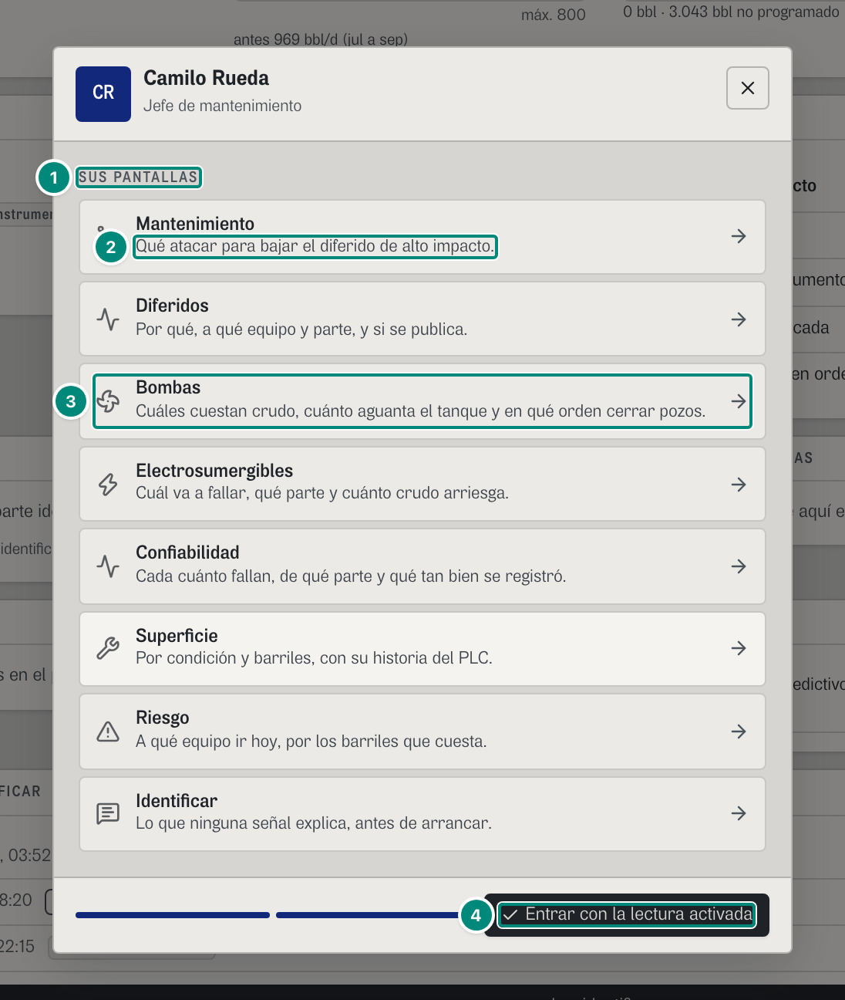

| # | Lo que se ve | En la captura | Cómo se calcula | Texto según el valor | Viene de |
|---|---|---|---|---|---|
| 1 | Título | «SUS PANTALLAS» | — | — | — |
| 2 | Para qué | «Mantenimiento · Qué atacar para bajar el diferido de alto impacto.» | `PARA_QUE[pantalla]` (en nivel `decision`, `PARA_QUE_DECISION` si existe) | tabla de abajo | `Onboarding.tsx:12-39` |
| 3 | Una pantalla | «Bombas» | aquí van las pantallas una por una (no el grupo «Equipos» del riel) | cada una lleva a su pantalla y cierra | `rol.pantallas` |
| 4 | Entrar | «Entrar con la lectura activada» | cierra y enciende «¿cómo se lee?» | — | — |

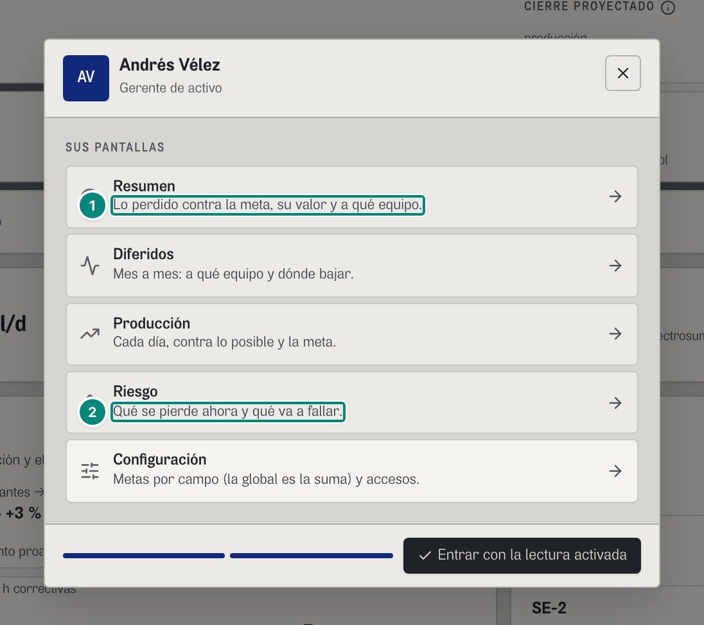

| # | Lo que se ve | En la captura | Cómo se calcula | Texto según el valor | Viene de |
|---|---|---|---|---|---|
| 1 | Resumen (decisión) | «Lo perdido contra la meta, su valor y a qué equipo.» | `PARA_QUE_DECISION.resumen` | — | — |
| 2 | Riesgo (decisión) | «Qué se pierde ahora y qué va a fallar.» | `PARA_QUE_DECISION.riesgo` | — | — |

Sus pantallas son Resumen, Diferidos, Producción, Riesgo y Configuración (`roles.ts`): el gerente **no** tiene Bombas ni Electrosumergibles (decisión del dueño, 8-oct). Su variante de esas dos pantallas, que no tenía ruta, se quitó del código (`PlacaDirectiva`, las ramas `nivel === 'decision'` de `Bombas.tsx` y `Esp.tsx`, y `PARA_QUE_DECISION.bombas/esp`); `#/ger/bombas/…` y `#/ger/esp/…` caen en su Resumen. Lo que le interesa de los equipos (de qué campo viene el diferido y qué equipos de ese campo fallan) está en «POR CAMPO» del Resumen, que se despliega por campo (6A).

Textos completos (literales del código):

| Pantalla | `PARA_QUE` (todos) | `PARA_QUE_DECISION` (gerente) |
|---|---|---|
| bombas | Cuáles cuestan crudo, cuánto aguanta el tanque y en qué orden cerrar pozos. | — (el gerente no tiene Bombas) |
| esp | Cuál va a fallar, qué parte y cuánto crudo arriesga. | — (el gerente no tiene Electrosumergibles) |
| trabajo | Qué está parado o avisa, y qué revisar. | — |
| mantenimiento | Qué atacar para bajar el diferido de alto impacto. | — |
| confiabilidad | Cada cuánto fallan, de qué parte y qué tan bien se registró. | — |
| equipo | Por condición y barriles, con su historia del PLC. | — |
| produccion | Lo medido cada día contra el potencial y la meta. | Cada día, contra lo posible y la meta. |
| pozos | Caudal de cada pozo, su origen y qué lo para. | — |
| turno | Lo que recibe y lo que entrega. | — |
| resumen | Diferido total y de alto impacto, contra la meta. | Lo perdido contra la meta, su valor y a qué equipo. |
| diferidos | Por qué, a qué equipo y parte, y si se publica. | Mes a mes: a qué equipo y dónde bajar. |
| riesgo | A qué equipo ir hoy, por los barriles que cuesta. | Qué se pierde ahora y qué va a fallar. |
| causa | Lo que ninguna señal explica, antes de arrancar. | — |
| planta | Dónde está el problema. Gris es normal; color, anormal. | — |
| configuracion | Lo único que se escribe a mano, con firma. | Metas por campo (la global es la suma) y accesos. |
| conectores | Bordes conectados y tags sin equipo resuelto. | — |
| perfil | Avisos, apariencia y permisos. | — |

| Rol | `foco` (paso 1) |
|---|---|
| Gerente de activo (`ger`, decisión) | Barriles que no se produjeron, cuánto es de los equipos de alto impacto, y si baja contra la meta que usted firmó. Usted fija las metas de cada campo y da los accesos. |
| Ingeniera de producción (`prod`) | Explicas el mes en barriles: el factor de asignación en banda, la custodia completa y nada sin identificar. |
| Supervisor de operaciones (`sup`, operación) | Entras por las bombas: lo gris está normal, el color es el problema. Si una para, cierras en el orden que menos cuesta. |
| Operador de campo (`oper`, operación) | Cómo están las bombas, a qué equipo vas, y qué se dañó cuando la señal no lo dice. |
| Jefe de mantenimiento (`jefe`) | Respondes por que los barriles diferidos bajen, no por explicarlos. |
| Ingeniero de confiabilidad (`conf`) | Respondes por la reparación activa, no por la espera del repuesto. |
| Técnico de mantenimiento (`tec`, operación) | Abres el equipo y dices qué encontraste cuando la señal no lo dice. De ahí aprende el vigía. |
| Administrador de la implementación (`adm`) | Configuras conectores, umbrales, tanques, respaldos y el programa de paradas. Las metas y los accesos los da el gerente de activo. |

(Para capturarla no se usa el generador, que siempre la salta: el guion [guiones/marco.mjs](../capturas/guiones/marco.mjs) entra sin la marca `trim.intro.<rol>`; se corre con `node docs/backend/capturas/guiones/marco.mjs [--salida docs/backend/img] [--puerto 5198]`.)

### Captura 7 · subpantallas de «Pozos y equipos»

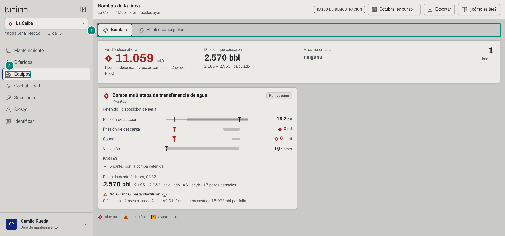

Fondo: Bombas del jefe de mantenimiento (nivel ingeniería) en La Ceiba. La cabecera de la estación («Perdiéndose ahora 11.059 bbl/d · 1 bomba detenida · 17 pozos cerrados · 2 de oct, 14:00», «Diferido que causaron 2.570 bbl · 2.185 – 2.956 · calculado») se explica en 6B «La estación», captura `sup-bombas-ceiba`; la placa de P-201B en ingeniería («Presión de succión 18,2 psi», «Presión de descarga 0 psi», «Caudal 0 bbl/d», «Vibración 0,0 mm/s», «5 partes con la bomba detenida», «Detenida desde 2 de oct, 03:52», «2.570 bbl · 2.185 – 2.956 · calculado · 461 bbl/h · 17 pozos cerrados», «No arrancar hasta identificar» ⓘ, «9 fallas en 12 meses · cada 41 d · 40,0 h fuera · le ha costado 18.075 bbl por falla»: las horas fuera con `fmtHoras(mdtH, true)` y lo que ya costó cada falla rotulado «le ha costado … por falla», antes «18.075 bbl/falla · 40,0 h fuera»), en 6B, captura `conf-bombas-portafolio` (filas de La Ceiba).

| # | Lo que se ve | En la captura | Cómo se calcula | Texto según el valor | Viene de |
|---|---|---|---|---|---|
| 1 | Pestañas | «Bombas · Electrosumergibles» | las subpantallas que el rol usa **y** el campo tiene en su perfil firmado (`hayEquipo`) | no salen si hay menos de dos y nada que avisar; la activa con `aria-current` | perfil del campo |
| 2 | Entrada del riel | «Equipos» | — | — | — |

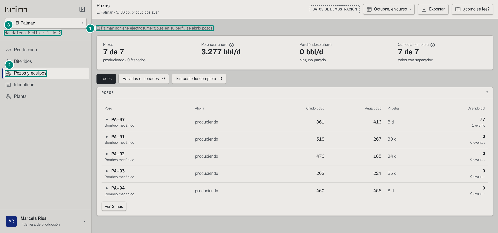

Fondo: Pozos de producción en El Palmar, explicada en 6B (`prod-esp-palmar`, la misma dirección).

| # | Lo que se ve | En la captura | Cómo se calcula | Texto según el valor | Viene de |
|---|---|---|---|---|---|
| 1 | Aviso | «El Palmar no tiene electrosumergibles en su perfil: se abrió pozos.» | `#/prod/esp/palmar/curso`: el perfil de El Palmar no tiene ESP; se redirige a la primera que sí (en el orden del rol) y **se dice** (`Subpantallas.tsx:21-30`) | si el rol usa una subpantalla que el campo no tiene: «{ámbito} no tiene {x} ni {y} en su perfil.» | perfil firmado |
| 2 | Entrada | «Pozos y equipos» | producción tiene Pozos | — | — |
| 3 | Campos | «Magdalena Medio · 1 de 2» | producción tiene La Ceiba y El Palmar | — | — |

### Captura 8 · Exportar

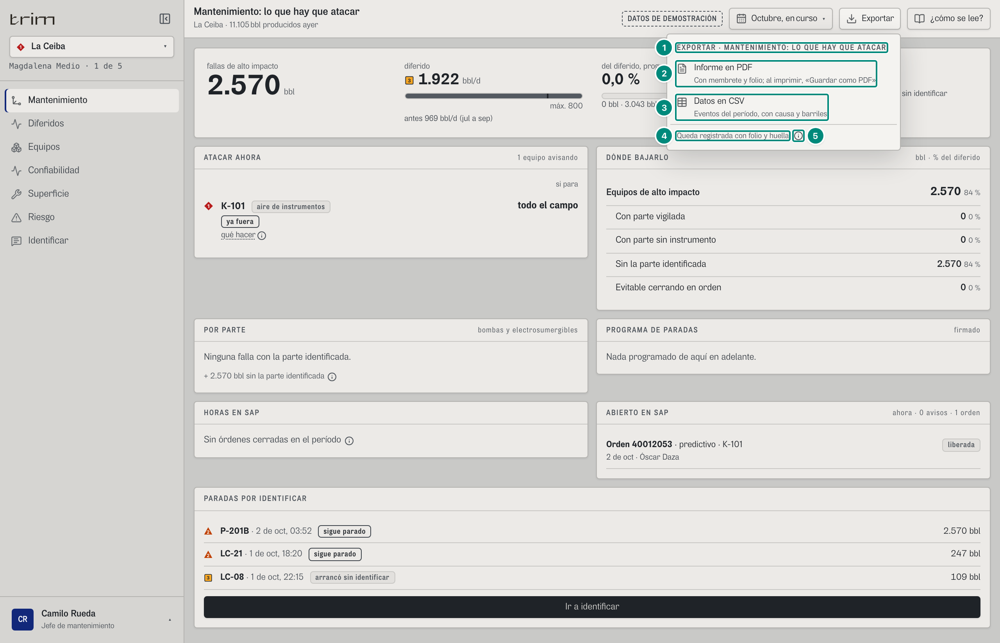

Fondo: Mantenimiento del jefe en La Ceiba (6C.3, captura 1).

| # | Lo que se ve | En la captura | Cómo se calcula | Texto según el valor | Viene de |
|---|---|---|---|---|---|
| 1 | Título | «EXPORTAR · MANTENIMIENTO: LO QUE HAY QUE ATACAR» | el título de la pantalla; con la ficha de un equipo abierta: «Ficha del equipo {equipo} · {campo}» (y el botón de exportar va en la ficha) | — | — |
| 2 | Informe en PDF | «Con membrete y folio; al imprimir, «Guardar como PDF»» | `POST /api/informes` `{ formato: 'pdf', titulo, alcance, periodo, campos, desde, hasta, equipo? }` → el servidor devuelve el folio, las cifras y la huella; luego se abre la ventana de imprimir con el membrete (captura 11) | errores en el menú (`role="alert"`): el texto del servidor o «No se pudo exportar: {mensaje}» | 5D §4 «Registrar un informe» |
| 3 | Datos en CSV | «Eventos del período, con causa y barriles» | mismo `POST` con `formato: 'csv'`; el front arma el archivo `TRIM-{folio}-eventos.csv` con los eventos del libro de esos campos y período, encabezado con Empresa, Informe, Alcance, Período, Generado, Datos hasta, Estado del período, Configuración, Folio, Huella SHA-256, cada «Cifra protegida» y la Nota de cálculo | 5D §4 «CSV de los eventos» | `GET /api/vistas/diferidos` |
| 4 | Respaldo | «Queda registrada con folio y huella» | — | debajo, después de exportar: «Último: **{folio}** · {14 primeros caracteres de la huella}…» | `GET /api/informes` |
| 5 | ⓘ | (globo) | — | «Cada exportación queda registrada con su folio y la huella de sus cifras: así se puede comprobar que no se modificó.» | — |

### Captura 9 · «¿cómo se lee?»

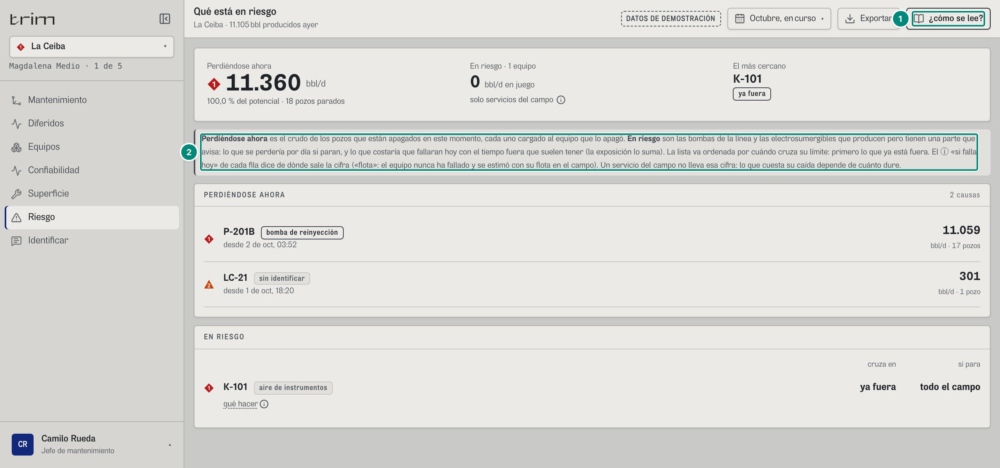

Fondo: Riesgo del jefe en La Ceiba: las mismas cifras y filas que la captura 4 de 6C.1 (`ger-riesgo-ceiba`); en nivel ingeniería K-101 lleva además «qué hacer».

| # | Lo que se ve | En la captura | Cómo se calcula | Texto según el valor | Viene de |
|---|---|---|---|---|---|
| 1 | Interruptor | botón presionado | `comoSeLee` en el estado de la aplicación (no se guarda: cada visita arranca apagado, salvo «Entrar con la lectura activada») | — | — |
| 2 | Lectura | el renglón con borde izquierdo gris | `Lectura` solo se dibuja si el interruptor está encendido (`Lectura.tsx:7-15`); lo que explica cada pantalla está en la sección «Lectura» de su ficha en este capítulo | en el papel **no** sale (la explicación de cada cifra sale por sus ⓘ) | — |

Los ⓘ y los globos son otra cosa: se ven siempre y salen escritos en el papel (8 §8.8).

### Captura 10 · el cajón en el teléfono

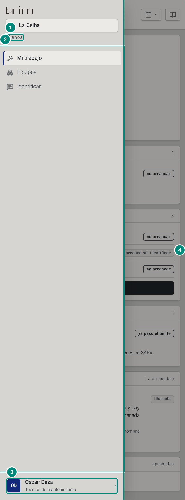

Fondo: Mi trabajo del técnico en el teléfono (6C.6, captura 2).

| # | Lo que se ve | En la captura | Cómo se calcula | Texto según el valor | Viene de |
|---|---|---|---|---|---|
| 1 | Campo | ◆ 1 «La Ceiba» · «Magdalena Medio» | el técnico tiene un solo campo: el selector no se abre (sin ▾) | — | `usuarios[].campos` |
| 2 | Pantallas | Mi trabajo, Equipos, Identificar | — | — | `rol.pantallas` |
| 3 | Persona | «Óscar Daza · Técnico de mantenimiento» | — | — | — |
| 4 | Cerrar | el fondo oscuro | «Cerrar la navegación» | — | — |

En el teléfono la cabecera es: ☰, título, «Demo · {período}» y «{campo} · {lo producido ayer}» (en dos renglones; el del período nunca se corta), el ícono del período, Exportar solo con su ícono y el ícono de «¿cómo se lee?» (ver 6C.6, captura 2).

### Captura 11 · el papel (Exportar → Informe en PDF) y la impresión sin folio

Capturado con el guion [guiones/marco.mjs](../capturas/guiones/marco.mjs): Exportar → «Informe en PDF» (con `window.print` anulado) y `page.emulateMedia({ media: 'print' })`, sobre `#/jefe/riesgo/ceiba/curso`; se le agregó un margen blanco a la captura para que los números no tapen el texto.

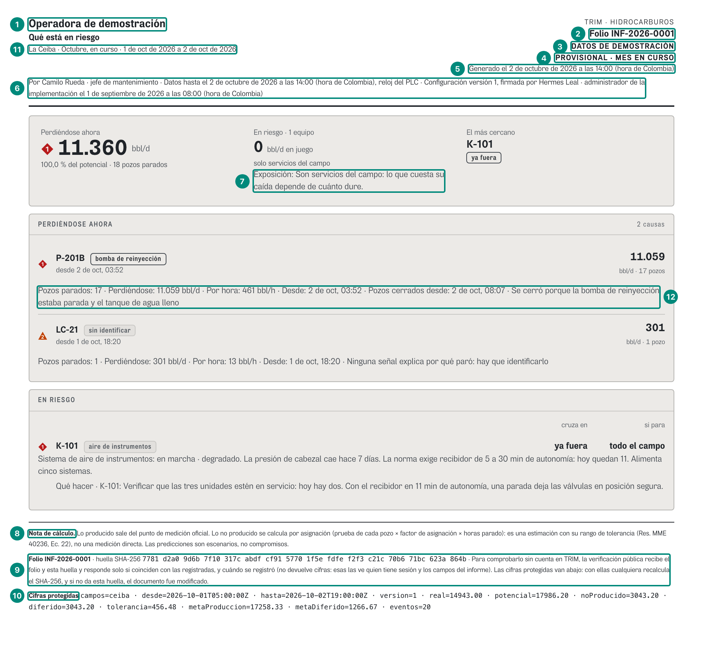

Lo que se imprime es la pantalla Riesgo del jefe en La Ceiba (sus cifras, en 6C.1, captura 4), con el membrete arriba, los globos escritos y el pie.

| # | Lo que se ve | En la captura | Cómo se calcula | Texto según el valor | Viene de |
|---|---|---|---|---|---|
| 1 | Empresa | «Operadora de demostración» | `config.empresa` de la **versión con la que se calculó** el informe (no la vigente al imprimir) | — | configuración firmada (membrete) |
| 2 | Folio | «Folio INF-2026-0001» | consecutivo del servidor `INF-AAAA-NNNN` → 5D §4 | sin folio: «SIN FOLIO» | `POST /api/informes` → `folio` |
| 3 | Sello demo | «DATOS DE DEMOSTRACIÓN» | solo con la fuente demo | — | — |
| 4 | Estado | «PROVISIONAL · MES EN CURSO» | `informe.estado`: `provisional` → «PROVISIONAL · MES EN CURSO»; `bloqueado` → «NO PUBLICABLE TODAVÍA»; `publicable` → nada → 5D §4 «Estado del período en el informe» | — | `informe.estado` |
| 5 | Generado | «Generado el 2 de octubre de 2026 a las 14:00 (hora de Colombia)» | `fechaHoraLarga(informe.fecha)` (hora del servidor) | — | `informe.fecha` |
| 6 | Quién, hasta cuándo y con qué versión | «Por Camilo Rueda · jefe de mantenimiento · Datos hasta el 2 de octubre de 2026 a las 14:00 (hora de Colombia), reloj del PLC · Configuración versión 1, firmada por Hermes Leal · administrador de la implementación el 1 de septiembre de 2026 a las 08:00 (hora de Colombia)» | `informe.por`, AHORA, `informe.version` y su firma | — | `informe`, `GET /api/configuracion/historial` |
| 7 | ⓘ escrito | «Exposición: Son servicios del campo: lo que cuesta su caída depende de cuánto dure.» | todo ⓘ, globo y «ver N más» sale escrito en el papel («{título}: {texto}»); el resto de la hoja es la pantalla Riesgo del jefe en La Ceiba (cifras de 6C.1, captura 4: «11.360 bbl/d», «100,0 % del potencial · 18 pozos parados», «En riesgo · 1 equipo», «0 bbl/d en juego», «solo servicios del campo», «2 causas», las filas de P-201B, LC-21 y K-101 con la columna «si para» «todo el campo») | — | `GET /api/vistas/riesgo`, `/estado` |
| 8 | Nota de cálculo | «Lo producido sale del punto de medición oficial. Lo no producido se calcula por asignación (prueba de cada pozo × factor de asignación × horas parado): es una estimación con su rango de tolerancia (Res. MME 40236, Ec. 22), no una medición directa. Las predicciones son escenarios, no compromisos.» | `NOTA_DE_CALCULO` (`widgets/diferidos/Rango.tsx`) | — | — |
| 9 | Folio y huella | «Folio INF-2026-0001 · huella SHA-256 7781 d2a0 9d6b 7f10 317c abdf cf91 5770 1f5e fdfe f2f3 c21c 70b6 71bc 623a 864b · Para comprobarlo sin cuenta en TRIM, la verificación pública recibe el folio y esta huella…» | SHA-256 de la forma canónica de las cifras, agrupada de a 4 (`huellaLegible`) → 5D §4 «Forma canónica y huella» | — | `informe.huella` |
| 10 | Cifras protegidas | «campos=ceiba · desde=2026-10-01T05:00:00Z · hasta=2026-10-02T19:00:00Z · version=1 · real=14943.00 · potencial=17986.20 · noProducido=3043.20 · diferido=3043.20 · tolerancia=456.48 · metaProduccion=17258.33 · metaDiferido=1266.67 · eventos=20» | `formaCanonica(informe.cifras)` (una por línea en el CSV; aquí unidas con « · ») | con ellas cualquiera recalcula el SHA-256 | `informe.cifras` |
| 11 | Período del membrete | «La Ceiba · Octubre, en curso · 1 de oct de 2026 a 2 de oct de 2026» | «{alcance} · {periodo}» (`Membrete.tsx:33`): con informe, `inf.alcance` e `inf.periodo` tal como los guardó el servidor; sin él, `ambito.titulo` y `periodoDelInforme(rango, parcial)` = «{nombre del período}[, en curso si es parcial y el nombre no lo dice] · {desde} a {min(hasta, AHORA) − 1 ms}» (`src/widgets/informe/periodo.ts:14-18`, fechas «1 de oct de 2026») | — | `informe.alcance`, `informe.periodo` |
| 12 | Globos escritos | «Pozos parados: 17 · Perdiéndose: 11.059 bbl/d · Por hora: 461 bbl/h · Desde: 2 de oct, 03:52 · Pozos cerrados desde: 2 de oct, 08:07 · Se cerró porque la bomba de reinyección estaba parada y el tanque de agua lleno» (P-201B); LC-21: «Pozos parados: 1 · Perdiéndose: 301 bbl/d · Por hora: 13 bbl/h · Desde: 1 de oct, 18:20 · Ninguna señal explica por qué paró: hay que identificarlo»; K-101: «Sistema de aire de instrumentos: en marcha · degradado. La presión de cabezal cae hace 7 días. La norma exige recibidor de 5 a 30 min de autonomía: hoy quedan 11. Alimenta cinco sistemas.» y «Qué hacer · K-101: Verificar que las tres unidades estén en servicio: hoy hay dos. Con el recibidor en 11 min de autonomía, una parada deja las válvulas en posición segura.» | el globo de cada fila sale escrito (`imprimir="todo"` en PERDIÉNDOSE AHORA; solo la pista en EN RIESGO) → 6C.1 «Globo de una fila»; «Por hora» = $n_0(\text{bblDia}/24)$ (11.058,9/24 = 460,8; 300,8/24 = 12,5) | — | `riesgo[]` (`motivo`, `accion`, `cierreDesde`) |

Además, el pie de **cada** hoja (`@page @bottom-left`): «Folio INF-2026-0001 · Operadora de demostración · lo producido se mide; lo diferido se calcula», y arriba de cada hoja «DATOS DE DEMOSTRACIÓN» (no se ven en una captura de pantalla: son cajas de margen de la página impresa). Periodo del membrete: «La Ceiba · Octubre, en curso · 1 de oct de 2026 a 2 de oct de 2026» (`periodoDelInforme`).

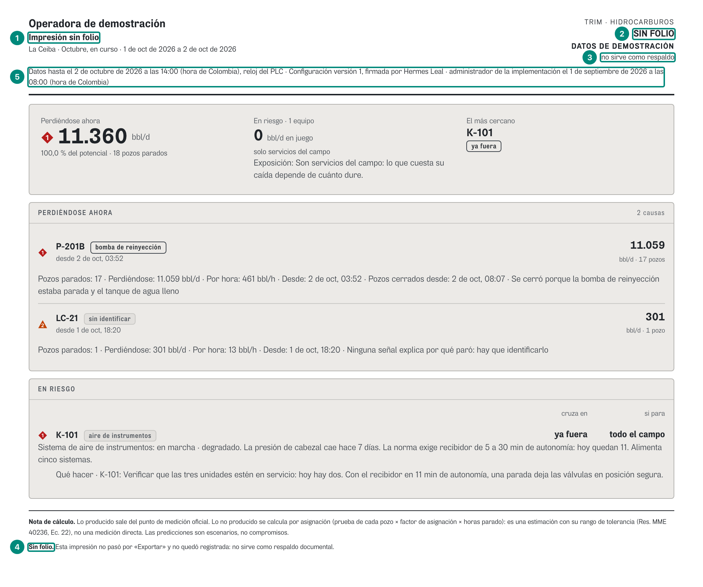

La hoja es la misma de la captura anterior (la pantalla Riesgo y sus globos escritos, filas 7 y 12); cambian el membrete y el pie.

| # | Lo que se ve | En la captura | Cómo se calcula | Texto según el valor | Viene de |
|---|---|---|---|---|---|
| 1 | Título | «Impresión sin folio» | imprimir sin pasar por Exportar: no hay informe | — | — |
| 2 | Folio | «SIN FOLIO» | — | pie de cada hoja: «SIN FOLIO · no sirve como respaldo» | — |
| 3 | Aviso | «no sirve como respaldo» | — | — | — |
| 4 | Pie | «Sin folio. Esta impresión no pasó por «Exportar» y no quedó registrada: no sirve como respaldo documental.» | — | — | — |
| 5 | Membrete sin informe | «La Ceiba · Octubre, en curso · 1 de oct de 2026 a 2 de oct de 2026» y «Datos hasta el 2 de octubre de 2026 a las 14:00 (hora de Colombia), reloj del PLC · Configuración versión 1, firmada por Hermes Leal · administrador de la implementación el 1 de septiembre de 2026 a las 08:00 (hora de Colombia)» | sin informe no hay «Por …» ni «Generado el …» (en su lugar «no sirve como respaldo»); «Datos hasta» = `fechaHoraLarga(AHORA)`; la versión es la **vigente** al imprimir (`Membrete.tsx:15, 40, 44`) | — | `GET /api/configuracion/historial` |

Sin folio el membrete sigue diciendo el período y la versión **vigente** de la configuración; no dice «Por …» ni «Generado el …».

**Huecos de este marco** van en `09-huecos-y-dudas.md`.
