# 6D.1 Producción — la tubería del campo, qué limitó cada día, lo que no se produjo por tipo y por tramo · producción

**Para qué.** «qué limita hoy al campo» (el rótulo de LA TUBERÍA DEL CAMPO, `src/widgets/choke/Tuberia.tsx:69`): «¿Dónde está hoy el tope del campo, cuánto está pasando y qué se perdió en cada tramo?» (U2 §2.1). La pantalla entera, para producción: «Después: lo medido cada día, custodia y libro publicable.» (`src/widgets/Onboarding.tsx:20`).
**Ruta.** `#/prod/produccion/ceiba/curso` (y `cerrado` = septiembre, `trimestre`, `doce`, `ytd`; con todos sus campos, `#/prod/produccion/ceiba~portafolio/curso`) · **Roles y nivel.** `prod` (ingeniería; sus campos son La Ceiba y El Palmar, `src/entities/roles.ts:53-58`). Todo lo de esta sección sale solo en ingeniería (`ing`, `src/pages/Produccion.tsx:45`, `:107-114`, `:127-128`): el gerente también tiene Producción y no ve nada de esto (U2 §3.2). Lo demás de la pantalla —la cabecera, «DÍA A DÍA», «MEDICIÓN OFICIAL», el factor, el cuadre diario y la asignación oficial— está en 6A.3.
**Lee.** (CONTRATO.md, «Vistas calculadas» y Anexo A.) **Escribe.** Nada.

| Endpoint | Para qué |
|---|---|
| `GET /api/vistas/campos/:campo/tuberia?desde&hasta` → `TuberiaCampo` | LA TUBERÍA DEL CAMPO (capturas 1-3 y 9) y cada fila de LA TUBERÍA DE CADA CAMPO (captura 8) |
| `GET /api/vistas/choke/arbol?campos&desde&hasta&orden=gestion` → `ArbolChoke` | las ramas de cada tramo de «Se trabó en el período» (`SeTrabo`, `Tuberia.tsx:547`; captura 3) |
| `GET /api/vistas/estado?campos` → `EstadoCampo.pozos` | el «· 18» de los pozos (`Tuberia.tsx:48`, `:60`) |
| `GET /api/vistas/equipos-hoy?campos` → `severidad` | la marca de hoy de un equipo (◆1 P-201B) (`Tuberia.tsx:49`, `:57-58`) |
| `GET /api/vistas/campos/:campo/choke/serie?desde&hasta` → `SerieChoke` | QUÉ LIMITÓ, DÍA POR DÍA (capturas 4 y 10) |
| `GET /api/vistas/choke/reparto?campos&desde&hasta` → `BrechaChoke` | LO QUE NO SE PRODUJO, POR TIPO (capturas 5 y 6) y el ⓘ del «% del potencial» de la cabecera (`InfoDelPotencial`, `Produccion.tsx:214-225`) |
| `GET /api/vistas/choke/mensual?campos` → `MesPorTramo[]`, y `GET /api/vistas/diferidos/mensual?campos` | LO PERDIDO POR TRAMO, MES A MES (captura 7); el segundo solo da el nombre de cada mes (`src/widgets/choke/Mensual.tsx:28-31`) |

Fórmulas: los cuatro tramos y sus palabras → 5E §1; lo que deja pasar cada tramo, lo que limita, «casi iguales», «le sobran», la frase de siempre y la de hoy → 5E §2 y §6; el tramo de cada parada y la propuesta con pregunta → 5E §3; lo que se pierde ahora y lo perdido en el período por tramo, con sus equipos → 5E §4; la escalera y la eficiencia de producción → 5E §4; la serie, el aviso de cambio y el mes a mes → 5E §8; el árbol de cada tramo → 5E §5; el carril del agua y lo que queda sin P-201B → 5E §6; lo que pasa hoy (`caudalesAhora`) → 5B §5; el potencial del libro, lo real y el «% del potencial» → 5A §3 y 6A.3.

**Dos números para lo que dan los pozos.** La cabecera (6A.3) dice 11.360 bbl/d: las pruebas × el factor de asignación del mes (0,958), lo que el libro asigna. La tubería dice **11.857** bbl/d: las pruebas solas, × el factor de medición firmado (1 mientras nadie lo firme). Esa es la que decide qué limita: el factor del mes sale de lo que ya pasó por la planta y escondería lo que la limita (D3; `potencialesDelCampo`, `src/entities/choke.ts:962-989`). La diferencia de hoy, 497 bbl/d, tiene su renglón (fila 25), y la del período, el suyo en la escalera (captura 5). Las cifras de U2 §2.2 y §9.1 (11.360 de los pozos, 12.000 de la planta, «le sobran 640») son de antes de D3 y de la capacidad del tren de crudo del demo en 13.000: la pantalla de hoy dice 11.857, 13.000 y 1.143. Todo lo de esta sección lo calcula el motor: la pantalla escala el dibujo, suma solo lo que se dice en cada fila y arma las frases con lo que llega hecho.

### Captura 1 · producción, La Ceiba, octubre en curso: la tubería del campo

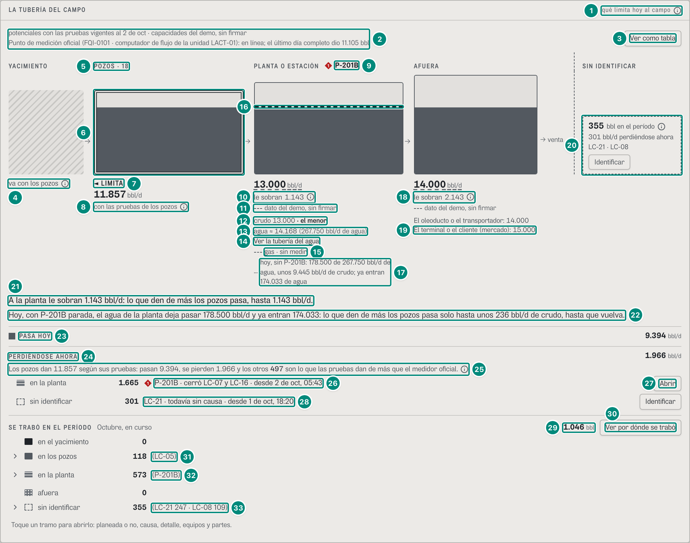

Recorte del panel a 1.300 px (el número de la frase de hoy cabe a su derecha). La tubería va entre la cabecera y «QUÉ LIMITÓ, DÍA POR DÍA» (`Produccion.tsx:107-114`).

| # | Lo que se ve | En la captura | Cómo se calcula | Texto según el valor | Viene de |
|---|---|---|---|---|---|
| 1 | Rótulo del panel y su ⓘ | «LA TUBERÍA DEL CAMPO» · «qué limita hoy al campo» ⓘ | fijo | ⓘ «Lo que limita»: «El tramo más angosto. No es una alarma: todo campo tiene uno. TRIM lo calcula con las pruebas de los pozos y las capacidades firmadas; nadie lo escribe a mano.» (`TEXTO.limita`, `src/widgets/choke/palabras.ts:56`; `Tuberia.tsx:68-69`). En el papel va delante de la cabecera «{campo} · {período} ·» (`:73`) | — |
| 2 | Cabecera | «potenciales con las pruebas vigentes al 2 de oct · capacidades del demo, sin firmar» y debajo «Punto de medición oficial (FQI-0101 · computador de flujo de la unidad LACT-01): en línea; el último día completo dio 11.105 bbl» | la fecha es la del reloj (`fechaCorta(AHORA)`); las capacidades, según estén firmados los trenes medidos y afuera (`capacidadesDeLaTuberia`, `src/entities/choke-reparto.ts:575-583`); el medidor, en línea si llegó el fiscal del último día completo (11.105 bbl del 1-oct) (`medidorDe`, `choke-reparto.ts:559-572`) → 5E §6 | capacidades: «capacidades firmadas el {fecha} por {persona}» / «capacidades: unas firmadas…, otras del demo, sin firmar» / «capacidades del demo, sin firmar»; sin tubería de crudo, «sin tubería de crudo» (`Tuberia.tsx:74`). Medidor sin dato del último día: «Sin comunicación con el punto de medición oficial ({medidor}) desde el {fecha}: lo real de esos días queda sin dato»; sin medidor registrado, nada (`:75`) | `capacidades.texto`, `medidor.texto` |
| 3 | «Ver como tabla» | botón | — | abre la tabla de los mismos números debajo del dibujo y el foco va a su título (B-36; `Tuberia.tsx:61-63`, `:77-79`); pasa a «Ocultar la tabla» (captura 2). No sale sin tubería de crudo | — |
| 4 | El yacimiento | caja rayada, sin contorno · «va con los pozos» ⓘ | no tiene número propio: su caja es tan alta como la de los pozos (`Tuberia.tsx:297`) | ⓘ «El yacimiento»: «El yacimiento no tiene un número propio: lo que puede dar se mide con las pruebas de los pozos. Aquí solo se cuenta lo que se perdió por causas del yacimiento.» (`TEXTO.yacimiento`, `palabras.ts:58`; `Tuberia.tsx:340-341`) | `tramos[reservorio]` (`potencialBpd: null`, `estado: sin-dato`) |
| 5 | Rótulo de los pozos | «POZOS · 18» | `CAJA[pozo]` en mayúsculas y los pozos del campo (`Tuberia.tsx:287`; `CAJA`, `palabras.ts:10-12`) | sin pozos no va el número | `GET /api/vistas/estado` → `pozos` |
| 6 | La caja de los pozos | doble contorno; lo relleno, hasta la misma raya en los tres tramos | cada caja es tan alta como lo que deja pasar, con el eje en cero: $\text{alto} = \max\big(2,\ \text{round}(v/\text{tope}\cdot 150)\big)$ px con $\text{tope} = \max(11.857;\ 13.000;\ 14.000;\ 9.394) = 14.000$: pozos 127, planta 139, afuera 150 px (`ALTO`, `px`, `Tuberia.tsx:263`, `:274-275`). Lo relleno es lo que pasa hoy, $px(9.394) = 101$ px menos el borde de abajo (`BORDE`, `:266`, `:298`, `:313`): una sola raya recta | contorno doble de 4 px si limita; discontinuo de 3 px si está «casi igual»; gris discontinuo y «sin dato» sin número; sencillo si no (`:296`, `:306-310`). Todo en gris: lo que limita nunca va en rojo (U2 §2.3). Las diferencias son chicas (los pozos son el 85 % de afuera) y así se ven: mandan la palabra y el número. Cada caja es un botón que abre su detalle (Interacciones) | `tramos[].potencialBpd`, `.limita`, `.casiIgual`; `pasaHoyBpd` |
| 7 | Lo que limita | «◄ LIMITA» ⓘ | el menor de los tres: $\min(11.857;\ 13.000;\ 14.000) = 11.857$ → los pozos (`dominanteDe`, `choke.ts:833-845`) → 5E §2 | solo si `limita` (B-16); «casi iguales» al lado si otro tramo está a menos del 3 % (`PARAMETROS_CHOKE.umbralCasiIguales`, `choke.ts:195-198`); el ⓘ es el de la fila 1 (`Limita`, `Tuberia.tsx:139-148`) | `tramos[].limita`, `.casiIgual`; `limita`, `casiIguales` |
| 8 | Lo que dan los pozos | «11.857 bbl/d» · «con las pruebas de los pozos» ⓘ | $\sum$ de la prueba vigente de los 18 pozos × el factor de medición (1, sin firmar) = 11.857 (`pruebasDelCampo`, `choke.ts:930-934`) → 5E §2. Un pozo sin prueba no entra | `n0` + «bbl/d» (`Numero`, `Tuberia.tsx:151-158`) y debajo `ESTADO_TRAMO.pruebas` (`palabras.ts:44`) con el ⓘ «Lo que dan los pozos» = la `fuente`: «La suma de lo que dan los pozos con su prueba vigente. No lleva el factor de asignación del mes: ese sale de lo que ya pasó por la planta y escondería lo que la limita. El libro sí lo usa para valorar lo diferido (unos 11.360 bbl/d hoy): son dos preguntas distintas» (`fuentePozos`, `choke-reparto.ts:586`; D3, `Tuberia.tsx:349-350`). Ese ⓘ no se imprime: en el papel la fuente va en la tabla | `tramos[pozo].potencialBpd`, `.fuente`, `.estado` |
| 9 | Rótulo de la planta | «PLANTA O ESTACIÓN» ◆1 «P-201B» | los equipos que hacen perder ahora en ese tramo y tienen alarma hoy (`EquiposEnAlarma`, `Tuberia.tsx:203-215`) | la marca es la de hoy del equipo (◆ P1), nunca la del tramo (`:57-58`); sin equipo en alarma, solo el rótulo | `perdiendoAhora[].tramo/.equipo`; `GET /api/vistas/equipos-hoy` → `severidad` |
| 10 | Lo que deja pasar la planta | «13.000 bbl/d» subrayado discontinuo · «le sobran 1.143» ⓘ | la planta = el menor de los trenes medidos, en crudo: $\min(13.000;\ 14.168) = 13.000$; el gas no entra (`tramosDelCampo`, `choke.ts:938-951`). Le sobran $13.000 − 11.857 = 1.143$ (`holgura`, `choke.ts:837`) → 5E §2 | subrayado discontinuo si el número no está firmado (`sinFirma`: `demo` o `sin-firmar`, `palabras.ts:48`; `Tuberia.tsx:154`). «le sobran» no sale en el tramo que limita (`:346-348`); su ⓘ: «Cuánto más podría pasar este tramo antes de volverse el más angosto.» (`TEXTO.sobran`, `palabras.ts:57`). Sin capacidad: la caja punteada con «sin dato» (`:319`) y, debajo del dibujo, «No se puede decir qué limita: falta la capacidad de la planta. La firma el administrador.» (`FaltaCapacidad`, `:468-472`) | `tramos[planta].potencialBpd`, `.holguraBpd`, `.estado` |
| 11 | De dónde sale | «┄ dato del demo, sin firmar» | el `estado` del tren que manda (`demo`) | `ESTADO_TRAMO` (`palabras.ts:43-46`): «con las pruebas de los pozos», «dato del demo, sin firmar», «firmado», «sin firmar», «sin dato»; lo sin firmar con la raya discontinua delante (`Tuberia.tsx:350`) | `tramos[].estado` |
| 12 | El carril del crudo | «crudo 13.000 · el menor» | la capacidad del tren de crudo; «el menor» = `trenQueLimita` | «· el menor» solo en el carril que manda dentro de la planta (`esElMenor`, `Tuberia.tsx:161`, `:176-177`) | `tramos[planta].trenes[]`, `.trenQueLimita` |
| 13 | El carril del agua | «agua ≈ 14.168 (267.750 bbl/d de agua)» | el tren de agua pasado a crudo con el corte de las pruebas: $267.750 \times 11.857/224.075 = 267.750 \times 0{,}052915 = 14.168$ (`trenesDePlanta`, `src/entities/capacidades.ts:272`; `crudoPorAgua`, `choke.ts:971`) → 5E §2 y 5E §6 | «{tren} ≈ {en crudo} ({capacidad} {unidad})»; sin crudo que pasar, «—» (`Tuberia.tsx:178-184`) | `trenes[agua].capacidad`, `.enCrudo`, `.unidad` |
| 14 | «Ver la tubería del agua» | enlace | — | va a la pantalla Agua (6D.2), solo si el rol la tiene (`ir('agua')`, `Tuberia.tsx:55-56`, `:185-189`); no se imprime | — |
| 15 | El carril del gas | «┄ gas · sin medir» ⓘ | el gas no se mide en esta fase: no entra al mínimo de la planta (`medido: false`) | ⓘ «Gas sin medir»: «El gas no se mide en esta fase: no se puede saber si el tren de gas es el más angosto.» (`TEXTO.gasSinMedir`, `palabras.ts:60`; `Tuberia.tsx:170-175`). Un campo sin tren de gas (El Palmar) no tiene este renglón | `trenes[gas].medido` |
| 16 | La raya de hoy | raya discontinua dentro de la caja de la planta | lo que queda hoy sin P-201B, en crudo, 9.445 bbl/d: $px(9.445) = 101$ px, casi en el borde de lo relleno (9.394) (`Tuberia.tsx:315-318`) | solo con un equipo parado que angosta hoy un tren (`disponibleHoy`). La caja **no** se angosta: su alto sigue siendo la capacidad instalada (NSTA p. 29; U2 §2.3; B-14) | `tramos[planta].disponibleHoy.valor` |
| 17 | Lo que queda hoy, en palabras | «hoy, sin P-201B: 178.500 de 267.750 bbl/d de agua, unos 9.445 bbl/d de crudo; ya entran 174.033 de agua» | el agua que queda con P-201A y P-201C, $267.750 − 89.250 = 178.500$ (una sin instrumento se cuenta en marcha); en crudo, $178.500 \times 0{,}052915 = 9.445$; entra el agua de los 15 pozos que producen, 174.033 (`aguaDisponibleHoy`, `choke-reparto.ts:516-531`) → 5E §6 | el texto del motor, con la raya punteada delante (`Tuberia.tsx:192-197`) | `tramos[planta].disponibleHoy` (`.texto`, `.agua`, `.entraBpd`) |
| 18 | Afuera | «14.000 bbl/d» · «le sobran 2.143» ⓘ · «┄ dato del demo, sin firmar» | la evacuación del oleoducto o el transportador; le sobran $14.000 − 11.857 = 2.143$ | como las filas 10 y 11 | `tramos[exportacion].potencialBpd`, `.holguraBpd`, `.estado` |
| 19 | Afuera por dentro | «El oleoducto o el transportador: 14.000» · «El terminal o el cliente (mercado): 15.000» | los subniveles; el mercado no baja lo que puede pasar afuera (NSTA p. 29) | un renglón por subnivel (`Tuberia.tsx:352-356`). Si el comprador recibe menos de lo que el sistema puede dar, la frase de abajo agrega «El comprador recibe hasta {n} bbl/d: es el mercado, un subnivel de afuera.» (`choke.ts:998`) | `tramos[exportacion].subniveles[]` |
| 20 | Sin identificar | bloque aparte, discontinuo: «355 bbl en el período» ⓘ · «301 bbl/d perdiéndose ahora» · «LC-21 · LC-08» · «Identificar» | lo que todavía no tiene causa: no es un tramo y no se reparte (U2 §2.3). 355,0 = LC-21 246,5 + LC-08 108,5 en el período; 300,8 = LC-21 ahora | ⓘ «Sin identificar»: «Paradas que todavía no tienen causa: hasta que alguien diga qué pasó, no se sabe dónde se trabó. No se reparten entre los tramos.» (`TEXTO.sinIdentificar`, `palabras.ts:59`); «perdiéndose ahora» solo si es más de 0; hasta tres equipos; «Identificar» va a Identificar (6D.7) si el rol la tiene y hay algo (`Tuberia.tsx:328-335`) | `sinTramoBbl`, `sinTramoAhoraBpd`, `sinTramoEquipos[]` |
| 21 | La frase de siempre | «A la planta le sobran 1.143 bbl/d: lo que den de más los pozos pasa, hasta 1.143 bbl/d.» | la frase del motor con lo que limita y el tramo que le sigue, el de menos holgura (`textosDeHoy`, `choke.ts:992-1015`) → 5E §2 | limita la planta: «A los pozos les sobran {h} bbl/d: abrir más pozos no da nada. Lo que da es ampliar {el tren de crudo · el agua · el gas}.»; limita afuera: «Afuera no reciben más: a los pozos les sobran {h} bbl/d. Lo que da es más nominación o más evacuación.»; casi iguales: «{A} y {B} están casi iguales (menos de 3 % de diferencia): lo que se gane en uno lo frena el otro.»; empate al barril: «Dos tramos dan exactamente lo mismo: {A} y {B}.» y la explicación firmada o «Producción tiene que explicar por qué (lo pide el método).»; limitan los pozos y le sigue afuera: «Afuera reciben {h} bbl/d más: lo que den de más los pozos pasa, hasta {h} bbl/d.» (`Tuberia.tsx:98`) | `frase` |
| 22 | La frase de hoy | «Hoy, con P-201B parada, el agua de la planta deja pasar 178.500 bbl/d y ya entran 174.033: lo que den de más los pozos pasa solo hasta unos 236 bbl/d de crudo, hasta que vuelva.» | lo que cabe hoy: $(178.500 − 174.033) \times 0{,}052915 = 236$ bbl/d de crudo (`cabeBpd`; `fraseDeHoy`, `choke-reparto.ts:534-540`) → 5E §6 | solo si el equipo parado deja el agua por debajo del agua de los pozos (178.500 < 224.075); si ya no cabe nada: «Hoy no: con {equipo} parada, el agua de la planta está llena (entran {n} de {m} bbl/d). Lo que den de más los pozos no pasa hasta que vuelva.» (B-14; `Tuberia.tsx:99-100`) | `fraseHoy` |
| 23 | Pasa hoy | ■ «PASA HOY» 9.394 bbl/d | el crudo que sale ahora de los pozos que producen, valorado como el libro: 9.394,2 (`caudalesAhora`, 5B §5) | el cuadrito es el relleno del dibujo (`Tuberia.tsx:486-491`) | `pasaHoyBpd` |
| 24 | Perdiéndose ahora | «PERDIÉNDOSE AHORA» 1.966 bbl/d | $\sum$ de lo que se pierde en cada pozo con un evento abierto: 1.665,2 (LC-16 y LC-07, por P-201B) + 300,8 (LC-21) = 1.966,0 (`perdiendoPorTramo`, `choke-reparto.ts:460-480`) → 5E §6 | sin marca: un total no es una alarma (B-40); sin nada: «Nada: todos los pozos con prueba están produciendo.» (`Tuberia.tsx:492-498`) | `perdiendoAhoraBpd` |
| 25 | El cuadre de hoy | «Los pozos dan 11.857 según sus pruebas: pasan 9.394, se pierden 1.966 y los otros **497** son lo que las pruebas dan de más que el medidor oficial.» ⓘ | $11.857 − 9.394{,}2 − 1.966{,}0 = 496{,}8$ (`brechaPruebasBpd`, `choke-reparto.ts:645`) → 5E §6 (D3). Con el factor del mes era el cuadre de U2 §2.2: $11.360 − 9.394 = 1.966$ | solo si $\lvert\text{brecha}\rvert \ge 0{,}5$; negativa: «…, se pierden {n}: el medidor oficial mide {m} más que las pruebas.» (`Tuberia.tsx:500-510`); ⓘ «Las pruebas y el medidor»: «Las pruebas de los pozos y el punto de medición oficial no miden igual: lo que dan los pozos según sus pruebas, menos lo que pasa hoy por el punto oficial y lo que se está perdiendo, es lo que las pruebas dan de más (el factor de asignación del mes). No es una pérdida de hoy: es lo que el medidor no confirma de las pruebas.» (`TEXTO.cuadreHoy`, `palabras.ts:53`) | `tramos[pozo].potencialBpd`, `pasaHoyBpd`, `perdiendoAhoraBpd`, `brechaPruebasBpd` |
| 26 | Un renglón de lo que se pierde ahora | ▤ «en la planta» **1.665** ◆ «P-201B · cerró LC-07 y LC-16 · desde 2 de oct, 05:43» | una fila por tramo y equipo; «desde» = el primero de sus pozos que paró (LC-16 a las 05:43) | la muestra es el dibujo del tramo (B-35); `DONDE[tramo]` (`palabras.ts:15-17`); ◆ solo con alarma de hoy; «cerró» y hasta tres pozos por su nombre, si son más «N pozos» (`Tuberia.tsx:512-524`) | `perdiendoAhora[]` (`tramo`, `bpd`, `equipo`, `listaPozos`, `pozos`, `desde`) |
| 27 | Abrir | «Abrir» | — | abre la ficha del equipo (6B.4); el lector oye «Abrir P-201B» (`Tuberia.tsx:528`) | — |
| 28 | Lo que no tiene tramo | ⬚ «sin identificar» **301** · «LC-21 · todavía sin causa · desde 1 de oct, 18:20» · «Identificar» | `tramo: null`: la parada de LC-21 no tiene causa (5B §2.2) | muestra discontinua; «Identificar» (6D.7) (`Tuberia.tsx:516-527`) | `perdiendoAhora[tramo = null]` |
| 29 | Se trabó en el período | «SE TRABÓ EN EL PERÍODO» «Octubre, en curso» **1.046** bbl | el diferido del libro del período: $0 + 117{,}9 + 573{,}1 + 0 + 355{,}0 = 1.046{,}0$, el mismo de `/vistas/diferidos` (U2 §0, principio 6) → 5E §4 | sin nada: «Nada se trabó en octubre (en curso).» (`periodoEnFrase`, `palabras.ts:70-76`; `Tuberia.tsx:557-566`) | `diferido` |
| 30 | «Ver por dónde se trabó» | botón | — | lleva a Diferidos, al panel «POR DÓNDE SE TRABÓ» (6D.4); solo si el rol la tiene y algo se trabó (`Tuberia.tsx:563`) | — |
| 31 | Un tramo del período | «› en los pozos 118 (LC-05)» | 117,9 bbl: la baja tensión de LC-05 (causa SE-2), con el tramo «en el pozo» propuesto por TRIM y su pregunta sin contestar («¿De dónde vino el corte…?», fila 15 de la captura 5) → 5E §3 | `DONDE[tramo]`, `n0` y hasta tres equipos entre paréntesis, sin sus barriles (`Tuberia.tsx:550-551`, `:569`); con barriles y ramas, el renglón es un botón con «›» que abre su árbol (captura 3); sin barriles («en el yacimiento 0», «afuera 0»), sin botón (`:588`) | `perdidoPeriodo[].bbl`, `.equiposTop[]` |
| 32 | Otro tramo | «› en la planta 573 (P-201B)» | 573,1: los dos pozos que cerró P-201B, desde las 05:43 y las 05:46 hasta las 14:00 | ídem | ídem |
| 33 | Sin identificar en el período | «› ⬚ sin identificar 355 (LC-21 247 · LC-08 109)» | `sinTramoBbl` = 246,5 + 108,5 | discontinuo; aquí sí van los barriles de cada equipo (`Tuberia.tsx:570`) | `sinTramoBbl`, `sinTramoEquipos[]` |

Debajo va «Toque un tramo para abrirlo: planeada o no, causa, detalle, equipos y partes.» (`Tuberia.tsx:572`; no se imprime). El lector oye el dibujo en una frase (U2 §2.8; `resumenDe`, `Tuberia.tsx:218-233`): «Tubería de La Ceiba. Limitan los pozos: 11.857 barriles por día. Planta o estación: 13.000, le sobran 1.143, sin firmar. Afuera: 14.000, le sobran 2.143, sin firmar. Pasa hoy: 9.394. Perdiéndose ahora: 1.966, de ellos 1.665 en la planta por P-201B y 301 sin identificar, LC-21.» En el papel: el dibujo y sus dos frases no se parten (B-28); debajo, el detalle de los cuatro tramos de a dos por renglón, la tabla de la captura 2 y, una vez, lo que dicen los ⓘ (`Tuberia.tsx:92`, `:110-112`, `:120-128`).

Los dos cuadres de U2 §2.2, con las cifras de la captura: **lo que dan los pozos − lo que pasa hoy − lo que se pierde ahora = lo que las pruebas dan de más que el medidor** (11.857 − 9.394 − 1.966 = 497, fila 25) y **el reparto por tramo + sin identificar = el diferido del libro** (0 + 118 + 573 + 0 + 355 = 1.046, filas 29-33). El segundo es el mismo cuadre del árbol: cada renglón sale de la tubería y su árbol de `/vistas/choke/arbol`, y los dos leen las mismas filas con la clasificación vigente (6D·H2).

### Captura 2 · «Ver como tabla»

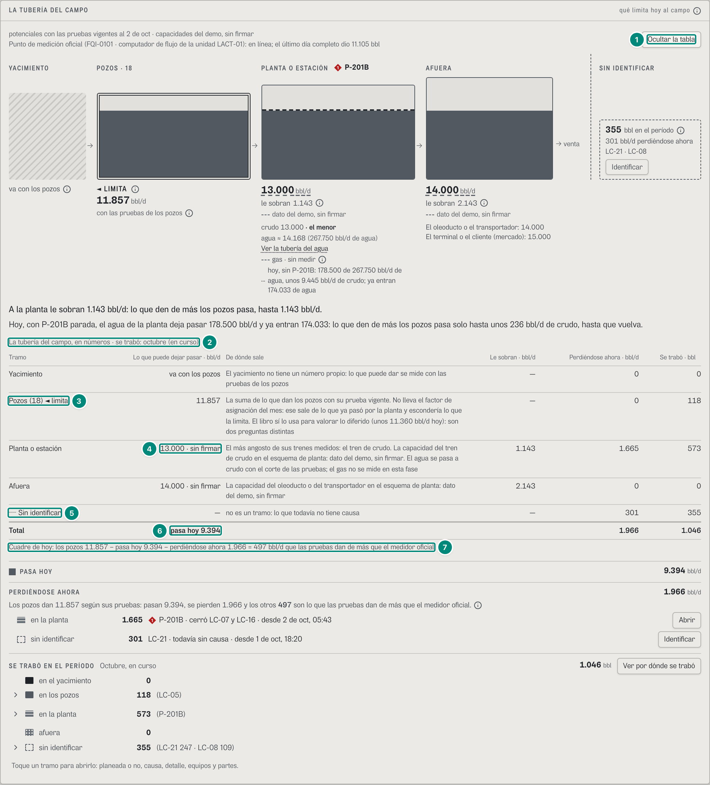

La misma tubería en números (U2 §2.8: la tabla equivalente del dibujo, la que se imprime). Abierta, va justo debajo del dibujo y sus frases (`Tuberia.tsx:102`); cerrada, sale igual en el papel (`:120-122`).

| # | Lo que se ve | En la captura | Cómo se calcula | Texto según el valor | Viene de |
|---|---|---|---|---|---|
| 1 | «Ocultar la tabla» | botón (era «Ver como tabla») | — | `aria-expanded`; al abrir, el foco va al título de la tabla (B-36; `Tuberia.tsx:61-63`, `:77-79`) | — |
| 2 | Título | «La tubería del campo, en números · se trabó: octubre (en curso)» | `periodoEnFrase(periodo)` (`palabras.ts:70-76`) | «septiembre», «los últimos 12 meses», «el año a la fecha»… (`Tuberia.tsx:633`) | — |
| 3 | La fila de los pozos | «Pozos (18) ◄ limita» · 11.857 · su fuente · «—» · 0 · 118 | una fila por tramo: «Lo que puede dejar pasar · bbl/d», «De dónde sale» (la `fuente` entera, la del ⓘ de la fila 8 de la captura 1), «Le sobran · bbl/d», «Perdiéndose ahora · bbl/d» y «Se trabó · bbl» (`Tuberia.tsx:641-650`) | « ◄ limita» y « · casi iguales» en el nombre; «Le sobran» es «—» en el que limita o sin dato; el yacimiento dice «va con los pozos» | `tramos[]` |
| 4 | La fila de la planta | «13.000 · sin firmar» · «El más angosto de sus trenes medidos: el tren de crudo. La capacidad del tren de crudo en el esquema de planta: dato del demo, sin firmar. El agua se pasa a crudo con el corte de las pruebas; el gas no se mide en esta fase» · 1.143 · 1.665 · 573 | ídem | « · sin firmar» si el número no está firmado (`sinFirma`) | `tramos[planta]` |
| 5 | Sin identificar | «┄ Sin identificar» · «—» · «no es un tramo: lo que todavía no tiene causa» · 301 · 355 | captura 1, filas 20 y 28 | — | `sinTramoAhoraBpd`, `sinTramoBbl` |
| 6 | Total | «pasa hoy 9.394» · 1.966 · 1.046 | captura 1, filas 23, 24 y 29 | — | `pasaHoyBpd`, `perdiendoAhoraBpd`, `diferido` |
| 7 | Cuadre de hoy | «Cuadre de hoy: los pozos 11.857 − pasa hoy 9.394 − perdiéndose ahora 1.966 = 497 bbl/d que las pruebas dan de más que el medidor oficial» | captura 1, fila 25 | negativo: «… (el medidor oficial mide más que las pruebas)»; con menos de 0,5 bbl/d no va (`Tuberia.tsx:659-666`) | `brechaPruebasBpd` |

### Captura 3 · el árbol de un tramo: «en la planta»

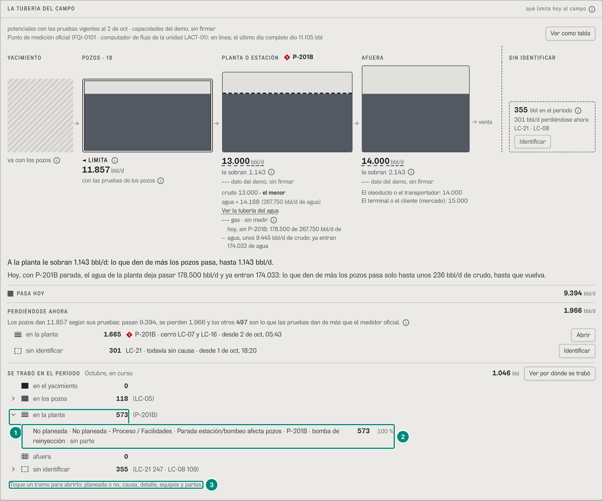

Cada tramo de «Se trabó en el período» se abre en su árbol de pérdidas, el «modelo choke expandido» de SPE-36848 (`RenglonTramo`, `Tuberia.tsx:582-621`). La lectura de las ramas, nodo por nodo (el paso, «falta», quién lo dijo, los códigos de la ANH según el rol), es de **6D.4** (`src/widgets/choke/Ramas.tsx`); aquí, solo lo propio de Producción.

| # | Lo que se ve | En la captura | Cómo se calcula | Texto según el valor | Viene de |
|---|---|---|---|---|---|
| 1 | El tramo abierto | «⌄ ▤ en la planta 573» | el botón del renglón (`Tuberia.tsx:602-608`) | hay botón solo si el tramo tiene 0,5 bbl o más y ramas (`conRamas`, `:588`); el lector oye «en la planta 573 bbl, con sus ramas: planeada o no, causa, detalle y equipos»; abre y cierra (`aria-expanded`) | `ArbolChoke.raiz.hijos[valor = planta]` |
| 2 | Sus ramas | «No planeada · No planeada - Proceso / Facilidades · Parada estación/bombeo afecta pozos · P-201B · bomba de reinyección · sin parte» **573** «100 %» | el árbol de gestión del período (tramo → planeada o no → causa → detalle → equipo → parte; `useArbolChoke({ orden: 'gestion' })`, `Tuberia.tsx:547`, `:614-618`): cada nodo suma exacto sus ramas; una rama de un solo hijo va en un renglón, con los barriles una vez (B-34) → 5E §5 | la parte de cada rama se dice contra el tramo (`base = nodo.bbl`, `:616`): aquí 573 de 573, «100 % del tramo» para el lector; para producción, sin los códigos de la ANH (`codigosDelRol('prod') = 'no'`, `palabras.ts:85-86`); lo demás, 6D.4 | `GET /api/vistas/choke/arbol?campos=ceiba&…&orden=gestion` → `raiz.hijos[].hijos` |
| 3 | La pista | «Toque un tramo para abrirlo: planeada o no, causa, detalle, equipos y partes.» | — | no se imprime; en el papel todas las ramas salen desplegadas (`Tuberia.tsx:572`, `:615`) | — |

El número del renglón (573) sale de la tubería y el de la rama, del árbol: son dos respuestas que tienen que dar lo mismo, porque las dos leen las filas de `/vistas/anh/paradas` con su clasificación vigente (CONTRATO.md:1420; 6D·H2). «Sin identificar» se abre igual que los tramos; «en el yacimiento» y «afuera», en 0, no se abren.

### Captura 4 · qué limitó, día por día (septiembre)

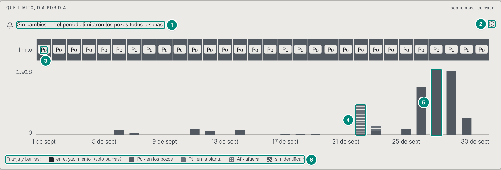

Un panel por campo, debajo de la tubería (`SerieLimita`, `src/widgets/choke/Serie.tsx:32-171`; U2 §7.1-7.2). Se muestra septiembre (`cerrado`): con octubre en curso son dos celdas («Po» y «Po»).

| # | Lo que se ve | En la captura | Cómo se calcula | Texto según el valor | Viene de |
|---|---|---|---|---|---|
| 1 | El aviso | 🔔 «Sin cambios: en el período limitaron los pozos todos los días.» | ningún aviso en el período y un solo tramo en la franja (`Serie.tsx:62-64`) → 5E §8 | con avisos, un renglón por aviso con el texto del motor: «Cambió lo que limita en {campo}: desde el {fecha} limitan los pozos ({n} bbl/d); antes, la planta · tren de crudo ({m}). Cambian los equipos que más cuestan si fallan: revise «Si falla hoy».» (`serieChoke`, `choke-reparto.ts:724-789`); con más de un tramo y sin aviso, «Sin avisos: lo que limita no cambió de forma sostenida en el período.»; con días casi iguales, «…, un día casi iguales con otro tramo» o «…, N días casi iguales…»; con vueltas sin aviso, «Lo que limita se turnó una vez (N veces) entre tramos casi iguales: ninguna vuelta pasó del 3 % por 3 días seguidos, y por eso no hubo aviso.»; sin días, «Sin días con dato en el período.» (`Serie.tsx:70-85`). En el demo de producción el aviso **no aparece en ningún período** (6D·H40) | `cambios[]`, `vueltas`, `dias[].dominante`, `.casiIguales` |
| 2 | ⓘ del aviso | ⓘ «Cambió lo que limita» | `PARAMETROS_CHOKE` (`choke.ts:195-198`: umbral 3 %, 3 días) | «TRIM avisa «Cambió lo que limita» solo si el tramo nuevo gana por más del 3 % y lo sostiene 3 días seguidos. Mientras dos tramos están a menos de esa diferencia, están «casi iguales» y no se avisa: un aviso por cada vuelta sería ruido. El umbral y los días los fija TRIM; se pueden ajustar.» (`AYUDA_AVISO`, `Serie.tsx:19`) | — |
| 3 | La franja | «limitó» · una celda por día, todas «Po» | lo que limitó cada día: el menor de los tres potenciales de ese día, con las pruebas y las capacidades que regían (`diasDelCampo`) → 5E §8. En septiembre, los pozos (de 11.857 a 11.954 bbl/d) contra 13.000 de la planta, los 30 días | la abreviatura (`ABREV`: «Po», «Pl», «Af», `palabras.ts:24`) solo si la celda mide 15 unidades del dibujo o más (`conTexto`, `Serie.tsx:43-47`: 668/días ≥ 15, hasta 44 días; con un trimestre ya no se escribe); un día casi igual, la celda partida en diagonal con los dos dibujos y «Po·Pl» (`:117-122`); sin dato, una celda vacía discontinua (`:125`). Globo de cada día: la fecha («· día en curso» si está a medias), «Limitan los pozos», lo que deja pasar cada tramo y lo que se trabó en cada uno; el lector oye lo mismo, y la franja es una sola parada de Tab: las flechas pasan de un día a otro (`:48-59`, `:107-114`) | `dias[].dominante`, `.casiIguales`, `.potenciales` |
| 4 | Una barra con la planta | 22 de sept: 862 bbl a rayas sobre 14 lisos | lo que se perdió ese día por tramo, apilado en el orden de la tubería, con el mismo dibujo de la franja (`Serie.tsx:136-142`): la parada de P-201B del 22-sep (862 + 179 del 23 = 1.041) | «sin identificar» va arriba, rayado y discontinuo (`:143-146`) | `dias[].porChoke` |
| 5 | La barra más alta | 27 de sept: 1.918 bbl, todo en los pozos | ídem; el eje va de 0 al día que más perdió, 1.918 (`:45-46`, `:96`) | las fechas, una cada pocos días y siempre la última (`:148-151`) | ídem |
| 6 | La leyenda | «Franja y barras: ■ en el yacimiento (solo barras) · Po · en los pozos · Pl · en la planta · Af · afuera · sin identificar» | — | una sola leyenda para la franja y las barras, con el mismo dibujo en las dos (B-09; `Leyenda`, `Serie.tsx:206-217`): los pozos liso, la planta a rayas, afuera a puntos, lo sin identificar rayado y discontinuo (B-35; `PatronesTramo`) | — |

En el papel, debajo de la franja va la tabla día por día (si son 62 días o menos): «Día · Limitó · en el yacimiento · en los pozos · en la planta · afuera · sin identificar» (`TablaDias`, `Serie.tsx:167`, `:219-241`).

### Captura 5 · lo que no se produjo, por tipo, y las dos eficiencias (septiembre)

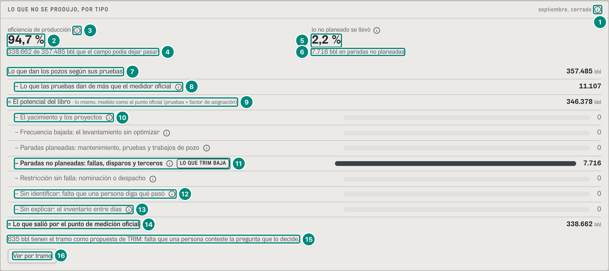

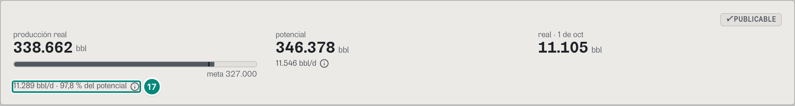

La escalera va después de «DÍA A DÍA» (`Escalera`, `src/widgets/choke/Escalera.tsx:37-121`; `Produccion.tsx:127`). La segunda imagen es la cabecera de la misma pantalla (6A.3), solo por la fila 17: es la decisión «Las dos eficiencias» de CORRECCIONES-F3 (un solo número del choke en la escalera; el del libro se llama «% del potencial»).

| # | Lo que se ve | En la captura | Cómo se calcula | Texto según el valor | Viene de |
|---|---|---|---|---|---|
| 1 | ⓘ de la escalera | «septiembre, cerrado» ⓘ «La escalera» | — | «Es la escalera del método choke (NSTA §5.3 y §6.4). Arriba, lo que dan los pozos según sus pruebas; lo que dan de más que el medidor oficial no es de ninguna parada y va aparte, en su renglón. Desde el potencial del libro, cada barril que no se produjo cae en un escalón y en un tramo, y los escalones suman exacto lo que no se produjo según el libro. Desarrollo es del yacimiento; desempeño, del levantamiento sin optimizar; las paradas, de mantenimiento y confiabilidad; capacidad, de la operación (nominación, despacho). El norte de TRIM vive en las paradas no planeadas.» (`AYUDA_ESCALERA`, `Escalera.tsx:12`); en el papel va una vez, al final (`:117`) | — |
| 2 | Eficiencia de producción | **94,7 %** | $\text{PE} = \text{real}/\text{potencial del sistema} = 338.662/357.485 = 94{,}73\,\%$; el potencial del sistema es lo que dan las pruebas menos lo estructural, aquí 0 porque los pozos limitaron todos los días (`armar`, `peDeCampo`, `choke-reparto.ts:330-386`) → 5E §4. Va con número solo si se puede creer (`peCreible`): en La Ceiba las pruebas dan más que el punto oficial | `n1` + « %»; sin `peCreible`, la frase del motor en su lugar (captura 5b) | `pe`, `peCreible`, `realPe`, `potencialPe` |
| 3 | ⓘ de la eficiencia | ⓘ «Eficiencia de producción» | — | «Lo que salió por el punto de medición oficial ÷ lo que el campo podía dejar pasar: lo que dan los pozos según sus pruebas o, el día que limita la planta o afuera, lo que deja pasar ese tramo (lo que no pasa aunque nada pare no se cuenta como pérdida). Es la eficiencia de producción de la NSTA (§5.3) y de la ISO/TS 3250. No es el «% del potencial» de arriba: ese divide por el potencial del libro, las pruebas con el factor de asignación del mes, que las deja medidas como el punto oficial, y solo descuenta lo que no se produjo por paradas. Esta descuenta además lo que las pruebas dan de más que el medidor oficial (11.107 bbl en el período): 94,7 % aquí y 97,8 % del potencial.» (`ayudaPe`, `Escalera.tsx:18-25`). Sin diferencia: «Las pruebas y el medidor oficial dan lo mismo en este período»; con el medidor por encima: «Esta suma además lo que el medidor oficial da de más que las pruebas ({n} bbl en el período)» | `pe`, `brechaPruebas`, `real`, `potencial` |
| 4 | Su pie | «338.662 de 357.485 bbl que el campo podía dejar pasar» | `realPe` de `potencialPe`: lo real y el potencial del sistema de los campos de crudo (aquí, los de La Ceiba) | `n0`; con varios campos, «… que los campos podían dejar pasar» (`Escalera.tsx:53`) | ídem |
| 5 | Lo no planeado | «lo no planeado se llevó» **2,2 %** ⓘ | $7.716/357.485 = 2{,}16\,\%$: lo no planeado que le costó al campo sobre el potencial del sistema (los días en que no limitan los pozos, lo que cabía en su holgura no cuenta, `cifras`, `choke-reparto.ts:299-318`) → 5E §4 | ⓘ «Lo no planeado»: «Las paradas no planeadas (fallas, disparos, terceros) ÷ lo que el campo podía dejar pasar: la eficiencia no planeada de la NSTA. Es el porcentaje que TRIM busca bajar prediciendo las bombas críticas.» (`AYUDA_NO_PLANEADO`, `Escalera.tsx:26`) | `peNoPlaneada` |
| 6 | Su pie | «7.716 bbl en paradas no planeadas» | el escalón del norte (fila 11) | `n0` | `porEscalon['disponibilidad-no-planeada']` |
| 7 | Arriba de la escalera | «Lo que dan los pozos según sus pruebas» **357.485** bbl | $\sum$ por día de lo que dan las pruebas, en los días con fiscal (`potencialPruebas`) | la escalera empieza donde empieza la eficiencia (D3; CORRECCIONES-F3) | `potencialPruebas` (6D·H1) |
| 8 | Lo que las pruebas dan de más | «− Lo que las pruebas dan de más que el medidor oficial» ⓘ **11.107** | $357.485 − 346.378{,}1 = 11.106{,}9$: las pruebas menos el libro (`brechaPruebas`) | con el medidor por encima, «+ Lo que el medidor oficial da de más que las pruebas» (El Palmar, septiembre: 792); en gris si redondea a 0; ⓘ «Las pruebas y el medidor oficial»: «Lo que las pruebas de los pozos dan de más que el punto de medición oficial en el período: el factor de asignación del mes lo descuenta. No es de ninguna parada (es sesgo de medición o desempeño de los pozos, sin separar mientras el factor de medición sea 1) y no se reparte por tramo.» (`AYUDA_BRECHA_PRUEBAS`, `Escalera.tsx:13`, `:77-83`) | `brechaPruebas` (6D·H1) |
| 9 | El potencial del libro | «= El potencial del libro · lo mismo, medido como el punto oficial (pruebas × factor de asignación)» **346.378** bbl | el potencial del libro del período (5A §3) | — | `potencial` |
| 10 | Un escalón en cero | «− El yacimiento y los proyectos» ⓘ 0, en gris | lo de cada escalón sale de las filas del período con su clasificación vigente (`escalonDeFila`, `choke-reparto.ts:169`) → 5E §4 | en gris si redondea a 0 (`Escalon`, `Escalera.tsx:135-152`). Los seis nombres son los de Diferidos (`ESCALON_CAMPO`, `palabras.ts:33-40`; B-26): «El yacimiento y los proyectos», «Frecuencia bajada: el levantamiento sin optimizar», «Paradas planeadas: mantenimiento, pruebas y trabajos de pozo», «Paradas no planeadas: fallas, disparos y terceros», «Restricción sin falla: nominación o despacho», «Sin identificar: falta que una persona diga qué pasó»; cada uno con su ⓘ «En la escalera de la NSTA: {nombre técnico}.» (`NOMBRE_ESCALON`, `choke.ts:168`) | `porEscalon` |
| 11 | El escalón del norte | «− Paradas no planeadas: fallas, disparos y terceros» ⓘ «LO QUE TRIM BAJA» **7.716** | 6.675,5 en los pozos + 1.040,6 en la planta (la tabla de la captura 6, con septiembre) | en negrita, con la barra más oscura (`--dato-1`); la palabra «LO QUE TRIM BAJA» va en gris: no es una alarma (`Escalera.tsx:142-147`). Lo sin identificar nunca cuenta como no planeado (D4) | `porEscalon['disponibilidad-no-planeada']` |
| 12 | Sin identificar | «− Sin identificar: falta que una persona diga qué pasó» ⓘ 0 | el escalón `sin-clasificar`: las filas sin causa (en octubre, 355) | — | `porEscalon['sin-clasificar']` |
| 13 | Sin explicar | «− Sin explicar: el inventario entre días» ⓘ 0 | $(\text{potencial} − \text{real}) − \sum \text{por tramo} = 7.716{,}06 − 7.716{,}06 = 0$ | barra discontinua; ⓘ «Sin explicar»: «Lo que no explica ningún evento: el inventario del tanque de venta entre un día y otro. Se muestra, nunca se reparte. Si pasa del 2,5 % del potencial del período, hay que revisarlo (el umbral de cierre de la NSTA).» (`AYUDA_SIN_EXPLICAR`, `Escalera.tsx:30`); si pasa del 2,5 % (`cuadra = false`), ■ en la cifra y «Lo sin explicar pasa del 2,5 % del potencial: hay que revisarlo antes de cerrar el mes.» (`:91-92`, `:98`) | `sinExplicar`, `cuadra` |
| 14 | Abajo de la escalera | «= Lo que salió por el punto de medición oficial» **338.662** bbl | lo real del libro (5A §3) | — | `real` |
| 15 | Lo que espera una respuesta | «635 bbl tienen el tramo como propuesta de TRIM: falta que una persona conteste la pregunta que lo decide.» | $\sum$ de las filas cuyo tramo es una propuesta con pregunta (`esperaTramo`, `choke-reparto.ts:190`) → 5E §3: los cortes de energía de LC-04 (135), LC-12 (63) y LC-06 (42), con «¿De dónde vino el corte: de afuera (el proveedor), del campo (pórtico, red de media o subestación) o de este pozo (su transformador, su variador o su cable)?», y las paradas de electrosumergible de LC-16 (217), LC-08 (61), LC-09 (55), LC-14 (28), LC-02 (20) y LC-12 (16), con «¿Falló la bomba o el pozo dejó de aportar? Si no aportó, es el yacimiento» = 635,4 | solo con 0,5 bbl o más (`Escalera.tsx:100-104`). En octubre: «118 bbl…», la baja tensión de LC-05 | `porConfirmar` |
| 16 | «Ver por tramo» | botón | — | abre la tabla de cada tramo por escalón (captura 6); en el papel sale siempre (`Escalera.tsx:113-116`) | — |
| 17 | El «% del potencial» de la cabecera | «11.289 bbl/d · 97,8 % del potencial» ⓘ | $338.662/346.378{,}1 = 97{,}77\,\%$: lo real sobre el potencial del libro (5A §3). Solo descuenta las paradas: por eso es mayor que la eficiencia de producción (fila 2) cuando las pruebas dan más que el medidor | ⓘ en ingeniería (`InfoDelPotencial`, `Produccion.tsx:214-225`; si la eficiencia no se puede creer, termina en «Aquí, {n} % del potencial; la eficiencia de producción del período no se puede creer: {textoPe}», sin su número): «Lo real ÷ el potencial de al lado: lo que daban las pruebas de los pozos con el factor de asignación del mes, que las deja medidas como el punto de medición oficial. Por eso solo descuenta lo que no se produjo por paradas. No es la eficiencia de producción («Lo que no se produjo, por tipo»): esa parte de las pruebas sin el factor y descuenta además lo que las pruebas dan de más que el medidor oficial (11.107 bbl en el período). Aquí, 97,8 % del potencial y 94,7 % de eficiencia de producción.»; en decisión, solo la primera parte (`DEL_POTENCIAL`, `:210`). Antes decía «eficiencia» (CORRECCIONES-F3, «Las dos eficiencias»; 6A.3) | `GET /api/vistas/diferidos` → `pe`; `GET /api/vistas/choke/reparto` → `brechaPruebas`, `pe` |

La escalera cuadra de renglón en renglón: 357.485 − 11.107 = 346.378; 346.378 − (0 + 0 + 0 + 7.716 + 0 + 0) − 0 = 338.662. Debajo de «Sin explicar», si el período tuvo un tramo que no deja pasar lo que dan los pozos (lo estructural), va la frase del motor, una por campo y tramo con su cifra: «{La planta} no deja pasar todo lo que pueden dar los pozos: {n} bbl de lo que no se produjo son de ahí, aunque nada pare. Ningún arreglo de equipos los recupera; solo más capacidad.» (con varios campos, «En {campo}, {la planta} no deja pasar …»; 5E·H31) y, si el real pasó la capacidad declarada, «El real pasó la capacidad declarada ({campo}, {tramo}: N días): ese número está por debajo de lo que ya pasó y hay que revisarlo. Esos días no se separa nada estructural.» (`textoEstructural`, `choke-reparto.ts:411-425`; `Escalera.tsx:99`). En el demo de producción no sale: los pozos limitan todos los días.

### Captura 5b · El Palmar, septiembre: la eficiencia que no se puede creer

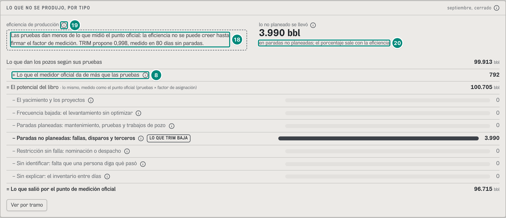

En septiembre las pruebas de El Palmar dan **menos** de lo que midió el punto oficial (la brecha de las pruebas es −792 bbl) y su factor de medición no está firmado: el potencial del sistema queda corto y la eficiencia pasaría de lo posible (96,8 % + 3,99 % de lo no planeado = 100,8 %). La escalera no da el número: dice por qué (QA-D3; 5E·H30; `Escalera.tsx:48-68`).

| # | Lo que se ve | En la captura | Cómo se calcula | Texto según el valor | Viene de |
|---|---|---|---|---|---|
| 18 | En lugar de la eficiencia | «Las pruebas dan menos de lo que midió el punto oficial: la eficiencia no se puede creer hasta firmar el factor de medición. TRIM propone 0,998, medido en 80 días sin paradas.» (borde discontinuo) | `peCreible` es falso: el factor de medición no estaba firmado y $\operatorname{round}(99.913 - 100.705{,}2) < 0$ (`peDeCampo`, `choke-reparto.ts:364-386`); lo que TRIM propone, la mediana de los 80 días sin paradas con los pozos limitando del 4 de jul al 1 de oct (`factorMedicionPropuesto`) → 5E §2 y §4 | firmado después del período: «Las pruebas dan menos de lo que midió el punto oficial y en estos días el factor de medición todavía no estaba firmado: la eficiencia no se puede creer. El firmado (0,998) rige desde el 3 de oct.»; con un factor firmado que deja la PE sobre 100 %: «Lo que salió pasa lo que dan las pruebas con el factor de medición firmado (…): la eficiencia no se puede creer hasta revisarlo. …»; un campo de gas: «La Zarza es un campo de gas: la eficiencia de crudo no aplica.»; el conjunto: «La eficiencia del conjunto no se puede creer: en El Palmar las pruebas dan menos de lo que midió el punto oficial y falta firmar su factor de medición.» (`ceiba~portafolio`, septiembre) | `textoPe`, `peCreible` |
| 19 | ⓘ de la eficiencia | ⓘ «Eficiencia de producción» | — | «La eficiencia de producción es lo que salió por el punto de medición oficial ÷ lo que el campo podía dejar pasar según las pruebas de los pozos (NSTA §5.3, ISO/TS 3250). Si las pruebas dan menos de lo que midió el punto oficial, ese potencial queda corto y la cuenta pasaría de lo posible; por eso TRIM no da el número hasta que se firme el factor de medición del campo («Filosofía operacional», paso 2). En un campo de gas, la eficiencia de crudo no aplica.» (`AYUDA_PE_NO_CREIBLE`, `Escalera.tsx:28`) | — |
| 20 | Lo no planeado, en barriles | «lo no planeado se llevó» **3.990 bbl** · «en paradas no planeadas; el porcentaje sale con la eficiencia» | el escalón no planeado (fila 11): su porcentaje se divide por el mismo potencial que la eficiencia y espera con ella | ⓘ «Lo no planeado»: «Las paradas no planeadas (fallas, disparos, terceros), en barriles: es lo que TRIM busca bajar. Su porcentaje se divide por lo mismo que la eficiencia de producción, y sale cuando esa se pueda creer.» (`AYUDA_NO_PLANEADO_BBL`, `Escalera.tsx:29`) | `porEscalon['disponibilidad-no-planeada']` |
| 8 | El medidor por encima | «+ Lo que el medidor oficial da de más que las pruebas» **792** | $100.705{,}2 - 99.913 = 792{,}2$: la brecha de las pruebas es negativa (fila 8 de la captura 5) | — | `brechaPruebas` |

La escalera cuadra igual: 99.913 + 792 = 100.705; 100.705 − 3.990 = 96.715, lo que salió. En ningún lugar de la pantalla queda un número de eficiencia sobre 100 % (la e2e `e2e/correcciones-f4.spec.ts` lo comprueba). Cuando el administrador firma el factor (6D.11, captura 5b), los pozos de hoy se leen con él (3.321 → 3.314 bbl/d con 0,998), pero septiembre no cambia: cada día se mide con la configuración de su medianoche.

### Captura 6 · «Ver por tramo» (octubre)

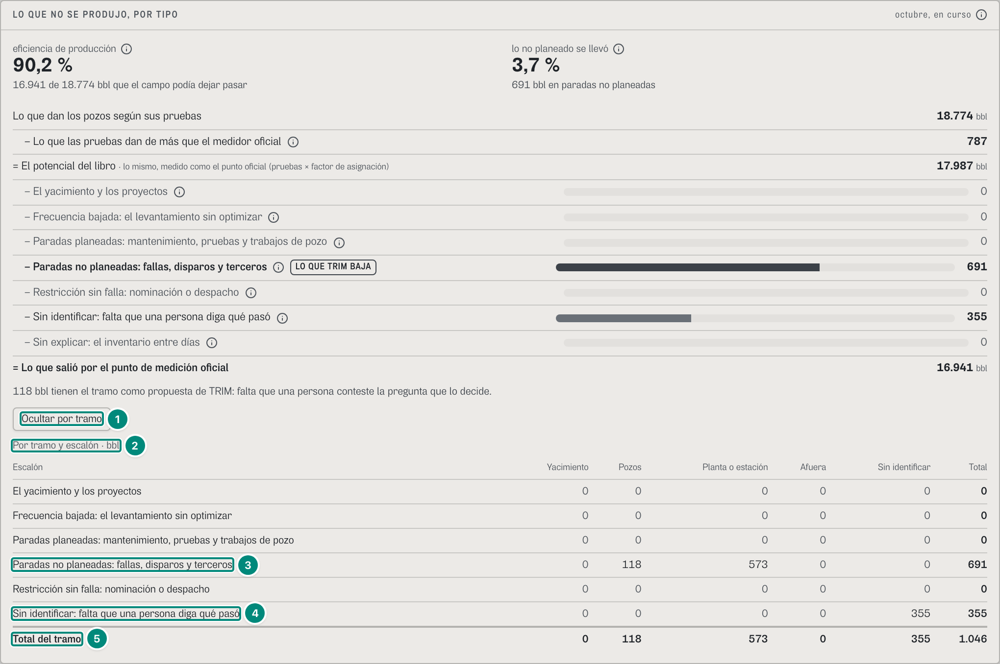

Octubre en curso, porque trae lo sin identificar (en septiembre, la fila de las no planeadas es 0 · 6.676 · 1.041 · 0 · 0 · 7.716 y todo lo demás en 0).

| # | Lo que se ve | En la captura | Cómo se calcula | Texto según el valor | Viene de |
|---|---|---|---|---|---|
| 1 | «Ocultar por tramo» | botón (era «Ver por tramo») | — | `aria-expanded` (`Escalera.tsx:114`) | — |
| 2 | Título | «Por tramo y escalón · bbl» | — | columnas: «Yacimiento · Pozos · Planta o estación · Afuera · Sin identificar · Total» (`PorTramo`, `Escalera.tsx:155-182`) | — |
| 3 | Las no planeadas | 0 · 118 · 573 · 0 · 0 · **691** | cada celda es lo de ese tramo en ese escalón; el total de la fila es el escalón de la escalera → 5E §4 | las celdas en 0, en gris | `porChokeEscalon[tramo][escalón]`, `porEscalon` |
| 4 | Sin identificar | 0 · 0 · 0 · 0 · 355 · **355** | lo sin causa solo cae en su columna: no se reparte entre los tramos | — | ídem |
| 5 | Total del tramo | 0 · 118 · 573 · 0 · 355 · **1.046** | las mismas cifras de «Se trabó en el período» (captura 1, filas 29-33) | — | `porChoke`, `diferido` |

### Captura 7 · lo perdido por tramo, mes a mes (septiembre)

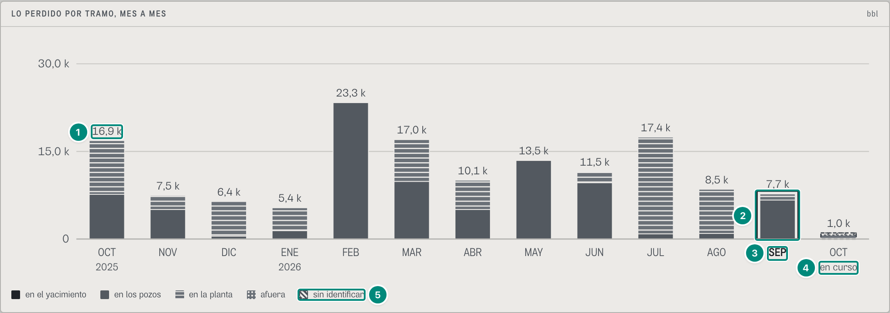

Los trece meses del calendario, sin importar el período (`PorTramoMensual`, `src/widgets/choke/Mensual.tsx:27-125`; U2 §7.4). Lo que cambia con el período es el contorno.

| # | Lo que se ve | En la captura | Cómo se calcula | Texto según el valor | Viene de |
|---|---|---|---|---|---|
| 1 | Una barra | OCT 2025, «16,9 k»: 7.650 en los pozos (liso) debajo y 9.202 en la planta (rayas) encima | cada mes, apilado por tramo en el orden de la tubería y lo sin identificar arriba, discontinuo; un hilo del color del panel separa un tramo del de abajo (`Mensual.tsx:58-75`). La cifra de arriba es el diferido del libro del mes, el mismo de `/vistas/diferidos/mensual` (`repartoPorMes`, `choke-reparto.ts:683-690`) → 5E §8 | «16,9 k» desde 1.000 (`k`, `Mensual.tsx:20`); el eje, a un tope «limpio» (30,0 k) (`tope`, `:14-19`, `:36`). Globo del mes: «Octubre 2025 · Mes cerrado · No se produjeron 16.852 bbl · en los pozos 7.650 bbl · no planeado 7.650 · en la planta 9.202 bbl · no planeado 9.202 · …» (`:67-70`) | `MesPorTramo[]`: `porTramo`, `noPlaneado`, `diferido` |
| 2 | El mes del período | contorno sobre SEP | los meses que se solapan con el período (`enPeriodo`, `Mensual.tsx:38`, `:76`): 6.676 en los pozos + 1.041 en la planta = 7.716 | ningún mes se atenúa: el gris es el dato (B-08); el del período lleva contorno y su rótulo en negrita (`data-mes-activo`, `:79`). Con `trimestre`, tres contornos | `desde`, `hasta` |
| 3 | Su rótulo | «SEP» en negrita | el nombre corto del mes de la serie del libro | el año bajo el primero y bajo enero («2025», «2026», `:82`) | `GET /api/vistas/diferidos/mensual` → `corto` |
| 4 | El mes en curso | OCT, «1,0 k», con contorno discontinuo · «en curso» | `parcial`: el mes no está publicado en todos los campos | contorno discontinuo y «en curso» (`Mensual.tsx:77`, `:83`); con octubre de período lleva además el contorno del período | `parcial` |
| 5 | La leyenda | «■ en el yacimiento · en los pozos · en la planta · afuera · sin identificar» | — | de texto, con las cuatro palabras de los tramos y el dibujo de cada uno (U2 §7.4; B-35; `Mensual.tsx:92-97`) | — |

En el papel, los mismos números en una tabla («Mes · en el yacimiento · en los pozos · en la planta · afuera · sin identificar · total», `Mensual.tsx:105-121`). Con el demo, de octubre de 2025 a octubre de 2026 (`referencia/choke/mensual-ceiba.json`): 16.852 · 7.478 · 6.431 · 5.356 · 23.349 · 17.021 · 10.069 · 13.450 · 11.527 · 17.441 · 8.522 · 7.716 · 1.046 (en curso: 118 en los pozos, 573 en la planta, 355 sin identificar).

### Captura 8 · con todos los campos: la tubería de cada campo

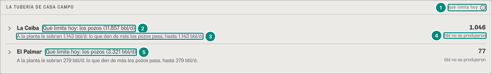

Con `ceiba~portafolio`, en lugar de la tubería y de la serie va una fila por campo (`TuberiaDeCadaCampo`, `src/widgets/choke/Campos.tsx:14-53`; `Produccion.tsx:107-108`; U2 §2.4). La escalera y el mes a mes suman los campos del ámbito (octubre: 91,8 % de eficiencia, «22.052 de 24.032 bbl que los campos podían dejar pasar»; en septiembre, «La eficiencia del conjunto no se puede creer: en El Palmar …», como en la captura 5b).

| # | Lo que se ve | En la captura | Cómo se calcula | Texto según el valor | Viene de |
|---|---|---|---|---|---|
| 1 | Rótulo | «LA TUBERÍA DE CADA CAMPO» · «qué limita hoy» ⓘ | — | ⓘ «Lo que limita» = `TEXTO.limita` (`Campos.tsx:16-17`) | — |
| 2 | Lo que limita en La Ceiba | «Qué limita hoy: los pozos (11.857 bbl/d)» | `textoCorto`: «Qué limita hoy: {los pozos · la planta · tren de crudo · afuera} ({n} bbl/d)» (`choke.ts:996`) | campo de gas: «Campo de gas: su tubería todavía no está»; sin esquema: «Sin esquema de planta: no se sabe qué limita» (`choke.ts:975-979`) | `GET /api/vistas/campos/ceiba/tuberia` → `textoCorto` |
| 3 | La frase | «A la planta le sobran 1.143 bbl/d: lo que den de más los pozos pasa, hasta 1.143 bbl/d.» | captura 1, fila 21 | no va en un campo de gas ni sin tubería (`Campos.tsx:43`) | `frase` |
| 4 | Lo que no se produjo | **1.046** «bbl no se produjeron» | captura 1, fila 29 | «no se produjeron», no «se trabó»: el barril es lo que se perdió (B-45; `Campos.tsx:46-48`) | `diferido` |
| 5 | El Palmar | «Qué limita hoy: los pozos (3.321 bbl/d)» · «A la planta le sobran 279 bbl/d: …» · 77 | $3.600 − 3.321 = 279$ | una fila por campo del ámbito; tocarla abre la tubería de ese campo (`setCampo`, `Campos.tsx:35`); el lector oye «{campo}: {textoCorto}. {frase} No se produjeron {n} barriles en el período. Abre su tubería.» (`:36`) | `GET /api/vistas/campos/palmar/tuberia` |

### En el teléfono (390 px)

**Captura 9 · la tubería de pie.**

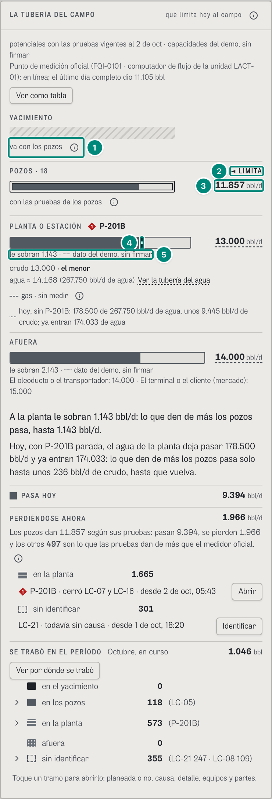

En el teléfono la tubería se pone de pie (U2 §2.6; `DePie`, `Tuberia.tsx:369-430`): los tramos uno debajo del otro, en el mismo orden, y cada uno es una barra cuyo **largo** es lo que deja pasar. Cabe sin desplazarse de lado.

| # | Lo que se ve | En la captura | Cómo se calcula | Texto según el valor | Viene de |
|---|---|---|---|---|---|
| 1 | El yacimiento | barra rayada · «va con los pozos» ⓘ | la barra mide lo de los pozos (`Tuberia.tsx:382`) | el ⓘ de la fila 4 de la captura 1, en su renglón (`:412-414`) | `tramos[reservorio]` |
| 2 | Lo que limita | «◄ LIMITA» al final del renglón de «POZOS · 18» | — | «◄ LIMITA» y «casi iguales» van a la derecha del rótulo (`Tuberia.tsx:393`); el ⓘ de lo que limita, en el renglón de abajo (`:418`) | `tramos[].limita`, `.casiIgual` |
| 3 | El número | «11.857 bbl/d» a la derecha de la barra, doble contorno | largo = lo que deja pasar sobre el mayor (14.000): pozos 84,7 %, planta 92,9 %, afuera 100 %; lo relleno, lo que pasa hoy sobre lo de ese tramo: 9.394/11.857 = 79,2 %, 9.394/13.000 = 72,3 %, 9.394/14.000 = 67,1 % (`Tuberia.tsx:376`, `:382-383`). Así lo relleno termina a la misma altura en las tres | la barra va sola en su renglón, sin ⓘ al lado: todas miden contra el mismo ancho (`:386`) | `tramos[].potencialBpd`; `pasaHoyBpd` |
| 4 | La raya de hoy | raya discontinua vertical en la barra de la planta | a $9.445/13.000 = 72{,}7\,\%$ de la barra (`Tuberia.tsx:403-406`) | como la fila 16 de la captura 1 | `tramos[planta].disponibleHoy.valor` |
| 5 | Debajo de la barra | «le sobran 1.143 · ┄ dato del demo, sin firmar» | captura 1, filas 10 y 11 | en un renglón (`Tuberia.tsx:415-420`); los carriles de la planta, en renglones (`:421`) | `tramos[].holguraBpd`, `.estado` |

De pie no va el bloque «SIN IDENTIFICAR» del dibujo (es de la tubería acostada, `Tuberia.tsx:328-335`): lo sin identificar se lee en «PERDIÉNDOSE AHORA» y en «SE TRABÓ EN EL PERÍODO», que quedan igual (sus renglones parten el equipo en una segunda línea). En el papel sale siempre la tubería acostada (`print:block` y `print:hidden`, `:282`, `:379`).

**Captura 10 · qué limitó, semana por semana (septiembre).**

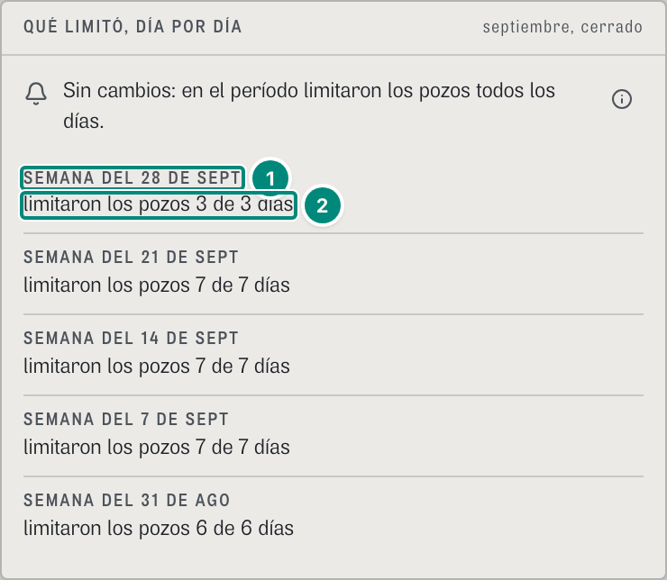

En el teléfono la franja de días no se lee: va una línea por semana, la más reciente arriba (U2 §7.5; `Semanas`, `Serie.tsx:175-203`). La leyenda y el dibujo no van.

| # | Lo que se ve | En la captura | Cómo se calcula | Texto según el valor | Viene de |
|---|---|---|---|---|---|
| 1 | Una semana | «SEMANA DEL 28 DE SEPT» | las semanas empiezan el lunes, en la hora de Colombia (`lunes`, `Serie.tsx:178`); septiembre trae cinco, desde la del 31 de agosto (6 días) | cinco a la vista y «ver N más» (`useVerMas`, `:182`, `:200`) | `dias[].dia` |
| 2 | Lo que limitó | «limitaron los pozos 3 de 3 días» | cuántos días limitó cada tramo en esa semana | un solo tramo: «{limitaron · limitó} {los pozos · la planta · afuera} {n} de {N días}»; varios: «limitaron los pozos 4, la planta 3 de 7 días»; « · N casi iguales»; sin dato, «sin dato» (`Serie.tsx:183-189`) | `dias[].dominante`, `.casiIguales` |

Lo demás cambia poco: la escalera pierde la barra de cada escalón (`sm:block`, `Escalera.tsx:146`) y el mes a mes se desplaza de lado y abre en el último mes (`alFinal`, `min-w-[560px]`, `Mensual.tsx:43-44`).

### Estados y otros campos

- **Septiembre (`cerrado`).** La tubería sigue diciendo lo de **hoy** (lo que limita, lo que pasa y lo que se pierde ahora son del 2-oct a las 14:00); lo que cambia es «Se trabó en el período»: **7.716** bbl, «en los pozos 6.676 (LC-11 · LC-04 · LC-16)», «en la planta 1.041 (P-201B)», «sin identificar 0»; el bloque «SIN IDENTIFICAR» del dibujo dice «0 bbl en el período · 301 bbl/d perdiéndose ahora», sin equipos, y conserva «Identificar» (`referencia/choke/tuberia-ceiba-2026-09.json`). La frase del gerente, que esta pantalla no muestra, es «Se trabó sobre todo en los pozos: LC-11 y LC-04 (electrosumergibles).» (6D.3).
- **El Palmar** (`#/prod/produccion/palmar/curso`). «POZOS · 7», limitan los pozos con **3.321** bbl/d; la planta 3.600 («crudo 3.600 · el menor», «agua ≈ 4.028 (16.000 bbl/d de agua)»), sin renglón de gas: no tiene tren de gas; afuera 4.200 (mercado 5.000); sin raya ni frase de hoy; «A la planta le sobran 279 bbl/d: lo que den de más los pozos pasa, hasta 279 bbl/d.»; «PERDIÉNDOSE AHORA 0 bbl/d» con «Nada: todos los pozos con prueba están produciendo.» y «Los pozos dan 3.321 según sus pruebas: pasan 3.277, se pierden 0 y los otros 44 son lo que las pruebas dan de más que el medidor oficial.»; el medidor es otro: «Punto de medición oficial (LIT-1021 y LIT-1022 · medidores automáticos de los tanques de despacho): en línea; el último día completo dio 3.186 bbl»; se trabó 77 bbl en los pozos (PA-07). En septiembre su escalera trae el caso contrario al de La Ceiba: «+ Lo que el medidor oficial da de más que las pruebas 792» (99.913 + 792 = 100.705) y, en lugar de la eficiencia (que daría 96,8 %), «Las pruebas dan menos de lo que midió el punto oficial: …» (captura 5b).
- **Trimestre, doce meses, año a la fecha.** La serie tiene 92 o más celdas, sin abreviaturas (fila 3 de la captura 4), con el tope del eje en 2.760 (trimestre) y 6.274 (doce y año a la fecha); el aviso dice lo mismo, «Sin cambios…» (6D·H40); el mes a mes lleva contorno en todos los meses del período.
- **Sin tubería de crudo** (un campo de gas, como La Zarza, o sin esquema; producción no los tiene en el demo): en lugar del dibujo, un hueco con la frase del motor («La Zarza es un campo de gas. La tubería del gas todavía no está: el gas tiene una tolerancia diferente y falta definir cómo se mide su potencial.»; sin esquema, «{campo} no tiene esquema de planta registrado: sin él no se sabe qué limita.», `choke.ts:975-979`) y «Configurar» para quien firma la configuración (`Tuberia.tsx:83-89`); sin «Ver como tabla», «PASA HOY» ni «PERDIÉNDOSE AHORA»; «Se trabó en el período» sí va.
- **Lo que el demo de producción no tiene** (se lee en las filas): limita la planta o afuera, «casi iguales», un empate al barril, capacidades firmadas, el medidor sin comunicación, el comprador por debajo del sistema y lo estructural. El empate y el cambio de lo que limita existen en los escenarios de referencia (`referencia/escenarios/empate/`, `cambio-de-limita/`).

### Interacciones

- **Una caja de la tubería** (clic o Enter; las flechas pasan de una a otra, `useFlechas`, `Tuberia.tsx:236-247`): abre «Detalle: {tramo}» debajo del dibujo, con su contorno de foco (`Detalle`, `:434-465`): lo que explica el tramo, «Lo que puede dejar pasar», «De dónde sale», «Las pruebas» (en los pozos: «la prueba más vieja es de hace 36 días (LC-01, 27 de ago)», `pruebaMasViejaDe`, `choke-reparto.ts:544-556`), «Le sobran» o «Lo que limita: es el tramo más angosto hoy: el tope del campo», «Perdiéndose ahora» («P-201B 1.665 bbl/d (LC-07 y LC-16, desde 2 de oct, 05:43)») y «Se trabó en el período» («573 bbl · P-201B 573»), con «Cerrar». La planta trae además «Ver la tubería del agua» (aquí) y «Ver la planta en el esquema» (en Planta, 6D.2). En el papel salen los cuatro detalles.
- **«Ver como tabla»** (captura 2), **«Abrir»** (la ficha del equipo, 6B.4), **«Identificar»** (6D.7), **«Ver por dónde se trabó»** (Diferidos, 6D.4), **un tramo del período** (su árbol, captura 3), **«Ver por tramo»** (captura 6).
- **Globos** de cada día de la serie y de cada mes del mes a mes (pasar el cursor o tocar; en el papel, sus tablas).
- **Con todos los campos**, tocar una fila abre la tubería de ese campo (captura 8).
