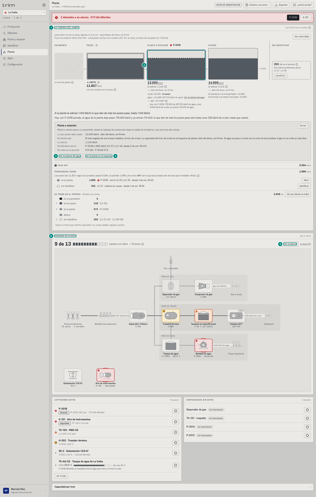
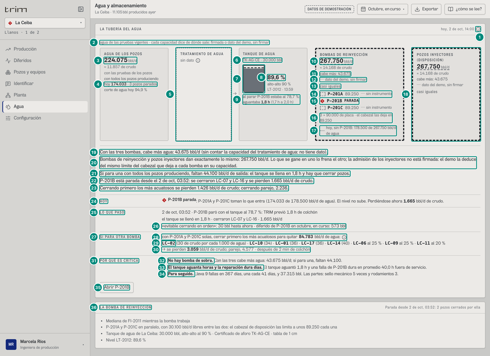
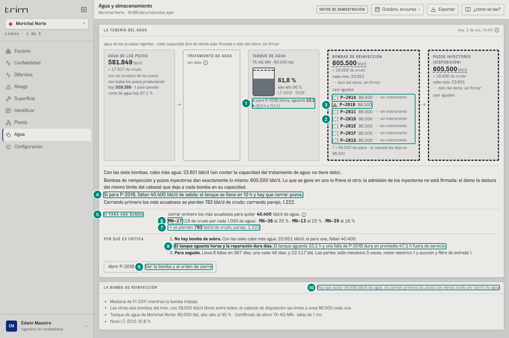
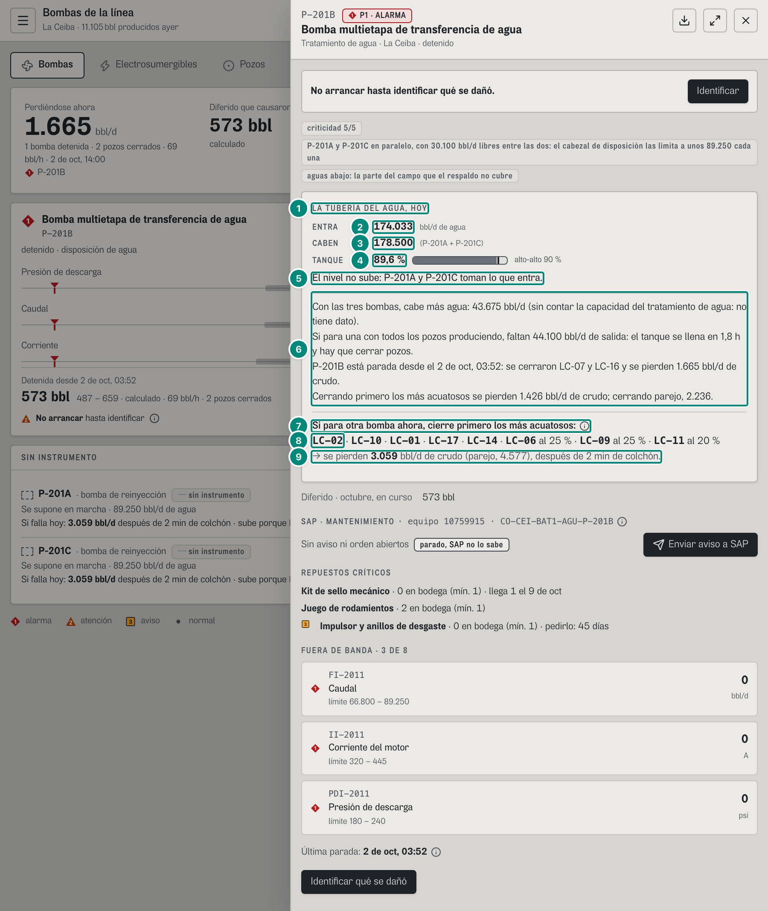
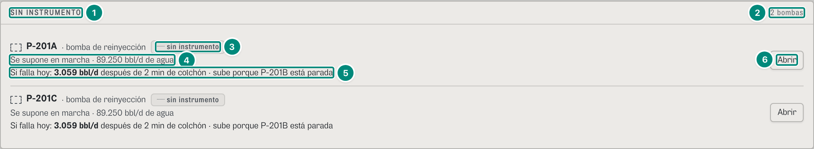
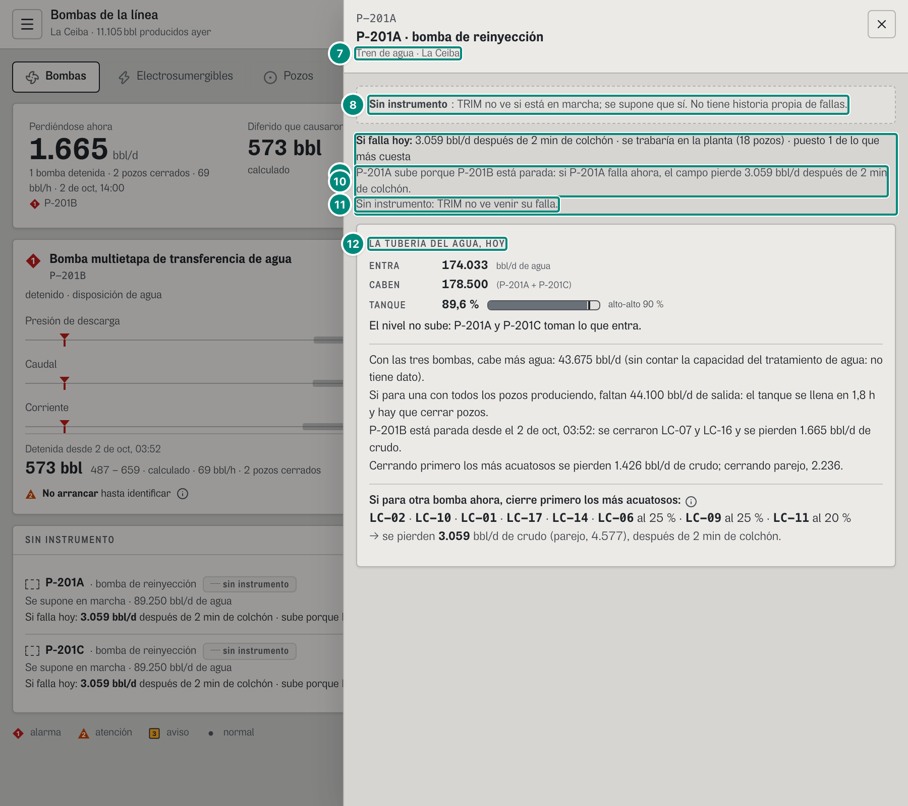
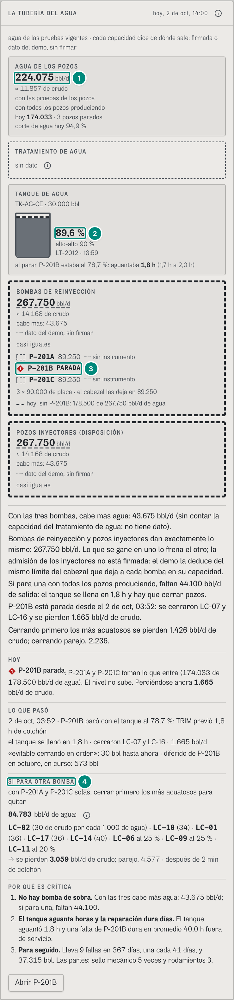
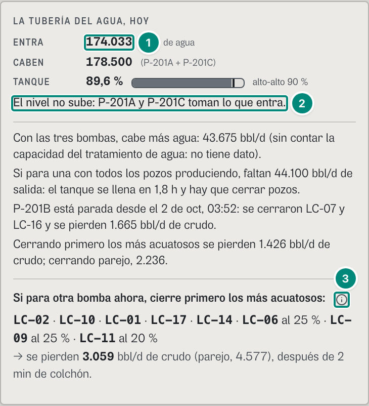

# 6D.2 Planta y Agua — la tubería encima del esquema, la tubería del agua, el colchón y «si para otra bomba» · producción, confiabilidad, administrador; la ficha de la bomba para supervisor y operador

**Para qué.** Agua: «Tren de agua: qué limita, el colchón y si para una bomba.» (`src/widgets/Onboarding.tsx:28`); en U2 §5.1, «¿Cuánta agua entra, cuánta puedo sacar, cuánto aguanta el tanque y qué pasa si para una bomba?». Planta: «Dónde está el problema. Gris es normal; color, anormal.» (`Onboarding.tsx:27`; 6C.7).
**Ruta.** `#/<rol>/planta/<campo>/<período>` y `#/<rol>/agua/<campo>/<período>`, de un campo (`campoId`, `src/pages/Agua.tsx:16`); la ficha de una bomba, `#/<rol>/bombas/<campo>/<período>/<equipo>`; «SIN INSTRUMENTO», al pie de `#/<rol>/bombas/<campo>/<período>`. · **Roles y nivel.** Planta y Agua: `prod`, `conf`, `adm` (ingeniería; `src/entities/roles.ts:54`, `:79`, `:109`); producción tiene La Ceiba y El Palmar, confiabilidad La Ceiba, Morichal Norte y Guacamayo, el administrador todos. Bombas: `sup` y `oper` (operación, La Ceiba), `jefe`, `conf`, `tec`. «LA TUBERÍA DEL AGUA, HOY» va en la ficha técnica de una bomba de disposición, en operación y en ingeniería (`AguaHoy`, `src/widgets/choke/AguaHoy.tsx:21-81`; `src/widgets/PanelEquipo.tsx:191`); el gerente ve la ficha ejecutiva, sin ella (6B.4).
**Lee.** (CONTRATO.md, «Vistas calculadas» y Anexo A.) **Escribe.** Nada.

| Endpoint | Para qué |
|---|---|
| `GET /api/vistas/campos/:campo/tuberia?desde&hasta` → `TuberiaCampo` | la tubería del campo encima del esquema (captura 1; 6D.1) |
| `GET /api/vistas/campos/:campo/agua` → `TuberiaAgua` | LA TUBERÍA DEL AGUA (capturas 2, 3 y 7), «LA TUBERÍA DEL AGUA, HOY» (capturas 4 y 8), «SIN INSTRUMENTO» y la ficha mínima (capturas 5 y 6) |
| `GET /api/vistas/campos/:campo/ahora` → `caudales`, `niveles` | «hoy 174.033», el corte de agua de hoy y el nivel del tanque (`useCampoAhora`, `src/widgets/choke/Agua.tsx:38`) |
| `GET /api/vistas/estado?campos` → `parados` | «· 3 pozos parados» |
| `GET /api/vistas/equipos-hoy?campos` → `severidad` | la marca de cada bomba (◆1 P-201B, ▲2 la de Morichal) |
| `GET /api/vistas/bombas/prediccion?campo&equipo` → `Prediccion` | HOY (`llenado`), SI PARA UNA BOMBA (`orden`), LA BOMBA DE REINYECCIÓN (`metodo`, `supuestos`) |
| `GET /api/vistas/bombas/paradas?campo&equipo` → `ParadaMedida[]` | LO QUE PASÓ: la parada abierta, su colchón previsto y el observado, «evitable cerrando en orden» |
| `GET /api/vistas/equipos/:campo/:equipo/historia` → `bomba` (`HistorialEquipo`) | POR QUÉ ES CRÍTICA |
| `GET /api/vistas/diferidos?campos&desde&hasta` → `porEquipo` | «diferido de P-201B en {período}» |
| `GET /api/vistas/criticidad?campos` → `FilaCriticidad[]` | «Si falla hoy» de P-201A y P-201C (capturas 5 y 6) |

Fórmulas: la tubería del agua (sus cinco tramos, lo que limita, «cabe más», «casi iguales» y el empate, la raya de hoy y «si para otra bomba») → 5E §6; el agua sin salida, el colchón, el llenado con la bomba ya parada y el orden de cierre con su crudo → 5B §4.2 («Agua sin salida», «Colchón del tanque», «Llenado del tanque con la bomba ya parada», «Orden de cierre y crudo en riesgo»); la predicción por papel (disposición, recobro) → 5B §4.3; la parada medida y «evitable cerrando en orden» → 5B §4.4 y §4.5; la historia de la bomba → 5B §7; «Si falla hoy» de P-201A y P-201C → 5E §7 y 6D.5; la tubería del campo → 6D.1; el esquema de planta → 6C.7.

**La tubería del agua es la del campo, en agua** (CHOKE-COMPLETO §9; U2 §5): agua de los pozos → tratamiento → tanque → bombas de reinyección → pozos inyectores. En La Ceiba el agua **no limita**: lo que entra con todos los pozos (224.075 bbl/d) es menos de lo que sacan las bombas y admiten los inyectores (267.750), y por eso cada tramo dice «cabe más», nunca «le sobran» ni «◄ limita» (B-16). Pero es **lo más frágil**: con P-201B parada, si para otra bomba hay que cerrar pozos a los 2 minutos. El tanque no tiene caudal: es el colchón que da tiempo cuando para una bomba.

### Captura 1 · producción, La Ceiba, 1.512 px: la tubería encima del esquema

Con la caja de la planta abierta. Todo lo de adentro de la tubería es lo de 6D.1 (captura 1): el mismo componente, con las mismas cifras. Confiabilidad y el administrador, que no tienen Producción (`roles.ts:79`, `:109`), la ven aquí.

| # | Lo que se ve | En la captura | Cómo se calcula | Texto según el valor | Viene de |
|---|---|---|---|---|---|
| 1 | La tubería, arriba del esquema | «LA TUBERÍA DEL CAMPO» | el mismo componente de Producción (`TuberiaDelCampo`, `src/pages/Planta.tsx:535-537`), entre la franja «2 detenidos o en alarma · 573 bbl diferidos» y «ESQUEMA DE PLANTA» (U2 §2.4) | 6D.1, capturas 1-3 | `GET /api/vistas/campos/ceiba/tuberia` |
| 2 | La planta, abierta | la caja con su contorno de foco y, debajo, «Planta o estación» con su detalle | clic (o Enter) en la caja (6D.1, Interacciones) | — | `tramos[planta]` |
| 3 | «Ver la tubería del agua» | botón del detalle | — | va a Agua (captura 2) si el rol la tiene (`Tuberia.tsx:106`, `:459`); el mismo enlace va en el carril del agua (6D.1, fila 14) y en «Capacidad por tren» (`Planta.tsx:571`) | — |
| 4 | «Ver la planta en el esquema» | botón del detalle | — | baja al esquema, sin animación (`verEsquema`, `Planta.tsx:110-112`: `scrollIntoView`); solo en Planta y en pantalla ancha: en Producción no hay esquema y en el teléfono no se pasa (`onUbicarPlanta={estrecho ? undefined : verEsquema}`, `:536`) | — |
| 5 | «Ver la tubería» | botón al lado de «9 de 13 equipos con datos» | — | sube a la tubería (`verTuberia`, `Planta.tsx:111`, `:258`); no sale en el teléfono | — |
| 6 | El esquema | «ESQUEMA DE PLANTA» | el dibujo de los equipos; la tubería es su resumen en cuatro tramos (U2 §2.4) | 6C.7 | 6C.7 |

Lo demás de la pantalla —la franja de alarma, el esquema, «CAPTURANDO DATOS», «CONFIGURADOS SIN DATOS» y «Capacidad por tren»— está en 6C.7. En el teléfono la tubería va de pie (6D.1, captura 9) y el esquema, plegado en «Ver el esquema» (`Planta.tsx:539-545`), sin los dos botones de enlace. Con otros campos, la misma tubería dice: en Morichal Norte (confiabilidad), «Qué limita hoy: los pozos (17.937 bbl/d)», la planta 18.666 con **el agua como el menor** («agua ≈ 18.666 (605.500 bbl/d de agua) · el menor»: 605.500 × 17.937/581.849) y «A la planta le sobran 729 bbl/d…»; en Guacamayo (administrador), los pozos 6.828, la planta 8.000 y afuera 7.500: «Afuera reciben 672 bbl/d más: lo que den de más los pozos pasa, hasta 672 bbl/d.» (`textosDeHoy`, `choke.ts:994-998`).

### Captura 2 · producción, La Ceiba: la tubería del agua

La pantalla Agua, «Agua y almacenamiento» (`src/pages/Agua.tsx:14-37`; `TuberiaDelAgua`, `src/widgets/choke/Agua.tsx:36-94`; U2 §5 y §9.6): el dibujo de cinco tramos, las frases del colchón y, con la bomba de la línea, cuatro renglones (hoy, lo que pasó, si para otra bomba y por qué es crítica).

| # | Lo que se ve | En la captura | Cómo se calcula | Texto según el valor | Viene de |
|---|---|---|---|---|---|
| 1 | Rótulo y su ⓘ | «LA TUBERÍA DEL AGUA» · «hoy, 2 de oct, 14:00» ⓘ | la hora del reloj (`fechaHora(AHORA)`, `Agua.tsx:48`): todo es de ahora, no del período | ⓘ «La tubería del agua»: «Es el modelo choke del agua: el agua de los pozos pasa por el tratamiento, el tanque y las bombas de reinyección hasta los pozos inyectores. El tramo más angosto dice «limita»; el tanque no tiene caudal: es el colchón que da tiempo cuando para una bomba. Cada capacidad se dice también en crudo, con el crudo que trae cada barril de agua según las pruebas.» (`AYUDA_TUBERIA`, `Agua.tsx:26`); en el papel va al final (`:86-90`) | — |
| 2 | Cabecera | «agua de las pruebas vigentes · cada capacidad dice de dónde sale: firmada o dato del demo, sin firmar» | fija | en el papel, delante, «{campo} · {período} ·» (`Agua.tsx:50-53`) | — |
| 3 | El agua de los pozos | «AGUA DE LOS POZOS» **224.075** bbl/d · «≈ 11.857 de crudo» · «con las pruebas de los pozos» | $\sum$ del agua de la prueba vigente de los 18 pozos = 224.075, y su crudo, 11.857 (la misma base de lo que dan los pozos en la tubería del campo) (`tuberiaAgua`, `src/entities/choke-agua.ts:211-213`) → 5E §6 | «≈ {crudo} de crudo» solo si hay crudo: un campo de gas lo dice en agua (B-18; `Agua.tsx:138`) | `tramos[producida].potencialBpd`, `.crudoBpd`, `.estado` |
| 4 | Lo de hoy | «con todos los pozos produciendo» · «hoy **174.033** · 3 pozos parados» · «corte de agua hoy 94,9 %» | el agua de los 15 pozos que producen ahora; el corte, $174.033/(174.033 + 9.394) = 94{,}9\,\%$ (`Agua.tsx:44`, `:66-72`) | « · N pozos parados» solo con pozos parados (`plural`) | `GET /api/vistas/campos/ceiba/ahora` → `caudales`; `GET /api/vistas/estado` → `parados` |
| 5 | El tratamiento | «TRATAMIENTO DE AGUA» «sin dato» ⓘ, caja discontinua | el esquema de La Ceiba no tiene la capacidad del tratamiento | lo que falta va en gris discontinuo (`Agua.tsx:119`, `:127`, `:143-146`); ⓘ = `sinDato`: «El demo no trae la capacidad del tratamiento de agua» (`src/entities/capacidades.ts:156-157`) | `tramos[tratamiento].sinDato` |
| 6 | El tanque | «TANQUE DE AGUA» «TK-AG-CE · 30.000 bbl» | el tanque de la configuración firmada (`tuberiaAgua`, `choke-agua.ts:239-252`) | sin tanque firmado: «sin tanque firmado» ⓘ (`Agua.tsx:170`) | `tramos[tanques].tanques[]` (`id`, `capacidadBbl`) |
| 7 | El tanque, dibujado | un recipiente lleno al 89,6 % con la raya discontinua del alto-alto | el nivel de ahora y el alto-alto (90 %) (`Agua.tsx:181-184`) | gris: el nivel no es una alarma aquí (U1 §9.3) | `niveles`, `altoAlto` |
| 8 | El nivel | **89,6 %** · «alto-alto 90 %» · «LT-2012 · 13:59» | el transmisor del tanque, con su hora (`Agua.tsx:185-191`) | sin lectura: ◆ morado «Sin comunicación · ---» (`DatoInvalido`, `:186-187`) | `GET /api/vistas/campos/ceiba/ahora` → `niveles[TK-AG-CE]` |
| 9 | El colchón | «al parar P-201B estaba al 78,7 %: aguantaba **1,8 h** (1,7 h a 2,0 h)» | con la bomba parada, el colchón previsto de la parada abierta: $V_\text{libre} = (0{,}90 − 0{,}787) \cdot 30.000 = 3.390$ bbl; $h = 3.390/(44.100/24) = 1{,}84$ h; rango 1,66-2,03 (`paradaMedida`, `choke-agua.ts:245-247`) → 5B §4.2 «Colchón del tanque» y §4.4 | en marcha: «si para {bomba} ahora, aguanta {h} ({mín} a {máx})» (captura 3); de recobro: «La bomba es de recobro y la reserva toma toda su agua: si para, el tanque no sube»; sin nivel: «Sin el nivel del tanque: no se puede calcular el colchón» (`Agua.tsx:193-200`; `choke-agua.ts:242-251`) | `tanques[].colchon` (`horas`, `rango`, `nivelPct`, `cuando`, `bomba`) |
| 10 | Las bombas | «BOMBAS DE REINYECCIÓN» **267.750** bbl/d · «≈ 14.168 de crudo» | la suma de las bombas en servicio, con la cifra de cada una en este campo: $3 \times 89.250$; en crudo, $267.750 \times 0{,}052915$ (`choke-agua.ts:229-230`, `:264-266`) → 5E §6 | la de reserva no suma | `tramos[bombas].potencialBpd`, `.crudoBpd` |
| 11 | Cabe más | «cabe más: 43.675» | $267.750 − 224.075 = 43.675$: contra lo que entra con todos los pozos (`holguraBpd`, `choke-agua.ts:254`) | «cabe más», no «le sobran», que en la tubería del campo es contra lo que limita (B-16); si no alcanza, «le faltan {n}» (`Agua.tsx:140`) | `tramos[].holguraBpd` |
| 12 | De dónde sale | «┄ dato del demo, sin firmar» | las bombas, firmadas solo si todas las de servicio lo están (`choke-agua.ts:260`) | número subrayado discontinuo y «┄» delante si no está firmado (`Agua.tsx:135`, `:141`) | `tramos[].estado` |
| 13 | Casi iguales | «casi iguales» (en las bombas y en los inyectores), contorno discontinuo grueso | los tramos de la disposición a menos del 3 % del más angosto; aquí son iguales al barril (267.750 y 267.750) (`choke-agua.ts:283-288`) | «◄ LIMITA» solo si el agua limita (B-16, B-18); el contorno discontinuo de 3 px marca lo casi igual (`Agua.tsx:128-130`, `:149-155`) | `tramos[].casiIgual`, `casiIguales`, `limita`, `angosto` |
| 14 | Una bomba sin instrumento | «⬚ P-201A 89.250 ┄ sin instrumento» | su cifra en este campo; TRIM no la ve: se cuenta en marcha (`marcha: sin-lectura`) | el rectángulo discontinuo de «falta», no el círculo de «sin comunicación» (B-44; `Agua.tsx:236`, `:242`) | `bombas[]` (`instrumentada`, `marcha`, `capacidadBpd`) |
| 15 | La bomba parada | «◆1 P-201B PARADA» | `marcha: parada`: tiene una parada abierta en el PLC | con alarma, su marca de hoy; sin alarma, el cuadrito oscuro de lo detenido (`Parada`, `Agua.tsx:229`, `:234`, `:240`); « · de reserva», « · recobro» si aplica (`:243-244`) | `bombas[].marcha`; `GET /api/vistas/equipos-hoy` → `severidad` |
| 16 | La placa | «3 × 90.000 de placa · el cabezal las deja en 89.250» | la placa es de referencia; la cifra de cada bomba es lo que deja el cabezal de disposición | solo si las de servicio tienen la misma placa y la misma cifra; «· el cabezal las deja en…» solo si la cifra es distinta de la placa (`Agua.tsx:219-223`) | `bombas[].placaBpd`, `.capacidadBpd` |
| 17 | La raya de hoy | «┈ hoy, sin P-201B: 178.500 de 267.750 bbl/d de agua» | $267.750 − 89.250 = 178.500$ (`disponibleHoy`, `choke-agua.ts:233-236`) | solo con una bomba parada; el tramo no se angosta (U2 §2.3) (`Agua.tsx:157-161`) | `tramos[bombas].disponibleHoy` |
| 18 | Los inyectores | «POZOS INYECTORES (DISPOSICIÓN)» 267.750 bbl/d · «≈ 14.168 de crudo» · «cabe más: 43.675» · «┄ dato del demo, sin firmar» · «casi iguales» | la admisión del demo, deducida del límite del cabezal: 3 × 89.250 (`capacidades.ts:158-159`) | sin dato: «sin dato» ⓘ «El demo no trae lo que admiten los pozos inyectores» (Guacamayo, El Palmar, La Zarza) | `tramos[inyectores]` |
| 19 | La primera frase | «Con las tres bombas, cabe más agua: 43.675 bbl/d (sin contar la capacidad del tratamiento de agua: no tiene dato).» | `sobraBpd` y lo que falta para decirlo (`choke-agua.ts:323-329`) → 5E §6 | «Con su bomba» / «Con las {dos…diez} bombas»; si el agua limita: «El agua limita: {tramo} deja pasar {n} bbl/d y los pozos dan {m}; faltan {f} bbl/d de salida, que frenan {c} bbl/d de crudo.»; si falta una capacidad de la disposición: «No se puede decir qué limita el agua: falta {…}. La firma el administrador.»; sin capacidades: «Sin capacidades del tren de agua en el demo: no se puede decir si el agua limita.» (`Agua.tsx:80-82`) | `frases[]` |
| 20 | El empate | «Bombas de reinyección y pozos inyectores dan exactamente lo mismo: 267.750 bbl/d. Lo que se gane en uno lo frena el otro; la admisión de los inyectores no está firmada: el demo la deduce del mismo límite del cabezal que deja a cada bomba en su capacidad.» | dos tramos iguales al barril (`choke-agua.ts:333-334`) | con la admisión firmada: «… producción tiene que explicar por qué (lo pide el método).»; a menos del 3 % sin ser iguales: «{A} y {B} están casi iguales (menos de 3 % de diferencia): lo que se gane en uno lo frena el otro.» (`:335`) | `frases[]`, `empate`, `casiIguales` |
| 21 | Si para una | «Si para una con todos los pozos produciendo, faltan 44.100 bbl/d de salida: el tanque se llena en 1,8 h y hay que cerrar pozos.» | $74.200 − 30.100 = 44.100$: lo que movía P-201B menos lo que toman sus hermanas (5B §4.2 «Agua sin salida»); las horas son las del colchón del tanque, la fila 9 (`llena`, `choke-agua.ts:336-343`) | en marcha: «Si para {bomba}, faltan…» (captura 3); de recobro: «Si para {bomba} hoy, no cierra pozos: el agua tiene otra salida. Si sigue parada semanas, el yacimiento pierde presión: eso se trabaría «en el yacimiento».»; con el respaldo que toma todo: «Si para {bomba}, el respaldo toma toda su agua: no cierra pozos.» (`:338-345`). Las 1,8 h son las del 2-oct al 78,7 %, no las de ahora (6D·H16) | `sinUna.aguaSinSalidaBpd`, `tanques[].colchon.horas` |
| 22 | Lo de hoy, en la frase | «P-201B está parada desde el 2 de oct, 03:52: se cerraron LC-07 y LC-16 y se pierden 1.665 bbl/d de crudo.» | `sinUna.desde`, los pozos que cerró la parada y lo que se pierde (`choke-agua.ts:344`) | solo con la bomba parada; «se cerró» con un pozo | `sinUna.desde`, `.perdiendoBpd` |
| 23 | El orden, en la frase | «Cerrando primero los más acuatosos se pierden 1.426 bbl/d de crudo; cerrando parejo, 2.236.» | el orden de cierre para quitar 44.100 bbl/d entre los 18 pozos: LC-02, LC-10 y LC-01 enteros, LC-17 al 25 % y LC-07 al 12 % → 1.425,5 contra 2.235,8 parejo → 5B §4.2 «Orden de cierre y crudo en riesgo» | solo en una bomba de disposición con agua sin salida (`choke-agua.ts:346-347`) | `sinUna.crudoBpd`, `.crudoParejoBpd` |
| 24 | HOY | «HOY» ◆1 «P-201B parada: P-201A y P-201C toman lo que entra (174.033 de 178.500 bbl/d de agua). El nivel no sube. Perdiéndose ahora **1.665** bbl/d de crudo.» | el llenado con la bomba ya parada: entra 174.033 y caben 178.500, así que el tanque no sube (`Prediccion.llenado`: horas sin fin) → 5B §4.2 «Llenado del tanque con la bomba ya parada» | solo con la bomba parada; si sube: «El tanque llega al alto-alto en {h}.»; sin hermanas, «quedan lo que entra» (`LoDeLaBomba`, `Agua.tsx:277-289`) | `GET /api/vistas/bombas/prediccion` → `llenado`; `sinUna.perdiendoBpd` |
| 25 | LO QUE PASÓ | «2 de oct, 03:52 · P-201B paró con el tanque al 78,7 %: TRIM previó 1,8 h de colchón» · «el tanque se llenó en 1,8 h · cerraron LC-07 y LC-16 · 1.665 bbl/d» | la parada abierta medida: lo previsto (1,84 h) contra lo observado (1,84 h: de las 03:52:18 a las 05:43) → 5B §4.4 | el renglón de lo observado solo si el tanque llegó al alto-alto (`Agua.tsx:291-302`) | `GET /api/vistas/bombas/paradas` → `ParadaMedida.colchon` |
| 26 | Lo evitable | «evitable cerrando en orden»: 30 bbl hasta ahora · diferido de P-201B en octubre, en curso: 573 bbl | lo que costó de más cerrar como se cerró (LC-16 y LC-07) en vez del orden de TRIM → 5B §4.5; el diferido del período de la bomba (5A) | — | `ParadaMedida.evitable`; `GET /api/vistas/diferidos` → `porEquipo` |
| 27 | SI PARA OTRA BOMBA | «SI PARA OTRA BOMBA» | con una bomba de la línea ya parada, lo que pasa si para otra de las que quedan (B-01): la misma cuenta del «si falla hoy» de las hermanas (`siParaOtra`, `choke-agua.ts:303-320`) → 5E §6 | sin ninguna parada, en su lugar va «SI PARA UNA BOMBA» con el orden de `Prediccion` (captura 3; `Agua.tsx:305-341`) | `siParaOtra` |
| 28 | El agua que hay que quitar | «con P-201A y P-201C solas, cerrar primero los más acuatosos para quitar **84.783** bbl/d de agua:» ⓘ | entra 174.033 y quedaría una sola de 89.250 (la mayor de las que siguen): $174.033 − (178.500 − 89.250) = 84.783$ | ⓘ «Los más acuatosos»: «Hay que parar los pozos acuatosos, los que más producen agua»: es la regla de operación del campo. TRIM los ordena por el crudo que dan por cada barril de agua: primero los que menos crudo pierden.» (`AYUDA_ACUATOSOS`, `Agua.tsx:27`) | `siParaOtra.enMarcha`, `.aguaSinSalidaBpd` |
| 29 | El orden | «LC-02 (30 de crudo por cada 1.000 de agua) · LC-10 (34) · LC-01 (36) · LC-17 (36) · LC-14 (40) · LC-06 al 25 % · LC-09 al 25 % · LC-11 al 20 %» | el orden de TRIM para 84.783 bbl/d (5B §4.2 «Orden de cierre…»): cinco enteros; LC-06 y LC-09, electrosumergibles, no bajan más de 25 %; LC-11 cierra lo que falta (20 %) | entero: «({crudo por cada 1.000 de agua})», con «de crudo por cada 1.000 de agua» solo en el primero; en parte: «al {n} %» (`Agua.tsx:312-318`) | `siParaOtra.pasos[]` (`pozo`, `fraccion`, `crudoPorAgua`) |
| 30 | Lo que costaría | «→ se pierden **3.059** bbl/d de crudo; parejo, 4.577 · después de 2 min de colchón» | 3.058,6 en orden contra 4.576,5 parejo; colchón al nivel de ahora: $(0{,}90 − 0{,}896) \cdot 30.000 = 120$ bbl libres; $120/(84.783/24) = 0{,}034$ h ≈ 2 min | «después de {colchón}», en minutos bajo una hora (`textoColchon`); sin nivel, sin colchón (`Agua.tsx:319`) | `siParaOtra.crudoBpd`, `.crudoParejoBpd`, `.colchonH` |
| 31 | POR QUÉ ES CRÍTICA | «POR QUÉ ES CRÍTICA» | tres renglones de la bomba de la línea, sin teoría (U2 §5.4; `Agua.tsx:343-366`) | solo en una bomba de disposición con agua sin salida y con historia | `sinUna`, `HistorialEquipo` |
| 32 | No hay de sobra | «**No hay bomba de sobra.** Con las tres cabe más agua: 43.675 bbl/d; si para una, faltan 44.100.» | `sobraBpd` y `sinUna.aguaSinSalidaBpd` | la negrita solo si no hay bomba de reserva (`Agua.tsx:348`) | `sobraBpd`, `sinUna` |
| 33 | El colchón contra la reparación | «**El tanque aguanta horas y la reparación dura días.** El tanque aguantó 1,8 h y una falla de P-201B dura en promedio 40,0 h fuera de servicio.» | el colchón de la fila 9 contra el tiempo medio fuera de servicio de sus fallas cerradas (`mdtH`) → 5B §7 | la negrita solo si el colchón es menor que la reparación; «aguantó» (al parar) o «aguanta» (si para ahora) (`Agua.tsx:351-356`) | `tanques[].colchon.horas`; `HistorialEquipo.mdtH` |
| 34 | Para seguido | «**Para seguido.** Lleva 9 fallas en 367 días, una cada 41 días, y 37.315 bbl. Las partes: sello mecánico 5 veces y rodamientos 3.» | la historia de la bomba (5B §7): fallas, días de historia, cada cuánto y lo que le ha costado; hasta tres partes | la negrita con más de una falla (`Agua.tsx:357-363`) | `HistorialEquipo` (`fallas`, `dias`, `mtbfDias`, `bbl`, `porParte`) |
| 35 | Abrir P-201B | «Abrir P-201B» | — | abre la ficha (captura 4); quien tiene Bombas ve además «Ver la bomba y el orden de cierre» (captura 3; `Agua.tsx:368-371`) | — |
| 36 | LA BOMBA DE REINYECCIÓN | «LA BOMBA DE REINYECCIÓN» · «Parada desde 2 de oct, 03:52: 2 pozos cerrados por ella» y sus supuestos | el método y los supuestos de la predicción (5B §4.3): «Mediana de FI-2011 mientras la bomba trabaja», «P-201A y P-201C en paralelo, con 30.100 bbl/d libres entre las dos: el cabezal de disposición las limita a unos 89.250 cada una», «Tanque de agua de La Ceiba: 30.000 bbl, alto-alto al 90 % · Certificado de aforo TK-AG-CE · tabla de 1 cm», «Nivel LT-2012: 89,6 %» | la bomba es la de perfil de inyección del registro, no un id fijo (`src/pages/Agua.tsx:17-20`, `:30-34`) | `Prediccion.metodo`, `.supuestos` |

El lector oye el dibujo en una frase (`resumenAgua`, `Agua.tsx:97-108`): «Tubería del agua de La Ceiba. Entran 224.075 barriles de agua por día con todos los pozos produciendo; hoy, 174.033. Tratamiento de agua: sin dato. Bombas de reinyección: 267.750, casi igual a otro tramo. Pozos inyectores (disposición): 267.750, casi igual a otro tramo. Tanque de agua de La Ceiba: al 89,6 %, alto-alto 90 %. Hoy, sin P-201B: 178.500 de 267.750 bbl/d de agua.» Debajo del panel va una lectura fija: «El agua no se mide en cada pozo: sale de sus pruebas. La que saca la bomba sí se mide, en su medidor de caudal. Lo que las bombas no sacan llena el tanque; cuando llega al alto-alto, hay que cerrar pozos, primero los más acuatosos. Por eso la bomba de reinyección es de alto impacto.» (`src/pages/Agua.tsx:25-29`).

### Captura 3 · confiabilidad, Morichal Norte: la bomba en marcha

Las reglas son las de la captura 2; aquí, lo que cambia con la bomba de la línea **en marcha** (▲2: la succión va cayendo, 6B.1). Sin bomba parada no hay raya de hoy, «HOY», «LO QUE PASÓ» ni «SI PARA OTRA BOMBA». Arriba: «AGUA DE LOS POZOS 581.849 bbl/d · ≈ 17.937 de crudo · hoy 559.389 · 1 pozo parado · corte de agua hoy 97,1 %»; las bombas y los inyectores, 605.500 cada uno, iguales al barril («casi iguales»); las frases: «Con las siete bombas, cabe más agua: 23.651 bbl/d (…)», el empate, «Si para P-201B…» (fila 4) y «Cerrando primero los más acuatosos se pierden 783 bbl/d de crudo; cerrando parejo, 1.222.».

| # | Lo que se ve | En la captura | Cómo se calcula | Texto según el valor | Viene de |
|---|---|---|---|---|---|
| 1 | El colchón, si para ahora | «si para P-201B ahora, aguanta **10,1 h** (9,0 h a 11,1 h)» | al nivel de ahora (61,8 %): $V_\text{libre} = (0{,}90 − 0{,}618) \cdot 60.000 = 16.920$ bbl; $h = 16.920/(40.400/24) = 10{,}05$ h; rango 9,04-11,06 (`prediccion(…).colchon`, `choke-agua.ts:248-249`) → 5B §4.2 «Colchón del tanque» (el ejemplo de Morichal) | `cuando: si-para-ahora` (`Agua.tsx:197`) | `tanques[].colchon` |
| 2 | Siete bombas | P-201A a P-201G, 86.500 cada una, seis «┄ sin instrumento» · «7 × 90.000 de placa · el cabezal las deja en 86.500» | $7 \times 86.500 = 605.500$; cabe más $605.500 − 581.849 = 23.651$ | captura 2, filas 14 y 16 | `bombas[]` |
| 3 | La bomba de la línea, en marcha | ▲2 «P-201B 86.500» | en marcha, con su marca de hoy | sin «PARADA»: su cifra (`Agua.tsx:237`, `:241`) | `bombas[P-201B].marcha`; `severidad` |
| 4 | Si para | «Si para P-201B, faltan 40.400 bbl/d de salida: el tanque se llena en 10 h y hay que cerrar pozos.» | $79.900 − 39.500 = 40.400$: lo que mueve P-201B menos lo que toman las otras seis (5B §4.2 «Agua sin salida»); las horas, las de la fila 1 | captura 2, fila 21 | `sinUna`, `tanques[].colchon` |
| 5 | SI PARA UNA BOMBA | «SI PARA UNA BOMBA» · «cerrar primero los más acuatosos para quitar **40.400** bbl/d de agua:» ⓘ | sin una bomba parada, el orden de la predicción de la bomba de la línea (`Prediccion.orden`, `Agua.tsx:324-341`) → 5B §4.2 «Orden de cierre y crudo en riesgo» | ⓘ «Los más acuatosos» (captura 2, fila 28) | `GET /api/vistas/bombas/prediccion` → `orden` |
| 6 | El orden | «MN-27 (19 de crudo por cada 1.000 de agua) · MN-36 al 25 % · MN-13 al 25 % · MN-39 al 16 %» | MN-27 entero; MN-36 y MN-13, electrosumergibles, en su tope de 25 %; MN-39 cierra lo que falta (5B §4.2, el ejemplo de Morichal) | captura 2, fila 29 | `orden.pasos[]` |
| 7 | Lo que costaría | «→ se pierden 783 bbl/d de crudo; parejo, 1.222» | 783,07 contra 1.222,00 | sin colchón en el renglón: lo dice el tanque (fila 1) | `orden.crudoBpd`, `.crudoParejoBpd` |
| 8 | El colchón contra la reparación | «**El tanque aguanta horas y la reparación dura días.** El tanque aguanta 10,1 h y una falla de P-201B dura en promedio 47,1 h fuera de servicio.» | «aguanta» porque el colchón es el de si para ahora | captura 2, fila 33; los otros dos renglones: «No hay bomba de sobra. Con las siete cabe más agua: 23.651 bbl/d; si para una, faltan 40.400.» y «Para seguido. Lleva 8 fallas en 367 días, una cada 46 días, y 22.117 bbl. Las partes: sello mecánico 5 veces, motor eléctrico 1 y succión y filtro de entrada 1.» | `HistorialEquipo` |
| 9 | «Ver la bomba y el orden de cierre» | botón | — | solo con Bombas en el rol: confiabilidad sí, producción no (`Agua.tsx:370`); lleva a Bombas (6B.1) | — |
| 10 | El método | «Hay que quitar 40.400 bbl/d de agua: se cierran primero los pozos con menos crudo por barril de agua» | `Prediccion.metodo` de una bomba de disposición en marcha (5B §4.3) | — | `Prediccion.metodo` |

### Captura 4 · supervisor, la ficha de P-201B: «LA TUBERÍA DEL AGUA, HOY»

A 900 px, como las fichas de 6B.4. El supervisor no tiene la pantalla Agua: la ficha le trae lo que necesita con la bomba parada (U2 §5.6 y §9.6; B-01, B-17). El resto de la ficha es de 6B.4.

| # | Lo que se ve | En la captura | Cómo se calcula | Texto según el valor | Viene de |
|---|---|---|---|---|---|
| 1 | El bloque | «LA TUBERÍA DEL AGUA, HOY» | en la ficha técnica de una bomba de disposición (`PanelEquipo.tsx:191`; `AguaHoy.tsx:21-81`); no va en una de recobro, de transporte ni en un campo de gas (`AguaHoy.tsx:27`) | con la bomba de la línea parada, la ficha no pinta la lectura fija del registro: va esto, que arma el motor (B-17; `paradaDelTren`, `PanelEquipo.tsx:67-69`, `:189`) | `GET /api/vistas/campos/ceiba/agua` |
| 2 | ENTRA | «ENTRA **174.033** bbl/d de agua» | el agua que entra ahora (`siParaOtra.entraBpd`) | ENTRA, CABEN, TANQUE y si el nivel sube, solo con una bomba ya parada (`AguaHoy.tsx:39-58`) | `siParaOtra.entraBpd` |
| 3 | CABEN | «CABEN **178.500** (P-201A + P-201C)» | lo que caben las que siguen: $2 \times 89.250$ | — | `siParaOtra.cabenBpd`, `.enMarcha` |
| 4 | TANQUE | «TANQUE **89,6 %**», su barra con la raya del alto-alto, «alto-alto 90 %» | el nivel de ahora y el alto-alto (`AguaHoy.tsx:43-53`) | solo con nivel | `tanques[].nivelPct`, `.altoAlto` |
| 5 | Si sube | «El nivel no sube: P-201A y P-201C toman lo que entra.» | entra 174.033 y caben 178.500 | si entra más: «El nivel sube: entra más de lo que caben {…}.»; con una sola, «toma» (`AguaHoy.tsx:54-56`) | `siParaOtra.entraBpd`, `.cabenBpd` |
| 6 | Las frases del colchón | «Con las tres bombas, cabe más agua…» · «Si para una con todos los pozos produciendo…» · «P-201B está parada desde…» · «Cerrando primero los más acuatosos…» | las del motor (captura 2, filas 19 y 21-23) sin la del empate, que es de ingeniería y está en Agua (`AguaHoy.tsx:31-32`) | la de «Si para una…» trae el colchón del 2-oct (6D·H16) | `frases[]` |
| 7 | El orden, para quien opera | «Si para otra bomba ahora, cierre primero los más acuatosos:» ⓘ | el orden de la que sigue en riesgo, no solo los pozos que ya cerró la parada (B-01; `AguaHoy.tsx:62-75`) | ⓘ «Los más acuatosos» (captura 2, fila 28); sin pasos, no va | `siParaOtra.pasos` |
| 8 | Los pozos | «LC-02 · LC-10 · LC-01 · LC-17 · LC-14 · LC-06 al 25 % · LC-09 al 25 % · LC-11 al 20 %» | captura 2, fila 29 | solo el nombre y, en parte, «al {n} %» (`AguaHoy.tsx:67-69`) | `siParaOtra.pasos[]` |
| 9 | Lo que costaría | «→ se pierden **3.059** bbl/d de crudo (parejo, 4.577), después de 2 min de colchón.» | captura 2, fila 30 | «después de {colchón}» (`textoColchon`) | `siParaOtra.crudoBpd`, `.crudoParejoBpd`, `.colchonH` |

Quien tiene la pantalla Agua (confiabilidad, el administrador) ve al final «Ver la tubería del agua», que cierra la ficha y abre Agua (`AguaHoy.tsx:33`, `:76-78`); en ingeniería, arriba del bloque va «Si falla hoy: ya está parado: se pierden 1.665 bbl/d ahora» (`SiFallaHoyFicha`, 6D.5). Con la bomba en marcha (P-201B de Morichal, confiabilidad) el bloque trae solo las frases («Con las siete bombas…», «Si para P-201B, faltan 40.400…», «Cerrando primero…») y el botón.

### Capturas 5 y 6 · supervisor: «SIN INSTRUMENTO» en Bombas y la ficha mínima de P-201A

P-201A y P-201C sacan el agua de La Ceiba mientras P-201B está parada, y no tienen instrumento: TRIM no las ve parar, pero existen (B-01, B-37, B-44). Van al pie de Bombas, después de las placas, y tienen una ficha mínima.

| # | Lo que se ve | En la captura | Cómo se calcula | Texto según el valor | Viene de |
|---|---|---|---|---|---|
| 1 | El bloque | «SIN INSTRUMENTO» | las bombas del tren de agua en servicio sin instrumento (`SinInstrumento`, `src/pages/Bombas.tsx:140-175`) | uno por campo del ámbito; en portafolio, « · {campo}» (`:148-149`); sin ninguna, no va (`:144-145`) | `GET /api/vistas/campos/ceiba/agua` → `tramos[bombas].bombas[]` (`instrumentada: false`, `reserva: false`) |
| 2 | Cuántas | «2 bombas» | — | «1 bomba» o «N bombas» (`Bombas.tsx:150`) | ídem |
| 3 | Una bomba | «⬚ P-201A · bomba de reinyección» · chip «┄ sin instrumento» | — | el rectángulo discontinuo de «falta», no el círculo de «sin comunicación» (B-44; `Bombas.tsx:159-161`); «bomba de recobro» si es de recobro | `bombas[].papel` |
| 4 | Lo que se sabe | «Se supone en marcha · 89.250 bbl/d de agua» | su cifra en este campo | — | `bombas[].capacidadBpd` |
| 5 | Si falla hoy | «Si falla hoy: **3.059 bbl/d** después de 2 min de colchón · sube porque P-201B está parada» | la fila de «Si falla hoy» de la bomba (5E §7; 6D.5): con P-201B parada, si falla P-201A queda P-201C sola, la misma cuenta de `siParaOtra` (captura 2, filas 28-30) | «después de {colchón}», en minutos bajo una hora (`colchon`, `Bombas.tsx:134`); « · sube porque {otra} está parada» si subió (`:164-166`) | `GET /api/vistas/criticidad` (6D.5) |
| 6 | Abrir | «Abrir» | — | abre la ficha mínima (fila 7), en su campo; el lector oye «Abrir P-201A»; en el teléfono mide 48 px (`Bombas.tsx:168`) | — |
| 7 | La ficha mínima | «P-201A» · «P-201A · bomba de reinyección» · «Tren de agua · La Ceiba» | un equipo sin registro propio: la ficha dice lo que se sabe y no inventa lo demás (`FichaMinima`, `PanelEquipo.tsx:78`, `:332-367`) | el nombre de su fila de criticidad | `GET /api/vistas/criticidad` → `nombre` |
| 8 | Sin instrumento | «**Sin instrumento**: TRIM no ve si está en marcha; se supone que sí. No tiene historia propia de fallas.» | fijo (`PanelEquipo.tsx:356-360`) | — | — |
| 9 | Si falla hoy | «Si falla hoy: 3.059 bbl/d después de 2 min de colchón · se trabaría en la planta (18 pozos) · puesto 1 de lo que más cuesta» | 6D.5 (`SiFallaHoyFicha`) | en operación y en ingeniería (`nivel !== 'decision'`, `PanelEquipo.tsx:361`) | `GET /api/vistas/criticidad` (6D.5) |
| 10 | Por qué subió | «P-201A sube porque P-201B está parada: si P-201A falla ahora, el campo pierde 3.059 bbl/d después de 2 min de colchón.» | 6D.5 | — | ídem |
| 11 | Lo que TRIM no ve | «Sin instrumento: TRIM no ve venir su falla.» | 6D.5 | — | ídem |
| 12 | La tubería del agua, hoy | «LA TUBERÍA DEL AGUA, HOY» | la de la captura 4: P-201A también es una bomba de disposición del tren (`PanelEquipo.tsx:362`) | — | `GET /api/vistas/campos/ceiba/agua` |

P-201C tiene el mismo renglón y la misma ficha («Si falla hoy: 3.059 bbl/d después de 2 min de colchón · sube porque P-201B está parada»): las dos tienen la misma cifra y, si falla cualquiera, queda la otra sola.

### En el teléfono (390 px)

**Captura 7 · Agua de pie.**

| # | Lo que se ve | En la captura | Cómo se calcula | Texto según el valor | Viene de |
|---|---|---|---|---|---|
| 1 | Los tramos, uno debajo del otro | «AGUA DE LOS POZOS 224.075 bbl/d…» arriba y los inyectores abajo | la rejilla de cinco columnas es de pantalla ancha (`md:`, `Agua.tsx:63`); en el teléfono, una columna y sin flechas (`:123`) | — | — |
| 2 | El tanque | «89,6 %» al lado del recipiente | — | igual que en la captura 2 | — |
| 3 | La bomba parada | «◆1 P-201B PARADA» | — | ídem | — |
| 4 | Los renglones de la bomba | «SI PARA OTRA BOMBA» encima de su texto | el rótulo ocupa su propio renglón (`w-full sm:w-[150px]`, `Agua.tsx:267`) | — | — |

**Captura 8 · la ficha de P-201B en el teléfono.**

Es el boceto de U2 §9.6 («Teléfono, dentro de la ficha de la bomba en Bombas»): lo que ve el supervisor en campo con la bomba parada. El bloque es el mismo de la captura 4; la ficha ocupa todo el ancho.

| # | Lo que se ve | En la captura | Cómo se calcula | Texto según el valor | Viene de |
|---|---|---|---|---|---|
| 1 | ENTRA | «174.033» | captura 4, fila 2 | — | `siParaOtra.entraBpd` |
| 2 | Si sube | «El nivel no sube: P-201A y P-201C toman lo que entra.» | captura 4, fila 5 | — | `siParaOtra` |
| 3 | El ⓘ de los más acuatosos | ⓘ | captura 4, fila 7 | en el teléfono el ⓘ es un blanco de toque de 24 px (WCAG 2.5.8; `src/shared/ui/Info.tsx:33-35`); «Ver la tubería del agua», para quien lo tiene, mide 48 px (`AguaHoy.tsx:77`) | — |

### Estados y otros campos

- **Guacamayo** (confiabilidad, administrador; `#/conf/agua/guacamayo/curso`): la bomba de la línea es de **recobro**. «TK-AG-GU · 20.000 bbl», 42,3 %, y en lugar del colchón «La bomba es de recobro y la reserva toma toda su agua: si para, el tanque no sube»; las bombas suman 110.000 (P-201A 60.000 ┄ sin instrumento, P-201B 50.000 · recobro, P-201C 50.000 ┄ sin instrumento · de reserva: la de reserva no suma); los inyectores, «sin dato». Frases: «Con las dos bombas, cabe más agua: 19.878 bbl/d (sin contar la capacidad del tratamiento de agua y la admisión de los inyectores: no tienen dato).» y «Si para P-201B hoy, no cierra pozos: el agua tiene otra salida. Si sigue parada semanas, el yacimiento pierde presión: eso se trabaría «en el yacimiento».». Sin «SI PARA UNA BOMBA» ni «POR QUÉ ES CRÍTICA» (no es de disposición); LA BOMBA DE REINYECCIÓN: «Inyección para recobro con salida alterna para el agua: parar no cierra pozos hoy. Baja el soporte de presión del yacimiento y el efecto llega en semanas.» y «P-201C de reserva (50.000 bbl/d), alineada al pozo de disposición alterno: toma todo su caudal».
- **El Palmar** (producción): «sin tanque firmado» ⓘ; una bomba, P-201B 16.000 «┄ sin instrumento», sin perfil: no hay «si para», ni orden, ni el panel de la bomba (`src/pages/Agua.tsx:19`, `:30`); los inyectores, «sin dato»; una frase: «Con su bomba, cabe más agua: 2.808 bbl/d (sin contar la capacidad del tratamiento de agua y la admisión de los inyectores: no tienen dato).».
- **La Zarza** (administrador), campo de gas: el agua va en agua, sin «≈ de crudo» (B-18): 1.429 bbl/d, P-201B 4.000 ┄ sin instrumento, «cabe más: 2.571», y la frase «La Zarza es un campo de gas: su agua se dice en agua, sin pasarla a crudo.» (`choke-agua.ts:325`).
- **Lo que el demo no tiene** (se lee en las filas): el agua que limita («◄ LIMITA» y «El agua limita: …»), un tanque sin lectura (◆ morado «Sin comunicación · ---»), una bomba parada sin alarma (el cuadrito oscuro), el respaldo que toma toda el agua y el tanque que sube con la bomba parada («El nivel sube…», «El tanque llega al alto-alto en {h}.»).

### Interacciones

- **Planta:** «Ver la tubería» y «Ver la planta en el esquema» mueven la vista entre la tubería y el esquema, sin animación (captura 1); «Ver la tubería del agua» va a Agua desde el carril del agua, el detalle de la planta y «Capacidad por tren».
- **Agua:** «Abrir P-201B» (la ficha, 6B.4 y captura 4); «Ver la bomba y el orden de cierre» (Bombas, 6B.1; solo quien la tiene); los ⓘ (globos; en el papel, una vez al final, `Agua.tsx:86-90`). El panel no se parte en el papel (`print:break-inside-avoid`, `Agua.tsx:47`).
- **Bombas:** «Abrir» en «SIN INSTRUMENTO» abre la ficha mínima en su campo (`setCampo`, `abrirEquipo`, `Bombas.tsx:168`).
- **La ficha:** «Ver la tubería del agua» cierra la ficha y abre Agua (`AguaHoy.tsx:77`); «Identificar qué se dañó» y lo demás, 6B.4.
