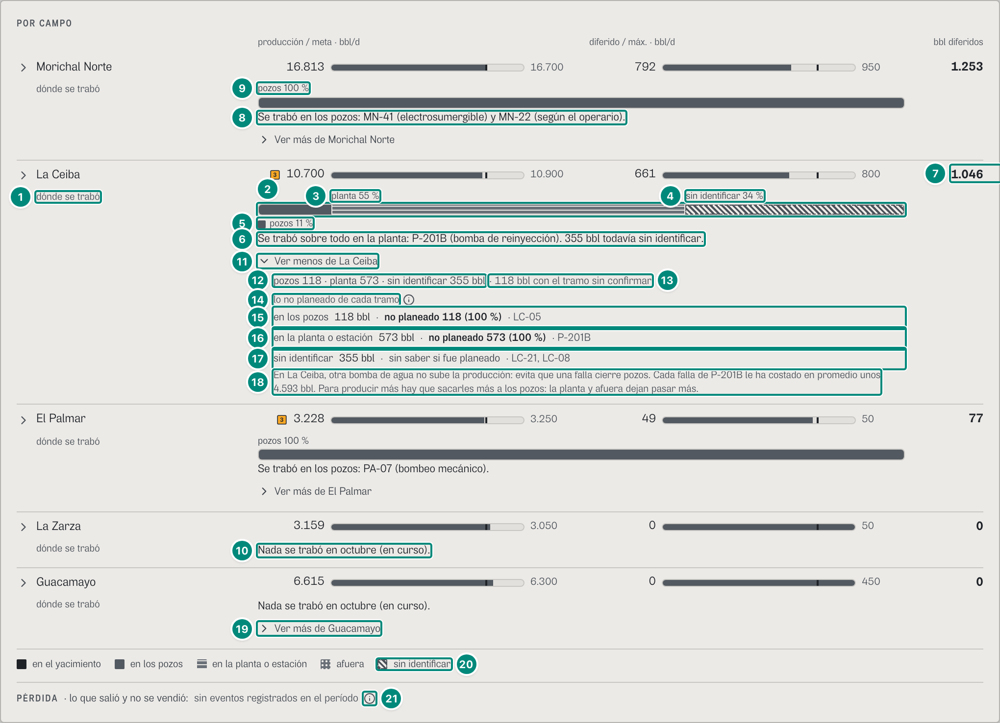
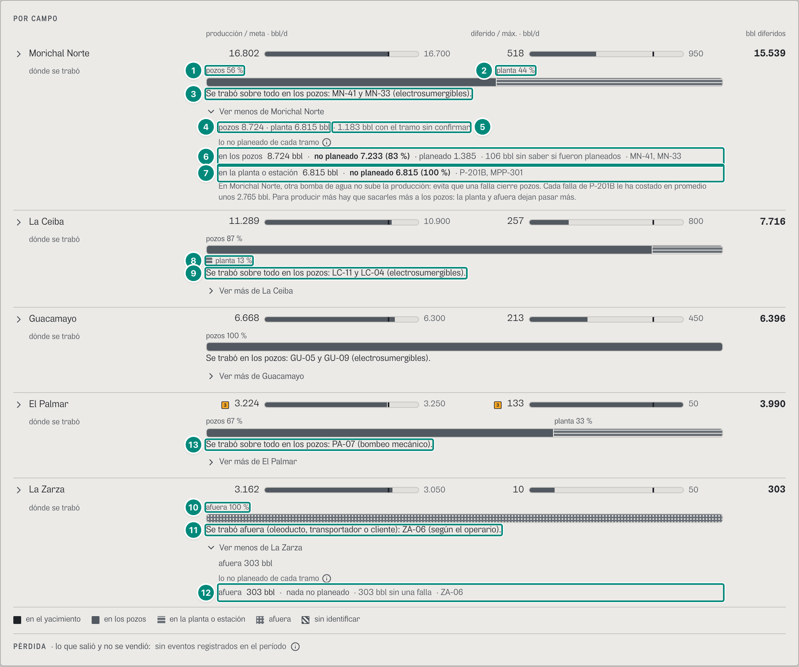
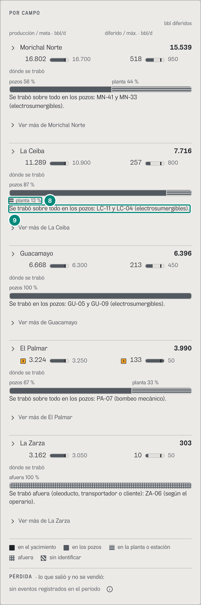
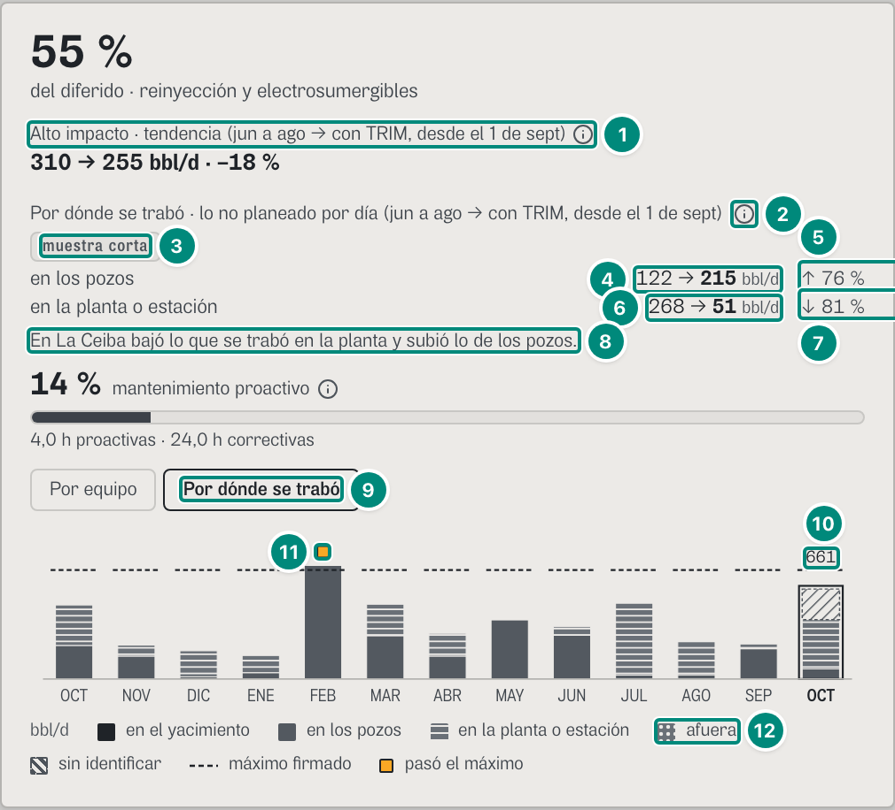
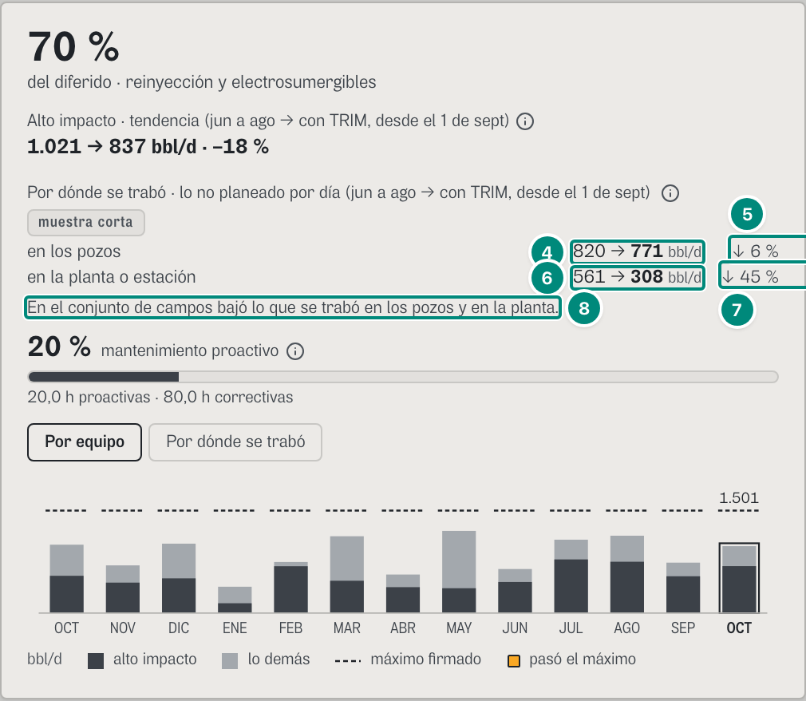
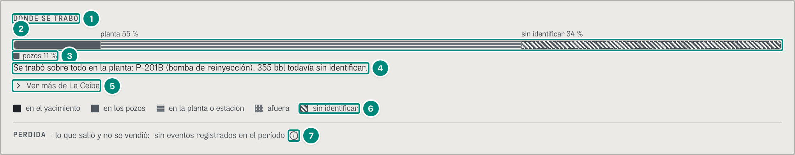

# 6D.3 Resumen del activo — «dónde se trabó» cada campo, con lo no planeado · gerente

> **CAMBIADO (v3, 27 y 28-oct-2026).** El gerente ve el choke en **La planta viva** (producido · diferido · perdido por tramo, con su traza a un toque) y los tonos de resultados. Lo que rige: [06-pantallas-v3.md](../06-pantallas-v3.md) §6.1 y §6.7.

**Para qué.** «Lo perdido, el retorno posible y a qué equipo ir.» (`PARA_QUE_DECISION.resumen`, `src/widgets/Onboarding.tsx:37`). Lo del choke responde la pregunta que U2 §3.1 le da al gerente: «¿En qué tramo se me trabó cada campo este mes, y con qué equipos?».
**Ruta.** `#/ger/resumen/ceiba~portafolio/<período>` (todos los campos: «POR CAMPO») y `#/ger/resumen/<campo>/<período>` (un campo: el panel «DÓNDE SE TRABÓ») · **Roles y nivel.** `ger` → `decision`: el Resumen de ese nivel es `ResumenDirectivo` (`src/pages/Resumen.tsx:34`). Lo demás de la pantalla (el ciclo, MEDIDO · PERÍODO, «Durante», el alto impacto, POR EQUIPO y la lista de equipos de cada campo) está en 6A.1; aquí va solo lo del choke.
**Lee.** Una consulta por campo, con el período de la cabecera (`DondeSeTraboCampo`, `src/widgets/resumen/DondeSeTrabo.tsx:35-88`), más dos de todos los campos juntos (CONTRATO.md, Anexo A):

| Endpoint | Para qué |
|---|---|
| `GET /api/vistas/choke/reparto?campos=<campo>&desde&hasta` → `BrechaChoke` | la barra (`porChoke`, `diferido`), «pozos 118 · planta 573 · …», lo que espera a una persona (`porConfirmar`), el inventario entre días (`sinExplicar`), lo no planeado de cada tramo (`porChokeEscalon`) y sus equipos (`porChokeEquipo`) |
| `GET /api/vistas/campos/:campo/tuberia?desde&hasta` → `TuberiaCampo` | solo `fraseGerente` |
| `GET /api/vistas/choke/arbol?campos=<campo>&desde&hasta&orden=gestion` → `ArbolChoke` | qué tramos tienen barriles y cuántos (`raiz.hijos[].bbl`), para «lo no planeado de cada tramo». Se pide al cargar, aunque «Ver más» esté cerrado (el bloque va escondido, no ausente) |
| `GET /api/vistas/criticidad?campos=<campo>` → `VistaCriticidad` | solo `campos[0].desembotellar` (U2 §6.5) |
| `GET /api/vistas/choke/base?campos&desde=<1-sep>&hasta=<AHORA>` → `LineaBasePorTramo` | «Por dónde se trabó · lo no planeado por día» (siempre desde que entró TRIM, no con el período de la cabecera) |
| `GET /api/vistas/choke/mensual?campos` → `MesPorTramo[]` | el mes a mes «Por dónde se trabó» |
| `GET /api/vistas/diferidos?campos&desde&hasta` → `Libro` y `GET /api/vistas/diferidos/mensual?campos` | lo de 6A.1: la cifra de cada campo (`porCampo[].brecha`), la leyenda (`diferido`), el mes a mes «Por equipo» |

Fórmulas: el tramo de cada fila → 5E §3; el reparto del período por tramo y por escalón, los equipos de cada tramo y la frase del gerente → 5E §4 y §6; las palabras de los tramos → 5E §1; lo no planeado (el escalón `disponibilidad-no-planeada`, la cifra del norte, D4) → 5E §4; «antes → con TRIM» por tramo y el mes a mes → 5E §8; el árbol en orden `gestion` → 5E §5; lo que se gana desembotellando → 5E §7; la cifra de cada campo → 5A §3.

Lo que hay que llevarse: **la barra de cada campo suma exacto el diferido del libro del campo** (U2 §0, principio 6): Σ `porChoke` = `diferido` = `Libro.porCampo[].brecha` (1.046 en La Ceiba, octubre). Solo cuando el período corta meses aparece un resto que no es de ningún tramo, el inventario entre días (`sinExplicar`), y se dice aparte. El gerente no ve la tubería, potenciales, códigos de la ANH, N1/N2 ni la palabra «choke» (U2 §3.2): campo → dónde → qué equipo. La e2e `choke-arbol` lo comprueba en la pantalla y en el papel. Por cada campo con barriles se piden cuatro vistas enteras para usar unas pocas cifras de cada una (6D·H3).

### Captura 1 · gerente, todos los campos, octubre en curso («Ver más de La Ceiba» abierto)

| # | Lo que se ve | En la captura | Cómo se calcula | Texto según el valor | Viene de |
|---|---|---|---|---|---|
| 1 | Rótulo de la fila | «dónde se trabó» | fijo, debajo de las barras de cada campo y en sus mismas columnas, siempre a la vista (`src/widgets/resumen/PorCampo.tsx:132-137`) | — | — |
| 2 | La barra de La Ceiba | pozos · planta · sin identificar | cada segmento mide su parte del total: pozos 117,92 + planta 573,06 + sin identificar 355,04 = 1.046,03 bbl (5E §4). Orden fijo, el de la tubería: yacimiento, pozos, planta, afuera y, al final, lo sin identificar | un tramo en cero no se dibuja (`conBarriles`, `src/widgets/diferidos/reparto.ts:46-47`). Gris y dibujo de cada tramo (`RELLENO`, `reparto.ts:29-35`; B-35): yacimiento liso oscuro, pozos liso, planta a rayas, afuera a puntos, sin identificar rayado en diagonal y con borde discontinuo (`src/widgets/diferidos/tramos.tsx:101`). El lector oye «Dónde se trabó La Ceiba en el período: en los pozos 118 barriles, en la planta o estación 573 barriles, sin identificar 355 barriles; en total 1.046 barriles, el diferido del libro.» (`DondeSeTrabo.tsx:53`, `leidoReparto`, `reparto.ts:55-58`) | `GET /api/vistas/choke/reparto?campos=ceiba` → `porChoke`, `diferido` |
| 3 | Palabra y parte encima del segmento | «planta 55 %» | 573,06 / 1.046,03 = 54,8 % → `pctParte` → «55 %» | palabra corta (`CORTO_TRAMO`, `reparto.ts:11-13`) con su parte (`conParte`, `tramos.tsx:77`). Va encima de su segmento si la parte es ≥ 20 % (`tramos.tsx:81`; B-13) | `porChoke.planta` / Σ `porChoke` |
| 4 | Ídem | «sin identificar 34 %» | 355,04 / 1.046,03 = 33,9 % | lo sin identificar no es un tramo: es lo que espera a que una persona diga qué pasó, y no se reparte (5E §1) | `porChoke['sin-asignar']` |
| 5 | La palabra que no cabe, al lado | ▪ «pozos 11 %» | 117,92 / 1.046,03 = 11,3 % < 20 % | va debajo de la barra, con su muestra (`sinLugar`, `tramos.tsx:82, 105-109`). Antes, en el teléfono, se cortaba («planta 13…», B-13). En Diferidos, sin la parte escrita, el umbral es 12 % y la palabra que no cabe no se escribe (6D.4) | `porChoke.pozo` |
| 6 | La frase del motor | «Se trabó sobre todo en la planta: P-201B (bomba de reinyección). 355 bbl todavía sin identificar.» | el tramo con más barriles, sin contar lo sin identificar: planta 573 > pozos 118 (`mayor`, `src/entities/choke-reparto.ts:632`); los dos primeros equipos de ese tramo, con su familia (P-201B, `reinyeccion` → «bomba de reinyección»); lo sin identificar, en barriles (`fraseGerente`, `choke-reparto.ts:636-637`) (5E §6) | «sobre todo» si la parte redondeada del tramo mayor es menos de 100 % (aquí 55 %). Varios equipos del mismo tipo van en plural: «LC-11 y LC-04 (electrosumergibles)». Si los tipos difieren, cada equipo lleva el suyo (fila 8) (`conFamilia`, `:668-672`; `FAMILIA`, `:656-664`). La baja tensión de un pozo se dice «baja tensión» (`familia`, `:665-666`). « N bbl todavía sin identificar.» solo si son ≥ 0,5 bbl. Sin barriles la pantalla no usa esta frase (fila 10) | `GET /api/vistas/campos/ceiba/tuberia` → `fraseGerente` |
| 7 | Barriles diferidos del campo | **1.046** | `Libro.porCampo[].brecha` = 1.046,03 (6A.1.4): la misma cifra que suma la barra (fila 2) | `n0` | `GET /api/vistas/diferidos` → `porCampo[].brecha` |
| 8 | Frase de Morichal Norte | «Se trabó en los pozos: MN-41 (electrosumergible) y MN-22 (según el operario).» | pozos 1.253,23 = 100 % del campo: sin «sobre todo». MN-41 1.083,10 (electrosumergible). MN-22 90,34: su causa con más barriles es lo declarado (86,32), y además tiene 4,02 de energía. Los dos tipos difieren: cada uno con su familia (`declarada` → «según el operario») | ver fila 6 | ídem, `campos=morichal` |
| 9 | Un solo tramo | «pozos 100 %» encima | 1.253,23 / 1.253,23 | la barra entera lisa | `porChoke.pozo` |
| 10 | Un campo sin barriles | «Nada se trabó en octubre (en curso).» (La Zarza) | `diferido` < 0,5 bbl → sin barra (`nada`, `DondeSeTrabo.tsx:47`) | el período en palabras: `periodoEnFrase('Octubre, en curso')` = «octubre (en curso)» (`src/widgets/choke/palabras.ts:70-76`; B-39). La pantalla arma esta frase y no usa la del motor («Nada se trabó en La Zarza en el período.», 6D·H4). Sin «Ver más» si tampoco hay inventario ni desembotellamiento (`hayMas`, `DondeSeTrabo.tsx:50`): La Zarza es de gas y no trae `desembotellar` | `diferido` |
| 11 | Plegar lo demás | «⌄ Ver menos de La Ceiba» | botón con `aria-expanded` (`DondeSeTrabo.tsx:58-62`) | cerrado: «› Ver más de {campo}». En el papel lo plegado sale desplegado y el botón no (`hidden print:block`, `:63`; B-13) | — |
| 12 | Barriles de cada tramo | «pozos 118 · planta 573 · sin identificar 355 bbl» | `textoReparto(porChoke)` (`reparto.ts:50-51`): los tramos con barriles, en el orden fijo | palabra corta y `n0` (`DondeSeTrabo.tsx:66`) | `porChoke` |
| 13 | Lo que espera una respuesta | «· 118 bbl con el tramo sin confirmar» ⓘ | `porConfirmar` = 117,92: la fila de LC-05. SE-2 la tumbó sola («La baja tensión tumbó solo a LC-05: SE-2 siguió alimentando a los demás pozos, así que se propone el pozo»): cuenta en los pozos, donde la puso TRIM, pero espera «¿De dónde vino el corte: de afuera (el proveedor), del campo (pórtico, red de media o subestación) o de este pozo (su transformador, su variador o su cable)?» (`esperaTramo`, `choke-reparto.ts:190-195`; se suma en `:231`) (5E §3) | sale si son ≥ 0,5 bbl (`DondeSeTrabo.tsx:67-72`). ⓘ «Con el tramo sin confirmar»: «TRIM propuso dónde se trabó en 118 bbl, pero falta un dato que solo sabe una persona del campo (por ejemplo, de dónde vino un corte de energía). Mientras tanto cuentan donde los puso TRIM.». En Diferidos la misma cifra se llama distinto (6D·H17) | `porConfirmar` |
| 14 | Título | «lo no planeado de cada tramo» ⓘ | fijo (`NoPlaneadoPorTramo`, `DondeSeTrabo.tsx:98-140`; D4 de F2-B en CORRECCIONES-F2C.md): un renglón por tramo con ≥ 0,5 bbl en el árbol (`:102-103`), en el orden de la tubería (`:106`) | ⓘ «Lo no planeado»: «Las paradas que nadie programó: fallas, disparos y terceros. Es lo que TRIM tiene que bajar. Lo que todavía no tiene causa no se sabe si fue planeado: va aparte, sin contarse como planeado ni como no planeado. Lo que no se produjo sin una falla (una nominación, la frecuencia bajada, el yacimiento) tampoco es una parada.» (`:111`) | `GET /api/vistas/choke/arbol?…&orden=gestion` → `raiz.hijos[].bbl` |
| 15 | Los pozos | «en los pozos 118 bbl · **no planeado 118 (100 %)** · LC-05» | tramo del árbol 117,92; su escalón `disponibilidad-no-planeada` 117,92 → 117,92 / 117,92 = 100 % (`:117-119`); los dos primeros equipos del tramo en el reparto (`:120`) (5E §4, D4) | con no planeado ≥ 0,5: «no planeado N (P %)» en negrilla y, si pasan de 0,5 bbl, « · planeado N» (`disponibilidad-planeada`), « · N bbl sin saber si fueron planeados» (`sin-clasificar`) y « · N bbl sin una falla» (capacidad + desempeño + desarrollo) (`:127-132`). Sin no planeado: «sin saber si fue planeado» si hay sin clasificar, si no «nada no planeado». Los casos, en la captura 2 | `porChokeEscalon.pozo`, `porChokeEquipo.pozo[0..1]` |
| 16 | La planta | «en la planta o estación 573 bbl · **no planeado 573 (100 %)** · P-201B» | 573,06, todo no planeado | ídem | `porChokeEscalon.planta` |
| 17 | Lo sin identificar | «sin identificar 355 bbl · sin saber si fue planeado · LC-21, LC-08» | 355,04, escalón `sin-clasificar`. Lo sin identificar nunca cuenta como no planeado (`choke-reparto.ts:17-19`) | ídem | `porChokeEscalon['sin-asignar']` |
| 18 | Lo que se gana desembotellando | «En La Ceiba, otra bomba de agua no sube la producción: evita que una falla cierre pozos. Cada falla de P-201B le ha costado en promedio unos 4.593 bbl. Para producir más hay que sacarles más a los pozos: la planta y afuera dejan pasar más.» | lo arma el motor (`desembotellarDe`, `src/entities/criticidad.ts:416-432`; U2 §6.5): hoy limitan los pozos y la bomba de disposición P-201B tiene historia (4.593 bbl por falla en promedio: es lo que ya costó, no «si falla hoy») (5E §7) | si limita la planta por el agua: «otra bomba de agua sí sube la producción…». Si limita otro tren de la planta: «hay que ampliar {el tren} de la planta: abrir más pozos no da nada». Si limita afuera: «hace falta más salida afuera: oleoducto, transportador o nominación». Si hay tramos casi iguales: «hay que ampliar X y Y a la vez…». Sin bomba de disposición con historia: solo «En {campo}, para producir más…» (Guacamayo y El Palmar). Campo de gas o sin lo que limita: no viene (La Zarza) | `GET /api/vistas/criticidad?campos=ceiba` → `campos[0].desembotellar` |
| 19 | «Ver más» sin barriles | «› Ver más de Guacamayo» | Guacamayo: «Nada se trabó en octubre (en curso).», pero trae desembotellamiento | dentro: «En Guacamayo, para producir más hay que sacarles más a los pozos: la planta y afuera dejan pasar más.» | `desembotellar` |
| 20 | Leyenda | «▪ en el yacimiento ▪ en los pozos ≡ en la planta o estación ⁘ afuera ▨ sin identificar» | las cinco palabras largas (`LARGO_TRAMO`, `reparto.ts:15-17`) con la muestra de cada tramo (`LeyendaTramos`, `tramos.tsx:46-55`) | una sola vez, al final de POR CAMPO, si el libro del período tiene diferido (`PorCampo.tsx:86`); sin ninguna barra no se pone (B-39) | `Libro.diferido` |
| 21 | Pérdida | «PÉRDIDA · lo que salió y no se vendió: sin eventos registrados en el período» ⓘ | fija (`LineaPerdida`, `DondeSeTrabo.tsx:144-153`): TRIM todavía no registra pérdidas (U2 §9.2; P1 §1.9). Es su estado vacío y no lee nada (6D·H5) | ⓘ «Pérdida»: «Lo producido que no se vendió: pitera, derrame o tea. Va aparte y nunca se suma a los barriles diferidos: son dos cifras distintas. Cuando TRIM registre pérdidas, van aquí, campo por campo.» | — |

### Captura 2 · gerente, todos los campos, septiembre cerrado («Ver más» de Morichal Norte y de La Zarza)

Las cifras son de la referencia `referencia/choke/reparto-*-2026-09.json`.

| # | Lo que se ve | En la captura | Cómo se calcula | Texto según el valor | Viene de |
|---|---|---|---|---|---|
| 1 | Morichal Norte, los pozos | «pozos 56 %» | 8.724,13 / 15.539,44 = 56,1 % | ≥ 20 %: encima (captura 1, fila 3) | `GET /api/vistas/choke/reparto?campos=morichal` → `porChoke` |
| 2 | Morichal Norte, la planta | «planta 44 %» | 6.815,31 / 15.539,44 = 43,9 % | ídem | ídem |
| 3 | Frase | «Se trabó sobre todo en los pozos: MN-41 y MN-33 (electrosumergibles).» | pozos 8.724 > planta 6.815; MN-41 3.831,69 y MN-33 1.958,13, los dos electrosumergible: plural | la frase nombra solo el tramo mayor. La planta (P-201B, MPP-301) va en «Ver más» (fila 7). U2 §9.2 proponía «En los pozos (MN-41, MN-33) y en la planta (P-201B, MPP-301)»; B-13 la dejó en dos renglones | `fraseGerente` |
| 4 | Barriles de cada tramo | «pozos 8.724 · planta 6.815 bbl» | `textoReparto` | — | `porChoke` |
| 5 | Lo que espera una respuesta | «· 1.183 bbl con el tramo sin confirmar» | `porConfirmar` = 1.183,48 | captura 1, fila 13 | `porConfirmar` |
| 6 | Los pozos, con planeado y sin saber | «en los pozos 8.724 bbl · **no planeado 7.233 (83 %)** · planeado 1.385 · 106 bbl sin saber si fueron planeados · MN-41, MN-33» | escalones del tramo: no planeado 7.232,56 (7.232,56 / 8.724,13 = 82,9 %); planeado 1.385,08 = los cambios de electrosumergible programados de MN-16 (743,71) y MN-05 (641,37), los que el vigía anticipó (U2 §7.3); sin clasificar 106,49 (lo que declaró el operario en MN-22, sin causa de la tabla). 7.232,56 + 1.385,08 + 106,49 = 8.724,13 (5E §4) | captura 1, fila 15 | `porChokeEscalon.pozo` |
| 7 | La planta | «en la planta o estación 6.815 bbl · **no planeado 6.815 (100 %)** · P-201B, MPP-301» | P-201B 3.788,54 (bomba de reinyección) y MPP-301 3.026,77 (bomba multifásica) | — | `porChokeEscalon.planta`, `porChokeEquipo.planta` |
| 8 | La palabra que no cabe | ≡ «planta 13 %» al lado | La Ceiba: 1.040,55 / 7.716,06 = 13,5 % < 20 % | captura 1, fila 5 | `campos=ceiba` → `porChoke` |
| 9 | Frase de La Ceiba | «Se trabó sobre todo en los pozos: LC-11 y LC-04 (electrosumergibles).» | pozos 6.675,51; LC-11 3.677,23 y LC-04 2.260,58. De LC-04, 134,99 son de energía: su causa con más barriles sigue siendo la electrosumergible | — | `fraseGerente` |
| 10 | Afuera | ⁘ «afuera 100 %» | La Zarza: 302,63 bbl, todo afuera; la barra a puntos | — | `campos=zarza` → `porChoke.exportacion` |
| 11 | Frase de La Zarza | «Se trabó afuera (oleoducto, transportador o cliente): ZA-06 (según el operario).» | `DONDE_PERIODO.exportacion` (`src/entities/choke.ts:1377`). ZA-06: lo declarado, «El comprador nominó menos gas», es del mercado: afuera, de otro dueño (regla `choke.topologia@3`, 5E §3) | — | `fraseGerente` |
| 12 | Afuera, sin una falla | «afuera 303 bbl · nada no planeado · 303 bbl sin una falla · ZA-06» | la nominación es una restricción sin falla: escalón `capacidad`, 302,63 (`N2_CAPACIDAD`, `choke-reparto.ts:156`; 5E §4). No planeado 0 y sin clasificar 0 → «nada no planeado» | captura 1, fila 15 | `porChokeEscalon.exportacion` |
| 13 | Frase de El Palmar | «Se trabó sobre todo en los pozos: PA-07 (bombeo mecánico).» | pozos 2.686,57 (67 %) y planta 1.303,65 (33 %, encima de su segmento). Solo se nombra el tramo mayor: V-101 (separador) no sale | `levantamiento` → «bombeo mecánico» | `fraseGerente` |

Guacamayo (sin marca): «pozos 100 %» y «Se trabó en los pozos: GU-05 y GU-09 (electrosumergibles).». Son 6.396,39 bbl, y la frase nombra dos equipos: GU-07 (1.546,76), el tercero, no sale.

#### En el teléfono (390 px)

Cada campo va en dos columnas: el nombre y su cifra arriba, las dos barras de meta debajo (`PorCampo.tsx:62-63`). «dónde se trabó» ocupa el ancho entero (`:133-136`). La barra, su frase (fila 9) y la palabra que no cabe («planta 13 %», fila 8, debajo de la barra) son las mismas. Por eso el umbral es 20 % con la parte escrita: a 390 px un segmento del 13 % no tiene lugar para «planta 13 %» (B-13).

### Captura 3 · gerente, La Ceiba: «Antes → con TRIM» por tramo y el mes a mes «Por dónde se trabó»

El panel del alto impacto (6A.1.2) gana dos cosas del choke: la comparación con la base abierta por tramo (U2 §7.3) y el mes a mes con dos posiciones (U2 §7.4). La comparación no depende del período de la cabecera. Siempre va de los tres meses publicados antes de que entrara TRIM (`PUESTA_EN_MARCHA`, 1-sep-2026) a lo que va desde entonces hasta AHORA (`src/widgets/resumen/ResumenDirectivo.tsx:83, 219`).

| # | Lo que se ve | En la captura | Cómo se calcula | Texto según el valor | Viene de |
|---|---|---|---|---|---|
| 1 | La base, escrita igual en los dos renglones | «Alto impacto · tendencia (jun a ago → con TRIM, desde el 1 de sept)» ⓘ | el renglón de 6A.1.2 («310 → 255 bbl/d · −18 %»). Sus meses se escriben con `mesesAntes(inicio)` (`ResumenDirectivo.tsx:39-43, 213`) | B-50: la misma base, con las mismas palabras, que el renglón de abajo | `Libro` (6A.1) |
| 2 | El título y su ⓘ | «Por dónde se trabó · lo no planeado por día (jun a ago → con TRIM, desde el 1 de sept)» ⓘ | `base.base.nombre` = «jun a ago»: los tres meses publicados en todos los campos antes del período (`lineaBase`, `src/entities/libro.ts:1110-1123`); `fechaCorta(base.periodo.desde)` = «1 de sept» (`DondeSeTrabo.tsx:205`) | ⓘ «Antes → con TRIM, por tramo»: «Lo no planeado por día de cada tramo: antes de TRIM (jun a ago, los tres meses publicados antes del 1 de sept) y con TRIM (desde el 1 de sept). Van las dos flechas, la que baja y la que sube: un solo porcentaje escondería dónde está el trabajo pendiente. Un mes es poco para afirmar una mejora: la comparación vale cuando haya tres meses.» (`:206-207`; la última frase solo con muestra corta). Sin tres meses publicados antes: «Por dónde se trabó: sin tres meses publicados antes de TRIM con qué comparar.» (`:193`) | `GET /api/vistas/choke/base?campos=ceiba&desde=2026-09-01T00:00:00-05:00&hasta=<AHORA>` → `base.nombre`, `periodo.desde` |
| 3 | Muestra corta | chip «muestra corta» | días con TRIM = AHORA − 1-sep = 31,58 d < 90 (`:195-196, 208`) | sin el chip desde 90 días | `periodo` |
| 4 | Los pozos, antes → con TRIM | «en los pozos 122 → **215** bbl/d» | antes: lo no planeado de los pozos en jun–ago ÷ 92 d = 122,37; con TRIM: (6.675,51 de septiembre + 117,92 de octubre) ÷ 31,58 d = 215,10 (`lineaBasePorTramo`, `src/entities/choke-reparto.ts:694-717`; `fila`, `:700`) (5E §8) | un tramo sale si alguno de los dos es ≥ 0,5 bbl/d (`DondeSeTrabo.tsx:194`); `n0` (`:219`). Sin ninguno: «Nada no planeado en los dos períodos.» (`:211`) | `noPlaneado.pozo.baseDia`, `.periodoDia` |
| 5 | Su flecha | «↑ 76 %» | `cambio` = (215,10 − 122,37) / 122,37 = +75,8 % | `flecha` (`:197-201`): «↑ N %» sube, «↓ N %» baja, «igual» si redondea a 0, «—» sin base (`cambio` nulo: el tramo no tenía nada antes). El lector oye «subió 76 por ciento» | `noPlaneado.pozo.cambio` |
| 6 | La planta | «en la planta o estación 268 → **51** bbl/d» | 268,37 → (1.040,55 + 573,06) ÷ 31,58 = 51,09 | ídem | `noPlaneado.planta` |
| 7 | Su flecha | «↓ 81 %» | −81,0 % | ídem | ídem |
| 8 | La frase | «En La Ceiba bajó lo que se trabó en la planta y subió lo de los pozos.» | la arma el motor: los tramos con `cambio` < 0 («bajó lo que se trabó en …») y con `cambio` > 0 («subió lo de …») (`choke-reparto.ts:704-709`) | con varios campos empieza «En el conjunto de campos» (captura 4); sin ningún cambio: «En La Ceiba lo no planeado no cambió por tramo.» | `LineaBasePorTramo.texto` |
| 9 | El selector del mes a mes | «Por equipo» · **«Por dónde se trabó»** | dos botones con `aria-pressed` (`ResumenDirectivo.tsx:303-313`; U2 §7.4). «Por equipo» es el de siempre (alto impacto y lo demás, 6A.1) y va por defecto (`:284`) | no se imprime (`no-imprimir`): en el papel sale la vista que estaba elegida. Los nombres son distintos a los de Diferidos de ingeniería (B-48, 6D.4) | — |
| 10 | El mes del período | **661** sobre octubre, con contorno | octubre: 1.046,03 bbl ÷ 1,58 d = 660,6 bbl/d. Cada mes es lo de cada tramo ÷ sus días hasta AHORA, apilado de abajo arriba en el orden de la tubería (pozos 74,5 · planta 361,9 · sin identificar 224,2 bbl/d, este rayado y discontinuo, arriba) (`:289-296, 331-340`) (5E §8) | el mes del período lleva contorno, su cifra (`:348, 351`) y su rótulo en negrilla (`:352`); ningún mes se atenúa. Globo (pase el cursor): «Octubre 2026», «Diferido 661 bbl/d», «En los pozos 74 bbl/d», «En la planta o estación 362 bbl/d», «Sin identificar 224 bbl/d», «Máximo firmado 800 bbl/d», pista «Clic para ver este mes» (`:324-328`). La raya del máximo firmado no cambia de una vista a otra (`:349`) | `GET /api/vistas/choke/mensual?campos=ceiba` → `porTramo`; `GET /api/vistas/diferidos/mensual` → `libro.diferido`, `libro.meta.diferidoDia` |
| 11 | Pasó el máximo | ■ sobre febrero | febrero: 23.348,8 bbl ÷ 28 d = 833,9 bbl/d > 800 firmado. Todo en los pozos | cuadrado de prioridad 3, solo en meses cerrados (`!m.parcial`, `:295, 350`) | `libro.meta` |
| 12 | Leyenda | «en el yacimiento · en los pozos · en la planta o estación · ⁘ afuera · sin identificar · máximo firmado · pasó el máximo» | con «Por dónde se trabó», las cinco palabras con su muestra (`:364-366`); con «Por equipo», «alto impacto» y «lo demás» (`:367-370`) | «bbl/d» va en la leyenda, no en el dibujo (`:363`) | — |

### Captura 4 · gerente, todos los campos: la misma comparación

Las mismas filas de la captura 3, con `campos` = los cinco:

| # | En la captura | Cómo se calcula |
|---|---|---|
| 4 | «en los pozos 820 → **771** bbl/d» | 819,73 → 771,08 |
| 5 | «↓ 6 %» | −5,9 % |
| 6 | «en la planta o estación 561 → **308** bbl/d» | 560,95 → 308,16 |
| 7 | «↓ 45 %» | −45,1 % |
| 8 | «En el conjunto de campos bajó lo que se trabó en los pozos y en la planta.» | los dos tramos bajaron: «bajó lo que se trabó en los pozos y en la planta» (`listaY`) |

En los cinco campos los pozos bajan aunque en La Ceiba suben: un solo porcentaje del conjunto escondería La Ceiba. Por eso la comparación se abre también en cada campo (U2 §7.3, «diseño honesto»). Las cifras de U2 §7.3 (806 → 754 y 614 → 325) eran un cálculo previo del diseño con la regla del libro. El motor de hoy cuenta solo el escalón no planeado de cada fila.

### Captura 5 · gerente, un campo solo (La Ceiba, octubre en curso)

Con un solo campo no hay POR CAMPO. Va el panel «DÓNDE SE TRABÓ» (`PanelDondeSeTrabo`, `DondeSeTrabo.tsx:158-185`; `ResumenDirectivo.tsx:267-269`), con la misma pieza por campo (`DondeSeTraboCampo`) y la pérdida.

| # | Lo que se ve | En la captura | Regla |
|---|---|---|---|
| 1 | Título | «DÓNDE SE TRABÓ» | fijo (`:166`). Con «¿cómo se lee?», la lectura: «En qué parte del campo empezó lo que costó barriles en el período: en el yacimiento, en los pozos, en la planta o estación, o afuera (oleoducto, transportador o cliente). Lo que nadie ha identificado va aparte, rayado: no se reparte. La barra suma los barriles diferidos del período, los mismos de arriba.» (`:167-172`) |
| 2 | La barra | planta 55 % · sin identificar 34 % | la de la captura 1, filas 2-4 |
| 3 | La palabra que no cabe | «pozos 11 %» | captura 1, fila 5 |
| 4 | La frase | «Se trabó sobre todo en la planta: P-201B (bomba de reinyección). 355 bbl todavía sin identificar.» | captura 1, fila 6 |
| 5 | Lo plegado | «› Ver más de La Ceiba» | abierto, lo de la captura 1, filas 12-18 (abierto en la captura 6 de 6D.4, que es el mismo panel) |
| 6 | Leyenda | las cinco palabras | aquí depende del reparto de los campos del panel (`total` ≥ 0,5, `:161-162, 181`), no del libro |
| 7 | Pérdida | «PÉRDIDA · … sin eventos registrados en el período» ⓘ | `conPerdida` (`:182`): en el Resumen sí; en Diferidos del gerente no (6D.4) |

En el panel no van las barras de producción y de diferido contra la meta: están arriba, en MEDIDO · PERÍODO (6A.1.2). Tampoco va la cifra del campo ni el nombre: con varios campos, cada uno lleva su nombre (`:176`).

### Estados y otros campos

- **Sin barriles** (La Zarza y Guacamayo en octubre): «Nada se trabó en octubre (en curso).», sin barra ni «lo no planeado». La leyenda sale si algún campo de POR CAMPO tiene diferido. En un campo solo, sin barriles, el panel queda sin leyenda (B-39; e2e F2-C con `#/ger/resumen/zarza/curso`).
- **Inventario entre días**: con un período que corta meses (un rango a mano), «Ver más» agrega «· +N de inventario entre días» (o «−N») con la ⓘ «Inventario entre días»: «El período corta meses: el tanque de venta guarda de un día para otro. No es de ningún tramo y no se reparte; en el mes entero da cero.» (`DondeSeTrabo.tsx:73-78`). Es `sinExplicar` redondeado. En octubre y septiembre da 0 y no sale (5E §4: potencial − real = Σ por tramo + sin explicar).
- **Planeado y sin una falla**: los casos de «lo no planeado» están en la captura 2: Morichal Norte con planeado y sin saber, La Zarza con «nada no planeado» y «sin una falla».
- **Sin base**: un período sin tres meses publicados antes de TRIM da «Por dónde se trabó: sin tres meses publicados antes de TRIM con qué comparar.». En el demo no pasa: la base es siempre jun–ago, la de 1-sep.
- **Muestra corta**: desde que haya 90 días con TRIM (30-nov) el chip se va y la ⓘ ya no dice «Un mes es poco…».
- **En el papel**: «Ver más» sale desplegado en todos los campos; los botones de «Ver más» y del mes a mes no se imprimen (e2e `choke-arbol`: tampoco en el papel hay códigos de la ANH ni «choke»).

### Interacciones

«Ver más de {campo}» y «Ver menos…» abren y cierran cada campo por su lado. Un toque en el nombre del campo abre su lista de equipos, y un toque en un equipo, su ficha ejecutiva (6A.1.4). «Por equipo» / «Por dónde se trabó» cambian el mes a mes, y un clic en un mes lo abre: el período de la cabecera pasa a ese mes (`ResumenDirectivo.tsx:237-238`). Los globos de cada mes y las ⓘ se escriben en el papel.
