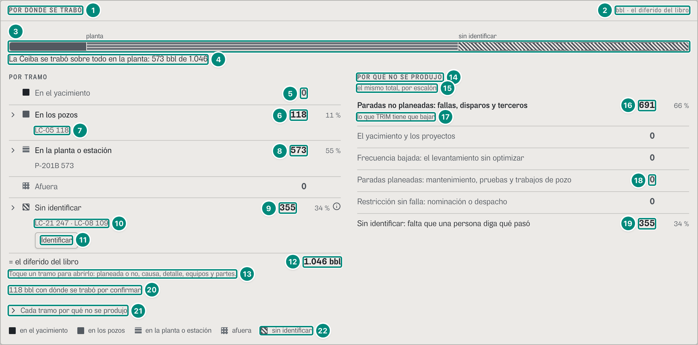
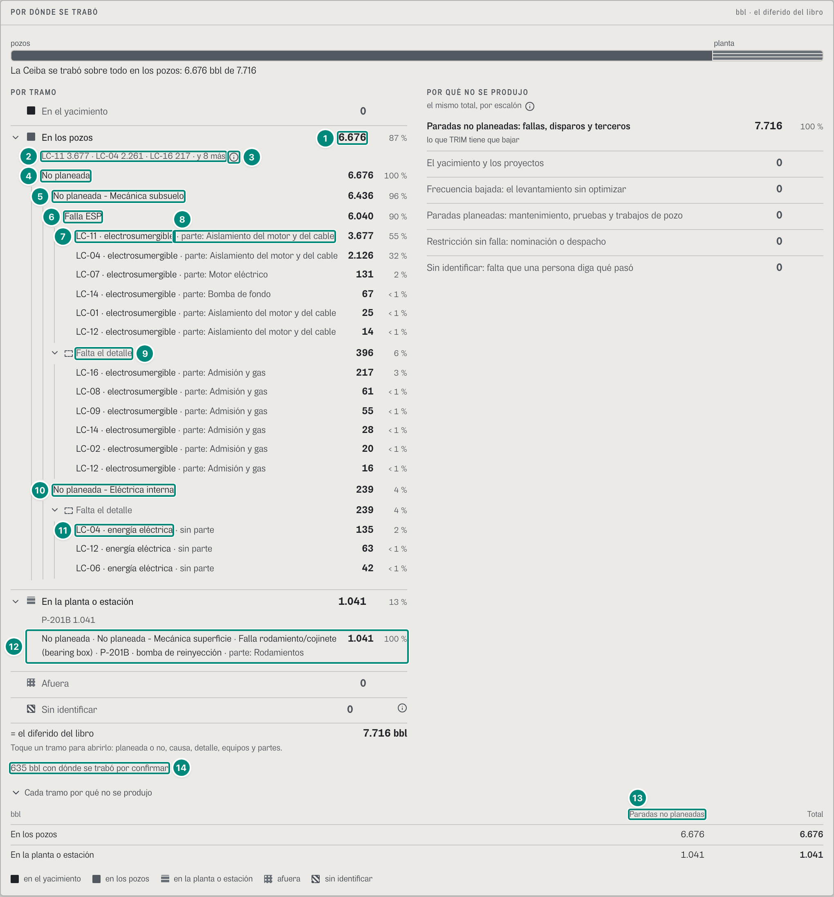
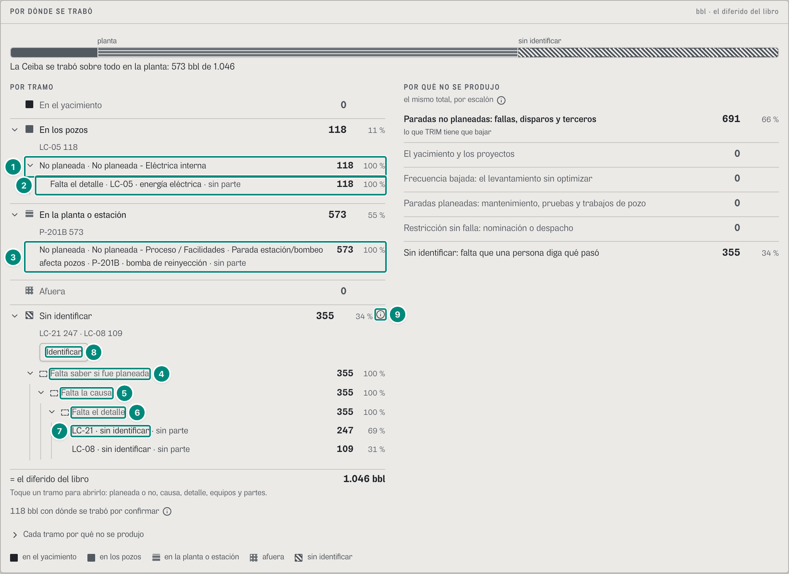
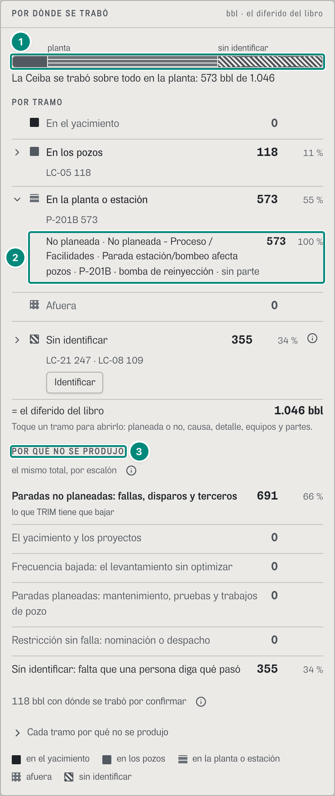
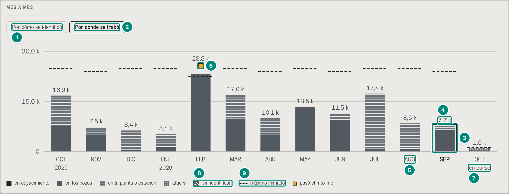
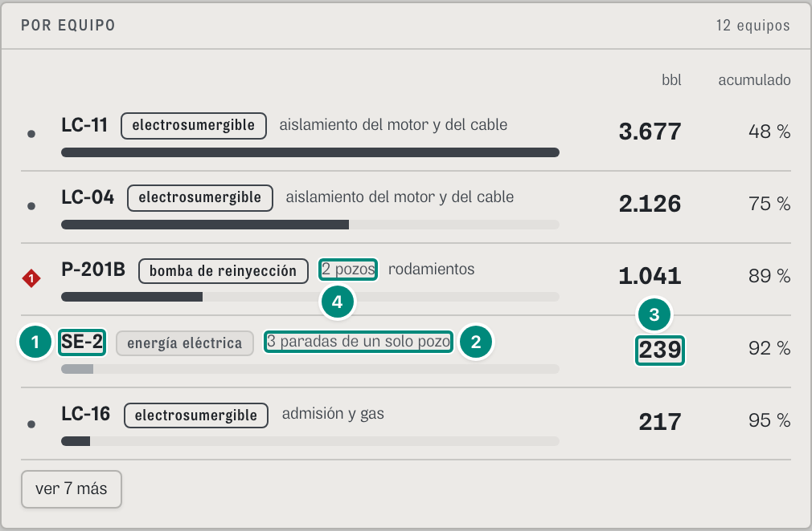
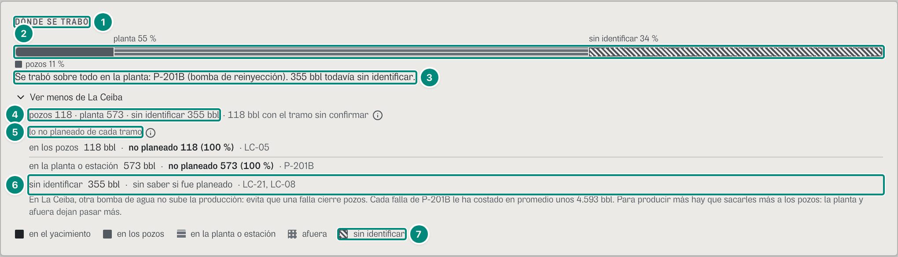
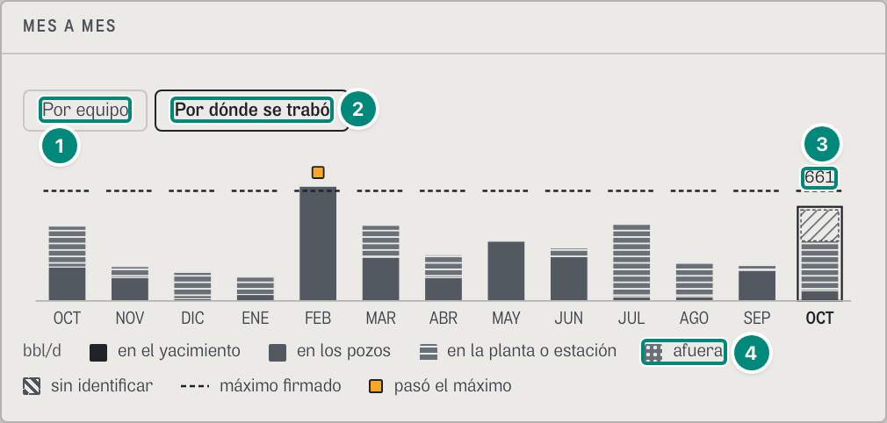

# 6D.4 Diferidos — por dónde se trabó y el árbol de cada tramo · producción, mantenimiento, confiabilidad y gerente

**Para qué.** «Después: por qué, parte, palancas y si el mes se publica.» (`PARA_QUE.diferidos`, `src/widgets/Onboarding.tsx:24`); para el gerente, «Mes a mes: a qué equipo y dónde bajar.» (`PARA_QUE_DECISION.diferidos`, `:38`).
**Ruta.** `#/<rol>/diferidos/<campo>[~portafolio]/<período>` · **Roles y nivel.** `prod`, `jefe`, `conf` → `ingenieria`: el panel «POR DÓNDE SE TRABÓ» con el árbol de cada tramo y el mes a mes «Por cómo se identificó» / «Por dónde se trabó». `ger` → `decision`: el panel «DÓNDE SE TRABÓ» de su Resumen (6D.3) y el mes a mes «Por equipo» / «Por dónde se trabó» (`src/pages/Diferidos.tsx:44-66`). Lo demás de Diferidos (la cabecera, el cuadre, el factor, las palancas, el tipo de causa, POR EQUIPO y POR PARTE) está en 6A.2; aquí va solo lo del choke.
**Lee.** (CONTRATO.md, Anexo A)

| Endpoint | Para qué |
|---|---|
| `GET /api/vistas/choke/reparto?campos&desde&hasta` → `BrechaChoke` | la barra y su frase (`porChoke`, `texto`), POR TRAMO (`porChoke`, `porChokeEquipo`), POR QUÉ NO SE PRODUJO (`porEscalon`), el cruce (`porChokeEscalon`), POR CAMPO (`porCampo[]`), `porConfirmar`, el inventario (`sinExplicar`, `cuadra`) y `textoEstructural` |
| `GET /api/vistas/choke/arbol?campos&desde&hasta&orden=gestion` → `ArbolChoke` | las ramas de cada tramo (`raiz.hijos[valor=tramo].hijos`) |
| `GET /api/vistas/choke/mensual?campos` → `MesPorTramo[]` | el mes a mes «Por dónde se trabó» (`porTramo`) |
| `GET /api/vistas/diferidos?campos&desde&hasta` → `Libro` y `GET /api/vistas/diferidos/mensual?campos` | lo de 6A.2; aquí, POR EQUIPO («N paradas de un solo pozo») y el total de cada mes |
| (gerente) las cuatro vistas por campo de 6D.3 | el panel «DÓNDE SE TRABÓ» |

Fórmulas: el tramo de cada fila → 5E §3; el reparto por tramo y por escalón, los equipos de cada tramo, `porTipo` y la frase → 5E §4; el escalón de cada fila y lo no planeado → 5E §4; el árbol (niveles, ramas que faltan, cada nodo = Σ de sus ramas, la rama de la pérdida) → 5E §5; el mes a mes → 5E §8; el diferido, lo identificado y lo declarado del libro → 5A §3.

Lo que hay que llevarse: **todo el panel suma el diferido del libro**, que es la cifra de la cabecera (6A.2). La suman la barra, POR TRAMO («= el diferido del libro»), POR QUÉ NO SE PRODUJO («el mismo total, por escalón»), cada tramo abierto en su árbol y el cruce. Son las mismas filas de la ANH con su clasificación vigente: corregir el paso 2 o el 4 de una fila mueve sus barriles en todas a la vez (5E §5). El primer nivel del árbol en orden `gestion` es el mismo reparto por tramo (`src/entities/choke-arbol.ts:25-31`). **Esta sección es la dueña de la lectura de las ramas** (`src/widgets/choke/Ramas.tsx`): 6D.1 (Producción, «SE TRABÓ EN EL PERÍODO») y 6D.10 (Regulatorio, «ÁRBOL DE CAUSAS · COMO LA CIRCULAR») usan el mismo componente y remiten aquí.

### Captura 1 · producción, La Ceiba, octubre en curso (los tramos cerrados)

| # | Lo que se ve | En la captura | Cómo se calcula | Texto según el valor | Viene de |
|---|---|---|---|---|---|
| 1 | Título | «POR DÓNDE SE TRABÓ» | fijo (`src/widgets/diferidos/PorTramo.tsx:57-61`); el panel va entre «Dónde bajarlo / Tipo de causa» y los Paretos (`Diferidos.tsx:126-128`) | con «¿cómo se lee?»: «Dónde empezó lo que costó barriles en el período: en el yacimiento, en los pozos, en la planta o estación, o afuera (oleoducto, transportador o cliente). Lo sin identificar va aparte, rayado: no se reparte. A la derecha, el mismo total por qué no se produjo: lo no planeado es lo que TRIM tiene que bajar. Suma lo mismo que el cuadre de arriba. Toque o pase el cursor por una fila para ver de dónde sale.» (`:63-69`) | — |
| 2 | Unidad | «bbl · el diferido del libro» | fija (`:60`) | — | — |
| 3 | La barra | planta · sin identificar | `porChoke`: pozos 117,92 · planta 573,06 · sin identificar 355,04 (5E §4); los mismos dibujos y el mismo orden del gerente (6D.3, captura 1, fila 2) | aquí sin la parte escrita: la palabra va encima si el segmento es ≥ 12 % (`src/widgets/diferidos/tramos.tsx:81`). Los pozos (11,3 %) quedan sin palabra y sin renglón al lado: su cifra está en POR TRAMO (fila 6) y el lector la oye (6D·H18) | `GET /api/vistas/choke/reparto?campos=ceiba&desde&hasta` → `porChoke` |
| 4 | La frase | «La Ceiba se trabó sobre todo en la planta: 573 bbl de 1.046» | el tramo mayor sin contar lo sin identificar, con sus barriles y el total (`brechaPorChoke`, `src/entities/choke-reparto.ts:281-284`) | con varios campos empieza «El conjunto de campos». Dice «sobre todo» aun con el 100 % (6D·H19). Sin barriles la pantalla pone «Nada se trabó en octubre (en curso).» sin barra (`PorTramo.tsx:70-71`) y no la frase del motor («… no tuvo paradas que costaran crudo en el período», 6D·H4) | `BrechaChoke.texto` |
| 5 | Un tramo en cero | «■ En el yacimiento 0» | `porChoke.reservorio` = 0 | en gris, sin parte, sin botón: no tiene ramas (`TramoConRamas`, `:202-251`; `v < 0.5`, `:219`). Los cinco renglones están siempre, en el orden de la tubería (`:82-85`) | `porChoke` |
| 6 | Los pozos | «› ■ En los pozos **118** 11 %» | 117,92; parte = 117,92 / 1.046,03 = 11 % (`parte`, `:49`) | con barriles y ramas, el renglón es un botón que abre su árbol (`aria-expanded`; `conRamas`, `:209, 221-227`). El lector oye además «, con sus ramas: planeada o no, causa, detalle y equipos» (`:226`). Captura 3 | `porChoke.pozo`; árbol → `raiz.hijos[pozo]` |
| 7 | Sus equipos | «LC-05 118» | los tres primeros de `porChokeEquipo.pozo` con sus barriles y « · y N más» (`:233-235`). LC-05 es el elemento donde se originó la fila: SE-2 la tumbó sola y se carga al pozo (`elementoDeFila`, `choke-reparto.ts:153`; 5E §3) | en POR EQUIPO (6A.2) esa misma parada va a SE-2: allí cada parte va con el equipo al que se le carga. Si un equipo de los tres tiene barriles de dos causas, lleva una ⓘ (captura 2, fila 3) | `porChokeEquipo.pozo` |
| 8 | La planta | «› ≡ En la planta o estación **573** 55 %» · «P-201B 573» | 573,06 / 1.046,03 = 55 % | ídem | `porChoke.planta` |
| 9 | Lo sin identificar | «› ▨ Sin identificar **355** 34 %» ⓘ | 355,04 | ⓘ «Sin identificar»: «Paradas que todavía no tienen causa: hasta que alguien diga qué pasó, no se sabe dónde se trabó. No se reparten entre los tramos.» (`:231`); la ⓘ sale también en 0 | `porChoke['sin-asignar']` |
| 10 | Sus equipos | «LC-21 247 · LC-08 109» | los pozos sin causa: el elemento es el pozo | — | `porChokeEquipo['sin-asignar']` |
| 11 | Ir a responder | botón «Identificar» | solo en lo sin identificar con barriles y si el rol tiene la pantalla Identificar (`irA('causa')`, `Diferidos.tsx:38, 127`; `PorTramo.tsx:243`) | `prod`, `jefe` y `conf` la tienen; lleva a 6D.7 | — |
| 12 | El total | «= el diferido del libro **1.046 bbl**» | Σ de los cinco renglones = 117,92 + 573,06 + 355,04 = 1.046,03 = el diferido del libro de la cabecera (`data-total-tramos`, `:86-88`) (5E §4) | `n0` | `BrechaChoke.diferido` |
| 13 | Cómo se abre | «Toque un tramo para abrirlo: planeada o no, causa, detalle, equipos y partes.» | fijo, con barriles (`:89`) | no se imprime: en el papel los tramos salen abiertos | — |
| 14 | El mismo total por escalón | «POR QUÉ NO SE PRODUJO» | fijo (`:93-95`) | — | — |
| 15 | Subtítulo | «el mismo total, por escalón» ⓘ | fijo | ⓘ «Por qué no se produjo»: «Es la escalera de la NSTA (§5.3 y §6.4): desarrollo (el yacimiento y los proyectos), desempeño (levantamiento sin optimizar), disponibilidad planeada y no planeada, y capacidad (restricción sin falla). Cada barril va a un tramo y a un escalón. El norte de TRIM vive en la disponibilidad no planeada: las paradas que nadie programó.» (`:98-99`) | — |
| 16 | Lo no planeado | «Paradas no planeadas: fallas, disparos y terceros **691** 66 %» | escalón `disponibilidad-no-planeada` = 117,92 + 573,06 = 690,98; 690,98 / 1.046,03 = 66 % (`escalonDeFila`, `choke-reparto.ts:169-187`; 5E §4, D4) | primero lo no planeado y después el orden de la escalera (`ORDEN_ESCALON`, `PorTramo.tsx:27`). Los rótulos son los de Producción (`ESCALON_CAMPO`, `src/widgets/choke/palabras.ts:33-40`; B-26). Globo de cada escalón: título = el rótulo, «Barriles 691 bbl», «Del diferido 66 %», cada tramo con lo suyo («En los pozos 118 bbl», «En la planta o estación 573 bbl») y la pista con el nombre de la NSTA («En la escalera de la NSTA: Paradas no planeadas: fallas, disparos y terceros.», `NOMBRE_ESCALON`, `src/entities/choke.ts:168-175`) (`PorTramo.tsx:105-107`) | `porEscalon['disponibilidad-no-planeada']`, `porChokeEscalon` |
| 17 | El norte | «lo que TRIM tiene que bajar» | solo en el escalón no planeado, que va en negrilla (`:109-111`) | — | — |
| 18 | Un escalón en cero | «Paradas planeadas: mantenimiento, pruebas y trabajos de pozo 0» | 0 | en gris y sin parte (`:108, 114`). En La Ceiba, octubre, también van en 0 «El yacimiento y los proyectos», «Frecuencia bajada: el levantamiento sin optimizar» y «Restricción sin falla: nominación o despacho» | `porEscalon` |
| 19 | Lo sin identificar, por escalón | «Sin identificar: falta que una persona diga qué pasó **355** 34 %» | escalón `sin-clasificar` = 355,04. Lo sin identificar nunca es no planeado. 691 + 355 = 1.046 | — | `porEscalon['sin-clasificar']` |
| 20 | Lo que espera una respuesta | «118 bbl con dónde se trabó por confirmar» ⓘ | `porConfirmar` = 117,92: la fila de LC-05, que espera «¿De dónde vino el corte…?» (6D.3, captura 1, fila 13) | sale si son ≥ 0,5 bbl. ⓘ «Por confirmar»: «TRIM propuso el tramo, pero falta un dato que solo sabe una persona del campo (de dónde vino un corte de energía, si el oleoducto recibía). Mientras tanto cuentan donde los puso TRIM; se confirman en Identificar.» (`:123-128`). El gerente lo lee con otras palabras (6D·H17) | `porConfirmar` |
| 21 | El cruce, plegado | «› Cada tramo por qué no se produjo» | botón con `aria-expanded` (`:162-168`) | sale si hay algún tramo y algún escalón con ≥ 0,5 bbl. Abierto, la tabla de la captura 2 (fila 13). En el papel sale desplegado, con el título «CADA TRAMO POR QUÉ NO SE PRODUJO» (`:170-171`) | `porChokeEscalon` |
| 22 | Leyenda | las cinco palabras con su muestra | `LeyendaTramos` (`tramos.tsx:46-55`), si el total es ≥ 0,5 (`PorTramo.tsx:193`) | sin barriles no se pone (B-39) | — |

### Captura 2 · producción, La Ceiba, septiembre: el árbol, nodo por nodo

Abiertos: «En los pozos», «En la planta o estación» y «Cada tramo por qué no se produjo». Las cifras son las del árbol `referencia/choke-arbol/ceiba-2026-09-gestion.json`. Cómo se lee cada rama (`Ramas.tsx`; motor `src/entities/choke-arbol.ts`):

- **Los niveles** (orden `gestion`): tramo → planeada o no (paso 4) → causa (N1) → detalle (N2) → equipo → parte (`NIVELES_ARBOL`, `choke-arbol.ts:70-74`). El tramo lo pinta POR TRAMO; `Ramas` pinta lo que cuelga de él (`Ramas.tsx:27-40`).
- **Cada rama** lleva su texto, sus barriles y su parte del tramo (`base` = el tramo, `:98`). La parte es `pctParte`: «< 1 %» por debajo de 1 (`src/shared/lib/formato.ts:20-21`). El lector oye «3.677 bbl, 55 % del tramo» (`:125-132`). Las hermanas van de más a menos barriles, con lo que falta al final (`antes`, `choke-arbol.ts:240-241`). Cada nodo suma exacto sus ramas (`armar`, `:245-271`; la revisa `revisarArbol`, `:303-340`).
- **Qué se abre**: los tres primeros niveles (planeada o no, causa y detalle) empiezan abiertos y cada uno es un botón con `aria-expanded` (`abiertas = 3`, `Ramas.tsx:29, 88, 141-146`). Los equipos no son botones. Un equipo con una sola parte la lleva en su renglón («· parte: X», o «· sin parte» si falta); con varias, debajo y siempre a la vista (`:94, 118-122, 161`). En el papel todo sale desplegado.
- **Una rama de un solo hijo va en un renglón** (B-34; `cadenaDe`, `:73-81`): la cadena sigue mientras el nodo tenga un solo hijo, no sea un equipo, el hijo no sea una parte ni lo que falta y el nodo tenga filas. Los barriles van una vez. Cada eslabón conserva su paso y sus barriles en `data-nodo-cadena` (`:111-117`).
- **Lo que falta va en su propia rama**: «Falta saber si fue planeada», «Falta la causa», «Falta el detalle», «Sin equipo», «Sin parte» (`TEXTO_FALTA`, `choke-arbol.ts:108-111`). Va en gris claro con un cuadro discontinuo, nunca en rojo (`Ramas.tsx:96, 109, 116`). Nunca se reparte para que cuadre (U2 §0, principio 5) (5E §5).
- **«Ver N más (X bbl)»**: con más de 8 hermanas se ven 7 y el botón dice cuántas faltan y sus barriles (`A_LA_VISTA`, `:25, 49-64`). En el papel salen todas. En el demo pasa en Morichal Norte, septiembre: «Falla ESP» tiene 11 equipos (`#/conf/diferidos/morichal/cerrado`).
- **Los códigos de la ANH** dependen del rol (`codigosDelRol`, `palabras.ts:85-86`; U2 §1.3). Producción, mantenimiento y el gerente no los ven. Confiabilidad y el administrador los ven en una ⓘ por paso: «Para la ANH · cau_niv1» con «{paso de la circular}: «{cadena}»» (`Ramas.tsx:153-156`). Regulatorio los ve al lado de cada paso (`:99-106`; 6D.10).
- **La pérdida**: en el orden `circular`, el nivel «Qué pasó» (diferida o pérdida) siempre trae la rama «Pérdida: TRIM todavía no tiene registro de pérdidas», vacía, con 0 bbl, sin parte y en gris (`TEXTO_PERDIDA`, `choke-arbol.ts:114`; `:267`). Lleva la ⓘ «Pérdida»: «La pérdida es lo producido que no se vendió (derrame, tea, pitera). Va aparte y nunca se suma a lo diferido. TRIM todavía no tiene el registro de pérdidas: esta rama queda vacía hasta que lo tenga, y ningún barril diferido se pasa a ella.» (`EXPLICA_PERDIDA`, `:116`; `Ramas.tsx:158`). En el papel esa ⓘ va una sola vez, al final del árbol (B-10). En el orden `gestion` de Diferidos no hay nivel «Qué pasó»; se ve en 6D.10.

| # | Lo que se ve | En la captura | Cómo se calcula | Texto según el valor | Viene de |
|---|---|---|---|---|---|
| 1 | El tramo abierto | «⌄ En los pozos **6.676** 87 %» | 6.675,51 / 7.716,06 = 87 %; sus ramas suman 6.675,51 (5E §5) | captura 1, fila 6 | árbol → `raiz.hijos[pozo].bbl` = `porChoke.pozo` |
| 2 | Sus equipos | «LC-11 3.677 · LC-04 2.261 · LC-16 217 · y 8 más» | once equipos en el tramo: tres a la vista y «y 8 más» | captura 1, fila 7 | `porChokeEquipo.pozo` |
| 3 | Un equipo con dos causas | ⓘ junto a los equipos | LC-04 = 2.125,60 de electrosumergible + 134,99 de energía = 2.260,58 (`porTipo`; B-12) (5E §4) | globo «LC-04 · 2.261 bbl»: «2.126 de electrosumergible y 135 de energía eléctrica. En «Por equipo» cada parte va con el equipo al que se le carga.» (`PorTramo.tsx:236-240`). Solo para los tres primeros con más de un tipo: LC-12 también tiene dos (62,68 de energía y 30,16 de electrosumergible) y no lleva ⓘ. En POR EQUIPO (6A.2) LC-04 vale 2.126 y su baja tensión va a SE-2 (captura 5) | `porChokeEquipo.pozo[].porTipo` |
| 4 | Planeada o no | «⌄ No planeada 6.676 100 %» | el paso 4 vigente de las filas (`ETIQUETA_PLANEACION`, `src/entities/anh-catalogo.ts:284`); `noPlaneadaBbl` = 6.675,51 | sus hermanas, si las hay: «Planeada» y «Falta saber si fue planeada» (al final). En septiembre todo lo de La Ceiba fue no planeado. Los pozos de Morichal Norte se abren en «No planeada» 7.233, «Planeada» 1.385 (MN-16 y MN-05, con «Falta la causa») y «Falta saber si fue planeada» 106 (MN-22) (`referencia/choke-arbol/morichal-2026-09-gestion.json`) | `NodoArbol` (`dimension: 'planeacion'`) |
| 5 | La causa (N1) | «⌄ No planeada - Mecánica subsuelo 6.436 96 %» | 6.436,07 / 6.675,51 = 96 % | el nombre de la Tabla 1, el mismo de Identificar (`textoN1`, `anh-catalogo.ts:350`; B-27). Sin causa: «Falta la causa» | `dimension: 'n1'` |
| 6 | El detalle (N2) | «⌄ Falla ESP 6.040 90 %» | 6.040,08 / 6.675,51 = 90 % | `textoN2` (`anh-catalogo.ts:516`). Sin detalle: «Falta el detalle» (fila 9) | `dimension: 'n2'` |
| 7 | El equipo | «LC-11 · electrosumergible» 3.677 55 % | el elemento de la fila con el tipo de causa que más le pesa (`tipoMayor`, `choke-arbol.ts:197-203, 216-219`); 3.677,23 / 6.675,51 = 55 % | no es un botón. Un mismo pozo puede salir en dos ramas, una por parada: LC-14 va con 66,62 en «Falla ESP» (bomba de fondo) y con 27,99 en «Falta el detalle» (admisión y gas) | `dimension: 'equipo'` |
| 8 | Su parte | «· parte: Aislamiento del motor y del cable» | la parte de la causa (`NOMBRE_PARTE`); una sola → en el renglón del equipo (`Ramas.tsx:94, 118-122`) | sin parte: «· sin parte» (fila 11); con varias, una por renglón debajo del equipo | `dimension: 'parte'` |
| 9 | Lo que falta | «⌄ ⬚ Falta el detalle 396 6 %» | 395,98: las paradas por admisión y gas (LC-16 216,65 · LC-08 60,83 · LC-09 54,85 · LC-14 27,99 · LC-02 19,93 · LC-12 15,72), cuya parte no tiene un detalle en la tabla de la ANH (B-11) | en gris claro con el cuadro discontinuo y al final de sus hermanas; no se reparte entre los detalles conocidos (5E §5) | `valor: 'falta'` |
| 10 | Otra causa | «⌄ No planeada - Eléctrica interna 239 4 %» | 239,44 / 6.675,51 = 4 %: las tres bajas tensiones de un solo pozo. Su único hijo es «Falta el detalle», así que la cadena no sigue: lo que falta se ve aparte | — | `dimension: 'n1'` |
| 11 | La baja tensión, en su pozo | «LC-04 · energía eléctrica · sin parte» 135 2 % | 134,99: la baja tensión que tumbó solo a LC-04 cuelga del pozo (el elemento de la fila) y no de SE-2 (5E §3) | «· sin parte»: la parte falta (`Sin parte`, en minúscula) | `dimension: 'equipo'` |
| 12 | Una cadena de un renglón | «No planeada · No planeada - Mecánica superficie · Falla rodamiento/cojinete (bearing box) · P-201B · bomba de reinyección · parte: Rodamientos» 1.041 100 % | la planta tiene una sola rama en cada nivel: va en un renglón, con 1.040,55 una vez (B-34) | ver arriba, «Una rama de un solo hijo…» | árbol → `raiz.hijos[planta]` |
| 13 | El cruce abierto | tabla «bbl · Paradas no planeadas · Total»: «En los pozos 6.676 · 6.676», «En la planta o estación 1.041 · 1.041» | `porChokeEscalon`: filas = tramos con ≥ 0,5; columnas = escalones con ≥ 0,5, con la primera parte de su rótulo (`ESCALON[e].split(':')[0]`); Total = `porChoke` (`PorTramo.tsx:162-192`) | «·» en una celda < 0,5 | `porChokeEscalon`, `porChoke` |
| 14 | Lo que espera una respuesta | «635 bbl con dónde se trabó por confirmar» | 635,43 = las tres bajas tensiones de un solo pozo (134,99 + 62,68 + 41,78), que esperan «¿De dónde vino el corte…?», más las seis paradas por admisión y gas (395,97), cuyo tramo propuesto también espera una respuesta (`esperaTramo`, `choke-reparto.ts:190-195`) | captura 1, fila 20 | `porConfirmar` |

### Captura 3 · producción, La Ceiba, octubre en curso: las cadenas en un renglón y lo que falta

Abiertos los tres tramos con barriles. Las cifras salen del árbol `referencia/choke-arbol/ceiba-2026-10-gestion.json` y del motor del demo (AHORA = 2-oct 14:00).

| # | Lo que se ve | En la captura | Cómo se calcula | Texto según el valor | Viene de |
|---|---|---|---|---|---|
| 1 | Una cadena que para antes de lo que falta | «⌄ No planeada · No planeada - Eléctrica interna» 118 100 % | dos eslabones (planeada o no → causa) con 117,92 una vez. La causa tiene un solo hijo, pero es lo que falta («Falta el detalle»), y la cadena no lo absorbe: se ve aparte (`cadenaDe`, `Ramas.tsx:76`) | el último eslabón tiene ramas: el renglón es un botón | árbol → `raiz.hijos[pozo]` |
| 2 | Una cadena que empieza en lo que falta | «Falta el detalle · LC-05 · energía eléctrica · sin parte» 118 100 % | «Falta el detalle» tiene un solo hijo, el equipo LC-05, y la cadena sigue hasta él. El equipo lleva su parte en el renglón | la marca de lo que falta (gris claro y cuadro discontinuo) la decide el último eslabón, el equipo, así que aquí «Falta el detalle» no la lleva (6D·H20) | ídem |
| 3 | La cadena entera en un renglón | «No planeada · No planeada - Proceso / Facilidades · Parada estación/bombeo afecta pozos · P-201B · bomba de reinyección · sin parte» 573 100 % | un solo hijo en cada nivel, del paso 4 al equipo: 573,06 una vez (B-34; e2e `choke-arbol`: un renglón, sin repetir «573 bbl»). Son los dos pozos que cerró la parada de P-201B (LC-16 y LC-07): el detalle «Parada estación/bombeo afecta pozos» | «· sin parte»: P-201B paró sin primera alarma ni firma y la parte la dice quien la abra (B-11) | árbol → `raiz.hijos[planta]` |
| 4 | Lo que falta, paso por paso | «⌄ ⬚ Falta saber si fue planeada» 355 100 % | lo sin identificar no tiene paso 4: rama propia (`TEXTO_FALTA.planeacion`). Su único hijo también es lo que falta, así que la cadena no sigue | en gris claro con el cuadro discontinuo | árbol → `raiz.hijos[sin-asignar]` |
| 5 | Ídem | «⌄ ⬚ Falta la causa» 355 100 % | `TEXTO_FALTA.n1` | los mismos 355 se repiten en cada paso que falta: la regla de B-34 para en lo que falta, para que cada paso faltante se vea | ídem |
| 6 | Ídem | «⌄ ⬚ Falta el detalle» 355 100 % | `TEXTO_FALTA.n2`; tiene dos hijos y ahí termina | — | ídem |
| 7 | Los pozos sin causa | «LC-21 · sin identificar · sin parte» 247 69 % | 246,53 / 355,04 = 69 %; LC-08, 108,52 = 31 %. El tipo `pendiente` se dice «sin identificar» | — | `dimension: 'equipo'` |
| 8 | Ir a responder | «Identificar» | captura 1, fila 11 | — | — |
| 9 | Su ⓘ | ⓘ junto a «34 %» | captura 1, fila 9 | — | — |

#### En el teléfono (390 px)

| # | Lo que se ve | En la captura | Regla |
|---|---|---|---|
| 1 | La barra | planta · sin identificar | la misma; las palabras se cortan con «…» si no caben (`truncate`, `tramos.tsx:90`) |
| 2 | La cadena de la planta | en tres renglones, con 573 y 100 % arriba a la derecha | el texto de la cadena se parte (`break-words`, `Ramas.tsx:109`); los barriles no se mueven de su columna |
| 3 | El mismo total por escalón | «POR QUÉ NO SE PRODUJO» debajo de POR TRAMO | las dos columnas pasan a una (`[grid-template-columns:repeat(auto-fit,minmax(min(100%,280px),1fr))]`, `PorTramo.tsx:79`) |

Los botones de los tramos y de las ramas miden al menos 24 px de alto (`min-h-6`).

### Captura 4 · producción, La Ceiba, septiembre: el mes a mes «Por dónde se trabó»

El mes a mes de ingeniería (`src/widgets/diferidos/MesAMes.tsx`) parte cada columna (los barriles del mes) de dos maneras: por cómo se identificó (6A.2) o por dónde se trabó (U2 §7.4). El total es el mismo, el del libro de cada mes.

| # | Lo que se ve | En la captura | Cómo se calcula | Texto según el valor | Viene de |
|---|---|---|---|---|---|
| 1 | La vista de siempre | «Por cómo se identificó» | por defecto (`vista = 'como'`, `MesAMes.tsx:37`): por señal, declarado y sin identificar (6A.2) | dos botones con `aria-pressed` (`:51-61`), que no se imprimen. El nombre lo decidió B-48: los mes a mes del gerente y de ingeniería no parten lo mismo, y «Por equipo» aquí diría algo que no se pinta | `Libro` de cada mes |
| 2 | La vista del choke | **«Por dónde se trabó»** | cada columna partida en los cuatro tramos y lo sin identificar, de abajo arriba en el orden de la tubería; lo sin identificar arriba, rayado y con raya discontinua (`:76-79, 106-113`) (5E §8) | los dibujos de cada tramo en SVG (`PatronesTramo`, `tramos.tsx:22-36`; B-35) | `GET /api/vistas/choke/mensual?campos=ceiba` → `porTramo` |
| 3 | El mes del período | contorno sobre septiembre y «SEP» en negrilla | el mes que cae en el período de la cabecera (`enPeriodo`, `:47`) | contorno (`data-mes-activo`) solo si el mes tiene barriles (`:103-105`) y rótulo en negrilla (`:127-130`). Ningún mes se atenúa, en ninguna de las dos vistas (B-08; CORRECCIONES-F3, vecino 4: atenuado, el gris de «por señal» se leía como el de «declarado»; `:98-100`). e2e F3: 0 grupos con opacidad menor que 1 y un contorno | — |
| 4 | Su cifra | «7,7 k» | 7.716,06 bbl: pozos 6.675,51 (liso) y planta 1.040,55 (rayas) | `k()` (`:21`): desde 1.000, «N,N k». Globo del mes: «Septiembre 2026»; «Diferidos 7.716 bbl», «En los pozos 6.676 bbl», «En la planta o estación 1.041 bbl», «Alto impacto 7.477 bbl», «Máximo firmado 24.000 bbl», «Del potencial 97,8 %», «Cierre publicable»; pista «Clic para ver este mes» (`:88-97`) | `MesPorTramo.porTramo`; `libro.brecha` |
| 5 | Otro mes | «AGO» | 8.522,38 bbl: planta 7.566,79 (rayas, casi toda la columna) y pozos 955,60 | el dibujo dice el tramo también sin color: agosto se trabó en la planta y septiembre en los pozos | ídem |
| 6 | Pasó el máximo | ■ sobre febrero | 23.348,8 bbl > 22.400 firmados para febrero; todo en los pozos | cuadrado de prioridad 3, solo en meses cerrados (`:85, 120-124`) | `libro.meta.diferido` |
| 7 | El mes en curso | «OCT · en curso», contorno discontinuo | octubre: 1.046 bbl («1,0 k»), parcial | contorno discontinuo (`:114-117`), «en curso» debajo del rótulo (`:134-136`), nunca el ■ (`:120`). Globo: pista «Mes en curso: cifras parciales, cierre sin publicar.» | `parcial` |
| 8 | Leyenda | «▪ en el yacimiento · ▪ en los pozos · ≡ en la planta o estación · ⁘ afuera · ▨ sin identificar · máximo firmado · pasó el máximo» | con «Por dónde se trabó», las cinco palabras con su muestra (`:145-146`); con «Por cómo se identificó», «por señal», «declarado» y «sin identificar» (`:147-154`) | — | — |
| 9 | El máximo | «- - - máximo firmado» | la raya de cada mes en su `meta.diferido` (`:118-119`): el máximo puede cambiar de un mes a otro | un mes con algún campo sin meta firmada no lleva raya ni ■ (`:84-85`) | `libro.meta` |

El eje va de 0 a un tope «limpio» por encima del mes mayor y de su máximo (`tope`, `:15-20, 44`): «0 · 15,0 k · 30,0 k». Un clic en un mes lo abre: el período de la cabecera pasa a ese mes (`Diferidos.tsx:73-74`).

### Captura 5 · producción, La Ceiba, septiembre: «3 paradas de un solo pozo» en POR EQUIPO

POR EQUIPO es de 6A.2. Lo del choke es una sola frase, que explica por qué SE-2 no está en POR TRAMO (B-12).

| # | Lo que se ve | En la captura | Cómo se calcula | Texto según el valor | Viene de |
|---|---|---|---|---|---|
| 1 | El equipo | «SE-2» chip «energía eléctrica» | la fila del libro: 239,44 bbl de energía, 3 eventos, 3 pozos | — | `GET /api/vistas/diferidos` → `porEquipo[]` |
| 2 | Lo que fue | «3 paradas de un solo pozo» | energía, más de un pozo y tantas paradas como pozos (`f.pozos > 1 && f.tipo === 'energia' && f.eventos === f.pozos`, `src/widgets/diferidos/Paretos.tsx:81-84`): cada baja tensión tumbó un solo pozo (LC-04, LC-12 y LC-06), no fue una caída del alimentador | si no: «N pozos». En POR TRAMO y en el árbol cada una va en su pozo (captura 2, fila 11): ahí no aparece SE-2 | `porEquipo[].pozos`, `.eventos`, `.tipo` |
| 3 | Sus barriles | **239** | 134,99 + 62,68 + 41,78 = 239,45: las tres ramas «LC-0x · energía eléctrica» del árbol | `n0` | `porEquipo[].bbl` |
| 4 | El caso contrario | «2 pozos» (P-201B) | una parada que cerró dos pozos | «N pozos» | `porEquipo[].pozos` |

### Captura 6 · gerente, La Ceiba, octubre en curso: «DÓNDE SE TRABÓ» en su Diferidos

El gerente no tiene «POR DÓNDE SE TRABÓ» ni el árbol: tiene el mismo panel de su Resumen de un campo (`PanelDondeSeTrabo`, `Diferidos.tsx:59-60`; U2 §3.1), sin la línea de la pérdida. Abierto «Ver más de La Ceiba»:

| # | Lo que se ve | En la captura | Regla |
|---|---|---|---|
| 1 | Título | «DÓNDE SE TRABÓ» | 6D.3, captura 5, fila 1 |
| 2 | La barra | planta 55 % · sin identificar 34 % · «pozos 11 %» al lado | con la parte escrita, como en el Resumen (6D.3, captura 1, filas 2-5); 1.046 bbl, la misma cifra de la cabecera de Diferidos y del Resumen (e2e `choke-gerente-riesgo`, «La misma cifra en Diferidos») |
| 3 | La frase | «Se trabó sobre todo en la planta: P-201B (bomba de reinyección). 355 bbl todavía sin identificar.» | `fraseGerente` (6D.3, captura 1, fila 6) |
| 4 | Barriles de cada tramo | «pozos 118 · planta 573 · sin identificar 355 bbl» · «· 118 bbl con el tramo sin confirmar» ⓘ | 6D.3, captura 1, filas 12-13 |
| 5 | Lo no planeado | «lo no planeado de cada tramo» ⓘ | 6D.3, captura 1, filas 14-16 |
| 6 | Lo sin identificar | «sin identificar 355 bbl · sin saber si fue planeado · LC-21, LC-08» | 6D.3, captura 1, fila 17; e2e `choke-arbol`: ni planeado ni no planeado (`data-no-planeada` = 0) |
| 7 | Leyenda | las cinco palabras | 6D.3, captura 5, fila 6 |

Abajo van «En La Ceiba, otra bomba de agua no sube la producción…» (6D.3, captura 1, fila 18) y los Paretos «POR EQUIPO» (sin tolerancia ni acumulado) y «TIPO DE CAUSA» (6A.2). La e2e `choke-arbol` comprueba que aquí tampoco hay códigos de la ANH ni «choke».

### Captura 7 · gerente, La Ceiba: el mes a mes «Por equipo» / «Por dónde se trabó»

Es la misma gráfica de su Resumen (`Tendencia`, `src/widgets/resumen/ResumenDirectivo.tsx:279-377`) en el panel «MES A MES» (`Diferidos.tsx:48-56`): por día y contra el máximo firmado por día. La lectura: «Diferido por día de cada mes: lo de alto impacto, oscuro; la raya, el máximo que usted firmó para ese mes. «Por dónde se trabó» parte cada mes por tramo. Toque o pase el cursor por un mes para ver sus cifras; un clic lo abre.» (`:51-55`).

| # | Lo que se ve | En la captura | Regla |
|---|---|---|---|
| 1 | La vista de siempre | «Por equipo» | alto impacto y lo demás (6A.2); por defecto |
| 2 | La vista del choke | **«Por dónde se trabó»** | 6D.3, captura 3, fila 9. B-48 (decidido distinto): el gerente lee «Por equipo» / «Por dónde se trabó» y la ingeniería «Por cómo se identificó» / «Por dónde se trabó» (captura 4). Los dos empiezan por «Por …» y el segundo es siempre el mismo |
| 3 | El mes del período | **661** sobre octubre, con contorno | 1.046,03 bbl ÷ 1,58 d (6D.3, captura 3, fila 10) |
| 4 | Leyenda | «… ⁘ afuera · ▨ sin identificar · máximo firmado · pasó el máximo» | 6D.3, captura 3, fila 12 |

### Estados y otros campos

- **Portafolio** (`#/prod/diferidos/ceiba~portafolio/cerrado`, La Ceiba y El Palmar): la frase dice «El conjunto de campos se trabó sobre todo en los pozos: 9.362 bbl de 11.706». POR TRAMO junta los equipos de los dos campos («LC-11 3.677 · PA-07 2.687 · LC-04 2.261 · y 9 más»; la planta, «V-101 1.304 · P-201B 1.041»). Debajo de los escalones va «POR CAMPO»: cada campo con una barra chica sin palabras, su reparto y su total («La Ceiba · pozos 6.676 · planta 1.041 · 7.716»; «El Palmar · pozos 2.687 · planta 1.304 · 3.990»). Un campo sin barriles dice «nada se trabó» (`PorTramo.tsx:140-160`).
- **Sin barriles** (Guacamayo en octubre, para confiabilidad): «Nada se trabó en octubre (en curso).» sin barra. Los cinco tramos van en 0 y sin botón, «= el diferido del libro 0 bbl», todos los escalones en 0, y no salen «Toque un tramo…», el cruce ni la leyenda (B-39).
- **Inventario entre días** (un período que corta meses): «+N bbl de inventario entre días» con la ⓘ «Inventario entre días»: «Potencial menos lo medido no da exacto la suma de los eventos cuando el período corta meses: el tanque de venta guarda de un día para otro. No es de ningún tramo y no se reparte; en el mes entero da cero. Pasado el 2,5 % del potencial se marca para revisar (el umbral de cierre de la NSTA).». Pasado ese umbral (`cuadra` falso), lleva el cuadrado de fuera de meta y «: más del 2,5 % del potencial, para revisar» (`PorTramo.tsx:129-135`; `choke-reparto.ts:335, 342`). En los meses enteros da 0 y no sale.
- **Lo estructural**: si lo que limita no son los pozos, va `textoEstructural` debajo («{La planta} no deja pasar todo lo que pueden dar los pozos: N bbl de lo que no se produjo son de ahí, aunque nada pare. Ningún arreglo de equipos los recupera; solo más capacidad.»). Lo mismo si el real pasó la capacidad declarada algún día («El real pasó la capacidad declarada (…): ese número está por debajo de lo que ya pasó y hay que revisarlo. …») (`PorTramo.tsx:136`; `textoDeEstructural`, `choke-reparto.ts:411-425`; 5E §4). En La Ceiba limitan los pozos y no sale.
- **Confiabilidad** (`#/conf/diferidos/morichal/cerrado`): las mismas ramas, cada paso con su ⓘ «Para la ANH · …». En septiembre, los pozos de Morichal Norte traen «Planeada» (captura 2, fila 4), y «Falla ESP» trae 11 equipos con «Ver 4 más».
- **Jefe de mantenimiento**: lo mismo que producción, sin códigos.
- **En el papel**: cada tramo con barriles sale abierto con todas sus ramas, también las de «Ver N más» (e2e `choke-arbol`, «En el papel, todos los tramos salen desplegados»). El cruce sale desplegado y con título; los botones, la línea «Toque un tramo…» y los selectores del mes a mes no se imprimen.

### Interacciones

Un toque (o Enter) en un tramo con barriles abre o cierra su árbol, y lo mismo cada paso del árbol (e2e `choke-arbol`). «Ver N más» muestra el resto de las hermanas. «Identificar» lleva a 6D.7. «Cada tramo por qué no se produjo» despliega el cruce. Pasar el cursor por un escalón o por un mes muestra su globo, y las ⓘ, el suyo. En el mes a mes, «Por cómo se identificó» / «Por dónde se trabó» (o, para el gerente, «Por equipo» / «Por dónde se trabó») cambian cómo se parte cada columna, y un clic en un mes lo abre.
