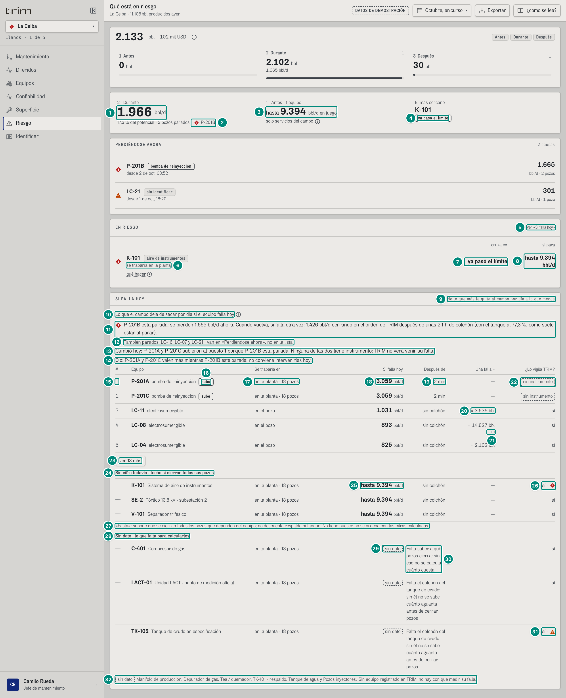
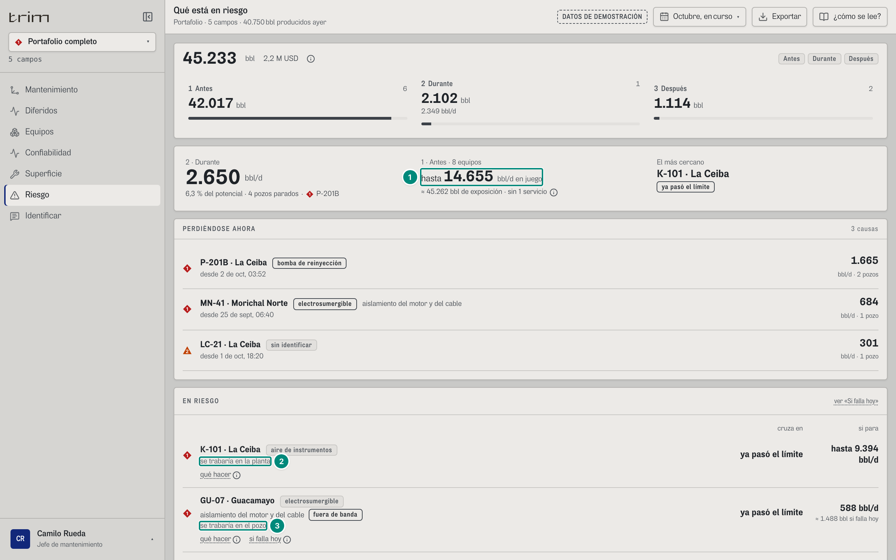
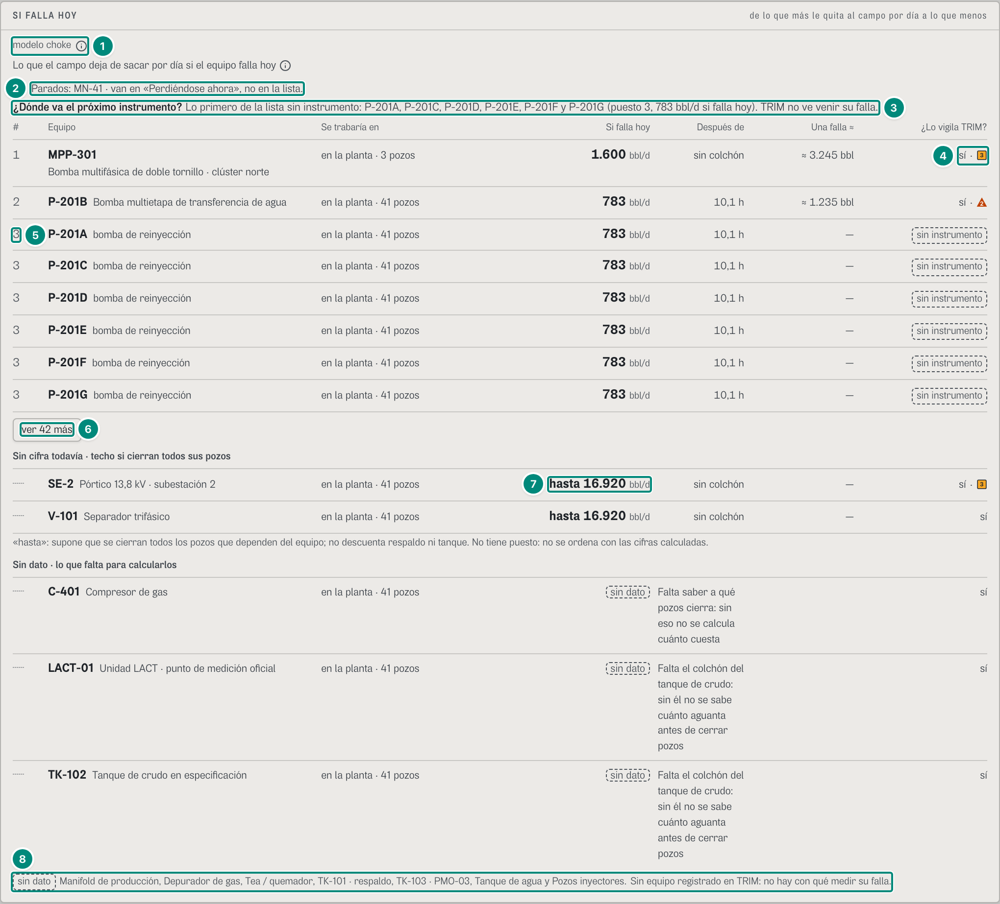
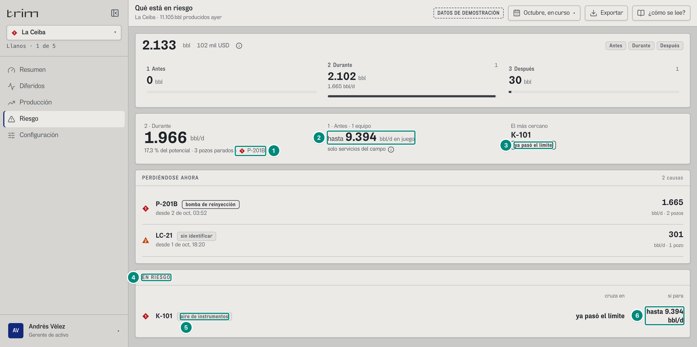
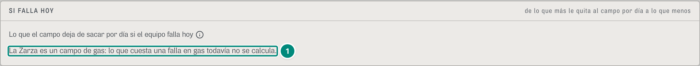
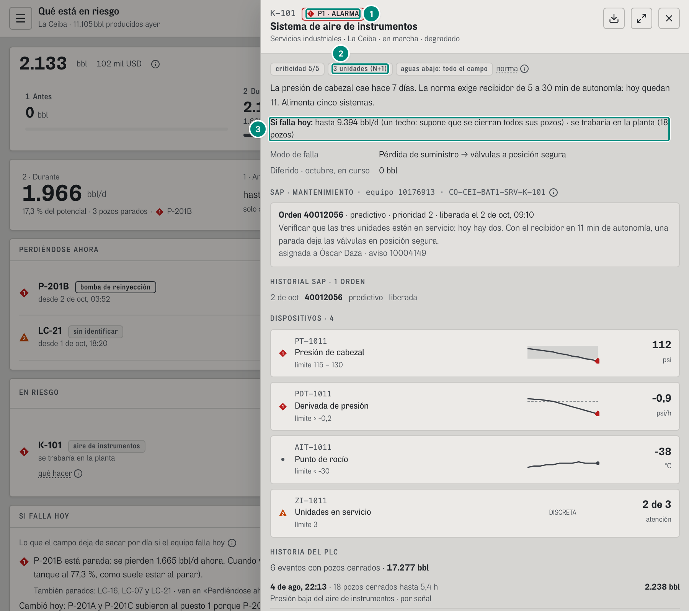
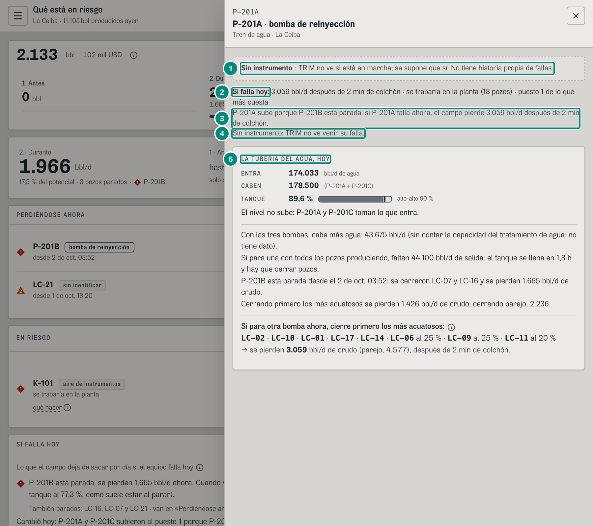
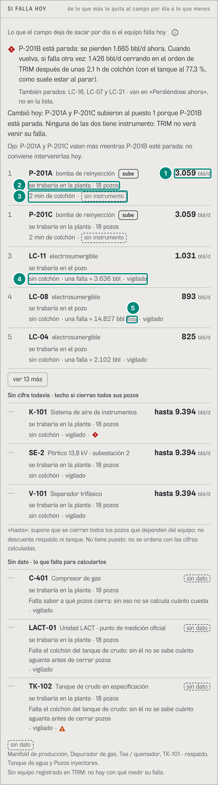

# 6D.5 Riesgo — «Si falla hoy» en tres grupos (y en la ficha del equipo) · jefe de mantenimiento, confiabilidad (el gerente ve Riesgo sin la lista)

> **RETIRADO como pantalla (v3; [borrado.md](../../experiencia-v3/borrado.md) A-13).** «Si falla hoy» está en la cabeza de Equipos. Lo que rige: [06-pantallas-v3.md](../06-pantallas-v3.md) §6.5.

**Para qué.** «¿Qué equipo le quita más barriles al campo si falla hoy, y lo está vigilando alguien?» (U2 §6.1). El panel lo dice en su título: «SI FALLA HOY · de lo que más le quita al campo por día a lo que menos» (`src/widgets/riesgo/SiFallaHoy.tsx:52-53`).
**Ruta.** `#/<rol>/riesgo/<campo>[~portafolio]/<período>` (con `/<equipo>` al final, la ficha abierta) · **Roles y nivel.** `jefe` y `conf` (`ingenieria`): el panel «SI FALLA HOY», la línea «se trabaría en» de cada fila de «En riesgo» y el enlace «ver «Si falla hoy»»; `ger` (`decision`): la pantalla Riesgo sin nada de eso (U2 §3.1; `src/pages/Riesgo.tsx:42-45, 229-235, 247-250`). Operación no tiene Riesgo (6C.1). El período no cambia nada: todo es «ahora». · **Lee.** `GET /api/vistas/criticidad?campos` → `VistaCriticidad` = `{ ranking: FilaCriticidad[], campos[] }` (CONTRATO.md, Anexo A): la lista, el tramo de cada fila de «En riesgo» y la línea de la ficha; `GET /api/vistas/equipos-hoy?campos` → `EquipoVivo.severidad`: la marca de alarma de cada fila. Lo demás de la pantalla (`/vistas/riesgo`, `/vistas/estado`, `/vistas/ciclo`) está en 6C.1. La ficha mínima de P-201A lee además `GET /api/vistas/campos/:campo/agua` (6D.2). · **Escribe.** Nada.
Fórmulas: «si falla hoy» de cada equipo, los tres grupos, el puesto, «sube», «cambió hoy», lo que decide cada rol y lo que no tiene cifra → 5E §7; el techo de un servicio («hasta», `Riesgo.techo` y `FilaCriticidad.grupo = 'techo'`) → 5E §7 y 5B §5.3; lo que cuesta una falla (`costoFalla`, `colchonH`, `mdtFuente`, «flota») → 5B §5.3 «Si falla hoy»; el colchón del tanque y el orden de cierre de una bomba de agua → 5B §4.2 «Colchón del tanque» y «Orden de cierre y crudo en riesgo»; el tramo de cada equipo (topología y alcance) → 5E §1 y 5E §1.

Lo demás de Riesgo (el cinturón del ciclo, «Perdiéndose ahora», cada fila de «En riesgo» con su «≈ N bbl si falla hoy», la exposición, los globos y la Lectura) está en 6C.1. Aquí van las piezas del choke y lo que cambió desde entonces en la cabecera y en «En riesgo» (B-40, B-42 y el techo). **Dos cifras con el mismo nombre:** en «En riesgo», «≈ N bbl si falla hoy» son los **barriles** de una falla de ese equipo (6C.1, captura 1, fila 26); en el panel «SI FALLA HOY» la cifra grande son **bbl/d**, lo que el campo deja de sacar por día ya agotado el colchón, y los barriles de una falla van en la columna «Una falla ≈», que en una bomba con instrumento es exactamente la cifra de «En riesgo» (CONTRATO.md, `/vistas/criticidad`). Las cifras son del demo con `AHORA = 2026-10-02T14:00-05:00` y se comprobaron corriendo el motor (`criticidadDelCampo`, `riesgoAhora`, `tuberiaAgua`).

### Captura 1 · jefe, La Ceiba, octubre en curso

| # | Lo que se ve | En la captura | Cómo se calcula | Texto según el valor | Viene de |
|---|---|---|---|---|---|
| 1 | «2 · Durante»: el total, sin marca | **1.966** bbl/d | Σ `bblDia` de las filas `perdiendo` = 1.665,2 (P-201B) + 300,8 (LC-21) = 1.966,0 (6C.1, captura 4, fila 1) | **Sin marca de alarma** (B-40): un total no es una alarma; la marca la lleva el equipo que lo causa (fila 2) (`Riesgo.tsx:179-182`). Antes llevaba ◆ delante (6C.1, captura 1, fila 1). El rótulo de hoy es «2 · Durante» | `GET /api/vistas/riesgo` → `bblDia` de las filas `perdiendo` |
| 2 | La marca, con el equipo | «· ◆ P-201B» al final de «17,3 % del potencial · 3 pozos parados» | la primera fila `perdiendo` en el orden del servidor (`bblDia` de mayor a menor: P-201B, 1.665,2) (`perdiendo[0]`) | ◆ P1 si la fila es de alto impacto, ▲ P2 si no; sin filas, nada (`Riesgo.tsx:185`). La misma marca de P-201B en «PERDIÉNDOSE AHORA», en «Si falla hoy» (fila 11) y en Turno (6D.6) | `riesgo[0].equipo`, `.altoImpacto` |
| 3 | «1 · Antes»: en juego, con el techo | «hasta **9.394** bbl/d en juego» | `sumaSiPara` (`src/shared/ui/costoHoy.ts:50-53`): Σ `bblDia` de las filas `en-riesgo` = 9.394,2 (solo K-101); si alguna trae `techo: true`, la suma es un techo (`Riesgo.tsx:50, 190`) → 5E §7 | «hasta » delante de la cifra solo si alguna fila es un techo (QA-R, vecino 1; CORRECCIONES-F3); sin techo, «N bbl/d en juego» (Morichal: «4.026 bbl/d en juego»). El rótulo «1 · Antes · 1 equipo» cuenta las filas. El pie («solo servicios del campo») es la exposición de 6C.1, fila 6. La Lectura no explica «hasta»: 6D·H23 | `riesgo[].bblDia`, `.techo` |
| 4 | «El más cercano»: ya pasó el límite | chip «ya pasó el límite» (K-101) | la primera fila `en-riesgo` ordenada por `horas`, con `horas` ausente = −1: lo que ya pasó va primero (`Riesgo.tsx:47`); K-101 no tiene `horas` | chip fuerte «ya pasó el límite» (B-42; antes «ya fuera») (`Riesgo.tsx:202`); con horas, «cruza en {fmtHoras}» (Morichal: «MN-07 · Bomba de fondo · cruza en 4 h») | `riesgo[].horas` |
| 5 | «ver «Si falla hoy»» | enlace a la derecha de «EN RIESGO» | — | solo en nivel `ingenieria` (`Riesgo.tsx:229-235`): lleva al panel «SI FALLA HOY» (`#si-falla-hoy`) y le pasa el foco; no se imprime (`no-imprimir`). El gerente no lo tiene (captura 4) | — |
| 6 | «se trabaría en» | «se trabaría en la planta» (K-101) | el tramo del mismo equipo y campo en «Si falla hoy», lo que está en la lista o parado (`tramoDe`, `Riesgo.tsx:44-45, 119, 143`); sale de la topología: K-101 es compartido (sirve a los 18 pozos) → planta → 5E §1 | `DONDE_CHOKE[tramo]`: «en el pozo», «en la planta», «afuera (oleoducto, transportador o cliente)», «en el yacimiento» (`src/entities/choke.ts:146-152`). Solo en ingeniería; un equipo que no está en la vista no lleva la línea. En el portafolio, GU-07 «se trabaría en el pozo» (captura 2) | `GET /api/vistas/criticidad` → `ranking[].tramo` y `campos[].parados[].tramo` |
| 7 | «cruza en»: ya pasó el límite | «ya pasó el límite» | `horas` ausente | `fmtHoras(horas)` o «ya pasó el límite» (B-42; `Riesgo.tsx:146`); el lector oye «cruza en ya pasó el límite» (`sr-only`). El mismo texto en Turno («1 · Vigilar»), Mantenimiento, Mi trabajo y el Resumen del gerente; en el globo, «Cruza su límite · ya pasó el límite» (`Riesgo.tsx:127`) | `riesgo[].horas` |
| 8 | «si para»: un techo | «hasta 9.394 bbl/d» | K-101 es un servicio en alarma que cuelga de todo el campo: `bblDia` = Σ crudo asignado de los pozos que producen ahora (15 de 18) = 9.394,2, con `techo: true` (`src/entities/diferido.ts:612-613`): supone que se cierran todos → 5B §5.3; 5E §7 | `siPara` (`costoHoy.ts:43-44`): «hasta » si `techo`; un servicio con 0 dice «todo el campo». En el globo y en el papel, `siParaLargo` (`costoHoy.ts:46-48`): «hasta 9.394 bbl/d (un techo: si se cierran todos los pozos que dependen de él)». La misma regla en Turno, Mantenimiento, Equipos y la ficha ejecutiva; la e2e F3 pide que ningún «9.394 bbl/d» quede sin «hasta» | `riesgo[].bblDia`, `.techo` |
| 9 | Título y orden | «SI FALLA HOY» · «de lo que más le quita al campo por día a lo que menos» | el orden del motor: primero lo medido de mayor a menor bbl/d (a igual cifra, el de menos colchón; luego el costo de una falla y el código), después los techos y al final lo que no tiene cifra (`orden`, `src/entities/criticidad.ts:439-442`) → 5E §7 | fijos (`SiFallaHoy.tsx:52-53`). El panel sale solo en nivel `ingenieria` (`Riesgo.tsx:247-250`) | `GET /api/vistas/criticidad` → `ranking[]` (ya ordenado) |
| 10 | Qué mide, con su ⓘ | «Lo que el campo deja de sacar por día si el equipo falla hoy» ⓘ | — | ⓘ «Si falla hoy», texto exacto de U2 §6.2 (`QUE_ES`, `SiFallaHoy.tsx:17`): «Cuánto dejaría de sacar el campo por día si este equipo para hoy, después de lo que aguanta el tanque y de lo que toma el respaldo. Cambia con lo que esté parado: si para una bomba, sus hermanas valen más.» Confiabilidad ve además «modelo choke» ⓘ (captura 3, fila 1) | — |
| 11 | Lo ya parado: la bomba | ◆ «P-201B está parada: se pierden 1.665 bbl/d ahora. Cuando vuelva, si falla otra vez: 1.426 bbl/d cerrando en el orden de TRIM después de unas 2,1 h de colchón (con el tanque al 77,3 %, como suele estar al parar).» | Lo parado no entra en la lista (ya está en «Perdiéndose ahora»); una bomba o un servicio parado lleva este renglón (`esRaiz`, `SiFallaHoy.tsx:28, 167-173`). Ahora: `perdiendoBpd` = 1.665,183 (LC-16 869,0 + LC-07 796,2, los que se cerraron por ella). Cuando vuelva: `bpd` = 1.425,5, lo que se cierra en el orden de TRIM si para con todo produciendo (la predicción de la bomba: 44.100 bbl/d de agua sin salida); el colchón con el nivel **típico al parar**, no con el de ahora (la mediana de `nivelAlParar` de sus paradas, 77,3 %; QA-A-09): (0,90 − 0,773) × 30.000 bbl ÷ (44.100/24) = 2,07 h (`colchonAlVolver`, `criticidad.ts:189-196`; la frase, `criticidad.ts:220-221`) → 5B §4.2 «Colchón del tanque» y «Orden de cierre y crudo en riesgo», 5B §4.3; 5E §7 | la frase la arma el motor (`porque`); la pantalla solo le pone el punto. Marca: la de hoy del equipo (◆1). Un servicio caído dice «{equipo} está caído: se pierden N bbl/d ahora» (`criticidad.ts:293`); una bomba de recobro parada, «{equipo} está parada. {equipo} inyecta para recobro: si falla hoy no cierra pozos; baja la presión del yacimiento en semanas» (`criticidad.ts:209, 222`) | `campos[].parados[]` con `familia` bomba o servicio: `porque`, `perdiendoBpd`, `bpd`, `colchonH` |
| 12 | Los pozos parados | «También parados: LC-16, LC-07 y LC-21 · van en «Perdiéndose ahora», no en la lista.» | los `parados` que no son bomba ni servicio, de mayor a menor `perdiendoBpd` (LC-16 869,0; LC-07 796,2; LC-21 300,8) (`criticidad.ts:367`) | «También parados» si arriba hay una bomba o un servicio parado; si no, «Parados» (Morichal, captura 3, fila 2) (`SiFallaHoy.tsx:174-178`). LC-16 y LC-07 están parados por P-201B, y en «Perdiéndose ahora» van dentro de la fila de P-201B («2 pozos»), sin su nombre: 6D·H22 | `campos[].parados[]` (pozos) |
| 13 | Cambió hoy | «Cambió hoy: P-201A y P-201C subieron al puesto 1 porque P-201B está parada. Ninguna de las dos tiene instrumento: TRIM no verá venir su falla.» | las filas con `subio` (las hermanas de una bomba parada, `deHermana`, `criticidad.ts:261`) y el puesto de la primera; la segunda frase, si ninguna está vigilada (`criticidad.ts:369-374`) → 5E §7 | «subió»/«subieron»; «No tiene»/«Ninguna de las dos tiene»/«Ninguna de las N tiene» (`criticidad.ts:371`). Sin nada que suba, no sale. U2 §6.3 decía «al puesto 3» porque contaba a K-101 y SE-2 como cifras; desde D6 (B-06) son techos sin puesto | `campos[].cambioHoy` |
| 14 | Lo que decide el jefe | «Ojo: P-201A y P-201C valen más mientras P-201B esté parada: no conviene intervenirlas hoy.» | las mismas filas que suben (`noIntervenir`, `criticidad.ts:381-383`) | solo el jefe (`SiFallaHoy.tsx:185-187`); confiabilidad ve en su lugar «¿Dónde va el próximo instrumento?» (captura 3, fila 3). Debajo irían los trabajos del programa firmado sobre esos equipos: «Ojo: {equipo} vale más mientras {otro} esté parada: tiene programado «{motivo}» el {fecha}. ¿Mover el trabajo?» + «El programa lo cambia el administrador en Configuración, con firma.» (`criticidad.ts:396-407`, `SiFallaHoy.tsx:189-193`); hoy no hay ninguno (`avisosTrabajo: []`) | `campos[].noIntervenir`, `campos[].avisosTrabajo[]` |
| 15 | «#»: el puesto | «1», «1», «3», «4», «5» | `puesto` = 1 + cuántos medidos del campo cuestan más: los que cuestan lo mismo lo comparten (P-201A y P-201C, 3.058,6 cada una; LC-11 queda tercera) (`criticidad.ts:364-366`) → 5E §7 | un techo o un sin dato no tiene puesto: «┄» (`SiFallaHoy.tsx:118`). Los encabezados «#», «Equipo», «Se trabaría en», «Si falla hoy», «Después de», «Una falla ≈», «¿Lo vigila TRIM?» son fijos y solo van en el escritorio (`SiFallaHoy.tsx:201-205`) | `ranking[].puesto` |
| 16 | «sube» | chip fuerte «sube» (P-201A y P-201C) | la fila trae `subio` | `SiFallaHoy.tsx:122`. Delante, el equipo en negrita y su nombre sin repetir el código («bomba de reinyección», `nombreSinId`, `SiFallaHoy.tsx:25-26`). El globo dice el porqué y, si sube o tiene `sinDato`, sale en el papel (`imprimir="pista"`, `SiFallaHoy.tsx:153`) | `ranking[].subio`, `.nombre` |
| 17 | Se trabaría en | «en la planta · 18 pozos» (P-201A); «en el pozo» (las electrosumergibles) | el tramo según la topología (`chokeDeAlcance(alcance)`: dedicado → pozo, compartido → planta) y, en la planta, los pozos que dependen de él (`servidos`) (`criticidad.ts:340`) → 5E §1 | `DONDE_CHOKE[tramo]` + « · N pozos» solo en la planta y con `servidos > 0` (`SiFallaHoy.tsx:110`) | `ranking[].tramo`, `.servidos` |
| 18 | Si falla hoy | **3.059** bbl/d (P-201A) | hermana sin instrumento (`deHermana`, `criticidad.ts:231-263`): el agua que entra ahora, 174.033 bbl/d, menos lo que deja pasar la otra bomba en marcha (P-201C, 89.250; P-201B está parada) = 84.783 bbl/d sin salida; cerrando en el orden de TRIM, los más acuatosos primero (LC-02, LC-10, LC-01, LC-17 y LC-14 enteros, LC-06 y LC-09 al 25 %, LC-11 al 20 %), se pierden 3.058,6 bbl/d (parejo, 4.576,5) → 5B §4.2 «Orden de cierre y crudo en riesgo»; 5E §7. Es la cuenta de «Si para otra bomba» de la tubería del agua (`siParaOtra`, 6D.2). Una electrosumergible: el crudo asignado de su pozo (LC-11 1.030,9; LC-08 893,0; LC-04 824,9) | `n0` + «bbl/d»; un techo, «hasta N» (fila 25); sin cifra, el chip «sin dato» (fila 29) (`SiFallaHoy.tsx:111, 125-129`) | `ranking[].bpd` |
| 19 | Después de | «2 min» (P-201A); «sin colchón» (las electrosumergibles) | el colchón del tanque al nivel de ahora (TK-AG-CE, LT-2012 al 89,6 % a las 13:59): (0,90 − 0,896) × 30.000 bbl ÷ (84.783/24) = 0,034 h = 2,04 min (`criticidad.ts:249`) → 5B §4.2 «Colchón del tanque» | `colchon(h)` (`SiFallaHoy.tsx:23`): bajo una hora, en minutos (mínimo «1 min»); si no, `fmtHoras(h, true)` («10,1 h» en Morichal). Sin colchón: «—» si la cifra es 0 o no hay; «sin dato» en una bomba con `sinDato` (P-201B de El Palmar); si no, «sin colchón» (`SiFallaHoy.tsx:112-113`) | `ranking[].colchonH` |
| 20 | Una falla ≈ | «≈ 3.636 bbl» (LC-11); «—» (P-201A) | electrosumergible: crudo × horas fuera promedio ÷ 24 = 1.030,919 × 84,65 / 24 = 3.636,1 (su única falla cerrada duró 84,65 h, «3,5 d»), la misma cuenta de `riesgoAhora` (`dePozo`, `criticidad.ts:166-171`); en una bomba con instrumento, exactamente `costoDeBomba` → 5B §5.3 «Si falla hoy» | «≈ {n0} bbl»; sin `costoFalla`, «—» (P-201A no tiene historia propia; el bombeo mecánico tampoco) (`SiFallaHoy.tsx:136-138`). El globo agrega «Una falla: {mdtFuente}» («3,5 d fuera, el promedio de su falla cerrada») | `ranking[].costoFalla`, `.mdtFuente` |
| 21 | flota | «flota» bajo «≈ 14.827 bbl» (LC-08) | LC-08 nunca ha fallado: se usa el tiempo fuera promedio de las electrosumergibles de La Ceiba, 398,5 h («16,6 d»): 892,952 × 398,50 / 24 = 14.826,6 → 5B §5.3 «Si falla hoy» | sale con `costoDe === 'flota'` (`SiFallaHoy.tsx:137`); con historia propia no se marca (LC-11, LC-04). En el teléfono va en la misma línea | `ranking[].costoDe` |
| 22 | ¿Lo vigila TRIM? | «sin instrumento» (P-201A y P-201C); «sí» (las electrosumergibles) | `vigilado`: una bomba con perfil o un equipo del registro instrumentado y con dispositivos en el campo (`vigiladoEn`, `criticidad.ts:152-156`); un pozo, si es electrosumergible y el perfil firmado del campo tiene electrosumergibles (`criticidad.ts:180`) | «sí» (en el teléfono, «vigilado»); si no, «sin instrumento» en un rectángulo discontinuo, su forma propia (B-44) (`SiFallaHoy.tsx:143-145`). Tras «ver 13 más», LC-19 y LC-03 (bombeo mecánico) también dicen «sin instrumento» | `ranking[].vigilado` |
| 23 | ver 13 más | «ver 13 más» | 18 filas medidas: se ven 5; nunca se esconde una que subió o que tiene alarma P1, ni se parte un empate en el quinto puesto (`SiFallaHoy.tsx:95-99`) | `ver {n} más` / «ver menos»; lo escondido sale en el papel (`solo-impresion`, `SiFallaHoy.tsx:156`). Las 13, en orden: LC-05 812 · LC-14 783 (flota) · LC-19 778 (bombeo mecánico) · LC-06 692 (flota) · LC-09 620 · LC-17 539 (flota) · LC-15 470 (flota) · LC-10 459 (flota) · LC-12 379 · LC-02 378 (flota) · LC-03 374 (bombeo mecánico) · LC-01 360 (flota) · H-302 **0** (puesto 18, «—», «sí · ■»: «Cero mientras el respaldo esté bien (respaldo en línea (H-301))», `criticidad.ts:301-302`) | `ranking[]` |
| 24 | Grupo de los techos | «Sin cifra todavía · techo si cierran todos sus pozos» | `grupo = 'techo'`: servicios y equipos de proceso compartidos sin respaldo, o con el respaldo ya en uso hoy (`deServicio`, `criticidad.ts:284-309`) → 5E §7 | subtítulo fijo (`SiFallaHoy.tsx:212`); no se ordena con lo medido y su «#» es «┄» (D6; B-06). Sin techos no sale | `ranking[].grupo` |
| 25 | Un techo | «hasta 9.394 bbl/d» (K-101; también SE-2 y V-101) | Σ crudo asignado de los pozos que dependen de él y producen ahora: 15 de los 18 = 9.394,2 (`criticidad.ts:285-287, 307`), la misma cifra de la fila 8 | «hasta {n0}» con `grupo = 'techo'` y cifra > 0 (`SiFallaHoy.tsx:111`); «Después de»: «sin colchón». El globo dice por qué es un techo: «Si K-101 cae hoy, se frenan los 15 pozos que producen y dependen de él: hasta 9.394 bbl/d, desde el primer minuto. Techo: supone que se cierran todos los pozos que dependen de él; su respaldo ya está en uso hoy (2 de 3 unidades en servicio; 3 unidades (N+1))». Con el respaldo bien, un servicio vale 0 y va con lo medido (H-302, fila 23) (`respaldoHoy`, `criticidad.ts:268-274`) | `ranking[].bpd`, `.sinDato`, `.porque` |
| 26 | La marca de alarma | «sí · ◆» (K-101) | la marca de hoy del equipo (`severidad` 1: presión de cabezal fuera, 2 de 3 unidades) | va en «¿Lo vigila TRIM?» y no pegada al puesto, que se leía como otro puesto (B-43; `SiFallaHoy.tsx:140-146`); sin alarma, solo «sí». El lector oye «…, con una alarma de prioridad 1» (`SiFallaHoy.tsx:114`) | `GET /api/vistas/equipos-hoy` → `severidad` |
| 27 | Nota del techo | «hasta»: supone que se cierran todos los pozos que dependen del equipo; no descuenta respaldo ni tanque. No tiene puesto: no se ordena con las cifras calculadas. | — | fija (`SiFallaHoy.tsx:214`) | — |
| 28 | Grupo sin dato | «Sin dato · lo que falta para calcularlos» | `grupo = 'sin-dato'`: la evacuación (tanque de crudo, LACT) y el compresor (`criticidad.ts:296-299`) | subtítulo fijo (`SiFallaHoy.tsx:219`) | `ranking[].grupo` |
| 29 | sin dato | chip discontinuo «sin dato» (C-401, LACT-01, TK-102) | `bpd: null` | `SiFallaHoy.tsx:126-127` | `ranking[].bpd` |
| 30 | Lo que falta | «Falta saber a qué pozos cierra: sin eso no se calcula cuánto cuesta» (C-401); LACT-01 y TK-102: «Falta el colchón del tanque de crudo: sin él no se sabe cuánto aguanta antes de cerrar pozos» | `sinDato` del motor (`criticidad.ts:298-299`) | ocupa «Después de» y «Una falla ≈» (`SiFallaHoy.tsx:132-133`) | `ranking[].sinDato` |
| 31 | Marca en una fila sin dato | «sí · ▲» (TK-102) | la marca de hoy de TK-102 (`severidad` 2) | como la fila 26 | `GET /api/vistas/equipos-hoy` → `severidad` |
| 32 | Lo que no se puede medir | «sin dato» Manifold de producción, Depurador de gas, Tea / quemador, TK-101 · respaldo, Tanque de agua y Pozos inyectores. Sin equipo registrado en TRIM: no hay con qué medir su falla. | `sinCalcular`: lo de la topología que no es pozo, bomba con perfil, bomba del tren de agua ni equipo del registro (`criticidad.ts:352`); también lo firmado «Todavía no sé» («Falta saber a qué pozos sirve: el administrador contestó «Todavía no sé»») y lo nuevo sin responder (`criticidad.ts:355-358`); una bomba sin perfil: «Bomba sin perfil en este campo: no se sabe cuánto mueve ni cuánto duran sus fallas» (`criticidad.ts:348`) | un solo motivo se dice una vez; varios, cada uno en un ⓘ «Sin dato» (`SiFallaHoy.tsx:225-234`) | `campos[].sinCalcular[]` |

**Globo de una fila** (al pasar el cursor o tocar; `SiFallaHoy.tsx:150-154`): título «{equipo} · {nombre}»; filas «Si falla hoy», «Se trabaría», «Después de», «Una falla» («≈ N bbl» o «sin cifra») y «¿Lo vigila TRIM?»; pista = `porque` + `sinDato` + «Una falla: {mdtFuente}», unidos por punto. P-201A: «Si P-201A falla hoy, quedan 84.783 bbl/d de agua sin salida: el campo pierde 3.059 bbl/d después de 2 min de colchón. Sin instrumento: TRIM no ve si está en marcha; se supone que sí». Una fila se abre (ficha del equipo) si el equipo existe hoy en el campo o es una bomba (`abrible`, `SiFallaHoy.tsx:74, 157-159`).

**Lectura** (`SiFallaHoy.tsx:65-71`, literal): «Cada fila es un equipo del campo. «Se trabaría en»: dónde se trabaría la producción si para. «Si falla hoy»: lo que el campo dejaría de sacar por día, una vez agotado el colchón del tanque; «hasta»: se supone que se cierra todo lo que depende de él. «Una falla ≈»: lo que costaría una falla con lo que suelen durar las suyas. Lo que ya está parado va arriba, aparte. Toque una fila para abrir el equipo.»

### Captura 2 · jefe, portafolio (lo de arriba)

La captura es solo lo de arriba (800 px); el panel «SI FALLA HOY» del portafolio va campo por campo (ver «Estados y otros campos»).

| # | Lo que se ve | En la captura | Cómo se calcula | Texto según el valor | Viene de |
|---|---|---|---|---|---|
| 1 | En juego, con el techo | «hasta **14.655** bbl/d en juego» (8 equipos) | 9.394,2 (K-101, techo) + 1.599,8 (MPP-301) + 783,1 (P-201B de Morichal) + 647,2 (GU-04) + 606,5 (MN-07) + 588,1 (GU-07) + 526,1 (MN-18) + 510,4 (MN-27) = 14.655,2 (6C.1, captura 1, fila 5); con una fila techo, la suma también lo es (`sumaSiPara`) → 5E §7 | como la captura 1, fila 3. Sin K-101 (Morichal o Guacamayo solos) no hay techo y no dice «hasta» | `riesgo[].bblDia`, `.techo` |
| 2 | Se trabaría en, un servicio | «se trabaría en la planta» (K-101 · La Ceiba) | como la captura 1, fila 6; el tramo se busca por campo y equipo (`${campoId}\|${equipo}`, `Riesgo.tsx:45`): cada fila lleva el de su campo | — | `ranking[].tramo` |
| 3 | Se trabaría en, un pozo | «se trabaría en el pozo» (GU-07 · Guacamayo) | una electrosumergible está dedicada a su pozo → pozo (5E §1); MN-07, MN-18, MN-27 y GU-04 también; P-201B de Morichal y MPP-301, «en la planta» | — | `ranking[].tramo` |

### Captura 3 · confiabilidad, Morichal Norte (el panel)

| # | Lo que se ve | En la captura | Cómo se calcula | Texto según el valor | Viene de |
|---|---|---|---|---|---|
| 1 | «modelo choke» ⓘ | «modelo choke» ⓘ | — | solo confiabilidad (U2 §1.3; `SiFallaHoy.tsx:56-60`). ⓘ «Modelo choke», texto exacto (`MODELO_CHOKE`, `SiFallaHoy.tsx:19`): «Es un método internacional para ubicar dónde se pierde producción: lo publicó BP en 1996 (artículo SPE-36848), lo usa el regulador británico (NSTA) y la ANH lo adoptó en 2026 (Circulares 003 y 024). No es la válvula choke de la cabeza del pozo (Circular 024, p. 4).» | — |
| 2 | Parados, sin bomba parada | «Parados: MN-41 · van en «Perdiéndose ahora», no en la lista.» | MN-41 está parado (684,1 bbl/d); en Morichal no hay bomba ni servicio parado: no hay renglón de lo ya parado, ni «sube», ni «Cambió hoy» (`cambioHoy` ausente) | «Parados», no «También parados» (`SiFallaHoy.tsx:176`) | `campos[].parados[]` |
| 3 | Lo que decide confiabilidad | «¿Dónde va el próximo instrumento? Lo primero de la lista sin instrumento: P-201A, P-201C, P-201D, P-201E, P-201F y P-201G (puesto 3, 783 bbl/d si falla hoy). TRIM no ve venir su falla.» | las filas sin vigía con cifra > 0 que comparten el primer puesto de ellas (`criticidad.ts:376-380`) → 5E §7 | solo confiabilidad (`SiFallaHoy.tsx:180-184`); el jefe ve en su lugar «Ojo: …» (captura 1, fila 14) cuando algo sube. En La Ceiba: «… P-201A y P-201C (puesto 1, 3.059 bbl/d si falla hoy). TRIM no ve venir su falla.» | `campos[].proximoInstrumento` |
| 4 | La marca de MPP-301 | «sí · ■» | la marca de hoy de MPP-301 (`severidad` 3, aviso) | En la misma pantalla, la fila de MPP-301 en «En riesgo» lleva ▲ (la prioridad de su parte, `Riesgo.prioridad` = 2): un equipo con dos marcas: 6D·H21 | `GET /api/vistas/equipos-hoy` → `severidad` |
| 5 | Un empate en el puesto | «3» (P-201A a P-201G) | las seis bombas sin instrumento cuestan 782,8 bbl/d cada una, después de 10,05 h de colchón: empatan entre sí y quedan detrás de P-201B (783,07 bbl/d, puesto 2) (`criticidad.ts:364-366`) | a la vista van 8 filas y no 5: un empate en el quinto puesto no se parte (`SiFallaHoy.tsx:95-97`). Las seis se llaman «bomba de reinyección» y P-201B, con su nombre del registro, «Bomba multietapa de transferencia de agua»: 6D·H25 | `ranking[].puesto`, `.bpd` |
| 6 | ver 42 más | «ver 42 más» | 50 filas medidas: 8 a la vista y 42 más | como la captura 1, fila 23 | `ranking[]` |
| 7 | El techo de Morichal | «hasta 16.920 bbl/d» (SE-2, con «sí · ■»; también V-101) | Σ crudo asignado de los pozos de Morichal que dependen de él y producen ahora = 16.920,1 → 5E §7 | como la captura 1, fila 25 | `ranking[].bpd` |
| 8 | Lo que no se puede medir | «sin dato» … «TK-101 · respaldo, TK-103 · PMO-03, Tanque de agua y Pozos inyectores. Sin equipo registrado en TRIM: …» | como la captura 1, fila 32 | — | `campos[].sinCalcular[]` |

### Captura 4 · gerente, La Ceiba (qué ve y qué no)

El gerente ve la cabecera, «PERDIÉNDOSE AHORA» y «EN RIESGO» como en 6C.1 (captura 4), con los cambios de la captura 1 (B-40, B-42 y el techo). No ve el panel «SI FALLA HOY» (U2 §3.1: ve los equipos en riesgo, no la lista) y la pantalla ni siquiera pide `/vistas/criticidad` (`useCriticidad(ingenieria ? ids : [])`, `Riesgo.tsx:44`).

| # | Lo que se ve | En la captura | Cómo se calcula | Texto según el valor | Viene de |
|---|---|---|---|---|---|
| 1 | La marca, con el equipo | «· ◆ P-201B» | como la captura 1, fila 2 | — | `riesgo[0]` |
| 2 | En juego | «hasta 9.394 bbl/d en juego» | como la captura 1, fila 3 | el techo se le dice también al gerente | `riesgo[].techo` |
| 3 | El más cercano | chip «ya pasó el límite» | como la captura 1, fila 4 | — | `riesgo[].horas` |
| 4 | «EN RIESGO» sin enlace | «EN RIESGO» | — | sin «ver «Si falla hoy»» (nivel `decision`, `Riesgo.tsx:229`) | — |
| 5 | La fila sin tramo | K-101 · «aire de instrumentos», sin «se trabaría en» y sin «qué hacer» | sin la vista de criticidad no hay tramo (`tramo` = undefined, `Riesgo.tsx:119`); «qué hacer» no va en nivel `decision` (6C.1) | — | — |
| 6 | Si para | «hasta 9.394 bbl/d» | como la captura 1, fila 8 | — | `riesgo[].bblDia`, `.techo` |

### Captura 5 · jefe, La Zarza

| # | Lo que se ve | En la captura | Cómo se calcula | Texto según el valor | Viene de |
|---|---|---|---|---|---|
| 1 | Campo de gas | «La Zarza es un campo de gas: lo que cuesta una falla en gas todavía no se calcula.» | el motor marca el campo de gas (`CAMPOS_DE_GAS`) y pasa todas sus filas a sin dato (`criticidad.ts:361-362`, `deGas`, `:311-320`): el condensado no se ordena con el crudo (B-18; PLAN-MAESTRO §3, solo crudo). El porqué de cada fila tampoco dice barriles de crudo (5E·H36): «Si ZA-01 falla hoy: sin dato. La Zarza es un campo de gas: lo que cuesta una falla en gas todavía no se calcula.» | la pantalla pone solo la frase, sin tabla ni «sin dato» (`SiFallaHoy.tsx:196, 225`); la ficha de un equipo de La Zarza dice «Si falla hoy: La Zarza es un campo de gas: …» (`SiFallaHoy.tsx:250`). El contrato no declara `campos[].campoDeGas`: 6D·H6 | `campos[].campoDeGas` |

### Captura 6 · jefe, La Ceiba, la ficha de K-101 (900 px)

Lo demás de la ficha está en 6B.4 (`jefe-equipo-ficha-K-101`). Aquí, solo lo de «Si falla hoy» (B-37).

| # | Lo que se ve | En la captura | Cómo se calcula | Texto según el valor | Viene de |
|---|---|---|---|---|---|
| 1 | La marca de hoy | «◆ P1 · ALARMA» | `severidad` 1 del equipo | la misma marca de «sí · ◆» en la lista (captura 1, fila 26) y de la fila de K-101 en «En riesgo» | `GET /api/vistas/equipos/:campo/:equipo` → `severidad` (6B.4) |
| 2 | El respaldo declarado | chip «3 unidades (N+1)» | `redundancia` del registro. Su lectura ZI-1011 «Unidades en servicio · 2 de 3» dice que el respaldo ya está en uso (`respaldoHoy`, `criticidad.ts:268-274`): por eso K-101 es un techo y no 0 | con el respaldo bien, un servicio vale 0 «mientras el respaldo esté bien» (H-302) | el registro (`redundancia`, `dispositivos`) |
| 3 | Si falla hoy, en la ficha | «Si falla hoy: hasta 9.394 bbl/d (un techo: supone que se cierran todos sus pozos) · se trabaría en la planta (18 pozos)» | la fila del equipo en la vista de su campo, en la lista o en lo parado (`SiFallaHoyFicha`, `SiFallaHoy.tsx:243-262`): el techo de 9.394,2 (captura 1, fila 25), tramo planta, 18 pozos servidos → 5E §7 | `SiFallaHoy.tsx:249-253`: ya parado, «ya está parado: se pierden N bbl/d ahora»; campo de gas, la frase de La Zarza; sin cifra, «sin dato: {sinDato}»; techo, «hasta N bbl/d (un techo: supone que se cierran todos sus pozos)»; 0, «no cierra pozos»; si no, «N bbl/d» + « después de {colchón} de colchón». Luego, salvo parado o gas, « · se trabaría {dónde}» (la planta con «(N pozos)») y « · puesto N de lo que más cuesta» si tiene puesto: un techo no lo tiene (`SiFallaHoy.tsx:257`). Solo en nivel `ingenieria` (`PanelEquipo.tsx:190`) | `GET /api/vistas/criticidad?campos=<campo>` → la fila de K-101 |

### Captura 7 · jefe, La Ceiba, la ficha mínima de P-201A (900 px)

P-201A y P-201C no tienen registro propio en TRIM (no tienen instrumento): solo su perfil mínimo del tren de agua, con capacidad y papel. Su ficha es la mínima (`FichaMinima`, `PanelEquipo.tsx:78, 328-367`; B-37), con lo que sí se sabe.

| # | Lo que se ve | En la captura | Cómo se calcula | Texto según el valor | Viene de |
|---|---|---|---|---|---|
| 1 | Sin instrumento | «Sin instrumento: TRIM no ve si está en marcha; se supone que sí. No tiene historia propia de fallas.» | se abre si el equipo está entre las bombas del tren de agua del campo (`PanelEquipo.tsx:68, 78`) | fijo (`PanelEquipo.tsx:356-360`); arriba, «P-201A · bomba de reinyección» y «Tren de agua · La Ceiba» | `GET /api/vistas/campos/:campo/agua` → `tramos[bombas].bombas[]` |
| 2 | Si falla hoy | «Si falla hoy: 3.059 bbl/d después de 2 min de colchón · se trabaría en la planta (18 pozos) · puesto 1 de lo que más cuesta» | captura 1, filas 15, 17, 18 y 19 | `SiFallaHoyFicha`, como la captura 6; en la ficha mínima sale en todos los niveles menos `decision` (`PanelEquipo.tsx:361`) | la fila de P-201A |
| 3 | Por qué sube | «P-201A sube porque P-201B está parada: si P-201A falla ahora, el campo pierde 3.059 bbl/d después de 2 min de colchón.» | `subio.porque` del motor (`criticidad.ts:261`) | renglón aparte, solo si sube (`SiFallaHoy.tsx:258`) | `ranking[].subio.porque` |
| 4 | Sin vigía | «Sin instrumento: TRIM no ve venir su falla.» | `vigilado: false` | solo sin vigía (`SiFallaHoy.tsx:259`) | `ranking[].vigilado` |
| 5 | La tubería del agua, hoy | «LA TUBERÍA DEL AGUA, HOY»: entra 174.033, caben 178.500 (P-201A + P-201C), tanque 89,6 %; «Si para otra bomba ahora, cierre primero los más acuatosos: …» → «se pierden 3.059 bbl/d de crudo (parejo, 4.577), después de 2 min de colchón» | `AguaHoy` (`PanelEquipo.tsx:362`): la misma cuenta de la fila 2 → 6D.2 | — | `GET /api/vistas/campos/:campo/agua` → `siParaOtra` |

### En el teléfono (390 px)

Cada equipo es un renglón con el puesto, el equipo y la cifra, y debajo dos líneas: dónde se trabaría, y el colchón, la falla y el vigía separados por «·» (U2 §6.6; la rejilla de `SiFallaHoy.tsx:101-103`). Los encabezados de las columnas no van. «Cambió hoy» y «Ojo» quedan arriba de la lista, como en el escritorio.

| # | Lo que se ve | En la captura | Cómo se calcula | Texto según el valor | Viene de |
|---|---|---|---|---|---|
| 1 | La cifra | «3.059 bbl/d», a la derecha del equipo | captura 1, fila 18 | — | `ranking[].bpd` |
| 2 | Dónde | «se trabaría en la planta · 18 pozos» | captura 1, fila 17 | con «se trabaría » delante (solo en el teléfono, `SiFallaHoy.tsx:124`) | `ranking[].tramo`, `.servidos` |
| 3 | Colchón y vigía | «2 min de colchón · sin instrumento» | captura 1, filas 19 y 22 | « de colchón» detrás del colchón (`SiFallaHoy.tsx:135`); sin cifra de falla, no se escribe nada de la falla (`SiFallaHoy.tsx:136`) | `ranking[].colchonH`, `.vigilado` |
| 4 | Una electrosumergible | «sin colchón · una falla ≈ 3.636 bbl · vigilado» | captura 1, filas 19, 20 y 22 | «una falla» delante de la cifra y «vigilado» en lugar de «sí» (`SiFallaHoy.tsx:137, 144`) | `ranking[].costoFalla`, `.vigilado` |
| 5 | flota | «flota» en la misma línea, después de «≈ 14.827 bbl» | captura 1, fila 21 | `max-lg:inline` (`SiFallaHoy.tsx:137`) | `ranking[].costoDe` |

### Estados y otros campos

- **Portafolio** (`#/jefe/riesgo/ceiba~portafolio/curso`): un bloque por campo, con su nombre arriba (`SiFallaHoy.tsx:166`), en el orden de los campos del rol. La Ceiba como en la captura 1; Morichal Norte como en la captura 3, sin lo de confiabilidad (al jefe no le sale «modelo choke» ni «¿Dónde va el próximo instrumento?»); **Guacamayo**: P-201A primera, «2.136 bbl/d», «5,7 h», «sin instrumento» (su globo: «Sin instrumento: TRIM no ve si está en marcha; se supone que sí. La reserva no se cuenta: solo está declarada para otra bomba»), GU-07 «sí · ◆», GU-04 «sí · ▲», «ver 11 más», techos SE-2 y V-101 «hasta 6.615 bbl/d»; **El Palmar**: P-201B primera, «3.277 bbl/d» con «Después de: sin dato» (su globo: «Sin tanque de agua firmado o sin su nivel: no se sabe cuánto aguanta»), los pozos de bombeo mecánico «sin instrumento», techos «hasta 3.277 bbl/d»; **La Zarza**: solo la frase (captura 5). Ningún campo trae hoy «Cambió hoy» fuera de La Ceiba.
- **Sin nada parado** (Guacamayo, El Palmar): no hay renglón de lo parado ni «Parados». **Sin nada que suba**: no salen «Cambió hoy», «Ojo» ni los avisos de trabajo.
- **Un campo sin nada que medir** (y que no es de gas): «Ningún equipo de {campo} tiene con qué medir su falla.» (`SiFallaHoy.tsx:198`).
- **Nivel `decision`** (gerente): sin panel, sin tramo y sin enlace (captura 4).
- **Período**: no cambia nada; todo es «ahora» (`AHORA`).
- **En el papel**: lo escondido tras «ver N más» sale (`solo-impresion`); el globo de lo que sube o tiene `sinDato` sale como pista (`imprimir="pista"`); «ver «Si falla hoy»» no se imprime.

### Interacciones

- «ver «Si falla hoy»» (en «EN RIESGO»): baja hasta el panel y le pasa el foco (`Riesgo.tsx:232`).
- Clic en una fila del panel: cambia al campo de la fila y abre la ficha del equipo (`setCampo`, `abrirEquipo`, `Riesgo.tsx:248-249`): la ficha de 6B.4 con la línea «Si falla hoy» (captura 6) o, en una bomba del tren sin registro, la ficha mínima (captura 7). Una fila de un equipo que no existe hoy en el campo y no es bomba no se abre (`role="group"`, `SiFallaHoy.tsx:159`).
- `#/jefe/riesgo/ceiba/curso/K-101` y `…/P-201A` abren la pantalla con esa ficha.
- «ver N más» / «ver menos»; ⓘ «Si falla hoy», ⓘ «Modelo choke» (confiabilidad) y ⓘ «Sin dato» (cuando hay varios motivos); el globo de cada fila.
