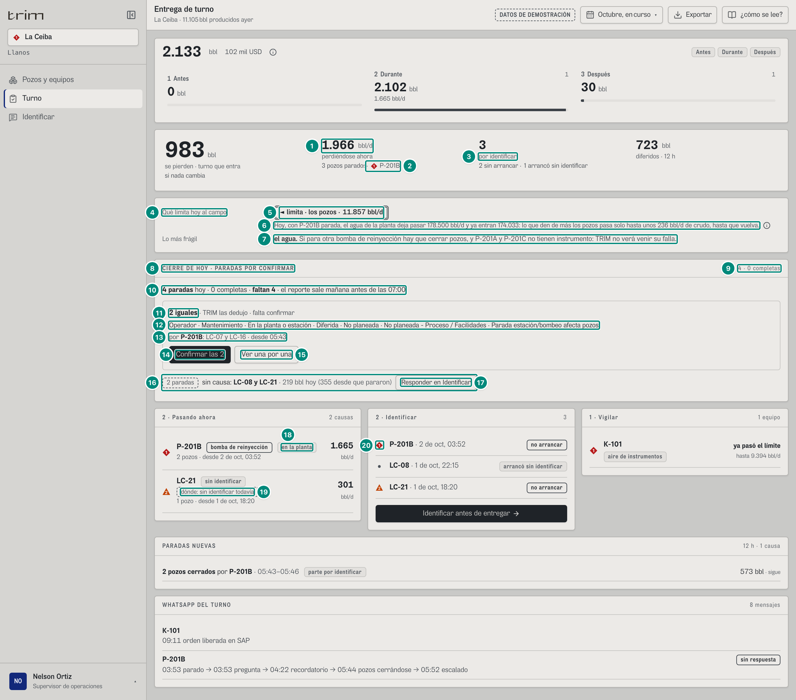
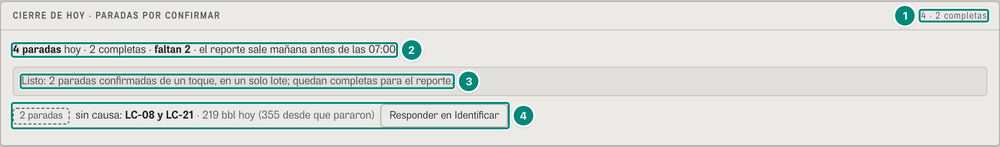
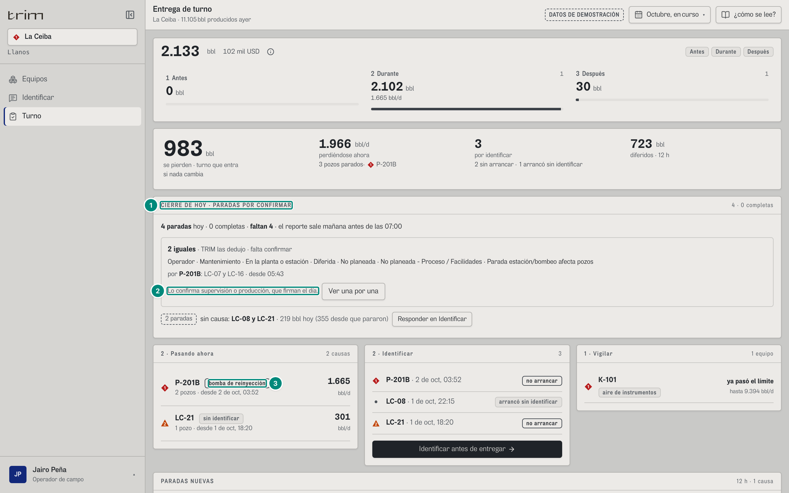
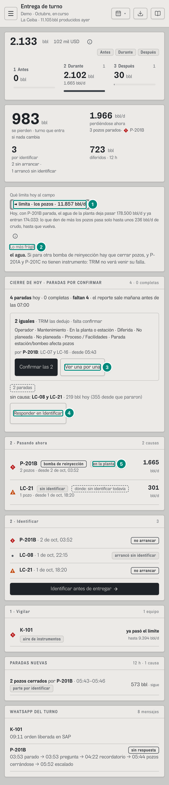

# 6D.6 Turno — «Qué limita hoy al campo», «Lo más frágil» y el cierre de hoy · supervisor, operador

**Para qué.** «Lo que recibe y lo que entrega.» (6B.5). Lo del choke en el turno responde la pregunta del supervisor: «¿Qué está frenando el campo ahora, y en qué orden cierro si se llena el tanque?» (U2 §3.1), y deja cerradas las paradas del día para el reporte a la ANH, que «sale mañana antes de las 07:00» (`src/widgets/arbol/CierreDeHoy.tsx:77`).
**Ruta.** `#/<rol>/turno/<campo>/<período>` (`sup` y `oper` tienen solo La Ceiba). El turno son las 12 h que terminan en AHORA, cualquiera sea el período (6B.5). · **Roles y nivel.** `sup` y `oper` (`operacion`). El supervisor ve «Hoy limita» (dos renglones), el chip del tramo en «2 · Pasando ahora» y confirma el lote. El operador no ve nada del modelo (U2 §3.1; `veTramo`, `src/pages/Turno.tsx:89`) y en el cierre lee «Lo confirma supervisión o producción, que firman el día.» (captura 3). · **Lee.** `GET /api/vistas/campos/:campo/tuberia?desde=AHORA−12h&hasta=AHORA` → `TuberiaCampo` (`limita`, `tramos[pozo].potencialBpd`, `fraseHoy`, `frase`, `textoCorto`, `perdiendoAhora[]`); `GET /api/vistas/campos/:campo/agua` → `TuberiaAgua` (`sinUna`, `frases`); `GET /api/vistas/criticidad?campos` → `ranking[]` (las bombas que suben); `GET /api/vistas/anh/paradas?campos&desde=<hoy 00:00>&hasta=AHORA` → `ParadaAnh[]` (el cierre de hoy); `GET /api/vistas/paradas/por-identificar?campos` → `Pregunta[]` (lo que lleva cada parada desde que paró). CONTRATO.md, Anexo A. Lo demás de la pantalla (riesgo, libro de 12 h, mensajes) en 6B.5. · **Escribe.** «Confirmar las 2»: `POST /api/anh/paradas/confirmar` con `{ ids, cadena }` → `RespuestaConfirmacion` (en lote: solo `sup` y `prod`, con `anh:confirmar`; `CONFIRMAN_EN_LOTE`, `src/entities/anh-paradas.ts:335`).
Fórmulas: lo que limita, el potencial de cada tramo y la frase → 5E §2; la frase de hoy con una bomba parada (`disponibleHoy`, `fraseHoy`) → 5E §6 y 5E §6; lo más frágil (las bombas que suben) → 5E §7; el tramo de lo que se pierde ahora → 5E §3; las filas de la ANH de hoy, sus estados, la cadena de 6 pasos y la confirmación en lote → 5E §9; los barriles de cada fila (`diferidaTrimBbl`) y de cada pregunta (`bbl`) → 5B §3.2 y 5A §3.

Lo demás de Turno (la cabecera, «2 · Identificar», «1 · Vigilar», «PARADAS NUEVAS» y «WHATSAPP DEL TURNO») está en 6B.5. Aquí va lo que se agregó entre la cabecera y los paneles («Hoy limita» y el cierre de hoy) y lo que cambió en ellos: el chip del tramo y las marcas (B-20, B-40). Las cifras son del demo con `AHORA = 2026-10-02T14:00-05:00`, comprobadas con el motor (`potencialesDelCampo`, `tuberiaCampo`, `tuberiaAgua`, `paradasAnh`, `libro`).

### Captura 1 · supervisor, La Ceiba

| # | Lo que se ve | En la captura | Cómo se calcula | Texto según el valor | Viene de |
|---|---|---|---|---|---|
| 1 | Perdiéndose ahora, sin marca | **1.966** bbl/d | Σ `bblDia` de las filas `perdiendo` = 1.665,2 + 300,8 (6B.5, fila 3) | **sin marca de alarma** (B-40, `Turno.tsx:229-230`); antes «◆ 1.966» (6B.5, fila 3) | `GET /api/vistas/riesgo` → `bblDia` |
| 2 | La marca, con el equipo | «3 pozos parados · ◆ P-201B» | `causaMayor`: la fila `perdiendo` de alto impacto con más bbl/d (alto impacto primero, luego `bblDia`) (`Turno.tsx:86`) | ◆ si es de alto impacto, ▲ si no (`Turno.tsx:234`); sin filas, nada | `riesgo[].altoImpacto`, `.bblDia` |
| 3 | Por identificar, sin marca | «3» · «por identificar» · «2 sin arrancar · 1 arrancó sin identificar» | la cuenta única (6B.5, filas 5 y 6) | sin marca en la cifra ni en «arrancó sin identificar» (B-40); antes ▲ y ■ (6B.5, filas 5, 6 y 30) | `Pregunta.pide/arrancoSinIdentificar` |
| 4 | Rótulo | «Qué limita hoy al campo» | — | fijo (`src/widgets/arbol/HoyLimita.tsx:51`); el bloque solo sale si el rol ve el tramo (`Turno.tsx:257`) | — |
| 5 | Lo que limita | «◄ limita · los pozos · 11.857 bbl/d» | el tramo más angosto de la tubería de La Ceiba: pozos 11.857 bbl/d (Σ prueba vigente × el factor de medición firmado), planta 13.000, afuera 14.000 → limitan los pozos (`potencialesDelCampo`, `src/entities/choke.ts:962`) → 5E §2 | chip gris de doble contorno, porque no es una alarma (U2 §0, principio 4): «◄ limita · {tramo en minúscula} · {n0} bbl/d» con «los pozos», «la planta o estación» o «afuera: oleoducto, transportador o cliente» (`HoyLimita.tsx:54-57`; `NOMBRE_CHOKE_CAMPO`, `choke.ts:155-159`). Sin lo que limita (campo de gas, sin esquema de planta): «sin dato» + `textoCorto` («Campo de gas: su tubería todavía no está», «Sin esquema de planta: no se sabe qué limita») (`HoyLimita.tsx:62`) | `tuberia.limita`, `tramos[].limita`, `tramos[pozo].potencialBpd` |
| 6 | La frase de hoy | «Hoy, con P-201B parada, el agua de la planta deja pasar 178.500 bbl/d y ya entran 174.033: lo que den de más los pozos pasa solo hasta unos 236 bbl/d de crudo, hasta que vuelva.» ⓘ | con una bomba de agua parada: lo que deja pasar el agua = 267.750 (las tres bombas) − 89.250 (P-201B) = 178.500 bbl/d; entran 174.033; lo que cabe, en crudo = (178.500 − 174.033) × 0,052915 = 236,4 bbl/d, con 0,052915 el crudo por barril de agua de las pruebas (11.857 / 224.075) (`aguaDisponibleHoy` y `fraseDeHoy`, `src/entities/choke-reparto.ts:516-540`) → 5E §6 | `fraseHoy ?? frase` (`HoyLimita.tsx:59`; B-14). Sin nada parado que angoste el agua, la frase de siempre: «A la planta le sobran 1.143 bbl/d: lo que den de más los pozos pasa, hasta 1.143 bbl/d.» (`choke.ts:1011`). Si ya no cabe nada (menos de 0,5 bbl/d): «Hoy no: con {equipo} parada, el agua de la planta está llena (entran N de M bbl/d). Lo que den de más los pozos no pasa hasta que vuelva.» (`choke-reparto.ts:537`). Sin `fraseHoy` si aun con la parada cabe toda el agua de los pozos (`choke-reparto.ts:535`). ⓘ «Limita»: «El tramo más angosto. No es una alarma: todo campo tiene uno. TRIM lo calcula con las pruebas de los pozos y las capacidades firmadas; nadie lo escribe a mano.» (`HoyLimita.tsx:60`) | `tuberia.fraseHoy`, `.frase`, `tramos[planta].disponibleHoy` |
| 7 | Lo más frágil | «Lo más frágil · **el agua.** Si para otra bomba de reinyección hay que cerrar pozos, y P-201A y P-201C no tienen instrumento: TRIM no verá venir su falla.» | las bombas que suben en «Si falla hoy» porque otra está parada (P-201A y P-201C, 3.059 bbl/d cada una; 6D.5, captura 1, fila 18) y cuáles no tienen vigía (`HoyLimita.tsx:39-44`) → 5E §7 | «… y {lista} no tiene/tienen instrumento: …» solo si alguna no tiene vigía. Sin bomba parada: la frase de la tubería del agua que empieza «Si para {bomba}» (6D.2), si una bomba de disposición en marcha dejaría agua sin salida (`sinUna`); si no, el renglón no sale. Sin puesto ni lista: el supervisor no tiene «Si falla hoy» (U2 §3.1; B-19) | `criticidad.ranking[].subio`, `.vigilado`; `agua.sinUna`, `agua.frases` |
| 8 | El cierre de hoy | «CIERRE DE HOY · PARADAS POR CONFIRMAR» | las filas del árbol de la ANH (`ParadaAnh`) del día operacional de hoy (2 de oct), pedidas de la medianoche a AHORA (`CierreDeHoy.tsx:37-38`) → 5E §3 | Lectura (`CierreDeHoy.tsx:73-78`): «Las paradas de hoy, cada una con sus 6 pasos del árbol de causas. Las que TRIM propuso con la misma cadena se confirman de un toque por grupo; la raíz de cada grupo queda a la vista para no cargarle a una raíz lo que fue de otra. Lo que alguien cambió sale del grupo solo. Con lo confirmado se miden las paradas no planeadas, y el reporte a la ANH sale mañana antes de las 07:00.» | `GET /api/vistas/anh/paradas` → `ParadaAnh[]` con `diaOperacional` = hoy |
| 9 | Paradas y completas | «4 · 0 completas» | paradas = eventos distintos entre las filas de hoy (`cuantasParadas`, `src/widgets/arbol/palabras.ts:162`): LC-16, LC-07, LC-08 y LC-21; completas = las de estado `confirmada`: ninguna | «completa»/«completas» (`CierreDeHoy.tsx:72`) | `ParadaAnh.eventoId`, `.estado` |
| 10 | El resumen | «**4 paradas** hoy · 0 completas · **faltan 4** · el reporte sale mañana antes de las 07:00» | faltan = 4 − 0 | «faltan N» solo si alguna no está completa (`CierreDeHoy.tsx:79-82`). Sin filas hoy: «Hoy no ha parado ningún pozo: no hay nada que cerrar.» (`CierreDeHoy.tsx:84`) | ídem |
| 11 | Un grupo | «**2 iguales** · TRIM las dedujo · falta confirmar» | las filas `propuesta`, sin las que esperan a quien abre el equipo, agrupadas por cadena idéntica de 6 pasos (`gruposPorCadena`, `anh-paradas.ts:339-348`; `lotesDe`, `CierreDeHoy.tsx:17-27`): LC-07 y LC-16. Los grupos, del más grande al más chico → 5E §9 | «1 propuesta · TRIM la dedujo» / «N iguales · TRIM las dedujo»; «falta confirmar» es el estado `propuesta` (`ESTADO`, `palabras.ts:19-21`) (`CierreDeHoy.tsx:90-91`) | `ParadaAnh.estado`, `.clasificacion` |
| 12 | La cadena, en una línea | «Operador · Mantenimiento · En la planta o estación · Diferida · No planeada · No planeada - Proceso / Facilidades · Parada estación/bombeo afecta pozos» | los 6 pasos de la primera fila del grupo, en palabras (`valorEnPalabras`, `palabras.ts:59-71`): responsable, dónde se trabó, diferida o pérdida, planeada o no, la causa (N1) y el detalle (N2) | sin códigos (`CierreDeHoy.tsx:93`): es lo que se confirma | `ParadaAnh.clasificacion` |
| 13 | La raíz | «por **P-201B**: LC-07 y LC-16 · desde 05:43» | las raíces del grupo, cada una con el equipo de la causa, sus pozos y la primera hora de sus filas (LC-16 cerró a las 05:43 y LC-07 a las 05:46; P-201B paró a las 03:52 y el tanque aguantó) (`CierreDeHoy.tsx:21-24, 94-101`) | «por {equipo}: » solo si hay más de un pozo o la causa no es el pozo mismo; la hora sola si es de hoy (`horaCorta`, `palabras.ts:80-86`) | `ParadaAnh.raiz`, `.causa.equipo`, `.pozo`, `.inicio` |
| 14 | Confirmar el grupo | «Confirmar las 2» | `confirmarAnh({ ids, cadena })` con las filas del grupo y la cadena que se ve (`CierreDeHoy.tsx:62-69`) → 5E §9 | «Confirmar» con una fila, «Confirmar las N» con varias (`CierreDeHoy.tsx:105`). Solo quien firma el día: `sup` o `prod` con `anh:confirmar` y acceso activo (`CierreDeHoy.tsx:41`); si no, «Lo confirma supervisión o producción, que firman el día.» (captura 3). Lo que queda después, en la captura 2 | `POST /api/anh/paradas/confirmar` |
| 15 | Una por una | «Ver una por una» | — | lleva a Identificar (6D.7); solo con la pantalla `causa` en el rol (`CierreDeHoy.tsx:60, 108`) | — |
| 16 | Las que faltan | chip «2 paradas» · «sin causa: **LC-08 y LC-21** · 219 bbl hoy (355 desde que pararon)» | las filas `pendiente`, contadas por parada (B-21). Hoy: Σ `diferidaTrimBbl` de sus filas del día = 43,4 (LC-08, de 00:00 a 01:10) + 175,5 (LC-21, de 00:00 a 14:00) = 218,9; desde que pararon: Σ `bbl` de sus preguntas = 108,5 + 246,5 = 355,0 (`CierreDeHoy.tsx:120-128`) → 5B §3.2 | un renglón por estado: «esperan a quien abra el equipo: la causa y el detalle los confirma el jefe de mantenimiento o confiabilidad», «falta un dato» o «sin causa» (`CierreDeHoy.tsx:115-119`); «(N desde que pararon)» solo si llegaron todas sus preguntas y la cifra pasa la de hoy (B-21) | `ParadaAnh.estado`, `.diferidaTrimBbl`; `Pregunta.bbl` |
| 17 | Responder | «Responder en Identificar» | — | solo con la pantalla `causa` (`CierreDeHoy.tsx:129`) | — |
| 18 | Dónde se trabó lo que se pierde ahora | chip «en la planta» (P-201B) | el tramo de la parada abierta según el motor del tramo: P-201B es compartida (sirve a los 18 pozos) → planta (`DondeSeTrabo`, `HoyLimita.tsx:80-87`) → 5E §3 | `DONDE_CHOKE[tramo]` en un chip gris; solo para quien ve el tramo, no `oper` ni `tec` (`Turno.tsx:89, 128`); sin la fila en `perdiendoAhora`, nada | `GET /api/vistas/campos/:campo/tuberia` → `perdiendoAhora[].tramo` |
| 19 | Sin tramo todavía | «dónde: sin identificar todavía» (LC-21) | la parada de LC-21 no tiene causa y no tiene tramo (`tramo: null`) | rectángulo gris discontinuo «dónde: {DONDE_CHOKE['sin-asignar']}» (`HoyLimita.tsx:86`) | `perdiendoAhora[].tramo` = `null` |
| 20 | La marca, con el equipo | ◆ en «P-201B · 2 de oct, 03:52» («2 · Identificar») | la marca de hoy del equipo, la misma en toda la pantalla (`Turno.tsx:53-54, 142`; B-20) | LC-08 lleva el punto gris (hoy sin alarma) y LC-21 ▲; la urgencia de identificar va en palabras: «no arrancar», «arrancó sin identificar». Antes la marca salía de la pregunta: ▲ si seguía parada, ■ si arrancó (6B.5, filas 14 y 15) | `GET /api/vistas/equipos-hoy` → `severidad` |

### Captura 2 · supervisor, después de «Confirmar las 2» (el panel)

Se toca «Confirmar las 2» (captura 1, fila 14) y se captura el panel.

| # | Lo que se ve | En la captura | Cómo se calcula | Texto según el valor | Viene de |
|---|---|---|---|---|---|
| 1 | Paradas y completas | «4 · 2 completas» | las filas de LC-07 y LC-16 pasan a `confirmada` | como la captura 1, fila 9 | `RespuestaConfirmacion.paradas[].estado` |
| 2 | El resumen | «**4 paradas** hoy · 2 completas · **faltan 2** · el reporte sale mañana antes de las 07:00» | 4 − 2 | como la captura 1, fila 10 | ídem |
| 3 | El aviso | «Listo: 2 paradas confirmadas de un toque, en un solo lote; quedan completas para el reporte.» | `r.paradas.length` = 2 filas; `r.lote` presente; las dos quedaron `confirmada` (`CierreDeHoy.tsx:67-68`) | «; la causa de algunas la confirma quien abra el equipo.» si alguna no quedó completa; sin lote (las filas de una sola parada, B-07), sin «, en un solo lote». Es `role="status"` y recibe el foco si el botón ya no está (`CierreDeHoy.tsx:53-57, 83`). Cuenta filas y no paradas: 6D·H24 | `RespuestaConfirmacion.paradas`, `.lote` |
| 4 | Lo que queda | chip «2 paradas» · «sin causa: LC-08 y LC-21 · 219 bbl hoy (355 desde que pararon)» · «Responder en Identificar» | como la captura 1, fila 16; el grupo confirmado sale del panel | — | ídem |

### Captura 3 · operador, La Ceiba (lo de arriba)

| # | Lo que se ve | En la captura | Cómo se calcula | Texto según el valor | Viene de |
|---|---|---|---|---|---|
| 1 | Sin «Hoy limita» | el cierre de hoy va justo debajo de la cabecera | el operador no ve el tramo (`veTramo` es falso para `oper` y `tec`, `Turno.tsx:89, 257-258`): contesta lo que vio (U2 §3.1) | — | — |
| 2 | Sin botón de confirmar | «Lo confirma supervisión o producción, que firman el día.» | el operador no confirma en lote (`CONFIRMAN_EN_LOTE` = `sup`, `prod`) | sí tiene «Ver una por una» y «Responder en Identificar» (tiene la pantalla `causa`) | — |
| 3 | Sin chip del tramo | «P-201B · bomba de reinyección» sin «en la planta»; LC-21 sin «dónde: …» | `veTramo` (`Turno.tsx:128`) | — | — |

### En el teléfono (390 px)

| # | Lo que se ve | En la captura | Cómo se calcula | Texto según el valor | Viene de |
|---|---|---|---|---|---|
| 1 | Lo que limita | «◄ limita · los pozos · 11.857 bbl/d» debajo de su rótulo | captura 1, fila 5 | el rótulo y el valor en dos renglones (la rejilla de dos columnas empieza en `sm`, `HoyLimita.tsx:45`); la frase de hoy en su renglón y el ⓘ debajo | `tuberia` |
| 2 | Lo más frágil | rótulo y frase en dos renglones | captura 1, fila 7 | ídem | `criticidad`, `agua` |
| 3 | Botones del grupo | «Confirmar las 2» y «Ver una por una», de 40 px | captura 1, filas 14 y 15 | `min-h-10` en el teléfono (`CierreDeHoy.tsx:104, 108`) | — |
| 4 | Responder | «Responder en Identificar», de 48 px, en su propio renglón | captura 1, fila 17 | `min-h-12` (`CierreDeHoy.tsx:129`); el chip «2 paradas» queda encima | — |
| 5 | El chip del tramo | «en la planta» en la línea de P-201B | captura 1, fila 18 | — | `perdiendoAhora[].tramo` |

### Estados y otros campos

- **Sin nada parado que angoste el agua**: la frase de siempre debajo de «◄ limita» (captura 1, fila 6) y «Lo más frágil» con la frase del agua «Si para {bomba}…» o sin renglón.
- **Campo de gas o sin esquema de planta**: «Qué limita hoy al campo» dice «sin dato» y el `textoCorto` (captura 1, fila 5). El supervisor y el operador tienen hoy solo La Ceiba (`src/entities/roles.ts`).
- **Varios campos** (un rol con más de un campo, en portafolio): un bloque de «Hoy limita» por campo con su nombre (`HoyLimita.tsx:49`) y, en el cierre, « · {campo}» después de cada pozo (`CierreDeHoy.tsx:58-59`).
- **Sin paradas hoy**: «Hoy no ha parado ningún pozo: no hay nada que cerrar.»
- **Paradas que esperan a quien abre el equipo** (una señal apunta y faltan la causa y el detalle, `esperaAQuienAbre`, `src/entities/anh-clasificacion.ts:1199-1202`): no entran en un grupo; van en su renglón «esperan a quien abra el equipo: la causa y el detalle los confirma el jefe de mantenimiento o confiabilidad». Una a la que le falta un paso: «falta un dato».
- **Una persona cambió un paso**: la fila ya no tiene la misma cadena y sale del grupo sola (la Lectura).
- **Error al confirmar** (p. ej. `403` de un lote que no firma el rol; `409` si la cadena cambió entre que se vio y se tocó): el texto del servidor en un `role="alert"` (`CierreDeHoy.tsx:113`); las reglas y códigos, CONTRATO.md `POST /api/anh/paradas/confirmar` y la tabla C-22.
- **Período**: no cambia nada; «Hoy limita» usa las 12 h del turno y el cierre, el día operacional de hoy.

### Interacciones

- «Confirmar las N»: confirma el grupo; el grupo sale, el aviso lo dice y suben las completas (captura 2).
- «Ver una por una» y «Responder en Identificar»: van a Identificar (6D.7).
- ⓘ «Limita». Clic en una fila de «2 · Pasando ahora»: la ficha del equipo (6B.4).
