# 6D.7 Identificar — el árbol de 6 pasos de cada parada, «Por contestar», la cascada de un toque y el motivo · operador, supervisor, técnico, producción, jefe, confiabilidad

**Para qué.** «Durante: identificar antes de arrancar (causa → SAP/ISO).» (`PARA_QUE.causa`, `src/widgets/Onboarding.tsx:26`). El panel nuevo lo dice en su «¿cómo se lee?»: «Cada parada se clasifica en 6 pasos, el mismo árbol de la Circular 024 de la ANH: quién, dónde se trabó, qué pasó, si era planeada, la causa y el detalle. Así se mide qué paradas no planeadas bajar, y el reporte a la ANH sale de lo mismo. TRIM propone cada paso y dice de dónde salió; una persona lo confirma. Lo que falta va en gris discontinuo: nada se rellena.» (`src/widgets/arbol/ArbolIdentificar.tsx:94-101`).
**Ruta.** `#/<rol>/causa/<campo>[~portafolio]/<período>` · **Roles y nivel.** `oper`, `sup`, `tec` (operación); `prod`, `jefe`, `conf` (ingeniería); el gerente no la tiene (`src/entities/roles.ts:54-91`). Contestan y corrigen los seis (`anh:clasificar`, `roles.ts:58-95`), cada uno en lo suyo; confirman en lote quienes firman el día (`anh:confirmar`: `sup`, `prod`); ponen «En el yacimiento» `prod` y `conf` (`anh:yacimiento`). · **Lee.** `GET /api/vistas/anh/paradas?campos&desde&hasta` → `ParadaAnh[]` (CONTRATO.md, Anexo A), **del período** (no de toda la historia, como «Por identificar» de 6C.2); si el período corta una cascada, la misma vista otra vez con la ventana de la raíz, el día en que cayó y el siguiente (`useRaicesDeCascadas`, `src/shared/api/arbol.ts:113-133`; QA-R, vecino 12). · **Escribe.** `POST /api/anh/paradas/confirmar`, `POST /api/anh/paradas/:id/clasificacion`, `…/yacimiento`, `…/respuesta` y `…/revision` (CONTRATO.md:761-882). Los rechazos traen `estado` y `codigo` de la tabla C-22 (CONTRATO.md:219-238; en el demo, `src/shared/api/escrituras.ts`, que hace de servidor).

Fórmulas: la fila (pozo × día operacional × causa), la raíz y la cascada, `inicioEvento`, las filas abiertas al corte y los retiros → 5E §9; la propuesta de TRIM (`REGLAS_ANH`, `proponerClasificacion`), quién declara y quién confirma cada paso (`PASOS_QUE_DECLARA`, `PASOS_QUE_CONFIRMA`), las preguntas de campo y los estados → 5E §9; el paso 2 y su porqué (`chokeDeCausa`) → 5E §3 y 5E §1; cuánto de esto confirmó o corrigió una persona → 6D.9 y 5E §9.

Lo demás de Identificar está en 6C.2 y no se repite aquí: la regla «no arrancar», la cabecera de cifras, «POR IDENTIFICAR · SIN ARRANCAR» con los formularios «QUÉ SE DAÑÓ» y «POR QUÉ PARÓ», NO CONFORMIDADES, DECLARADAS y el hilo de WhatsApp de cada pregunta (el chat, en 6D.8; **RETIRADO (27-oct-2026)**). Este panel va después de lo que no se arranca: para supervisión, entre la cabecera de cifras y NO CONFORMIDADES; para ingeniería, entre «POR IDENTIFICAR · SIN ARRANCAR» y NO CONFORMIDADES (`src/pages/Causa.tsx:213-251`). Para el operador y el técnico la pantalla es otra (captura 4).

Lo que hay que llevarse:

- **Son dos universos en la misma pantalla.** «Por identificar» (6C.2) cuenta *preguntas* del libro de toda la historia: P-201B, LC-21 y LC-08. El árbol cuenta *paradas de pozo* del período: LC-07 y LC-16 (las cerró P-201B), LC-05, LC-21 y LC-08. La bomba no es fila de la ANH: sus pozos sí, como una cascada de una sola raíz.
- **Las paradas del árbol suman lo del libro.** 573 + 118 + 247 + 109 = 1.046 bbl, el diferido de octubre de La Ceiba (6C.2, captura 1, fila 23: «691 de 1.046 bbl diferidos»). Cada fila lleva los barriles del libro (`diferidaTrimBbl`), que no viajan a la ANH.
- **Una tarjeta es una decisión** (`agrupar`, `src/widgets/arbol/grupos.ts:26-45`): las filas con el mismo campo, la misma raíz, el mismo estado y la misma cadena vista (y sin una revisión sin atender), de más a menos barriles. Lo que una persona cambia en una fila la saca de su tarjeta (captura 13).
- **Bloques** (`ArbolIdentificar.tsx:108-109`; `src/widgets/arbol/palabras.ts:24-27`): REVISAR (lo que alguien marcó «Algo está mal» o le pidió a este rol), POR CONFIRMAR, FALTA UN DATO, SIN CAUSA y COMPLETAS (plegado). Cinco tarjetas a la vista y «ver las otras N» (`VISIBLES = 5`, `src/shared/ui/listaCorta.ts:3`); en el papel salen todas.

### Captura 1 · supervisor, La Ceiba, octubre en curso (el panel del árbol)

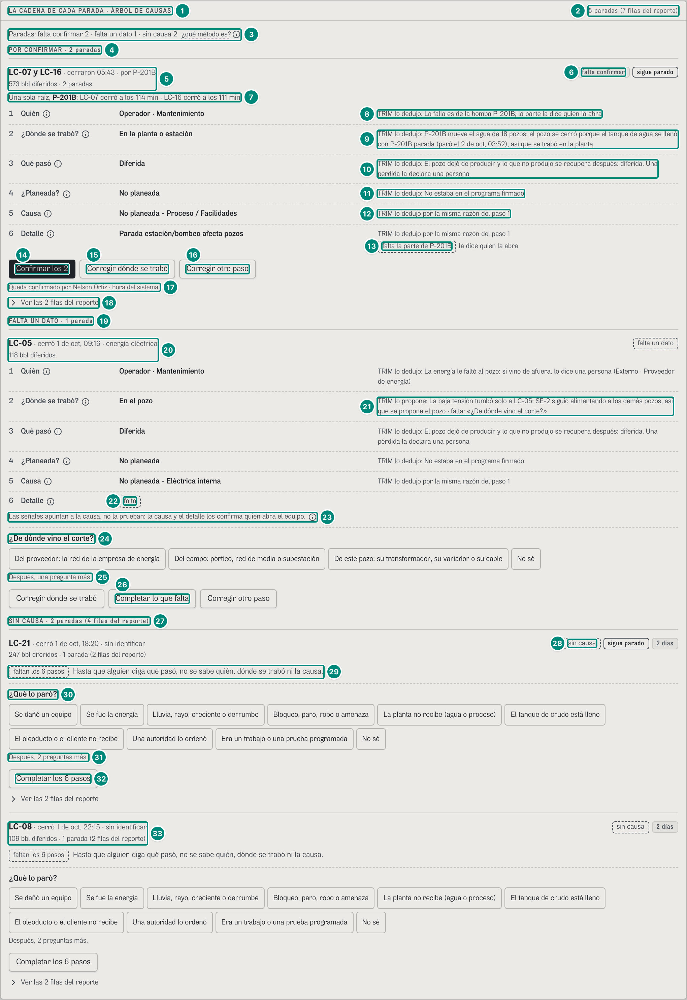

| # | Lo que se ve | En la captura | Cómo se calcula | Texto según el valor | Viene de |
|---|---|---|---|---|---|
| 1 | Título del panel | «LA CADENA DE CADA PARADA · ÁRBOL DE CAUSAS» | fijo (`ArbolIdentificar.tsx:92`) | para el operador y el técnico el panel es «POR CONTESTAR» (captura 4) | — |
| 2 | Paradas y filas | «5 paradas (7 filas del reporte)» | paradas = eventos de pozo distintos (`cuantasParadas`, `palabras.ts:162`): LC-07, LC-16, LC-05, LC-21 y LC-08; filas = pozo × día operacional: LC-21 y LC-08 cruzaron la medianoche del 1-oct, dos filas cada una → 1 + 1 + 1 + 2 + 2 = 7 (5E §3) | «{n} paradas ({m} filas del reporte)» si $m \ne n$; si son iguales, solo «{n} paradas»; «1 parada» en singular (`paradasYFilas`, `palabras.ts:164-167`; B-21). El lector oye además «del árbol de causas en Octubre, en curso» | `GET /api/vistas/anh/paradas` → `ParadaAnh[]`: el front cuenta los `eventoId` distintos y las filas |
| 3 | Resumen por estado y el método | «Paradas: falta confirmar 2 · falta un dato 1 · sin causa 2» · «¿qué método es?» ⓘ | paradas (no filas) de cada estado, en el orden de los bloques (`ORDEN_SECCIONES`, `palabras.ts:27`): falta confirmar = LC-07 y LC-16; falta un dato = LC-05; sin causa = LC-21 y LC-08 (`ArbolIdentificar.tsx:90`) | estados (`ESTADO`, `palabras.ts:19-21`): `propuesta` «falta confirmar», `por-precisar` «falta un dato», `pendiente` «sin causa», `confirmada` «completa»; un estado sin paradas no se escribe; sin ninguna: «Ninguna parada en {período}.» (`ArbolIdentificar.tsx:103`). ⓘ «¿Qué método es?»: «Es un método internacional para ubicar dónde se pierde producción: lo publicó BP en 1996 (artículo SPE-36848), lo usa el regulador británico (NSTA) y la ANH lo adoptó en 2026 (Circulares 003 y 024). No es la válvula choke de la cabeza del pozo (Circular 024, p. 4).» (`INFO_METODO`, `palabras.ts:38`) | `ParadaAnh.estado` |
| 4 | Bloque | «POR CONFIRMAR · 2 paradas» | las tarjetas en `propuesta` que no esperan una revisión de este rol (`ArbolIdentificar.tsx:52-53`) | `SECCION` (`palabras.ts:24-26`) + paradas y filas (aquí iguales: sin paréntesis). «ver las otras N» desde la sexta tarjeta; COMPLETAS empieza plegado («ver las N») (`ArbolIdentificar.tsx:134-155`) | `ParadaAnh.estado`, `revision` |
| 5 | La tarjeta: pozos, desde cuándo, qué y barriles | «LC-07 y LC-16 · cerraron 05:43 · por P-201B» / «573 bbl diferidos · 2 paradas» | pozos: hasta tres por su nombre, más «{n} pozos» (`Tarjeta.tsx:76`); «cerraron 05:43»: el primer `inicioEvento` del grupo (LC-16, 05:43; LC-07, 05:46), solo la hora porque es de hoy (`desdeCuando`, `palabras.ts:176-184`; `horaCorta`, `:80-86`; B-22); «por P-201B»: la raíz es otro evento; barriles: $\sum$ `diferidaTrimBbl` = 273 + 300 = 573 (573,06 en el libro: 6C.2, captura 1, fila 7) | sin cascada, el tipo de causa en minúscula («energía eléctrica», fila 20). Un evento que empezó antes del período: «parada desde el {fecha, hora} (en este período, desde el {fecha})»; parcial: «con la frecuencia bajada desde el …» (B-22). Debajo, las filas aparte si son más que las paradas («· 1 parada (2 filas del reporte)»), o «· tramo {n} de {m}» en una fila sola de un evento de varios tramos (`Tarjeta.tsx:126-134`) | `ParadaAnh.pozo/inicioEvento/raiz/causa.equipo/causa.tipo/diferidaTrimBbl` |
| 6 | Estado y marcas | «falta confirmar» · «sigue parado» | `estadoDeTarjeta` (`palabras.ts:170-171`); «sigue parado»: alguna fila abierta al corte de un día que sigue en curso (`Tarjeta.tsx:75`) | chip lleno en `propuesta` y `confirmada`; gris discontinuo en «falta un dato», «faltan {n} pasos» (B-21) y «sin causa». Además: «para revisar», «parcial: {x} de {y} Hz» (o «parcial · {n} % del caudal»), «disparo», «se pasó de la ventana del programa», «{n} días» (`Tarjeta.tsx:105-118`) | `estado`, `faltan`, `abiertaAlCorte`, `diaEnCurso`, `parcial`, `hz`, `fraccion`, `disparo`, `exceso`, `revision` |
| 7 | La cascada | «Una sola raíz, P-201B: LC-07 cerró a los 114 min · LC-16 cerró a los 111 min» | minutos entre la parada de la raíz (P-201B, 2-oct 03:52) y el cierre de cada pozo: 05:46 → 114, 05:43 → 111 (`minutosDesdeRaiz`, `src/entities/anh-paradas.ts:272-275`; 5E §3) | con más de cuatro pozos, «{n} pozos · una sola raíz: {raíz}» (captura 11); si la raíz cerró más pozos de los que tiene la tarjeta, «· la raíz cerró {n} pozos en este período» (captura 13) (`Tarjeta.tsx:140-147`) | `ParadaAnh.raiz/minutosDesdeRaiz` |
| 8 | Paso 1 · Quién | «Operador · Mantenimiento» · «TRIM lo dedujo: La falla es de la bomba P-201B; la parte la dice quien la abra» | fila `linea-sin-n2` de `REGLAS_ANH` (bomba de la línea sin parte): `op-mantenimiento` (`src/entities/anh-clasificacion.ts:677-680`); el porqué nombra la bomba y lo que falta (B-11, `:1037-1041`) (5E §9) | cada paso: número, rótulo y su ⓘ (el nombre del paso en la circular), el valor en palabras (`valorEnPalabras`, `palabras.ts:59-70`) y de dónde salió (`marcaDelPaso`, `src/widgets/arbol/marcas.ts:37-68`): de TRIM, «TRIM lo dedujo: {porqué}», «programa firmado», «su árbol» o «registro de la ANH» (`marcaDeTrim`, `palabras.ts:99-104`), en gris; de una persona, «dijo / confirmó / corrigió {persona} · {hora}» (+ «· en lote»; corregido: «· antes: {lo propuesto} · {motivo}»), en tinta plena (`marcaDePersona`, `palabras.ts:89-96`; `Cadena.tsx:63`). Con la parte ya dicha: «… (sello mecánico): la tabla de la ANH no tiene una causa exacta para esa parte» (6D.8, captura 4) | `clasificacion.responsable` (`valor`, `procedencia`, `porque`) |
| 9 | Paso 2 · ¿Dónde se trabó? | «En la planta o estación» · «TRIM lo dedujo: P-201B mueve el agua de 18 pozos: el pozo se cerró porque el tanque de agua se llenó con P-201B parada (paró el 2 de oct, 03:52), así que se trabó en la planta» | `chokeDeCausa`: manda el origen (la raíz, P-201B), que sirve a 18 pozos según la topología → planta; una bomba de disposición parada cierra el pozo por el tanque de agua lleno (`src/entities/choke.ts:774-791`, la frase en `:786`) (5E §3, 5E §1) | ⓘ (U2 §1.5): «Dónde empezó lo que paró el pozo, no dónde está el pozo: si la planta no recibe y el pozo cierra, se trabó en la planta. Es el paso 2 de la Circular 024 de la ANH ("componente del sistema de producción").» (`INFO_PASO_2`, `palabras.ts:36`); confiabilidad lee además «En el reporte: {etiqueta} ({código})» (`Cadena.tsx:54-56`). «TRIM lo propone» y «· falta: «{pregunta}»» cuando el motor del tramo deja una pregunta abierta (fila 21; `marcas.ts:5-23, 62-65`); en la tarjeta de un pozo solo de una cascada, además «{pozo} cerró {m} min después de {raíz}» | `clasificacion.choke` (`porque`: `regla`, `elemento`, `pozosServidos`, `texto`, `pregunta`) |
| 10 | Paso 3 · Qué pasó | «Diferida» · «TRIM lo dedujo: El pozo dejó de producir y lo que no produjo se recupera después: diferida. Una pérdida la declara una persona» | toda fila se propone diferida (`anh-clasificacion.ts:1055-1056`) | la referencia «(P1 §2.4)» del texto del motor no sale en la pantalla (`sinReferencias`, `palabras.ts:108-109`) | `clasificacion.impacto` |
| 11 | Paso 4 · ¿Planeada? | «No planeada» · «TRIM lo dedujo: No estaba en el programa firmado» | ningún programa firmado la cubre (`anh-clasificacion.ts:1057-1059`) | con programa: «programa firmado» y «Estaba en el programa firmado: {motivo}» | `clasificacion.planeacion` |
| 12 | Paso 5 · Causa | «No planeada - Proceso / Facilidades» · «TRIM lo dedujo por la misma razón del paso 1» | la N1 de la fila (`NP_PROC`), con el nombre de la Tabla 1, el mismo del árbol de cada tramo (B-27) | un porqué igual al de un paso anterior no se repite: «{marca} por la misma razón del paso {n}» (B-11; `Cadena.tsx:38-41`) | `clasificacion.n1` |
| 13 | Paso 6 · Detalle | «Parada estación/bombeo afecta pozos» · «TRIM lo dedujo por la misma razón del paso 1» · «falta la parte de P-201B · la dice quien la abra» | la N2 de `linea-sin-n2` (`NP_PROC/parada-estacion-bombeo-afecta-pozos`): la Tabla 1 no tiene causa para la parte de una bomba de reinyección | «falta la parte de {bomba}» (gris discontinuo) solo en `linea-sin-n2`, sin parte y con el detalle de TRIM (`Cadena.tsx:47, 73`; B-11). Un paso en falta es «falta», con «TRIM sugiere: {valor}» si la regla preselecciona algo (`Cadena.tsx:59-61`); uno que una persona dijo y otra retiró lleva debajo «antes: …, retirado por …» (captura 14) | `clasificacion.n2`, `propuesta.fila`, `causa.parte` |
| 14 | Confirmar | «Confirmar los 2» | un toque: `POST /api/anh/paradas/confirmar { ids: [las 2 filas], cadena }` (`Tarjeta.tsx:90-103, 207-209`); quien firma el día manda varias filas en lote (`escrituras.ts:1216-1231`) y sube a «confirmado» los 6 pasos (`PASOS_QUE_CONFIRMA`, `anh-clasificacion.ts:1166-1169`) | una fila: «Confirmar»; supervisión y producción (`CONFIRMAN_EN_LOTE`, `anh-paradas.ts:335`): «Confirmar los {n}» (pozos) o «Confirmar los {n} días»; el jefe y confiabilidad: «Confirmar esta parada ({n} pozos · {m} filas)» (captura 10) (`Tarjeta.tsx:86-88`). Sale solo en `propuesta` y, si «una señal apunta», con lo demás avalado, solo para el jefe y confiabilidad (`Tarjeta.tsx:84`). Después: «Listo. LC-07 y LC-16 quedan completas (2 filas), en un solo lote.»; la tarjeta pasa a COMPLETAS y cada paso dice «confirmó Nelson Ortiz · 14:00 · en lote» (`Tarjeta.tsx:94-103`; e2e `arbol-identificar.spec.ts:16-36`) | `POST /api/anh/paradas/confirmar` → `{ paradas, lote? }` |
| 15 | Corregir el paso 2 | «Corregir dónde se trabó» | abre el editor del paso 2 (captura 3) | no sale sin causa (`Tarjeta.tsx:210`) | — |
| 16 | Corregir los demás | «Corregir otro paso» | abre el editor de quién, qué pasó, ¿planeada?, causa y detalle (capturas 12 a 14) | no sale sin causa; con algo en falta sale también «Completar lo que falta» o «Completar los 6 pasos» (`Tarjeta.tsx:211-212, 223-228`) | — |
| 17 | Quién confirma | «Queda confirmado por Nelson Ortiz · hora del sistema.» | la persona de la sesión; la hora la pone el servidor | solo con el botón de confirmar (`Tarjeta.tsx:215-217`); sin nadie con acceso en el rol: «Nadie con acceso activo tiene este rol: confirma una persona, no un rol.» (`:220`) | sesión |
| 18 | Las filas del reporte | «Ver las 2 filas del reporte» | una por pozo × día operacional; abiertas en la captura 2 | solo con más de una fila (`Tarjeta.tsx:231-242`); en el papel salen abiertas | `ParadaAnh[]` |
| 19 | Bloque | «FALTA UN DATO · 1 parada» | `por-precisar`: no están los 6 pasos (a LC-05 le falta el detalle) | «faltan {n} pasos» en la tarjeta cuando falta más de uno (B-21) | `estado`, `faltan` |
| 20 | Una parada de un pozo | «LC-05 · cerró 1 de oct, 09:16 · energía eléctrica» / «118 bbl diferidos» | no es cascada: «cerró», con el día porque no es de hoy, y el tipo de causa (`TIPO_CAUSA.energia` en minúscula); 117,9 bbl: la baja tensión del alimentador SE-2 que la señal sí prueba en el libro (6C.2, captura 1, fila 22). Su paso 1: «TRIM lo dedujo: La energía le faltó al pozo; si vino de afuera, lo dice una persona (Externo · Proveedor de energía)» (fila `energia-uv-o-dedicado`, `anh-clasificacion.ts:685-688`) | — | `ParadaAnh` |
| 21 | Paso 2 de LC-05 | «TRIM lo propone: La baja tensión tumbó solo a LC-05: SE-2 siguió alimentando a los demás pozos, así que se propone el pozo · falta: «¿De dónde vino el corte?»» | regla @2 del motor del tramo (U2 §4.4, caso 8): un UV que tumbó un solo pozo de su alimentador en la ventana de cascada (15 min) → el pozo, con la pregunta de energía (`choke.ts:762-769`) (5E §3) | «TRIM lo propone» porque el porqué trae `pregunta`; la pregunta que se nombra es la de campo abierta que resuelve el paso 2 (`marcas.ts:8-11`) | `choke.porque.pregunta`, `propuesta.preguntas` |
| 22 | Paso 6 de LC-05 | «falta» | la fila no decide la N2 entre las 13 de `NP_ENINT` y no sugiere ninguna (`anh-clasificacion.ts:685-688`) | — | `faltan`, `propuesta.sugerido` |
| 23 | Una señal apunta | «Las señales apuntan a la causa, no la prueban: la causa y el detalle los confirma quien abra el equipo.» ⓘ | `clasificacion.apunta` (`senal-apunta@1`): el código UV no prueba de dónde vino el corte (`Tarjeta.tsx:173-178`) | ⓘ «Una señal apunta, no prueba»: «El código UV (baja tensión) puede venir de superficie (el cable, el variador o la red): las señales apuntan a esta causa, no la prueban. La confirma quien abra el equipo» (`anh-clasificacion.ts:950-951`). Con «una señal apunta», la causa y el detalle solo los confirman el jefe y confiabilidad (`CONFIRMAN_LO_QUE_APUNTA`, `:1183`) | `clasificacion.apunta.porque` |
| 24 | La pregunta | «¿De dónde vino el corte?» · «Del proveedor: la red de la empresa de energía» · «Del campo: pórtico, red de media o subestación» · «De este pozo: su transformador, su variador o su cable» · «No sé» | `PREGUNTAS_CAMPO.corte` (`anh-clasificacion.ts:485-497`): la primera deja Externo · Proveedor de energía, planta y `NP_ENEXT`; la segunda, Operador · Mantenimiento, planta y `NP_ENINT`; la tercera, Operador · Mantenimiento, pozo y `NP_ENINT`; «No sé» no fija nada: la pregunta sigue y escala a quien revisa | UNA pregunta a la vez (B-23): primero la que sigue a lo último contestado, después la de campo antes que la técnica (`enOrden`, `palabras.ts:124-131`). Cada rol ve las que contesta (`ROLES_QUE_CONTESTAN`, `anh-clasificacion.ts:359-364`). Un toque: `POST …/respuesta { pregunta: 'corte', opcion: '<el texto del botón>', aplicarAlEvento (o aplicarALaCascada e ids), cadena }` y el aviso «Guardado en LC-05: «{opción}».» (`Preguntas.tsx:55-69`) | `propuesta.preguntas[]` (`texto`, `quien`, `opciones[].texto/deja/sigue`) |
| 25 | Lo que queda | «Después, una pregunta más.» | abiertas para el supervisor: «¿De dónde vino el corte?» y «¿Qué fue, exactamente?» (el detalle, `quien: causa`) | «Después, una pregunta más.» / «Después, {n} preguntas más.» (`Preguntas.tsx:137`; B-23) | `propuesta.preguntas` |
| 26 | Completar | «Completar lo que falta» | el editor con los pasos en falta (aquí el detalle), con las opciones que admite la regla (`Tarjeta.tsx:211, 225`) | «Completar los 6 pasos» si faltan los seis | — |
| 27 | Bloque | «SIN CAUSA · 2 paradas (4 filas del reporte)» | `pendiente`: la causa de TRIM es «sin identificar» (LC-21 y LC-08, código CMD) | — | `estado` |
| 28 | Marcas de LC-21 | «sin causa» · «sigue parado» · «2 días» | LC-21 sigue parada desde el 1-oct, 18:20: sus filas tocan dos días operacionales (`Tarjeta.tsx:74, 116`) | LC-08 arrancó el 2-oct a las 01:10: «2 días», sin «sigue parado» (fila 33) | `diaOperacional`, `abiertaAlCorte` |
| 29 | Sin causa | «faltan los 6 pasos» · «Hasta que alguien diga qué pasó, no se sabe quién, dónde se trabó ni la causa.» | sin causa faltan los seis: una línea, no seis huecos (`Tarjeta.tsx:161-163`; U2 §4.2) | a quien no se le pregunta nada: «Lo que encontró se registra arriba, en «Por identificar» (o en «No conformidades», si ya arrancó): con eso TRIM propone los 6 pasos.» (`Tarjeta.tsx:167-171`). Al supervisor le salen las dos preguntas de LC-21, la del libro y la del árbol: 6D·H27 | — |
| 30 | La pregunta de la parada sin causa | «¿Qué lo paró?» y sus 10 respuestas | `PREGUNTAS_CAMPO['que-lo-paro']` (`anh-clasificacion.ts:424-440`): «Se dañó un equipo», «Se fue la energía», «Lluvia, rayo, creciente o derrumbe», «Bloqueo, paro, robo o amenaza», «La planta no recibe (agua o proceso)», «El tanque de crudo está lleno», «El oleoducto o el cliente no recibe», «Una autoridad lo ordenó», «Era un trabajo o una prueba programada», «No sé» | cada respuesta deja lo suyo y abre la que sigue («Se fue la energía» → «¿De dónde vino el corte?»). En el teléfono, cinco, «No sé» y «Más opciones…» (captura 8) | `propuesta.preguntas` |
| 31 | Lo que queda | «Después, 2 preguntas más.» | las pendientes de una fila sin causa: «¿Qué lo paró?», «¿Este cierre estaba programado?» y «¿Se perdió crudo o gas que ya había salido?» (`anh-clasificacion.ts:1027-1031`) | ídem fila 25 | — |
| 32 | Completar | «Completar los 6 pasos» | el editor con los seis pasos | — | — |
| 33 | Otra sin causa | «LC-08 · cerró 1 de oct, 22:15 · sin identificar» / «109 bbl diferidos · 1 parada (2 filas del reporte)» | arrancó sin identificar (la no conformidad de 6C.2): 108,52 bbl | — | — |

### Captura 2 · supervisor: las filas del reporte de una parada

Pasos (`antes`): tocar «Ver las 2 filas del reporte» en la tarjeta de LC-07 y LC-16.

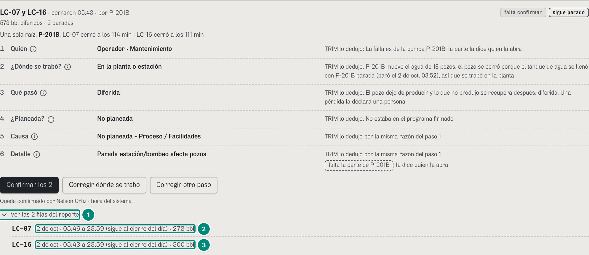

| # | Lo que se ve | En la captura | Cómo se calcula | Texto según el valor | Viene de |
|---|---|---|---|---|---|
| 1 | La lista abierta | «Ver las 2 filas del reporte» | despliega las filas de la tarjeta (`aria-expanded`; `Tarjeta.tsx:231-242`) | en el papel sale abierta (`print:grid`) | — |
| 2 | Una fila | «LC-07 · 2 de oct · 05:46 a 23:59 (sigue al cierre del día) · 273 bbl» | `horasDeFila` (`palabras.ts:157-158`): día operacional · inicio a fin; una fila abierta al corte termina a las 23:59:59 de su día y lo dice (`anh-paradas.ts:250-253`); los barriles, `n0(diferidaTrimBbl)`: los del libro hasta AHORA (14:00), no hasta las 23:59 | sin «(sigue al cierre del día)» si el pozo arrancó ese día; sin fechas ISO ni cero delante (B-25). Hoy, «a 23:59 (sigue al cierre del día)» describe un corte que todavía no llega y los barriles son hasta las 14:00: 6D·H28 | `ParadaAnh.diaOperacional/inicio/fin/abiertaAlCorte/diferidaTrimBbl` |
| 3 | La otra fila | «LC-16 · 2 de oct · 05:43 a 23:59 (sigue al cierre del día) · 300 bbl» | ídem; 273 + 300 = 573 (captura 1, fila 5) | — | ídem |

Las filas de las paradas sin causa, abiertas igual (exploración del 23-oct): LC-21, «1 de oct · 18:20 a 23:59 (sigue al cierre del día) · 71 bbl» y «2 de oct · 00:00 a 23:59 (sigue al cierre del día) · 175 bbl» (la tarjeta dice 247 porque suma sin redondear: 246,53); LC-08, «1 de oct · 22:15 a 23:59 (sigue al cierre del día) · 65 bbl» y «2 de oct · 00:00 a 01:10 · 43 bbl» (108,52 → 109).

### Captura 3 · supervisor: «Corregir dónde se trabó» en una cascada

Pasos (`antes`): tocar «Corregir dónde se trabó» en la tarjeta de LC-07 y LC-16. En el escritorio el editor se abre en su lugar, debajo de los botones; en el teléfono, como hoja desde abajo (captura 9).

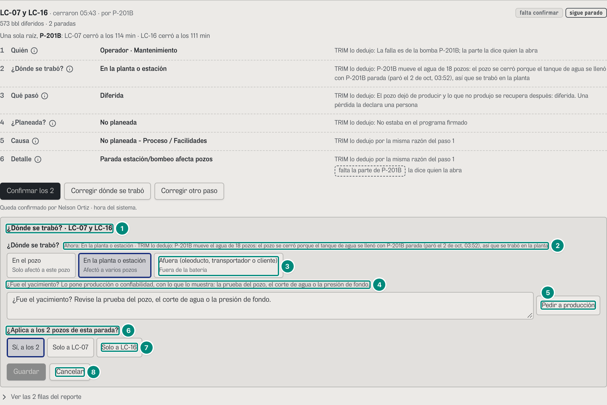

| # | Lo que se ve | En la captura | Cómo se calcula | Texto según el valor | Viene de |
|---|---|---|---|---|---|
| 1 | Título | «¿Dónde se trabó? · LC-07 y LC-16» | `¿Dónde se trabó? · {pozos}` (`Tarjeta.tsx:226`); el editor es `Editor.tsx` dentro de `HojaInferior` (`src/shared/ui/HojaInferior.tsx:10-14`) | «Lo que falta · {pozos}» con «Completar…»; «Corregir un paso · {pozos}» con «Corregir otro paso» | — |
| 2 | Lo de ahora | «Ahora: En la planta o estación · TRIM lo dedujo: P-201B mueve el agua de 18 pozos: …» | el valor y su marca, la misma de la cadena (`Editor.tsx:181-183`) | si el paso falta: «falta · TRIM sugiere: {valor}» | `clasificacion.choke` |
| 3 | Las opciones | «En el pozo / Solo afectó a este pozo» · «En la planta o estación / Afectó a varios pozos» (marcada) · «Afuera (oleoducto, transportador o cliente) / Fuera de la batería» | orden fijo y línea de U2 §1.5 (`OPCIONES_CHOKE`, `OPCION_CHOKE`, `LINEA_CHOKE`: `palabras.ts:41-45`); empieza marcada la de ahora (`Editor.tsx:53`) | «En el yacimiento / La roca o el fluido, no un equipo» solo para producción y confiabilidad (`PONEN_YACIMIENTO`) y solo en este editor (`Editor.tsx:71-72`): pide «¿Qué lo muestra?» («La prueba del pozo», «El corte de agua subió», «La presión de fondo cayó», «Otra…»), va pozo por pozo («¿A qué pozo? «En el yacimiento» se pone pozo por pozo.») y se guarda por `…/yacimiento`; la marca queda «Lo puso Marcela Ríos: la prueba del pozo» (e2e `arbol-identificar.spec.ts:162-182`). Con el paso en falta, solo las opciones que admite la regla | `propuesta.opciones.choke` |
| 4 | El yacimiento, para quien no lo pone | «¿Fue el yacimiento? Lo pone producción o confiabilidad, con lo que lo muestra: la prueba del pozo, el corte de agua o la presión de fondo.» | supervisión y el jefe no tienen `anh:yacimiento` (`Editor.tsx:188-197`) | — | — |
| 5 | Pedírselo a producción | campo de dos renglones con «¿Fue el yacimiento? Revise la prueba del pozo, el corte de agua o la presión de fondo.» · «Pedir a producción» | `PIDE_YACIMIENTO` (`Editor.tsx:23`; B-46); `POST …/revision { motivo, pedirA: 'prod', aplicarALaCascada, ids }` (`Editor.tsx:144-154`) | aviso: «Listo: se le pidió a producción que revise los 2 pozos. La parada le aparece en «Revisar».»; un pedido de menos de 5 caracteres: «Diga qué le pide a producción.» | `POST /api/anh/paradas/:id/revision` |
| 6 | La cascada | «¿Aplica a los 2 pozos de esta parada?» | los pozos de TODA la raíz que muestra la pantalla, aunque el período la corte (`raiz`; `Editor.tsx:120-124`; vecino 12) | solo en una cascada de más de un pozo (`Editor.tsx:230-243`) | `raiz` |
| 7 | A quién | «Sí, a los 2» (marcada) · «Solo a LC-07» · «Solo a LC-16» | «Sí, a los {n}»: `aplicarALaCascada: true, ids: [todas las filas de la raíz]`; «Solo a {pozo}»: `aplicarAlEvento` en la fila de ese pozo (`Editor.tsx:126-137`) | más de tres pozos: una lista «Solo a un pozo…» (`Editor.tsx:235-240`). Aviso: «Guardado en los 2 pozos: ¿Dónde se trabó? → {valor}.» (`Editor.tsx:140-141`) | `POST /api/anh/paradas/:id/clasificacion` |
| 8 | Guardar y Cancelar | «Guardar» (gris) · «Cancelar» | «Guardar» sigue inactivo mientras falte algo: aquí no ha cambiado nada (`Editor.tsx:114-118, 256`) | lo que falta se dice debajo cuando ya hay un cambio: «Diga qué lo muestra.», «Diga por qué lo cambia: ya lo había dicho una persona.» (captura 12) | — |

Cuando la corrección de otro paso cambiaría lo que propone el paso 2, el editor pregunta y no cambia solo: con «Quién» en «Externo · Transportador», «Cambió quién: ahora es Externo · Transportador. ¿Cambiamos también dónde se trabó a «Afuera»?» con «Sí» y «No, dejar como estaba» (`Editor.tsx:220-229`; U2 §1.5).

### Captura 4 · operador, La Ceiba: «POR CONTESTAR»

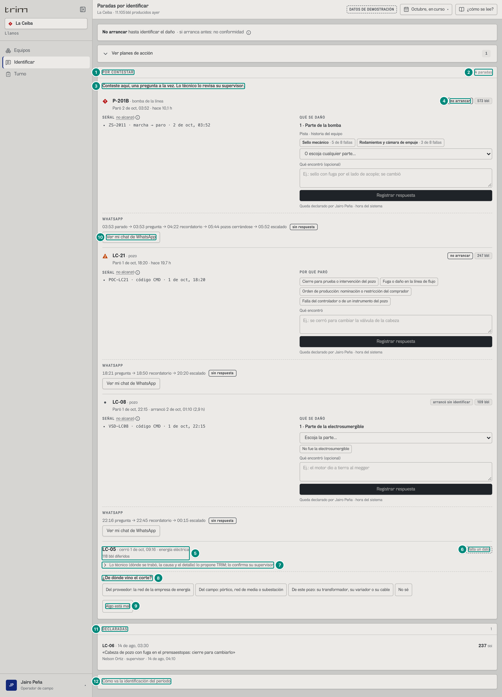

El operador y el técnico (los que no revisan: `ROLES_QUE_CONTESTAN.revisa`) tienen una sola lista: primero lo que pregunta el libro (las tarjetas de 6C.2) y después las preguntas del árbol, sin preguntar dos veces una parada (B-02; `Causa.tsx:191-211`; `ArbolIdentificar.tsx:66-88`).

| # | Lo que se ve | En la captura | Cómo se calcula | Texto según el valor | Viene de |
|---|---|---|---|---|---|
| 1 | La lista | «POR CONTESTAR» | un solo panel con las dos listas (`ArbolIdentificar.tsx:76`) | — | — |
| 2 | Cuántas | «4 paradas» | `nAntes` + las del árbol que le preguntan algo: 3 del libro (P-201B y LC-21, sin arrancar; LC-08, que arrancó sin respuesta: `Causa.tsx:195`) + 1 del árbol (LC-05). LC-07 y LC-16 no se le preguntan: su raíz, P-201B, espera la respuesta del libro; LC-21 y LC-08 tampoco, por lo mismo (`excluir`, `ArbolIdentificar.tsx:72`) | el lector oye «por contestar en Octubre, en curso»; sin nada: «No le falta contestar nada en {período}.» (`ArbolIdentificar.tsx:84`) | `GET /api/vistas/paradas/por-identificar` y `GET /api/vistas/anh/paradas` |
| 3 | Instrucción | «Conteste aquí, una pregunta a la vez. Lo técnico lo revisa su supervisor.» | fija (`ArbolIdentificar.tsx:78`) | — | — |
| 4 | Las del libro, primero | ◆ «P-201B · bomba de la línea» … «no arrancar» | las tarjetas de 6C.2 (captura 1 de 6C.2): «QUÉ SE DAÑÓ» y «POR QUÉ PARÓ» | — | `Pregunta[]` |
| 5 | La del árbol | «LC-05 · cerró 1 de oct, 09:16 · energía eléctrica» / «118 bbl diferidos» | la misma tarjeta de la captura 1 (fila 20), sin la cadena abierta | — | `ParadaAnh` |
| 6 | Estado | «falta un dato» | ídem captura 1, fila 6 | — | `estado` |
| 7 | Lo técnico, plegado | «Lo técnico (dónde se trabó, la causa y el detalle) lo propone TRIM; lo confirma su supervisor» | al tocarlo: quién, dónde se trabó, la causa y el detalle (no «qué pasó» ni «¿planeada?», que son de su terreno) (`Tarjeta.tsx:149-159`; U2 §4.5) | en el papel sale abierto (`print:block`) | `clasificacion` |
| 8 | La pregunta | «¿De dónde vino el corte?» y sus 4 respuestas | la misma de la captura 1 (fila 24), sin «Después, una pregunta más.»: el detalle (`quien: causa`) no se le pregunta al operador | al operador solo le salen las de `campo` (`ROLES_QUE_CONTESTAN.campo`): nunca «dónde se trabó», «en la planta», «afuera» ni «yacimiento» como opciones, ni listas o radios de la causa o el detalle (U2 §4.5; e2e `arbol-identificar.spec.ts:38-56`) | `propuesta.preguntas[].quien` |
| 9 | Algo está mal | «Algo está mal» | puede decirlo antes de contestar (captura 6). «Sí, así fue» no sale todavía: solo después de contestar (B-03; `Tarjeta.tsx:199-204`) | — | — |
| 10 | El chat (**RETIRADO (27-oct-2026)**) | «Ver mi chat de WhatsApp» | el chat de la pregunta de P-201B: 6D.8 | — | — |
| 11 | Lo declarado | «DECLARADAS» | 6C.2 | — | — |
| 12 | Los indicadores, al final | «Cómo va la identificación del período» | la cabecera de cifras de 6C.2 (% por señal, declarado, por identificar, no conformidades), plegada y después de lo que tiene que contestar (B-54; `Causa.tsx:205-208`) | en el papel sale abierta (`print:open:block`) | `GET /api/vistas/diferidos` |

Lo que TRIM ya dedujo y no le pide nada al operador va plegado al final del panel: «Estas ya las dedujo TRIM: no tiene que hacer nada · {n} paradas», con «{pozos} · {estado}; lo revisa su supervisor» (`YaDeducidas`, `ArbolIdentificar.tsx:114-130`; B-03). En el demo de octubre no hay ninguna: LC-07 y LC-16 esperan la respuesta del libro.

### Captura 5 · operador: después de contestar

Pasos (`antes`): en la tarjeta de LC-05, tocar «De este pozo: su transformador, su variador o su cable» y abrir «Lo técnico…». Arriba del panel queda el aviso «Guardado en LC-05: «De este pozo: su transformador, su variador o su cable».».

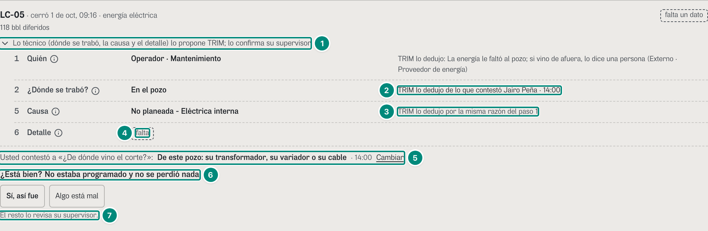

| # | Lo que se ve | En la captura | Cómo se calcula | Texto según el valor | Viene de |
|---|---|---|---|---|---|
| 1 | Lo técnico, abierto | «Lo técnico (dónde se trabó, la causa y el detalle) lo propone TRIM; lo confirma su supervisor» | captura 4, fila 7 | — | — |
| 2 | Paso 2 | «En el pozo» · «TRIM lo dedujo de lo que contestó Jairo Peña · 14:00» | la respuesta deja `choke: pozo` declarado a nombre de Jairo (`responder`, `anh-clasificacion.ts:1344`; `escrituras.ts:1049-1064`), pero el operador no dice el paso 2 como suyo (`PASOS_QUE_DECLARA.oper` = ¿planeada? y qué pasó, `anh-clasificacion.ts:1176-1179`): lo dedujo TRIM de su respuesta (`deducidoDeRespuesta`, `palabras.ts:143-147`; `marcas.ts:47-50`; B-04) | si quien contestó dice ese paso como suyo (supervisión, el jefe…), la marca es solo «dijo {persona} · {hora}» (vecino 11; `marcas.ts:25-30, 57`; e2e `correcciones-f3.spec.ts:130-142`) | `clasificacion.choke.procedencia = declarado`, `.rol` |
| 3 | Paso 5 | «No planeada - Eléctrica interna» · «TRIM lo dedujo por la misma razón del paso 1» | la respuesta dejaba `NP_ENINT`, lo mismo que TRIM proponía: sigue siendo de TRIM (D1: una respuesta no confirma ni corrige) | — | `clasificacion.n1` |
| 4 | Paso 6 | «falta» | el detalle lo contestan el técnico y quienes revisan (`quien: causa`) | — | `faltan` |
| 5 | Lo que contestó | «Usted contestó a «¿De dónde vino el corte?»: De este pozo: su transformador, su variador o su cable · 14:00 · Cambiar» | `clasificacion.respuestas` (`Preguntas.tsx:86-100`; B-04) | «Usted contestó» si es la persona de la sesión, «{persona} contestó» si no; la pregunta se nombra cuando hay más de una respuesta o ya no queda ninguna abierta. «Cambiar» abre «Algo está mal» con el atajo «Mi respuesta a «{pregunta}» era otra» (`Tarjeta.tsx:120, 271`) | `clasificacion.respuestas[]` |
| 6 | Avalar lo suyo | «¿Está bien? No estaba programado y no se perdió nada» · «Sí, así fue» · «Algo está mal» | lo de su terreno que todavía no dijo una persona (`PASOS_QUE_CONFIRMA.oper`: ¿planeada? y qué pasó), dicho en palabras (`DE_SU_TERRENO`, `Tarjeta.tsx:32-35, 187-197`), solo DESPUÉS de contestar (B-03). «Sí, así fue»: `POST …/confirmar { ids, cadena, pasos: ['planeacion', 'impacto'] }` | aviso: «Listo. Su respuesta en LC-05 queda guardada; el supervisor revisa el resto.» (`Tarjeta.tsx:98-99`). Al supervisor le queda «confirmó Jairo Peña» en esos dos pasos, «TRIM lo dedujo de lo que contestó Jairo Peña» en el 2 y la tarjeta en «falta un dato» (e2e `arbol-identificar.spec.ts:69-78`) | `POST /api/anh/paradas/confirmar` |
| 7 | Lo demás | «El resto lo revisa su supervisor.» | fija | — | — |

### Captura 6 · operador: «Algo está mal»

Pasos (`antes`): tocar «Algo está mal» en la tarjeta de LC-05.

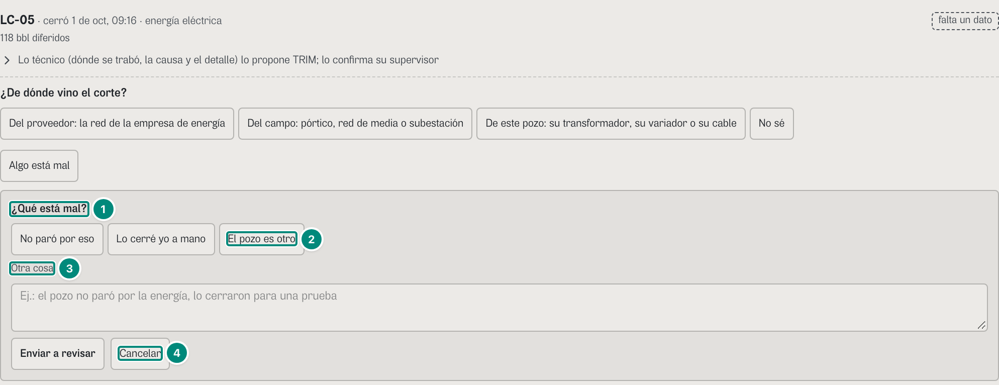

| # | Lo que se ve | En la captura | Cómo se calcula | Texto según el valor | Viene de |
|---|---|---|---|---|---|
| 1 | La pregunta | «¿Qué está mal?» | `AlgoEstaMal` (`Tarjeta.tsx:262-309`): no corrige nada; pasa la parada a quien la revisa | desde «Cambiar»: «¿Qué cambiaría? Lo corrige su supervisor.» y el atajo «Mi respuesta a «{pregunta}» era otra» | — |
| 2 | Atajos de un toque | «No paró por eso» · «Lo cerré yo a mano» · «El pozo es otro» | `ATAJOS_MAL` (`Tarjeta.tsx:260`; B-52): con uno basta para enviar | — | — |
| 3 | El texto | «Otra cosa» | el campo; con un atajo escogido se llama «Algo más (opcional)»; el motivo es «{atajo}: {texto}» | sin atajo ni 5 caracteres (`MOTIVO_MINIMO`): «Escoja una de las opciones o diga qué está mal: lo lee quien la revisa.» | — |
| 4 | Enviar | «Enviar a revisar» · «Cancelar» | `POST /api/anh/paradas/:id/revision { motivo, aplicarAlEvento (o aplicarALaCascada e ids), cadena }` (`Tarjeta.tsx:279-288`) | aviso: «Listo: LC-05 queda para revisar. Lo ve su supervisor con lo que usted dijo.» (e2e `experiencia-f2c.spec.ts:94-103`); la tarjeta le sale a quien revisa en REVISAR, con «para revisar» (6D.8, captura 4). La misma revisión otra vez, sin atender, no se guarda dos veces, y no pisa la de otra persona en otra fila (vecino 6) | `POST /api/anh/paradas/:id/revision` |

### En el teléfono (390 px)

En el teléfono la tarjeta es la misma, en una columna: una pregunta a la vez, cada respuesta en su renglón y de 48 px de alto para el dedo con guantes (`min-h-12`: `OPCION`, `Preguntas.tsx:11`; los botones de la tarjeta, `Tarjeta.tsx:152, 208-212`; B-24), cinco respuestas a la vista y «Más opciones…» (B-23), y corregir se abre como hoja desde abajo (B-46).

**Captura 7 · operador, LC-05.**

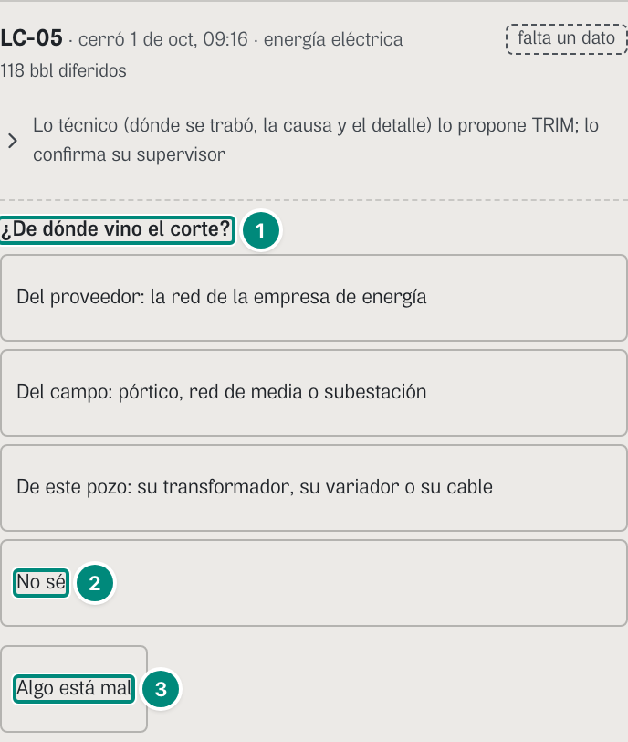

| # | Lo que se ve | En la captura | Cómo se calcula | Texto según el valor | Viene de |
|---|---|---|---|---|---|
| 1 | La pregunta | «¿De dónde vino el corte?» | captura 4, fila 8 | — | `propuesta.preguntas` |
| 2 | Una respuesta | «No sé» (y las otras tres, una por renglón) | 48 px de alto en el teléfono (`max-sm`), 32 px en el escritorio (`sm:min-h-8`) (`Preguntas.tsx:11, 114-124`) | con cuatro respuestas no hace falta «Más opciones…» | — |
| 3 | Algo está mal | «Algo está mal» | captura 6 | — | — |

**Captura 8 · supervisor, LC-21: cinco respuestas y «Más opciones…».**

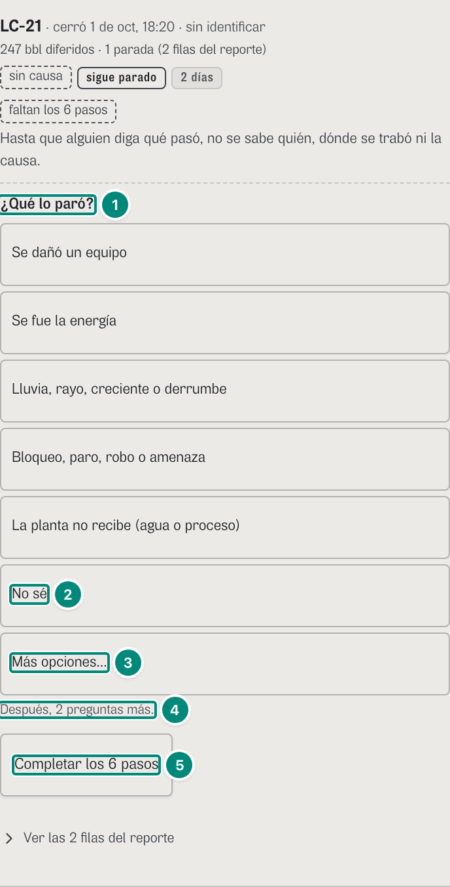

| # | Lo que se ve | En la captura | Cómo se calcula | Texto según el valor | Viene de |
|---|---|---|---|---|---|
| 1 | La pregunta | «¿Qué lo paró?» | captura 1, fila 30 | — | `propuesta.preguntas` |
| 2 | «No sé», siempre a la vista | «No sé» | con más de 6 respuestas (`A_LA_VISTA + 1`), las que pasan de la quinta se esconden en el teléfono, menos «No sé» (`Preguntas.tsx:14, 82, 118`) | — | — |
| 3 | Las demás | «Más opciones…» | muestra las 4 escondidas («El tanque de crudo está lleno», «El oleoducto o el cliente no recibe», «Una autoridad lo ordenó», «Era un trabajo o una prueba programada») (`Preguntas.tsx:125-127`) | solo en el teléfono (`sm:hidden`); vuelve a plegarse al contestar | — |
| 4 | Lo que queda | «Después, 2 preguntas más.» | captura 1, fila 31 | — | — |
| 5 | Completar | «Completar los 6 pasos» | 48 px en el teléfono | — | — |

**Captura 9 · supervisor: corregir como hoja inferior.** Pasos (`antes`): «Corregir dónde se trabó» en LC-07 y LC-16.

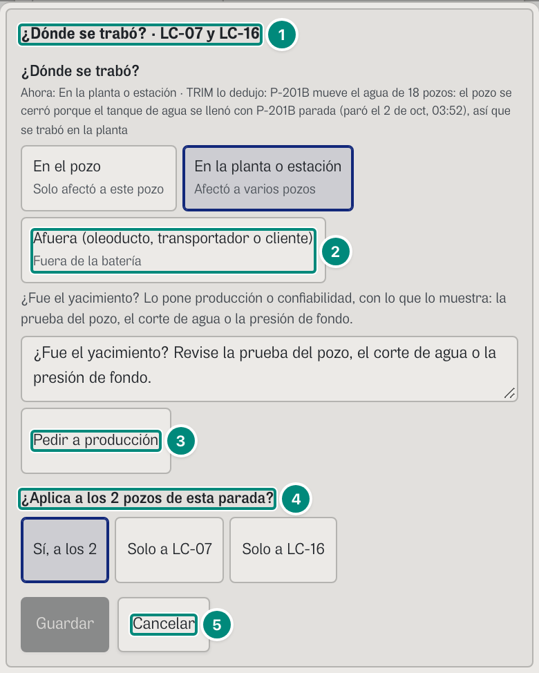

| # | Lo que se ve | En la captura | Cómo se calcula | Texto según el valor | Viene de |
|---|---|---|---|---|---|
| 1 | La hoja | «¿Dónde se trabó? · LC-07 y LC-16» | en el teléfono (`max-width: 639.98px`, `src/shared/ui/telefono.ts:4`) el editor es un diálogo modal desde abajo, de hasta el 90 % de la pantalla: el foco entra, lo de atrás queda inerte y Escape, tocar el fondo o «Cancelar» lo cierran y devuelven el foco (`HojaInferior.tsx:16-27`; B-46) | en el escritorio va en su lugar (captura 3) | — |
| 2 | Las opciones | «En el pozo» · «En la planta o estación» (marcada) · «Afuera (oleoducto, transportador o cliente)» | captura 3, fila 3 | — | — |
| 3 | Pedir a producción | el campo de dos renglones y «Pedir a producción» | dos renglones para que el pedido se lea entero en el teléfono (`Editor.tsx:192-194`; B-46) | — | — |
| 4 | La cascada | «¿Aplica a los 2 pozos de esta parada?» · «Sí, a los 2» · «Solo a LC-07» · «Solo a LC-16» | captura 3, filas 6 y 7 (e2e `arbol-identificar.spec.ts:211-236`: nada se sale, se recorta ni se pisa) | — | — |
| 5 | Cerrar | «Guardar» · «Cancelar» | — | — | — |

### Captura 10 · jefe de mantenimiento: confirmar una parada de varios pozos de un toque

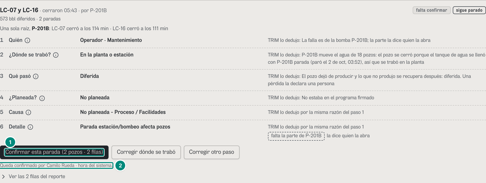

La tarjeta es la de la captura 1; cambia el botón (B-07).

| # | Lo que se ve | En la captura | Cómo se calcula | Texto según el valor | Viene de |
|---|---|---|---|---|---|
| 1 | Confirmar | «Confirmar esta parada (2 pozos · 2 filas)» | el jefe no firma el día (no tiene `anh:confirmar`), pero las filas de UNA parada (mismo `campoId` y misma `raiz`: los pozos de una cascada o los días de un pozo) son una sola decisión: las confirma de un toque quien clasifica, sin lote (`escrituras.ts:1197-1219`; B-07) | «({n} pozos · {m} filas)» o, un pozo de varios días, «({n} días · {m} filas)» (`Tarjeta.tsx:86-88`). Filas de paradas distintas en una petición, para quien no firma el día: 403 `sin-capacidad`, «Confirmar varias paradas de una vez lo hacen supervisión o producción, que firman el día: confírmelas una por una.» (`escrituras.ts:1201, 1217`) | `POST /api/anh/paradas/confirmar` |
| 2 | Quién | «Queda confirmado por Camilo Rueda · hora del sistema.» | la persona de la sesión | después: «Listo. LC-07 y LC-16 quedan completas (2 filas).» (sin «en un solo lote»), el resumen pasa a «Paradas: falta un dato 1 · sin causa 2 · completa 2» y cada paso dice «confirmó Camilo Rueda · 14:00» (e2e `experiencia-f2c.spec.ts:22-42`; exploración del 23-oct) | sesión |

Confiabilidad ve el mismo botón; además, el ⓘ de cada paso le dice lo que va al reporte («En el reporte: {etiqueta} ({código})», `Cadena.tsx:48, 55`).

### Captura 11 · jefe, Morichal, 18-may-2026: una respuesta para los 41 pozos

Pasos (`antes`): en `#/jefe/causa/morichal/2026-05-18_2026-05-18`, tocar «Falla transformador» (la respuesta de «¿Qué fue, exactamente?») en la tarjeta de SE-2.

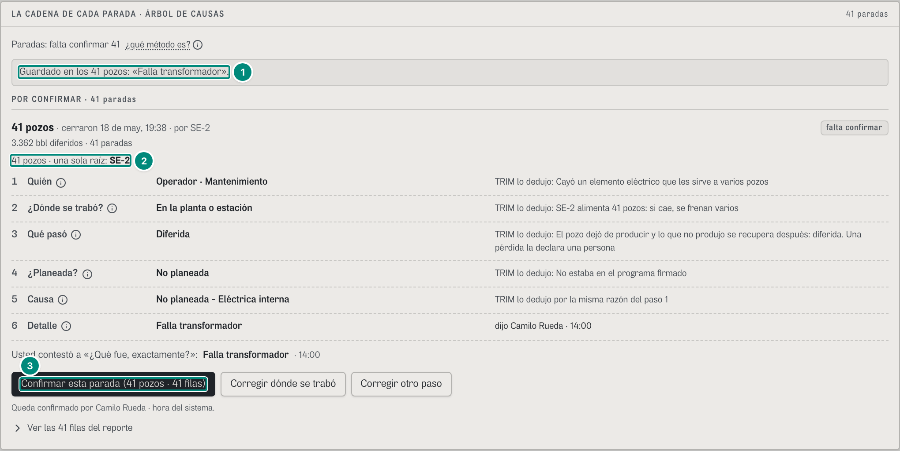

| # | Lo que se ve | En la captura | Cómo se calcula | Texto según el valor | Viene de |
|---|---|---|---|---|---|
| 1 | El aviso | «Guardado en los 41 pozos: «Falla transformador».» | la respuesta va «para la cascada», con las filas de toda la raíz (`Preguntas.tsx:55-69`) | hasta tres pozos por su nombre («Guardado en LC-07 y LC-16: …»); más, «los {n} pozos», nunca los 41 nombres (`pozosEnCorto`, `palabras.ts:113-115`; vecino 10; e2e `correcciones-f3.spec.ts:157-167`). El editor dice siempre «los {n} pozos» (captura 3, fila 7): 6D·H29 | `POST …/respuesta` |
| 2 | La cascada | «41 pozos · una sola raíz: SE-2» | SE-2 cayó el 18-may a las 19:38 y cerró los 41 pozos de Morichal (U2 §4.4, caso 1); la tarjeta: «41 pozos · cerraron 18 de may, 19:38 · por SE-2», «3.362 bbl diferidos · 41 paradas» (las filas del 18) | con más de cuatro pozos, sin la lista de minutos (`Tarjeta.tsx:142-144`) | `ParadaAnh.raiz` |
| 3 | Confirmar la cascada | «Confirmar esta parada (41 pozos · 41 filas)» | con el detalle dicho («dijo Camilo Rueda · 14:00») la tarjeta pasa de FALTA UN DATO a POR CONFIRMAR («Paradas: falta confirmar 41») y se confirma de un toque | el período es un día: la tarjeta tiene las 41 filas del 18-may, pero la cascada tiene 123 (tres días: «26.215 bbl diferidos · 41 paradas (123 filas del reporte)» en `#/jefe/causa/morichal/doce`). La respuesta quedó en los 41 eventos (todas sus filas: vecino 12), y confirmar manda solo las 41 de la tarjeta (`Tarjeta.tsx:208`): 6D·H8 | `POST /api/anh/paradas/confirmar` |

Con el período entero (`#/jefe/causa/morichal/doce`) la misma tarjeta encabeza FALTA UN DATO, con «¿Qué fue, exactamente?» y sus 13 respuestas de `NP_ENINT` más «No sé». Una cascada que el período corta se escribe entera: en `#/sup/causa/ceiba/2026-06-24_2026-06-24` la tarjeta de K-101 muestra 4 de los 18 pozos que cerró el 23-jun, y corregir dice «Guardado en los 18 pozos» (antes, 409 siempre: vecino 12; e2e `correcciones-f3.spec.ts:144-155`).

### Captura 12 · el motivo tras un 422: el supervisor cambia lo que dijo el jefe

Pasos (`antes`, los del e2e `experiencia-f2c.spec.ts:44-70`): como jefe (`#/jefe/causa/ceiba/curso`), «Corregir otro paso» en LC-07 y LC-16, el detalle a «Tanques llenos / capacidad limitada» y «Guardar» (para los 2 pozos; corrige lo que proponía TRIM: no pide motivo); «Mi perfil» → «Cambiar de rol» → «Supervisor de operaciones» (la sesión del demo, con lo guardado, sigue: `src/widgets/MenuPerfil.tsx:79-131`); como supervisor, «Corregir otro paso», «Planeada» y «Guardar».

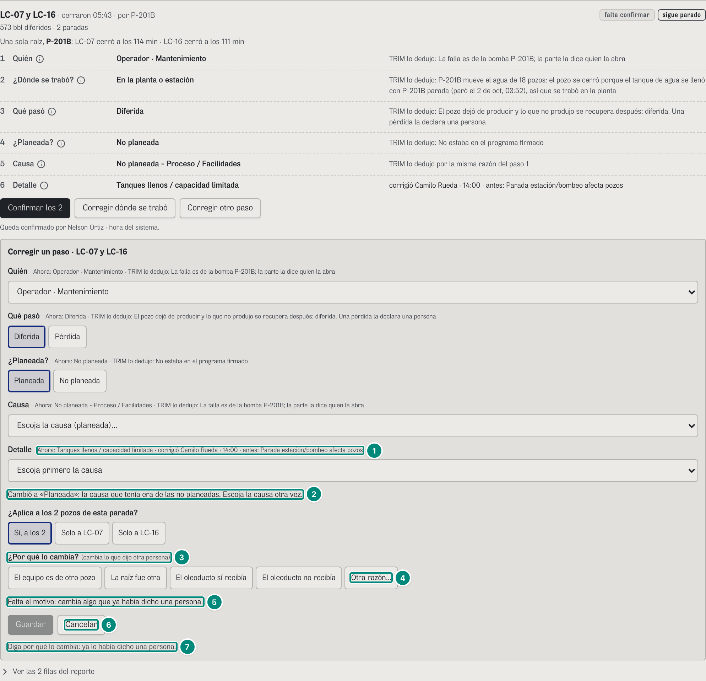

| # | Lo que se ve | En la captura | Cómo se calcula | Texto según el valor | Viene de |
|---|---|---|---|---|---|
| 1 | El detalle, de una persona | «Ahora: Tanques llenos / capacidad limitada · corrigió Camilo Rueda · 14:00 · antes: Parada estación/bombeo afecta pozos» | `corregido`, con lo que proponía TRIM al lado (`marcaDePersona`; `marcas.ts:51-60`) | — | `clasificacion.n2` |
| 2 | La planeación arrastra la causa | «Cambió a «Planeada»: la causa que tenía era de las no planeadas. Escoja la causa otra vez.» | cambiar «¿Planeada?» vacía la causa y el detalle de la otra planeación: la ANH rechaza el reporte entero si se cruzan (C24 p. 7) (`Editor.tsx:86-92`) | las causas se filtran por la planeación: 8 planeadas o 12 no planeadas (e2e `arbol-identificar.spec.ts:82-109`) | — |
| 3 | El motivo | «¿Por qué lo cambia? (cambia lo que dijo otra persona)» | el editor no lo pedía: el único paso que cambia, «¿Planeada?», era de TRIM. Lo pidió el servidor: cambiarlo retira el detalle que dijo el jefe, y retirar lo que dijo una persona sin motivo es 422 `falta-motivo` (`escrituras.ts:845-881`, aquí `:858`). El editor ve «motivo» en el error y lo pregunta (`conMotivo`, `pideMotivo`: `Editor.tsx:63, 129, 139`; F2-A) | «(ya lo había dicho una persona)» cuando el editor lo sabe antes de mandar (cambia un paso que dijo una persona); «(cambia lo que dijo otra persona)» cuando lo pide el servidor (`Editor.tsx:244-253`) | — |
| 4 | Atajos | «El equipo es de otro pozo» · «La raíz fue otra» · «El oleoducto sí recibía» · «El oleoducto no recibía» · «Otra razón…» | `MOTIVOS` (`palabras.ts:48`; U2 §1.5); «Otra razón…» abre un campo («Ej.: el pórtico sí cayó: lo vio el electricista») | — | — |
| 5 | El rechazo | «Falta el motivo: cambia algo que ya había dicho una persona.» | 422 `falta-motivo` de `…/clasificacion` (`escrituras.ts:930`; tabla C-22) | el mensaje del servidor, tal cual (`role="alert"`) | `{ error: { codigo, mensaje } }` |
| 6 | Guardar | «Guardar» (gris) · «Cancelar» | inactivo hasta que haya un motivo de 5 caracteres o más (`Editor.tsx:118, 256`) | — | — |
| 7 | La pista | «Diga por qué lo cambia: ya lo había dicho una persona.» | lo que falta para guardar (`Editor.tsx:118, 259`) | dice «ya lo había dicho una persona» al lado de «cambia lo que dijo otra persona» y repite el aviso del servidor: 6D·H26 | — |

Con «Otra razón…» y «Estaba en el programa de paradas del mes», «Guardar» responde «Guardado en los 2 pozos: ¿Planeada? → Planeada.» y el detalle del jefe queda retirado (captura 14).

### Captura 13 · el motivo tras un 409: cambia lo que dijo otra persona en otra fila

Pasos (`antes`): como jefe, «Corregir otro paso» en LC-07 y LC-16, «Quién» a «Operador · Operación», «Solo a LC-16» y «Guardar»; la cascada se parte en dos tarjetas (LC-16 ya tiene otra cadena). Como supervisor (por «Mi perfil»), «Corregir otro paso» en LC-07, «Quién» a «Operador · Planeación/Logística» y «Guardar» con «Sí, a los 2». Es el caso de `referencia/escrituras/409-cambia-a-otra-persona.json`.

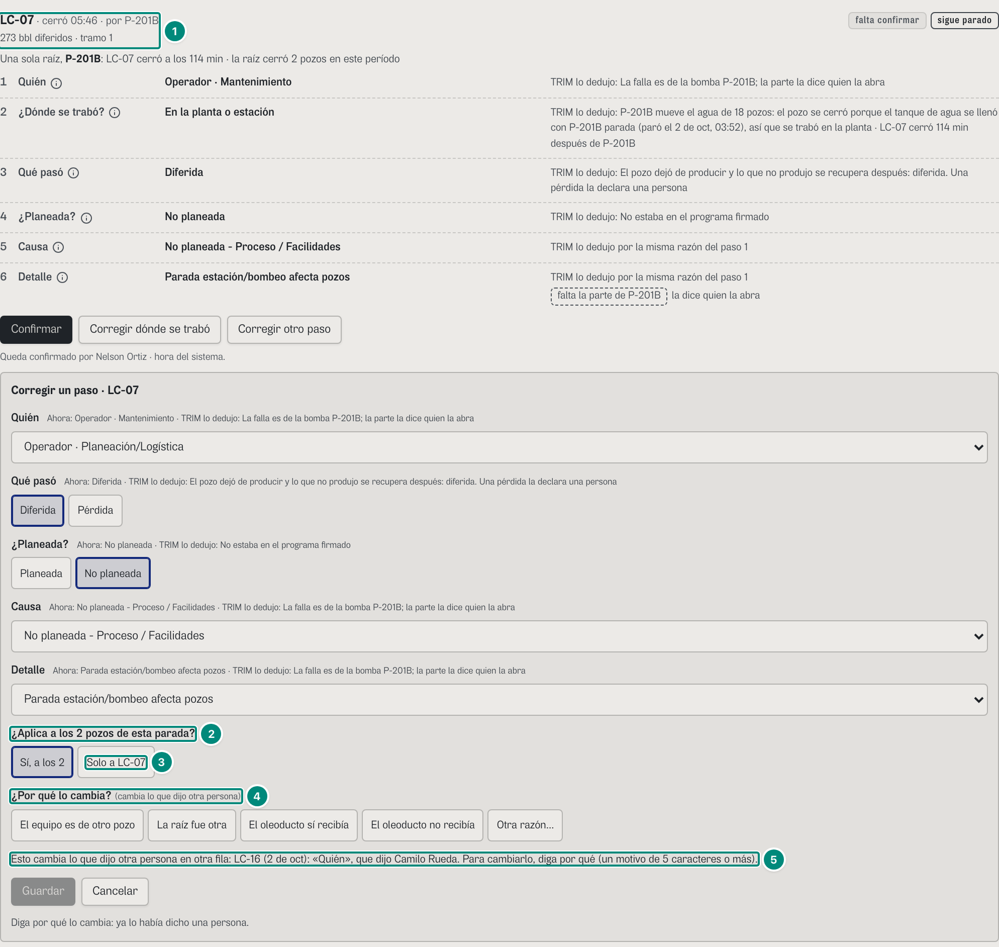

| # | Lo que se ve | En la captura | Cómo se calcula | Texto según el valor | Viene de |
|---|---|---|---|---|---|
| 1 | LC-07 sola | «LC-07 · cerró 05:46 · por P-201B» / «273 bbl diferidos · tramo 1» | lo que el jefe dijo solo de LC-16 la sacó de la tarjeta: su cadena ya es otra (`grupos.ts:3-8`) | «tramo 1», sin «de {m}»: el evento sigue abierto; debajo, «Una sola raíz, P-201B: LC-07 cerró a los 114 min · la raíz cerró 2 pozos en este período» (`Tarjeta.tsx:132, 145`) | `tramo`, `raiz` |
| 2 | La cascada sigue | «¿Aplica a los 2 pozos de esta parada?» | aunque la tarjeta tenga un pozo, la raíz tiene dos (`Editor.tsx:121-123`) | — | `raiz` |
| 3 | A quién | «Sí, a los 2» (marcada) · «Solo a LC-07» | por defecto, toda la raíz | — | — |
| 4 | El motivo | «¿Por qué lo cambia? (cambia lo que dijo otra persona)» | lo pidió el servidor, como en la captura 12 | — | — |
| 5 | El rechazo | «Esto cambia lo que dijo otra persona en otra fila: LC-16 (2 de oct): «Quién», que dijo Camilo Rueda. Para cambiarlo, diga por qué (un motivo de 5 caracteres o más).» | 409 `cambia-a-otra-persona`: sin motivo, la escritura cambiaría lo que dijo OTRA persona en otra fila del alcance (`escrituras.ts:859-863`; `cambioEnPalabras`, `:716`) | dice cuáles: pozo, día, paso y quién, hasta cuatro y «; y {n} más» | `{ error: { codigo: 'cambia-a-otra-persona', mensaje } }` |

### Captura 14 · el retiro, visto por quien lo había dicho

Pasos (`antes`): los de la captura 12; «Otra razón…», «Estaba en el programa de paradas del mes», «Guardar»; «Mi perfil» → «Cambiar de rol» → «Jefe de mantenimiento». Es el e2e `correcciones-f3.spec.ts:94-128`.

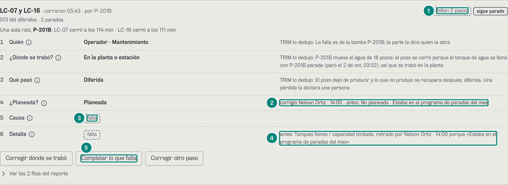

| # | Lo que se ve | En la captura | Cómo se calcula | Texto según el valor | Viene de |
|---|---|---|---|---|---|
| 1 | Estado | «faltan 2 pasos» | la causa y el detalle quedaron en falta: la tarjeta pasa a FALTA UN DATO («Paradas: falta un dato 3 · sin causa 2») | «faltan {n} pasos» cuando falta más de uno (B-21) | `estado`, `faltan` |
| 2 | Paso 4 | «Planeada» · «corrigió Nelson Ortiz · 14:00 · antes: No planeada · Estaba en el programa de paradas del mes» | una corrección con motivo: el motivo queda en el porqué de lo guardado (`conMotivo`, `escrituras.ts:768-772`) | en el papel, sin el motivo (D2) | `clasificacion.planeacion` |
| 3 | Paso 5 | «falta» | la causa de TRIM (`NP_PROC`, no planeada) no va con «Planeada» y se quita sola al leer; la fila no sugiere otra | — | `faltan` |
| 4 | El retiro | «antes: Tanques llenos / capacidad limitada, retirado por Nelson Ortiz · 14:00 porque «Estaba en el programa de paradas del mes»» | lo que dijo el jefe no se borra: queda guardado como `retirado` (quién, cuándo, el motivo y el valor), no rige y la fila vuelve a lo que propone TRIM, que aquí falta (`escrituras.ts:864-877`; `retirosDe`, `anh-paradas.ts:149-158, 282`; D1, vecino 8) | `Cadena.tsx:44, 65-72`. En el papel: «antes: Tanques llenos / capacidad limitada, retirado por el supervisor de operaciones · 14:00», sin el motivo (D2; e2e `correcciones-f3.spec.ts:123-126`) | `ParadaAnh.retiros[]` (`paso`, `valor`, `por`, `rol`, `hora`, `motivo`) |
| 5 | Completar | «Completar lo que falta» | el editor con la causa y el detalle, ya filtrados por «Planeada» | — | — |

### Lo que cambia en el papel (D2)

El generador no imprime: esto se lee del código y de la e2e (`CORRECCIONES-F3.md`, «D2 en el papel»; e2e `correcciones-f3.spec.ts:72-92, 123-126`). En el papel y en el PDF de «Exportar»:

- **Lo plegado sale desplegado**: las tarjetas detrás de «ver las otras N» y las COMPLETAS (`solo-impresion`, `ArbolIdentificar.tsx:148`), las filas del reporte (`print:grid`, `Tarjeta.tsx:238`), lo técnico del operador (`print:block`, `Tarjeta.tsx:156`) y «Estas ya las dedujo TRIM» (`ArbolIdentificar.tsx:125`).
- **No salen los botones ni los formularios**: confirmar, corregir, «¿Está bien?», «Algo está mal», el editor y los botones que pliegan (`no-imprimir`: `Tarjeta.tsx:152, 189, 200, 234, 290`; `Editor.tsx:174`).
- **Las personas por su rol, sin lo que escribieron** (`DichoEnPapel`, `src/shared/ui/DichoEnPapel.tsx:12-19`; `rolEnPapel`, `src/shared/ui/papel.ts:13`):
  - la marca de cada paso: «confirmó el supervisor de operaciones · 14:00»; una corrección, sin su motivo; «En el yacimiento», con el atajo («la prueba del pozo») y sin una nota escrita (`marcas.ts:46, 55-60`; `Cadena.tsx:28-30, 42, 64`);
  - la revisión: «El operador de campo marcó «Algo está mal» · 14:00», sin el motivo, y quién la atendió por su rol (`Tarjeta.tsx:251-256`);
  - quién contestó y quién dijo «No sé»: «el operador de campo contestó» (lo de la persona de la sesión sigue «Usted contestó») (`Preguntas.tsx:90, 104`);
  - el retiro: «retirado por el supervisor de operaciones · 14:00», sin el «porque» (`Cadena.tsx:68-70`; captura 14).
- **RETIRADO (27-oct-2026)** **El chat de WhatsApp no se imprime** (`Causa.tsx:514-515`): es la conversación con sus palabras (6D.8).

Lo que va a la ANH sigue otra regla, la misma del papel: lo estructurado, con la persona por su rol, nunca el texto libre (CONTRATO.md, «Clasificación ANH», `desc_evid`; 5E §9).

### Estados y otros campos

- **Producción** (`#/prod/causa/ceiba/curso`): la cabecera de cifras va arriba (ingeniería); confirma en lote («Confirmar los 2»); en «Corregir dónde se trabó» tiene «En el yacimiento» con «¿Qué lo muestra?» (captura 3, fila 3). En septiembre (`#/prod/causa/ceiba/cerrado`) las paradas por baja carga preguntan primero «Las señales apuntan a que al pozo le faltó aporte (baja carga). ¿Fue el yacimiento?» («Sí, fue el yacimiento» · «No, fue la bomba»; solo producción y confiabilidad: `quien: yacimiento`, `anh-clasificacion.ts:536-546`) y «¿Qué fue, exactamente?» sale después: «Después, una pregunta más.» (B-32; e2e `experiencia-f2c.spec.ts:72-81`).
- **Confiabilidad**: como el jefe (captura 10), con lo que va al reporte en el ⓘ de cada paso. En Guacamayo el 17-oct-2025 (`#/conf/causa/guacamayo/2025-10-17_2025-10-17`), con el tanque de crudo lleno la pregunta va directa: «¿El oleoducto o el cliente estaba recibiendo?» («Sí, recibía» · «No, no recibía» · «No sé»), con «Nota del evento: «Tanque de crudo alto: despacho limitado por la nominación del oleoducto»» al lado (ayuda a contestar, no decide; `Preguntas.tsx:110-113`; B-31). Con «No, no recibía» el paso 2 queda «Afuera: oleoducto, transportador o cliente» con «dijo Edwin Maestre» (vecino 11; e2e `arbol-identificar.spec.ts:111-134`).
- **Técnico**: la lista «POR CONTESTAR» del operador; además se le pregunta la causa y el detalle (`quien: causa`) y los dice como suyos (`PASOS_QUE_DECLARA.tec`, `anh-clasificacion.ts:1177`).
- **Portafolio**: cada tarjeta dice su campo («· {campo}», `Tarjeta.tsx:129`).
- **«No sé»**: la pregunta sigue abierta y a quien revisa le sale «sigue abierta · {persona} contestó «No sé» a «{pregunta}»: la contesta quien revisa.» (`Preguntas.tsx:101-106`); repetirlo no se guarda otra vez (C-19).
- **Parcial**: «con la frecuencia bajada desde el 15 de abr, 02:10 · parcial: 41,5 de 55,5 Hz» (el ejemplo de B-22; `palabras.ts:181`, `Tarjeta.tsx:105-107`).
- **Sin paradas en el período**: «Ninguna parada de pozo en {período}: no hay nada que reportar.» (`ArbolIdentificar.tsx:107`). Sin nadie con acceso en el rol: sin botones y «Nadie con acceso activo tiene este rol: confirma una persona, no un rol.»

### Interacciones

Cada toque escribe por la costura (`src/shared/api/escrituras.ts`, que en el demo hace de servidor) y el aviso de lo que se hizo sale arriba del panel; si el botón que tenía el foco desapareció con la tarjeta, el foco pasa al aviso (`ArbolIdentificar.tsx:55-64`). Un rechazo se dice debajo, con el mensaje del servidor (`role="alert"`).

| Toque | Quién | Escribe | Aviso | Rechazos que se ven (tabla C-22) |
|---|---|---|---|---|
| «Confirmar…» (captura 1, fila 14; captura 10) · «Sí, así fue» (captura 5) | sup y prod, en lote; jefe y conf, una parada; oper y tec, sus dos pasos | `POST /api/anh/paradas/confirmar { ids, cadena, pasos? }` | «Listo. {pozos} quedan completas ({m} filas)[, en un solo lote].»; si queda la causa para quien abre el equipo: «Listo: quedó confirmado lo que su rol avala en {pozos}. La causa y el detalle los confirma quien abra el equipo: el jefe de mantenimiento o confiabilidad.»; el operador: «Listo. Su respuesta en {pozos} queda guardada; el supervisor revisa el resto.» (`Tarjeta.tsx:94-103`) | 409 `cadena-cambio`: «Mientras la revisaba, alguien cambió esta parada: vuelva a abrirla para ver cómo quedó.»; 403 `sin-capacidad` (varias paradas sin firmar el día); 409 `lote-sin-pasos`; 403 `paso-ajeno` |
| Una respuesta (captura 1, filas 24 y 30; captura 11) | cada rol, las suyas | `POST /api/anh/paradas/:id/respuesta` | «Guardado en {pozos}: «{opción}».»; con «No sé», «… La pregunta queda abierta y la revisa su supervisor.» (`Preguntas.tsx:60-69`) | 409 `pregunta-cerrada`: «Mientras la veía, alguien ya contestó esa pregunta: vuelva a abrir la parada para ver cómo quedó.»; 422 `pregunta-ajena`; 409 `cascada-cambio` |
| «Guardar» del editor (capturas 3, 12, 13) | sup, prod, jefe, conf | `POST /api/anh/paradas/:id/clasificacion` (o `…/yacimiento`) | «Guardado en {los n pozos \| pozo}: {paso} → {valor} · ….» (`Editor.tsx:140-141`) | 422 `falta-motivo` y 409 `cambia-a-otra-persona`: el editor pide el motivo y se vuelve a guardar (capturas 12 y 13); 422 `clasificacion-incoherente` (una causa de la otra planeación: «cambie primero «¿Planeada?»»); 409 `cadena-cambio` |
| «Algo está mal» (captura 6) · «Pedir a producción» (captura 3) | los seis · sup y jefe | `POST /api/anh/paradas/:id/revision` | «Listo: {pozos} queda(n) para revisar. Lo ve su supervisor con lo que usted dijo.» · «Listo: se le pidió a producción que revise …» | 422 `texto-corto`: «Diga qué está mal (o qué pide): queda con la parada para quien la revisa.» |

«Ver las N filas del reporte», «Lo técnico…», «ver las otras N» y los ⓘ no escriben. Cambiar de rol desde «Mi perfil» conserva lo guardado en la sesión del demo (así se armaron las capturas 12 a 14); con la fuente http, lo guardado es del servidor.
