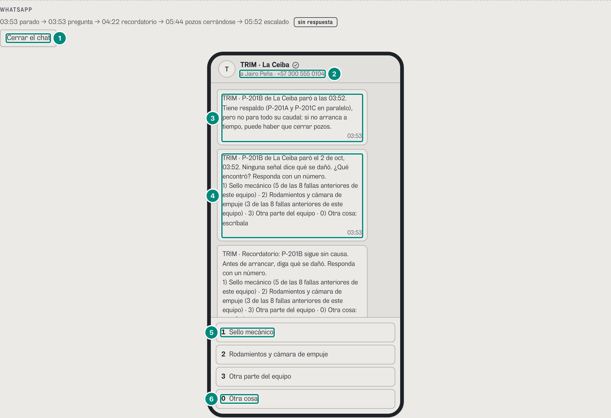
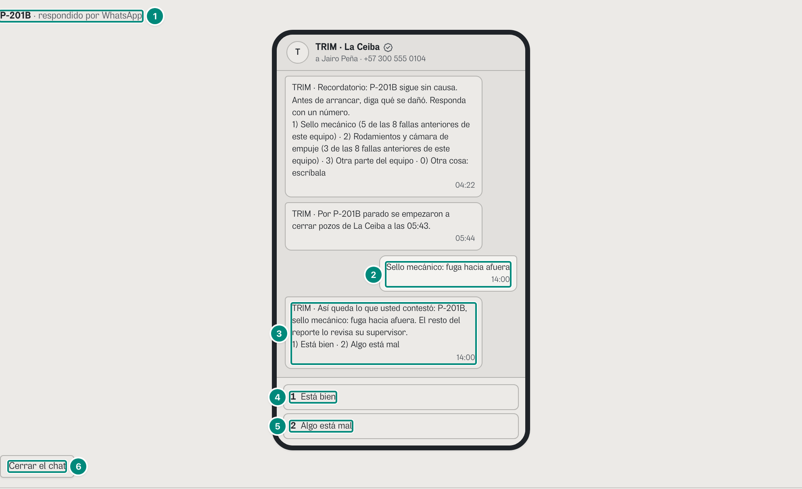
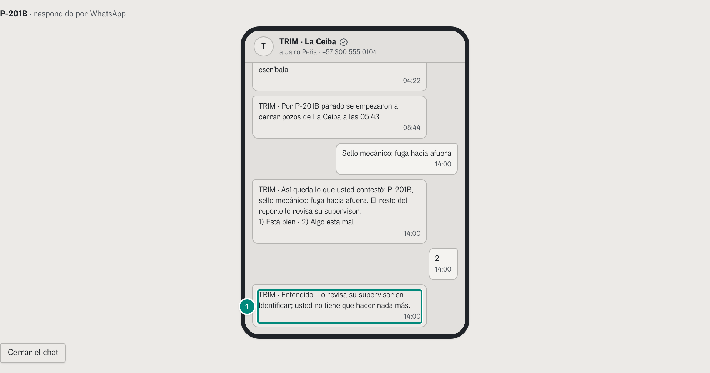
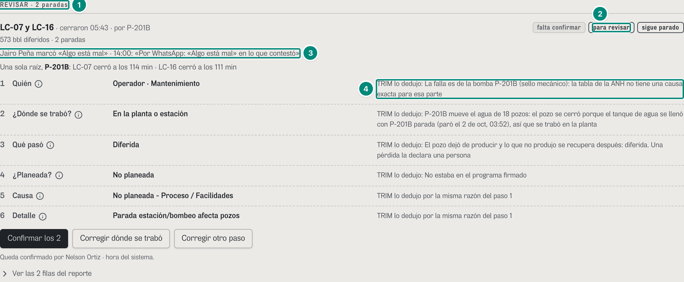

# 6D.8 WhatsApp — el chat de la parada: el respaldo en corto, el cierre en el mismo hilo y «2 Algo está mal» · operador, supervisor (y quien mire el chat) · RETIRADO (27-oct-2026)

> **RETIRADO (27-oct-2026).** El canal de WhatsApp no se construye (CAMBIOS-CONTRATO.md §3): lo que tenía valor quedó en pantalla, dentro de TRIM (Hoy).

> **RETIRADO (27-oct-2026).** El dueño decidió quitar el canal de WhatsApp: el backend no lo construye. Reemplazo dentro de TRIM: la pregunta de cada parada se contesta en **la pregunta de Hoy** y en «Contestar» de Identificar; el respaldo en corto y el cierre se leen en la tarjeta de la parada en Hoy; «2 Algo está mal» es el botón **«Algo está mal»** (`POST /api/anh/paradas/:id/revision`); quien no contestó lo recoge el supervisor con la tarjeta **«Conseguir la causa»** y su insignia. Ver [CAMBIOS-CONTRATO.md §3](../CAMBIOS-CONTRATO.md#3-retirado-whatsapp-propuesto-el-27-oct-2026) y [whatsapp.md](../../experiencia-v3/whatsapp.md). Este capítulo queda como histórico.

**Para qué.** «El carril caliente: lo que TRIM le manda por WhatsApp a quien tiene que actuar, en minutos, por el canal que ya usa. Y la respuesta en el mismo hilo: un toque para decir qué se dañó, escogiendo entre las causas que la señal sugiere.» (`src/entities/mensajes.ts:1-4`).
**Ruta.** Identificar, `#/<rol>/causa/<campo>[~portafolio]/<período>`: el bloque WHATSAPP de cada pregunta del libro y DECLARADAS (`src/pages/Causa.tsx:463-520, 629-635`). · **Roles y nivel.** Lo ven todos los que tienen Identificar (`oper`, `sup`, `tec`, `prod`, `jefe`, `conf`): «Ver mi chat de WhatsApp» quien recibió la pregunta, «Ver el chat de {nombre}» los demás. · **Lee.** `GET /api/mensajes?campos` → `Mensaje[]` (el registro de lo enviado, CONTRATO.md:937-980), `GET /api/usuarios` (nombre y número) y `GET /api/vistas/paradas/por-identificar` (la respuesta: `causa.declarado`). · **Escribe.** Nada desde el navegador en producción: la respuesta entra por `POST /api/webhooks/whatsapp`, firmado por Meta (CONTRATO.md:982-1020). En el demo el teléfono hace de webhook (`recibirWhatsapp` y `revisarDesdeWhatsapp`, `src/shared/api/escrituras.ts:440-470, 1140-1158`); «2 Algo está mal» es la misma escritura que `POST /api/anh/paradas/:id/revision`. Con la fuente http el teléfono no manda nada y lo dice en el chat: «Con el servidor, una respuesta por WhatsApp solo entra por el webhook firmado de Meta: este teléfono es del demo y no la envía.» (`WHATSAPP_SOLO_WEBHOOK`, `escrituras.ts:431`).

Fórmulas: las reglas del hilo (parada, pregunta, recordatorio a los 30 min, escalamiento a las 2 h, cierre de pozos), las diez plantillas y las opciones numeradas → 5D §5 («Tabla de reglas», «Las diez plantillas», «Opciones numeradas»); la revisión que deja «2 Algo está mal» y quién la atiende → 5E §9.

6C.2 (captura 2, `oper-causa-chat`) explica el chat: a quién llegó, la pregunta y su plantilla, el recordatorio, el cierre de pozos y las respuestas rápidas. Aquí va lo que cambió con F2-C y F3:

1. **El primer mensaje dice el respaldo en corto** (B-05): sin las cifras del cabezal, que son de ingeniería y quedan en la pantalla (captura 1). 6C.2 (captura 2) ya cita el mensaje corto.
2. **El chat sigue abierto al contestar, y el cierre «Así queda lo que usted contestó…» llega en el mismo hilo** (B-05; capturas 2 y 3).
3. **«Ver mi chat de WhatsApp»** para el propio operador (B-45), «Ver el chat de Jairo Peña» para los demás (6C.2, captura 3).
4. **«2 Algo está mal» deja la parada para revisar**, con la misma regla del botón de la pantalla: no pisa lo que pidió otra persona (vecino 6; capturas 3 y 4).

**Lo que no va por WhatsApp (B-33).** El árbol de 6 pasos no tiene hilo de WhatsApp: sus preguntas («¿De dónde vino el corte?» de LC-05, «¿Qué lo paró?» de LC-21, «¿Qué fue, exactamente?»…) se contestan solo en la pantalla (6D.7, capturas 1 y 4). Mandarlas exige una plantilla nueva aprobada por Meta y que el registro de mensajes lea el estado de la clasificación para saber qué preguntar; hoy el registro solo manda las preguntas del libro («¿qué se dañó?», `trim_que_se_dano`) (`CORRECCIONES-F2C.md`, B-33: fuera de alcance). En el demo, de los 311 mensajes de La Ceiba ninguno es de LC-05, LC-07 ni LC-16 desde el 30-sep (motor, 23-oct): la causa de LC-05 la prueba la señal en el libro, así que no es una pregunta del libro, y la pregunta de su paso 2 vive solo en la pantalla. 6D·H9.

### Captura 1 · operador, La Ceiba: el chat de P-201B, desde el primer mensaje

Pasos (`antes`): «Ver mi chat de WhatsApp» en la tarjeta de P-201B y tocar la primera burbuja: el historial (hasta 380 px, desplazable) arranca abajo (`src/widgets/whatsapp/Telefono.tsx:70, 155`) y el toque lo trae al principio. La captura es el bloque WHATSAPP de la tarjeta.

| # | Lo que se ve | En la captura | Cómo se calcula | Texto según el valor | Viene de |
|---|---|---|---|---|---|
| 1 | El botón | «Cerrar el chat» (cerrado decía «Ver mi chat de WhatsApp») | el chat de quien recibió el primer mensaje de pregunta del evento (regla `causa`, sin insistencia, enviado) (`Causa.tsx:466-516`) | «Ver mi chat de WhatsApp» si es la persona de la sesión (B-45); si no, «Ver el chat de {nombre}»; «Cerrar el chat» abierto; sin destinatario, «WhatsApp: sin destinatario» (6C.2, captura 8). Qué chats están abiertos lo guarda la pantalla, no la tarjeta: un chat sigue abierto aunque la tarjeta cambie de lugar al contestar (`Causa.tsx:65-68`; B-05) | `GET /api/mensajes` → `Mensaje.regla/insistencia/para`; `GET /api/usuarios` |
| 2 | A quién | «a Jairo Peña · +57 300 555 0104» | 6C.2, captura 2, fila 1 | — | `GET /api/usuarios` |
| 3 | El primer mensaje | «TRIM · P-201B de La Ceiba paró a las 03:52. Tiene respaldo (P-201A y P-201C en paralelo), pero no para todo su caudal: si no arranca a tiempo, puede haber que cerrar pozos.» · 03:53 | plantilla `trim_equipo_parado` (`PLANTILLAS.parada`, `mensajes.ts:117`), regla `parada`: un equipo de alto impacto paró → supervisor y operador, un minuto después. La consecuencia sale del respaldo firmado que regía a esa hora (`configEn`): con caudal libre, pero menos que la capacidad de P-201B, «Tiene respaldo ({quién}), pero no para todo su caudal: …» (`mensajes.ts:283-293`). El respaldo, en corto: lo que va antes de la primera coma, dos puntos o punto y coma, sin lo que va entre paréntesis (`respaldoCorto`, `mensajes.ts:169-174`; B-05) | sin respaldo o sin caudal libre: «Si no arranca a tiempo, hay que cerrar los pozos que dependen de ella.»; con el libre igual o mayor que la capacidad: «Tiene respaldo ({quién}): toma todo su caudal y no hay que cerrar pozos.»; una electrosumergible, `trim_electrosumergible_parada` con «Según su última prueba, el pozo deja de producir unos {n} bbl/d.» o «Todavía no tiene prueba de pozo: no se sabe cuánto deja de producir.» (`mensajes.ts:294-298`). Antes de B-05 decía «(P-201A y P-201C en paralelo, con 30.100 bbl/d libres entre las dos: el cabezal de disposición las limita a unos 89.250 cada una)»: esas cifras van en la pantalla (6D.2) | `Mensaje.plantilla = parada`, `parametros.consecuencia`, `texto` |
| 4 | La pregunta | «TRIM · P-201B de La Ceiba paró el 2 de oct, 03:52. Ninguna señal dice qué se dañó. ¿Qué encontró? Responda con un número.» y «1) Sello mecánico (5 de las 8 fallas anteriores de este equipo) · 2) Rodamientos y cámara de empuje (3 de las 8 fallas anteriores de este equipo) · 3) Otra parte del equipo · 0) Otra cosa: escríbala» · 03:53 | `trim_que_se_dano` con las opciones numeradas en una sola línea (`mensajes.ts:120, 320-336`) | 6C.2, captura 2, fila 2; 5D §5.2-§5.3 | `Mensaje.texto`, `opciones` |
| 5 | Respuesta rápida | «1 Sello mecánico» (y «2 Rodamientos y cámara de empuje», «3 Otra parte del equipo») | las `opciones` de la pregunta menos «0», y al final «0 Otra cosa» (`Telefono.tsx:115-119`) | tocar una parte pregunta «TRIM · ¿Qué vio en {parte}? Responda con un número.» con lo que se puede ver en ella (`Telefono.tsx:92-97`) | `Mensaje.opciones` |
| 6 | Otra cosa | «0 Otra cosa» | pide «TRIM · Escriba qué encontró.» y abre la caja «Escriba qué encontró» con «Enviar» (`Telefono.tsx:99, 175-182`) | con «0», 8 caracteres o más (CONTRATO.md:999-1000) | — |

Debajo de lo que se ve siguen el recordatorio (04:22) y el cierre de pozos (05:44), que 6C.2 muestra; el escalado de las 05:52 fue al supervisor y no está en este chat.

### Captura 2 · operador: contestar por el chat

Pasos (`antes`): «Ver mi chat de WhatsApp», «1 Sello mecánico» y, a «¿Qué vio en sello mecánico?», «1 Fuga hacia afuera». Arriba del panel queda «Respondido: P-201B (por WhatsApp, 14:00). Pasó a «Declaradas».» (`Causa.tsx:158-162`).

| # | Lo que se ve | En la captura | Cómo se calcula | Texto según el valor | Viene de |
|---|---|---|---|---|---|
| 1 | La parada, ya respondida | «P-201B · respondido por WhatsApp» | la pregunta ya no pide respuesta (pasó a DECLARADAS), pero el chat que estaba abierto se queda en su lugar, con su cierre (`RespondidaConChat`, `Causa.tsx:155-157, 254-269`; B-05) | solo si se respondió por WhatsApp con el chat abierto; se va con «Cerrar el chat» | `pregunta.causa.declarado` |
| 2 | Lo que contestó | «Sello mecánico: fuga hacia afuera» · 14:00 | la respuesta guardada, «{parte}: {lo que vio, en minúscula}» (`escrituras.ts:460-463`), con la hora del servidor (las 14:00 del demo) | los pasos intermedios del chat («1», «¿Qué vio en…?») se limpian al guardar: queda la respuesta (`Telefono.tsx:87-91`) | `causa.declarado.texto/hora` |
| 3 | El cierre, en el mismo hilo | «TRIM · Así queda lo que usted contestó: P-201B, sello mecánico: fuga hacia afuera. El resto del reporte lo revisa su supervisor.» y «1) Está bien · 2) Algo está mal» · 14:00 | `Telefono.tsx:57-61` (U1 §2.6, corregido por S1 U1-2): se le muestra para avalar SOLO lo que contestó; dónde se trabó, la causa y el detalle no van: los confirma su supervisor | a quien mira el chat de otra persona que ya respondió: «TRIM · Ya respondió {por}: «{texto}». Gracias.» (`Telefono.tsx:67`) | `causa.declarado` |
| 4 | Está bien | «1 Está bien» | `Telefono.tsx:116` | responde «TRIM · Listo. Gracias, Jairo. Su respuesta queda guardada a las 14:00.» (`Telefono.tsx:63-64`). No confirma nada del árbol: lo técnico de LC-07 y LC-16 sigue «TRIM lo dedujo» y la tarjeta, «falta confirmar» (e2e `arbol-identificar.spec.ts:184-206`) | — |
| 5 | Algo está mal | «2 Algo está mal» | `revisarWhatsapp` → `revisarDesdeWhatsapp` (`Telefono.tsx:77-83`; `escrituras.ts:1140-1158`) | captura 3 | — |
| 6 | Cerrar | «Cerrar el chat» | cierra el chat; la parada ya está en DECLARADAS, donde se puede volver a abrir («Ver mi chat de WhatsApp», `Causa.tsx:629-635`) | — | — |

### Captura 3 · operador: «2 Algo está mal» por el chat

Pasos (`antes`): los de la captura 2 y «2 Algo está mal».

| # | Lo que se ve | En la captura | Cómo se calcula | Texto según el valor | Viene de |
|---|---|---|---|---|---|
| 1 | La respuesta de TRIM | «TRIM · Entendido. Lo revisa su supervisor en Identificar; usted no tiene que hacer nada más.» (después de la burbuja «2») | «2» es la misma escritura que «Algo está mal» en la pantalla (`…/revision`; B-05; CONTRATO.md:1006-1010), a nombre de quien tiene el número, con un motivo cerrado, sin texto libre (D2): «Por WhatsApp: «Algo está mal» en lo que contestó» (`MOTIVO_WHATSAPP`, `escrituras.ts:1132`). No toca ningún paso. Va a las filas de la parada: las de su evento o, si la parada es de una bomba o de un servicio, las de su cascada; aquí, LC-07 y LC-16 (`filasDeRaiz`, `escrituras.ts:1150-1155`). Con la misma regla de la pantalla (vecino 6): en otra fila u otro evento donde rige una revisión de OTRA persona sin atender (el jefe le pidió a producción «¿Fue el yacimiento?»), esa clave no se escribe y su pedido sigue; la fila de la dirección sí la recibe (`escribirRevision`, `escrituras.ts:1079-1086`; contrato §13, «vecino 6») | después de «2» no quedan respuestas rápidas. Si no entra, el chat dice «TRIM · {error}» (`Telefono.tsx:66`): «Ese número no recibe las alertas de este campo: la respuesta no entra.», «Su rol no marca paradas para revisar.» o «Esa parada no tiene filas para la ANH todavía: avísele a su supervisor.» (`escrituras.ts:1146-1152`); con la fuente http, `WHATSAPP_SOLO_WEBHOOK` | en producción, `POST /api/webhooks/whatsapp`; deja `revision` en las filas |

### Captura 4 · supervisor: lo que dejó «2 Algo está mal»

Pasos (`antes`): los de la captura 3 y «Mi perfil» → «Cambiar de rol» → «Supervisor de operaciones» (la sesión del demo sigue). La captura es el bloque REVISAR del árbol (6D.7).

| # | Lo que se ve | En la captura | Cómo se calcula | Texto según el valor | Viene de |
|---|---|---|---|---|---|
| 1 | El bloque | «REVISAR · 2 paradas» | las tarjetas con una revisión sin atender que le toca a este rol (sin `pedirA`: supervisión, producción, el jefe o confiabilidad) (`esperaRevision`, `src/entities/anh-clasificacion.ts:1468-1470`; `ArbolIdentificar.tsx:51-53`) | va antes de POR CONFIRMAR; el resumen «Paradas: …» sigue contando por estado («falta confirmar 2 · falta un dato 1 · sin causa 2») | `ParadaAnh.revision` |
| 2 | Marca | «para revisar» | `revision` sin `atendida` (`Tarjeta.tsx:111`) | la tarjeta sigue «falta confirmar»: una revisión no toca pasos | `revision.atendida` |
| 3 | Quién y qué | «Jairo Peña marcó «Algo está mal» · 14:00: «Por WhatsApp: «Algo está mal» en lo que contestó»» | `Revision` (`Tarjeta.tsx:247-257`) | con `pedirA`: «{persona} le pidió a la ingeniera de producción · {hora}: «{motivo}»»; atendida: «· la revisó {persona} · {hora}», cuando ese rol dice, corrige, contesta o confirma algo de la fila (`atender`, `escrituras.ts:796-807`); en el papel, por su rol y sin el motivo (D2) | `revision.por/hora/motivo/pedirA/atendida` |
| 4 | Lo que trajo la respuesta | «TRIM lo dedujo: La falla es de la bomba P-201B (sello mecánico): la tabla de la ANH no tiene una causa exacta para esa parte» | la respuesta del libro le puso la parte a la causa de P-201B: el porqué del paso 1 la nombra y «falta la parte de P-201B» ya no sale (B-11; `anh-clasificacion.ts:1037-1041`; `Cadena.tsx:47`); los 6 pasos siguen siendo de TRIM | lo que el operador marcó como mal es su respuesta (la parte), que vive en el libro, no en los 6 pasos: 6D·H10 | `causa.parte` |

Más abajo, DECLARADAS lleva la respuesta: «P-201B · 2 de oct, 03:52» · «Sello mecánico · fuga hacia afuera» · «Jairo Peña · operador de campo · 2 de oct, 14:00 · por WhatsApp» · «análisis pendiente» · «Ver el chat de Jairo Peña» (6C.2, captura 9; exploración del 23-oct).

### Interacciones

| En el chat | Qué pasa | Escribe |
|---|---|---|
| Un número de la pregunta | una parte: «TRIM · ¿Qué vio en {parte}? Responda con un número.»; «3 Otra parte del equipo»: todas las partes; en una electrosumergible, «No fue la electrosumergible»: las causas del pozo (`Telefono.tsx:98-110`) | nada hasta la última respuesta |
| La última respuesta | se guarda con `canal: whatsapp`; la tarjeta pasa a DECLARADAS y el chat se queda abierto con el cierre (capturas 2 y 3) | `recibirWhatsapp` (en producción, el webhook: 6C.2 y CONTRATO.md:982-1020) |
| «1 Está bien» | «TRIM · Listo. Gracias, {nombre}. Su respuesta queda guardada a las {hora}.» | nada |
| «2 Algo está mal» | «TRIM · Entendido. …» y la parada al bloque REVISAR de quien revisa (captura 4) | `revisarDesdeWhatsapp` → `revision` |
| Un rechazo | «TRIM · {error}» en el mismo chat; si ya respondió otra persona, «TRIM · Ya respondió {por}: «{texto}». Gracias.» | nada |

El chat no se imprime (`Causa.tsx:514-515`): es la conversación con sus palabras (D2). En el papel, el hilo de la tarjeta dice a quién llegó cada paso («03:53 pregunta: Jairo Peña»), que es el registro de a quién se avisó (`CORRECCIONES-F3.md`, «D2 en el papel», Decidido).
