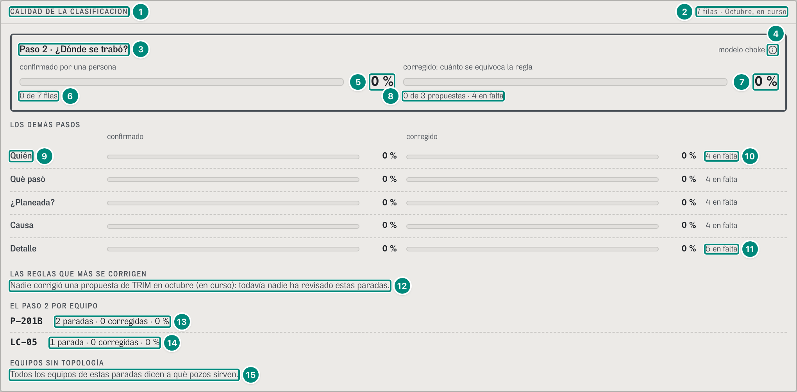
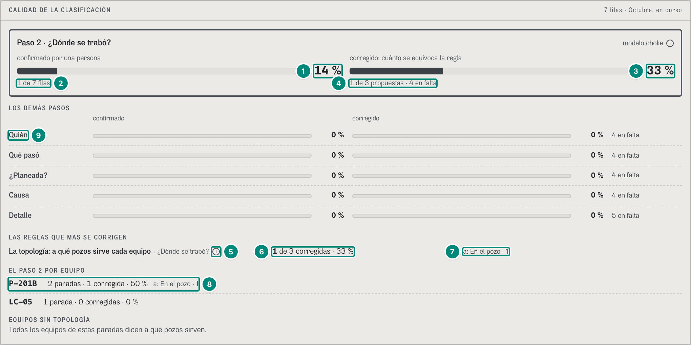
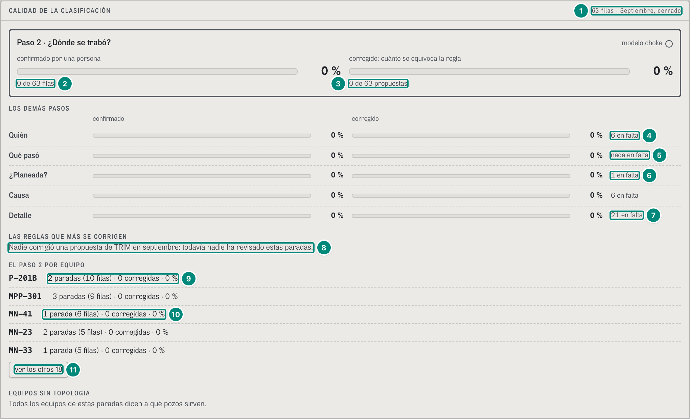
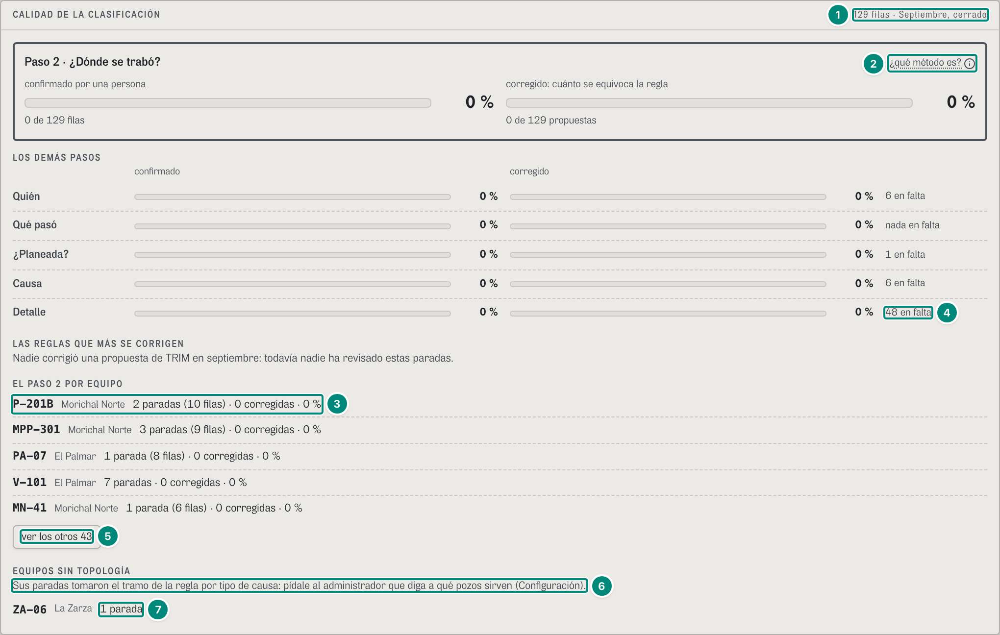
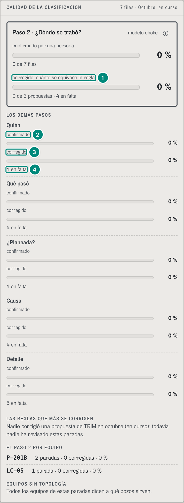

# 6D.9 Confiabilidad — la calidad de la clasificación · confiabilidad, jefe de mantenimiento

**Para qué.** «Antes: aciertos del vigía. Después: MTBF, costo por falla, no repetir.» (`PARA_QUE.confiabilidad`, `src/widgets/Onboarding.tsx:18`). El panel de esta sección dice la suya en su «¿cómo se lee?»: «Cuánto de lo que propone TRIM miró una persona (confirmado) y cuánto cambió (corregido), paso por paso. El paso 2, dónde se trabó, va aparte: si se corrige mucho, la topología o la regla está mal.» (`src/widgets/arbol/Calidad.tsx:95-97`; U2 §4.6, P1 §2.1 «correcciones por regla»).
**Ruta.** `#/<rol>/confiabilidad/<campo>[~portafolio]/<período>` · **Roles y nivel.** `conf` y `jefe` (ingeniería; agrega campos). La planeadora (`plan`) tiene la pantalla en `src/entities/roles.ts:84-85`, pero es de v2 (`ROLES_V2`, `src/shared/config/producto.ts:19`): `#/plan/confiabilidad/…` abre la de producción (`rolPorId`, `roles.ts:122-125`). · **Lee.** `GET /api/vistas/anh/calidad?campos&desde&hasta` → `CalidadClasificacion` (CONTRATO.md, Anexo A; el servidor la arma sobre las filas de `GET /api/vistas/anh/paradas` con lo que ya dijeron las personas encima, `pedirCalidadAnh`, `src/shared/api/arbol.ts:136-143`) · **Escribe.** Nada. Lo que el panel cuenta lo escriben Identificar, Turno y WhatsApp: `POST /api/anh/paradas/:id/clasificacion`, `…/confirmar`, `…/:id/respuesta`, `…/:id/yacimiento` (6D.7).
Fórmulas: confirmado, corregido, las reglas que más se corrigen, el paso 2 por equipo y los equipos sin topología → 5E §9; la fila de `paradas_pozo` y su clasificación vigente (quién declara, quién confirma) → 5E §9; el tramo que propone el motor y la regla por tipo de causa → 5E §3 y 5E §1.

Lo demás de Confiabilidad (las familias, «¿ACIERTA EL VIGÍA?», los tres relojes, LOS MÁS COSTOSOS, DE QUÉ FALLAN, FALLAS POR MES y CALIDAD DEL REGISTRO) está en 6C.4 y no cambió. Este panel va al final de la pantalla (`src/pages/Confiabilidad.tsx:218-219`) y tiene dos diferencias con el resto:

- **Sigue el período de la cabecera** (`rango.desde`, `rango.hasta`, `Confiabilidad.tsx:219`): «7 filas · Octubre, en curso». El resto de la pantalla es toda la historia; 6C.4 lo dice así: el período no cambia nada salvo este panel.
- **No sale en un campo sin equipos de alto impacto**: El Palmar y La Zarza dicen solo «{campo} no tiene equipos de alto impacto.» (`Confiabilidad.tsx:43`), y su calidad no se ve (6D·H30).

U2 §4.6 lo llamaba «CALIDAD DE DÓNDE SE TRABÓ». En pantalla cuenta los seis pasos, con el paso 2 destacado arriba. La unidad es la **fila** de `paradas_pozo`: un pozo × un día operacional × una causa (`ParadaAnh`, `src/entities/anh-paradas.ts`), la misma del reporte a la ANH. Una parada de dos pozos, o de un pozo que cruza la medianoche, da dos filas. El motor (`calidadClasificacion`, `src/entities/anh-calidad.ts:103-165`) mira cada paso $p$ de cada fila $f$ del período ($F$) y lo cuenta en una de estas casillas:

- **en falta:** el paso no tiene valor (`:108`).
- **propuesta:** lo propuso TRIM (una regla, el programa o la topología). Es todo lo que no es «lo dijo una persona donde TRIM no proponía nada» (`propusoTrim`, `:89`). Si no, cuenta como **declarada**.
- **corregida:** una persona cambió lo que TRIM proponía. Puede ser `corregido` en el editor, o una respuesta de campo que dejó otro valor (`cambioATrim`, `:91-92`).
- **avalada:** la dijo o la confirmó un rol que puede avalar ese paso (`avalado`, `src/entities/anh-clasificacion.ts:1187-1193`). Supervisión, producción, el jefe y confiabilidad avalan los seis pasos. El operador y el técnico solo «¿Planeada?» y «Qué pasó» (`PASOS_QUE_CONFIRMA` y `PASOS_QUE_DECLARA`, `:1166-1179`). Una corrección de un rol de ingeniería también avala.

$$
\%\,\text{confirmado}_p = \frac{\text{avaladas}_p}{|F|}\cdot 100
\qquad
\%\,\text{corregido}_p = \frac{\text{corregidas}_p}{\text{propuestas}_p}\cdot 100
$$

Las dos son `null` («—» en pantalla) sin filas o sin propuestas. El confirmado se divide por **todas** las filas, también las que están en falta: mientras haya una fila sin causa, ningún paso llega al 100 %.

### Captura 1 · confiabilidad, La Ceiba, octubre en curso

El demo arranca sin una sola corrección ni confirmación: todo está en 0 % en todos los campos y períodos (`referencia/anh/calidad-*-2026-09.json`, `avaladas` y `corregidas` en 0). Las cifras distintas de cero están en la captura 2.

| # | Lo que se ve | En la captura | Cómo se calcula | Texto según el valor | Viene de |
|---|---|---|---|---|---|
| 1 | Título | «CALIDAD DE LA CLASIFICACIÓN» | fijo (`Calidad.tsx:93`) | — | — |
| 2 | Filas y período | «7 filas · Octubre, en curso» | $\lvert F\rvert$ = 7, las filas de La Ceiba del 1-oct a las 14:00 del 2-oct. LC-16 y LC-07, que cerró P-201B el 2-oct, dan 1 fila cada uno. LC-05, por baja tensión el 1-oct, da 1. LC-21, parada desde el 1-oct 18:20, da 2 (1 y 2 de oct). LC-08, del 1-oct 22:15 al 2-oct 01:10, da 2. Son las mismas 7 filas del árbol de Regulatorio (6D.10: «7 filas de paradas_pozo · 5 paradas») | `plural(paradas,'fila','filas')` + « · » + el nombre del período (`Calidad.tsx:93`) | `GET /api/vistas/anh/calidad` → `paradas` |
| 3 | El paso 2, aparte | «Paso 2 · ¿Dónde se trabó?» | la entrada `paso = 'choke'` de `porPaso` (`Calidad.tsx:52`). Los otros cinco pasos van abajo | recuadro con contorno grueso gris, sin color: no es una alarma (`Calidad.tsx:100-101`). Sin esa entrada no sale el recuadro | `porPaso[paso=choke]` |
| 4 | Rótulo del método | «modelo choke» ⓘ | solo para `conf`: `conRotulo = useRol().id === 'conf'` (`Calidad.tsx:49`; U2 §1.3) | globo «Modelo choke»: «Es un método internacional para ubicar dónde se pierde producción: lo publicó BP en 1996 (artículo SPE-36848), lo usa el regulador británico (NSTA) y la ANH lo adoptó en 2026 (Circulares 003 y 024). No es la válvula choke de la cabeza del pozo (Circular 024, p. 4).» (`INFO_METODO`, `src/widgets/arbol/palabras.ts:38`). El jefe ve en su lugar «¿qué método es?» con el mismo globo (captura 4). En el papel, el texto del globo sale debajo (`Info`, `imprimir` por defecto) | — |
| 5 | Confirmado por una persona | «0 %» bajo «confirmado por una persona» | $\text{avaladas}/\lvert F\rvert$ = 0 / 7 | `n0` + « %»; «—» si es `null` (`pct`, `Calidad.tsx:16`). La barra va de 0 a 100 %, gris (`--dato-1`): no es una alarma. El lector oye «¿Dónde se trabó?, confirmado por una persona: 0 %» (`Barra`, `Calidad.tsx:22-32`) | `porPaso[choke].pctConfirmado` |
| 6 | Apoyo | «0 de 7 filas» | avaladas de filas (`Calidad.tsx:112`) | — | `.avaladas`, `.paradas` |
| 7 | Corregido | «0 %» bajo «corregido: cuánto se equivoca la regla» | $\text{corregidas}/\text{propuestas}$ = 0 / 3 | como la fila 5; «—» sin propuestas | `.pctCorregido` |
| 8 | Apoyo | «0 de 3 propuestas · 4 en falta» | **propuestas = 3**: las dos filas de P-201B y la de LC-05, ubicadas por el motor del choke (5E §3). **En falta = 4**: las cuatro filas de LC-21 y LC-08, sin causa, y sin causa no hay tramo. Son los 355 bbl de «Sin identificar» del árbol (5E §5; 6D.10, fila 18) | « · N en falta» solo si es más de 0. « · N las dijo una persona sin propuesta» si `declaradas > 0` (`Calidad.tsx:117`) | `.corregidas`, `.propuestas`, `.enFalta`, `.declaradas` |
| 9 | LOS DEMÁS PASOS, una fila | «Quién · 0 % · 0 % · 4 en falta» | lo mismo para Quién, Qué pasó, ¿Planeada?, Causa y Detalle, en el orden de la circular (`otros`, `Calidad.tsx:53, 62-69`). El rótulo es la palabra de campo de cada paso (`ROTULO`, `arbol/palabras.ts:30`; `PASO_CAMPO`, `src/entities/anh-catalogo.ts:209-211`) | dos barras por fila, la primera del confirmado y la segunda del corregido. El encabezado «confirmado / corregido» sale solo en la pantalla ancha (`Calidad.tsx:123`); en el teléfono, cada barra lleva su rótulo (fila 1 de la captura 5) | `porPaso[]` |
| 10 | En falta de un paso | «4 en falta» | Quién, Qué pasó, ¿Planeada? y Causa: las mismas cuatro filas sin causa | «N en falta», o «nada en falta» con 0 (`Calidad.tsx:67`) | `porPaso[].enFalta` |
| 11 | Detalle | «5 en falta» | las cuatro sin causa más LC-05. Su detalle (`cau_niv2`) espera la respuesta a «¿De dónde vino el corte?» (6D.7). En el árbol de Regulatorio es «Falta el detalle», 118 bbl (6D.10, fila 16) | — | `porPaso[n2].enFalta` |
| 12 | LAS REGLAS QUE MÁS SE CORRIGEN, vacía | «Nadie corrigió una propuesta de TRIM en octubre (en curso): todavía nadie ha revisado estas paradas.» | la lista son las reglas con al menos una corrección (`porRegla` con `corregidas > 0`, `Calidad.tsx:54`), y aquí no hay ninguna | el período va en palabras con `periodoEnFrase`: «octubre (en curso)», «septiembre», «los últimos 12 meses» (`src/widgets/choke/palabras.ts:70-76`; B-45). La cola «: todavía nadie ha revisado estas paradas» sale solo si ningún paso tiene una fila avalada (`Calidad.tsx:130`). Con 0 filas dice lo mismo (6D·H31) | `porRegla[]`, `porPaso[].avaladas` |
| 13 | EL PASO 2 POR EQUIPO | «P-201B · 2 paradas · 0 corregidas · 0 %» | una línea por equipo con alguna fila de paso 2 propuesto (`chokePorEquipo` con `paradas > 0`, `Calidad.tsx:55`). El equipo es el elemento donde se originó la parada, es decir, la raíz de la cascada (`porque.elemento`, `anh-calidad.ts:140`): P-201B para LC-16 y LC-07, con 2 filas y 2 eventos. El % es corregidas ÷ filas del equipo | «N parada(s)» cuenta los eventos, y « (N filas)» sale solo si las filas son más (`paradasYFilasDe`, `Calidad.tsx:18-19`; B-47; captura 3). Después « · N corregida(s) · N %» y, con correcciones, «a: …» (captura 2). Orden: más corregidas, más filas, campo y equipo (`anh-calidad.ts:161-162`). Se ven cinco y «ver los otros N» (`VISIBLES = 5`, `src/shared/ui/listaCorta.ts:3`); en el papel salen todas (`solo-impresion`, `Calidad.tsx:144-146`) | `chokePorEquipo[]` → `.paradas`, `.eventos`, `.corregidas`, `.pctCorregido`, `.cambiadoA` |
| 14 | Otro equipo | «LC-05 · 1 parada · 0 corregidas · 0 %» | la baja tensión de LC-05 (regla «Baja tensión en un pozo»): el tramo es el pozo, 117,92 bbl (5E §3) | — | ídem |
| 15 | EQUIPOS SIN TOPOLOGÍA, vacía | «Todos los equipos de estas paradas dicen a qué pozos sirven.» | `sinTopologia` vacía: ninguna fila con causa tomó el tramo de la regla por tipo de causa (`chokeDeCausa(…).fuente === 'regla'`, `anh-calidad.ts:147-157`) | con equipos sale «Sus paradas tomaron el tramo de la regla por tipo de causa: pídale al administrador que diga a qué pozos sirven (Configuración).» y una línea por equipo (`Calidad.tsx:150-165`; captura 4) | `sinTopologia[]` |

### Captura 2 · confiabilidad, La Ceiba, octubre, con el paso 2 de LC-16 corregido

Así se llega a esta captura:

1. En Identificar (`#/conf/causa/ceiba/curso`), en la tarjeta de P-201B (LC-07 y LC-16), se toca «Corregir dónde se trabó».
2. Se escoge «En el pozo» y luego «Solo a LC-16».
3. Se toca «Guardar». Aparece el aviso «Guardado en LC-16: ¿Dónde se trabó? → En el pozo.», y el paso dice «corrigió Edwin Maestre · 14:00 · antes: En la planta o estación».
4. Por el riel, se pasa a «Confiabilidad».

No pide motivo, porque cambia lo que proponía TRIM. El motivo es obligatorio solo si se cambia lo que ya dijo una persona (`tocaAPersona`, `src/widgets/arbol/Editor.tsx:105, 118`). En el demo, lo guardado vive en la sesión de la página y el cambio de pantalla por el riel lo conserva. Con el servidor, es `POST /api/anh/paradas/:id/clasificacion`, y la vista lo cuenta en la siguiente lectura.

| # | Lo que se ve | En la captura | Cómo se calcula | Texto según el valor | Viene de |
|---|---|---|---|---|---|
| 1 | Confirmado | «14 %» | 1 / 7 = 14,3 %. La corrección también avala el paso: queda `corregido` con rol `conf`, que puede decir los seis pasos (`avalado`, `anh-clasificacion.ts:1187-1190`) | ídem captura 1, fila 5 | `porPaso[choke].pctConfirmado` |
| 2 | Apoyo | «1 de 7 filas» | ídem | — | `.avaladas` |
| 3 | Corregido | «33 %» | 1 / 3 = 33,3 %. LC-16 sigue contando como propuesta, porque su procedencia es `corregido` y no `declarado` (`propusoTrim`, `anh-calidad.ts:89`): la regla propuso 3 y se equivocó en 1 | ídem | `.pctCorregido` |
| 4 | Apoyo | «1 de 3 propuestas · 4 en falta» | ídem | ídem | `.corregidas`, `.propuestas`, `.enFalta` |
| 5 | La regla | «La topología: a qué pozos sirve cada equipo · ¿Dónde se trabó?» ⓘ | la regla que propuso el paso 2 de las tres filas: `choke.topologia@3`, la del motor del choke. Se toma de la propuesta de la fila, que no cambia aunque una persona corrija (`reglaQuePropuso`, `anh-calidad.ts:98-99`) | nombre en palabras (`nombreDeRegla`, `anh-clasificacion.ts:784-790`): `choke.topologia@…` es «La topología: a qué pozos sirve cada equipo», `choke.yacimiento@…` es «En el yacimiento, puesto por una persona» y `programa-exceso@…` es «Se pasó de la ventana del programa». Una fila de `REGLAS_ANH` sale con su `NOMBRE_FILA` («Baja tensión en un pozo», «Programa firmado, sin la causa»…). Una regla desconocida sale con su id. Después va « · » y el paso. Globo «La regla»: «choke.topologia@3: la regla de TRIM que propuso el paso «¿Dónde se trabó?».» (`Calidad.tsx:73-75`) | `porRegla[].regla`, `.paso` |
| 6 | Cuánto se le corrige | «1 de 3 corregidas · 33 %» | corregidas ÷ propuestas de esa regla en ese paso | la lista lleva solo las reglas con alguna corrección (`Calidad.tsx:54`). Orden: más corregidas, mayor %, paso y regla (`anh-calidad.ts:159-160`). Se ven cinco y «ver las otras N»; en el papel, todas (`Calidad.tsx:133-135`) | `.corregidas`, `.propuestas`, `.pctCorregido` |
| 7 | A qué la cambiaron | «a: En el pozo · 1» | valor que pusieron las personas → filas, de más a menos (`cambios`, `Calidad.tsx:35-36`) | en el paso 2 se usan los nombres de tramo (`NOMBRE_CHOKE`: «En el pozo», «En la planta o estación», «Afuera…», «En el yacimiento»); en los demás pasos, `valorEnPalabras` (`arbol/palabras.ts:59-70`) | `.cambiadoA` |
| 8 | El equipo | «P-201B · 2 paradas · 1 corregida · 50 % · a: En el pozo · 1» | 1 de sus 2 filas: 50 %. Queda primero por tener más corregidas | «corregida» en singular con 1 (`Calidad.tsx:87`). «a: …» sale solo con correcciones (`:88`) | `chokePorEquipo[]` |
| 9 | Los demás pasos | «Quién · 0 % · 0 %» (y los otros cuatro igual) | no se movieron: la corrección fue solo del paso 2. Los otros cinco pasos de LC-16 siguen siendo lo que dedujo TRIM | — | `porPaso[]` |

### Captura 3 · confiabilidad, Morichal Norte, septiembre (cerrado)

El caso de la referencia es `referencia/anh/calidad-morichal-2026-09.json`.

| # | Lo que se ve | En la captura | Cómo se calcula | Texto según el valor | Viene de |
|---|---|---|---|---|---|
| 1 | Filas y período | «63 filas · Septiembre, cerrado» | las 63 filas de Morichal en septiembre (31 paradas en el árbol de Regulatorio: «63 filas de paradas_pozo · 31 paradas») | ídem captura 1, fila 2 | `paradas` |
| 2 | Confirmado | «0 de 63 filas» (0 %) | — | — | `porPaso[choke]` |
| 3 | Corregido | «0 de 63 propuestas» (0 %) | todas las filas tienen el paso 2 propuesto, sin «en falta»: en septiembre ninguna parada de Morichal quedó sin causa, y con causa el motor del choke siempre propone un tramo (5E §3) | sin « · N en falta» cuando es 0 | `.propuestas`, `.enFalta` |
| 4 | Quién | «6 en falta» (Causa, también 6) | cinco filas del programa firmado sin su causa de la ANH: MN-16 del 4 al 6 de sept y MN-05 del 12 y 13. Son los cambios programados de la electrosumergible que anticipó el vigía (regla «Programa firmado, sin la causa»; 6C.4, fila 44). La sexta es MN-22 del 30-sep, declarada con sus palabras («Declarada con sus palabras»). En ninguna de las seis TRIM propone quién ni la causa | ídem captura 1, fila 10 | `porPaso[responsable].enFalta`, `porPaso[n1].enFalta` |
| 5 | Qué pasó | «nada en falta» | todas tienen «Diferida» | «nada en falta» con 0 | `porPaso[impacto].enFalta` |
| 6 | ¿Planeada? | «1 en falta» | MN-22: lo declarado con sus palabras no dice si fue planeado. Las del programa sí son «planeada» | — | `porPaso[planeacion].enFalta` |
| 7 | Detalle | «21 en falta» | las 6 de arriba y 15 con la causa pero sin el detalle | — | `porPaso[n2].enFalta` |
| 8 | Las reglas, vacía | «Nadie corrigió una propuesta de TRIM en septiembre: todavía nadie ha revisado estas paradas.» | un mes cerrado se dice sin «(en curso)» (`periodoEnFrase`) | ídem captura 1, fila 12 | — |
| 9 | Paradas con sus filas | «P-201B · 2 paradas (10 filas) · 0 corregidas · 0 %» | 2 eventos de P-201B en septiembre que cerraron pozos: 10 filas (pozos × días). El % se divide por las filas | B-47: se cuentan paradas y las filas van entre paréntesis | `chokePorEquipo[].paradas` (filas), `.eventos` |
| 10 | Una parada de varios días | «MN-41 · 1 parada (6 filas) · 0 corregidas · 0 %» | MN-41 falló el 25-sep a las 06:40 y siguió parada hasta el fin del mes: una fila por día, del 25 al 30 (en octubre, «MN-41 · 1 parada (2 filas)», la que pide la e2e de B-47) | ídem | ídem |
| 11 | Ver más | «ver los otros 18» | 23 equipos y 5 a la vista. Tocar los muestra todos y el botón pasa a «ver menos»; en el papel salen todos (`Calidad.tsx:144-146`) | `ver los otros ${n}` (6D·H32: con uno dice «ver los otros 1») | — |

### Captura 4 · jefe de mantenimiento, portafolio, septiembre

Es la única vista del demo con un equipo en «EQUIPOS SIN TOPOLOGÍA». La referencia es `referencia/anh/calidad-portafolio-2026-09.json`.

| # | Lo que se ve | En la captura | Cómo se calcula | Texto según el valor | Viene de |
|---|---|---|---|---|---|
| 1 | Filas y período | «129 filas · Septiembre, cerrado» | 28 de La Ceiba + 63 de Morichal + 22 de Guacamayo + 15 de El Palmar + 1 de La Zarza | — | `paradas` |
| 2 | El rótulo del jefe | «¿qué método es?» ⓘ | el jefe no es `conf`: no ve «modelo choke», ve el enlace con el mismo globo (`Calidad.tsx:104-106`). El rótulo es solo de confiabilidad, regulatorio y el administrador (U2 §1.3), y la e2e `choke-gerente-riesgo` lo pide así en el Riesgo del jefe. En el texto de esta pantalla el jefe tampoco lee «choke»: la palabra va dentro del globo | globo «¿Qué método es?» con `INFO_METODO` | — |
| 3 | El campo de cada equipo | «P-201B · Morichal Norte · 2 paradas (10 filas) · 0 corregidas · 0 %» | en el portafolio, cada línea lleva el nombre del campo en gris (`donde`, `Calidad.tsx:56, 86`) | sin portafolio no lleva campo | `chokePorEquipo[].campoId` |
| 4 | Detalle | «48 en falta» | 11 + 21 + 8 + 8 + 0, los de cada campo | — | `porPaso[n2].enFalta` |
| 5 | Ver más | «ver los otros 43» | 48 equipos (12 + 23 + 10 + 2 + 1) y 5 a la vista | — | — |
| 6 | Pedido al administrador | «Sus paradas tomaron el tramo de la regla por tipo de causa: pídale al administrador que diga a qué pozos sirven (Configuración).» | `sinTopologia` tiene un equipo | fijo (`Calidad.tsx:155`) | `sinTopologia[]` |
| 7 | El equipo sin topología | «ZA-06 · La Zarza · 1 parada» | La Zarza, 1-sep, 06:34 a 23:49. Nelson Ortiz declaró «El comprador nominó menos gas: se cerró el pozo» (regla «Declarada: el comprador nominó menos»), y el motor del choke puso «Afuera», en el mercado, con `fuente: 'regla'` (`src/entities/choke.ts:716-719`). Es la misma fila que en Regulatorio sale «Afuera» con `choke_mod EXPORTACION` (6D.10, captura 3). ZA-06 es un pozo, y su tramo no depende de ninguna topología: el pedido al administrador no le aplica (6D·H7) | `paradasYFilasDe` | `sinTopologia[]` → `.equipo`, `.campoId`, `.paradas`, `.eventos` |

### En el teléfono (390 px)

| # | Lo que se ve | En la captura | Regla |
|---|---|---|---|
| 1 | El paso 2 en una columna | «corregido: cuánto se equivoca la regla» debajo de «confirmado por una persona» | la rejilla de dos columnas es de `sm:` (`Calidad.tsx:108`): en el teléfono, una debajo de la otra |
| 2 | Rótulo de cada barra | «confirmado» | sin el encabezado de columnas (`hidden … sm:grid`, `Calidad.tsx:123`), cada barra lleva su rótulo chico (`sm:hidden`, `:65-66`) |
| 3 | La segunda barra | «corregido» | ídem |
| 4 | En falta, en su renglón | «4 en falta» | cada paso ocupa cinco renglones: nombre, dos barras con su rótulo y lo que falta |

Las cifras son las de la captura 1.

### Estados y otros campos

- **Sin filas** (Guacamayo, octubre en curso): «0 filas · Octubre, en curso», las barras con «—» (`pctConfirmado` y `pctCorregido` son `null`), «0 de 0 filas», «0 de 0 propuestas», «nada en falta» en los cinco pasos, «Nadie corrigió una propuesta de TRIM en octubre (en curso): todavía nadie ha revisado estas paradas.» (6D·H31), «Ninguna parada con el paso 2 propuesto en octubre (en curso).» (`Calidad.tsx:141`) y «Todos los equipos de estas paradas dicen a qué pozos sirven.».
- **Morichal Norte, octubre en curso**: «6 filas · Octubre, en curso», «0 de 6 propuestas». Quién, ¿Planeada? y Causa tienen «1 en falta»; Detalle, «3 en falta»; Qué pasó, «nada en falta». Por equipo: «MN-22 · 2 paradas», «MN-41 · 1 parada (2 filas)», «MN-25 · 1 parada», «MN-31 · 1 parada».
- **La Ceiba, septiembre**: «28 filas · Septiembre, cerrado», «0 de 28 propuestas». En falta solo el Detalle, «11 en falta» (los 396 y 239 bbl de «Falta el detalle» del árbol de Regulatorio, 6D.10, captura 2). Por equipo: «LC-04 · 2 paradas (5 filas)», «LC-11 · 1 parada (5 filas)», «P-201B · 2 paradas (4 filas)», «LC-12 · 3 paradas», «LC-09 · 1 parada (2 filas)» y «ver los otros 7».
- **Guacamayo, septiembre**: «22 filas», Detalle «8 en falta», «GU-05 · 1 parada (5 filas)» primero y «ver los otros 5».
- **Portafolio de confiabilidad** (`ceiba~portafolio`: sus tres campos, La Ceiba, Morichal Norte y Guacamayo). En octubre: «13 filas», «0 de 9 propuestas · 4 en falta», y por equipo «P-201B · La Ceiba · 2 paradas», «MN-22 · Morichal Norte · 2 paradas», «MN-41 · Morichal Norte · 1 parada (2 filas)», «LC-05», «MN-25» y «ver los otros 1» (6D·H32). En septiembre: «113 filas», Detalle «40 en falta», «ver los otros 40».
- **El Palmar y La Zarza** (el jefe): no hay panel, solo «El Palmar no tiene equipos de alto impacto.» (`Confiabilidad.tsx:43`). Sus 15 y 1 filas de septiembre solo se cuentan en el portafolio del jefe (6D·H30).
- **En el papel**: las listas salen enteras (lo que «ver …» esconde va en `solo-impresion`), y el globo del rótulo sale escrito debajo de él.

### Interacciones

- «ver los otros N» / «ver las otras N» y «ver menos» (`aria-expanded`) en las reglas y en los equipos.
- El ⓘ del rótulo del método y el de cada regla. Las líneas del panel no se pueden tocar: no abren la ficha del equipo, a diferencia del resto de Confiabilidad (6C.4).
- «¿cómo se lee?» abre la `Lectura` del panel (`Calidad.tsx:94-98`): «Cuánto de lo que propone TRIM miró una persona (confirmado) y cuánto cambió (corregido), paso por paso. El paso 2, dónde se trabó, va aparte: si se corrige mucho, la topología o la regla está mal. Las reglas que más se corrigen van primero; los equipos sin topología se le piden al administrador.»
- Lo que cambia las cifras se hace en otras pantallas: confirmar o corregir en Identificar y en Turno, y contestar por WhatsApp (6D.7, 6D.8). El panel lo cuenta en la siguiente lectura (captura 2).
