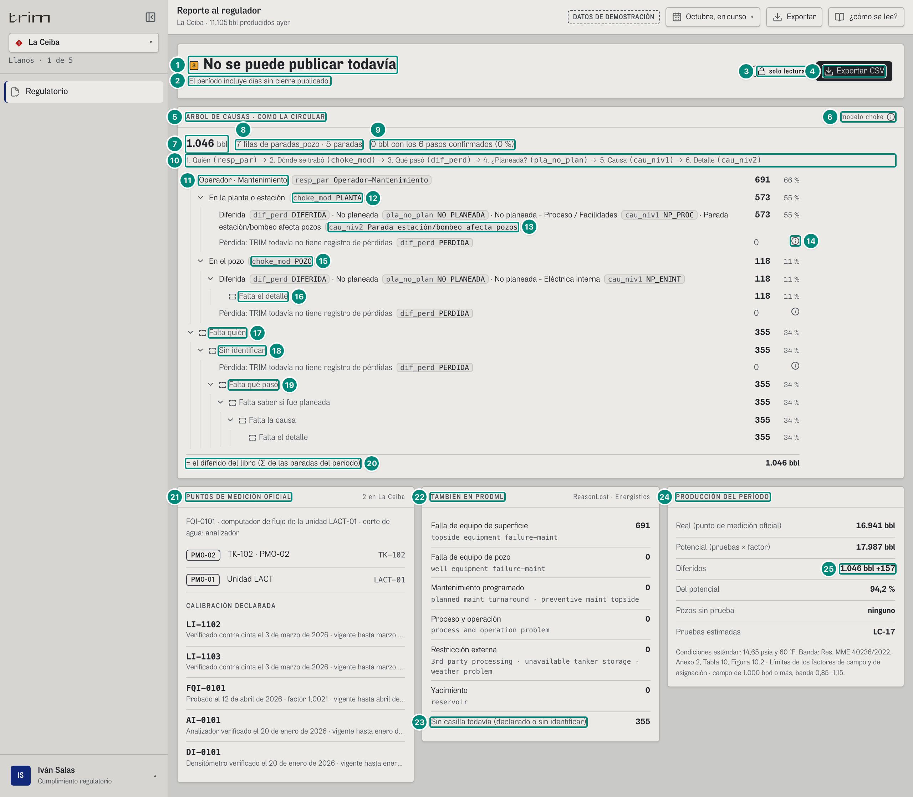
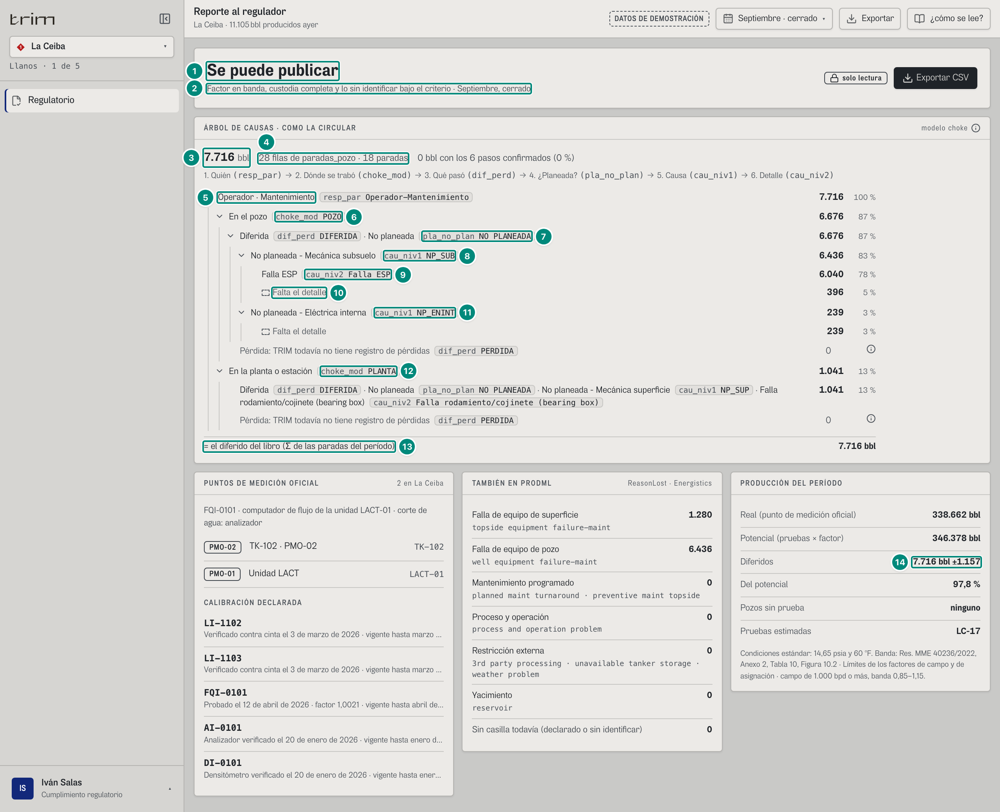
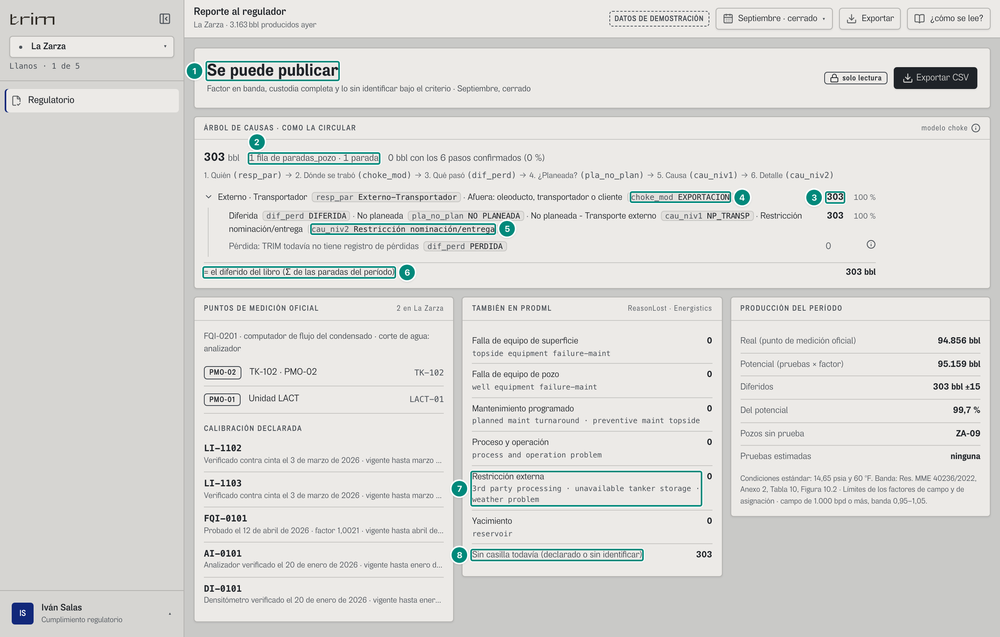
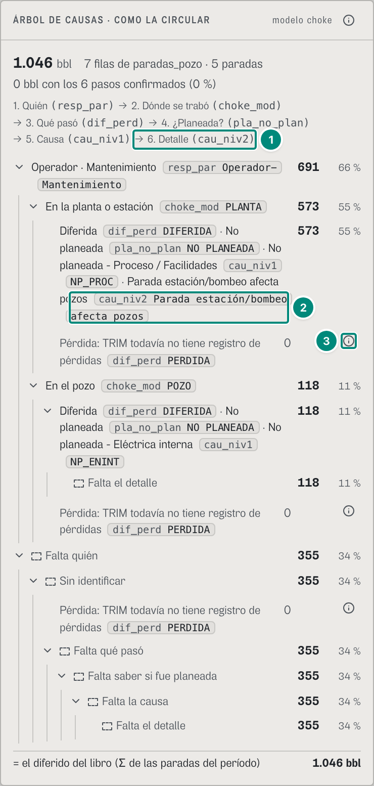

# 6D.10 Regulatorio — el árbol en el orden de la circular · cumplimiento regulatorio

**Para qué.** «El árbol de la circular de cada parada, con lo que va a la ANH.» (`PARA_QUE.regulatorio`, `src/widgets/Onboarding.tsx:31`). El foco del rol es «Cada parada en el árbol de la circular, con lo que va a la ANH, y la medición viva. Nunca la tocamos.» (`src/entities/roles.ts:104`). U2 §3.1 le da esta pregunta: «¿Cada fila lleva su tramo, y cuadra?».
**Ruta.** `#/reg/regulatorio/<campo>/<período>`, un campo a la vez: `regulatorio` no agrega campos (`src/app/pantallas.tsx:63`, sin `agrega`). Con `ceiba~portafolio` se abre La Ceiba y la pantalla dice «Usted no tiene asignado el portafolio: le mostramos La Ceiba.» (6D·H33). · **Roles y nivel.** `reg`, Cumplimiento regulatorio (Iván Salas; ingeniería; todos los campos). Esta es su única pantalla (`roles.ts:102-107`). Se encendió el 22-oct con el árbol de pérdidas del choke y ya no está en `ROLES_V2` (`src/shared/config/producto.ts:10-19`). · **Lee.** `GET /api/vistas/choke/arbol?campos=<campo>&desde&hasta&orden=circular` → `ArbolChoke`, el panel principal. Las filas que cuelgan de él son las de `GET /api/vistas/anh/paradas` (CONTRATO.md, Anexo A). `GET /api/vistas/diferidos?campos&desde&hasta` → `Libro` da la cabecera, el cuadre, PRODML y la producción. `GET /api/vistas/diferidos/mensual?campos` solo se usa en el CSV. `GET /api/catalogo` da la medición oficial y el esquema de la planta. · **Escribe.** Nada: «solo lectura». Regulatorio no confirma ni corrige; eso se hace en Identificar y en Turno (6D.7).
Fórmulas: el árbol (órdenes, niveles, ramas que faltan, la rama de la pérdida, cada nodo = Σ de sus ramas, la raíz = el diferido del libro) → 5E §5; el tramo de cada fila (paso 2) → 5E §3; publicable y sus motivos → 5A §7; potencial, real, diferido y «Del potencial» → 5A §3; la tolerancia → 5A §4; la banda del factor → 5A §2; la casilla PRODML de cada tipo de causa → 5B §2.1; los puntos de medición del esquema → 5D §7.

Lo que ya estaba en Regulatorio no tiene capítulo propio en 6A–6C: la cabecera «publicable», PUNTOS DE MEDICIÓN OFICIAL con la calibración, TAMBIÉN EN PRODML y PRODUCCIÓN DEL PERÍODO. Esas partes van en las filas 1-4 y 21-25. Lo nuevo es el panel «ÁRBOL DE CAUSAS · COMO LA CIRCULAR» (`src/widgets/choke/ArbolCircular.tsx`): el árbol de pérdidas del choke en el orden `circular`. Sus niveles son responsable → tramo → diferida o pérdida → planeada o no → causa N1 → detalle N2 (`NIVELES_ARBOL.circular`, `src/entities/choke-arbol.ts:72`; C24 p. 5). Cada nodo trae sus barriles del motor y suma exacto sus ramas, y la raíz es el diferido del libro del período (`arbolDelChoke`, `choke-arbol.ts:279-290`).

La lectura de las ramas nodo por nodo está en 6D.4 (`src/widgets/choke/Ramas.tsx`): qué dice cada nivel, cuándo una cadena va en un renglón, «Ver N más», lo que falta. Aquí va lo propio de Regulatorio:

- el orden de la circular y el campo de `paradas_pozo` de cada paso, arriba;
- los códigos de la ANH al lado de cada paso. Con `codigos="vista"`, solo regulatorio los ve ahí; confiabilidad y el administrador los ven en un ⓘ, y nadie más los ve (`codigosDelRol`, `src/widgets/choke/palabras.ts:85-86`; U2 §1.3);
- la cuenta de lo confirmado;
- el cuadre con el libro;
- los ⓘ que en el papel van una vez al final (B-10).

**Lo que viaja a la ANH** es la cadena de cada paso en la forma de salida vigente, `C024-2026` por defecto (`VERSION_POR_DEFECTO`, `src/entities/anh-catalogo.ts:190`; `FORMA_C024`, `:419`):

| Campo | Qué lleva |
|---|---|
| `resp_par` | los nueve responsables tal como los escribe la circular: «Operador-Mantenimiento», «Externo-Transportador»… (`RESPONSABLES_C024`, `:98`) |
| `choke_mod` | `POZO`, `PLANTA`, `EXPORTACION` (sin tilde, como la circular) o `RESERVORIO` |
| `dif_perd` | `DIFERIDA` o `PERDIDA` |
| `pla_no_plan` | `PLANEADA` o `NO PLANEADA` (`VALORES_C024`, `:106`) |
| `cau_niv1` | la clave de la Tabla 1: `NP_PROC`, `NP_SUB`… |
| `cau_niv2` | el texto de la Tabla 1 byte a byte: «Parada estación/bombeo afecta pozos» |

Con la versión `DICC-V3.2`, que se escoge con una línea firmada de la configuración, `cau_niv1` lleva el texto en mayúsculas, y la «¿cómo se lee?» del panel lo dice (`FORMA`, `ArbolCircular.tsx:11-14`). Un paso sin valor no lleva cadena: nunca se inventa una (`cadenaDe`, `choke-arbol.ts:225-237`).

### Captura 1 · cumplimiento regulatorio, La Ceiba, octubre en curso

Las cifras con decimales salen de `referencia/choke-arbol/ceiba-2026-10-gestion.json`, que es el mismo árbol en otro orden.

| # | Lo que se ve | En la captura | Cómo se calcula | Texto según el valor | Viene de |
|---|---|---|---|---|---|
| 1 | Publicable | ■3 «No se puede publicar todavía» | `Libro.publicable`, es decir, sin motivos (5A §7). Octubre en curso tiene días sin cierre publicado (motivo `en-curso`, `src/entities/libro.ts:845`) | «Se puede publicar», o «No se puede publicar todavía» con ■3, aviso (`FueraDeMeta`, `Regulatorio.tsx:57`). Globo «Libro del período»: «TRIM lee los puntos de medición. Nunca escribe sobre ellos.», con «Publicable no», «Puntos de medición 2», «Instrumentos con calibración 5», «Banda de asignación ±15 %» y «Período Octubre, en curso» (`Regulatorio.tsx:52-55`) | `Libro.publicable` |
| 2 | Por qué | «El período incluye días sin cierre publicado.» | los textos de `Libro.motivos`, uno tras otro | si se puede publicar: «Factor en banda, custodia completa y lo sin identificar bajo el criterio · {período}» (`Regulatorio.tsx:58`; captura 2) | `Libro.motivos[].texto` |
| 3 | Solo lectura | «solo lectura» | fijo: TRIM lee la medición y nunca escribe en ella (`Regulatorio.tsx:61`) | — | — |
| 4 | Exportar CSV | «Exportar CSV» | sale con `evidencia:exportar`, que `reg` tiene (`roles.ts:107`). Baja `libro-<campo>-mensual.csv` con un renglón por mes de la serie: real, potencial, diferido, factor, banda, «en banda», los barriles de cada casilla PRODML, «sin clasificar», tolerancia y aproximado (`Regulatorio.tsx:39-48`) | **no** lleva las filas de `paradas_pozo` ni sus seis cadenas, que son lo que muestra el árbol (6D·H11) | `GET /api/vistas/diferidos/mensual` |
| 5 | El panel | «ÁRBOL DE CAUSAS · COMO LA CIRCULAR» | `useArbolChoke({ campos: [campo], desde, hasta, orden: 'circular' })` (`ArbolCircular.tsx:29`). Va antes de las casillas de PRODML (lo pide la e2e `choke-arbol`) | — | `GET /api/vistas/choke/arbol?…&orden=circular` |
| 6 | Rótulo del método | «modelo choke» ⓘ | U2 §1.3: en Regulatorio va junto al título | globo «Modelo choke» con el texto exacto de U2 §1.3 (`QUE_ES_EL_CHOKE`, `ArbolCircular.tsx:17`, el mismo de `INFO_METODO`). Lleva `imprimir={false}`: en el papel sale una vez al final (fila 20; B-10) | — |
| 7 | La raíz | «1.046 bbl» | `raiz.bbl` = Σ de los barriles de las 7 filas dentro del período = 573,061 (en la planta) + 117,921 (en el pozo) + 355,044 (sin identificar) = 1.046,026. Es el diferido del libro (5E §5) | `n0` (`ArbolCircular.tsx:39`) | `raiz.bbl` |
| 8 | Filas y paradas | «7 filas de paradas_pozo · 5 paradas» | `raiz.filas` = 7 filas (pozo × día × causa). `raiz.eventos` = 5 eventos del controlador: LC-16, LC-07, LC-05, LC-21 y LC-08. Son las mismas 7 filas de la calidad de Confiabilidad (6D.9) | singular con 1: «1 fila de paradas_pozo · 1 parada» (`ArbolCircular.tsx:40`; captura 3) | `raiz.filas`, `raiz.eventos` |
| 9 | Lo confirmado | «0 bbl con los 6 pasos confirmados (0 %)» | `raiz.confirmadoBbl` son los barriles de las filas en estado `confirmada`, con los seis pasos avalados por una persona. El % es confirmado ÷ raíz (`ArbolCircular.tsx:33, 41`). El demo arranca sin confirmar nada | `pctParte`: «< 1 %» entre 0 y 1 (`src/shared/lib/formato.ts:20-21`) | `raiz.confirmadoBbl` |
| 10 | El orden | «1. Quién (resp_par) → 2. Dónde se trabó (choke_mod) → 3. Qué pasó (dif_perd) → 4. ¿Planeada? (pla_no_plan) → 5. Causa (cau_niv1) → 6. Detalle (cau_niv2)» | los niveles del orden `circular` con su palabra de campo (`NOMBRE_NIVEL`, `choke-arbol.ts:84-87`) y el campo de `paradas_pozo` donde viaja cada uno (`CAMPO_ANH`, `:95-97`; C24 p. 8) (`ArbolCircular.tsx:43-50`) | es una lista ordenada, con el nombre «El orden de la circular». La e2e `choke-arbol` pide «1. Quién (resp_par)» y «6. Detalle (cau_niv2)» | `niveles` |
| 11 | Paso 1 | «Operador · Mantenimiento» `resp_par Operador-Mantenimiento` · **691** · 66 % | nodo `responsable = op-mantenimiento`: P-201B y LC-05, 573,061 + 117,921 = 690,982 bbl. 690,982 / 1.046,026 = 66,1 % | el texto sale de `ETIQUETA_RESPONSABLE` (`anh-catalogo.ts:274-279`) y la cadena, de `RESPONSABLES_C024`. El lector oye «del período» después del % (`rotuloBase`, `ArbolCircular.tsx:60`). Los seis niveles empiezan abiertos (`abiertas={niveles.length}`) | `raiz.hijos[]` → `.texto`, `.cadena`, `.bbl` |
| 12 | Paso 2 | «En la planta o estación» `choke_mod PLANTA` · 573 · 55 % | LC-16 y LC-07, que cerró P-201B: 573,061 bbl, el 54,8 %. El tramo es el paso 2 **vigente** de la fila: lo que dijo una persona encima de lo que propone el motor (`tramoVigente`; 5E §3) | la cadena es `PLANTA` (`VALORES_C024.choke`) | `….hijos[].cadena` |
| 13 | Pasos 3 a 6 en un renglón | «Diferida `dif_perd DIFERIDA` · No planeada `pla_no_plan NO PLANEADA` · No planeada - Proceso / Facilidades `cau_niv1 NP_PROC` · Parada estación/bombeo afecta pozos `cau_niv2 Parada estación/bombeo afecta pozos`» · 573 · 55 % | una rama de un solo hijo va en un renglón, con los barriles una vez (B-34; `cadenaDe`, `Ramas.tsx:73-81`; 6D.4) | cada eslabón lleva su chip: el campo en gris y la cadena tal cual (`codigoDe`, `Ramas.tsx:99-106`). La causa lleva el nombre de la Tabla 1, el mismo que en Identificar (B-27) | `cadena` de cada nivel |
| 14 | La pérdida | «Pérdida: TRIM todavía no tiene registro de pérdidas» `dif_perd PERDIDA` · 0 ⓘ | la rama `perdida` está en cada tramo, vacía (`filas: 0`), porque TRIM no registra pérdidas (`choke-arbol.ts:267`; P1 §1.9) | sin % por ser una rama vacía (`Ramas.tsx:97, 130`). Globo «Pérdida»: «La pérdida es lo producido que no se vendió (derrame, tea, pitera). Va aparte y nunca se suma a lo diferido. TRIM todavía no tiene el registro de pérdidas: esta rama queda vacía hasta que lo tenga, y ningún barril diferido se pasa a ella.» (`EXPLICA_PERDIDA`, `choke-arbol.ts:116`). En el papel sale una vez al final (`imprimir={false}`, `Ramas.tsx:158`; B-10) | nodo `impacto = perdida` |
| 15 | Paso 2, otro tramo | «En el pozo» `choke_mod POZO` · 118 · 11 % | LC-05, 117,921 bbl. Debajo: «Diferida · No planeada · No planeada - Eléctrica interna `cau_niv1 NP_ENINT`» | — | — |
| 16 | Un paso que falta | «Falta el detalle» · 118 · 11 % | el `cau_niv2` de LC-05 no tiene valor y va en su rama `falta`, nunca repartido (`TEXTO_FALTA`, `choke-arbol.ts:108-111`). Es el «5 en falta» del Detalle en 6D.9 | gris, con un recuadro discontinuo y sin chip, porque nada viaja (`Ramas.tsx:116`). Los textos son «Falta quién», «Sin identificar» (en el tramo), «Falta qué pasó», «Falta saber si fue planeada», «Falta la causa» y «Falta el detalle» | nodo `valor = falta` |
| 17 | Falta quién | «Falta quién» · 355 · 34 % | las 4 filas sin causa, de LC-21 y LC-08: 355,044 bbl, el 33,9 % | lo que falta va al final de sus hermanas, aunque pese más (`antes`, `choke-arbol.ts:240-241`) | — |
| 18 | Sin identificar | «Sin identificar» · 355 | su tramo, `sin-asignar`: sin causa no se sabe dónde se trabó. Es lo mismo que «sin identificar» en la tubería (6D.1) | — | — |
| 19 | Lo demás que falta | «Falta qué pasó», y debajo «Falta saber si fue planeada», «Falta la causa» y «Falta el detalle», 355 cada uno | cada paso que falta va en su renglón: la cadena de un solo hijo no sigue cuando el hijo es lo que falta (`Ramas.tsx:76`; 6D.4). Así se lee qué campo del reporte falta | — | — |
| 20 | El cuadre | «= el diferido del libro (Σ de las paradas del período)» · 1.046 bbl | `Libro.diferido` del mismo período, Σ de los tramos = 1.046,03. La raíz del árbol tiene que dar lo mismo: la e2e `choke-arbol` los compara, y el front rechaza un árbol que no suma, diciendo dónde (`revisarArbol`, `choke-arbol.ts:303-339`) | `n0` + « bbl» (`ArbolCircular.tsx:61-63`). En el papel, debajo, «Pérdida: …» y «Modelo choke: …» una sola vez (`ArbolCircular.tsx:64-68`; B-10) | `GET /api/vistas/diferidos` → `diferido` |
| 21 | Puntos de medición | «PUNTOS DE MEDICIÓN OFICIAL · 2 en La Ceiba» | (ya estaba) los miembros del esquema de la planta que tienen `pmo`: PMO-02 (TK-102) y PMO-01 (Unidad LACT, LACT-01). Arriba, la fuente: «FQI-0101 · computador de flujo de la unidad LACT-01 · corte de agua: analizador». Debajo, CALIBRACIÓN DECLARADA: LI-1102, LI-1103, FQI-0101, AI-0101 y DI-0101 (`Regulatorio.tsx:29-34, 69-90`; 5D §7) | un punto sin equipo dice «sin instrumentar» (Morichal, PMO-03). Uno con equipo abre su ficha | `GET /api/catalogo` → `campos[campo].medicion`; esquema de la planta |
| 22 | PRODML | «TAMBIÉN EN PRODML · ReasonLost · Energistics» | (ya estaba; ahora va debajo del árbol) los barriles del libro por la casilla PRODML del tipo de causa (`CATEGORIA_DE`, `src/entities/causas.ts:54`; 5B §2.1): «Falla de equipo de superficie 691» y las demás en 0 (`Regulatorio.tsx:35, 92-99`) | su «¿cómo se lee?»: «El mismo diferido del árbol de arriba, en las casillas del estándar PRODML. Lo declarado o sin identificar no tiene casilla hasta que alguien lo clasifique.» | `Libro.porTipo` |
| 23 | Sin casilla | «Sin casilla todavía (declarado o sin identificar)» · 355 | los tipos de causa sin casilla; aquí, lo sin identificar, que es lo mismo que «Falta quién» (`Regulatorio.tsx:36, 100-103`) | la casilla sale del tipo de causa del libro, no de la clasificación ANH. Una parada declarada y ya clasificada en el árbol sigue «sin casilla» (captura 3; 6D·H12) | `Libro.porTipo` |
| 24 | Producción | «PRODUCCIÓN DEL PERÍODO» | (ya estaba) «Real (punto de medición oficial) 16.941 bbl», «Potencial (pruebas × factor) 17.987 bbl», «Del potencial 94,2 %», «Pozos sin prueba ninguno» y «Pruebas estimadas LC-17», con las condiciones estándar y la banda (5A §2, §3; `Regulatorio.tsx:106-118`) | — | `Libro.real`, `.potencial`, `.pe`, `.custodia` |
| 25 | Diferidos | «1.046 bbl ±157» | `Libro.brecha` (potencial − real: 17.987 − 16.941) ± `tolerancia` (5A §3, §4). No es la cuenta del cuadre (fila 20, Σ de las paradas): las dos se separan por el `residuo` (inventario y redondeo, ~0 en un mes entero). Aquí las dos dan 1.046 | — | `Libro.brecha`, `.tolerancia` |

La aserción del auditor para `#/reg/regulatorio/ceiba/curso` (`e2e/auditoria/rutas.ts:61`) pide «ÁRBOL DE CAUSAS · COMO LA CIRCULAR», «resp_par», «choke_mod», «cau_niv1», «Pérdida: TRIM todavía no tiene registro de pérdidas», «el diferido del libro» y «TAMBIÉN EN PRODML».

### Captura 2 · cumplimiento regulatorio, La Ceiba, septiembre (cerrado)

Es la ruta de la e2e `choke-arbol`. Las cifras con decimales salen de `referencia/choke-arbol/ceiba-2026-09-circular.json`.

| # | Lo que se ve | En la captura | Cómo se calcula | Texto según el valor | Viene de |
|---|---|---|---|---|---|
| 1 | Publicable | «Se puede publicar» (sin marca) | septiembre está cerrado y no tiene motivos (5A §7, «La Ceiba · septiembre: `[]` → publicable») | ídem captura 1, fila 1 | `Libro.publicable` |
| 2 | Por qué | «Factor en banda, custodia completa y lo sin identificar bajo el criterio · Septiembre, cerrado» | fijo + el nombre del período (`Regulatorio.tsx:58`) | — | — |
| 3 | La raíz | «7.716 bbl» | 7.716,059 | — | `raiz.bbl` |
| 4 | Filas y paradas | «28 filas de paradas_pozo · 18 paradas» | las 28 filas de la calidad de septiembre (6D.9, «28 filas · Septiembre, cerrado») | — | `raiz.filas`, `raiz.eventos` |
| 5 | Un solo responsable | «Operador · Mantenimiento» · 7.716 · 100 % | todas las paradas de septiembre son fallas de equipos: «Operador-Mantenimiento» | — | — |
| 6 | En el pozo | «En el pozo» `choke_mod POZO` · 6.676 · 87 % | 6.675,509 bbl (86,5 %), 24 filas | — | — |
| 7 | Dos pasos en un renglón | «Diferida `dif_perd DIFERIDA` · No planeada `pla_no_plan NO PLANEADA`» · 6.676 | la cadena se junta mientras haya un solo hijo, y se abre donde hay dos: aquí, en la causa | ídem captura 1, fila 13 | — |
| 8 | Causa N1 | «No planeada - Mecánica subsuelo» `cau_niv1 NP_SUB` · 6.436 · 83 % | 6.436,065 bbl (83,4 %), 21 filas: las electrosumergibles | — | — |
| 9 | Detalle N2 | «Falla ESP» `cau_niv2 Falla ESP` · 6.040 · 78 % | 6.040,082 bbl, 13 filas y 6 paradas. La e2e `choke-arbol` pide `cau_niv1 NP_SUB` y `cau_niv2 Falla ESP` | — | — |
| 10 | Detalle que falta | «Falta el detalle» · 396 · 5 % | 395,983 bbl: 8 filas (7 paradas) con la causa pero sin el detalle. Junto con los 239 de la fila 11, son el «11 en falta» del Detalle de La Ceiba en septiembre (6D.9) | ídem captura 1, fila 16 | — |
| 11 | Otra causa | «No planeada - Eléctrica interna» `cau_niv1 NP_ENINT` · 239 · 3 % | 239,444 bbl, 3 filas, todo sin detalle: debajo, «Falta el detalle» · 239 | — | — |
| 12 | En la planta | «En la planta o estación» `choke_mod PLANTA` · 1.041 · 13 % | 1.040,550 bbl, 4 filas y 2 paradas: la falla de rodamientos de P-201B (regla `linea-rodamientos`). Debajo, en un renglón: «Diferida · No planeada · No planeada - Mecánica superficie `NP_SUP` · Falla rodamiento/cojinete (bearing box)» | — | — |
| 13 | El cuadre | «= el diferido del libro (Σ de las paradas del período)» · 7.716 bbl | ídem captura 1, fila 20. Septiembre no tiene «Falta quién» ni «Sin identificar»: todas las paradas tienen causa | — | `Libro.diferido` |
| 14 | Diferidos | «7.716 bbl ±1.157» | brecha ± tolerancia. En PRODML (no marcado): «Falla de equipo de superficie 1.280» (los 1.040,6 de P-201B más los 239,4 de la eléctrica interna), «Falla de equipo de pozo 6.436» y «Sin casilla todavía 0» | — | `Libro.brecha`, `.tolerancia` |

### Captura 3 · cumplimiento regulatorio, La Zarza, septiembre: «Afuera»

La única parada de La Zarza en septiembre es ZA-06, el 1-sep de 06:34 a 23:49. Nelson Ortiz la declaró: «El comprador nominó menos gas: se cerró el pozo». Las cifras salen de `referencia/choke-arbol/zarza-2026-09-circular.json`.

| # | Lo que se ve | En la captura | Cómo se calcula | Texto según el valor | Viene de |
|---|---|---|---|---|---|
| 1 | Publicable | «Se puede publicar» | ídem captura 2 | — | `Libro.publicable` |
| 2 | Una fila | «303 bbl» · «1 fila de paradas_pozo · 1 parada» | 302,631 bbl | singular (`ArbolCircular.tsx:40`) | `raiz` |
| 3 | Quién y dónde, en un renglón | «Externo · Transportador» `resp_par Externo-Transportador` · «Afuera: oleoducto, transportador o cliente» · 303 · 100 % | un solo responsable con un solo tramo van en un renglón (B-34). La regla «Declarada: el comprador nominó menos» propone «Externo-Transportador», y el motor del choke la pone afuera, en el mercado: «Nelson Ortiz dijo «El comprador nominó menos gas: se cerró el pozo»: el comprador no recibió todo, así que es afuera, en el mercado» (`src/entities/choke.ts:716-719`; 5E §3) | — | — |
| 4 | Lo que viaja en el paso 2 | `choke_mod EXPORTACION` | `EXPORTACION` sin tilde, como la escribe la circular (C24 p. 8). El Diccionario V3.2 dice «EXPORTACIÓN» (`LISTAS_DICC_V32`) | — | `cadena` |
| 5 | Pasos 3 a 6 | «Diferida · No planeada · No planeada - Transporte externo `cau_niv1 NP_TRANSP` · Restricción nominación/entrega `cau_niv2 Restricción nominación/entrega`» · 303 | para la ANH, la nominación del comprador es «NO PLANEADA» (paso 4). En la cifra del norte no cuenta como no planeada: es una restricción sin falla (`noPlaneadaBbl` = 0 en todo el árbol; 5E §5) | — | — |
| 6 | El cuadre | «= el diferido del libro (Σ de las paradas del período)» · 303 bbl | — | — | `Libro.diferido` |
| 7 | PRODML | «Restricción externa» · 0 | la casilla de PRODML sale del tipo de causa del libro, y una parada declarada no tiene casilla (`CATEGORIA_DE`) | — | `Libro.porTipo` |
| 8 | Sin casilla | «Sin casilla todavía (declarado o sin identificar)» · 303 | los mismos 303 bbl que el árbol de arriba ya clasifica de punta a punta, con `NP_TRANSP` en `cau_niv1`. Los dos paneles dicen cosas distintas del mismo barril (6D·H12) | — | — |

Es la misma fila que 6D.9 muestra en «EQUIPOS SIN TOPOLOGÍA» (captura 4): su tramo salió de la declaración (`fuente: 'regla'`), no de la topología de La Zarza (6D·H7). Debajo del árbol, PRODUCCIÓN DEL PERÍODO dice «Real 94.856 bbl», «Potencial 95.159 bbl», «Diferidos 303 bbl ±15», «Del potencial 99,7 %» y «Pozos sin prueba ZA-09», con la banda 0,95–1,05.

### En el teléfono (390 px)

| # | Lo que se ve | En la captura | Regla |
|---|---|---|---|
| 1 | El orden, en tres renglones | «… → 5. Causa (cau_niv1) → 6. Detalle (cau_niv2)» | la lista se parte donde cabe (`flex-wrap`, `ArbolCircular.tsx:43`) |
| 2 | Un chip partido | `cau_niv2 Parada estación/bombeo afecta pozos`, en dos renglones | el chip se parte con la frase y cada pedazo conserva su recuadro (`break-words`, `[box-decoration-break:clone]`, `Ramas.tsx:102`). Las cifras siguen en su columna, a la derecha |
| 3 | El ⓘ de la pérdida | ⓘ a la derecha de «0» | en el teléfono, el blanco de toque mide 24 px (`Info.tsx:35`; WCAG 2.5.8) |

Arriba, la cabecera se apila («No se puede publicar todavía» y, debajo, «solo lectura» y «Exportar CSV»). Debajo del árbol van los tres paneles, uno tras otro. La e2e `choke-arbol` (390 px) revisa que nada se salga ni se pise en `#/reg/regulatorio/ceiba/curso` y en `morichal/cerrado`.

### Estados y otros campos

- **Sin filas** (Guacamayo o La Zarza, octubre en curso): «0 bbl», «0 filas de paradas_pozo · 0 paradas», «0 bbl con los 6 pasos confirmados (0 %)», en lugar de las ramas «Nada se trabó en octubre (en curso): no hay filas de paradas_pozo.» (`ArbolCircular.tsx:58-59`) y «= el diferido del libro (Σ de las paradas del período) 0 bbl».
- **Morichal Norte**: en octubre, «1.253 bbl» y «6 filas de paradas_pozo · 5 paradas» («No se puede publicar todavía»). En septiembre, «15.539 bbl», «63 filas de paradas_pozo · 31 paradas» y «Se puede publicar». Es la ruta de la e2e de B-10 (el papel) y de la de 390 px.
- **Guacamayo, septiembre**: «6.396 bbl», «22 filas de paradas_pozo · 11 paradas». **El Palmar, septiembre**: «3.990 bbl», «15 filas de paradas_pozo · 8 paradas».
- **Trimestre** (La Ceiba, julio a septiembre): «33.680 bbl», «154 filas de paradas_pozo · 98 paradas», «Se puede publicar».
- **Portafolio**: no hay; se abre el campo y se dice (6D·H33).
- **Más de ocho ramas hermanas**: se ven siete y «Ver N más (X bbl)», y en el papel van todas (`A_LA_VISTA = 8`, `Ramas.tsx:25, 57-63`; 6D.4).
- **Con una corrección o una confirmación** hecha en Identificar: el árbol lee la clasificación vigente de cada fila. Si alguien corrige el paso 2, los barriles de esa fila se mueven de tramo, y cuando los seis pasos de una fila quedan avalados, sus barriles suben a «con los 6 pasos confirmados» (CONTRATO.md, `/vistas/choke/arbol`; 5E §5). Si el reparto por tramo de las otras vistas sigue o no esa corrección, el contrato y el motor lo dicen distinto (6D·H2).
- **Otra forma de salida** (`DICC-V3.2`, firmada en la configuración): cambian las cadenas, con el texto en mayúsculas en `cau_niv1` y en `cau_niv2`, y la «¿cómo se lee?» dice «el Diccionario de datos V3.2: el texto en mayúsculas en cau_niv1 y cau_niv2» (`ArbolCircular.tsx:11-14`). El demo usa la de la circular.
- **En el papel** (B-10): el árbol sale desplegado (`print:block`, `Ramas.tsx:53, 138`). Los ⓘ que se repiten no se imprimen en su renglón: lo que dicen va una sola vez al final, «Pérdida: …» y «Modelo choke: …» (`ArbolCircular.tsx:64-68`). La e2e `experiencia-f2c` pide que salga una vez y que ningún renglón pase de 120 px. El árbol no lleva texto escrito por una persona ni nombres, solo códigos del catálogo, así que «D2 en el papel» (CORRECCIONES-F3) no le cambia nada.

### Interacciones

- **Un paso** (botón con `aria-expanded`): un toque cierra lo que cuelga de él y otro lo abre (`Ramas.tsx:141-146`). Al entrar, los seis niveles están abiertos. Lo pide la e2e `choke-arbol`.
- **«Ver N más (X bbl)»** abre las ramas escondidas de un nivel.
- **Los ⓘ**: el del rótulo del método y el de cada rama de pérdida.
- **«¿cómo se lee?»** abre la `Lectura` del árbol (`ArbolCircular.tsx:51-57`): «Cada barril diferido del período, en el orden de los seis pasos de la Circular 024 (p. 5). Al lado de cada paso va la cadena que viaja a la ANH, en la forma de salida de la Circular 024 (Tabla 1): la clave en cau_niv1 y la cadena de la tabla en cau_niv2. Lo que falta va en su propia rama, en gris discontinuo: esa fila todavía no se puede reportar. La pérdida (lo producido que no se vendió) tiene su rama, vacía mientras TRIM no tenga el registro de pérdidas. Toque un paso para cerrarlo o abrirlo; en el papel sale entero.»
- **La cabecera**: el globo «Libro del período» (fila 1) y «Exportar CSV» (fila 4).
- **Un punto de medición con equipo** abre la ficha de ese equipo (`abrirEquipo`, `Regulatorio.tsx:72`).
