# 6D.11 Configuración — «Filosofía operacional»: a qué pozos sirve cada equipo y cuánto deja pasar cada tramo · administrador (producción y confiabilidad la leen)

**Para qué.** Decir cómo está armado el campo, para que TRIM sepa dónde se traba cada parada y qué limita hoy. Es una pestaña de Configuración y no tiene frase propia: va con la de la pantalla, «Lo único que se escribe a mano, con firma.» (`PARA_QUE.configuracion`, `src/widgets/Onboarding.tsx:29`). El nombre es la palabra de Edinson (U2 §8.1).
**Ruta.** `#/adm/filosofia/<campo>/<período>`. Es la misma vista de Configuración abierta en esa pestaña: `filosofia` tiene dirección propia pero vive dentro de `configuracion` (`src/app/pantallas.tsx:65-67`, `DENTRO_DE` en `:74`), así que no sale en el menú y el enlace conserva el borrador. El período de la cabecera no cambia nada, salvo la tubería que pide el paso 2 (`useRango`, `src/widgets/configuracion/CapacidadesPaso.tsx:41-43`). · **Roles y nivel.** `adm` (ingeniería, `config:firmar`): la prepara y la firma. `prod` (La Ceiba y El Palmar) y `conf` (La Ceiba, Morichal y Guacamayo), ingeniería sin `config:firmar`: la leen (captura 13). El gerente no la tiene (`src/entities/roles.ts:54`, `:79`, `:109`; U2 §8.1).
**Lee.**

| Endpoint | Qué toma |
|---|---|
| `GET /api/vistas/topologia?campo` → `TopologiaVigente` | paso 1: cada equipo con lo que rige (la topología firmada o, sin ella, la que TRIM deriva del registro), su nombre y su tipo; `porSaber` y `sinResponder` |
| `GET /api/vistas/topologia/propuestas?campo` → `Propuestas` | paso 1: lo que TRIM propone, con su porqué, su evidencia, el conflicto y el caso de borde |
| `GET /api/catalogo` (arranque) | los pozos del campo: las casillas de «A varios pozos» y lo que es «todo el campo» (`pedirPozosDelCampo`, `src/shared/api/medicion.ts:58`) |
| la locación de cada pozo (sin endpoint) | el caso de borde; en el demo, `src/entities/datos/topologia.ts` por `fuente.ts` (CONTRATO.md propone `Pozo.locacion` en `GET /api/campos/:campo/pozos`) |
| `GET /api/vistas/campos/:campo/capacidades` → `VistaCapacidades` | paso 2: lo que rige de cada tramo, quién lo firmó y lo que necesita la revisión (`entrada`); el factor de medición: el que rige (`vigentes.factorMedicion`), quién lo firmó (`firmaFactor`) y lo que TRIM propone (`factorMedicionPropuesto`) |
| `GET /api/vistas/campos/:campo/tuberia?desde&hasta` → `TuberiaCampo` | paso 2: «◄ limita», la cifra de cada tramo, la prueba más vieja, el tren de agua en crudo, `campoDeGas` |
| `GET /api/vistas/choke/reparto?campos&desde&hasta` → `BrechaChoke` | paso 2: los días en que lo real pasó la capacidad (`superado`), desde el inicio de la historia |
| `GET /api/configuracion/historial` (arranque) | la versión sobre la que se edita y «VERSIONES FIRMADAS» |

**Escribe.** `POST /api/topologia/importar { campo, texto }` (lee el archivo, no firma); `POST /api/configuracion/vista-previa { config, aunConErrores: true }` (no guarda nada); `POST /api/configuracion { config, motivo, base }` (la firma: 403, 409, 422). Todo con `config:firmar` (CONTRATO.md, «`POST /api/configuracion`», «`POST /api/configuracion/vista-previa`», «`POST /api/topologia/importar`» y el Anexo A).
Fórmulas: «¿a qué pozos sirve?» → alcance → tramo y las propuestas de TRIM → 5E §1; las palabras de los tramos → 5E §1; qué limita y la planta como el más angosto de sus trenes medidos → 5E §2; el tramo de cada parada → 5E §3; «si falla hoy» → 5E §7; lo ya confirmado que queda «para revisar» → 5E §9; la firma, las diferencias y `validarConfig` → 5D.2 §2. Lo demás de Configuración (metas, accesos y configuración técnica) está en 6A.4.

Lo que hay que llevarse: el administrador **nunca escoge «pozo» o «planta»**. Contesta un hecho, «¿A qué pozos sirve este equipo?», y TRIM deduce el tramo (`elementoDeRespuesta`, `src/entities/choke-config.ts:79-88`; `chokeDeAlcance`, `src/entities/choke.ts:212-219`): a un solo pozo → dedicado → «En el pozo»; a varios, a todo el campo o la llegada de la energía → compartido → «En la planta o estación»; de otro dueño o el punto de entrega → tercero o frontera → «Afuera»; «Todavía no sé» → sin tramo, por saber. TRIM propone lo que ya sabe, pero no firma nada solo: la primera vez, la topología de un campo se firma entera (los 36 equipos de La Ceiba). Nada rige hasta la firma, y una firma nunca cambia en silencio lo que ya confirmó una persona.

Con «¿cómo se lee?» encendido, la página abre con: «Aquí se dice cómo está armado el campo: a qué pozos sirve cada equipo y cuánto deja pasar cada tramo. No se escoge «pozo» o «planta»: se contesta a qué pozos sirve cada equipo y TRIM deduce dónde se traba cuando para (lo de un solo pozo, en el pozo; lo de varios, en la planta o estación; lo de otro dueño, afuera). Si todavía no se sabe, se dice: TRIM no lo adivina. TRIM propone lo que ya sabe y usted lo confirma. Nada rige hasta que se firma.» (`src/widgets/configuracion/Filosofia.tsx:94-100`). Cada paso trae el suyo (`CapacidadesPaso.tsx:74-80`, `ImpactoPaso.tsx:69-73`, `CargaTopologia.tsx:62-67`).

### Captura 1 · administrador, La Ceiba, paso 1 «Equipos y pozos»

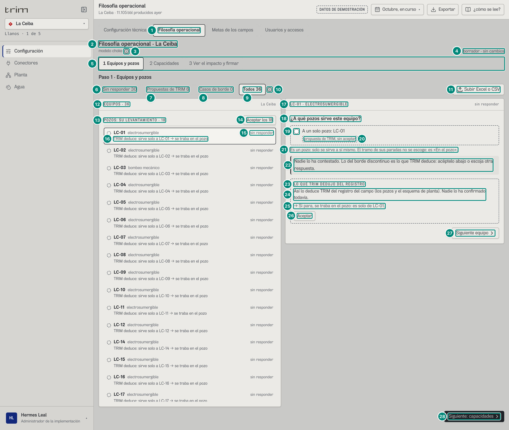

| # | Lo que se ve | En la captura | Cómo se calcula | Texto según el valor | Viene de |
|---|---|---|---|---|---|
| 1 | Pestaña | «Filosofía operacional» (seleccionada) | la dirección `…/filosofia/…` la abre (`src/pages/Configuracion.tsx:66`); tocarla cambia de pantalla, no de estado (`:67-71`) | orden por rol (`:60-61`): con `config:firmar`, «Configuración técnica · Filosofía operacional · Metas de los campos · Usuarios y accesos»; ingeniería sin firma, «Filosofía operacional · Configuración técnica · Metas de los campos» (captura 13); el gerente, sin esta pestaña | rol (sesión) |
| 2 | Título | «Filosofía operacional · La Ceiba» | el campo de la cabecera (`Filosofia.tsx:74`) | — | ruta |
| 3 | Rótulo secundario | «modelo choke» ⓘ | fijo: uno de los tres lugares donde se dice «choke» (U2 §1.3) | ⓘ «Modelo choke: Es un método internacional para ubicar dónde se pierde producción: lo publicó BP en 1996 (artículo SPE-36848), lo usa el regulador británico (NSTA) y la ANH lo adoptó en 2026 (Circulares 003 y 024). No es la válvula choke de la cabeza del pozo (Circular 024, p. 4).» (`Filosofia.tsx:16`, `:76`) | — |
| 4 | Estado del borrador | «borrador · sin cambios» | `cambios` = renglones de `diferenciasPorGrupo(vigente, propuesta)`, de todas las pestañas (`Configuracion.tsx:225-226`) | «sin cambios» o `plural(n, 'cambio sin firmar', 'cambios sin firmar')` (`Filosofia.tsx:79`). La topología nueva de un campo es **un** cambio: con K-101 contestado, «borrador · 1 cambio sin firmar» (capturas 6 y 7) | borrador contra `GET /api/configuracion/historial` |
| 5 | Los tres pasos | «1 Equipos y pozos · 2 Capacidades · 3 Ver el impacto y firmar» | `PASOS` (`Filosofia.tsx:19`); el paso vive fuera del editor (`Configuracion.tsx:72-73`): al firmar no se pierde | el puesto, con borde oscuro y `aria-current="step"`; se puede ir a cualquiera en cualquier orden (U2 §8.1); el foco va a «Paso N · …» (`Filosofia.tsx:61-66`, `:101-103`) | — |
| 6 | Filtro | «Sin responder 30» | equipos sin contestar, sin firmar y **sin** propuesta de TRIM (`estado`, `src/widgets/configuracion/TopologiaPaso.tsx:79`; `enFiltro`, `:46-47`): 36 − 6 = 30 (los 18 pozos, C-401, el manifold, el depurador, la tea, TK-102, TK-101, el tanque de agua, P-201A, P-201C, los inyectores, el gas a venta y el oleoducto) | el puesto lleva borde oscuro (`aria-pressed`); cambiarlo vuelve al primer equipo del filtro (`:141`); «Ver lo que falta» del paso 3 abre aquí (fila 77) | el front cuenta sobre `GET /api/vistas/topologia` y `…/propuestas` |
| 7 | Filtro | «Propuestas de TRIM 6» | sin contestar y con al menos una propuesta: SE-2 (el alimentador de los pozos y el registro), K-101 (las cascadas y el registro), V-101 (el registro, en conflicto), H-302 (las cascadas), LACT-01 (el registro) y P-201B (los pozos que mueve la bomba) (`propuestasTopologia`, `choke.ts:466-512`) → 5E §1 | — | `Propuestas[].elemento` |
| 8 | Filtro | «Casos de borde 0» | equipos con `casoBorde` (`TopologiaPaso.tsx:86`): compartidos por 2 o 3 pozos de una misma locación (`casoBordeDe`, `choke.ts:269-274`); el demo no trae la locación de los pozos de La Ceiba | Morichal: 1, MPP-301 (captura 4) | `elementos[].casoBorde`, `Propuestas[].casoBorde` |
| 9 | Filtro | «Todos 36» | los 18 pozos y los 18 equipos de la planta y sus salidas: la topología que TRIM deriva del registro (`topologiaDerivada`, `choke.ts:330-365`) más lo propuesto, lo «por saber» y lo nuevo (`TopologiaPaso.tsx:69`) | la página abre en «Todos» (`Filosofia.tsx:110`) | `elementos`, `porSaber`, `sinResponder` |
| 10 | ⓘ de los filtros | (globo) | — | «Sin responder y propuestas de TRIM: Sin responder: nadie lo ha contestado y TRIM solo lo deduce del registro del campo (los pozos y el esquema de planta). Propuesta de TRIM: nadie lo ha contestado, pero TRIM tiene además una prueba propia (las caídas en cascada, el alimentador, la bomba o el registro del equipo) y le pide que la acepte. En los dos casos, «Aceptar» lo pasa al borrador y queda firmado cuando se firma la versión.» (`EXPLICA_FILTROS`, `src/widgets/configuracion/topologia.ts:14`; B-49) | — |
| 11 | Carga masiva | «Subir Excel o CSV» | abre y cierra el panel de la carga (captura 10) | solo con `config:firmar` (`TopologiaPaso.tsx:151-155`) | — |
| 12 | Lista | «EQUIPOS · 36» · «La Ceiba» | todos los equipos del campo, no los del filtro (`:204`) | — | — |
| 13 | Un tipo de equipo | «POZOS: SU LEVANTAMIENTO · 18» | la clase de cada equipo, en el orden de `ORDEN_GRUPO` (`topologia.ts:44-46`); el número cuenta lo que se ve en el filtro (`TopologiaPaso.tsx:133`, `:210`). En La Ceiba, con «Todos»: POZOS: SU LEVANTAMIENTO · 18, SERVICIOS DEL CAMPO · 3 (C-401, SE-2, K-101), PROCESO · 5 (manifold, V-101, depurador, tea, H-302), TANQUES · 3 (TK-102, TK-101, tanque de agua), MEDICIÓN Y DESPACHO · 1 (LACT-01), BOMBAS · 3 (P-201A, P-201B, P-201C), POZOS INYECTORES · 1 y SALIDAS DE LA BATERÍA · 2 (gas a venta, oleoducto) | nombres de `GRUPO` (`topologia.ts:39-43`); también «Pozos que fluyen solos» (los 9 de La Zarza) y «Alimentadores eléctricos»; un tipo sin equipos en el filtro no sale | `elementos[].clase` |
| 14 | Aceptar en lote | «Aceptar los 18» | los `aceptables` del tipo: con algo que TRIM ya tiene, sin conflicto, y sin responder o propuesta (`aceptable`, `TopologiaPaso.tsx:59`); cada uno pasa al borrador con la respuesta que corresponde a lo que rige (`respuestaDe`, `choke-config.ts:93-98`; `TopologiaPaso.tsx:125-128`) | «Aceptar el que falta» o «Aceptar los N» (`:214`); el lector oye «Aceptar lo que TRIM dedujo para 18 equipos de «Pozos: su levantamiento»» (`:213`). Solo dentro de un tipo (U2 §8.3); lo que tiene dos fuentes que no cuadran no entra (fila 31). Dentro de un filtro cuenta también lo que no se ve: 6D·H35 | — |
| 15 | Estado del renglón | ◌ «sin responder» | `estado` (`TopologiaPaso.tsx:79`): contestado → «en el borrador»; topología firmada o «Todavía no sé» firmado → «firmado»; con propuesta → «propuesta de TRIM»; si no, «sin responder» (`NOMBRE_ESTADO`, `topologia.ts:18-23`) | con conflicto dice «dos fuentes no cuadran» (`:254`). Las marcas son grises y con forma (`src/widgets/configuracion/marcas.tsx:27-42`): círculo punteado, sin responder; «?», propuesta; visto en un cuadro, en el borrador; visto, firmado | — |
| 16 | Lo que TRIM deduce | «TRIM deduce: sirve solo a LC-01 → se traba en el pozo» | `renglonDe(queda, respuesta, todos)` (`choke-config.ts:117-127`): dedicado, «sirve solo a {pozo}»; todos los pozos, «sirve a todo el campo (18 pozos)»; 2 o 3, «sirve a MN-07, MN-18 y MN-33»; más, «sirve a N pozos»; tercero, «de otro dueño, más allá de la batería»; frontera, «punto de entrega»; acometida, «llegada de la energía (N pozos)»; y «→ se traba en el pozo / en la planta / afuera» (`dondeCorto`) → 5E §1 | «TRIM deduce: » solo si nadie lo contestó (sin responder o propuesta: B-49, `TopologiaPaso.tsx:258`); contestado o firmado, sin prefijo («sirve solo a LC-11 → se traba en el pozo»). Sin elemento: «todavía no se sabe: sus paradas quedan sin tramo hasta que se diga» o «sin responder: el tramo de sus paradas sale de la regla por tipo de falla» | `elementos[].alcance`, `pozos` |
| 17 | La pregunta de un equipo | «LC-01 · ELECTROSUMERGIBLE» · «sin responder» | el tag y lo que dice el registro, en mayúsculas; sin tag, solo el nombre («MANIFOLD DE PRODUCCIÓN», `esClaveInterna`, `topologia.ts:11`; B-29) (`TopologiaPaso.tsx:335-338`) | el extra: el estado, o «dos fuentes no cuadran» | `elementos[].nombre` |
| 18 | La pregunta | «¿A qué pozos sirve este equipo?» | una sola pregunta por equipo (U2 §8.2) | — | — |
| 19 | La única respuesta de un pozo | ○ «A un solo pozo: LC-01» | un pozo solo se sirve a sí mismo: su única respuesta es él (`TopologiaPaso.tsx:311-313`, `:352`; C-13) | nada marcado: nadie lo contestó (B-49). La firma rechaza un pozo que sirve a otro («Topología {pozo}: es un pozo, así que solo se sirve a sí mismo…», `src/entities/configuracion.ts:500`) | — |
| 20 | Lo que TRIM deduce, sin aceptar | «propuesta de TRIM, sin aceptar» (borde discontinuo) | la respuesta que corresponde a lo que TRIM tiene (`sugerida`, `TopologiaPaso.tsx:305`, `:344`), solo si nadie la contestó ni está firmada | gris discontinuo con la palabra, nunca marcada (B-49; `:354-358`); con «A un solo pozo» o «A varios pozos» de un equipo que no es pozo dice los pozos («: MN-07, MN-18, MN-33», o «N pozos» si son más de 3; captura 4) | `elementos`, `Propuestas` |
| 21 | Un pozo | «Es un pozo: solo se sirve a sí mismo. El tramo de sus paradas no se escoge: es «En el pozo».» | `propio` (`TopologiaPaso.tsx:386`; C-13) | solo en los pozos del campo | catálogo |
| 22 | Lo que dice al instante | «Nadie lo ha contestado. Lo del borde discontinuo es lo que TRIM deduce: acéptelo abajo o escoja otra respuesta.» | renglón `aria-live` (`:389-395`) | contestado: «→ » y la frase de la fila 25; sin nada que TRIM tenga: «Nadie lo ha contestado: sin responder: el tramo de sus paradas sale de la regla por tipo de falla.»; «A varios pozos» con menos de dos: «Escoja al menos dos pozos. Si sirve a uno solo, es «A un solo pozo».». Quien solo lee recibe la misma instrucción: 6D·H34 | — |
| 23 | Lo que TRIM tiene | «LO QUE TRIM DEDUJO DEL REGISTRO» (borde discontinuo) | `candidatosDe` (`:446-462`): lo que rige y cada propuesta; las que dicen lo mismo van en un bloque | título (`:476-478`): con propuestas, «PROPUESTA DE TRIM» (fondo gris, captura 2); lo firmado, «LO QUE ESTÁ FIRMADO»; si no, este | `elementos`, `Propuestas` |
| 24 | El porqué | «Así lo deduce TRIM del registro del campo (los pozos y el esquema de planta). Nadie lo ha confirmado todavía.» | lo que rige sin firmar (`:480`) | firmado: «Así está firmado en la versión vigente.»; un equipo nuevo del registro que la firma no trae: «Es un equipo nuevo del registro que la versión firmada no trae: así lo deduce TRIM. Mientras nadie lo conteste, sus paradas toman el tramo de la regla por tipo de falla.» (`:481`) | `sinResponder` |
| 25 | La frase | «→ Si para, se traba en el pozo: es solo de LC-01.» | `fraseDe(r, elemento, todos)` (`choke-config.ts:104-112`): «Si para, se traba » + el tramo en palabras (`NOMBRE_CHOKE`, `choke.ts:125-130`) + «: es solo de {pozo}», «: sirve a los N pozos» (todos) o «: sirve a N pozos» → 5E §1 | afuera: «Si para, se traba afuera.»; acometida: «Si para, se traba en la planta o estación. Quién respondió (el proveedor o nosotros) se pregunta en cada parada.»; «Todavía no sé»: «Mientras no se sepa, TRIM no adivina: sus paradas quedan sin tramo y en Identificar cada una pregunta «¿Dónde se originó la parada: en el pozo, en la planta o afuera?».» (`PREGUNTA_ORIGEN`, `choke.ts:431`) | — |
| 26 | Aceptar | «Aceptar» | pasa esa respuesta al borrador (`contestar`, `TopologiaPaso.tsx:316-325`, `:493`) | no sale en lo firmado ni a quien solo lee; el lector oye «Aceptar para LC-01: Si para, se traba en el pozo: es solo de LC-01.» | nada se escribe hasta firmar |
| 27 | Siguiente equipo | «Siguiente equipo» | el siguiente de los que se ven en el filtro, en el orden de la lista; del último vuelve al primero (`mover`, `:119-123`; `:420-424`) | en el escritorio y con más de uno a la vista; en el teléfono va abajo (captura 11) | — |
| 28 | Siguiente paso | «Siguiente: capacidades» | `ir(paso + 1)` (`Filosofia.tsx:122-128`) | paso 2: «Volver a equipos y pozos» y «Siguiente: ver el impacto y firmar»; paso 3: solo «Volver a capacidades» | — |

### Captura 2 · un equipo compartido con propuesta de TRIM: K-101, con sus caídas

Se tocó el renglón de K-101 y «Ver las 6 caídas». La lista se desplaza sola hasta el equipo escogido (`TopologiaPaso.tsx:240-244`).

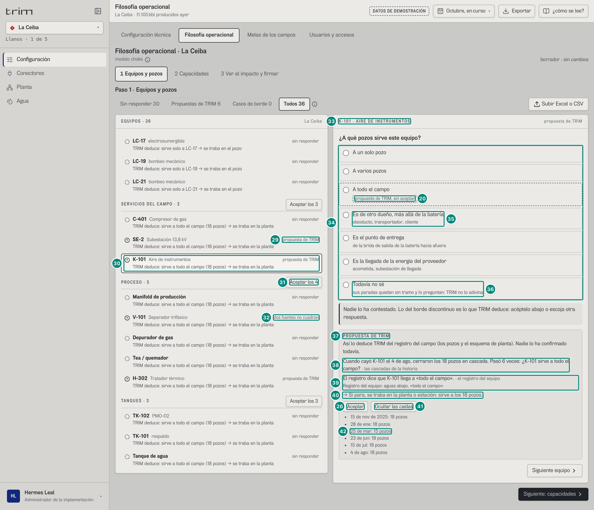

| # | Lo que se ve | En la captura | Cómo se calcula | Texto según el valor | Viene de |
|---|---|---|---|---|---|
| 29 | Una propuesta en la lista | «?» SE-2 «propuesta de TRIM» | `estado = propuesta` (fila 15) | SE-2 trae dos: «Los 18 pozos cuelgan de SE-2: ¿SE-2 sirve a todo el campo?» (el alimentador) y «El registro dice que SE-2 llega a «todo el campo».» | `Propuestas[elemento=SE-2]` |
| 30 | El equipo escogido | K-101 «Aire de instrumentos» · «propuesta de TRIM» · «TRIM deduce: sirve a todo el campo (18 pozos) → se traba en la planta» (borde oscuro) | `actual` (`TopologiaPaso.tsx:117`): el renglón del ejemplo de U2 §8.2 | «Aire de instrumentos» es el nombre del esquema de planta; el paso 3 lo llama «Sistema de aire de instrumentos»: 6D·H37 | `elementos[elemento=K-101]` |
| 31 | Un tipo con un conflicto | «PROCESO · 5» y «Aceptar los 4» | V-101 no entra en el lote: `aceptable` pide que no haya conflicto (`:59`) | lo que no cuadra lo decide una persona (U2 §8.3) | — |
| 32 | Dos fuentes que no cuadran | V-101 «dos fuentes no cuadran» | una propuesta con `conflicto` (`:77`, `:254`) | la marca sigue siendo la de la propuesta («?»); la pregunta, en la captura 3 | `Propuestas[].conflicto` |
| 33 | La pregunta de K-101 | «K-101 · AIRE DE INSTRUMENTOS» · «propuesta de TRIM» | fila 17 | — | — |
| 34 | Las siete respuestas | «A un solo pozo · A varios pozos · A todo el campo · Es de otro dueño, más allá de la batería · Es el punto de entrega · Es la llegada de la energía del proveedor · Todavía no sé» | `RESPUESTAS_TOPOLOGIA` (`choke-config.ts:41-42`) con los textos de `BOTON` (`topologia.ts:27-35`; U2 §8.2). Lo que TRIM deduce de cada una (`elementoDeRespuesta`, `choke-config.ts:79-88`): un pozo → dedicado → pozo; dos o más, todo el campo o la acometida → compartido → planta; otro dueño → tercero → afuera; el punto de entrega → frontera → afuera; «Todavía no sé» → sin elemento, por saber (`Config.topologiaPorSaber`) → 5E §1 | «A un solo pozo» abre «El pozo», una lista con los 18 (empieza en LC-01); «A varios pozos», las casillas «Los pozos a los que sirve K-101 · N escogidos», y pasa al borrador desde dos (`TopologiaPaso.tsx:314`, `:361-381`); lo demás pasa al tocarlo. Contestado: «En el borrador: falta firmar (paso 3).» y «Volver a lo que regía» (`:397-404`) | — |
| 20 | Lo que TRIM deduce, sin aceptar | «A todo el campo» con «propuesta de TRIM, sin aceptar» | `respuestaDe` de lo que rige: los 18 pozos → «todos» | fila 20 | — |
| 35 | Una aclaración | «Es de otro dueño, más allá de la batería» · «oleoducto, transportador, cliente» | `BOTON.tercero` | las aclaraciones van en un segundo renglón, también en el teléfono | — |
| 36 | Todavía no sé | «Todavía no sé» · «sus paradas quedan sin tramo y lo preguntan: TRIM no lo adivina» | firmado así, el motor no le pone a sus paradas el tramo de la regla por tipo de falla: el paso 2 del árbol queda en falta con la pregunta de origen (`porSaberDe`, `choke.ts:431-439`) → 5E §3 | en el historial: «Topología: K-101 (La Ceiba): todavía no se sabe a qué pozos sirve; el tramo de sus paradas queda en falta hasta que se diga» (`configuracion.ts:423`) | — |
| 37 | Lo que TRIM propone | «PROPUESTA DE TRIM» | lo que rige (los 18) y las dos propuestas de K-101 dicen lo mismo: van en un solo bloque (`candidatosDe`, `TopologiaPaso.tsx:446-462`) | fondo gris (con propuestas) | `Propuestas` |
| 38 | Las cascadas | «Cuando cayó K-101 el 4 de ago, cerraron los 18 pozos en cascada. Pasó 6 veces: ¿K-101 sirve a todo el campo?» · «las cascadas de la historia» | por cada caída del servicio, los pozos que cerró (`tramosDeEvento`); la última, cuántas veces y la unión de todos (`choke.ts:485-498`): la unión es de los 18 → «todo el campo» | «los 18 pozos» si fueron todos, si no «N pozos»; con una unión parcial, «¿… sirve a esos N?» y un conflicto si es menor de lo que la topología le supone (`:495-497`; en Morichal, C-401: 6D·H38). La fuente en palabras: `FUENTE` (`TopologiaPaso.tsx:50-53`) | `Propuestas[fuente=cascadas].porque` |
| 39 | El registro | «El registro dice que K-101 llega a «todo el campo».» · «el registro del equipo» · «Registro del equipo: aguas abajo, «todo el campo»» | `aguasAbajo` del registro del equipo (`choke.ts:500-510`) | la evidencia va debajo, salvo la de las cascadas, que va en su lista (`TopologiaPaso.tsx:485`) | `Propuestas[fuente=registro]` |
| 40 | La frase | «→ Si para, se traba en la planta o estación: sirve a los 18 pozos.» | fila 25, compartido con los 18 | — | — |
| 41 | Las caídas | «Ocultar las caídas» (antes, «Ver las 6 caídas») | con más de una caída (`:494-500`) | con una sola, va escrita debajo (`:501`) | `Propuestas[fuente=cascadas].evidencia` |
| 42 | Una caída | «25 de mar: 15 pozos»; las otras cinco, de 18 pozos: 15 de nov de 2025, 28 de ene, 23 de jun, 15 de jul y 4 de ago | `fechaCorta(inicio)`: los pozos que cerró esa caída | — | ídem |
| 26 | Aceptar | «Aceptar» | pasa «A todo el campo» al borrador | fila 26 | — |

### Captura 3 · dos fuentes que no cuadran: V-101

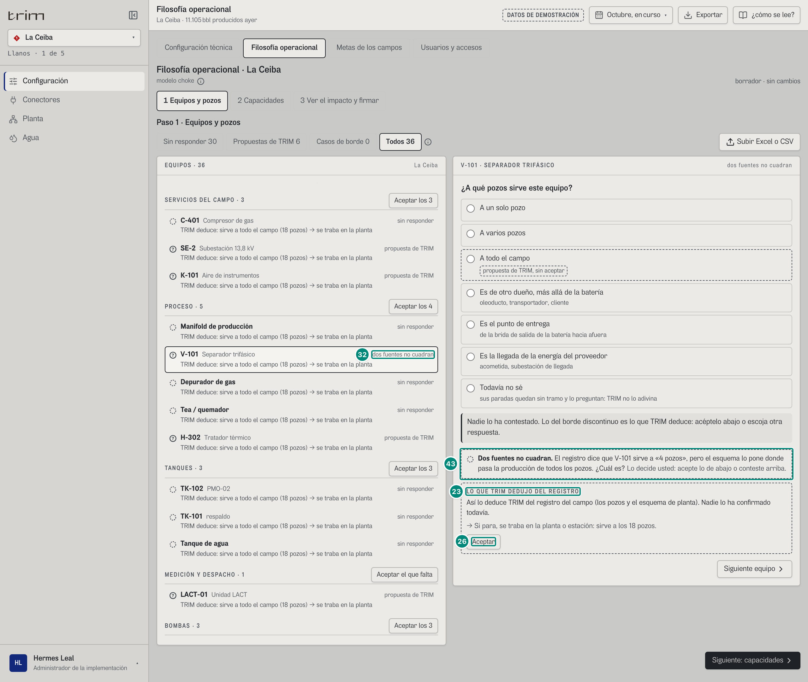

| # | Lo que se ve | En la captura | Cómo se calcula | Texto según el valor | Viene de |
|---|---|---|---|---|---|
| 32 | En la lista | V-101 «dos fuentes no cuadran» | fila 32 | — | — |
| 43 | Lo que no cuadra | ◌ «Dos fuentes no cuadran. El registro dice que V-101 sirve a «4 pozos», pero el esquema lo pone donde pasa la producción de todos los pozos. ¿Cuál es? Lo decide usted: acepte lo de abajo o conteste arriba.» | una propuesta sin pozos es un conflicto (`TopologiaPaso.tsx:457`, `:408-413`): el registro dice «4 pozos» y el esquema le pasa los 18 (`choke.ts:504-509`; U2 §8.3) → 5E §1 | círculo gris punteado («Falta decidir») y la palabra; abajo solo queda «LO QUE TRIM DEDUJO DEL REGISTRO» (los 18), con su «Aceptar»; no entra en ningún lote (fila 31; `:291`) | `Propuestas[elemento=V-101].conflicto` |
| 23 | Lo que TRIM tiene | «LO QUE TRIM DEDUJO DEL REGISTRO» | fila 23: la única respuesta que TRIM puede dar | — | — |
| 26 | Aceptar | «Aceptar» | la única forma de pasar V-101 al borrador sin contestar arriba | — | — |

### Captura 4 · el caso de borde del demo: MPP-301 en Morichal Norte

`#/adm/filosofia/morichal/curso` con el filtro «Casos de borde». Morichal tiene 65 equipos: «Sin responder 58 · Propuestas de TRIM 7 · Casos de borde 1 · Todos 65» (41 pozos; SERVICIOS DEL CAMPO · 3, PROCESO · 5, TANQUES · 4, MEDICIÓN Y DESPACHO · 1, BOMBAS · 8, POZOS INYECTORES · 1, SALIDAS DE LA BATERÍA · 2). El caso de U2 §8.6 es un transformador; el demo no tiene transformadores de pozo, y el único equipo con la locación de sus pozos es la bomba multifásica del clúster norte (`src/entities/datos/topologia.ts:19-21`).

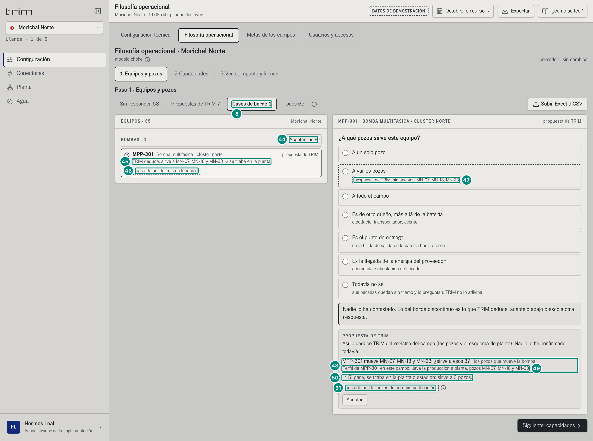

| # | Lo que se ve | En la captura | Cómo se calcula | Texto según el valor | Viene de |
|---|---|---|---|---|---|
| 8 | Filtro | «Casos de borde 1» (puesto) | fila 8 | — | — |
| 44 | El lote en un filtro | «BOMBAS · 1» y «Aceptar los 8» | el encabezado cuenta lo que se ve (MPP-301); el lote, los aceptables del tipo: MPP-301 y P-201A a P-201G (`TopologiaPaso.tsx:133`, `:211-216`) | acepta también los siete que el filtro esconde: 6D·H35 | — |
| 45 | Lo que TRIM deduce | «TRIM deduce: sirve a MN-07, MN-18 y MN-33 → se traba en la planta» | `renglonDe` con 3 pozos (fila 16) | — | `elementos[elemento=MPP-301].pozos` |
| 46 | La etiqueta en la lista | «caso de borde: misma locación» | `casoBorde = 'misma-locacion'`: compartido por 2 o 3 pozos con la misma locación (`casoBordeDe`, `choke.ts:269-274`); MN-07, MN-18 y MN-33 son del «Clúster norte» | gris discontinuo, nunca una alarma (`TopologiaPaso.tsx:261`) | `elementos[].casoBorde` |
| 47 | Lo que TRIM deduce, sin aceptar | «A varios pozos» · «propuesta de TRIM, sin aceptar: MN-07, MN-18, MN-33» | fila 20 con los pozos | — | — |
| 48 | La propuesta | «MPP-301 mueve MN-07, MN-18 y MN-33: ¿sirve a esos 3?» · «los pozos que mueve la bomba» | el perfil de la bomba en el campo (`choke.ts:477-483`) | una bomba de agua, sin pozos en su perfil: «P-201B saca el agua de los 41 pozos: ¿sirve a todo el campo?» (en La Ceiba, «de los 18 pozos») | `Propuestas[fuente=bomba]` |
| 49 | La evidencia | «Perfil de MPP-301 en este campo: lleva la producción a planta, pozos MN-07, MN-18 y MN-33» | ídem | — | ídem |
| 50 | La frase | «→ Si para, se traba en la planta o estación: sirve a 3 pozos.» | sirve a varios → compartido → planta, aunque sean de una misma locación | — | — |
| 51 | El caso de borde | «caso de borde: pozos de una misma locación» ⓘ | `EXPLICA_CASO_BORDE` (`choke.ts:260`; `TopologiaPaso.tsx:507-514`) | ⓘ «Caso de borde: Falta confirmar con la operadora si un transformador que alimenta 2 o 3 pozos de una misma locación va al pozo o a la planta. Hoy va a la planta, porque sirve a varios. Si la regla cambia, todos los equipos con esta etiqueta cambian juntos, con vista previa y firma.»; contestado, sale también debajo de la frase de arriba (`:396`). El administrador no puede escoger «pozo» para este equipo (U2 §8.6, punto 4); en la carga por CSV avisa sin bloquear (`choke-config.ts:409-410`) | locación de los pozos (sin endpoint) |

### Captura 5 · paso 2 «Capacidades», La Ceiba

Lo que deja pasar cada tramo por día, con su fuente (U2 §8.4), y el factor de medición con que se leen las pruebas de los pozos (QA-D3; 5E·H9). Hoy nada está firmado: rigen los datos del demo y el factor 1, y se dice. Lo que se escribe va al borrador (`Config.capacidades`) y se firma en el paso 3; la revisión corre mientras se escribe con las mismas reglas del servidor (`revisarCapacidades`, `src/entities/capacidades.ts:350-413`).

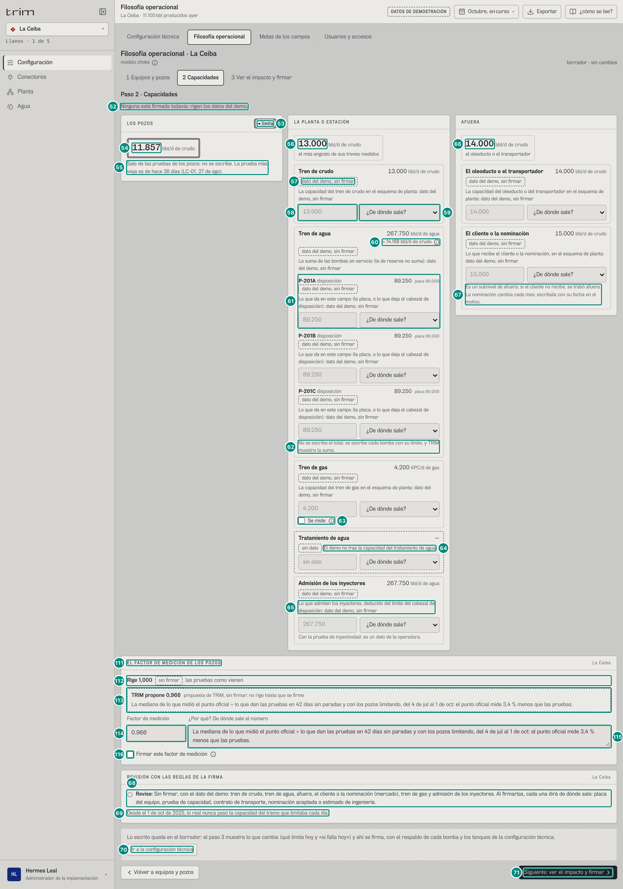

| # | Lo que se ve | En la captura | Cómo se calcula | Texto según el valor | Viene de |
|---|---|---|---|---|---|
| 52 | Quién firmó | «Ninguna está firmada todavía: rigen los datos del demo.» | sin `firma` (`CapacidadesPaso.tsx:81-85`) | firmadas: «Las que rigen se firmaron en la versión N el {fecha y hora} por {quién}.» (la versión desde la que rigen, `firmaDeCapacidades`, `capacidades.ts:222-231`) | `VistaCapacidades.firma` |
| 53 | Lo que limita | LOS POZOS «◄ limita» | el tramo que limita hoy → 5E §2 | doble contorno gris, nunca rojo (`marcas.tsx:55-61`; U2 §0) | `TuberiaCampo.tramos[].limita` |
| 54 | Los pozos | «11.857» bbl/d de crudo (doble contorno) | lo que dan los pozos según sus pruebas: 11.857 → 5E §2 | no se escribe | `entrada.pozosBpd` |
| 55 | De dónde sale | «Sale de las pruebas de los pozos: no se escribe. La prueba más vieja es de hace 36 días (LC-01, 27 de ago).» | la prueba más vieja de los pozos: del 27 de ago al 2 de oct, 36 días | sin pruebas viejas, solo la primera frase (`:100`) | `tramos[pozo].pruebaMasVieja.texto` |
| 56 | La planta | «13.000» bbl/d de crudo · «el más angosto de sus trenes medidos» | el menor de los trenes medidos, en crudo (`trenMenor`, `capacidades.ts:288-289`): crudo 13.000; agua ≈ 14.168 (fila 60); el gas no se mide en La Ceiba y no entra → 5E §2 | sin dato: «sin dato» en gris discontinuo (`CapacidadesPaso.tsx:266-274`; La Zarza, en «Estados») | `tramos[planta].potencialBpd` |
| 57 | Tren de crudo | «13.000 bbl/d de crudo» · «dato del demo, sin firmar» · «La capacidad del tren de crudo en el esquema de planta: dato del demo, sin firmar» | `capacidadesDe` (`capacidades.ts:170-217`): firmado → chip «firmado» y «{fuente} · firmada»; del demo → etiqueta discontinua; sin dato → «sin dato» | el 13.000 se subió a mano en el demo el 21-oct, desde 12.000 (el número de U2 §8.4), para que no fuera menor que lo que ya pasó (CONTRATO.md, «Las capacidades de los tramos firmadas») | `vigentes.crudo` |
| 58 | La cifra | caja vacía con «13.000» de guía | vacía, rige lo de arriba; lo escrito va al borrador con la fuente (`CapacidadesPaso.tsx:345-366`) | solo con `config:firmar`; paso de 100 | — |
| 59 | La fuente | «¿De dónde sale?» | Placa del equipo · Prueba de capacidad · Contrato de transporte · Nominación aceptada · Estimado de ingeniería (`FUENTES_CAPACIDAD`, `capacidades.ts:40-45`) | obligatoria al firmar (fila 73) | — |
| 60 | El agua en crudo | «≈ 14.168 bbl/d de crudo» ⓘ | el tren de agua pasado a crudo con la relación crudo/agua de las pruebas: $267.750 \times 11.857 / 224.075 = 14.168$ (`trenesDePlanta`, `capacidades.ts:272-285`) | ⓘ «En crudo: El paso a crudo nunca se escribe: TRIM lo calcula con el corte de agua de las pruebas, que cambia todos los días.» (`CapacidadesPaso.tsx:294-299`) | `entrada.aguaPozosBpd` (224.075) |
| 61 | Una bomba del tren de agua | «P-201A disposición 89.250 · placa 90.000» | la cifra de la bomba en este campo (lo que deja el cabezal de disposición); la placa solo se lee. El tren = Σ de las bombas en servicio: $3 \times 89.250 = 267.750$; la de reserva no suma, y lo topan la admisión o el tratamiento si son menores (`capacidades.ts:197-206`) | «disposición», «recobro» o «de reserva: no suma» (Guacamayo, P-201C) (`CapacidadesPaso.tsx:334-335`) | `vigentes.bombas[]` |
| 62 | Cómo se escribe | «No se escribe el total: se escribe cada bomba con su límite, y TRIM muestra la suma.» | fijo (`:116`) | — | — |
| 63 | Tren de gas | «4.200 KPC/d de gas» · «Se mide» (sin marcar) ⓘ | `gas.medido` = no en La Ceiba: un tren sin medir no entra en el mínimo de la planta | ⓘ «Gas sin medir: Un tren de gas sin medir no entra en lo que limita: no se puede saber si es el más angosto.» (`:136`); sin tren de gas en el esquema: «Sin tren de gas en el esquema.» (El Palmar) | `vigentes.gas` |
| 64 | Tratamiento de agua | «—» · «sin dato» · «El demo no trae la capacidad del tratamiento de agua» (borde discontinuo) | `estado = sin-dato` | se puede escribir y firmar | `vigentes.tratamiento` |
| 65 | Admisión de los inyectores | «267.750 bbl/d de agua» · «Lo que admiten los inyectores, deducido del límite del cabezal de disposición: dato del demo, sin firmar» · «Con la prueba de inyectividad: es un dato de la operadora.» | el dato del demo (`capacidades.ts:187`) | — | `vigentes.admision` |
| 66 | Afuera | «14.000» bbl/d de crudo · «el oleoducto o el transportador» | la capacidad del oleoducto (14.000; abajo, con su fuente) → 5E §2 | — | `tramos[exportacion].potencialBpd` |
| 67 | El cliente | «El cliente o la nominación» · «15.000 bbl/d de crudo» · «Es un subnivel de afuera: si el cliente no recibe, se trabó afuera. La nominación cambia cada mes: escríbala con su fecha en el motivo.» | el mercado de la NSTA, dentro de afuera (nunca un quinto tramo) | — | `vigentes.mercado` |
| 68 | La revisión | ◌ «Revise: Sin firmar, con el dato del demo: tren de crudo, tren de agua, afuera, el cliente o la nominación (mercado), tren de gas y admisión de los inyectores. Al firmarlas, cada una dirá de dónde sale: placa del equipo, prueba de capacidad, contrato de transporte, nominación aceptada o estimado de ingeniería.» | la regla 4 de `revisarCapacidades` (`capacidades.ts:395-397`): lo que sigue del demo | lo que bloquea: ■ P3 y «Bloquea la firma:»; lo demás: el círculo gris discontinuo y «Revise:» (B-30, `CapacidadesPaso.tsx:372-379`); el morado no se usa aquí. Sin nada: «Todas cumplen las reglas de la firma.» | `VistaCapacidades.entrada` (la pantalla revisa) |
| 69 | Lo que ya pasó | «Desde el 1 de oct de 2025, lo real nunca pasó la capacidad del tramo que limitaba cada día.» | `superado` del reparto, desde el inicio de la historia hasta ahora (`CapacidadesPaso.tsx:44-45`, `:177-182`) | con días: «Por N días lo real pasó la capacidad del tramo que limitaba (…)», con hasta tres; no sale en un campo de gas ni sin esquema | `BrechaChoke.superado` |
| 70 | La configuración técnica | «Ir a la configuración técnica» | el respaldo de cada bomba y los tanques se firman allá (6A.4.5) | el renglón: «Lo escrito queda en el borrador: el paso 3 muestra lo que cambia (qué limita hoy y «si falla hoy») y ahí se firma, con el respaldo de cada bomba y los tanques de la configuración técnica.»; quien solo lee: «Las capacidades las escribe y las firma el administrador de la implementación.» (`:186-195`) | — |
| 71 | Seguir | «Siguiente: ver el impacto y firmar» (y «Volver a equipos y pozos») | fila 28 | — | — |
| 111 | El factor de medición | «EL FACTOR DE MEDICIÓN DE LOS POZOS» · «La Ceiba» | el número por el que se multiplican las pruebas para que digan lo que mide el punto oficial: con él se calculan lo que dan los pozos, lo que limita y la eficiencia → 5E §2 | con «¿cómo se lee?», «Las pruebas de los pozos se miden con el separador de prueba; lo real, con el punto de medición oficial. El factor de medición dice por cuánto hay que multiplicar las pruebas para que digan lo que mide el punto oficial. Con él se calcula lo que dan los pozos, lo que limita y la eficiencia de producción. Sin firma rige 1.» (`FactorMedicion`, `CapacidadesPaso.tsx:200-263`; en el paso, `:159-160`) | — |
| 112 | Lo que rige | «Rige 1,000» · «sin firmar» · «las pruebas como vienen» | sin firma, 1 (`FACTOR_MEDICION_SIN_FIRMA`): el motor no usa la propuesta | firmado: «Rige 0,998 · firmado en la versión 2 el 2 de oct, 14:00 por Hermes Leal · administrador de la implementación: «{porqué}»» (la versión desde la que rige, `firmaDeFactorMedicion`) | `vigentes.factorMedicion`, `firmaFactor` |
| 113 | Lo que propone TRIM | «TRIM propone 0,966» · «propuesta de TRIM, sin firmar: no rige hasta que se firme» · «La mediana de lo que midió el punto oficial ÷ lo que dan las pruebas en 42 días sin paradas y con los pozos limitando, del 4 de jul al 1 de oct: el punto oficial mide 3,4 % menos que las pruebas.» (borde discontinuo) | la mediana de lo real ÷ las pruebas en los días completos sin paradas y con los pozos limitando de los 90 antes de hoy (`factorMedicionPropuesto`, `src/entities/choke.ts:1161-1204`) → 5E §2 | con menos de 7 días: «TRIM no lo propone» y «En los 90 días antes de hoy (…) hubo N días sin paradas y con los pozos limitando: hacen falta 7 para proponer el factor de medición. Mientras no se firme, rige 1.»; en un campo de gas: «La Zarza es un campo de gas: la eficiencia de crudo no aplica y TRIM no propone el factor de medición.» | `factorMedicionPropuesto` |
| 114 | La cifra | «Factor de medición» · caja con **0.966** | prellenada con la propuesta; paso de 0,001, entre 0,5 y 1,5 | solo con `config:firmar` y fuera de un campo de gas; cambiarla la pone en la firma | — |
| 115 | El porqué | «¿Por qué? De dónde sale el número» · el texto de la propuesta | prellenado con `factorMedicionPropuesto.texto` | se puede reescribir: es el porqué de la firma (5 a 500 caracteres) | — |
| 116 | Firmarlo | ☐ «Firmar este factor de medición» ⓘ | sin marcar, el borrador no cambia («borrador · sin cambios»): prellenado no es firmado. Marcado (o cambiada la cifra o el porqué), `Config.capacidades[campo].factorMedicion = { valor, porque }` va al borrador y se firma en el paso 3 con lo demás | ⓘ «Firmar el factor: Marcado, el factor va en el borrador y se firma en el paso 3 con las capacidades. Sin marcar, rige el que ya está firmado o, sin firma, 1: TRIM no usa su propuesta sola.» | — |

### Captura 5b · el factor de medición en el borrador (El Palmar)

Se marcó «Firmar este factor de medición» y se escribió 1,02, lejos de lo que TRIM mide (0,998).

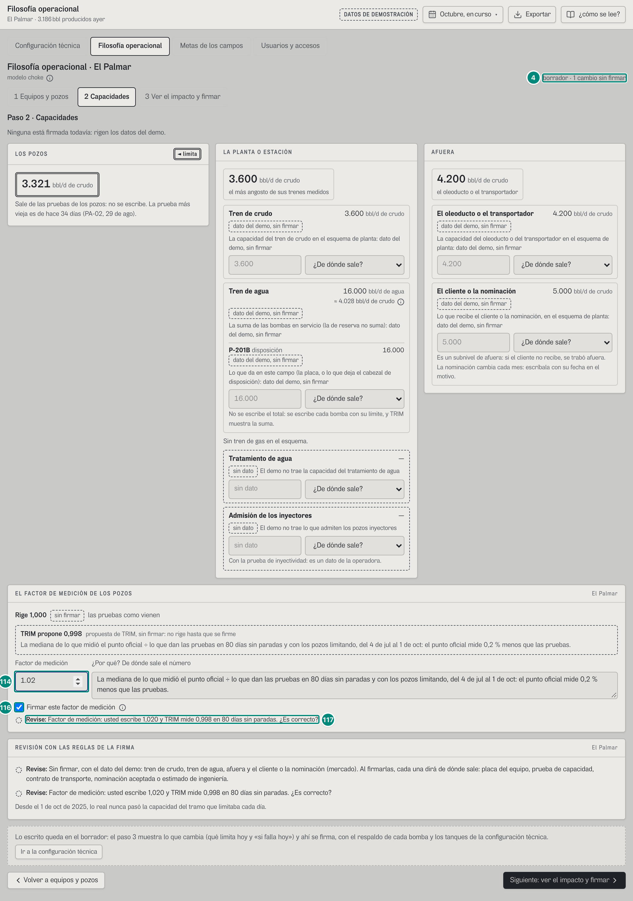

| # | Lo que se ve | En la captura | Cómo se calcula | Texto según el valor | Viene de |
|---|---|---|---|---|---|
| 4 | Estado del borrador | «borrador · 1 cambio sin firmar» | el factor ya está en `Config.capacidades` del borrador | el paso 3 lo dice: «Capacidades de El Palmar (se firman por primera vez): factor de medición 1,020 («{porqué}»)» (`diferenciasCapacidades`, `capacidades.ts:475-503`) | — |
| 116 | Firmarlo | ☑ «Firmar este factor de medición» | marcado | desmarcarlo lo quita del borrador; si ya estaba firmado, el historial dirá «factor de medición: se quitó el firmado (…); rige 1» | — |
| 114 | La cifra | «1.02» | lo escrito | — | — |
| 117 | La revisión | ◌ «Revise: Factor de medición: usted escribe 1,020 y TRIM mide 0,998 en 80 días sin paradas. ¿Es correcto?» | se aleja más de 0,02 de la propuesta (`DISTANCIA_FACTOR_PROPUESTO`): pide confirmar, sin bloquear (`revisarCapacidades`, `capacidades.ts:398-411`) | bloquea: fuera de 0,5–1,5 («Factor de medición: escriba un número entre 0,5 y 1,5 (1 es que las pruebas miden lo mismo que el punto oficial).»), sin porqué («… diga por qué, de dónde sale el número.») o en un campo de gas | `entrada.factorMedicionPropuesto` |

Firmado (motivo y «Firmar como Hermes Leal», como la captura 9), el panel dice «Rige 0,998 · firmado en la versión 2 …», los pozos de hoy se leen con él (El Palmar: 3.321 → 3.314 bbl/d) y la eficiencia de los días que vengan se puede creer; la de septiembre no cambia (6D.1, captura 5b). Lo prueba `e2e/correcciones-f4.spec.ts`.

### Captura 6 · paso 2 con un número que no se puede firmar

Se escribió 5.000 en el tren de crudo, sin fuente (lo mismo que la e2e `e2e/choke-configuracion.spec.ts`, capacidades).

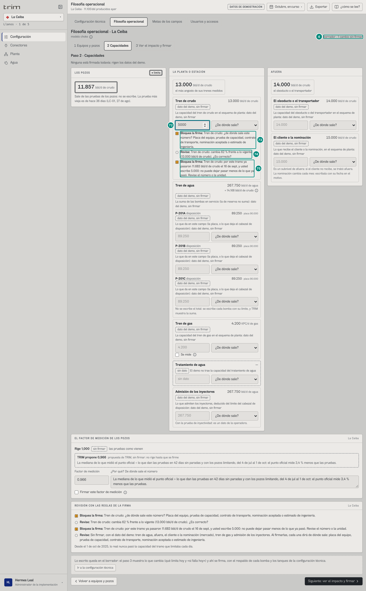

| # | Lo que se ve | En la captura | Cómo se calcula | Texto según el valor | Viene de |
|---|---|---|---|---|---|
| 4 | Estado del borrador | «borrador · 1 cambio sin firmar» | fila 4 | — | — |
| 72 | Lo escrito | «5000» | va al borrador como `{ bpd: 5000, fuente }` con la fuente que rige, que aquí no hay (`CapacidadesPaso.tsx:350-353`) | — | — |
| 73 | Sin fuente | ■ «Bloquea la firma: Tren de crudo: ¿de dónde sale este número? Placa del equipo, prueba de capacidad, contrato de transporte, nominación aceptada o estimado de ingeniería.» | regla 1 (`capacidades.ts:359-360`) | también bloquea «escriba un número mayor que cero (y menor de 10.000.000)» (`:357-358`) | — |
| 74 | Un cambio grande | ◌ «Revise: Tren de crudo: cambia 62 % frente a lo vigente (13.000 bbl/d de crudo). ¿Es correcto?» | $\lvert 5.000 - 13.000 \rvert / 13.000 = 61{,}5\ \%$, más del 20 % (`CAMBIO_GRANDE`, `capacidades.ts:295`, `:361-362`) | no bloquea: pide confirmar | — |
| 75 | Menos de lo que ya pasó | ■ «Bloquea la firma: Tren de crudo: por este tramo ya pasaron 11.683 bbl/d de crudo el 16 de sept, y usted escribe 5.000: no puede dejar pasar menos de lo que ya pasó. Revise el número o la unidad.» | lo máximo que pasó en un día completo por el punto oficial en los últimos 30 días (`maximoCrudoDiario`, `choke.ts:1520-1527`): 11.683 el 16 de sept; $5.000 < 11.683$ (regla 2, `capacidades.ts:373-381`); vale para el tren de crudo y afuera | con el dato del demo (nada escrito) no bloquea | `entrada.maximoCrudo` |

Las tres líneas se repiten en «REVISIÓN CON LAS REGLAS DE LA FIRMA», y el tren de crudo sale de la lista de lo que sigue del demo (fila 68). La firma solo dice el primero de los dos bloqueos: 6D·H14.

### Captura 7 · paso 3 «Ver el impacto y firmar», con un cambio de verdad: K-101 sirve solo a LC-11

El cambio de la e2e `choke-configuracion`: en el paso 1, K-101 «A un solo pozo» y LC-11 (un equipo de la planta: un pozo no puede servir a otro, C-13). Antes de firmar, TRIM pasa la versión nueva sobre los datos y dice lo que cambia (U2 §8.5).

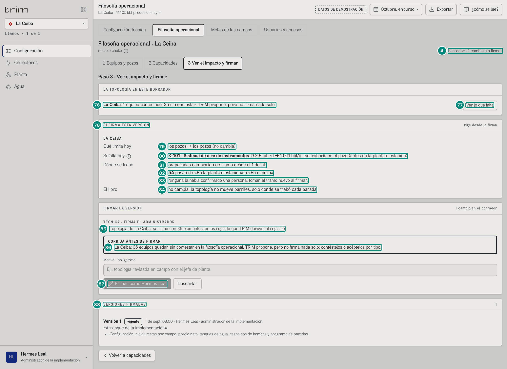

| # | Lo que se ve | En la captura | Cómo se calcula | Texto según el valor | Viene de |
|---|---|---|---|---|---|
| 4 | Estado del borrador | «borrador · 1 cambio sin firmar» | la topología nueva de La Ceiba es un renglón (fila 85) | — | — |
| 76 | La topología del borrador | «LA TOPOLOGÍA EN ESTE BORRADOR» · «La Ceiba: 1 equipo contestado, 35 sin contestar. TRIM propone, pero no firma nada solo.» | por campo con algo contestado: contestados = respuestas del borrador; sin contestar = `pendientesDe` ($36 - 1$; `choke-config.ts:172-175`) (`Filosofia.tsx:67`; `ImpactoPaso.tsx:66`, `:74-93`) | sin nada pendiente: «La Ceiba: N equipos contestados: la topología del campo queda completa.»; un campo con topología ya firmada no tiene pendientes | borrador |
| 77 | Ver lo que falta | «Ver lo que falta» | cambia al campo y abre el paso 1 en «Sin responder» (`Filosofia.tsx:59-66`, `:119`) | abre «Sin responder 30»: los 5 que son propuesta de TRIM quedan en «Propuestas de TRIM 5». 6D·H39 | — |
| 78 | La vista previa | «SI FIRMA ESTA VERSIÓN» · «rige desde la firma» | `previsualizarConfig(propuesta)` = `POST /api/configuracion/vista-previa { config, aunConErrores: true }` (`src/app/store.ts:254`; `ImpactoPaso.tsx:49-62`): las reglas de la firma sin firmar; una respuesta vieja no pisa a la nueva | sin cambios: «No hay cambios en el borrador: conteste en el paso 1, o cambie el respaldo o los tanques en la configuración técnica.»; mientras llega: «Calculando lo que cambia…»; un rechazo sin impacto (403, o un 422 que ni deja calcular): el texto del servidor (`:95-98`) | `RespuestaVistaPrevia.impacto` |
| 79 | Qué limita hoy | «Qué limita hoy» · «los pozos → los pozos (no cambia)» | `limitaAntes` → `limitaDespues`: lo que limita hoy con cada configuración (`potencialesDelCampo(…).dominante`, `choke-config.ts:247`) → 5E §2 | «(no cambia)» si son iguales; «sin tubería de crudo» si no hay (`ImpactoPaso.tsx:17`, `:128-129`) | `campos[].limitaAntes/limitaDespues` |
| 80 | Si falla hoy | «Si falla hoy» ⓘ · «K-101 · Sistema de aire de instrumentos: 9.394 bbl/d → 1.031 bbl/d · se trabaría en el pozo (antes en la planta o estación)» | solo los equipos cuyo «si falla hoy» o cuyo tramo cambian (`choke-config.ts:249-253`): hoy K-101 frenaría los 15 pozos que producen y dependen de él (9.394,2 bbl/d, un techo); sirviendo solo a LC-11, lo que da LC-11 (1.030,9) → 5E §7 | ⓘ «Si falla hoy: Cuántos barriles por día dejaría de dar el campo si ese equipo parara ahora, y dónde se trabaría. Solo salen los equipos que cambian.»; «· se trabaría … (antes …)» solo si cambia el tramo; sin cambios, «no cambia ningún equipo» (`ImpactoPaso.tsx:131-146`). No dice «hasta» aunque es un techo (6D·H15); el nombre es el del registro (6D·H37) | `campos[].criticidad[]` |
| 81 | Dónde se trabó | «Dónde se trabó» · «54 paradas cambiarían de tramo desde el 1 de jul:» | las filas del reporte de la ANH desde el primer día del tercer mes cerrado (1 de jul) cuyo tramo propuesto cambia con la versión nueva (`choke-config.ts:244`, `:259-268`): con K-101 dedicado a LC-11, sus paradas se traban «En el pozo» → 5E §3. Son 54 filas de **2 paradas** de K-101: 15 de jul (18 filas) y 4 de ago (36: 18 pozos en dos días) | «Una parada cambiaría» o «N paradas cambiarían»; sin cambios, «Ninguna parada cambia de tramo desde el 1 de jul.» (`ImpactoPaso.tsx:150-152`). Cuenta filas y las llama paradas: 6D·H13 | `campos[].paradasQueCambian.total` |
| 82 | Por tramo | «54 pasan de «En la planta o estación» a «En el pozo»» | `porTramo`, de mayor a menor | «pasa» o «pasan»; los tramos con las palabras de `NOMBRE_CHOKE` (`ImpactoPaso.tsx:19`, `:154-158`) → 5E §1 | `paradasQueCambian.porTramo[]` |
| 83 | Lo ya confirmado | «Ninguna la había confirmado una persona: toman el tramo nuevo al firmar.» | `confirmadas`: de esas, las que una persona ya dijo o confirmó en el paso 2 del árbol (`esDePersona`, `choke-config.ts:264-265`) | una: «La que ya confirmó una persona no cambia sola: queda «para revisar» en Identificar.»; varias: «Las N que ya confirmó una persona no cambian solas: quedan «para revisar» en Identificar.» (`ImpactoPaso.tsx:160-166`) → 5E §9 | `paradasQueCambian.confirmadas` |
| 84 | El libro | «El libro» · «no cambia: la topología no mueve barriles, solo dónde se trabó cada parada» | el último renglón de `texto` (`choke-config.ts:278`; `ImpactoPaso.tsx:123`, `:171`) | — | `campos[].texto` |
| 85 | Lo que se firma | «FIRMAR LA VERSIÓN» · «1 cambio en el borrador» · «TÉCNICA · FIRMA EL ADMINISTRADOR» · «Topología de La Ceiba: se firma con 36 elementos; antes regía la que TRIM deriva del registro» | `diferenciasPorGrupo` (`configuracion.ts:410`): la primera firma de la topología de un campo es un renglón, porque se firma entera (`conTopologia`, `choke-config.ts:143-165`) → 5D.2 §2 «Lo que cambió entre dos versiones» | con una topología ya firmada, un renglón por equipo que cambia: «Topología: K-101 (La Ceiba): {antes} → {después}; se traba en la planta → en el pozo» (`configuracion.ts:416`). Es el bloque de toda la configuración (6A.4.2) | — |
| 86 | Lo que falta | «CORRIJA ANTES DE FIRMAR» · «La Ceiba: 35 equipos quedan sin contestar en la filosofía operacional. TRIM propone, pero no firma nada solo: contéstelos o acéptelos por tipo.» | `faltanParaFirmar` (`choke-config.ts:177-182`), junto a `validarConfig` y las capacidades que bloquean (`Configuracion.tsx:229-232`) | «un equipo queda» / «N equipos quedan»; regla de la pantalla: al servidor le llega la topología entera | — |
| 87 | La firma | «Motivo · obligatorio» · «Firmar como Hermes Leal» (deshabilitado) · «Descartar» | deshabilitado mientras haya algo en «CORRIJA ANTES DE FIRMAR» (`Configuracion.tsx:290`) | sin motivo: «Falta el motivo: diga por qué cambia la filosofía operacional. Queda en el historial de versiones, con su firma.» y el foco a la caja (`:241-245`); de guía, «Ej.: topología revisada en campo con el jefe de planta» (`:285`); «Descartar» vuelve a la vigente y borra lo contestado (`:237`); sin nadie activo con el rol, «Nadie con acceso activo tiene este rol.» (6A.4.2) | `POST /api/configuracion { config, motivo, base }`: 409 si `base` ya no es la vigente («Mientras editaba se firmó la versión N (…). Descarte el borrador y vuelva a editar sobre ella.»), 403 sin `config:firmar` o con un campo ajeno, 422 por `validarConfig` (la topología es su regla 9 y las capacidades la 10 y la 11) (`src/shared/api/escrituras.ts:123-171`; 5D.2 §2) |
| 88 | Las versiones | «VERSIONES FIRMADAS» · «1» · «Versión 1» vigente · «1 de sept, 08:00 · Hermes Leal · administrador de la implementación» | el historial (6A.4.1, filas 17-19; 5D.2 §4) | — | `GET /api/configuracion/historial` |

### Captura 8 · el borrador con errores también muestra lo que cambiaría (B-53)

El tren de crudo de la captura 6 (5.000, sin fuente) y después el paso 3.

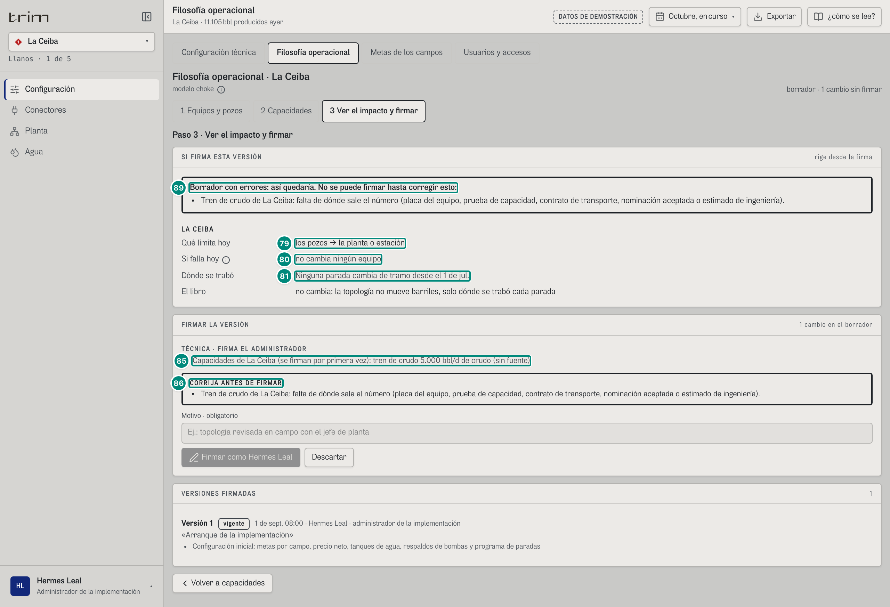

| # | Lo que se ve | En la captura | Cómo se calcula | Texto según el valor | Viene de |
|---|---|---|---|---|---|
| 89 | Borrador con errores | «Borrador con errores: así quedaría. No se puede firmar hasta corregir esto:» · «Tren de crudo de La Ceiba: falta de dónde sale el número (placa del equipo, prueba de capacidad, contrato de transporte, nominación aceptada o estimado de ingeniería).» | con `aunConErrores`, los 422 de `validarConfig` y de las capacidades no cortan la vista previa: responde 200 con `{ impacto, errores[] }` (`escrituras.ts:1291-1299`; CONTRATO.md); el error es de `validarCapacidades` (`capacidades.ts:425`) | borde grueso y `role="alert"` (`ImpactoPaso.tsx:99-104`). Las capacidades de lo que ya pasó solo se revisan cuando `validarConfig` no encuentra nada: aquí sale un error, y el paso 2 decía dos (6D·H14) | `RespuestaVistaPrevia.errores[]` |
| 79 | Qué limita hoy | «los pozos → la planta o estación» | con 5.000 en el tren de crudo, la planta sería el tramo más angosto (5.000 < 11.857) | — | — |
| 80 | Si falla hoy | «no cambia ningún equipo» | el tren de crudo no cambia «si falla hoy» de ningún equipo | — | — |
| 81 | Dónde se trabó | «Ninguna parada cambia de tramo desde el 1 de jul.» | las capacidades no mueven el tramo de las paradas | — | — |
| 85 | Lo que se firma | «Capacidades de La Ceiba (se firman por primera vez): tren de crudo 5.000 bbl/d de crudo (sin fuente)» | `diferenciasCapacidades` (`capacidades.ts:475-503`) | — | — |
| 86 | Lo que falta | «CORRIJA ANTES DE FIRMAR» con el mismo error | fila 86 | el botón de la firma queda deshabilitado | — |

### Captura 9 · después de firmar

Para firmar la topología de La Ceiba hay que contestar sus 36 equipos: K-101 a LC-11 (captura 7), «Aceptar» por tipo en los ocho tipos que quedan (18 + 2 + 4 + 3 + 1 + 3 + 1 + 2 = 34 equipos) y V-101 a mano (no entra en el lote); después, el motivo «Topología revisada en campo con el jefe de planta» y «Firmar como Hermes Leal».

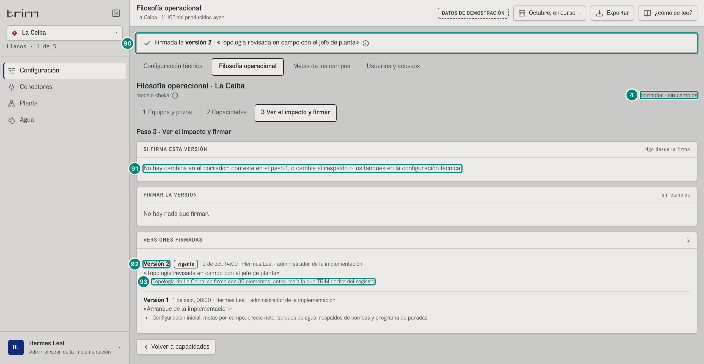

| # | Lo que se ve | En la captura | Cómo se calcula | Texto según el valor | Viene de |
|---|---|---|---|---|---|
| 90 | La firma | «✓ Firmada la versión 2 · «Topología revisada en campo con el jefe de planta»» ⓘ | hay más versiones que al entrar (`Configuracion.tsx:81-83`, `:99-105`) | ⓘ «Desde cuándo rige: Cada cambio rige desde la fecha que lleva; desde ahí las pantallas se miden contra él.» | `POST /api/configuracion` → `version` |
| 4 | Estado del borrador | «borrador · sin cambios» | el editor se rehace sobre la versión nueva (`key={versiones.length}`, `Configuracion.tsx:118`); el paso 3 sigue puesto | — | — |
| 91 | Sin cambios | «No hay cambios en el borrador: conteste en el paso 1, o cambie el respaldo o los tanques en la configuración técnica.» | fila 78 | — | — |
| 92 | La versión nueva | «Versión 2» · «vigente» · «2 de oct, 14:00 · Hermes Leal · administrador de la implementación» | `fecha` la pone el servidor (en el demo, la hora del PLC: `escrituras.ts:96`, `:166`); `por`, la persona y el rol de la sesión | — | `Version.fecha/por/motivo` |
| 93 | Lo firmado | «Topología de La Ceiba: se firma con 36 elementos; antes regía la que TRIM deriva del registro» | `Version.cambios` (fila 85) | — | `Version.cambios` |

Lo que queda después, en el paso 1: «Sin responder 0 · Propuestas de TRIM 0 · Casos de borde 0 · Todos 36»; cada renglón dice «firmado» con su visto, sin «TRIM deduce:» (K-101: «sirve solo a LC-11 → se traba en el pozo»). La pregunta de K-101 trae la respuesta marcada, «LO QUE ESTÁ FIRMADO» · «Así está firmado en la versión vigente.» y, aparte, la propuesta de TRIM de siempre («→ Si para, se traba en la planta o estación: sirve a los 18 pozos.») con su «Aceptar»: volver a ella es otro cambio y otra firma. Desde ahí la topología de La Ceiba es la firmada (`topologiaFirmada`, `choke.ts:412-414`): un equipo nuevo del registro sale «sin responder» y, mientras nadie lo conteste, sus paradas toman el tramo de la regla por tipo de falla (`sinResponderDe`, `choke.ts:424-428`), sin trabar la firma de lo demás. Cada parada guarda la versión con que se clasificó (U2 §8.5).

### Captura 10 · la carga por Excel o CSV, con un pozo que sirve a otro

«Subir Excel o CSV», cuatro filas pegadas y «Revisar»: K-101 a LC-11 y LC-12 (bien), LC-11 a LC-11 y LC-12 (un pozo que sirve a otro), XX-99 (no existe) y SE-2 a todos (bien).

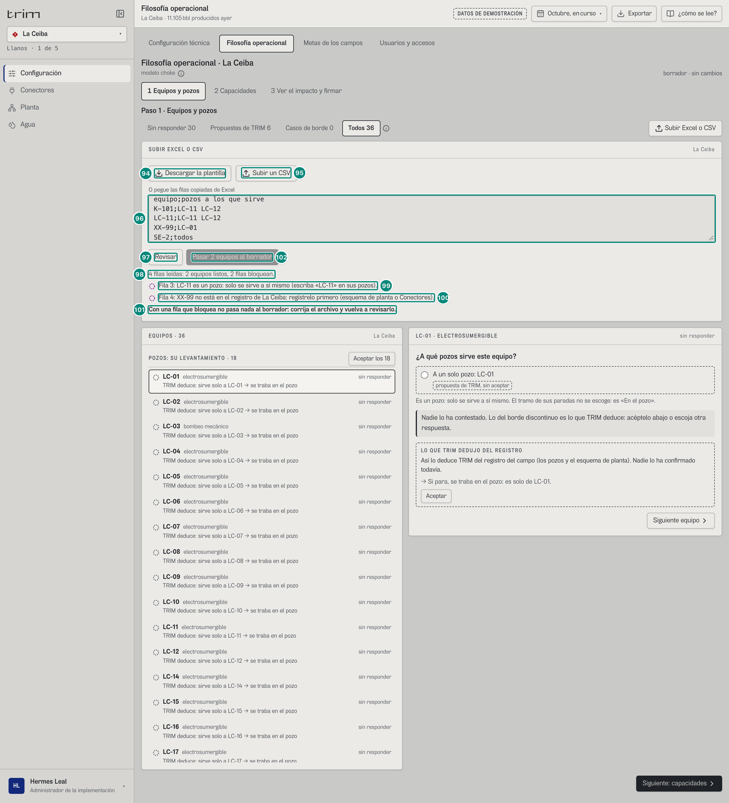

| # | Lo que se ve | En la captura | Cómo se calcula | Texto según el valor | Viene de |
|---|---|---|---|---|---|
| 94 | La plantilla | «SUBIR EXCEL O CSV» · «La Ceiba» · «Descargar la plantilla» | `plantillaTopologia(elementos, porSaber, todos)` (`choke-config.ts:324-330`): `TRIM-topologia-ceiba.csv` con «equipo;pozos a los que sirve» y una fila por equipo con lo que quedaría hoy, en las mismas palabras que lee la carga: «SE-2;todos», «LC-11;LC-11», «oleoducto;otro dueño» (`pozosEnPlantilla`, `:316-320`) | descargarla y subirla sin cambios da lo mismo; lo «por saber» va como «todavía no sé» | — |
| 95 | Subir el archivo | «Subir un CSV» | lee el archivo y lo revisa en el acto (`CargaTopologia.tsx:70`) | — | — |
| 96 | O pegarlo | «O pegue las filas copiadas de Excel», con las cuatro filas | dos columnas, separadas por punto y coma, tabulador o coma (decide la primera fila); los pozos en lista o con una palabra: «todos», «otro dueño», «punto de entrega» o «todavía no sé»; el encabezado se salta (`leerTopologia`, `choke-config.ts:308-312`, `:358-415`) | de guía, «equipo;pozos a los que sirve / SE-2;todos / MPP-301;MN-07 MN-18 MN-33» | — |
| 97 | Revisar | «Revisar» | `POST /api/topologia/importar { campo, texto }` (`CargaTopologia.tsx:39-47`; `escrituras.ts:1306-1325`); una respuesta vieja no pisa a la nueva | «Revisando…» mientras tanto | → `TopologiaLeida`; 403 sin `config:firmar` o con un campo ajeno, 404 un campo fuera del registro, 422 un texto vacío («El archivo llegó vacío: …») |
| 98 | Lo leído | «4 filas leídas: 2 equipos listos, 2 filas bloquean.» | `filas` (sin el encabezado ni las vacías); listos = `topologia` + `porSaber` (K-101 y SE-2) (`CargaTopologia.tsx:52`, `:89-92`) | `plural` en las tres cuentas | `filas`, `topologia`, `porSaber`, `hallazgos[].bloquea` |
| 99 | Un pozo que sirve a otro | ◌ (morado) «Fila 3: LC-11 es un pozo: solo se sirve a sí mismo (escriba «LC-11» en sus pozos).» | la regla de la firma (`configuracion.ts:500`) dicha en su fila (`choke-config.ts:403-406`; C-13) | círculo morado punteado: dato que no corresponde (`DatoInvalido`; el lector oye «Bloquea: dato que no corresponde», `CargaTopologia.tsx:113-120`) | `hallazgos[]` |
| 100 | Un equipo que no existe | ◌ (morado) «Fila 4: XX-99 no está en el registro de La Ceiba: regístrelo primero (esquema de planta o Conectores).» | `choke-config.ts:384-385` | también bloquean: equipo vacío, repetido («ya está en la fila N»), sin pozos, un pozo de otro campo («MN-07 no es un pozo de La Ceiba.») (`:383-401`); el caso de borde avisa sin bloquear, en gris discontinuo (`:409-410`). Se ven hasta 12 y «y N filas más así.» (`CargaTopologia.tsx:95-96`); el servidor devuelve hasta 50 (`escrituras.ts:1329`) | `hallazgos[]` |
| 101 | Nada pasa | «Con una fila que bloquea no pasa nada al borrador: corrija el archivo y vuelva a revisarlo.» | una topología a medias cambiaría el tramo de las paradas de los equipos que sí venían bien (`CargaTopologia.tsx:12-18`, `:97`) | — | — |
| 102 | Pasar al borrador | «Pasar 2 equipos al borrador» (deshabilitado) | sin bloqueos, pasa lo leído al borrador (`:53-58`): «N equipos pasaron al borrador (N «todavía no sé»). Revíselos en la lista y firme en el paso 3.» | no firma | — |

### En el teléfono (390 px)

Una pregunta por pantalla (U2 §8.7; `estrecho` ≤ 767 px, `Filosofia.tsx:21-24`). Lo contestado queda en el borrador y la firma se hace en el escritorio.

**Captura 11 · paso 1 en el teléfono.** Se escogió K-101 en «Ir a otro equipo».

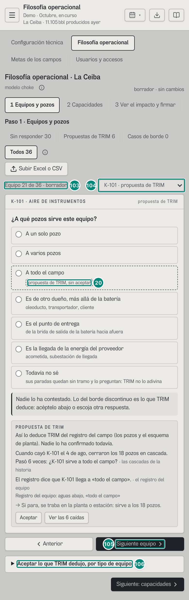

| # | Lo que se ve | En la captura | Cómo se calcula | Texto según el valor | Viene de |
|---|---|---|---|---|---|
| 103 | Dónde va | «Equipo 21 de 36 · borrador» | la posición en lo que se ve del filtro (`TopologiaPaso.tsx:174-176`) | «—» si el escogido no está en el filtro | — |
| 104 | Ir a otro equipo | «K-101 · propuesta de TRIM» | un selector en vez de la lista: «{equipo} · {estado}» (`:177-183`) | V-101 sale «propuesta de TRIM» y no «dos fuentes no cuadran»: 6D·H36 | — |
| 20 | Lo que TRIM deduce, sin aceptar | «A todo el campo» con «propuesta de TRIM, sin aceptar» | fila 20 | las respuestas van enteras, con su aclaración | — |
| 105 | Moverse | «Anterior» · «Siguiente equipo» | `mover(±1)` (`:186-189`) | deshabilitados con un solo equipo a la vista | — |
| 106 | Aceptar por tipo | «Aceptar lo que TRIM dedujo, por tipo de equipo» (plegado) | `AceptarPorTipo` (`:192-195`, `:268-285`): un renglón por tipo con «Aceptar los N» y «Lo que tiene dos fuentes que no cuadran no entra en el lote: se contesta uno por uno.» | sin nada que aceptar: «No queda nada que aceptar en lote: lo que falta lo decide usted, equipo por equipo.» | — |

**Captura 12 · paso 3 en el teléfono**, con K-101 a LC-11 (como la captura 7).

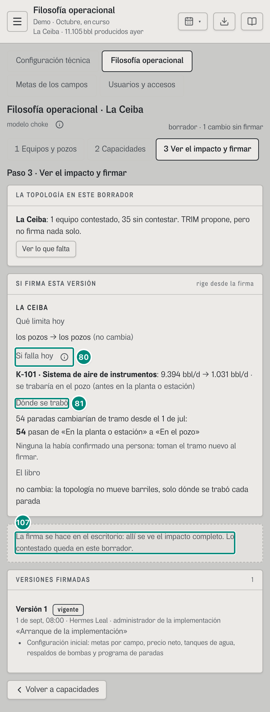

| # | Lo que se ve | En la captura | Cómo se calcula | Texto según el valor | Viene de |
|---|---|---|---|---|---|
| 80 | Si falla hoy | «K-101 · Sistema de aire de instrumentos: 9.394 bbl/d → 1.031 bbl/d · se trabaría en el pozo (antes en la planta o estación)» | fila 80; en el teléfono el rótulo va encima de su renglón | — | — |
| 81 | Dónde se trabó | «54 paradas cambiarían de tramo desde el 1 de jul:» | fila 81 | — | — |
| 107 | La firma | «La firma se hace en el escritorio: allí se ve el impacto completo. Lo contestado queda en este borrador.» | en el teléfono no va «FIRMAR LA VERSIÓN» (`ImpactoPaso.tsx:111-113`) | quien solo lee no lo ve | — |

### Captura 13 · producción, solo lectura

`#/prod/filosofia/ceiba/curso`, con K-101 escogido. Confiabilidad ve lo mismo en sus campos (Morichal: la lista de 65 y «Solo lectura»).

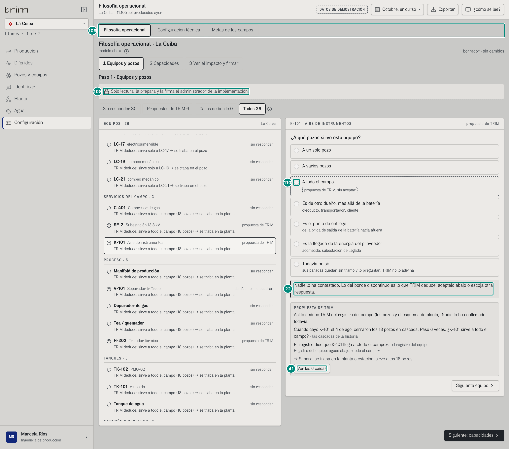

| # | Lo que se ve | En la captura | Cómo se calcula | Texto según el valor | Viene de |
|---|---|---|---|---|---|
| 108 | Solo lectura | «Solo lectura: la prepara y la firma el administrador de la implementación.» | sin `config:firmar` (`Filosofia.tsx:104-106`) | — | rol |
| 109 | Las pestañas | «Filosofía operacional · Configuración técnica · Metas de los campos» | ingeniería sin firma (`Configuracion.tsx:61`) | sin «Usuarios y accesos» | rol |
| 110 | Las respuestas | ○ «A todo el campo» deshabilitada (atenuada) | `disabled={!puede}` (`TopologiaPaso.tsx:350`) | no hay «Subir Excel o CSV», ni «Aceptar los N», ni «Aceptar»; «Ver las 6 caídas» sí | — |
| 22 | Lo que dice al instante | «Nadie lo ha contestado. Lo del borde discontinuo es lo que TRIM deduce: acéptelo abajo o escoja otra respuesta.» | fila 22 | les pide aceptar lo que no pueden: 6D·H34 | — |
| 41 | Las caídas | «Ver las 6 caídas» | fila 41 | — | — |

En los pasos 2 y 3 producción lee lo mismo sin cajas ni firma: «Las capacidades las escribe y las firma el administrador de la implementación.» y «La vista previa y la firma las hace el administrador de la implementación, sobre su borrador.» (`ImpactoPaso.tsx:95`); la vista previa ni se pide (el servidor le respondería 403).

### Estados y otros campos

- **Morichal Norte** (65 equipos): además del caso de borde (captura 4), dos conflictos. V-101, como en La Ceiba. C-401 trae dos bloques: «LO QUE TRIM DEDUJO DEL REGISTRO» (los 41 pozos) y «PROPUESTA DE TRIM» con «Cuando cayó C-401 el 25 de jul, cerraron 11 pozos en cascada. Pasó 3 veces: ¿C-401 sirve a esos 25?» y «Dos fuentes no cuadran. En sus caídas cerraron 25 de los 41 pozos que la topología le supone» (`choke.ts:495-497`; el texto: 6D·H38). En el paso 2, la planta es «18.666» bbl/d de crudo, el tren de agua: siete bombas de 86.500 (placa 90.000), 605.500 bbl/d de agua ≈ 18.666 de crudo, menos que el tren de crudo (19.500); los pozos, «17.937» con «◄ limita»; afuera 21.000; el cliente 24.000.
- **La Zarza** (campo de gas): el paso 1 tiene «Pozos que fluyen solos» (9). El paso 2 abre con «La Zarza es un campo de gas. La tubería del gas todavía no está: el gas tiene una tolerancia diferente y falta definir cómo se mide su potencial.» (`CapacidadesPaso.tsx:86-90`); la planta y afuera dicen «sin dato» aunque sus trenes tengan cifra (crudo 3.400, gas 16.800 KPC/d, oleoducto 4.100, cliente 3.372), y no sale el renglón de lo que ya pasó. El factor de medición dice «Rige 1,000 · sin firmar» y «TRIM no lo propone · La Zarza es un campo de gas: la eficiencia de crudo no aplica y TRIM no propone el factor de medición.», sin caja ni casilla: en un campo de gas no se firma (422 si llega).
- **El Palmar y Guacamayo**: «Sin tren de gas en el esquema.» (El Palmar); «P-201C de reserva: no suma» (Guacamayo: 60.000 + 50.000 = 110.000 bbl/d de agua).
- **Un campo sin esquema de planta**: «{campo} no tiene esquema de planta registrado: sin él no se sabe qué limita.» y «Configurar», que lleva a la configuración técnica (`CapacidadesPaso.tsx:91-98`).
- **Un empate**: si dos tramos dan exactamente lo mismo, sale el panel «EXPLICAR EL EMPATE» («Dos tramos que dan exactamente lo mismo se explican por escrito (NSTA §5.4): va con la firma de las capacidades.») y la revisión dice «Con estos números, {A} y {B} dan exactamente lo mismo (N bbl/d). El método pide explicar un empate: escriba por qué.», que bloquea hasta que se explique (5 caracteres o más; `capacidades.ts:382-393`). En el demo no hay ninguno.
- **Afuera**: el oleoducto (y el gas a venta) es de otro dueño: «Es de otro dueño, más allá de la batería» con «propuesta de TRIM, sin aceptar» y «→ Si para, se traba afuera.».
- **«Todavía no sé» firmado**: el renglón dice «todavía no se sabe: sus paradas quedan sin tramo hasta que se diga» y el estado «firmado»; sus paradas preguntan el origen en Identificar (6D.7) y en «Si falla hoy» el equipo va sin calcular, con el porqué (6D.5).

### Interacciones

Las pestañas de Configuración (la de la filosofía cambia la dirección). Los tres pasos, en cualquier orden. En el paso 1: los filtros (cada uno vuelve al primer equipo de su lista), un renglón (escoge el equipo), «Siguiente equipo», las siete respuestas (con la lista de un pozo o las casillas de varios), «Aceptar» en cada bloque, «Aceptar los N» por tipo, «Ver las N caídas», «Volver a lo que regía» y «Subir Excel o CSV» (plantilla, archivo o pegado, «Revisar», «Pasar N equipos al borrador»). En el paso 2: la cifra y la fuente de cada tramo y de cada bomba, «Se mide», la explicación del empate, el factor de medición (la cifra, el porqué y «Firmar este factor de medición») e «Ir a la configuración técnica». En el paso 3: «Ver lo que falta», el motivo, «Firmar como …» y «Descartar». En el teléfono: «Ir a otro equipo», «Anterior», «Siguiente equipo» y «Aceptar lo que TRIM dedujo, por tipo de equipo». Lo contestado en cualquier pestaña sigue en el borrador al cambiar de pestaña o de campo, hasta firmar o descartar (`Configuracion.tsx:116-119`, `:152`). Las e2e: `e2e/choke-configuracion.spec.ts` (K-101 a LC-11, la carga con C-13, la firma entera y las capacidades con errores, en 390, 320, 1280 y 1512 px).
