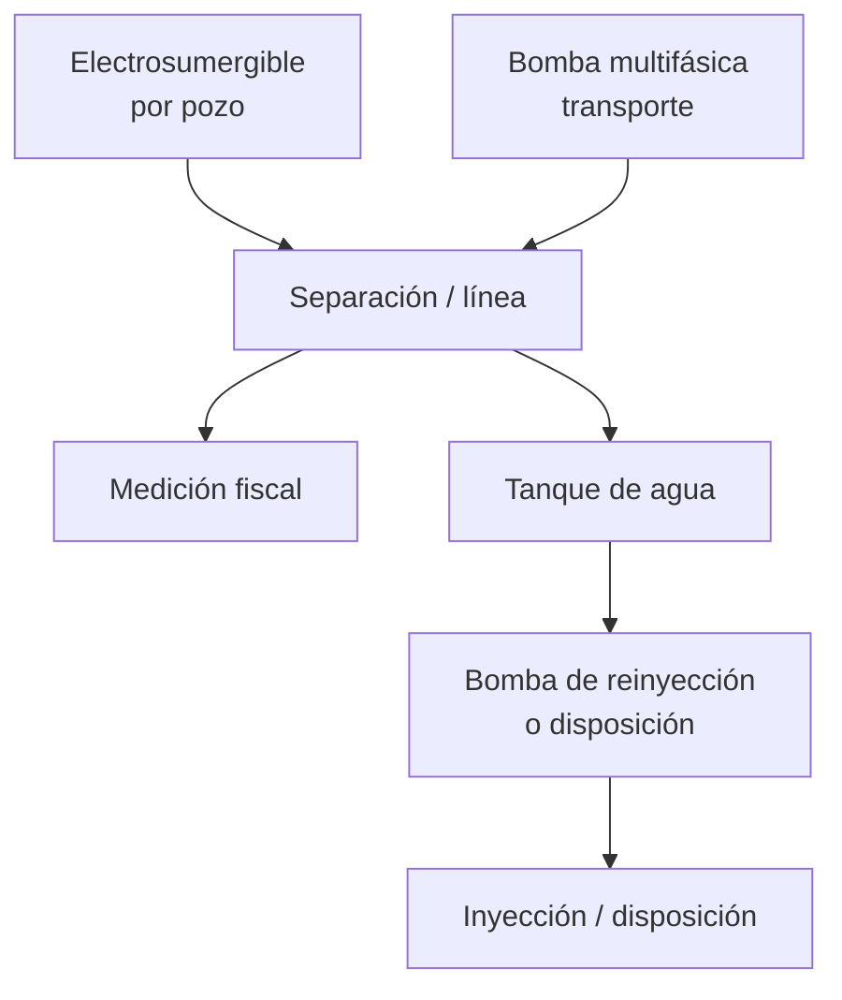
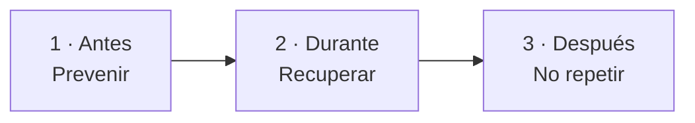

# Prevenir paradas no planificadas, en barriles

> **TRIM** es un producto **global** para **evitar paradas no planificadas** — y, cuando ocurren, **perder menos barriles** — en tres familias de equipos: **electrosumergibles** (cada pozo), **bombas multifásicas** (transporte del cluster) y **bombas de reinyección o disposición de agua** (tren de agua). Mide el diferido con custodia, anticipa con el **vigía** y prioriza con el ciclo **antes · durante · después**.

---

## El final de la historia: prevenir, no solo contar

| Etapa | Qué hace TRIM | Resultado |
|---|---|---|
| **Anticipar** | Vigía, salud por parte, riesgo («si falla hoy») | Intervenir **antes** de la parada no planificada |
| **Medir** | Libro: bbl por equipo, parte y período | Saber qué falló y cuánto costó (custodia) |
| **Actuar** | Colchón, turno, identificar, planes de acción | **Durante** y **después**: menos tiempo parado, no repetir |

El libro cierra la cuenta; el **vigía y el ciclo Antes** son la apuesta comercial: **menos paradas evitables** en los equipos que más barriles mueven.

---

## Los tres equipos (y líneas que se suman)

| Equipo | Si falla sin aviso… | Cómo TRIM previene |
|---|---|---|
| **Electrosumergible** | Ese pozo deja de producir (días/semanas) | Cruce de alarma en horas, parte dañada, costo si falla hoy |
| **Bomba multifásica** | Cierra el cluster de pozos que alimenta | Misma lógica de vigía + bbl en juego por línea |
| **Bomba de reinyección / agua** | Tanque sube → cerrar o reducir muchos pozos | Colchón en horas, respaldo, orden de cierre, riesgo |

Otras líneas (aire, compresión, energía, tratamiento…) **pueden entrar** en el esquema de planta y en causas; el **foco del producto** son estas tres. Servicios caídos se explican, pero la prevención proactiva va a **ESP + multifásica + reinyección**.

---

## Maduro o en desarrollo: mismo objetivo, distinto énfasis

| | **Yacimiento maduro** (alta BSW) | **En desarrollo / baja BSW** |
|---|---|---|
| **Dolor visible** | Una bomba de agua cierra medio campo en horas | ESP y multifásica dominan el diferido |
| **Prevención** | Vigía en desgaste + colchón del tanque | Vigía y MTBF **desde el primer pozo en línea** |
| **Libro** | Auditoría del diferido histórico | Baseline limpio desde arranque comercial |
| **Pitch** | «No cierren pozos por el agua» | «No dejen crecer la primera ola de fallas de ESP» |

En campos **nuevos** el ROI de prevención suele ser **mayor**: aún no hay MTBF basura ni paradas “normales” aceptadas.

---

## Por qué el agua acelera el drama (maduros)

| BSW | Agua por barril de crudo |
|---:|---:|
| 92 % | 11,5 |
| 95 % | 19 |
| 97 % | 32 |
| 98 % | 49 |

Con BSW alto, la **reinyección** pasa de “equipo de servicio” a **cuello de botella del activo**. TRIM sigue siendo el mismo producto cuando el agua aún no manda: las **ESP** y la **multifásica** llevan el vigía desde el día uno.

*Demo: campos colombianos; metrología y moneda por región.*

---

## Qué responde TRIM (por rol)

| Quién | Prevención / acción | Pantalla |
|---|---|---|
| **Gerencia** | ¿Cuánto evitamos / perdimos en bbl? | Retorno del ciclo + libro **MEDIDO** |
| **Mantenimiento** | ¿A qué equipo ir hoy? | Riesgo, confiabilidad, planes **Antes** |
| **Operación** | ¿Cuánto aguanta? ¿Identificar antes de arrancar? | Turno, colchón, identificar |
| **Producción** | ¿Publicable? | Diferidos, asignación, tolerancia |

---

## Las tres palancas = tres momentos de la parada

| Momento | Objetivo | Ejemplo demo (portafolio) |
|---|---|---|
| **1 · Antes** | **Evitar** la parada no planificada | ≈ 42.017 bbl en riesgo si fallan hoy |
| **2 · Durante** | Menos bbl por hora parada | P-201B: 2.102 bbl ciclo + 1.665 bbl/d perdiendo |
| **3 · Después** | No repetir la misma parte | Hasta ≈ 15.607 bbl (mes cerrado) |

**Ciclo** = simulado (priorización). **Libro** = medido (custodia). Separados en pantalla.

---

## Demo en 20 minutos

| # | Ver | Mensaje de prevención |
|---:|---|---|
| 1 | Resumen · portafolio | Retorno **Antes** + libro medido |
| 2 | Electrosumergibles / Riesgo | Quién avisa y cuántos bbl arriesga |
| 3 | Bombas · P-201B | Parada en curso: colchón + identificar |
| 4 | Planta | Tren de agua + severidad |
| 5 | «Ver planes de acción» | Qué haría mantenimiento (plegado) |

Reloj demo: **2 oct 2026, 14:00** (zona configurable).

---

## Piloto mínimo (tres familias)

| # | Conectar | Familia |
|---:|---|---|
| 1 | Controlador de pozo + variador ESP | Electrosumergible |
| 2 | PLC marcha/paro + alarmas bomba línea | Multifásica / reinyección |
| 3 | LT tanque de agua + caudal bomba agua | Reinyección |
| 4 | Fiscal o asignación diaria | Libro |
| 5 | Pruebas o asignación de pozos | Potencial |
| 6 | Series para vigía (I, V, P, T…) | **Antes** |
| 7 | Configuración firmada (tanque, respaldos) | Colchón |
| 8 | Esquema de planta | Planta |
| 9 | ERP mantenimiento | Ejecutar el plan |

**Solo lectura del borde** — TRIM no escribe al PLC.

---

## Qué no es TRIM

- Simulador de planta completo (P&ID 3D, termo-hidráulica).
- LLM que invente barriles del ciclo.
- SCADA sin libro publicable ni cadena al tag.

---

## Una línea

**Global · tres equipos · paradas no planificadas:** vigía para prevenir, libro para probar, ciclo para decidir en barriles.

*Pitch comercial · octubre 2026 · capítulos 1 y 11*
