# Informe final · Facilidades por fases (fases 0 a 7)

> 4-nov-2026. Cierra `PROMPT-FACILIDADES-POR-FASES.md` (§6). Todo lo de aquí está construido, probado y documentado; los commits los hace el dueño. Los pantallazos salen de la aplicación con los datos del demo (`node scripts/pantallazos-facilidades.mjs`) y están en [`capturas/facilidades/`](capturas/facilidades/).

## 1. Lo construido, en una tabla

| Fase | Qué quedó | Prueba propia | Detalle |
|---|---|---|---|
| 1 · Piezas | Las 6 piezas contratadas por cliente y por campo; cada pantalla, sección y tarea declara la suya | `verificar-piezas.mjs` (90) | `docs/backend/CAMBIOS-CONTRATO.md` F18 |
| 2 · Barriles bien contados | El diluyente (en planta, fondo u oleoducto) y el crudo neto de nafta; el día sin nafta, «no publicable»; evaporación y fondos de tanque como pérdida; **D1: factor de asignación diario** | `verificar-diluyente.mjs` (44) | `05a-libro/02` y `03` |
| 3 · Conexión según la planta | Historiador, directo a los equipos, mezcla o la entrada mínima «hay tensión»; El Palmar sin historiador | `verificar-conexion.mjs` (25) | F20 |
| 4 · Energía | El apagón total o parcial (relé, firma de cargas o silencio del gateway), los relojes, el aviso por rol, la prueba, **D2: notificación push**, **D3: rol «Responsable de energía»** | `verificar-planta.mjs` §1–7 | `docs/backend/12` |
| 5 · Planta | Las familias de planta con su tren y el vigía de planta (5 equipos de demo en Morichal) | `verificar-planta.mjs` §8 | `12` §12.11 |
| 6 · Re-arranque | El orden de arranque por barriles con sus límites, el cronómetro por fases y el margen N-1 con su deslastre | `verificar-arranque.mjs` (50) | `12` §12.12 |
| 7 · Panel | «Mi panel»: 6 indicadores con fórmula, fuente y caso a mano, y cualquier señal conectada | `verificar-indicadores.mjs` (36) | `docs/backend/13` |

**La puerta, al cierre:** `npm test` en verde (con la referencia: 347 de 347 casos y 48 de 48 escrituras rechazadas). Las pruebas de pantalla pasan todas en Chrome y en Safari de teléfono (337, más las 3 omitidas de siempre).

## 2. La matriz pieza × rol, ya construida

Lo que cada rol ve hoy de cada pieza. «—» es que esa pieza no le habla a ese rol. El detalle de cada celda está en la ficha del rol (`roles/<rol>.md`, §8).

| Rol | Núcleo | Equipos | Energía | Planta | Barriles | Mantenimiento |
|---|---|---|---|---|---|---|
| **ger** · Gerente | «Mi panel» (7) | El equipo que más barriles pone en riesgo | «Se fue la energía en La Ceiba. 11.360 bbl/d en juego.» y push (4) | — | Diferido por causa, «Falta de diluyente» incluida (2) | — |
| **prod** · Producción | «Mi panel» (7); la cadena del dato directo (3) | — | El corte cargado como causa de cada pozo, con el relé (4) | El tren de cada equipo (5) | Crudo neto de nafta; «no publicable» sin nafta (2) | — |
| **sup** · Supervisor | Push del apagón (4) | — | Relojes, lo que paró, la respuesta del operador; **re-arranque con cronómetro** (4, 6) | Relojes y orden de cierre | Paradas del turno, diluyente, evaporación y fondos (2) | — |
| **oper** · Operador | Push del apagón (4) | Una pregunta por vez | «¿Ve luz en la subestación 2? [Sí] [No]» (4) | — | Evaporación y fondos de tanque (2) | — |
| **jefe** · Mantenimiento | La cadena del dato directo (3) | Los equipos de planta que avisan (5) | El disparo y lo que paró, si no hay responsable de energía (D3) | El tren y «Lo que avisa el vigía» (5) | — | La orden; el apagón no abre falla propia (4) |
| **conf** · Confiabilidad | «Mi panel» con MTBF, MTTR, horas proactivas y cortes (7) | Las familias de planta en «Avisan» (5) | Cortes por mes en su panel (7) | El tren de cada equipo (5) | Qué equipo pone más diferido | El análisis de cada falla |
| **tec** · Técnico | La cadena del dato directo (3) | Su trabajo del día | Como trabajo asignado | — | — | Decir qué encontró |
| **reg** · Regulatorio | — | — | La parada por energía clasificada, con el relé (4) | — | El fiscal neto de nafta; «falta el dato de la nafta» (2) | — |
| **adm** · Administrador | Piezas contratadas y cómo se conecta cada campo (1, 3) | El catálogo y sus señales | «Probar el aviso de apagón» (4) | Capacidades de tanques | El esquema de dilución del campo (2) | — |
| **ener** · Energía (D3) | La cadena del dato eléctrico (3) | Generador, transformador, UPS, aire (4) | El disparo, los relojes; **el re-arranque y el margen N-1** (4, 6) | — | — | — |

### Pantallazos, por pieza

**Núcleo**
- El panel del gerente, de ejemplo: diferido por causa, horas proactivas, cortes de energía y el margen N-1 en «Sin dato». 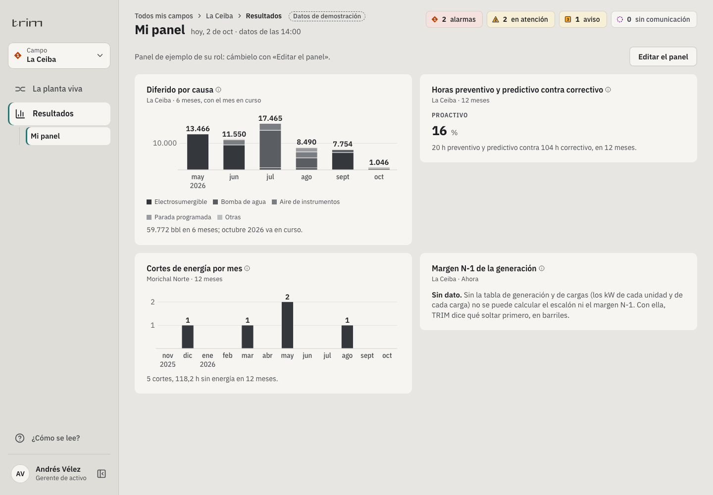
- El de confiabilidad en el teléfono, tema oscuro. 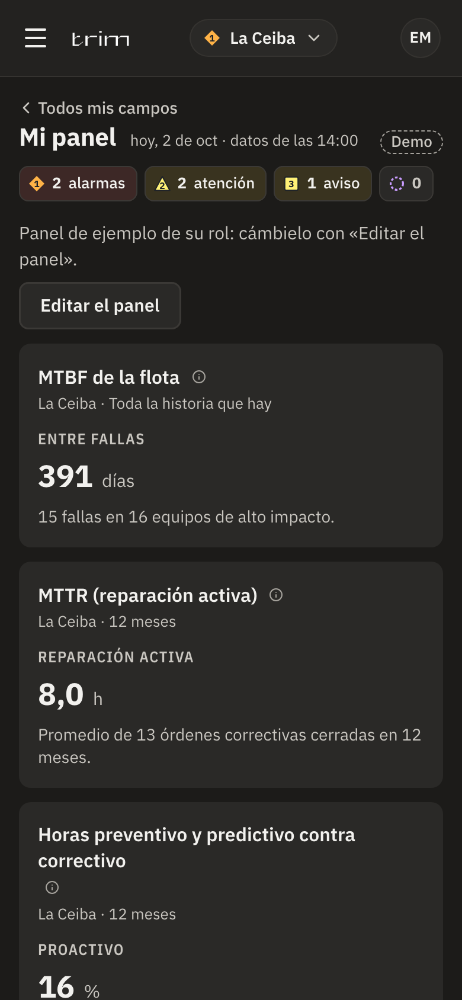
- La conexión directa de El Palmar (sin historiador). 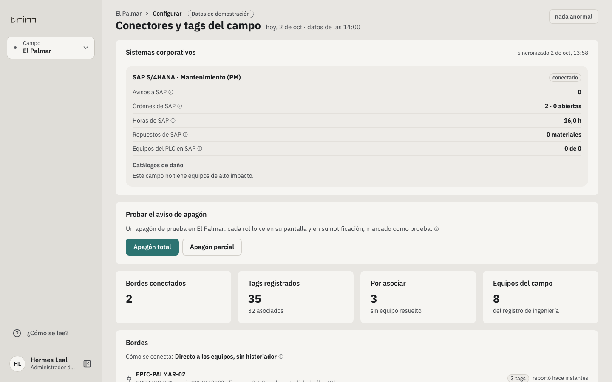

**Equipos y Planta**
- La torre de enfriamiento CT-601: «sube hacia su alarma (40 °C) y llega en 5 d», en el tren de agua. 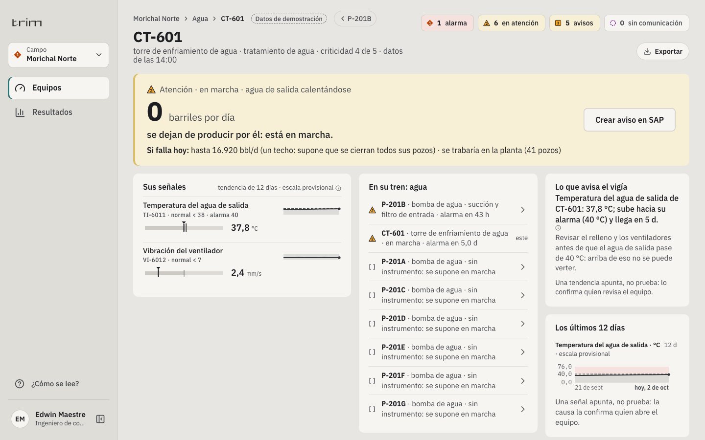
- La bomba de diluyente P-701 en el teléfono. 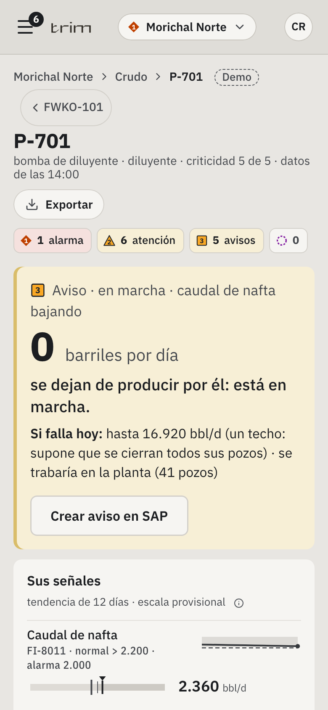
- La subestación de El Palmar, directa por IEC 61850. 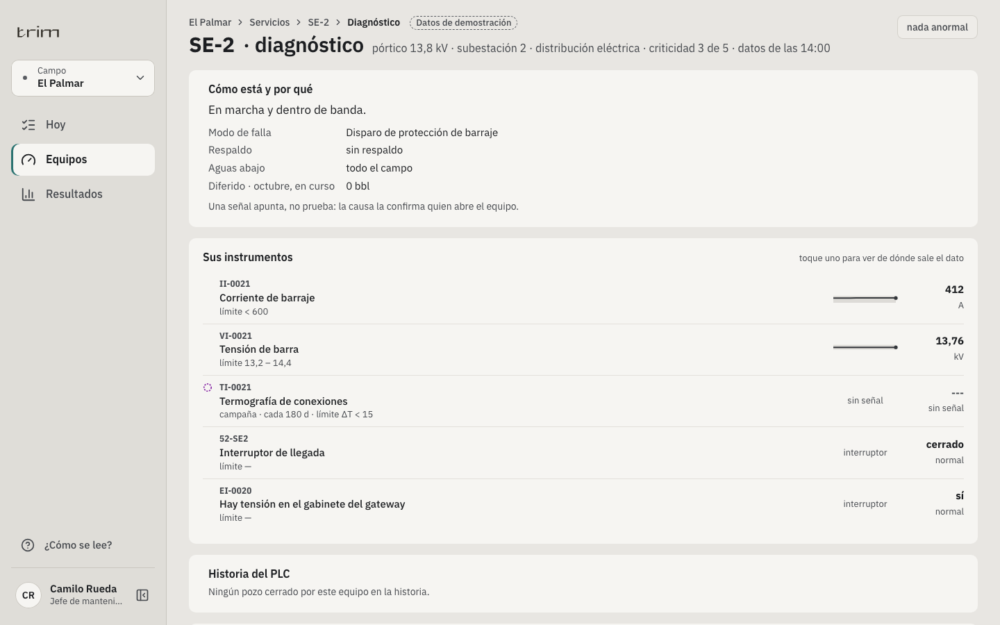

**Energía**
- El aviso del gerente en un apagón total de prueba. 
- La pregunta del operador. 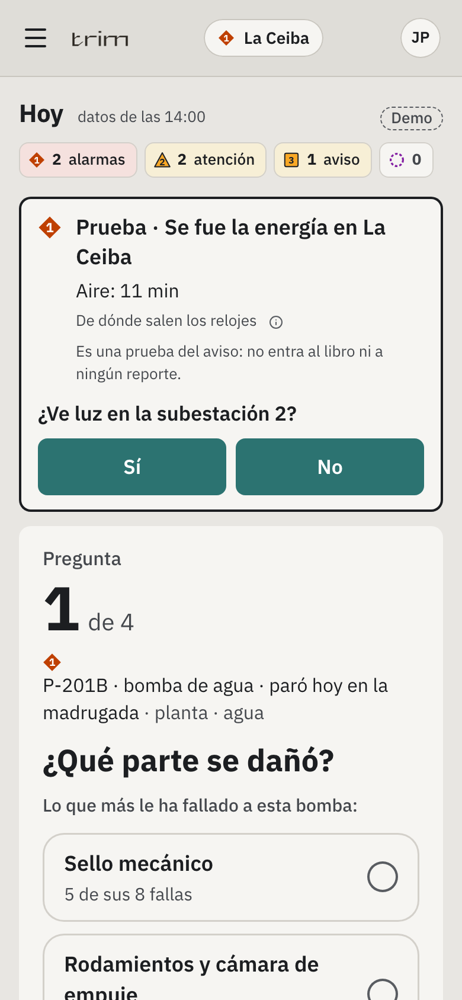
- El re-arranque del supervisor en el escritorio y en el teléfono, con una sola acción. 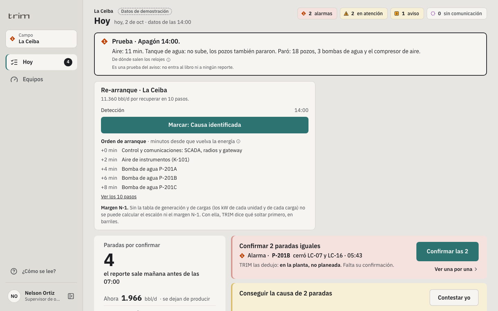 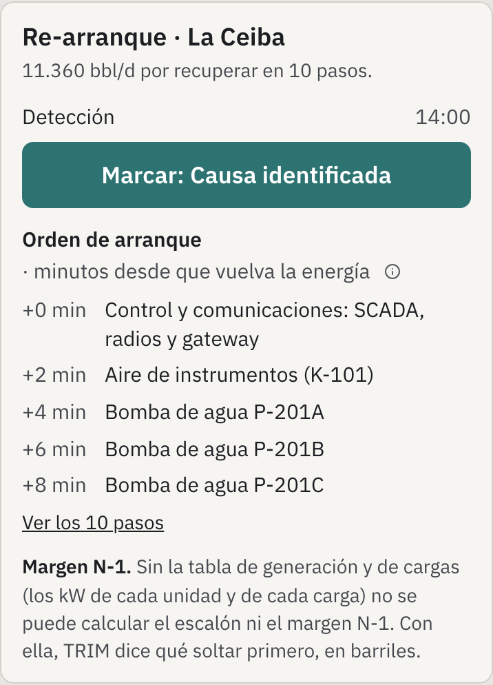
- Un apagón parcial: solo las bombas de agua, y el tanque que sube. 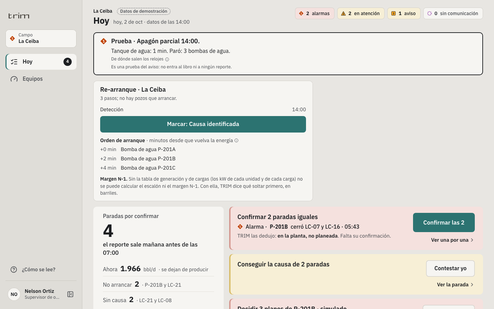

**Barriles**
- Las pérdidas nuevas del operador: fondos de tanque. 

**Mantenimiento**
- El Hoy del jefe. 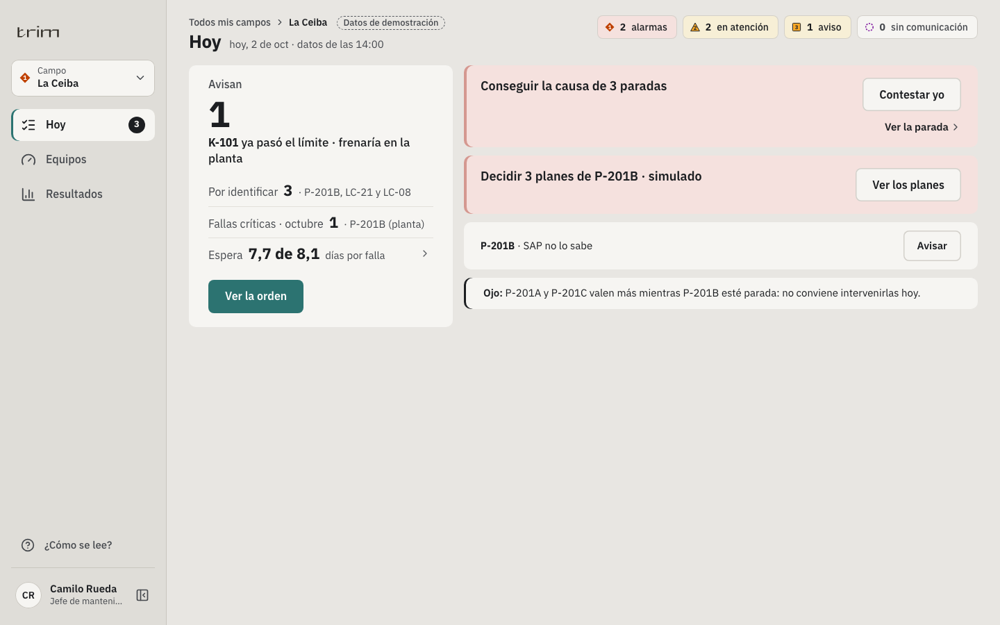

## 3. Los supuestos que siguen abiertos

Cada uno está marcado `[SUPUESTO]` en el código y se reemplaza con el dato firmado del cliente. Ninguno se presenta como dato de campo.

| # | Supuesto | Valor del demo | Dónde | Lo cierra |
|---|---|---|---|---|
| S1 | Autonomía del recibidor de aire fuera de La Ceiba | 12 a 22 min | `evento-planta.ts` (`AUTONOMIA_AIRE_MIN`) | Medirla y firmarla; La Ceiba ya sale de la ficha de K-101 (11 min) |
| S2 | La alarma de la UPS de El Palmar | 50 % de carga | `limites.ts` | La base de alarmas del cliente |
| S3 | Límites de las familias de planta sin fuente | Tensión de rejilla 18 kV, interfase 70 %, nafta 2.000 bbl/d | `limites.ts`, `familias-planta.ts` | Las hojas de datos de los equipos |
| S4 | Espera por el giro inverso de la electrosumergible | 30 min | `arranque.ts` | El variador de cada pozo (lo lee); pregunta 10 |
| S5 | Lote de pozos sin tabla de generación | 4 pozos, 5 min entre lotes | `arranque.ts` | La tabla de generación (el escalón lo fija) |
| S6 | Separación entre arranques de servicio | 2 min | `arranque.ts` | El ingeniero eléctrico |
| S7 | La topología eléctrica | Circuitos por alimentador de pozo y CCM por familia | `evento-planta.ts` | La topología firmada |
| S8 | La tabla de generación y de cargas | No existe en el demo: el margen N-1 dice «Sin dato» | `arranque.ts`, `indicadores.ts` | El PMS o el ingeniero eléctrico; preguntas 5 y 6 |
| S9 | Los campos del demo no diluyen | El diluyente se prueba con un campo sintético (Campo X) | `verificar-diluyente.mjs` | Un campo real que diluya; preguntas de `20` §9 |
| S10 | El responsable de energía se enciende con `VITE_ROL_ENERGIA=1` | Apagado por defecto | `producto.ts` | Con servidor, el registro de usuarios lo trae |
| S11 | El cronómetro del demo corre con el reloj de la máquina | El reloj del demo está congelado | `shared/api/eventoPlanta.ts` | Con servidor, la hora del servidor |

## 4. Las preguntas al experto que siguen sin respuesta

Ninguna de las 15 de `~/TRIM-petroleras/investigacion/19` §8.3 ni de las 10 de `20` §9 se ha contestado: todas siguen abiertas. Las que más mueven el producto construido:

| Pregunta | Qué cambia en TRIM cuando se conteste |
|---|---|
| 19 · 1 y 2: el último apagón, cuánto duró cada fase y cuánto tardó alguien en enterarse | El cronómetro ya registra cada fase: la respuesta da la línea base de «antes de TRIM» |
| 19 · 5 y 6: ¿hay PMS? ¿los kW y el SOE llegan al historiador? | Con eso entra la tabla de generación (S8) y el margen N-1 deja de decir «Sin dato» |
| 19 · 7: cuántos cortes al año y de qué tipo | Contrasta los cortes por mes del panel y abre la causa «energía» en sub-causas (R3) |
| 19 · 8: autonomía de las UPS | Un reloj más en el aviso, como el del aire |
| 19 · 9 y 10: el procedimiento de re-arranque, el giro inverso, cuántas ESP fallan al re-arrancar | Cierra S4, S5 y S6 y ajusta el orden de arranque |
| 19 · 11 y 12: cuántas horas aguanta el crudo quieto; los permisos antes de re-energizar | Un reloj del crudo que se enfría y un paso de verificación en el orden |
| 19 · 13 y 15: quién paga por evitar el apagón | El comprador y el mensaje de venta |
| 20 · 2, 3 y 5: si diluyen, dónde, y si la nafta tiene medidor | Cierra S9 con un campo real |
| 20 · 10: si calculan el factor diario | Confirma D1 con la práctica del operador |

Las demás (19 · 3, 4, 14; 20 · 1, 4, 6–9) siguen en sus documentos, igual de abiertas.

## 5. Lo que quedó fuera, a propósito

- **TRIM no opera interruptores ni el deslastre:** lee, traduce a barriles, avisa y guía (19 §5).
- **La confiabilidad de cada generador:** espera un generador instrumentado.
- **La causa «energía» en sub-causas** (red externa, generación propia, distribución, hueco, gas, rayo; 19 §6.3 R3): no se construyó.
- **El registro de arranques fallidos de ESP después de cada corte** (R4): no se construyó.
- **WhatsApp sigue retirado:** el aviso del apagón va por notificación push (D2).
